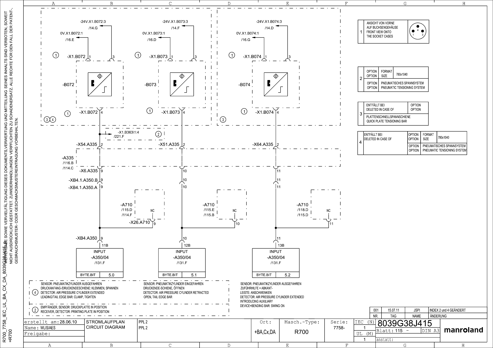

# +BA_Cx_DA — Sheet 115 of 247 — PPL 2

**PPL 2**

> Part of the manroland **R700** printing press IEC/UL circuit diagrams.
> Drawing class: **Stromlaufplan / Circuit diagram** (DIN A3).
> Document `+BA_Cx_DA` covers the **Printing units / main switch cabinet** machine section.

## At a glance

| Field | Value |
|---|---|
| Document | `+BA_Cx_DA`  (8039G38J415) |
| Sheet | **115** of 247 |
| Section (DE) | PPL 2 |
| Section (EN) | PPL 2 |
| Section type | CIRCUIT — Circuit diagram |
| Machine type | `R700` |
| Series | `7758` |
| Created | 28.06.10 |
| Replaces | — |
| Columns used | A, B, C, D, E, F, G, H |
| Path numbers | — |
| Labels on sheet | 164 |
| Cross-refs out | 18 |
| Cross-refs in | 45 |

**Previous:** [+BA_Cx_DA sheet 114](SHEET_0114.md) · **Next:** [+BA_Cx_DA sheet 116](SHEET_0116.md) · **Document TOC:** [_TOC.md](_TOC.md)  (+BA_Cx_DA) · **Master TOC:** [all sheets](../_MASTER_TOC.md)

## Sheet image (300 DPI, exact vector render)



_Rendered directly from the PDF vector layer at 300 DPI (1-bit), no OCR and no resampling. Use it to confirm anything ambiguous in the text below._

## Cross-references on this sheet

Each entry is a wire leaving this sheet. The printed token is `/sheet.column`; the link resolves to that sheet inside the same document.

| Ref | Target sheet | Col | Path | Destination on target | Target section | From col |
|---|---|---|---|---|---|---|
| `/14.F` | [+BA_Cx_DA sheet 14](SHEET_0014.md) | F | — | — | SPANNUNGSVERSORGUNG, SCHALTSCHRANKBELÜFTUNG | C |
| `/14.G` | [+BA_Cx_DA sheet 14](SHEET_0014.md) | G | — | — | SPANNUNGSVERSORGUNG, SCHALTSCHRANKBELÜFTUNG | B |
| `/14.D` | [+BA_Cx_DA sheet 14](SHEET_0014.md) | D | — | — | SPANNUNGSVERSORGUNG, SCHALTSCHRANKBELÜFTUNG | E |
| `/16.E` | [+BA_Cx_DA sheet 16](SHEET_0016.md) | E | — | — | SPANNUNGSVERSORGUNG, SCHALTSCHRANKBELÜFTUNG | A |
| `/16.G` | [+BA_Cx_DA sheet 16](SHEET_0016.md) | G | — | — | SPANNUNGSVERSORGUNG, SCHALTSCHRANKBELÜFTUNG | D |
| `/16.D` | [+BA_Cx_DA sheet 16](SHEET_0016.md) | D | — | — | SPANNUNGSVERSORGUNG, SCHALTSCHRANKBELÜFTUNG | C |
| `/221.F` | [+BA_Cx_DA sheet 221](SHEET_0221.md) | F | — | — | OPTION: FORMAT 780x1040 | B |
| `/116.B` | [+BA_Cx_DA sheet 116](SHEET_0116.md) | B | — | — | PPL 2 | A |
| `/114.C` | [+BA_Cx_DA sheet 114](SHEET_0114.md) | C | — | — | PPL 2 | A |
| `/115.E` | [+BA_Cx_DA sheet 115](SHEET_0115.md) | E | — | — | PPL 2 | D |
| `/115.B` | [+BA_Cx_DA sheet 115](SHEET_0115.md) | B | — | — | PPL 2 | D |
| `/115.D` | [+BA_Cx_DA sheet 115](SHEET_0115.md) | D | — | — | PPL 2 | B |
| `/118.D` | [+BA_Cx_DA sheet 118](SHEET_0118.md) | D | — | — | RESERVE: SPS STATION (INPUT) | E |
| `/115.D` | [+BA_Cx_DA sheet 115](SHEET_0115.md) | D | — | — | PPL 2 | E |
| `/114.F` | [+BA_Cx_DA sheet 114](SHEET_0114.md) | F | — | — | PPL 2 | B |
| `/131.F` | [+BA_Cx_DA sheet 131](SHEET_0131.md) | F | — | — | REFERENZMODUL | B |
| `/131.F` | [+BA_Cx_DA sheet 131](SHEET_0131.md) | F | — | — | REFERENZMODUL | C |
| `/131.F` | [+BA_Cx_DA sheet 131](SHEET_0131.md) | F | — | — | REFERENZMODUL | E |

### Incoming references (sheets that point here)

Every other sheet that sends a wire to this one. `Back-ref` is the token printed on *that* sheet; `Path` is its line number.

| From sheet | Cols | Back-ref | Path | Refs | What continues there |
|---|---|---|---|---|---|
| [+BA_Cx_DA#14](SHEET_0014.md) | C, F, G | `/14.C`, `/14.F`, `/14.G` | — | 3 | 24V.X1.B072:3; 24V.X1.B073:3 |
| [+BA_Cx_DA#16](SHEET_0016.md) | D, E, G | `/16.D`, `/16.E`, `/16.G` | — | 3 | 0V.X1.B072:1; 0V.X1.B073:1; 0V.X1.B074:1 |
| [+BA_Cx_DA#114](SHEET_0114.md) | C, F | `/114.C`, `/114.F` | — | 2 | — |
| [+BA_Cx_DA#115](SHEET_0115.md) | B, D, E | `/115.B`, `/115.D`, `/115.E` | — | 4 | — |
| [+BA_Cx_DA#116](SHEET_0116.md) | B | `/116.B` | — | 1 | — |
| [+BA_Cx_DA#118](SHEET_0118.md) | D | `/118.D` | — | 1 | — |
| [+BA_Cx_DA#131](SHEET_0131.md) | F | `/131.F` | — | 3 | — |
| [+BA_Cx_DA#145](SHEET_0145.md) | A | `/145.A` | — | 9 | — |
| [+BA_Cx_DA#159](SHEET_0159.md) | F, G, H | `/159.F`, `/159.G`, `/159.H` | — | 9 | — |
| [+BA_Cx_DA#162](SHEET_0162.md) | D | `/162.D` | — | 3 | — |
| [+BA_Cx_DA#176](SHEET_0176.md) | E | `/176.E` | — | 3 | — |
| [+BA_Cx_DA#182](SHEET_0182.md) | F, G | `/182.F`, `/182.G` | — | 2 | — |
| [+BA_Cx_DA#183](SHEET_0183.md) | F | `/183.F` | — | 1 | — |
| [+BA_Cx_DA#221](SHEET_0221.md) | F | `/221.F` | — | 1 | X1.B363\1:4 |


## Devices on this sheet

| Tag | Class | Class meaning (IEC) | Col | Sub | Terminal | Sign |
|---|---|---|---|---|---|---|
| `A350/04` | A | Baugruppe / assembly, module, PC board | C | 04 | — | — |
| `A350/04` | A | Baugruppe / assembly, module, PC board | B | 04 | — | — |
| `A350/04` | A | Baugruppe / assembly, module, PC board | E | 04 | — | — |
| `B073` | B | Umformer / transducer, sensor | C | — | — | — |
| `B072` | B | Umformer / transducer, sensor | A | — | — | — |
| `B074` | B | Umformer / transducer, sensor | D | — | — | — |
| `A335` | A | Baugruppe / assembly, module, PC board | A | — | — | — |
| `A710` | A | Baugruppe / assembly, module, PC board | B | — | — | — |
| `A710` | A | Baugruppe / assembly, module, PC board | D | — | — | — |
| `A710` | A | Baugruppe / assembly, module, PC board | E | — | — | — |
| `5.1` | — | cross-device reference | C | — | — | — |
| `5.0` | — | cross-device reference | B | — | — | — |
| `XB4.A350` | — | cross-device reference | B | — | — | — |
| `5.2` | — | cross-device reference | E | — | — | — |
| `X1.B073` | — | cross-device reference | C | — | — | — |
| `X1.B073` | — | cross-device reference | C | — | — | — |
| `X1.B072` | — | cross-device reference | A | — | — | — |
| `X1.B072` | — | cross-device reference | B | — | — | — |
| `X1.B074` | — | cross-device reference | D | — | — | — |
| `X1.B074` | — | cross-device reference | E | — | — | — |
| `X51.A335` | — | cross-device reference | C | — | — | — |
| `X54.A335` | — | cross-device reference | B | — | — | — |
| `X64.A335` | — | cross-device reference | E | — | — | — |
| `X6.A335` | — | cross-device reference | B | — | — | — |
| `XB4.1.A350.B` | — | cross-device reference | B | — | — | — |
| `XB4.1.A350.A` | — | cross-device reference | B | — | — | — |
| `X26.A710` | — | cross-device reference | B | — | — | — |
| `X1.B363\1:4` | — | cross-device reference | B | — | 4 | — |
| `NR.` | — | cross-device reference | G | — | — | — |
| `15.07.11` | — | cross-device reference | G | — | — | — |

## Potentials / nets

| Potential | Count | Columns | Attached devices | Terminals |
|---|---|---|---|---|
| `0V` | 3 | A, C, D | `B072`, `B073`, `B074`, `X1` | `1` |
| `24V` | 3 | B, C, E | `B072`, `B073`, `B074`, `X1` | `3` |


A potential such as `L24+/4` or `M24+` is a named supply/return rail; every place it appears on this sheet is electrically common.

## Wire-end annotations (grouped as printed)

A wire that continues elsewhere is annotated with a small cluster: the destination description, the path/line number `#NN`, and the `/sheet.column` cross reference. Each row below is one such cluster exactly as it is grouped on the drawing.

| Col | Y | Path | Cross-ref | Text on the wire |
|---|---|---|---|---|
| B | 48.5 | — | — | `24V.X1.B072:3` |
| C | 48.5 | — | — | `24V.X1.B073:3` |
| E | 48.5 | — | — | `24V.X1.B074:3` |
| G | 53.1 | — | — | `FRONT VIEW ONTO ANSICHT VON VORNE AUF BUCHSENGEHÄUSE` |
| B | 64.0 | — | `/14.G` | — |
| C | 64.0 | — | `/14.F` | — |
| E | 64.1 | — | `/14.D` | — |
| G | 70.0 | — | — | `4` |
| G | 72.5 | — | — | `1 1 3` |
| A | 76.8 | — | — | `0V.X1.B072:1` |
| C | 76.8 | — | — | `0V.X1.B073:1` |
| D | 76.8 | — | — | `0V.X1.B074:1` |
| G | 85.0 | — | — | `THE SOCKET CASES` |
| A | 92.4 | — | `/16.E` | — |
| C | 92.4 | — | `/16.D` | — |
| D | 92.4 | — | `/16.G` | — |
| A | 130.2 | — | — | `1` |
| C | 130.2 | — | — | `1 1` |
| B | 132.1 | — | — | `X1.B072 1 3` |
| C | 132.1 | — | — | `X1.B073 1 3` |
| E | 132.1 | — | — | `X1.B074 1 3` |
| F | 170.0 | — | — | `OPTION OPTION` |
| G | 170.0 | — | — | `FORMAT` |
| G | 177.2 | — | — | `SIZE 780x1040` |
| F | 185.2 | — | — | `2` |
| G | 198.3 | — | — | `PNEUMATISCHES SPANNSYSTEM PNEUMATIC TENSIONING SYSTEM` |
| F | 198.5 | — | — | `OPTION OPTION` |
| A | 200.1 | — | — | `B072` |
| C | 200.1 | — | — | `B073` |
| D | 200.1 | — | — | `B074` |
| G | 251.5 | — | — | `ENTFÄLLT BEI DELETED IN CASE OF` |
| G | 251.5 | — | — | `OPTION OPTION` |
| C | 264.8 | — | — | `1` |
| D | 266.2 | — | — | `1` |
| B | 266.8 | — | — | `X1.B072 4` |
| C | 266.8 | — | — | `X1.B073 4` |
| E | 266.8 | — | — | `X1.B074 4` |
| F | 271.0 | — | — | `3` |
| A | 271.9 | — | — | `1` |
| G | 279.8 | — | — | `PLATTENSCHNELLSPANNSCHIENE` |
| B | 286.6 | — | — | `3 4 3` |
| G | 290.5 | — | — | `QUICK PLATE TENSIONING BAR` |
| B | 316.3 | — | — | `X1.B363\1:4` |
| C | 322.0 | — | — | `2` |
| G | 322.7 | — | — | `ENTFÄLLT BEI DELETED IN CASE OF` |
| G | 322.7 | — | — | `OPTION OPTION` |
| G | 322.7 | — | — | `FORMAT` |
| B | 326.3 | — | `/221.F` | — |
| H | 329.9 | — | — | `SIZE 780x1040` |
| F | 339.4 | — | — | `4` |
| B | 344.7 | — | — | `X54.A335 2 X51.A335 2` |
| E | 344.7 | — | — | `X64.A335 2` |
| H | 350.1 | — | — | `PNEUMATISCHES SPANNSYSTEM PNEUMATIC TENSIONING SYSTEM` |
| G | 350.3 | — | — | `OPTION OPTION` |
| A | 377.3 | — | — | `A335` |
| A | 390.4 | — | `/116.B`, `/114.C` | — |
| C | 408.5 | — | — | `X6.A335 9 10 11` |
| B | 431.2 | — | — | `XB4.1.A350.B 9` |
| C | 431.2 | — | — | `10` |
| E | 431.2 | — | — | `11` |
| B | 448.2 | — | — | `XB4.1.A350.A 9` |
| C | 448.2 | — | — | `10` |
| E | 448.2 | — | — | `11` |
| B | 490.7 | — | — | `A710` |
| D | 490.7 | — | — | `A710` |
| E | 490.7 | — | — | `A710` |
| B | 503.8 | — | `/115.D` | — |
| D | 503.8 | — | `/115.E`, `/115.B` | — |
| E | 503.8 | — | `/118.D`, `/115.D` | — |
| D | 506.6 | — | — | `NC NC NC` |
| B | 516.2 | — | `/114.F` | — |
| C | 533.2 | — | — | `X26.A710 9` |
| D | 537.5 | — | — | `10` |
| F | 537.5 | — | — | `11` |
| B | 571.5 | — | — | `XB4.A350 9` |
| C | 572.9 | — | — | `10` |
| E | 572.9 | — | — | `11` |
| B | 589.9 | — | — | `11B` |
| C | 589.9 | — | — | `12B` |
| E | 589.9 | — | — | `13B` |
| B | 604.4 | — | — | `INPUT` |
| C | 604.4 | — | — | `INPUT` |
| E | 604.4 | — | — | `INPUT` |
| B | 618.3 | — | — | `A350/04` |
| C | 618.3 | — | — | `A350/04` |
| E | 618.3 | — | — | `A350/04` |
| B | 632.0 | — | `/131.F` | — |
| C | 632.0 | — | `/131.F` | — |
| E | 632.0 | — | `/131.F` | — |
| B | 661.1 | — | — | `BYTE.BIT 5.0` |
| C | 661.1 | — | — | `BYTE.BIT 5.1` |
| E | 661.1 | — | — | `BYTE.BIT 5.2` |
| A | 683.8 | — | — | `DRUCKANFANG /DRUCKENDESCHIENE: KLEMMEN, SPANNEN DETECTOR: AIR PRESSURE CYLINDER EXTENDED LEADING/TAIL EDGE BAR: CLAMP, TIGHTEN SENSOR: PNEUMATIKZYLINDER AUSGEFAHREN` |
| C | 683.8 | — | — | `DRUCKENDE SCHIENE, ÖFFNEN DETECTOR: AIR PRESSURE CYLINDER RETRACTED SENSOR: PNEUMATIKZYLINDER EINGEFAHREN` |
| E | 683.8 | — | — | `LEISTE: ANSCHWENKEN DETECTOR: AIR PRESSURE CYLINDER EXTENDED INTRODUCING AUXILIARY DEVICE+BENDING BAR: SWING ON SENSOR: PNEUMATIKZYLINDER AUSGEFAHREN ZUFÜHRHILFE + ABKANT` |
| A | 704.7 | — | — | `4` |
| C | 715.7 | — | — | `OPEN, TAIL EDGE BAR` |
| A | 740.5 | — | — | `EMPFÄNGER, SENSOR: DRUCKPLATTE IN POSITION RECEIVER, DETECTOR: PRINTING PLATE IN POSITION` |
| A | 747.2 | — | — | `2` |
| G | 747.2 | — | — | `001 15.07.11 JSPI INDEX 2 und 4 GEÄNDERT` |
| G | 761.4 | — | — | `NR. TAG NAME ÄNDERUNG` |


## Reconstructed tables

This sheet carries tabular content (pin map / terminal assignment / index). The grid below was rebuilt from the drawing's own rule lines, so each row is exactly one physical row of the table.

### Table 1 — 4 data rows × 9 columns (at x=184.3, y=175.7) — **B073**

| X54.A335 XB4.1.A350.B XB4.1.A350.A | X1.B072 X6.A335 | 4 2 9 9 9 | /221.F | 1 X1.B363\1:4 2 A710 /115.D NC /114.F X26.A710 9 | X51.A335 | X1.B073 | 4 2 10 10 10 |  |
|---|---|---|---|---|---|---|---|---|
| `XB4.A350` |  | `9 11B` |  |  |  |  | `10 12B` |  |
|  | `INPUT` | `A350/04 /131.F` |  |  |  | `INPUT` | `A350/04 /131.F` |  |
| `BYTE.BIT` |  | `5.0` |  |  | `BYTE.BIT` |  |  | `5.1` |
| `CYLINDER CLAMP,` | `AUSGEFAHREN KLEMMEN, EXTENDED TIGHTEN` |  | `SPANNEN` | `SENSOR: DRUCKENDE SCHIENE, DETECTOR: OPEN, TAIL` | `PNEUMATIKZYLINDER AIR EDGE BAR` | `ÖFFNEN PRESSURE` | `CYLINDER` | `EINGEFAHREN RETRACTED` |


### Table 2 — 3 data rows × 3 columns (at x=609.4, y=175.7)

| X64.A335 | X1.B074 | 4 2 11 11 11 |
|---|---|---|
|  |  | `11 13B` |
|  | `INPUT` | `A350/04 /131.F` |
| `BYTE.BIT` |  | `5.2` |


## Notes and free text on this sheet

| Text | Col | Y (pt) |
|---|---|---|
| `12B` | C | 589.89 |
| `INPUT` | C | 604.42 |
| `BYTE.BIT` | C | 661.67 |
| `SENSOR: PNEUMATIKZYLINDER EINGEFAHREN` | C | 683.78 |
| `DRUCKENDE SCHIENE, ÖFFNEN` | C | 694.42 |
| `DETECTOR: AIR PRESSURE CYLINDER RETRACTED` | C | 705.05 |
| `OPEN, TAIL EDGE BAR` | C | 715.66 |
| `11B` | B | 589.89 |
| `INPUT` | B | 604.42 |
| `BYTE.BIT` | B | 661.67 |
| `SENSOR: PNEUMATIKZYLINDER AUSGEFAHREN` | A | 683.78 |
| `DRUCKANFANG /DRUCKENDESCHIENE: KLEMMEN, SPANNEN` | A | 694.42 |
| `DETECTOR: AIR PRESSURE CYLINDER EXTENDED` | A | 705.04 |
| `LEADING/TAIL EDGE BAR: CLAMP, TIGHTEN` | A | 715.67 |
| `13B` | E | 589.89 |
| `INPUT` | E | 604.42 |
| `BYTE.BIT` | E | 661.67 |
| `SENSOR: PNEUMATIKZYLINDER AUSGEFAHREN` | E | 683.78 |
| `ZUFÜHRHILFE + ABKANT` | D | 694.42 |
| `LEISTE: ANSCHWENKEN` | D | 705 |
| `DETECTOR: AIR PRESSURE CYLINDER EXTENDED` | E | 715.68 |
| `INTRODUCING AUXILIARY` | D | 726.31 |
| `DEVICE+BENDING BAR: SWING ON` | E | 736.92 |
| `TAG` | G | 761.47 |
| `NAME` | G | 761.45 |
| `ÄNDERUNG` | H | 761.51 |
| `JSPI` | G | 747.28 |
| `INDEX 2 und 4 GEÄNDERT` | H | 747.34 |
| `ANSICHT VON VORNE` | G | 53.07 |
| `AUF BUCHSENGEHÄUSE` | G | 63.71 |
| `FRONT VIEW ONTO` | G | 74.3 |
| `THE SOCKET CASES` | G | 84.95 |
| `ENTFÄLLT BEI` | F | 251.46 |
| `DELETED IN CASE OF` | G | 262.11 |
| `PLATTENSCHNELLSPANNSCHIENE` | G | 279.84 |
| `QUICK PLATE TENSIONING BAR` | G | 290.47 |
| `OPTION` | G | 251.46 |
| `EMPFÄNGER, SENSOR: DRUCKPLATTE IN POSITION` | A | 740.46 |
| `RECEIVER, DETECTOR: PRINTING PLATE IN POSITION` | A | 751.09 |
| `NC` | C | 506.57 |
| `NC` | D | 506.57 |
| `NC` | F | 506.57 |
| `OPTION` | F | 169.97 |
| `FORMAT` | G | 169.99 |
| `SIZE` | G | 180.55 |
| `780x1040` | G | 177.15 |
| `780x1040` | H | 329.85 |
| `PNEUMATISCHES SPANNSYSTEM` | H | 350.08 |
| `PNEUMATIC TENSIONING SYSTEM` | H | 360.71 |
| `PNEUMATISCHES SPANNSYSTEM` | G | 198.34 |
| `PNEUMATIC TENSIONING SYSTEM` | G | 208.97 |

## Complete label inventory (exact text from the drawing)

Every text object inside the drawing area of this sheet, in DIN reading order (column A→H, then top→bottom). This is the authoritative list: if a string is not here it is not printed on this sheet.

| Col | Y | X | Dir | Type | Text |
|---|---|---|---|---|---|
| A | 76.8 | 145.7 | → | potential | `0V.X1.B072:1` |
| A | 92.4 | 158.5 | → | cross-reference | `/16.E` |
| A | 130.2 | 132.9 | → | number | `1` |
| A | 132.1 | 161.9 | → | device ref | `X1.B072` |
| A | 200.1 | 150.8 | → | device tag | `B072` |
| A | 271.9 | 161.2 | → | number | `1` |
| A | 286.6 | 111.4 | → | number | `3` |
| A | 286.6 | 125.6 | → | number | `4` |
| A | 377.3 | 149.4 | → | device tag | `A335` |
| A | 390.4 | 151.9 | → | cross-reference | `/116.B` |
| A | 402.8 | 151.7 | → | cross-reference | `/114.C` |
| A | 683.8 | 98.9 | → | text | `SENSOR: PNEUMATIKZYLINDER AUSGEFAHREN` |
| A | 694.4 | 98.4 | → | text | `DRUCKANFANG /DRUCKENDESCHIENE: KLEMMEN, SPANNEN` |
| A | 704.7 | 83.0 | → | number | `4` |
| A | 705.0 | 98.4 | → | text | `DETECTOR: AIR PRESSURE CYLINDER EXTENDED` |
| A | 715.7 | 98.4 | → | text | `LEADING/TAIL EDGE BAR: CLAMP, TIGHTEN` |
| A | 740.5 | 98.4 | → | text | `EMPFÄNGER, SENSOR: DRUCKPLATTE IN POSITION` |
| A | 747.2 | 83.0 | → | number | `2` |
| A | 751.1 | 98.4 | → | text | `RECEIVER, DETECTOR: PRINTING PLATE IN POSITION` |
| B | 48.5 | 193.3 | → | potential | `24V.X1.B072:3` |
| B | 64.0 | 214.3 | → | cross-reference | `/14.G` |
| B | 130.2 | 331.3 | → | number | `1` |
| B | 133.6 | 214.6 | → | number | `1` |
| B | 133.6 | 271.8 | → | number | `3` |
| B | 266.8 | 191.6 | → | device ref | `X1.B072` |
| B | 268.2 | 243.5 | → | number | `4` |
| B | 316.3 | 284.6 | → | device ref | `X1.B363\1:4` |
| B | 326.3 | 275.0 | → | cross-reference | `/221.F` |
| B | 344.7 | 184.3 | → | device ref | `X54.A335` |
| B | 346.2 | 243.5 | → | number | `2` |
| B | 408.5 | 191.6 | → | device ref | `X6.A335` |
| B | 409.9 | 243.5 | → | number | `9` |
| B | 431.2 | 165.8 | → | device ref | `XB4.1.A350.B` |
| B | 431.2 | 243.5 | → | number | `9` |
| B | 448.2 | 243.5 | → | number | `9` |
| B | 448.9 | 165.0 | → | device ref | `XB4.1.A350.A` |
| B | 490.7 | 291.1 | → | device tag | `A710` |
| B | 503.8 | 293.4 | → | cross-reference | `/115.D` |
| B | 516.2 | 294.2 | → | cross-reference | `/114.F` |
| B | 533.2 | 311.8 | → | device ref | `X26.A710` |
| B | 571.5 | 183.1 | → | device ref | `XB4.A350` |
| B | 572.9 | 243.5 | → | number | `9` |
| B | 589.9 | 245.8 | → | text | `11B` |
| B | 604.4 | 226.1 | → | text | `INPUT` |
| B | 618.3 | 219.5 | → | device tag | `A350/04` |
| B | 632.0 | 228.6 | → | cross-reference | `/131.F` |
| B | 661.1 | 262.5 | → | device ref | `5.0` |
| B | 661.7 | 194.2 | → | text | `BYTE.BIT` |
| C | 48.5 | 391.7 | → | potential | `24V.X1.B073:3` |
| C | 64.0 | 413.9 | → | cross-reference | `/14.F` |
| C | 76.8 | 344.1 | → | potential | `0V.X1.B073:1` |
| C | 92.4 | 356.3 | → | cross-reference | `/16.D` |
| C | 132.1 | 360.3 | → | device ref | `X1.B073` |
| C | 133.6 | 413.0 | → | number | `1` |
| C | 133.6 | 470.3 | → | number | `3` |
| C | 200.1 | 349.2 | → | device tag | `B073` |
| C | 264.8 | 359.7 | → | number | `1` |
| C | 266.8 | 390.0 | → | device ref | `X1.B073` |
| C | 268.2 | 441.9 | → | number | `4` |
| C | 322.0 | 380.7 | → | number | `2` |
| C | 344.7 | 382.7 | → | device ref | `X51.A335` |
| C | 346.2 | 441.9 | → | number | `2` |
| C | 409.9 | 441.4 | → | number | `10` |
| C | 431.2 | 441.4 | → | number | `10` |
| C | 448.2 | 441.4 | → | number | `10` |
| C | 506.6 | 363.6 | → | text | `NC` |
| C | 537.5 | 371.1 | → | number | `9` |
| C | 572.9 | 441.4 | → | number | `10` |
| C | 589.9 | 444.2 | → | text | `12B` |
| C | 604.4 | 424.5 | → | text | `INPUT` |
| C | 618.3 | 418.0 | → | device tag | `A350/04` |
| C | 632.0 | 427.0 | → | cross-reference | `/131.F` |
| C | 661.1 | 461.8 | → | device ref | `5.1` |
| C | 661.7 | 392.6 | → | text | `BYTE.BIT` |
| C | 683.8 | 347.0 | → | text | `SENSOR: PNEUMATIKZYLINDER EINGEFAHREN` |
| C | 694.4 | 346.4 | → | text | `DRUCKENDE SCHIENE, ÖFFNEN` |
| C | 705.0 | 346.4 | → | text | `DETECTOR: AIR PRESSURE CYLINDER RETRACTED` |
| C | 715.7 | 347.0 | → | text | `OPEN, TAIL EDGE BAR` |
| D | 76.8 | 570.9 | → | potential | `0V.X1.B074:1` |
| D | 92.4 | 582.8 | → | cross-reference | `/16.G` |
| D | 130.2 | 558.1 | → | number | `1` |
| D | 132.1 | 587.1 | → | device ref | `X1.B074` |
| D | 200.1 | 576.0 | → | device tag | `B074` |
| D | 266.2 | 587.9 | → | number | `1` |
| D | 286.6 | 536.6 | → | number | `3` |
| D | 490.7 | 489.5 | → | device tag | `A710` |
| D | 503.8 | 492.4 | → | cross-reference | `/115.E` |
| D | 506.6 | 562.1 | → | text | `NC` |
| D | 516.2 | 492.1 | → | cross-reference | `/115.B` |
| D | 537.5 | 568.9 | → | number | `10` |
| D | 694.4 | 581.1 | → | text | `ZUFÜHRHILFE + ABKANT` |
| D | 705.0 | 580.3 | → | text | `LEISTE: ANSCHWENKEN` |
| D | 726.3 | 580.3 | → | text | `INTRODUCING AUXILIARY` |
| E | 48.5 | 618.5 | → | potential | `24V.X1.B074:3` |
| E | 64.1 | 639.8 | → | cross-reference | `/14.D` |
| E | 133.6 | 639.8 | → | number | `1` |
| E | 133.6 | 697.0 | → | number | `3` |
| E | 266.8 | 616.8 | → | device ref | `X1.B074` |
| E | 268.2 | 668.7 | → | number | `4` |
| E | 344.7 | 609.4 | → | device ref | `X64.A335` |
| E | 346.2 | 668.7 | → | number | `2` |
| E | 409.9 | 668.1 | → | number | `11` |
| E | 431.2 | 668.1 | → | number | `11` |
| E | 448.2 | 668.1 | → | number | `11` |
| E | 490.7 | 716.3 | → | device tag | `A710` |
| E | 503.8 | 718.6 | → | cross-reference | `/118.D` |
| E | 516.2 | 718.6 | → | cross-reference | `/115.D` |
| E | 572.9 | 668.1 | → | number | `11` |
| E | 589.9 | 671.0 | → | text | `13B` |
| E | 604.4 | 651.3 | → | text | `INPUT` |
| E | 618.3 | 644.7 | → | device tag | `A350/04` |
| E | 632.0 | 653.8 | → | cross-reference | `/131.F` |
| E | 661.1 | 687.7 | → | device ref | `5.2` |
| E | 661.7 | 619.4 | → | text | `BYTE.BIT` |
| E | 683.8 | 580.8 | → | text | `SENSOR: PNEUMATIKZYLINDER AUSGEFAHREN` |
| E | 715.7 | 580.3 | → | text | `DETECTOR: AIR PRESSURE CYLINDER EXTENDED` |
| E | 736.9 | 580.3 | → | text | `DEVICE+BENDING BAR: SWING ON` |
| F | 72.6 | 869.1 | → | number | `1` |
| F | 170.0 | 885.5 | → | text | `OPTION` |
| F | 180.6 | 885.5 | → | text | `OPTION` |
| F | 185.2 | 868.8 | → | number | `2` |
| F | 198.5 | 886.5 | → | text | `OPTION` |
| F | 209.2 | 886.5 | → | text | `OPTION` |
| F | 251.5 | 885.0 | → | text | `ENTFÄLLT BEI` |
| F | 271.0 | 868.7 | → | number | `3` |
| F | 322.7 | 879.4 | → | text | `ENTFÄLLT BEI` |
| F | 339.4 | 867.7 | → | number | `4` |
| F | 506.6 | 788.8 | → | text | `NC` |
| F | 537.5 | 795.7 | → | number | `11` |
| G | 53.1 | 885.8 | → | text | `ANSICHT VON VORNE` |
| G | 63.7 | 885.8 | → | text | `AUF BUCHSENGEHÄUSE` |
| G | 70.0 | 1007.4 | → | number | `4` |
| G | 74.3 | 885.0 | → | text | `FRONT VIEW ONTO` |
| G | 81.4 | 996.4 | → | number | `1` |
| G | 81.4 | 1018.8 | → | number | `3` |
| G | 84.9 | 885.5 | → | text | `THE SOCKET CASES` |
| G | 170.0 | 920.4 | → | text | `FORMAT` |
| G | 177.1 | 957.1 | → | text | `780x1040` |
| G | 180.5 | 921.0 | → | text | `SIZE` |
| G | 198.3 | 920.4 | → | text | `PNEUMATISCHES SPANNSYSTEM` |
| G | 209.0 | 920.4 | → | text | `PNEUMATIC TENSIONING SYSTEM` |
| G | 251.5 | 991.8 | → | text | `OPTION` |
| G | 262.1 | 885.0 | → | text | `DELETED IN CASE OF` |
| G | 262.1 | 991.8 | → | text | `OPTION` |
| G | 279.8 | 885.0 | → | text | `PLATTENSCHNELLSPANNSCHIENE` |
| G | 290.5 | 885.5 | → | text | `QUICK PLATE TENSIONING BAR` |
| G | 322.7 | 986.2 | → | text | `OPTION` |
| G | 322.7 | 1021.1 | → | text | `FORMAT` |
| G | 333.3 | 879.4 | → | text | `DELETED IN CASE OF` |
| G | 333.3 | 986.2 | → | text | `OPTION` |
| G | 333.3 | 1021.7 | → | text | `SIZE` |
| G | 350.3 | 987.2 | → | text | `OPTION` |
| G | 360.9 | 987.2 | → | text | `OPTION` |
| G | 747.2 | 902.1 | → | number | `001` |
| G | 747.3 | 936.5 | → | device ref | `15.07.11` |
| G | 747.3 | 999.3 | → | text | `JSPI` |
| G | 761.3 | 901.1 | → | device ref | `NR.` |
| G | 761.5 | 942.7 | → | text | `TAG` |
| G | 761.5 | 996.1 | → | text | `NAME` |
| H | 329.8 | 1057.8 | → | text | `780x1040` |
| H | 350.1 | 1021.1 | → | text | `PNEUMATISCHES SPANNSYSTEM` |
| H | 360.7 | 1021.1 | → | text | `PNEUMATIC TENSIONING SYSTEM` |
| H | 747.3 | 1037.5 | → | text | `INDEX 2 und 4 GEÄNDERT` |
| H | 761.5 | 1038.7 | → | text | `ÄNDERUNG` |

## Reading-order text block

The same content as a plain block, grouped by DIN column — convenient to paste or to match against a visual description.

```text
=== Column A ===
  76.8  145.7  net          0V.X1.B072:1
  92.4  158.5  xref         /16.E
 130.2  132.9  numeric      1
 132.1  161.9  devref       X1.B072
 200.1  150.8  devtag       B072
 271.9  161.2  numeric      1
 286.6  111.4  numeric      3
 286.6  125.6  numeric      4
 377.3  149.4  devtag       A335
 390.4  151.9  xref         /116.B
 402.8  151.7  xref         /114.C
 683.8   98.9  text         SENSOR: PNEUMATIKZYLINDER AUSGEFAHREN
 694.4   98.4  text         DRUCKANFANG /DRUCKENDESCHIENE: KLEMMEN, SPANNEN
 704.7   83.0  numeric      4
 705.0   98.4  text         DETECTOR: AIR PRESSURE CYLINDER EXTENDED
 715.7   98.4  text         LEADING/TAIL EDGE BAR: CLAMP, TIGHTEN
 740.5   98.4  text         EMPFÄNGER, SENSOR: DRUCKPLATTE IN POSITION
 747.2   83.0  numeric      2
 751.1   98.4  text         RECEIVER, DETECTOR: PRINTING PLATE IN POSITION
=== Column B ===
  48.5  193.3  net          24V.X1.B072:3
  64.0  214.3  xref         /14.G
 130.2  331.3  numeric      1
 133.6  214.6  numeric      1
 133.6  271.8  numeric      3
 266.8  191.6  devref       X1.B072
 268.2  243.5  numeric      4
 316.3  284.6  devref       X1.B363\1:4
 326.3  275.0  xref         /221.F
 344.7  184.3  devref       X54.A335
 346.2  243.5  numeric      2
 408.5  191.6  devref       X6.A335
 409.9  243.5  numeric      9
 431.2  165.8  devref       XB4.1.A350.B
 431.2  243.5  numeric      9
 448.2  243.5  numeric      9
 448.9  165.0  devref       XB4.1.A350.A
 490.7  291.1  devtag       A710
 503.8  293.4  xref         /115.D
 516.2  294.2  xref         /114.F
 533.2  311.8  devref       X26.A710
 571.5  183.1  devref       XB4.A350
 572.9  243.5  numeric      9
 589.9  245.8  text         11B
 604.4  226.1  text         INPUT
 618.3  219.5  devtag       A350/04
 632.0  228.6  xref         /131.F
 661.1  262.5  devref       5.0
 661.7  194.2  text         BYTE.BIT
=== Column C ===
  48.5  391.7  net          24V.X1.B073:3
  64.0  413.9  xref         /14.F
  76.8  344.1  net          0V.X1.B073:1
  92.4  356.3  xref         /16.D
 132.1  360.3  devref       X1.B073
 133.6  413.0  numeric      1
 133.6  470.3  numeric      3
 200.1  349.2  devtag       B073
 264.8  359.7  numeric      1
 266.8  390.0  devref       X1.B073
 268.2  441.9  numeric      4
 322.0  380.7  numeric      2
 344.7  382.7  devref       X51.A335
 346.2  441.9  numeric      2
 409.9  441.4  numeric      10
 431.2  441.4  numeric      10
 448.2  441.4  numeric      10
 506.6  363.6  text         NC
 537.5  371.1  numeric      9
 572.9  441.4  numeric      10
 589.9  444.2  text         12B
 604.4  424.5  text         INPUT
 618.3  418.0  devtag       A350/04
 632.0  427.0  xref         /131.F
 661.1  461.8  devref       5.1
 661.7  392.6  text         BYTE.BIT
 683.8  347.0  text         SENSOR: PNEUMATIKZYLINDER EINGEFAHREN
 694.4  346.4  text         DRUCKENDE SCHIENE, ÖFFNEN
 705.0  346.4  text         DETECTOR: AIR PRESSURE CYLINDER RETRACTED
 715.7  347.0  text         OPEN, TAIL EDGE BAR
=== Column D ===
  76.8  570.9  net          0V.X1.B074:1
  92.4  582.8  xref         /16.G
 130.2  558.1  numeric      1
 132.1  587.1  devref       X1.B074
 200.1  576.0  devtag       B074
 266.2  587.9  numeric      1
 286.6  536.6  numeric      3
 490.7  489.5  devtag       A710
 503.8  492.4  xref         /115.E
 506.6  562.1  text         NC
 516.2  492.1  xref         /115.B
 537.5  568.9  numeric      10
 694.4  581.1  text         ZUFÜHRHILFE + ABKANT
 705.0  580.3  text         LEISTE: ANSCHWENKEN
 726.3  580.3  text         INTRODUCING AUXILIARY
=== Column E ===
  48.5  618.5  net          24V.X1.B074:3
  64.1  639.8  xref         /14.D
 133.6  639.8  numeric      1
 133.6  697.0  numeric      3
 266.8  616.8  devref       X1.B074
 268.2  668.7  numeric      4
 344.7  609.4  devref       X64.A335
 346.2  668.7  numeric      2
 409.9  668.1  numeric      11
 431.2  668.1  numeric      11
 448.2  668.1  numeric      11
 490.7  716.3  devtag       A710
 503.8  718.6  xref         /118.D
 516.2  718.6  xref         /115.D
 572.9  668.1  numeric      11
 589.9  671.0  text         13B
 604.4  651.3  text         INPUT
 618.3  644.7  devtag       A350/04
 632.0  653.8  xref         /131.F
 661.1  687.7  devref       5.2
 661.7  619.4  text         BYTE.BIT
 683.8  580.8  text         SENSOR: PNEUMATIKZYLINDER AUSGEFAHREN
 715.7  580.3  text         DETECTOR: AIR PRESSURE CYLINDER EXTENDED
 736.9  580.3  text         DEVICE+BENDING BAR: SWING ON
=== Column F ===
  72.6  869.1  numeric      1
 170.0  885.5  text         OPTION
 180.6  885.5  text         OPTION
 185.2  868.8  numeric      2
 198.5  886.5  text         OPTION
 209.2  886.5  text         OPTION
 251.5  885.0  text         ENTFÄLLT BEI
 271.0  868.7  numeric      3
 322.7  879.4  text         ENTFÄLLT BEI
 339.4  867.7  numeric      4
 506.6  788.8  text         NC
 537.5  795.7  numeric      11
=== Column G ===
  53.1  885.8  text         ANSICHT VON VORNE
  63.7  885.8  text         AUF BUCHSENGEHÄUSE
  70.0 1007.4  numeric      4
  74.3  885.0  text         FRONT VIEW ONTO
  81.4  996.4  numeric      1
  81.4 1018.8  numeric      3
  84.9  885.5  text         THE SOCKET CASES
 170.0  920.4  text         FORMAT
 177.1  957.1  text         780x1040
 180.5  921.0  text         SIZE
 198.3  920.4  text         PNEUMATISCHES SPANNSYSTEM
 209.0  920.4  text         PNEUMATIC TENSIONING SYSTEM
 251.5  991.8  text         OPTION
 262.1  885.0  text         DELETED IN CASE OF
 262.1  991.8  text         OPTION
 279.8  885.0  text         PLATTENSCHNELLSPANNSCHIENE
 290.5  885.5  text         QUICK PLATE TENSIONING BAR
 322.7  986.2  text         OPTION
 322.7 1021.1  text         FORMAT
 333.3  879.4  text         DELETED IN CASE OF
 333.3  986.2  text         OPTION
 333.3 1021.7  text         SIZE
 350.3  987.2  text         OPTION
 360.9  987.2  text         OPTION
 747.2  902.1  numeric      001
 747.3  936.5  devref       15.07.11
 747.3  999.3  text         JSPI
 761.3  901.1  devref       NR.
 761.5  942.7  text         TAG
 761.5  996.1  text         NAME
=== Column H ===
 329.8 1057.8  text         780x1040
 350.1 1021.1  text         PNEUMATISCHES SPANNSYSTEM
 360.7 1021.1  text         PNEUMATIC TENSIONING SYSTEM
 747.3 1037.5  text         INDEX 2 und 4 GEÄNDERT
 761.5 1038.7  text         ÄNDERUNG
```

---
_Generated from the PDF vector text layer; no OCR. Source: `R700_7758_IEC_UL_BA_CX_DA_8039G38J415_p`, sheet 115._
