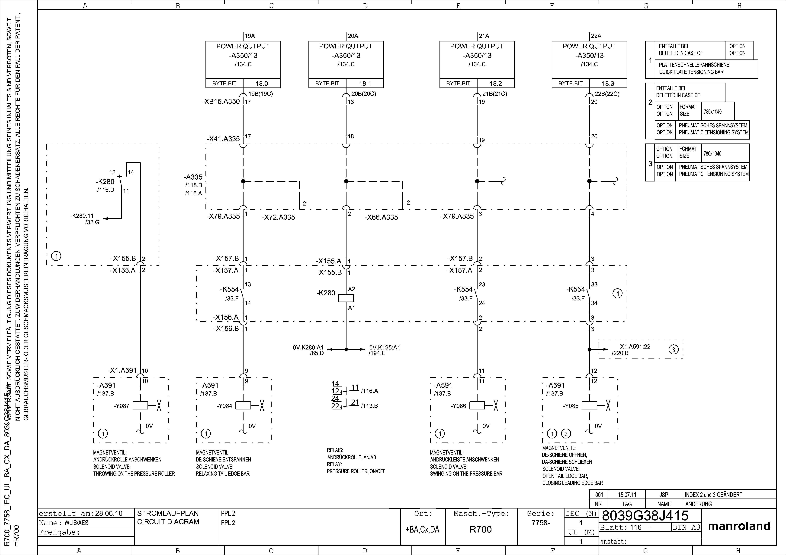

# +BA_Cx_DA — Sheet 116 of 247 — PPL 2

**PPL 2**

> Part of the manroland **R700** printing press IEC/UL circuit diagrams.
> Drawing class: **Stromlaufplan / Circuit diagram** (DIN A3).
> Document `+BA_Cx_DA` covers the **Printing units / main switch cabinet** machine section.

## At a glance

| Field | Value |
|---|---|
| Document | `+BA_Cx_DA`  (8039G38J415) |
| Sheet | **116** of 247 |
| Section (DE) | PPL 2 |
| Section (EN) | PPL 2 |
| Section type | CIRCUIT — Circuit diagram |
| Machine type | `R700` |
| Series | `7758` |
| Created | 28.06.10 |
| Replaces | — |
| Columns used | A, B, C, D, E, F, G, H |
| Path numbers | — |
| Labels on sheet | 204 |
| Cross-refs out | 19 |
| Cross-refs in | 53 |

**Previous:** [+BA_Cx_DA sheet 115](SHEET_0115.md) · **Next:** [+BA_Cx_DA sheet 117](SHEET_0117.md) · **Document TOC:** [_TOC.md](_TOC.md)  (+BA_Cx_DA) · **Master TOC:** [all sheets](../_MASTER_TOC.md)

## Sheet image (300 DPI, exact vector render)



_Rendered directly from the PDF vector layer at 300 DPI (1-bit), no OCR and no resampling. Use it to confirm anything ambiguous in the text below._

## Cross-references on this sheet

Each entry is a wire leaving this sheet. The printed token is `/sheet.column`; the link resolves to that sheet inside the same document.

| Ref | Target sheet | Col | Path | Destination on target | Target section | From col |
|---|---|---|---|---|---|---|
| `/134.C` | [+BA_Cx_DA sheet 134](SHEET_0134.md) | C | — | — | REFERENZMODUL | C |
| `/134.C` | [+BA_Cx_DA sheet 134](SHEET_0134.md) | C | — | — | REFERENZMODUL | D |
| `/134.C` | [+BA_Cx_DA sheet 134](SHEET_0134.md) | C | — | — | REFERENZMODUL | E |
| `/134.C` | [+BA_Cx_DA sheet 134](SHEET_0134.md) | C | — | — | REFERENZMODUL | F |
| `/118.B` | [+BA_Cx_DA sheet 118](SHEET_0118.md) | B | — | — | RESERVE: SPS STATION (INPUT) | B |
| `/115.A` | [+BA_Cx_DA sheet 115](SHEET_0115.md) | A | — | — | PPL 2 | B |
| `/116.D` | [+BA_Cx_DA sheet 116](SHEET_0116.md) | D | — | — | PPL 2 | A |
| `/32.G` | [+BA_Cx_DA sheet 32](SHEET_0032.md) | G | — | K280:11 | BUSVERBINDUNGEN: 20 mA SCHLEIFE, BUSFUNKTIONEN | A |
| `/33.F` | [+BA_Cx_DA sheet 33](SHEET_0033.md) | F | — | — | BUSVERBINDUNGEN: RESERVE SIGNALE | C |
| `/33.F` | [+BA_Cx_DA sheet 33](SHEET_0033.md) | F | — | — | BUSVERBINDUNGEN: RESERVE SIGNALE | E |
| `/33.F` | [+BA_Cx_DA sheet 33](SHEET_0033.md) | F | — | — | BUSVERBINDUNGEN: RESERVE SIGNALE | F |
| `/85.D` | [+BA_Cx_DA sheet 85](SHEET_0085.md) | D | — | 0V.K280:A1 0V.K195:A1 | WASCHVORRICHTUNG | D |
| `/194.E` | [+BA_Cx_DA sheet 194](SHEET_0194.md) | E | — | — | OPTION: WASCHVORRICHTUNG MIT BÜRSTE | D |
| `/220.B` | [+BA_Cx_DA sheet 220](SHEET_0220.md) | B | — | — | OPTION: FORMAT 780x1040 | G |
| `/137.B` | [+BA_Cx_DA sheet 137](SHEET_0137.md) | B | — | A591 | REFERENZMODUL | A |
| `/137.B` | [+BA_Cx_DA sheet 137](SHEET_0137.md) | B | — | A591 | REFERENZMODUL | B |
| `/137.B` | [+BA_Cx_DA sheet 137](SHEET_0137.md) | B | — | A591 | REFERENZMODUL | E |
| `/137.B` | [+BA_Cx_DA sheet 137](SHEET_0137.md) | B | — | A591 | REFERENZMODUL | F |
| `/113.B` | [+BA_Cx_DA sheet 113](SHEET_0113.md) | B | — | — | PPL 2 | D |

### Incoming references (sheets that point here)

Every other sheet that sends a wire to this one. `Back-ref` is the token printed on *that* sheet; `Path` is its line number.

| From sheet | Cols | Back-ref | Path | Refs | What continues there |
|---|---|---|---|---|---|
| [+BA_Cx_DA#32](SHEET_0032.md) | G | `/32.G` | — | 1 | — |
| [+BA_Cx_DA#33](SHEET_0033.md) | F | `/33.F` | — | 3 | — |
| [+BA_Cx_DA#85](SHEET_0085.md) | E | `/85.E` | — | 1 | — |
| [+BA_Cx_DA#113](SHEET_0113.md) | B | `/113.B` | — | 1 | — |
| [+BA_Cx_DA#115](SHEET_0115.md) | A | `/115.A` | — | 1 | — |
| [+BA_Cx_DA#116](SHEET_0116.md) | A | `/116.A` | — | 1 | — |
| [+BA_Cx_DA#118](SHEET_0118.md) | B | `/118.B` | — | 1 | — |
| [+BA_Cx_DA#134](SHEET_0134.md) | C | `/134.C` | — | 4 | — |
| [+BA_Cx_DA#137](SHEET_0137.md) | B | `/137.B` | — | 4 | — |
| [+BA_Cx_DA#142](SHEET_0142.md) | B | `/142.B` | — | 4 | — |
| [+BA_Cx_DA#171](SHEET_0171.md) | G | `/171.G` | — | 4 | — |
| [+BA_Cx_DA#181](SHEET_0181.md) | F | `/181.F` | — | 4 | — |
| [+BA_Cx_DA#183](SHEET_0183.md) | G | `/183.G` | — | 1 | — |
| [+BA_Cx_DA#184](SHEET_0184.md) | E | `/184.E` | — | 1 | — |
| [+BA_Cx_DA#186](SHEET_0186.md) | C | `/186.C` | — | 4 | — |
| [+BA_Cx_DA#187](SHEET_0187.md) | C, E, F | `/187.C`, `/187.E`, `/187.F` | — | 16 | — |
| [+BA_Cx_DA#194](SHEET_0194.md) | D | `/194.D` | — | 1 | 0V.K195:A1 |
| [+BA_Cx_DA#220](SHEET_0220.md) | A | `/220.A` | — | 1 | X1.A591:22 |


## Devices on this sheet

| Tag | Class | Class meaning (IEC) | Col | Sub | Terminal | Sign |
|---|---|---|---|---|---|---|
| `A350/13` | A | Baugruppe / assembly, module, PC board | F | 13 | — | — |
| `A350/13` | A | Baugruppe / assembly, module, PC board | E | 13 | — | — |
| `A350/13` | A | Baugruppe / assembly, module, PC board | C | 13 | — | — |
| `Y085` | Y | Magnetventil / solenoid valve, actuator | F | — | — | — |
| `A591` | A | Baugruppe / assembly, module, PC board | F | — | — | — |
| `K554` | K | Relais / relay, contactor | F | — | — | — |
| `Y086` | Y | Magnetventil / solenoid valve, actuator | E | — | — | — |
| `A591` | A | Baugruppe / assembly, module, PC board | E | — | — | — |
| `K554` | K | Relais / relay, contactor | E | — | — | — |
| `Y084` | Y | Magnetventil / solenoid valve, actuator | B | — | — | — |
| `A591` | A | Baugruppe / assembly, module, PC board | B | — | — | — |
| `A335` | A | Baugruppe / assembly, module, PC board | B | — | — | — |
| `K554` | K | Relais / relay, contactor | C | — | — | — |
| `A2` | A | Baugruppe / assembly, module, PC board | D | — | — | — |
| `A1` | A | Baugruppe / assembly, module, PC board | D | — | — | — |
| `K280` | K | Relais / relay, contactor | D | — | — | — |
| `A350/13` | A | Baugruppe / assembly, module, PC board | D | 13 | — | — |
| `Y087` | Y | Magnetventil / solenoid valve, actuator | A | — | — | — |
| `A591` | A | Baugruppe / assembly, module, PC board | A | — | — | — |
| `K280` | K | Relais / relay, contactor | A | — | — | — |
| `K280:11` | K | Relais / relay, contactor | A | — | 11 | — |
| `18.3` | — | cross-device reference | G | — | — | — |
| `18.2` | — | cross-device reference | E | — | — | — |
| `18.0` | — | cross-device reference | C | — | — | — |
| `XB15.A350` | — | cross-device reference | B | — | — | — |
| `X79.A335` | — | cross-device reference | E | — | — | — |
| `X157.A` | — | cross-device reference | E | — | — | — |
| `X157.B` | — | cross-device reference | E | — | — | — |
| `X155.A` | — | cross-device reference | D | — | — | — |
| `X155.B` | — | cross-device reference | D | — | — | — |
| `X79.A335` | — | cross-device reference | B | — | — | — |
| `X41.A335` | — | cross-device reference | B | — | — | — |
| `X157.B` | — | cross-device reference | C | — | — | — |
| `X157.A` | — | cross-device reference | C | — | — | — |
| `X156.A` | — | cross-device reference | C | — | — | — |
| `X156.B` | — | cross-device reference | C | — | — | — |
| `18.1` | — | cross-device reference | D | — | — | — |
| `X1.A591` | — | cross-device reference | A | — | — | — |
| `X155.A` | — | cross-device reference | A | — | — | — |
| `X155.B` | — | cross-device reference | A | — | — | — |
| `X1.A591:22` | — | cross-device reference | G | — | 22 | — |
| `NR.` | — | cross-device reference | G | — | — | — |
| `15.07.11` | — | cross-device reference | G | — | — | — |
| `X66.A335` | — | cross-device reference | D | — | — | — |
| `X72.A335` | — | cross-device reference | C | — | — | — |

## Potentials / nets

| Potential | Count | Columns | Attached devices | Terminals |
|---|---|---|---|---|
| `0V` | 6 | B, C, D, E, F | `K195`, `K280` | `A1` |


A potential such as `L24+/4` or `M24+` is a named supply/return rail; every place it appears on this sheet is electrically common.

## Wire-end annotations (grouped as printed)

A wire that continues elsewhere is annotated with a small cluster: the destination description, the path/line number `#NN`, and the `/sheet.column` cross reference. Each row below is one such cluster exactly as it is grouped on the drawing.

| Col | Y | Path | Cross-ref | Text on the wire |
|---|---|---|---|---|
| C | 50.6 | — | — | `19A` |
| D | 50.6 | — | — | `20A` |
| E | 50.6 | — | — | `21A` |
| F | 50.6 | — | — | `22A` |
| C | 65.8 | — | — | `POWER QUTPUT` |
| D | 65.8 | — | — | `POWER QUTPUT` |
| E | 65.8 | — | — | `POWER QUTPUT` |
| F | 65.8 | — | — | `POWER QUTPUT` |
| G | 67.2 | — | — | `ENTFÄLLT BEI DELETED IN CASE OF` |
| H | 67.2 | — | — | `OPTION OPTION` |
| C | 79.7 | — | — | `A350/13` |
| D | 79.7 | — | — | `A350/13` |
| E | 79.7 | — | — | `A350/13` |
| F | 79.7 | — | — | `A350/13` |
| G | 86.7 | — | — | `1` |
| C | 93.5 | — | `/134.C` | — |
| D | 93.5 | — | `/134.C` | — |
| E | 93.5 | — | `/134.C` | — |
| F | 93.5 | — | `/134.C` | — |
| H | 95.6 | — | — | `PLATTENSCHNELLSPANNSCHIENE` |
| G | 106.2 | — | — | `QUICK PLATE TENSIONING BAR` |
| C | 122.5 | — | — | `BYTE.BIT 18.0` |
| D | 122.5 | — | — | `BYTE.BIT 18.1` |
| E | 122.5 | — | — | `BYTE.BIT 18.2` |
| F | 122.5 | — | — | `BYTE.BIT 18.3` |
| G | 131.0 | — | — | `ENTFÄLLT BEI DELETED IN CASE OF` |
| C | 138.5 | — | — | `19B(19C)` |
| D | 138.5 | — | — | `20B(20C)` |
| E | 138.5 | — | — | `21B(21C)` |
| G | 138.5 | — | — | `22B(22C)` |
| C | 149.1 | — | — | `XB15.A350 17` |
| G | 150.5 | — | — | `2 SIZE 780x1040` |
| E | 150.6 | — | — | `18 20` |
| E | 150.6 | — | — | `19` |
| G | 159.3 | — | — | `OPTION OPTION` |
| G | 159.4 | — | — | `FORMAT` |
| G | 187.3 | — | — | `OPTION OPTION` |
| H | 187.4 | — | — | `PNEUMATISCHES SPANNSYSTEM PNEUMATIC TENSIONING SYSTEM` |
| C | 203.0 | — | — | `X41.A335 17` |
| D | 203.0 | — | — | `18` |
| F | 203.0 | — | — | `20` |
| E | 208.7 | — | — | `19` |
| G | 223.0 | — | — | `OPTION OPTION` |
| G | 223.1 | — | — | `FORMAT` |
| H | 230.2 | — | — | `SIZE 780x1040` |
| G | 243.6 | — | — | `3` |
| H | 250.4 | — | — | `PNEUMATISCHES SPANNSYSTEM PNEUMATIC TENSIONING SYSTEM` |
| G | 250.6 | — | — | `OPTION OPTION` |
| A | 257.6 | — | — | `K280 14` |
| A | 257.6 | — | — | `12` |
| B | 263.9 | — | — | `A335` |
| B | 277.0 | — | `/118.B`, `/115.A` | — |
| A | 284.1 | — | `/116.D` | — |
| A | 285.9 | — | — | `11` |
| D | 303.6 | — | — | `2` |
| C | 305.1 | — | — | `2` |
| C | 320.6 | — | — | `X79.A335 1` |
| D | 320.6 | — | — | `2` |
| E | 320.6 | — | — | `X79.A335 3` |
| F | 320.6 | — | — | `4` |
| A | 323.4 | — | `/32.G` | `K280:11` |
| C | 324.9 | — | — | `X72.A335` |
| D | 324.9 | — | — | `X66.A335` |
| A | 385.3 | — | — | `1` |
| A | 387.2 | — | — | `X155.B 2` |
| C | 387.2 | — | — | `X157.B 1` |
| E | 387.2 | — | — | `X157.B 2` |
| F | 388.7 | — | — | `3` |
| D | 391.5 | — | — | `X155.A 1` |
| A | 405.7 | — | — | `X155.A 2` |
| C | 405.7 | — | — | `X157.A 1` |
| E | 405.7 | — | — | `X157.A 2` |
| F | 405.7 | — | — | `3` |
| D | 408.5 | — | — | `X155.B 1` |
| C | 427.6 | — | — | `13` |
| E | 427.6 | — | — | `23` |
| F | 427.6 | — | — | `33` |
| C | 434.0 | — | — | `K554` |
| E | 434.0 | — | — | `K554` |
| F | 434.0 | — | — | `K554` |
| D | 434.7 | — | — | `A2` |
| D | 439.7 | — | — | `K280` |
| G | 442.0 | — | — | `1` |
| C | 448.8 | — | `/33.F` | — |
| E | 448.8 | — | `/33.F` | — |
| F | 448.8 | — | `/33.F` | — |
| C | 456.0 | — | — | `14` |
| E | 456.0 | — | — | `24` |
| F | 456.0 | — | — | `34` |
| D | 463.0 | — | — | `A1` |
| C | 476.5 | — | — | `X156.A 1` |
| E | 478.0 | — | — | `2` |
| F | 478.0 | — | — | `3` |
| C | 493.5 | — | — | `X156.B 1` |
| E | 495.0 | — | — | `2` |
| F | 495.0 | — | — | `3` |
| G | 521.9 | — | — | `X1.A591:22` |
| D | 523.3 | — | `/85.D` | `0V.K280:A1 0V.K195:A1` |
| G | 527.5 | — | — | `3` |
| D | 531.8 | — | `/194.E` | — |
| G | 531.8 | — | `/220.B` | — |
| A | 557.3 | — | — | `X1.A591 10` |
| C | 558.8 | — | — | `9` |
| E | 558.8 | — | — | `11` |
| F | 558.8 | — | — | `12` |
| B | 574.3 | — | — | `10` |
| C | 574.3 | — | — | `9` |
| E | 574.3 | — | — | `11` |
| F | 574.3 | — | — | `12` |
| D | 577.1 | — | — | `14 12 24 22 21` |
| A | 580.0 | — | `/137.B` | `A591` |
| B | 580.0 | — | `/137.B` | `A591` |
| E | 580.0 | — | `/137.B` | `A591` |
| F | 580.0 | — | `/137.B` | `A591` |
| D | 582.8 | — | — | `11 /116.A` |
| D | 611.8 | — | `/113.B` | — |
| A | 611.9 | — | — | `Y087` |
| B | 611.9 | — | — | `Y084` |
| E | 611.9 | — | — | `Y086` |
| F | 611.9 | — | — | `Y085` |
| B | 642.3 | — | — | `0V` |
| C | 642.3 | — | — | `0V` |
| E | 642.3 | — | — | `0V` |
| F | 642.3 | — | — | `0V` |
| A | 654.6 | — | — | `1` |
| B | 654.6 | — | — | `1` |
| E | 654.6 | — | — | `1` |
| F | 654.6 | — | — | `1 2` |
| F | 676.7 | — | — | `DE SCHIENE ÖFFNEN, DA SCHIENE SCHLIEßEN MAGNETVENTIL:` |
| D | 680.2 | — | — | `RELAIS:` |
| A | 683.8 | — | — | `MAGNETVENTIL:` |
| B | 683.8 | — | — | `DE SCHIENE ENTSPANNEN MAGNETVENTIL:` |
| E | 683.8 | — | — | `MAGNETVENTIL:` |
| D | 690.9 | — | — | `RELAY: PRESSURE ROLLER, ON/OFF ANDRÜCKROLLE, AN/AB` |
| B | 694.4 | — | — | `SOLENOID VALVE: THROWING ON THE PRESSURE ROLLER ANDRÜCKROLLE ANSCHWENKEN` |
| E | 694.4 | — | — | `SOLENOID VALVE: SWINGING ON THE PRESSURE BAR ANDRUCKLEISTE ANSCHWENKEN` |
| B | 705.0 | — | — | `RELAXING TAIL EDGE BAR SOLENOID VALVE:` |
| F | 708.6 | — | — | `SOLENOID VALVE: OPEN TAIL EDGE BAR, CLOSING LEADING EDGE BAR` |
| G | 747.2 | — | — | `001 15.07.11 JSPI INDEX 2 und 3 GEÄNDERT` |
| G | 761.3 | — | — | `NR. TAG NAME ÄNDERUNG` |


## Reconstructed tables

This sheet carries tabular content (pin map / terminal assignment / index). The grid below was rebuilt from the drawing's own rule lines, so each row is exactly one physical row of the table.

### Table 1 — 2 data rows × 4 columns (at x=184.3, y=62.4)

|  |  | POWER | QUTPUT A350/13 /134.C |
|---|---|---|---|
|  |  | `BYTE.BIT` | `18.0` |
| `14` | `A335` | `XB15.A350 X41.A335` | `19B(19C) 17 17` |


### Table 2 — 2 data rows × 2 columns (at x=467.7, y=62.4)

| POWER | QUTPUT A350/13 /134.C |
|---|---|
| `BYTE.BIT` | `18.1` |
|  | `20B(20C) 18 18` |


### Table 3 — 2 data rows × 2 columns (at x=666.1, y=62.4)

| POWER | QUTPUT A350/13 /134.C |
|---|---|
| `BYTE.BIT` | `18.2` |
|  | `21B(21C) 19 19` |


### Table 4 — 2 data rows × 2 columns (at x=836.2, y=62.4)

| POWER | QUTPUT A350/13 /134.C |
|---|---|
| `BYTE.BIT` | `18.3` |
|  | `22B(22C) 20 20` |


## Notes and free text on this sheet

| Text | Col | Y (pt) |
|---|---|---|
| `22A` | F | 50.6 |
| `22B(22C)` | G | 138.51 |
| `POWER QUTPUT` | F | 65.76 |
| `BYTE.BIT` | F | 123.08 |
| `21A` | E | 50.6 |
| `21B(21C)` | E | 138.51 |
| `POWER QUTPUT` | E | 65.76 |
| `BYTE.BIT` | E | 123.08 |
| `19A` | C | 50.6 |
| `19B(19C)` | C | 138.51 |
| `POWER QUTPUT` | C | 65.76 |
| `BYTE.BIT` | B | 123.08 |
| `MAGNETVENTIL:` | F | 676.68 |
| `DE SCHIENE ÖFFNEN,` | F | 687.31 |
| `DA SCHIENE SCHLIEßEN` | F | 697.95 |
| `SOLENOID VALVE:` | F | 708.57 |
| `OPEN TAIL EDGE BAR,` | F | 719.2 |
| `CLOSING LEADING EDGE BAR` | F | 729.86 |
| `MAGNETVENTIL:` | E | 683.76 |
| `ANDRUCKLEISTE ANSCHWENKEN` | E | 694.4 |
| `SOLENOID VALVE:` | E | 705.02 |
| `SWINGING ON THE PRESSURE BAR` | E | 715.66 |
| `MAGNETVENTIL:` | B | 683.76 |
| `DE SCHIENE ENTSPANNEN` | B | 694.4 |
| `SOLENOID VALVE:` | B | 705.02 |
| `RELAXING TAIL EDGE BAR` | B | 715.66 |
| `11 /116.A` | D | 582.79 |
| `RELAIS:` | D | 680.16 |
| `ANDRÜCKROLLE, AN/AB` | D | 690.88 |
| `RELAY:` | D | 701.43 |
| `PRESSURE ROLLER, ON/OFF` | D | 712.13 |
| `20A` | D | 50.6 |
| `20B(20C)` | D | 138.51 |
| `POWER QUTPUT` | D | 65.76 |
| `BYTE.BIT` | D | 123.08 |
| `MAGNETVENTIL:` | A | 683.76 |
| `ANDRÜCKROLLE ANSCHWENKEN` | A | 694.41 |
| `SOLENOID VALVE:` | A | 705.02 |
| `THROWING ON THE PRESSURE ROLLER` | B | 715.67 |
| `TAG` | G | 761.44 |
| `NAME` | G | 761.42 |
| `ÄNDERUNG` | H | 761.48 |
| `JSPI` | G | 747.25 |
| `INDEX 2 und 3 GEÄNDERT` | H | 747.31 |
| `ENTFÄLLT BEI` | G | 67.2 |
| `DELETED IN CASE OF` | G | 77.86 |
| `OPTION` | H | 67.21 |
| `PLATTENSCHNELLSPANNSCHIENE` | H | 95.59 |
| `QUICK PLATE TENSIONING BAR` | G | 106.22 |
| `OPTION` | G | 159.34 |
| `FORMAT` | G | 159.36 |
| `SIZE` | G | 169.92 |
| `780x1040` | H | 166.52 |
| `PNEUMATISCHES SPANNSYSTEM` | H | 250.41 |
| `PNEUMATIC TENSIONING SYSTEM` | H | 261.05 |

## Complete label inventory (exact text from the drawing)

Every text object inside the drawing area of this sheet, in DIN reading order (column A→H, then top→bottom). This is the authoritative list: if a string is not here it is not printed on this sheet.

| Col | Y | X | Dir | Type | Text |
|---|---|---|---|---|---|
| A | 257.6 | 165.3 | → | number | `12` |
| A | 257.6 | 193.3 | → | number | `14` |
| A | 271.0 | 145.1 | → | device tag | `K280` |
| A | 284.1 | 147.4 | → | cross-reference | `/116.D` |
| A | 285.9 | 186.2 | → | number | `11` |
| A | 323.4 | 106.6 | → | device tag | `K280:11` |
| A | 333.3 | 129.3 | → | cross-reference | `/32.G` |
| A | 385.3 | 83.3 | → | number | `1` |
| A | 387.2 | 167.8 | → | device ref | `X155.B` |
| A | 405.7 | 167.0 | → | device ref | `X155.A` |
| A | 557.3 | 163.3 | → | device ref | `X1.A591` |
| A | 580.0 | 147.1 | → | device tag | `A591` |
| A | 593.1 | 147.4 | → | cross-reference | `/137.B` |
| A | 611.9 | 172.6 | → | device tag | `Y087` |
| A | 654.6 | 154.1 | → | number | `1` |
| A | 683.8 | 141.2 | → | text | `MAGNETVENTIL:` |
| A | 694.4 | 141.7 | → | text | `ANDRÜCKROLLE ANSCHWENKEN` |
| A | 705.0 | 141.4 | → | text | `SOLENOID VALVE:` |
| B | 123.1 | 321.7 | → | text | `BYTE.BIT` |
| B | 149.1 | 306.1 | → | device ref | `XB15.A350` |
| B | 205.8 | 313.2 | → | device ref | `X41.A335` |
| B | 263.9 | 278.4 | → | device tag | `A335` |
| B | 277.0 | 280.9 | → | cross-reference | `/118.B` |
| B | 289.4 | 280.6 | → | cross-reference | `/115.A` |
| B | 323.5 | 313.2 | → | device ref | `X79.A335` |
| B | 388.7 | 215.1 | → | number | `2` |
| B | 405.7 | 215.1 | → | number | `2` |
| B | 558.7 | 214.6 | → | number | `10` |
| B | 574.3 | 214.6 | → | number | `10` |
| B | 580.0 | 303.0 | → | device tag | `A591` |
| B | 593.1 | 303.3 | → | cross-reference | `/137.B` |
| B | 611.9 | 328.5 | → | device tag | `Y084` |
| B | 642.3 | 220.8 | → | potential | `0V` |
| B | 654.6 | 310.1 | → | number | `1` |
| B | 683.8 | 297.1 | → | text | `MAGNETVENTIL:` |
| B | 694.4 | 296.8 | → | text | `DE SCHIENE ENTSPANNEN` |
| B | 705.0 | 297.4 | → | text | `SOLENOID VALVE:` |
| B | 715.7 | 141.4 | → | text | `THROWING ON THE PRESSURE ROLLER` |
| B | 715.7 | 296.8 | → | text | `RELAXING TAIL EDGE BAR` |
| C | 50.6 | 370.5 | → | text | `19A` |
| C | 65.8 | 327.7 | → | text | `POWER QUTPUT` |
| C | 79.7 | 347.1 | → | device tag | `A350/13` |
| C | 93.5 | 355.7 | → | cross-reference | `/134.C` |
| C | 122.5 | 387.1 | → | device ref | `18.0` |
| C | 138.5 | 376.2 | → | text | `19B(19C)` |
| C | 150.6 | 370.5 | → | number | `17` |
| C | 203.0 | 370.5 | → | number | `17` |
| C | 305.0 | 458.9 | → | number | `2` |
| C | 320.6 | 370.5 | → | number | `1` |
| C | 324.9 | 396.9 | → | device ref | `X72.A335` |
| C | 387.2 | 323.7 | → | device ref | `X157.B` |
| C | 388.7 | 370.5 | → | number | `1` |
| C | 405.7 | 322.9 | → | device ref | `X157.A` |
| C | 405.7 | 370.5 | → | number | `1` |
| C | 427.6 | 370.5 | → | number | `13` |
| C | 434.0 | 333.6 | → | device tag | `K554` |
| C | 448.8 | 341.6 | → | cross-reference | `/33.F` |
| C | 456.0 | 370.5 | → | number | `14` |
| C | 476.5 | 322.9 | → | device ref | `X156.A` |
| C | 478.0 | 370.5 | → | number | `1` |
| C | 493.5 | 323.7 | → | device ref | `X156.B` |
| C | 495.0 | 370.5 | → | number | `1` |
| C | 523.3 | 443.6 | → | potential | `0V.K280:A1` |
| C | 531.8 | 469.7 | → | cross-reference | `/85.D` |
| C | 558.7 | 371.1 | → | number | `9` |
| C | 574.3 | 371.1 | → | number | `9` |
| C | 642.3 | 376.7 | → | potential | `0V` |
| D | 50.6 | 527.0 | → | text | `20A` |
| D | 65.8 | 483.6 | → | text | `POWER QUTPUT` |
| D | 79.7 | 503.0 | → | device tag | `A350/13` |
| D | 93.5 | 511.7 | → | cross-reference | `/134.C` |
| D | 122.5 | 543.8 | → | device ref | `18.1` |
| D | 123.1 | 477.6 | → | text | `BYTE.BIT` |
| D | 138.5 | 532.6 | → | text | `20B(20C)` |
| D | 150.6 | 526.4 | → | number | `18` |
| D | 203.0 | 526.4 | → | number | `18` |
| D | 303.6 | 616.3 | → | number | `2` |
| D | 320.6 | 527.0 | → | number | `2` |
| D | 324.9 | 552.8 | → | device ref | `X66.A335` |
| D | 391.5 | 478.8 | → | device ref | `X155.A` |
| D | 392.9 | 526.4 | → | number | `1` |
| D | 408.5 | 479.6 | → | device ref | `X155.B` |
| D | 409.9 | 526.4 | → | number | `1` |
| D | 434.7 | 527.2 | → | device tag | `A2` |
| D | 439.7 | 479.6 | → | device tag | `K280` |
| D | 463.0 | 527.2 | → | device tag | `A1` |
| D | 523.3 | 559.6 | → | potential | `0V.K195:A1` |
| D | 531.8 | 558.4 | → | cross-reference | `/194.E` |
| D | 577.1 | 501.7 | → | number | `14` |
| D | 582.8 | 531.8 | → | text | `11 /116.A` |
| D | 588.5 | 501.7 | → | number | `12` |
| D | 599.8 | 501.7 | → | number | `24` |
| D | 605.5 | 532.1 | → | number | `21` |
| D | 611.1 | 501.7 | → | number | `22` |
| D | 611.8 | 547.1 | → | cross-reference | `/113.B` |
| D | 680.2 | 495.2 | → | text | `RELAIS:` |
| D | 690.9 | 496.1 | → | text | `ANDRÜCKROLLE, AN/AB` |
| D | 701.4 | 495.2 | → | text | `RELAY:` |
| D | 712.1 | 495.2 | → | text | `PRESSURE ROLLER, ON/OFF` |
| E | 50.6 | 725.4 | → | text | `21A` |
| E | 65.8 | 682.0 | → | text | `POWER QUTPUT` |
| E | 79.7 | 701.4 | → | device tag | `A350/13` |
| E | 93.5 | 710.1 | → | cross-reference | `/134.C` |
| E | 122.5 | 741.4 | → | device ref | `18.2` |
| E | 123.1 | 676.1 | → | text | `BYTE.BIT` |
| E | 138.5 | 731.1 | → | text | `21B(21C)` |
| E | 150.6 | 724.8 | → | number | `19` |
| E | 208.7 | 724.8 | → | number | `19` |
| E | 320.6 | 725.4 | → | number | `3` |
| E | 323.5 | 667.6 | → | device ref | `X79.A335` |
| E | 387.2 | 678.0 | → | device ref | `X157.B` |
| E | 388.7 | 725.4 | → | number | `2` |
| E | 405.7 | 677.2 | → | device ref | `X157.A` |
| E | 405.7 | 725.4 | → | number | `2` |
| E | 427.6 | 725.4 | → | number | `23` |
| E | 434.0 | 688.0 | → | device tag | `K554` |
| E | 448.8 | 695.9 | → | cross-reference | `/33.F` |
| E | 456.0 | 725.4 | → | number | `24` |
| E | 478.0 | 725.4 | → | number | `2` |
| E | 495.0 | 725.4 | → | number | `2` |
| E | 558.7 | 724.8 | → | number | `11` |
| E | 574.3 | 724.8 | → | number | `11` |
| E | 580.0 | 657.4 | → | device tag | `A591` |
| E | 593.1 | 657.6 | → | cross-reference | `/137.B` |
| E | 611.9 | 682.9 | → | device tag | `Y086` |
| E | 642.3 | 731.1 | → | potential | `0V` |
| E | 654.6 | 664.4 | → | number | `1` |
| E | 683.8 | 651.4 | → | text | `MAGNETVENTIL:` |
| E | 694.4 | 652.0 | → | text | `ANDRUCKLEISTE ANSCHWENKEN` |
| E | 705.0 | 651.7 | → | text | `SOLENOID VALVE:` |
| E | 715.7 | 651.7 | → | text | `SWINGING ON THE PRESSURE BAR` |
| F | 50.6 | 895.5 | → | text | `22A` |
| F | 65.8 | 852.1 | → | text | `POWER QUTPUT` |
| F | 79.7 | 871.5 | → | device tag | `A350/13` |
| F | 93.5 | 880.2 | → | cross-reference | `/134.C` |
| F | 123.1 | 846.1 | → | text | `BYTE.BIT` |
| F | 150.6 | 895.5 | → | number | `20` |
| F | 203.0 | 895.5 | → | number | `20` |
| F | 320.6 | 895.5 | → | number | `4` |
| F | 388.7 | 895.5 | → | number | `3` |
| F | 405.7 | 895.5 | → | number | `3` |
| F | 427.6 | 895.5 | → | number | `33` |
| F | 434.0 | 858.0 | → | device tag | `K554` |
| F | 448.8 | 866.0 | → | cross-reference | `/33.F` |
| F | 456.0 | 895.5 | → | number | `34` |
| F | 478.0 | 895.5 | → | number | `3` |
| F | 495.0 | 895.5 | → | number | `3` |
| F | 558.7 | 894.9 | → | number | `12` |
| F | 574.3 | 894.9 | → | number | `12` |
| F | 580.0 | 827.4 | → | device tag | `A591` |
| F | 593.1 | 827.7 | → | cross-reference | `/137.B` |
| F | 611.9 | 852.9 | → | device tag | `Y085` |
| F | 642.3 | 901.1 | → | potential | `0V` |
| F | 654.6 | 834.5 | → | number | `1` |
| F | 655.1 | 855.5 | → | number | `2` |
| F | 676.7 | 821.5 | → | text | `MAGNETVENTIL:` |
| F | 687.3 | 821.2 | → | text | `DE SCHIENE ÖFFNEN,` |
| F | 697.9 | 821.2 | → | text | `DA SCHIENE SCHLIEßEN` |
| F | 708.6 | 821.8 | → | text | `SOLENOID VALVE:` |
| F | 719.2 | 821.8 | → | text | `OPEN TAIL EDGE BAR,` |
| F | 729.9 | 821.8 | → | text | `CLOSING LEADING EDGE BAR` |
| G | 67.2 | 998.4 | → | text | `ENTFÄLLT BEI` |
| G | 77.9 | 998.4 | → | text | `DELETED IN CASE OF` |
| G | 86.7 | 982.5 | → | number | `1` |
| G | 106.2 | 998.9 | → | text | `QUICK PLATE TENSIONING BAR` |
| G | 122.5 | 911.5 | → | device ref | `18.3` |
| G | 131.0 | 994.1 | → | text | `ENTFÄLLT BEI` |
| G | 138.5 | 901.1 | → | text | `22B(22C)` |
| G | 141.6 | 994.1 | → | text | `DELETED IN CASE OF` |
| G | 150.5 | 982.2 | → | number | `2` |
| G | 159.3 | 994.7 | → | text | `OPTION` |
| G | 159.4 | 1029.5 | → | text | `FORMAT` |
| G | 169.9 | 1030.1 | → | text | `SIZE` |
| G | 170.0 | 994.7 | → | text | `OPTION` |
| G | 187.3 | 994.8 | → | text | `OPTION` |
| G | 197.9 | 994.8 | → | text | `OPTION` |
| G | 223.0 | 994.3 | → | text | `OPTION` |
| G | 223.1 | 1029.2 | → | text | `FORMAT` |
| G | 233.6 | 1029.8 | → | text | `SIZE` |
| G | 233.7 | 994.3 | → | text | `OPTION` |
| G | 243.6 | 982.3 | → | number | `3` |
| G | 250.6 | 995.0 | → | text | `OPTION` |
| G | 261.2 | 995.0 | → | text | `OPTION` |
| G | 442.0 | 933.7 | → | number | `1` |
| G | 521.9 | 936.6 | → | device ref | `X1.A591:22` |
| G | 527.5 | 1018.5 | → | number | `3` |
| G | 531.8 | 926.9 | → | cross-reference | `/220.B` |
| G | 747.2 | 901.9 | → | number | `001` |
| G | 747.2 | 936.3 | → | device ref | `15.07.11` |
| G | 747.2 | 999.1 | → | text | `JSPI` |
| G | 761.3 | 900.9 | → | device ref | `NR.` |
| G | 761.4 | 942.5 | → | text | `TAG` |
| G | 761.4 | 995.9 | → | text | `NAME` |
| H | 67.2 | 1105.2 | → | text | `OPTION` |
| H | 77.8 | 1105.2 | → | text | `OPTION` |
| H | 95.6 | 998.4 | → | text | `PLATTENSCHNELLSPANNSCHIENE` |
| H | 166.5 | 1066.3 | → | text | `780x1040` |
| H | 187.5 | 1028.8 | → | text | `PNEUMATISCHES SPANNSYSTEM` |
| H | 198.1 | 1028.8 | → | text | `PNEUMATIC TENSIONING SYSTEM` |
| H | 230.2 | 1065.9 | → | text | `780x1040` |
| H | 250.4 | 1028.9 | → | text | `PNEUMATISCHES SPANNSYSTEM` |
| H | 261.0 | 1028.9 | → | text | `PNEUMATIC TENSIONING SYSTEM` |
| H | 747.3 | 1037.3 | → | text | `INDEX 2 und 3 GEÄNDERT` |
| H | 761.5 | 1038.5 | → | text | `ÄNDERUNG` |

## Reading-order text block

The same content as a plain block, grouped by DIN column — convenient to paste or to match against a visual description.

```text
=== Column A ===
 257.6  165.3  numeric      12
 257.6  193.3  numeric      14
 271.0  145.1  devtag       K280
 284.1  147.4  xref         /116.D
 285.9  186.2  numeric      11
 323.4  106.6  devtag       K280:11
 333.3  129.3  xref         /32.G
 385.3   83.3  numeric      1
 387.2  167.8  devref       X155.B
 405.7  167.0  devref       X155.A
 557.3  163.3  devref       X1.A591
 580.0  147.1  devtag       A591
 593.1  147.4  xref         /137.B
 611.9  172.6  devtag       Y087
 654.6  154.1  numeric      1
 683.8  141.2  text         MAGNETVENTIL:
 694.4  141.7  text         ANDRÜCKROLLE ANSCHWENKEN
 705.0  141.4  text         SOLENOID VALVE:
=== Column B ===
 123.1  321.7  text         BYTE.BIT
 149.1  306.1  devref       XB15.A350
 205.8  313.2  devref       X41.A335
 263.9  278.4  devtag       A335
 277.0  280.9  xref         /118.B
 289.4  280.6  xref         /115.A
 323.5  313.2  devref       X79.A335
 388.7  215.1  numeric      2
 405.7  215.1  numeric      2
 558.7  214.6  numeric      10
 574.3  214.6  numeric      10
 580.0  303.0  devtag       A591
 593.1  303.3  xref         /137.B
 611.9  328.5  devtag       Y084
 642.3  220.8  net          0V
 654.6  310.1  numeric      1
 683.8  297.1  text         MAGNETVENTIL:
 694.4  296.8  text         DE SCHIENE ENTSPANNEN
 705.0  297.4  text         SOLENOID VALVE:
 715.7  141.4  text         THROWING ON THE PRESSURE ROLLER
 715.7  296.8  text         RELAXING TAIL EDGE BAR
=== Column C ===
  50.6  370.5  text         19A
  65.8  327.7  text         POWER QUTPUT
  79.7  347.1  devtag       A350/13
  93.5  355.7  xref         /134.C
 122.5  387.1  devref       18.0
 138.5  376.2  text         19B(19C)
 150.6  370.5  numeric      17
 203.0  370.5  numeric      17
 305.0  458.9  numeric      2
 320.6  370.5  numeric      1
 324.9  396.9  devref       X72.A335
 387.2  323.7  devref       X157.B
 388.7  370.5  numeric      1
 405.7  322.9  devref       X157.A
 405.7  370.5  numeric      1
 427.6  370.5  numeric      13
 434.0  333.6  devtag       K554
 448.8  341.6  xref         /33.F
 456.0  370.5  numeric      14
 476.5  322.9  devref       X156.A
 478.0  370.5  numeric      1
 493.5  323.7  devref       X156.B
 495.0  370.5  numeric      1
 523.3  443.6  net          0V.K280:A1
 531.8  469.7  xref         /85.D
 558.7  371.1  numeric      9
 574.3  371.1  numeric      9
 642.3  376.7  net          0V
=== Column D ===
  50.6  527.0  text         20A
  65.8  483.6  text         POWER QUTPUT
  79.7  503.0  devtag       A350/13
  93.5  511.7  xref         /134.C
 122.5  543.8  devref       18.1
 123.1  477.6  text         BYTE.BIT
 138.5  532.6  text         20B(20C)
 150.6  526.4  numeric      18
 203.0  526.4  numeric      18
 303.6  616.3  numeric      2
 320.6  527.0  numeric      2
 324.9  552.8  devref       X66.A335
 391.5  478.8  devref       X155.A
 392.9  526.4  numeric      1
 408.5  479.6  devref       X155.B
 409.9  526.4  numeric      1
 434.7  527.2  devtag       A2
 439.7  479.6  devtag       K280
 463.0  527.2  devtag       A1
 523.3  559.6  net          0V.K195:A1
 531.8  558.4  xref         /194.E
 577.1  501.7  numeric      14
 582.8  531.8  text         11 /116.A
 588.5  501.7  numeric      12
 599.8  501.7  numeric      24
 605.5  532.1  numeric      21
 611.1  501.7  numeric      22
 611.8  547.1  xref         /113.B
 680.2  495.2  text         RELAIS:
 690.9  496.1  text         ANDRÜCKROLLE, AN/AB
 701.4  495.2  text         RELAY:
 712.1  495.2  text         PRESSURE ROLLER, ON/OFF
=== Column E ===
  50.6  725.4  text         21A
  65.8  682.0  text         POWER QUTPUT
  79.7  701.4  devtag       A350/13
  93.5  710.1  xref         /134.C
 122.5  741.4  devref       18.2
 123.1  676.1  text         BYTE.BIT
 138.5  731.1  text         21B(21C)
 150.6  724.8  numeric      19
 208.7  724.8  numeric      19
 320.6  725.4  numeric      3
 323.5  667.6  devref       X79.A335
 387.2  678.0  devref       X157.B
 388.7  725.4  numeric      2
 405.7  677.2  devref       X157.A
 405.7  725.4  numeric      2
 427.6  725.4  numeric      23
 434.0  688.0  devtag       K554
 448.8  695.9  xref         /33.F
 456.0  725.4  numeric      24
 478.0  725.4  numeric      2
 495.0  725.4  numeric      2
 558.7  724.8  numeric      11
 574.3  724.8  numeric      11
 580.0  657.4  devtag       A591
 593.1  657.6  xref         /137.B
 611.9  682.9  devtag       Y086
 642.3  731.1  net          0V
 654.6  664.4  numeric      1
 683.8  651.4  text         MAGNETVENTIL:
 694.4  652.0  text         ANDRUCKLEISTE ANSCHWENKEN
 705.0  651.7  text         SOLENOID VALVE:
 715.7  651.7  text         SWINGING ON THE PRESSURE BAR
=== Column F ===
  50.6  895.5  text         22A
  65.8  852.1  text         POWER QUTPUT
  79.7  871.5  devtag       A350/13
  93.5  880.2  xref         /134.C
 123.1  846.1  text         BYTE.BIT
 150.6  895.5  numeric      20
 203.0  895.5  numeric      20
 320.6  895.5  numeric      4
 388.7  895.5  numeric      3
 405.7  895.5  numeric      3
 427.6  895.5  numeric      33
 434.0  858.0  devtag       K554
 448.8  866.0  xref         /33.F
 456.0  895.5  numeric      34
 478.0  895.5  numeric      3
 495.0  895.5  numeric      3
 558.7  894.9  numeric      12
 574.3  894.9  numeric      12
 580.0  827.4  devtag       A591
 593.1  827.7  xref         /137.B
 611.9  852.9  devtag       Y085
 642.3  901.1  net          0V
 654.6  834.5  numeric      1
 655.1  855.5  numeric      2
 676.7  821.5  text         MAGNETVENTIL:
 687.3  821.2  text         DE SCHIENE ÖFFNEN,
 697.9  821.2  text         DA SCHIENE SCHLIEßEN
 708.6  821.8  text         SOLENOID VALVE:
 719.2  821.8  text         OPEN TAIL EDGE BAR,
 729.9  821.8  text         CLOSING LEADING EDGE BAR
=== Column G ===
  67.2  998.4  text         ENTFÄLLT BEI
  77.9  998.4  text         DELETED IN CASE OF
  86.7  982.5  numeric      1
 106.2  998.9  text         QUICK PLATE TENSIONING BAR
 122.5  911.5  devref       18.3
 131.0  994.1  text         ENTFÄLLT BEI
 138.5  901.1  text         22B(22C)
 141.6  994.1  text         DELETED IN CASE OF
 150.5  982.2  numeric      2
 159.3  994.7  text         OPTION
 159.4 1029.5  text         FORMAT
 169.9 1030.1  text         SIZE
 170.0  994.7  text         OPTION
 187.3  994.8  text         OPTION
 197.9  994.8  text         OPTION
 223.0  994.3  text         OPTION
 223.1 1029.2  text         FORMAT
 233.6 1029.8  text         SIZE
 233.7  994.3  text         OPTION
 243.6  982.3  numeric      3
 250.6  995.0  text         OPTION
 261.2  995.0  text         OPTION
 442.0  933.7  numeric      1
 521.9  936.6  devref       X1.A591:22
 527.5 1018.5  numeric      3
 531.8  926.9  xref         /220.B
 747.2  901.9  numeric      001
 747.2  936.3  devref       15.07.11
 747.2  999.1  text         JSPI
 761.3  900.9  devref       NR.
 761.4  942.5  text         TAG
 761.4  995.9  text         NAME
=== Column H ===
  67.2 1105.2  text         OPTION
  77.8 1105.2  text         OPTION
  95.6  998.4  text         PLATTENSCHNELLSPANNSCHIENE
 166.5 1066.3  text         780x1040
 187.5 1028.8  text         PNEUMATISCHES SPANNSYSTEM
 198.1 1028.8  text         PNEUMATIC TENSIONING SYSTEM
 230.2 1065.9  text         780x1040
 250.4 1028.9  text         PNEUMATISCHES SPANNSYSTEM
 261.0 1028.9  text         PNEUMATIC TENSIONING SYSTEM
 747.3 1037.3  text         INDEX 2 und 3 GEÄNDERT
 761.5 1038.5  text         ÄNDERUNG
```

---
_Generated from the PDF vector text layer; no OCR. Source: `R700_7758_IEC_UL_BA_CX_DA_8039G38J415_p`, sheet 116._
