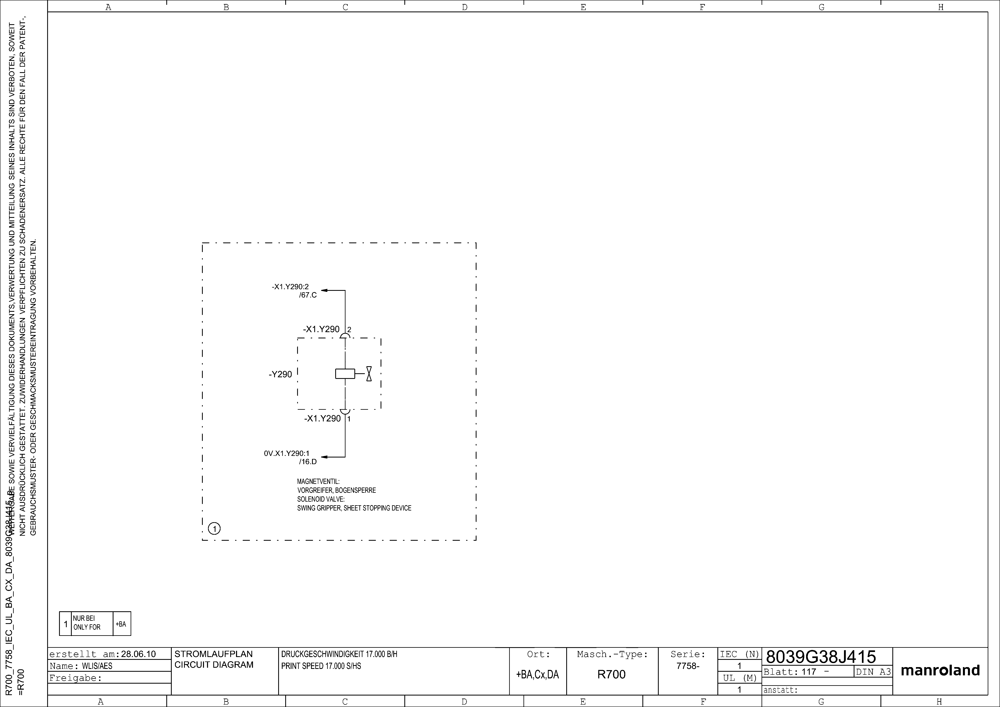

# +BA_Cx_DA — Sheet 117 of 247 — DRUCKGESCHWINDIGKEIT 17.000 B/H

**PRINT SPEED 17.000 S/HS**

> Part of the manroland **R700** printing press IEC/UL circuit diagrams.
> Drawing class: **Stromlaufplan / Circuit diagram** (DIN A3).
> Document `+BA_Cx_DA` covers the **Printing units / main switch cabinet** machine section.

## At a glance

| Field | Value |
|---|---|
| Document | `+BA_Cx_DA`  (8039G38J415) |
| Sheet | **117** of 247 |
| Section (DE) | DRUCKGESCHWINDIGKEIT 17.000 B/H |
| Section (EN) | PRINT SPEED 17.000 S/HS |
| Section type | CIRCUIT — Circuit diagram |
| Machine type | `R700` |
| Series | `7758` |
| Created | 28.06.10 |
| Replaces | — |
| Columns used | A, B, C |
| Path numbers | — |
| Labels on sheet | 18 |
| Cross-refs out | 2 |
| Cross-refs in | 4 |

**Previous:** [+BA_Cx_DA sheet 116](SHEET_0116.md) · **Next:** [+BA_Cx_DA sheet 118](SHEET_0118.md) · **Document TOC:** [_TOC.md](_TOC.md)  (+BA_Cx_DA) · **Master TOC:** [all sheets](../_MASTER_TOC.md)

## Sheet image (300 DPI, exact vector render)



_Rendered directly from the PDF vector layer at 300 DPI (1-bit), no OCR and no resampling. Use it to confirm anything ambiguous in the text below._

## Cross-references on this sheet

Each entry is a wire leaving this sheet. The printed token is `/sheet.column`; the link resolves to that sheet inside the same document.

| Ref | Target sheet | Col | Path | Destination on target | Target section | From col |
|---|---|---|---|---|---|---|
| `/67.C` | [+BA_Cx_DA sheet 67](SHEET_0067.md) | C | — | X1.Y290:2 | TRENNBLÄSER / | C |
| `/16.D` | [+BA_Cx_DA sheet 16](SHEET_0016.md) | D | — | 0V.X1.Y290:1 | SPANNUNGSVERSORGUNG, SCHALTSCHRANKBELÜFTUNG | C |

### Incoming references (sheets that point here)

Every other sheet that sends a wire to this one. `Back-ref` is the token printed on *that* sheet; `Path` is its line number.

| From sheet | Cols | Back-ref | Path | Refs | What continues there |
|---|---|---|---|---|---|
| [+BA_Cx_DA#16](SHEET_0016.md) | D | `/16.D` | — | 1 | — |
| [+BA_Cx_DA#67](SHEET_0067.md) | C | `/67.C` | — | 1 | — |
| [+BA_Cx_DA#150](SHEET_0150.md) | F | `/150.F` | — | 2 | — |


## Devices on this sheet

| Tag | Class | Class meaning (IEC) | Col | Sub | Terminal | Sign |
|---|---|---|---|---|---|---|
| `Y290` | Y | Magnetventil / solenoid valve, actuator | B | — | — | — |
| `X1.Y290` | — | cross-device reference | C | — | — | — |
| `X1.Y290` | — | cross-device reference | C | — | — | — |
| `X1.Y290:2` | — | cross-device reference | C | — | 2 | — |

## Potentials / nets

| Potential | Count | Columns | Attached devices | Terminals |
|---|---|---|---|---|
| `0V` | 1 | C | `X1`, `Y290` | `1` |


A potential such as `L24+/4` or `M24+` is a named supply/return rail; every place it appears on this sheet is electrically common.

## Wire-end annotations (grouped as printed)

A wire that continues elsewhere is annotated with a small cluster: the destination description, the path/line number `#NN`, and the `/sheet.column` cross reference. Each row below is one such cluster exactly as it is grouped on the drawing.

| Col | Y | Path | Cross-ref | Text on the wire |
|---|---|---|---|---|
| C | 337.6 | — | `/67.C` | `X1.Y290:2` |
| C | 387.3 | — | — | `X1.Y290 2` |
| B | 441.2 | — | — | `Y290` |
| C | 493.6 | — | — | `X1.Y290 1` |
| C | 536.0 | — | `/16.D` | `0V.X1.Y290:1` |
| C | 570.4 | — | — | `MAGNETVENTIL:` |
| C | 581.0 | — | — | `SOLENOID VALVE: SWING GRIPPER, SHEET STOPPING DEVICE VORGREIFER, BOGENSPERRE` |
| B | 626.2 | — | — | `1` |
| A | 733.3 | — | — | `1 NUR BEI` |
| A | 740.4 | — | — | `ONLY FOR +BA` |


## Notes and free text on this sheet

| Text | Col | Y (pt) |
|---|---|---|
| `MAGNETVENTIL:` | C | 570.38 |
| `VORGREIFER, BOGENSPERRE` | C | 581.02 |
| `SOLENOID VALVE:` | C | 591.64 |
| `SWING GRIPPER, SHEET STOPPING DEVICE` | C | 602.27 |
| `NUR BEI` | A | 733.33 |
| `ONLY FOR` | A | 744.02 |
| `+BA` | A | 740.44 |

## Complete label inventory (exact text from the drawing)

Every text object inside the drawing area of this sheet, in DIN reading order (column A→H, then top→bottom). This is the authoritative list: if a string is not here it is not printed on this sheet.

| Col | Y | X | Dir | Type | Text |
|---|---|---|---|---|---|
| A | 733.3 | 87.0 | → | text | `NUR BEI` |
| A | 738.7 | 75.4 | → | number | `1` |
| A | 740.4 | 137.9 | → | text | `+BA` |
| A | 744.0 | 87.6 | → | text | `ONLY FOR` |
| B | 441.2 | 320.0 | → | device tag | `Y290` |
| B | 626.2 | 253.4 | → | number | `1` |
| C | 337.6 | 323.7 | → | device ref | `X1.Y290:2` |
| C | 347.5 | 356.3 | → | cross-reference | `/67.C` |
| C | 387.3 | 360.9 | → | device ref | `X1.Y290` |
| C | 388.7 | 413.6 | → | number | `2` |
| C | 493.6 | 362.3 | → | device ref | `X1.Y290` |
| C | 495.0 | 413.0 | → | number | `1` |
| C | 536.0 | 314.4 | → | potential | `0V.X1.Y290:1` |
| C | 546.0 | 356.3 | → | cross-reference | `/16.D` |
| C | 570.4 | 353.8 | → | text | `MAGNETVENTIL:` |
| C | 581.0 | 354.3 | → | text | `VORGREIFER, BOGENSPERRE` |
| C | 591.6 | 354.0 | → | text | `SOLENOID VALVE:` |
| C | 602.3 | 354.0 | → | text | `SWING GRIPPER, SHEET STOPPING DEVICE` |

## Reading-order text block

The same content as a plain block, grouped by DIN column — convenient to paste or to match against a visual description.

```text
=== Column A ===
 733.3   87.0  text         NUR BEI
 738.7   75.4  numeric      1
 740.4  137.9  text         +BA
 744.0   87.6  text         ONLY FOR
=== Column B ===
 441.2  320.0  devtag       Y290
 626.2  253.4  numeric      1
=== Column C ===
 337.6  323.7  devref       X1.Y290:2
 347.5  356.3  xref         /67.C
 387.3  360.9  devref       X1.Y290
 388.7  413.6  numeric      2
 493.6  362.3  devref       X1.Y290
 495.0  413.0  numeric      1
 536.0  314.4  net          0V.X1.Y290:1
 546.0  356.3  xref         /16.D
 570.4  353.8  text         MAGNETVENTIL:
 581.0  354.3  text         VORGREIFER, BOGENSPERRE
 591.6  354.0  text         SOLENOID VALVE:
 602.3  354.0  text         SWING GRIPPER, SHEET STOPPING DEVICE
```

---
_Generated from the PDF vector text layer; no OCR. Source: `R700_7758_IEC_UL_BA_CX_DA_8039G38J415_p`, sheet 117._
