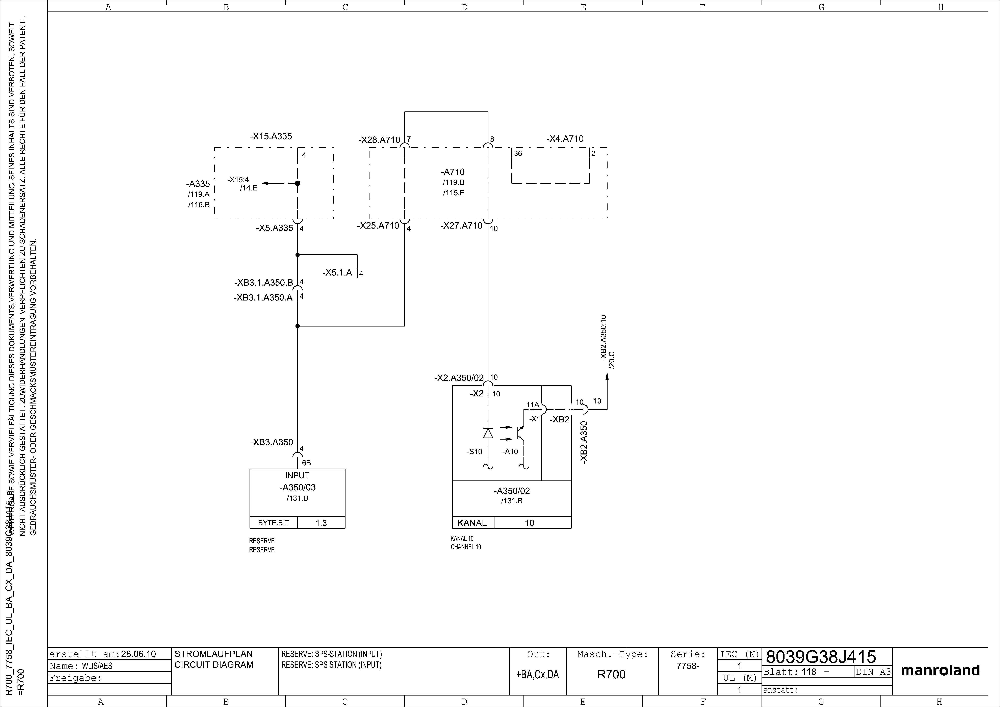

# +BA_Cx_DA — Sheet 118 of 247 — RESERVE: SPS STATION (INPUT)

**RESERVE: SPS STATION (INPUT)**

> Part of the manroland **R700** printing press IEC/UL circuit diagrams.
> Drawing class: **Stromlaufplan / Circuit diagram** (DIN A3).
> Document `+BA_Cx_DA` covers the **Printing units / main switch cabinet** machine section.

## At a glance

| Field | Value |
|---|---|
| Document | `+BA_Cx_DA`  (8039G38J415) |
| Sheet | **118** of 247 |
| Section (DE) | RESERVE: SPS STATION (INPUT) |
| Section (EN) | RESERVE: SPS STATION (INPUT) |
| Section type | CIRCUIT — Circuit diagram |
| Machine type | `R700` |
| Series | `7758` |
| Created | 28.06.10 |
| Replaces | — |
| Columns used | B, C, D, E |
| Path numbers | — |
| Labels on sheet | 58 |
| Cross-refs out | 8 |
| Cross-refs in | 22 |

**Previous:** [+BA_Cx_DA sheet 117](SHEET_0117.md) · **Next:** [+BA_Cx_DA sheet 119](SHEET_0119.md) · **Document TOC:** [_TOC.md](_TOC.md)  (+BA_Cx_DA) · **Master TOC:** [all sheets](../_MASTER_TOC.md)

## Sheet image (300 DPI, exact vector render)



_Rendered directly from the PDF vector layer at 300 DPI (1-bit), no OCR and no resampling. Use it to confirm anything ambiguous in the text below._

## Cross-references on this sheet

Each entry is a wire leaving this sheet. The printed token is `/sheet.column`; the link resolves to that sheet inside the same document.

| Ref | Target sheet | Col | Path | Destination on target | Target section | From col |
|---|---|---|---|---|---|---|
| `/14.E` | [+BA_Cx_DA sheet 14](SHEET_0014.md) | E | — | X15:4 | SPANNUNGSVERSORGUNG, SCHALTSCHRANKBELÜFTUNG | B |
| `/119.B` | [+BA_Cx_DA sheet 119](SHEET_0119.md) | B | — | — | RESERVE: SPS STATION (INPUT) | D |
| `/115.E` | [+BA_Cx_DA sheet 115](SHEET_0115.md) | E | — | — | PPL 2 | D |
| `/119.A` | [+BA_Cx_DA sheet 119](SHEET_0119.md) | A | — | — | RESERVE: SPS STATION (INPUT) | B |
| `/116.B` | [+BA_Cx_DA sheet 116](SHEET_0116.md) | B | — | — | PPL 2 | B |
| `/20.C` | [+BA_Cx_DA sheet 20](SHEET_0020.md) | C | — | XB2.A350:10 | BUSVERBINDUNGEN: SICHERHEITSBUS | E |
| `/131.D` | [+BA_Cx_DA sheet 131](SHEET_0131.md) | D | — | — | REFERENZMODUL | C |
| `/131.B` | [+BA_Cx_DA sheet 131](SHEET_0131.md) | B | — | — | REFERENZMODUL | D |

### Incoming references (sheets that point here)

Every other sheet that sends a wire to this one. `Back-ref` is the token printed on *that* sheet; `Path` is its line number.

| From sheet | Cols | Back-ref | Path | Refs | What continues there |
|---|---|---|---|---|---|
| [+BA_Cx_DA#14](SHEET_0014.md) | E | `/14.E` | — | 1 | — |
| [+BA_Cx_DA#20](SHEET_0020.md) | C | `/20.C` | — | 1 | XB2.A350:10 |
| [+BA_Cx_DA#115](SHEET_0115.md) | E | `/115.E` | — | 1 | — |
| [+BA_Cx_DA#116](SHEET_0116.md) | B | `/116.B` | — | 1 | — |
| [+BA_Cx_DA#119](SHEET_0119.md) | A, B | `/119.A`, `/119.B` | — | 2 | — |
| [+BA_Cx_DA#131](SHEET_0131.md) | B, D | `/131.B`, `/131.D` | — | 2 | — |
| [+BA_Cx_DA#153](SHEET_0153.md) | F | `/153.F` | — | 2 | — |
| [+BA_Cx_DA#157](SHEET_0157.md) | C, D, F | `/157.C`, `/157.D`, `/157.F` | — | 3 | — |
| [+BA_Cx_DA#160](SHEET_0160.md) | A, C | `/160.A`, `/160.C` | — | 2 | — |
| [+BA_Cx_DA#161](SHEET_0161.md) | A | `/161.A` | — | 1 | — |
| [+BA_Cx_DA#171](SHEET_0171.md) | E | `/171.E` | — | 1 | — |
| [+BA_Cx_DA#175](SHEET_0175.md) | H | `/175.H` | — | 1 | — |
| [+BA_Cx_DA#177](SHEET_0177.md) | E | `/177.E` | — | 1 | — |
| [+BA_Cx_DA#178](SHEET_0178.md) | G, H | `/178.G`, `/178.H` | — | 3 | — |


## Devices on this sheet

| Tag | Class | Class meaning (IEC) | Col | Sub | Terminal | Sign |
|---|---|---|---|---|---|---|
| `A350/03` | A | Baugruppe / assembly, module, PC board | C | 03 | — | — |
| `A335` | A | Baugruppe / assembly, module, PC board | B | — | — | — |
| `A710` | A | Baugruppe / assembly, module, PC board | D | — | — | — |
| `S10` | S | Schalter / switch | D | — | — | — |
| `A10` | A | Baugruppe / assembly, module, PC board | D | — | — | — |
| `X1` | X | Klemme / terminal, plug connector | E | — | — | — |
| `X2` | X | Klemme / terminal, plug connector | D | — | — | — |
| `XB2` | XB |  | E | — | — | — |
| `A350/02` | A | Baugruppe / assembly, module, PC board | D | 02 | — | — |
| `X15:4` | X | Klemme / terminal, plug connector | B | — | 4 | — |
| `XB3.1.A350.B` | — | cross-device reference | B | — | — | — |
| `XB3.1.A350.A` | — | cross-device reference | B | — | — | — |
| `1.3` | — | cross-device reference | C | — | — | — |
| `XB3.A350` | — | cross-device reference | B | — | — | — |
| `X5.A335` | — | cross-device reference | B | — | — | — |
| `X25.A710` | — | cross-device reference | C | — | — | — |
| `X28.A710` | — | cross-device reference | C | — | — | — |
| `X27.A710` | — | cross-device reference | D | — | — | — |
| `XB2.A350` | — | cross-device reference | E | — | — | — |
| `X5.1.A` | — | cross-device reference | C | — | — | — |
| `XB2.A350:10` | — | cross-device reference | E | — | 10 | — |
| `X4.A710` | — | cross-device reference | E | — | — | — |
| `X15.A335` | — | cross-device reference | B | — | — | — |

## Potentials / nets

_No named potentials on this sheet._

## Wire-end annotations (grouped as printed)

A wire that continues elsewhere is annotated with a small cluster: the destination description, the path/line number `#NN`, and the `/sheet.column` cross reference. Each row below is one such cluster exactly as it is grouped on the drawing.

| Col | Y | Path | Cross-ref | Text on the wire |
|---|---|---|---|---|
| D | 157.6 | — | — | `X15.A335 X4.A710` |
| C | 161.9 | — | — | `X28.A710 7` |
| D | 161.9 | — | — | `8` |
| E | 178.9 | — | — | `36 2` |
| C | 181.0 | — | — | `4` |
| D | 200.1 | — | — | `A710` |
| B | 210.1 | — | `/14.E` | `X15:4` |
| D | 213.2 | — | `/119.B`, `/115.E` | — |
| B | 214.3 | — | — | `A335` |
| B | 227.4 | — | `/119.A`, `/116.B` | — |
| C | 263.9 | — | — | `X25.A710 4` |
| D | 263.9 | — | — | `X27.A710 10` |
| B | 266.8 | — | — | `X5.A335 4` |
| C | 319.9 | — | — | `X5.1.A 4` |
| B | 332.0 | — | — | `XB3.1.A350.B 4` |
| B | 349.0 | — | — | `XB3.1.A350.A 4` |
| E | 375.0 | — | `/20.C` | `XB2.A350:10` |
| D | 445.4 | — | — | `X2.A350/02 10` |
| D | 463.8 | — | — | `X2` |
| E | 465.2 | — | — | `10 10` |
| E | 473.7 | — | — | `10` |
| E | 477.9 | — | — | `11A` |
| E | 494.9 | — | — | `X1` |
| E | 495.0 | — | — | `XB2` |
| E | 501.2 | — | — | `XB2.A350` |
| B | 521.9 | — | — | `XB3.A350 4` |
| D | 533.9 | — | — | `S10 A10` |
| C | 547.4 | — | — | `6B` |
| C | 561.9 | — | — | `INPUT` |
| C | 575.7 | — | — | `A350/03` |
| D | 580.0 | — | — | `A350/02` |
| C | 589.5 | — | `/131.D` | — |
| D | 592.4 | — | `/131.B` | — |
| D | 618.2 | — | — | `KANAL 10` |
| C | 618.6 | — | — | `BYTE.BIT 1.3` |
| D | 638.6 | — | — | `KANAL 10 CHANNEL 10` |
| B | 641.2 | — | — | `RESERVE RESERVE` |


## Reconstructed tables

This sheet carries tabular content (pin map / terminal assignment / index). The grid below was rebuilt from the drawing's own rule lines, so each row is exactly one physical row of the table.

### Table 1 — 7 data rows × 11 columns (at x=297.6, y=133.2)

| X15.A335 | 4 | X28.A710 | 7 | A710 /119.B | 8 | 36 |  | X4.A710 |  | 2 |
|---|---|---|---|---|---|---|---|---|---|---|
| `X5.A335` | `4` | `X25.A710` | `4` | `/115.E X27.A710` | `10` |  |  |  |  |  |
| `XB3.1.A350.B XB3.1.A350.A` | `X5.1.A 4 4` | `4` |  |  |  |  |  |  |  |  |
|  |  |  |  | `X2.A350/02` | `10` |  |  |  |  | `XB2.A350:10` |
| `XB3.A350` | `4 6B` |  |  | `X2 S10` | `10 A10` |  | `11A X1` | `XB2` | `10 XB2.A350` | `10` |
| `INPUT` |  |  |  |  |  |  |  |  |  |  |
|  | `A350/03 /131.D` |  |  |  |  | `A350/02 /131.B` |  |  |  |  |
| `BYTE.BIT` | `1.3` |  |  | `KANAL` |  |  | `10` |  |  |  |


## Notes and free text on this sheet

| Text | Col | Y (pt) |
|---|---|---|
| `6B` | C | 547.36 |
| `INPUT` | C | 561.9 |
| `BYTE.BIT` | B | 619.15 |
| `RESERVE` | B | 641.21 |
| `KANAL 10` | D | 638.58 |
| `CHANNEL 10` | D | 648.52 |
| `11A` | E | 477.92 |
| `KANAL` | D | 618.25 |
| `X2.A350/02` | D | 445.35 |

## Complete label inventory (exact text from the drawing)

Every text object inside the drawing area of this sheet, in DIN reading order (column A→H, then top→bottom). This is the authoritative list: if a string is not here it is not printed on this sheet.

| Col | Y | X | Dir | Type | Text |
|---|---|---|---|---|---|
| B | 157.6 | 297.6 | → | device ref | `X15.A335` |
| B | 210.1 | 270.7 | → | device tag | `X15:4` |
| B | 214.3 | 221.7 | → | device tag | `A335` |
| B | 219.9 | 286.0 | → | cross-reference | `/14.E` |
| B | 227.4 | 223.9 | → | cross-reference | `/119.A` |
| B | 239.8 | 224.2 | → | cross-reference | `/116.B` |
| B | 266.8 | 305.0 | → | device ref | `X5.A335` |
| B | 332.0 | 279.2 | → | device ref | `XB3.1.A350.B` |
| B | 349.7 | 278.4 | → | device ref | `XB3.1.A350.A` |
| B | 521.9 | 297.9 | → | device ref | `XB3.A350` |
| B | 619.1 | 307.6 | → | text | `BYTE.BIT` |
| B | 641.2 | 296.8 | → | text | `RESERVE` |
| B | 651.8 | 296.8 | → | text | `RESERVE` |
| C | 161.9 | 426.6 | → | device ref | `X28.A710` |
| C | 181.0 | 359.7 | → | number | `4` |
| C | 263.9 | 425.2 | → | device ref | `X25.A710` |
| C | 268.2 | 356.9 | → | number | `4` |
| C | 319.9 | 384.1 | → | device ref | `X5.1.A` |
| C | 322.1 | 427.7 | → | number | `4` |
| C | 332.0 | 356.9 | → | number | `4` |
| C | 349.0 | 356.9 | → | number | `4` |
| C | 530.4 | 356.9 | → | number | `4` |
| C | 547.4 | 359.7 | → | text | `6B` |
| C | 561.9 | 339.4 | → | text | `INPUT` |
| C | 575.7 | 332.9 | → | device tag | `A350/03` |
| C | 589.5 | 341.6 | → | cross-reference | `/131.D` |
| C | 618.6 | 375.6 | → | device ref | `1.3` |
| D | 161.9 | 484.4 | → | number | `7` |
| D | 161.9 | 583.7 | → | number | `8` |
| D | 178.9 | 612.0 | → | number | `36` |
| D | 200.1 | 525.0 | → | device tag | `A710` |
| D | 213.2 | 527.5 | → | cross-reference | `/119.B` |
| D | 225.6 | 527.8 | → | cross-reference | `/115.E` |
| D | 263.9 | 524.4 | → | device ref | `X27.A710` |
| D | 268.2 | 484.4 | → | number | `4` |
| D | 268.2 | 583.1 | → | number | `10` |
| D | 445.3 | 517.0 | → | text | `X2.A350/02` |
| D | 445.4 | 583.1 | → | number | `10` |
| D | 463.8 | 559.6 | → | device tag | `X2` |
| D | 465.2 | 585.9 | → | number | `10` |
| D | 533.9 | 555.9 | → | device tag | `S10` |
| D | 533.9 | 598.4 | → | device tag | `A10` |
| D | 580.0 | 588.0 | → | device tag | `A350/02` |
| D | 592.4 | 596.8 | → | cross-reference | `/131.B` |
| D | 618.3 | 544.8 | → | text | `KANAL` |
| D | 638.6 | 536.6 | → | text | `KANAL 10` |
| D | 648.5 | 536.9 | → | text | `CHANNEL 10` |
| E | 160.5 | 650.8 | → | device ref | `X4.A710` |
| E | 178.9 | 704.1 | → | number | `2` |
| E | 375.0 | 714.6 | ↕ | device ref | `XB2.A350:10` |
| E | 418.4 | 724.5 | ↕ | cross-reference | `/20.C` |
| E | 473.7 | 706.4 | → | number | `10` |
| E | 475.1 | 685.1 | → | number | `10` |
| E | 477.9 | 626.5 | → | text | `11A` |
| E | 494.9 | 630.1 | → | device tag | `X1` |
| E | 495.0 | 654.5 | → | device tag | `XB2` |
| E | 501.2 | 690.5 | ↕ | device ref | `XB2.A350` |
| E | 618.2 | 624.5 | → | number | `10` |

## Reading-order text block

The same content as a plain block, grouped by DIN column — convenient to paste or to match against a visual description.

```text
=== Column B ===
 157.6  297.6  devref       X15.A335
 210.1  270.7  devtag       X15:4
 214.3  221.7  devtag       A335
 219.9  286.0  xref         /14.E
 227.4  223.9  xref         /119.A
 239.8  224.2  xref         /116.B
 266.8  305.0  devref       X5.A335
 332.0  279.2  devref       XB3.1.A350.B
 349.7  278.4  devref       XB3.1.A350.A
 521.9  297.9  devref       XB3.A350
 619.1  307.6  text         BYTE.BIT
 641.2  296.8  text         RESERVE
 651.8  296.8  text         RESERVE
=== Column C ===
 161.9  426.6  devref       X28.A710
 181.0  359.7  numeric      4
 263.9  425.2  devref       X25.A710
 268.2  356.9  numeric      4
 319.9  384.1  devref       X5.1.A
 322.1  427.7  numeric      4
 332.0  356.9  numeric      4
 349.0  356.9  numeric      4
 530.4  356.9  numeric      4
 547.4  359.7  text         6B
 561.9  339.4  text         INPUT
 575.7  332.9  devtag       A350/03
 589.5  341.6  xref         /131.D
 618.6  375.6  devref       1.3
=== Column D ===
 161.9  484.4  numeric      7
 161.9  583.7  numeric      8
 178.9  612.0  numeric      36
 200.1  525.0  devtag       A710
 213.2  527.5  xref         /119.B
 225.6  527.8  xref         /115.E
 263.9  524.4  devref       X27.A710
 268.2  484.4  numeric      4
 268.2  583.1  numeric      10
 445.3  517.0  text         X2.A350/02
 445.4  583.1  numeric      10
 463.8  559.6  devtag       X2
 465.2  585.9  numeric      10
 533.9  555.9  devtag       S10
 533.9  598.4  devtag       A10
 580.0  588.0  devtag       A350/02
 592.4  596.8  xref         /131.B
 618.3  544.8  text         KANAL
 638.6  536.6  text         KANAL 10
 648.5  536.9  text         CHANNEL 10
=== Column E ===
 160.5  650.8  devref       X4.A710
 178.9  704.1  numeric      2
 375.0  714.6  devref       XB2.A350:10
 418.4  724.5  xref         /20.C
 473.7  706.4  numeric      10
 475.1  685.1  numeric      10
 477.9  626.5  text         11A
 494.9  630.1  devtag       X1
 495.0  654.5  devtag       XB2
 501.2  690.5  devref       XB2.A350
 618.2  624.5  numeric      10
```

---
_Generated from the PDF vector text layer; no OCR. Source: `R700_7758_IEC_UL_BA_CX_DA_8039G38J415_p`, sheet 118._
