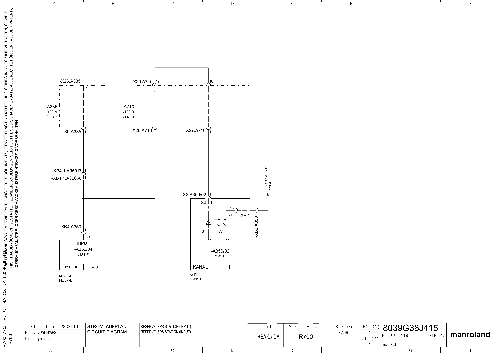

# +BA_Cx_DA — Sheet 119 of 247 — RESERVE: SPS STATION (INPUT)

**RESERVE: SPS STATION (INPUT)**

> Part of the manroland **R700** printing press IEC/UL circuit diagrams.
> Drawing class: **Stromlaufplan / Circuit diagram** (DIN A3).
> Document `+BA_Cx_DA` covers the **Printing units / main switch cabinet** machine section.

## At a glance

| Field | Value |
|---|---|
| Document | `+BA_Cx_DA`  (8039G38J415) |
| Sheet | **119** of 247 |
| Section (DE) | RESERVE: SPS STATION (INPUT) |
| Section (EN) | RESERVE: SPS STATION (INPUT) |
| Section type | CIRCUIT — Circuit diagram |
| Machine type | `R700` |
| Series | `7758` |
| Created | 28.06.10 |
| Replaces | — |
| Columns used | A, B, C, D, E |
| Path numbers | — |
| Labels on sheet | 51 |
| Cross-refs out | 7 |
| Cross-refs in | 18 |

**Previous:** [+BA_Cx_DA sheet 118](SHEET_0118.md) · **Next:** [+BA_Cx_DA sheet 120](SHEET_0120.md) · **Document TOC:** [_TOC.md](_TOC.md)  (+BA_Cx_DA) · **Master TOC:** [all sheets](../_MASTER_TOC.md)

## Sheet image (300 DPI, exact vector render)



_Rendered directly from the PDF vector layer at 300 DPI (1-bit), no OCR and no resampling. Use it to confirm anything ambiguous in the text below._

## Cross-references on this sheet

Each entry is a wire leaving this sheet. The printed token is `/sheet.column`; the link resolves to that sheet inside the same document.

| Ref | Target sheet | Col | Path | Destination on target | Target section | From col |
|---|---|---|---|---|---|---|
| `/120.A` | [+BA_Cx_DA sheet 120](SHEET_0120.md) | A | — | — | RESERVE: SPS STATION (INPUT) | A |
| `/118.B` | [+BA_Cx_DA sheet 118](SHEET_0118.md) | B | — | — | RESERVE: SPS STATION (INPUT) | A |
| `/120.B` | [+BA_Cx_DA sheet 120](SHEET_0120.md) | B | — | — | RESERVE: SPS STATION (INPUT) | B |
| `/118.D` | [+BA_Cx_DA sheet 118](SHEET_0118.md) | D | — | — | RESERVE: SPS STATION (INPUT) | B |
| `/20.A` | [+BA_Cx_DA sheet 20](SHEET_0020.md) | A | — | XB2.A350:1 | BUSVERBINDUNGEN: SICHERHEITSBUS | E |
| `/131.F` | [+BA_Cx_DA sheet 131](SHEET_0131.md) | F | — | — | REFERENZMODUL | A |
| `/131.B` | [+BA_Cx_DA sheet 131](SHEET_0131.md) | B | — | — | REFERENZMODUL | D |

### Incoming references (sheets that point here)

Every other sheet that sends a wire to this one. `Back-ref` is the token printed on *that* sheet; `Path` is its line number.

| From sheet | Cols | Back-ref | Path | Refs | What continues there |
|---|---|---|---|---|---|
| [+BA_Cx_DA#20](SHEET_0020.md) | A | `/20.A` | — | 1 | XB2.A350:1 |
| [+BA_Cx_DA#118](SHEET_0118.md) | B, D | `/118.B`, `/118.D` | — | 2 | — |
| [+BA_Cx_DA#120](SHEET_0120.md) | A, B | `/120.A`, `/120.B` | — | 2 | — |
| [+BA_Cx_DA#131](SHEET_0131.md) | B, F | `/131.B`, `/131.F` | — | 2 | — |
| [+BA_Cx_DA#153](SHEET_0153.md) | F | `/153.F` | — | 2 | — |
| [+BA_Cx_DA#159](SHEET_0159.md) | F, G, H | `/159.F`, `/159.G`, `/159.H` | — | 3 | — |
| [+BA_Cx_DA#162](SHEET_0162.md) | D | `/162.D` | — | 1 | — |
| [+BA_Cx_DA#176](SHEET_0176.md) | A, E | `/176.A`, `/176.E` | — | 2 | — |
| [+BA_Cx_DA#177](SHEET_0177.md) | E | `/177.E` | — | 1 | — |
| [+BA_Cx_DA#179](SHEET_0179.md) | B | `/179.B` | — | 2 | — |


## Devices on this sheet

| Tag | Class | Class meaning (IEC) | Col | Sub | Terminal | Sign |
|---|---|---|---|---|---|---|
| `A350/04` | A | Baugruppe / assembly, module, PC board | A | 04 | — | — |
| `A335` | A | Baugruppe / assembly, module, PC board | A | — | — | — |
| `A710` | A | Baugruppe / assembly, module, PC board | B | — | — | — |
| `S1` | S | Schalter / switch | D | — | — | — |
| `A1` | A | Baugruppe / assembly, module, PC board | D | — | — | — |
| `X1` | X | Klemme / terminal, plug connector | D | — | — | — |
| `X2` | X | Klemme / terminal, plug connector | D | — | — | — |
| `XB2` | XB |  | D | — | — | — |
| `A350/02` | A | Baugruppe / assembly, module, PC board | D | 02 | — | — |
| `4.0` | — | cross-device reference | B | — | — | — |
| `XB4.A350` | — | cross-device reference | A | — | — | — |
| `X6.A335` | — | cross-device reference | A | — | — | — |
| `XB4.1.A350.B` | — | cross-device reference | A | — | — | — |
| `XB4.1.A350.A` | — | cross-device reference | A | — | — | — |
| `X27.A710` | — | cross-device reference | C | — | — | — |
| `X29.A710` | — | cross-device reference | B | — | — | — |
| `X26.A710` | — | cross-device reference | B | — | — | — |
| `XB2.A350` | — | cross-device reference | D | — | — | — |
| `XB2.A350:1` | — | cross-device reference | E | — | 1 | — |
| `X26.A335` | — | cross-device reference | A | — | — | — |

## Potentials / nets

_No named potentials on this sheet._

## Wire-end annotations (grouped as printed)

A wire that continues elsewhere is annotated with a small cluster: the destination description, the path/line number `#NN`, and the `/sheet.column` cross reference. Each row below is one such cluster exactly as it is grouped on the drawing.

| Col | Y | Path | Cross-ref | Text on the wire |
|---|---|---|---|---|
| A | 188.8 | — | — | `X26.A335` |
| C | 190.2 | — | — | `X29.A710 17` |
| D | 190.2 | — | — | `18` |
| B | 208.0 | — | — | `2` |
| A | 249.8 | — | — | `A335` |
| B | 249.8 | — | — | `A710` |
| A | 262.8 | — | `/120.A`, `/118.B` | — |
| B | 262.8 | — | `/120.B`, `/118.D` | — |
| C | 306.4 | — | — | `X26.A710 1` |
| C | 306.4 | — | — | `X27.A710 1` |
| A | 309.3 | — | — | `X6.A335 1` |
| E | 394.0 | — | `/20.A` | `XB2.A350:1` |
| A | 402.8 | — | — | `XB4.1.A350.B 1` |
| A | 419.9 | — | — | `XB4.1.A350.A 1` |
| C | 459.5 | — | — | `X2.A350/02 1` |
| D | 478.0 | — | — | `X2` |
| D | 479.4 | — | — | `1 1` |
| E | 487.9 | — | — | `1` |
| D | 492.1 | — | — | `6C` |
| D | 509.1 | — | — | `X1` |
| D | 509.1 | — | — | `XB2` |
| D | 515.3 | — | — | `XB2.A350` |
| A | 536.1 | — | — | `XB4.A350 1` |
| D | 548.1 | — | — | `S1 A1` |
| B | 561.5 | — | — | `3B` |
| A | 576.1 | — | — | `INPUT` |
| A | 589.9 | — | — | `A350/04` |
| D | 594.2 | — | — | `A350/02` |
| A | 603.7 | — | `/131.F` | — |
| D | 606.5 | — | `/131.B` | — |
| D | 632.4 | — | — | `KANAL 1` |
| A | 632.7 | — | — | `BYTE.BIT 4.0` |
| C | 652.7 | — | — | `KANAL 1 CHANNEL 1` |
| A | 655.4 | — | — | `RESERVE RESERVE` |


## Reconstructed tables

This sheet carries tabular content (pin map / terminal assignment / index). The grid below was rebuilt from the drawing's own rule lines, so each row is exactly one physical row of the table.

### Table 1 — 2 data rows × 2 columns (at x=141.7, y=473.4)

| XB4.A350 | 1 3B |
|---|---|
| `INPUT` | `A350/04 /131.F` |
| `BYTE.BIT` | `4.0` |


### Table 2 — 3 data rows × 6 columns (at x=368.5, y=161.6)

| 17 1 | X27.A710 X2.A350/02 | 18 1 1 |  |  | XB2.A350:1 |
|---|---|---|---|---|---|
|  | `X2 S1` | `1 A1` | `6C X1` | `XB2` | `1 1 XB2.A350` |
|  |  | `A350/02 /131.B` |  |  |  |
|  | `KANAL` |  | `1` |  |  |


## Notes and free text on this sheet

| Text | Col | Y (pt) |
|---|---|---|
| `3B` | B | 561.53 |
| `INPUT` | A | 576.07 |
| `BYTE.BIT` | A | 633.32 |
| `RESERVE` | A | 655.39 |
| `KANAL 1` | C | 652.71 |
| `CHANNEL 1` | C | 662.67 |
| `6C` | D | 492.14 |
| `KANAL` | C | 632.42 |
| `X2.A350/02` | C | 459.52 |

## Complete label inventory (exact text from the drawing)

Every text object inside the drawing area of this sheet, in DIN reading order (column A→H, then top→bottom). This is the authoritative list: if a string is not here it is not printed on this sheet.

| Col | Y | X | Dir | Type | Text |
|---|---|---|---|---|---|
| A | 188.8 | 141.7 | → | device ref | `X26.A335` |
| A | 249.8 | 108.3 | → | device tag | `A335` |
| A | 262.8 | 110.6 | → | cross-reference | `/120.A` |
| A | 275.2 | 110.8 | → | cross-reference | `/118.B` |
| A | 309.3 | 149.1 | → | device ref | `X6.A335` |
| A | 402.8 | 123.3 | → | device ref | `XB4.1.A350.B` |
| A | 420.6 | 122.5 | → | device ref | `XB4.1.A350.A` |
| A | 536.1 | 142.0 | → | device ref | `XB4.A350` |
| A | 576.1 | 183.5 | → | text | `INPUT` |
| A | 589.9 | 177.0 | → | device tag | `A350/04` |
| A | 603.7 | 186.1 | → | cross-reference | `/131.F` |
| A | 633.3 | 151.7 | → | text | `BYTE.BIT` |
| A | 655.4 | 140.9 | → | text | `RESERVE` |
| A | 666.0 | 140.9 | → | text | `RESERVE` |
| B | 190.2 | 313.2 | → | device ref | `X29.A710` |
| B | 208.0 | 203.2 | → | number | `2` |
| B | 249.8 | 291.1 | → | device tag | `A710` |
| B | 262.8 | 293.7 | → | cross-reference | `/120.B` |
| B | 275.3 | 293.4 | → | cross-reference | `/118.D` |
| B | 306.4 | 311.8 | → | device ref | `X26.A710` |
| B | 310.7 | 200.4 | → | number | `1` |
| B | 402.8 | 200.4 | → | number | `1` |
| B | 419.9 | 200.4 | → | number | `1` |
| B | 544.6 | 200.4 | → | number | `1` |
| B | 561.5 | 203.8 | → | text | `3B` |
| B | 632.7 | 220.0 | → | device ref | `4.0` |
| C | 190.2 | 370.5 | → | number | `17` |
| C | 306.4 | 439.4 | → | device ref | `X27.A710` |
| C | 310.7 | 370.5 | → | number | `1` |
| C | 459.5 | 432.0 | → | text | `X2.A350/02` |
| C | 632.4 | 459.8 | → | text | `KANAL` |
| C | 652.7 | 451.6 | → | text | `KANAL 1` |
| C | 662.7 | 451.8 | → | text | `CHANNEL 1` |
| D | 190.2 | 498.0 | → | number | `18` |
| D | 310.7 | 498.0 | → | number | `1` |
| D | 459.5 | 498.0 | → | number | `1` |
| D | 478.0 | 474.5 | → | device tag | `X2` |
| D | 479.4 | 500.9 | → | number | `1` |
| D | 489.3 | 600.1 | → | number | `1` |
| D | 492.1 | 546.2 | → | text | `6C` |
| D | 509.1 | 545.1 | → | device tag | `X1` |
| D | 509.1 | 569.5 | → | device tag | `XB2` |
| D | 515.3 | 605.5 | ↕ | device ref | `XB2.A350` |
| D | 548.1 | 477.1 | → | device tag | `S1` |
| D | 548.1 | 519.6 | → | device tag | `A1` |
| D | 594.2 | 503.0 | → | device tag | `A350/02` |
| D | 606.5 | 511.8 | → | cross-reference | `/131.B` |
| D | 632.4 | 543.1 | → | number | `1` |
| E | 394.0 | 629.6 | ↕ | device ref | `XB2.A350:1` |
| E | 432.9 | 639.5 | ↕ | cross-reference | `/20.A` |
| E | 487.9 | 627.6 | → | number | `1` |

## Reading-order text block

The same content as a plain block, grouped by DIN column — convenient to paste or to match against a visual description.

```text
=== Column A ===
 188.8  141.7  devref       X26.A335
 249.8  108.3  devtag       A335
 262.8  110.6  xref         /120.A
 275.2  110.8  xref         /118.B
 309.3  149.1  devref       X6.A335
 402.8  123.3  devref       XB4.1.A350.B
 420.6  122.5  devref       XB4.1.A350.A
 536.1  142.0  devref       XB4.A350
 576.1  183.5  text         INPUT
 589.9  177.0  devtag       A350/04
 603.7  186.1  xref         /131.F
 633.3  151.7  text         BYTE.BIT
 655.4  140.9  text         RESERVE
 666.0  140.9  text         RESERVE
=== Column B ===
 190.2  313.2  devref       X29.A710
 208.0  203.2  numeric      2
 249.8  291.1  devtag       A710
 262.8  293.7  xref         /120.B
 275.3  293.4  xref         /118.D
 306.4  311.8  devref       X26.A710
 310.7  200.4  numeric      1
 402.8  200.4  numeric      1
 419.9  200.4  numeric      1
 544.6  200.4  numeric      1
 561.5  203.8  text         3B
 632.7  220.0  devref       4.0
=== Column C ===
 190.2  370.5  numeric      17
 306.4  439.4  devref       X27.A710
 310.7  370.5  numeric      1
 459.5  432.0  text         X2.A350/02
 632.4  459.8  text         KANAL
 652.7  451.6  text         KANAL 1
 662.7  451.8  text         CHANNEL 1
=== Column D ===
 190.2  498.0  numeric      18
 310.7  498.0  numeric      1
 459.5  498.0  numeric      1
 478.0  474.5  devtag       X2
 479.4  500.9  numeric      1
 489.3  600.1  numeric      1
 492.1  546.2  text         6C
 509.1  545.1  devtag       X1
 509.1  569.5  devtag       XB2
 515.3  605.5  devref       XB2.A350
 548.1  477.1  devtag       S1
 548.1  519.6  devtag       A1
 594.2  503.0  devtag       A350/02
 606.5  511.8  xref         /131.B
 632.4  543.1  numeric      1
=== Column E ===
 394.0  629.6  devref       XB2.A350:1
 432.9  639.5  xref         /20.A
 487.9  627.6  numeric      1
```

---
_Generated from the PDF vector text layer; no OCR. Source: `R700_7758_IEC_UL_BA_CX_DA_8039G38J415_p`, sheet 119._
