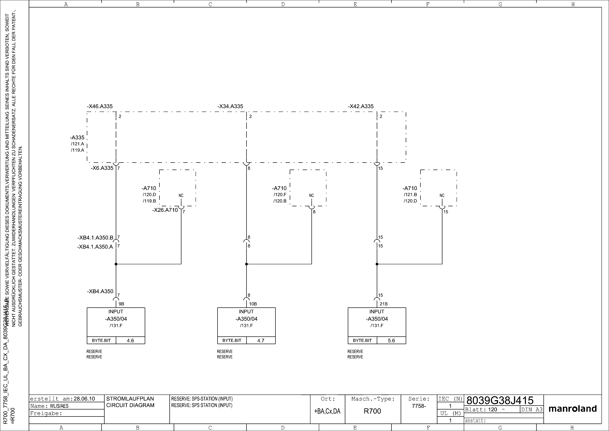

# +BA_Cx_DA — Sheet 120 of 247 — RESERVE: SPS STATION (INPUT)

**RESERVE: SPS STATION (INPUT)**

> Part of the manroland **R700** printing press IEC/UL circuit diagrams.
> Drawing class: **Stromlaufplan / Circuit diagram** (DIN A3).
> Document `+BA_Cx_DA` covers the **Printing units / main switch cabinet** machine section.

## At a glance

| Field | Value |
|---|---|
| Document | `+BA_Cx_DA`  (8039G38J415) |
| Sheet | **120** of 247 |
| Section (DE) | RESERVE: SPS STATION (INPUT) |
| Section (EN) | RESERVE: SPS STATION (INPUT) |
| Section type | CIRCUIT — Circuit diagram |
| Machine type | `R700` |
| Series | `7758` |
| Created | 28.06.10 |
| Replaces | — |
| Columns used | A, B, C, D, E, F |
| Path numbers | — |
| Labels on sheet | 65 |
| Cross-refs out | 11 |
| Cross-refs in | 29 |

**Previous:** [+BA_Cx_DA sheet 119](SHEET_0119.md) · **Next:** [+BA_Cx_DA sheet 121](SHEET_0121.md) · **Document TOC:** [_TOC.md](_TOC.md)  (+BA_Cx_DA) · **Master TOC:** [all sheets](../_MASTER_TOC.md)

## Sheet image (300 DPI, exact vector render)



_Rendered directly from the PDF vector layer at 300 DPI (1-bit), no OCR and no resampling. Use it to confirm anything ambiguous in the text below._

## Cross-references on this sheet

Each entry is a wire leaving this sheet. The printed token is `/sheet.column`; the link resolves to that sheet inside the same document.

| Ref | Target sheet | Col | Path | Destination on target | Target section | From col |
|---|---|---|---|---|---|---|
| `/121.A` | [+BA_Cx_DA sheet 121](SHEET_0121.md) | A | — | — | RESERVE: SPS STATION (INPUT) | A |
| `/119.A` | [+BA_Cx_DA sheet 119](SHEET_0119.md) | A | — | — | RESERVE: SPS STATION (INPUT) | A |
| `/121.B` | [+BA_Cx_DA sheet 121](SHEET_0121.md) | B | — | — | RESERVE: SPS STATION (INPUT) | F |
| `/120.D` | [+BA_Cx_DA sheet 120](SHEET_0120.md) | D | — | — | RESERVE: SPS STATION (INPUT) | F |
| `/120.F` | [+BA_Cx_DA sheet 120](SHEET_0120.md) | F | — | — | RESERVE: SPS STATION (INPUT) | D |
| `/120.B` | [+BA_Cx_DA sheet 120](SHEET_0120.md) | B | — | — | RESERVE: SPS STATION (INPUT) | D |
| `/120.D` | [+BA_Cx_DA sheet 120](SHEET_0120.md) | D | — | — | RESERVE: SPS STATION (INPUT) | B |
| `/119.B` | [+BA_Cx_DA sheet 119](SHEET_0119.md) | B | — | — | RESERVE: SPS STATION (INPUT) | B |
| `/131.F` | [+BA_Cx_DA sheet 131](SHEET_0131.md) | F | — | — | REFERENZMODUL | B |
| `/131.F` | [+BA_Cx_DA sheet 131](SHEET_0131.md) | F | — | — | REFERENZMODUL | C |
| `/131.F` | [+BA_Cx_DA sheet 131](SHEET_0131.md) | F | — | — | REFERENZMODUL | E |

### Incoming references (sheets that point here)

Every other sheet that sends a wire to this one. `Back-ref` is the token printed on *that* sheet; `Path` is its line number.

| From sheet | Cols | Back-ref | Path | Refs | What continues there |
|---|---|---|---|---|---|
| [+BA_Cx_DA#119](SHEET_0119.md) | A, B | `/119.A`, `/119.B` | — | 2 | — |
| [+BA_Cx_DA#120](SHEET_0120.md) | B, D, F | `/120.B`, `/120.D`, `/120.F` | — | 4 | — |
| [+BA_Cx_DA#121](SHEET_0121.md) | A, B | `/121.A`, `/121.B` | — | 2 | — |
| [+BA_Cx_DA#131](SHEET_0131.md) | F | `/131.F` | — | 3 | — |
| [+BA_Cx_DA#159](SHEET_0159.md) | F, G, H | `/159.F`, `/159.G`, `/159.H` | — | 9 | — |
| [+BA_Cx_DA#162](SHEET_0162.md) | D | `/162.D` | — | 3 | — |
| [+BA_Cx_DA#176](SHEET_0176.md) | E | `/176.E` | — | 3 | — |
| [+BA_Cx_DA#180](SHEET_0180.md) | B | `/180.B` | — | 1 | — |
| [+BA_Cx_DA#181](SHEET_0181.md) | G | `/181.G` | — | 1 | — |
| [+BA_Cx_DA#182](SHEET_0182.md) | B | `/182.B` | — | 1 | — |


## Devices on this sheet

| Tag | Class | Class meaning (IEC) | Col | Sub | Terminal | Sign |
|---|---|---|---|---|---|---|
| `A335` | A | Baugruppe / assembly, module, PC board | A | — | — | — |
| `A710` | A | Baugruppe / assembly, module, PC board | B | — | — | — |
| `A710` | A | Baugruppe / assembly, module, PC board | D | — | — | — |
| `A710` | A | Baugruppe / assembly, module, PC board | F | — | — | — |
| `A350/04` | A | Baugruppe / assembly, module, PC board | C | 04 | — | — |
| `A350/04` | A | Baugruppe / assembly, module, PC board | B | 04 | — | — |
| `A350/04` | A | Baugruppe / assembly, module, PC board | E | 04 | — | — |
| `X6.A335` | — | cross-device reference | B | — | — | — |
| `X26.A710` | — | cross-device reference | B | — | — | — |
| `4.7` | — | cross-device reference | D | — | — | — |
| `4.6` | — | cross-device reference | B | — | — | — |
| `XB4.A350` | — | cross-device reference | A | — | — | — |
| `5.6` | — | cross-device reference | F | — | — | — |
| `XB4.1.A350.B` | — | cross-device reference | A | — | — | — |
| `XB4.1.A350.A` | — | cross-device reference | A | — | — | — |
| `X34.A335` | — | cross-device reference | C | — | — | — |
| `X46.A335` | — | cross-device reference | A | — | — | — |
| `X42.A335` | — | cross-device reference | E | — | — | — |

## Potentials / nets

_No named potentials on this sheet._

## Wire-end annotations (grouped as printed)

A wire that continues elsewhere is annotated with a small cluster: the destination description, the path/line number `#NN`, and the `/sheet.column` cross reference. Each row below is one such cluster exactly as it is grouped on the drawing.

| Col | Y | Path | Cross-ref | Text on the wire |
|---|---|---|---|---|
| A | 203.0 | — | — | `X46.A335` |
| C | 203.0 | — | — | `X34.A335` |
| E | 203.0 | — | — | `X42.A335` |
| B | 223.6 | — | — | `2` |
| D | 223.6 | — | — | `2` |
| E | 223.6 | — | — | `2` |
| A | 263.9 | — | — | `A335` |
| A | 277.0 | — | `/121.A`, `/119.A` | — |
| B | 323.5 | — | — | `X6.A335 7 8` |
| E | 324.9 | — | — | `15` |
| B | 363.1 | — | — | `A710` |
| D | 363.1 | — | — | `A710` |
| F | 363.1 | — | — | `A710` |
| B | 376.2 | — | `/120.D`, `/119.B` | — |
| D | 376.2 | — | `/120.F`, `/120.B` | — |
| F | 376.2 | — | `/121.B`, `/120.D` | — |
| D | 379.0 | — | — | `NC NC NC` |
| B | 405.7 | — | — | `X26.A710 7` |
| D | 409.9 | — | — | `8` |
| F | 409.9 | — | — | `15` |
| A | 459.5 | — | — | `XB4.1.A350.B 7` |
| D | 459.5 | — | — | `8` |
| E | 459.5 | — | — | `15` |
| A | 476.5 | — | — | `XB4.1.A350.A 7` |
| D | 476.5 | — | — | `8` |
| E | 476.5 | — | — | `15` |
| B | 564.4 | — | — | `XB4.A350 7` |
| D | 572.9 | — | — | `8` |
| E | 572.9 | — | — | `15` |
| B | 589.9 | — | — | `9B` |
| D | 589.9 | — | — | `10B` |
| E | 589.9 | — | — | `21B` |
| B | 604.4 | — | — | `INPUT` |
| C | 604.4 | — | — | `INPUT` |
| E | 604.4 | — | — | `INPUT` |
| B | 618.3 | — | — | `A350/04` |
| C | 618.3 | — | — | `A350/04` |
| E | 618.3 | — | — | `A350/04` |
| B | 632.0 | — | `/131.F` | — |
| C | 632.0 | — | `/131.F` | — |
| E | 632.0 | — | `/131.F` | — |
| B | 661.1 | — | — | `BYTE.BIT 4.6` |
| C | 661.1 | — | — | `BYTE.BIT 4.7` |
| E | 661.1 | — | — | `BYTE.BIT 5.6` |
| A | 683.7 | — | — | `RESERVE RESERVE` |
| C | 683.7 | — | — | `RESERVE RESERVE` |
| E | 683.7 | — | — | `RESERVE RESERVE` |


## Reconstructed tables

This sheet carries tabular content (pin map / terminal assignment / index). The grid below was rebuilt from the drawing's own rule lines, so each row is exactly one physical row of the table.

### Table 1 — 2 data rows × 2 columns (at x=170.1, y=515.9)

| XB4.A350 | 7 9B |
|---|---|
| `INPUT` | `A350/04 /131.F` |
| `BYTE.BIT` | `4.6` |


### Table 2 — 1 data rows × 2 columns (at x=425.2, y=515.9) — **8 10B**

| INPUT | A350/04 /131.F |
|---|---|
| `BYTE.BIT` | `4.7` |


### Table 3 — 1 data rows × 2 columns (at x=680.3, y=515.9) — **15 21B**

| INPUT | A350/04 /131.F |
|---|---|
| `BYTE.BIT` | `5.6` |


## Notes and free text on this sheet

| Text | Col | Y (pt) |
|---|---|---|
| `10B` | D | 589.89 |
| `INPUT` | C | 604.42 |
| `BYTE.BIT` | C | 661.67 |
| `RESERVE` | C | 683.73 |
| `9B` | B | 589.88 |
| `INPUT` | B | 604.42 |
| `BYTE.BIT` | A | 661.67 |
| `RESERVE` | A | 683.73 |
| `21B` | E | 589.89 |
| `INPUT` | E | 604.42 |
| `BYTE.BIT` | E | 661.67 |
| `RESERVE` | E | 683.73 |
| `NC` | C | 379.01 |
| `NC` | D | 379.01 |
| `NC` | F | 379.01 |

## Complete label inventory (exact text from the drawing)

Every text object inside the drawing area of this sheet, in DIN reading order (column A→H, then top→bottom). This is the authoritative list: if a string is not here it is not printed on this sheet.

| Col | Y | X | Dir | Type | Text |
|---|---|---|---|---|---|
| A | 203.0 | 170.1 | → | device ref | `X46.A335` |
| A | 263.9 | 136.6 | → | device tag | `A335` |
| A | 277.0 | 138.9 | → | cross-reference | `/121.A` |
| A | 289.4 | 138.9 | → | cross-reference | `/119.A` |
| A | 459.5 | 151.7 | → | device ref | `XB4.1.A350.B` |
| A | 477.2 | 150.8 | → | device ref | `XB4.1.A350.A` |
| A | 564.4 | 170.4 | → | device ref | `XB4.A350` |
| A | 661.7 | 180.0 | → | text | `BYTE.BIT` |
| A | 683.7 | 169.2 | → | text | `RESERVE` |
| A | 694.4 | 169.2 | → | text | `RESERVE` |
| B | 223.6 | 232.2 | → | number | `2` |
| B | 323.5 | 177.4 | → | device ref | `X6.A335` |
| B | 324.9 | 229.3 | → | number | `7` |
| B | 363.1 | 276.9 | → | device tag | `A710` |
| B | 376.2 | 279.2 | → | cross-reference | `/120.D` |
| B | 388.6 | 279.5 | → | cross-reference | `/119.B` |
| B | 405.7 | 297.6 | → | device ref | `X26.A710` |
| B | 459.5 | 229.3 | → | number | `7` |
| B | 476.5 | 229.3 | → | number | `7` |
| B | 572.9 | 229.3 | → | number | `7` |
| B | 589.9 | 232.2 | → | text | `9B` |
| B | 604.4 | 211.9 | → | text | `INPUT` |
| B | 618.3 | 205.4 | → | device tag | `A350/04` |
| B | 632.0 | 214.4 | → | cross-reference | `/131.F` |
| B | 661.1 | 248.3 | → | device ref | `4.6` |
| C | 203.0 | 425.2 | → | device ref | `X34.A335` |
| C | 379.0 | 349.5 | → | text | `NC` |
| C | 409.9 | 356.9 | → | number | `7` |
| C | 604.4 | 467.0 | → | text | `INPUT` |
| C | 618.3 | 460.5 | → | device tag | `A350/04` |
| C | 632.0 | 469.6 | → | cross-reference | `/131.F` |
| C | 661.7 | 435.1 | → | text | `BYTE.BIT` |
| C | 683.7 | 424.3 | → | text | `RESERVE` |
| C | 694.4 | 424.3 | → | text | `RESERVE` |
| D | 223.6 | 487.3 | → | number | `2` |
| D | 324.9 | 484.4 | → | number | `8` |
| D | 363.1 | 532.1 | → | device tag | `A710` |
| D | 376.2 | 535.2 | → | cross-reference | `/120.F` |
| D | 379.0 | 604.6 | → | text | `NC` |
| D | 388.6 | 534.6 | → | cross-reference | `/120.B` |
| D | 409.9 | 612.0 | → | number | `8` |
| D | 459.5 | 484.4 | → | number | `8` |
| D | 476.5 | 484.4 | → | number | `8` |
| D | 572.9 | 484.4 | → | number | `8` |
| D | 589.9 | 486.7 | → | text | `10B` |
| D | 661.1 | 503.4 | → | device ref | `4.7` |
| E | 203.0 | 680.3 | → | device ref | `X42.A335` |
| E | 223.6 | 742.4 | → | number | `2` |
| E | 324.9 | 739.0 | → | number | `15` |
| E | 459.5 | 739.0 | → | number | `15` |
| E | 476.5 | 739.0 | → | number | `15` |
| E | 572.9 | 739.0 | → | number | `15` |
| E | 589.9 | 742.4 | → | text | `21B` |
| E | 604.4 | 722.1 | → | text | `INPUT` |
| E | 618.3 | 715.6 | → | device tag | `A350/04` |
| E | 632.0 | 724.7 | → | cross-reference | `/131.F` |
| E | 661.7 | 690.2 | → | text | `BYTE.BIT` |
| E | 683.7 | 679.5 | → | text | `RESERVE` |
| E | 694.4 | 679.5 | → | text | `RESERVE` |
| F | 363.1 | 787.2 | → | device tag | `A710` |
| F | 376.2 | 789.7 | → | cross-reference | `/121.B` |
| F | 379.0 | 859.7 | → | text | `NC` |
| F | 388.6 | 789.4 | → | cross-reference | `/120.D` |
| F | 409.9 | 866.6 | → | number | `15` |
| F | 661.1 | 758.6 | → | device ref | `5.6` |

## Reading-order text block

The same content as a plain block, grouped by DIN column — convenient to paste or to match against a visual description.

```text
=== Column A ===
 203.0  170.1  devref       X46.A335
 263.9  136.6  devtag       A335
 277.0  138.9  xref         /121.A
 289.4  138.9  xref         /119.A
 459.5  151.7  devref       XB4.1.A350.B
 477.2  150.8  devref       XB4.1.A350.A
 564.4  170.4  devref       XB4.A350
 661.7  180.0  text         BYTE.BIT
 683.7  169.2  text         RESERVE
 694.4  169.2  text         RESERVE
=== Column B ===
 223.6  232.2  numeric      2
 323.5  177.4  devref       X6.A335
 324.9  229.3  numeric      7
 363.1  276.9  devtag       A710
 376.2  279.2  xref         /120.D
 388.6  279.5  xref         /119.B
 405.7  297.6  devref       X26.A710
 459.5  229.3  numeric      7
 476.5  229.3  numeric      7
 572.9  229.3  numeric      7
 589.9  232.2  text         9B
 604.4  211.9  text         INPUT
 618.3  205.4  devtag       A350/04
 632.0  214.4  xref         /131.F
 661.1  248.3  devref       4.6
=== Column C ===
 203.0  425.2  devref       X34.A335
 379.0  349.5  text         NC
 409.9  356.9  numeric      7
 604.4  467.0  text         INPUT
 618.3  460.5  devtag       A350/04
 632.0  469.6  xref         /131.F
 661.7  435.1  text         BYTE.BIT
 683.7  424.3  text         RESERVE
 694.4  424.3  text         RESERVE
=== Column D ===
 223.6  487.3  numeric      2
 324.9  484.4  numeric      8
 363.1  532.1  devtag       A710
 376.2  535.2  xref         /120.F
 379.0  604.6  text         NC
 388.6  534.6  xref         /120.B
 409.9  612.0  numeric      8
 459.5  484.4  numeric      8
 476.5  484.4  numeric      8
 572.9  484.4  numeric      8
 589.9  486.7  text         10B
 661.1  503.4  devref       4.7
=== Column E ===
 203.0  680.3  devref       X42.A335
 223.6  742.4  numeric      2
 324.9  739.0  numeric      15
 459.5  739.0  numeric      15
 476.5  739.0  numeric      15
 572.9  739.0  numeric      15
 589.9  742.4  text         21B
 604.4  722.1  text         INPUT
 618.3  715.6  devtag       A350/04
 632.0  724.7  xref         /131.F
 661.7  690.2  text         BYTE.BIT
 683.7  679.5  text         RESERVE
 694.4  679.5  text         RESERVE
=== Column F ===
 363.1  787.2  devtag       A710
 376.2  789.7  xref         /121.B
 379.0  859.7  text         NC
 388.6  789.4  xref         /120.D
 409.9  866.6  numeric      15
 661.1  758.6  devref       5.6
```

---
_Generated from the PDF vector text layer; no OCR. Source: `R700_7758_IEC_UL_BA_CX_DA_8039G38J415_p`, sheet 120._
