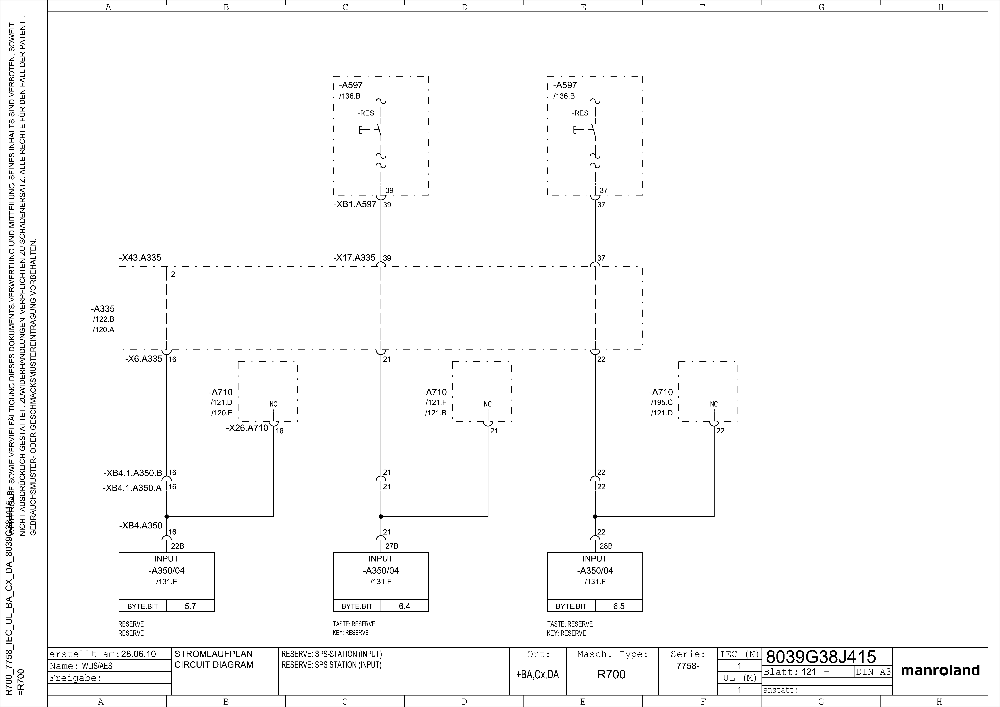

# +BA_Cx_DA — Sheet 121 of 247 — RESERVE: SPS STATION (INPUT)

**RESERVE: SPS STATION (INPUT)**

> Part of the manroland **R700** printing press IEC/UL circuit diagrams.
> Drawing class: **Stromlaufplan / Circuit diagram** (DIN A3).
> Document `+BA_Cx_DA` covers the **Printing units / main switch cabinet** machine section.

## At a glance

| Field | Value |
|---|---|
| Document | `+BA_Cx_DA`  (8039G38J415) |
| Sheet | **121** of 247 |
| Section (DE) | RESERVE: SPS STATION (INPUT) |
| Section (EN) | RESERVE: SPS STATION (INPUT) |
| Section type | CIRCUIT — Circuit diagram |
| Machine type | `R700` |
| Series | `7758` |
| Created | 28.06.10 |
| Replaces | — |
| Columns used | A, B, C, D, E, F |
| Path numbers | — |
| Labels on sheet | 75 |
| Cross-refs out | 13 |
| Cross-refs in | 33 |

**Previous:** [+BA_Cx_DA sheet 120](SHEET_0120.md) · **Next:** [+BA_Cx_DA sheet 122](SHEET_0122.md) · **Document TOC:** [_TOC.md](_TOC.md)  (+BA_Cx_DA) · **Master TOC:** [all sheets](../_MASTER_TOC.md)

## Sheet image (300 DPI, exact vector render)



_Rendered directly from the PDF vector layer at 300 DPI (1-bit), no OCR and no resampling. Use it to confirm anything ambiguous in the text below._

## Cross-references on this sheet

Each entry is a wire leaving this sheet. The printed token is `/sheet.column`; the link resolves to that sheet inside the same document.

| Ref | Target sheet | Col | Path | Destination on target | Target section | From col |
|---|---|---|---|---|---|---|
| `/136.B` | [+BA_Cx_DA sheet 136](SHEET_0136.md) | B | — | A597 | REFERENZMODUL | C |
| `/136.B` | [+BA_Cx_DA sheet 136](SHEET_0136.md) | B | — | A597 | REFERENZMODUL | E |
| `/122.B` | [+BA_Cx_DA sheet 122](SHEET_0122.md) | B | — | — | RESERVE: SPS STATION (INPUT) | A |
| `/120.A` | [+BA_Cx_DA sheet 120](SHEET_0120.md) | A | — | — | RESERVE: SPS STATION (INPUT) | A |
| `/121.F` | [+BA_Cx_DA sheet 121](SHEET_0121.md) | F | — | — | RESERVE: SPS STATION (INPUT) | D |
| `/121.B` | [+BA_Cx_DA sheet 121](SHEET_0121.md) | B | — | — | RESERVE: SPS STATION (INPUT) | D |
| `/121.D` | [+BA_Cx_DA sheet 121](SHEET_0121.md) | D | — | — | RESERVE: SPS STATION (INPUT) | B |
| `/195.C` | [+BA_Cx_DA sheet 195](SHEET_0195.md) | C | — | — | OPTION: WASCHVORRICHTUNG MIT BÜRSTE | F |
| `/121.D` | [+BA_Cx_DA sheet 121](SHEET_0121.md) | D | — | — | RESERVE: SPS STATION (INPUT) | F |
| `/120.F` | [+BA_Cx_DA sheet 120](SHEET_0120.md) | F | — | — | RESERVE: SPS STATION (INPUT) | B |
| `/131.F` | [+BA_Cx_DA sheet 131](SHEET_0131.md) | F | — | — | REFERENZMODUL | A |
| `/131.F` | [+BA_Cx_DA sheet 131](SHEET_0131.md) | F | — | — | REFERENZMODUL | C |
| `/131.F` | [+BA_Cx_DA sheet 131](SHEET_0131.md) | F | — | — | REFERENZMODUL | E |

### Incoming references (sheets that point here)

Every other sheet that sends a wire to this one. `Back-ref` is the token printed on *that* sheet; `Path` is its line number.

| From sheet | Cols | Back-ref | Path | Refs | What continues there |
|---|---|---|---|---|---|
| [+BA_Cx_DA#120](SHEET_0120.md) | A, F | `/120.A`, `/120.F` | — | 2 | — |
| [+BA_Cx_DA#121](SHEET_0121.md) | B, D, F | `/121.B`, `/121.D`, `/121.F` | — | 4 | — |
| [+BA_Cx_DA#122](SHEET_0122.md) | B | `/122.B` | — | 1 | — |
| [+BA_Cx_DA#131](SHEET_0131.md) | F | `/131.F` | — | 3 | — |
| [+BA_Cx_DA#136](SHEET_0136.md) | B | `/136.B` | — | 2 | — |
| [+BA_Cx_DA#143](SHEET_0143.md) | C | `/143.C` | — | 2 | — |
| [+BA_Cx_DA#159](SHEET_0159.md) | F, G, H | `/159.F`, `/159.G`, `/159.H` | — | 9 | — |
| [+BA_Cx_DA#162](SHEET_0162.md) | D | `/162.D` | — | 3 | — |
| [+BA_Cx_DA#173](SHEET_0173.md) | C | `/173.C` | — | 2 | — |
| [+BA_Cx_DA#176](SHEET_0176.md) | E | `/176.E` | — | 3 | — |
| [+BA_Cx_DA#181](SHEET_0181.md) | G | `/181.G` | — | 1 | — |
| [+BA_Cx_DA#195](SHEET_0195.md) | C | `/195.C` | — | 1 | — |


## Devices on this sheet

| Tag | Class | Class meaning (IEC) | Col | Sub | Terminal | Sign |
|---|---|---|---|---|---|---|
| `A597` | A | Baugruppe / assembly, module, PC board | C | — | — | — |
| `A335` | A | Baugruppe / assembly, module, PC board | A | — | — | — |
| `A350/04` | A | Baugruppe / assembly, module, PC board | A | 04 | — | — |
| `A350/04` | A | Baugruppe / assembly, module, PC board | C | 04 | — | — |
| `A710` | A | Baugruppe / assembly, module, PC board | B | — | — | — |
| `A710` | A | Baugruppe / assembly, module, PC board | D | — | — | — |
| `A597` | A | Baugruppe / assembly, module, PC board | E | — | — | — |
| `A350/04` | A | Baugruppe / assembly, module, PC board | E | 04 | — | — |
| `A710` | A | Baugruppe / assembly, module, PC board | F | — | — | — |
| `XB1.A597` | — | cross-device reference | C | — | — | — |
| `X6.A335` | — | cross-device reference | A | — | — | — |
| `X17.A335` | — | cross-device reference | C | — | — | — |
| `5.7` | — | cross-device reference | B | — | — | — |
| `XB4.A350` | — | cross-device reference | A | — | — | — |
| `6.4` | — | cross-device reference | C | — | — | — |
| `X26.A710` | — | cross-device reference | B | — | — | — |
| `XB4.1.A350.B` | — | cross-device reference | A | — | — | — |
| `XB4.1.A350.A` | — | cross-device reference | A | — | — | — |
| `6.5` | — | cross-device reference | E | — | — | — |
| `X43.A335` | — | cross-device reference | A | — | — | — |

## Potentials / nets

_No named potentials on this sheet._

## Wire-end annotations (grouped as printed)

A wire that continues elsewhere is annotated with a small cluster: the destination description, the path/line number `#NN`, and the `/sheet.column` cross reference. Each row below is one such cluster exactly as it is grouped on the drawing.

| Col | Y | Path | Cross-ref | Text on the wire |
|---|---|---|---|---|
| C | 96.7 | — | `/136.B` | `A597` |
| E | 96.7 | — | `/136.B` | `A597` |
| C | 131.1 | — | — | `RES` |
| E | 131.1 | — | — | `RES` |
| C | 222.8 | — | — | `39` |
| E | 222.8 | — | — | `37` |
| C | 238.4 | — | — | `XB1.A597 39` |
| E | 239.8 | — | — | `37` |
| A | 302.2 | — | — | `X43.A335` |
| C | 302.2 | — | — | `X17.A335 39` |
| E | 303.6 | — | — | `37` |
| B | 322.8 | — | — | `2` |
| A | 363.1 | — | — | `A335` |
| A | 376.2 | — | `/122.B`, `/120.A` | — |
| B | 422.7 | — | — | `X6.A335 16 21` |
| E | 424.1 | — | — | `22` |
| B | 462.4 | — | — | `A710` |
| D | 462.4 | — | — | `A710` |
| F | 462.4 | — | — | `A710` |
| B | 475.4 | — | `/121.D` | — |
| D | 475.4 | — | `/121.F`, `/121.B` | — |
| F | 475.4 | — | `/195.C`, `/121.D` | — |
| D | 478.2 | — | — | `NC NC NC` |
| B | 487.8 | — | `/120.F` | — |
| B | 504.9 | — | — | `X26.A710 16` |
| D | 509.1 | — | — | `21` |
| F | 509.1 | — | — | `22` |
| A | 558.7 | — | — | `XB4.1.A350.B 16` |
| C | 558.8 | — | — | `21` |
| E | 558.8 | — | — | `22` |
| A | 575.8 | — | — | `XB4.1.A350.A 16` |
| C | 575.8 | — | — | `21` |
| E | 575.8 | — | — | `22` |
| A | 621.1 | — | — | `XB4.A350 16` |
| C | 629.6 | — | — | `21` |
| E | 629.6 | — | — | `22` |
| B | 646.6 | — | — | `22B` |
| C | 646.6 | — | — | `27B` |
| E | 646.6 | — | — | `28B` |
| A | 661.1 | — | — | `INPUT` |
| C | 661.1 | — | — | `INPUT` |
| E | 661.1 | — | — | `INPUT` |
| A | 675.0 | — | — | `A350/04` |
| C | 675.0 | — | — | `A350/04` |
| E | 675.0 | — | — | `A350/04` |
| A | 688.7 | — | `/131.F` | — |
| C | 688.7 | — | `/131.F` | — |
| E | 688.7 | — | `/131.F` | — |
| A | 717.8 | — | — | `BYTE.BIT 5.7` |
| C | 717.8 | — | — | `BYTE.BIT 6.4` |
| E | 717.8 | — | — | `BYTE.BIT 6.5` |
| A | 740.4 | — | — | `RESERVE RESERVE` |
| E | 740.4 | — | — | `KEY: RESERVE TASTE: RESERVE` |
| C | 740.6 | — | — | `KEY: RESERVE TASTE: RESERVE` |


## Reconstructed tables

This sheet carries tabular content (pin map / terminal assignment / index). The grid below was rebuilt from the drawing's own rule lines, so each row is exactly one physical row of the table.

### Table 1 — 4 data rows × 11 columns (at x=141.7, y=90.7)

|  |  |  |  | A597 /136.B RES | 39 |  |  | A597 /136.B RES | 37 |  |
|---|---|---|---|---|---|---|---|---|---|---|
| `X43.A335 X6.A335 XB4.1.A350.B XB4.1.A350.A` | `2 16 16 16` | `A710 /121.D NC /120.F X26.A710` | `16` | `XB1.A597 X17.A335` | `39 39 21 21 21` | `A710 /121.F NC /121.B` | `21` |  | `37 37 22 22 22` | `A710 /195.C NC /121.D` |
| `XB4.A350` | `16 22B` |  |  |  | `21 27B` |  |  |  | `22 28B` |  |
| `INPUT` | `A350/04 /131.F` |  |  | `INPUT` | `A350/04 /131.F` |  |  | `INPUT` | `A350/04 /131.F` |  |
| `BYTE.BIT` | `5.7` |  |  | `BYTE.BIT` | `6.4` |  |  | `BYTE.BIT` | `6.5` |  |


## Notes and free text on this sheet

| Text | Col | Y (pt) |
|---|---|---|
| `RES` | C | 131.13 |
| `22B` | B | 646.59 |
| `INPUT` | A | 661.11 |
| `BYTE.BIT` | A | 718.36 |
| `RESERVE` | A | 740.43 |
| `27B` | C | 646.59 |
| `INPUT` | C | 661.11 |
| `BYTE.BIT` | C | 718.36 |
| `TASTE: RESERVE` | C | 740.61 |
| `KEY: RESERVE` | C | 750.58 |
| `RES` | E | 131.13 |
| `28B` | E | 646.59 |
| `INPUT` | E | 661.11 |
| `BYTE.BIT` | E | 718.36 |
| `TASTE: RESERVE` | E | 740.44 |
| `KEY: RESERVE` | E | 751.06 |
| `NC` | B | 478.22 |
| `NC` | D | 478.22 |
| `NC` | F | 478.22 |

## Complete label inventory (exact text from the drawing)

Every text object inside the drawing area of this sheet, in DIN reading order (column A→H, then top→bottom). This is the authoritative list: if a string is not here it is not printed on this sheet.

| Col | Y | X | Dir | Type | Text |
|---|---|---|---|---|---|
| A | 302.2 | 141.7 | → | device ref | `X43.A335` |
| A | 363.1 | 108.3 | → | device tag | `A335` |
| A | 376.2 | 110.8 | → | cross-reference | `/122.B` |
| A | 388.6 | 110.6 | → | cross-reference | `/120.A` |
| A | 422.7 | 149.1 | → | device ref | `X6.A335` |
| A | 558.7 | 123.3 | → | device ref | `XB4.1.A350.B` |
| A | 576.5 | 122.5 | → | device ref | `XB4.1.A350.A` |
| A | 621.1 | 142.0 | → | device ref | `XB4.A350` |
| A | 661.1 | 183.5 | → | text | `INPUT` |
| A | 675.0 | 177.0 | → | device tag | `A350/04` |
| A | 688.7 | 186.1 | → | cross-reference | `/131.F` |
| A | 718.4 | 151.7 | → | text | `BYTE.BIT` |
| A | 740.4 | 140.9 | → | text | `RESERVE` |
| A | 751.1 | 140.9 | → | text | `RESERVE` |
| B | 322.8 | 203.8 | → | number | `2` |
| B | 424.1 | 200.4 | → | number | `16` |
| B | 462.3 | 248.6 | → | device tag | `A710` |
| B | 475.4 | 250.9 | → | cross-reference | `/121.D` |
| B | 478.2 | 321.1 | → | text | `NC` |
| B | 487.8 | 251.7 | → | cross-reference | `/120.F` |
| B | 504.9 | 269.3 | → | device ref | `X26.A710` |
| B | 509.1 | 328.0 | → | number | `16` |
| B | 558.7 | 200.4 | → | number | `16` |
| B | 575.8 | 200.4 | → | number | `16` |
| B | 629.6 | 200.4 | → | number | `16` |
| B | 646.6 | 203.8 | → | text | `22B` |
| B | 717.8 | 220.0 | → | device ref | `5.7` |
| C | 96.7 | 403.7 | → | device tag | `A597` |
| C | 110.5 | 403.9 | → | cross-reference | `/136.B` |
| C | 131.1 | 426.0 | → | text | `RES` |
| C | 222.8 | 458.9 | → | number | `39` |
| C | 238.4 | 397.1 | → | device ref | `XB1.A597` |
| C | 239.9 | 456.1 | → | number | `39` |
| C | 302.2 | 396.9 | → | device ref | `X17.A335` |
| C | 303.6 | 456.1 | → | number | `39` |
| C | 424.1 | 456.1 | → | number | `21` |
| C | 558.7 | 456.1 | → | number | `21` |
| C | 575.8 | 456.1 | → | number | `21` |
| C | 629.6 | 456.1 | → | number | `21` |
| C | 646.6 | 458.9 | → | text | `27B` |
| C | 661.1 | 438.7 | → | text | `INPUT` |
| C | 675.0 | 432.1 | → | device tag | `A350/04` |
| C | 688.7 | 441.2 | → | cross-reference | `/131.F` |
| C | 717.8 | 475.1 | → | device ref | `6.4` |
| C | 718.4 | 406.8 | → | text | `BYTE.BIT` |
| C | 740.6 | 396.6 | → | text | `TASTE: RESERVE` |
| C | 750.6 | 396.3 | → | text | `KEY: RESERVE` |
| D | 462.3 | 503.7 | → | device tag | `A710` |
| D | 475.4 | 506.8 | → | cross-reference | `/121.F` |
| D | 478.2 | 576.2 | → | text | `NC` |
| D | 487.8 | 506.3 | → | cross-reference | `/121.B` |
| D | 509.1 | 583.7 | → | number | `21` |
| E | 96.7 | 658.8 | → | device tag | `A597` |
| E | 110.5 | 659.1 | → | cross-reference | `/136.B` |
| E | 131.1 | 681.2 | → | text | `RES` |
| E | 222.8 | 714.0 | → | number | `37` |
| E | 239.9 | 711.2 | → | number | `37` |
| E | 303.6 | 711.2 | → | number | `37` |
| E | 424.1 | 711.2 | → | number | `22` |
| E | 558.7 | 711.2 | → | number | `22` |
| E | 575.8 | 711.2 | → | number | `22` |
| E | 629.6 | 711.2 | → | number | `22` |
| E | 646.6 | 714.0 | → | text | `28B` |
| E | 661.1 | 693.8 | → | text | `INPUT` |
| E | 675.0 | 687.3 | → | device tag | `A350/04` |
| E | 688.7 | 696.3 | → | cross-reference | `/131.F` |
| E | 717.8 | 730.2 | → | device ref | `6.5` |
| E | 718.4 | 661.9 | → | text | `BYTE.BIT` |
| E | 740.4 | 651.7 | → | text | `TASTE: RESERVE` |
| E | 751.1 | 651.1 | → | text | `KEY: RESERVE` |
| F | 462.3 | 773.0 | → | device tag | `A710` |
| F | 475.4 | 775.3 | → | cross-reference | `/195.C` |
| F | 478.2 | 845.5 | → | text | `NC` |
| F | 487.8 | 775.3 | → | cross-reference | `/121.D` |
| F | 509.1 | 852.9 | → | number | `22` |

## Reading-order text block

The same content as a plain block, grouped by DIN column — convenient to paste or to match against a visual description.

```text
=== Column A ===
 302.2  141.7  devref       X43.A335
 363.1  108.3  devtag       A335
 376.2  110.8  xref         /122.B
 388.6  110.6  xref         /120.A
 422.7  149.1  devref       X6.A335
 558.7  123.3  devref       XB4.1.A350.B
 576.5  122.5  devref       XB4.1.A350.A
 621.1  142.0  devref       XB4.A350
 661.1  183.5  text         INPUT
 675.0  177.0  devtag       A350/04
 688.7  186.1  xref         /131.F
 718.4  151.7  text         BYTE.BIT
 740.4  140.9  text         RESERVE
 751.1  140.9  text         RESERVE
=== Column B ===
 322.8  203.8  numeric      2
 424.1  200.4  numeric      16
 462.3  248.6  devtag       A710
 475.4  250.9  xref         /121.D
 478.2  321.1  text         NC
 487.8  251.7  xref         /120.F
 504.9  269.3  devref       X26.A710
 509.1  328.0  numeric      16
 558.7  200.4  numeric      16
 575.8  200.4  numeric      16
 629.6  200.4  numeric      16
 646.6  203.8  text         22B
 717.8  220.0  devref       5.7
=== Column C ===
  96.7  403.7  devtag       A597
 110.5  403.9  xref         /136.B
 131.1  426.0  text         RES
 222.8  458.9  numeric      39
 238.4  397.1  devref       XB1.A597
 239.9  456.1  numeric      39
 302.2  396.9  devref       X17.A335
 303.6  456.1  numeric      39
 424.1  456.1  numeric      21
 558.7  456.1  numeric      21
 575.8  456.1  numeric      21
 629.6  456.1  numeric      21
 646.6  458.9  text         27B
 661.1  438.7  text         INPUT
 675.0  432.1  devtag       A350/04
 688.7  441.2  xref         /131.F
 717.8  475.1  devref       6.4
 718.4  406.8  text         BYTE.BIT
 740.6  396.6  text         TASTE: RESERVE
 750.6  396.3  text         KEY: RESERVE
=== Column D ===
 462.3  503.7  devtag       A710
 475.4  506.8  xref         /121.F
 478.2  576.2  text         NC
 487.8  506.3  xref         /121.B
 509.1  583.7  numeric      21
=== Column E ===
  96.7  658.8  devtag       A597
 110.5  659.1  xref         /136.B
 131.1  681.2  text         RES
 222.8  714.0  numeric      37
 239.9  711.2  numeric      37
 303.6  711.2  numeric      37
 424.1  711.2  numeric      22
 558.7  711.2  numeric      22
 575.8  711.2  numeric      22
 629.6  711.2  numeric      22
 646.6  714.0  text         28B
 661.1  693.8  text         INPUT
 675.0  687.3  devtag       A350/04
 688.7  696.3  xref         /131.F
 717.8  730.2  devref       6.5
 718.4  661.9  text         BYTE.BIT
 740.4  651.7  text         TASTE: RESERVE
 751.1  651.1  text         KEY: RESERVE
=== Column F ===
 462.3  773.0  devtag       A710
 475.4  775.3  xref         /195.C
 478.2  845.5  text         NC
 487.8  775.3  xref         /121.D
 509.1  852.9  numeric      22
```

---
_Generated from the PDF vector text layer; no OCR. Source: `R700_7758_IEC_UL_BA_CX_DA_8039G38J415_p`, sheet 121._
