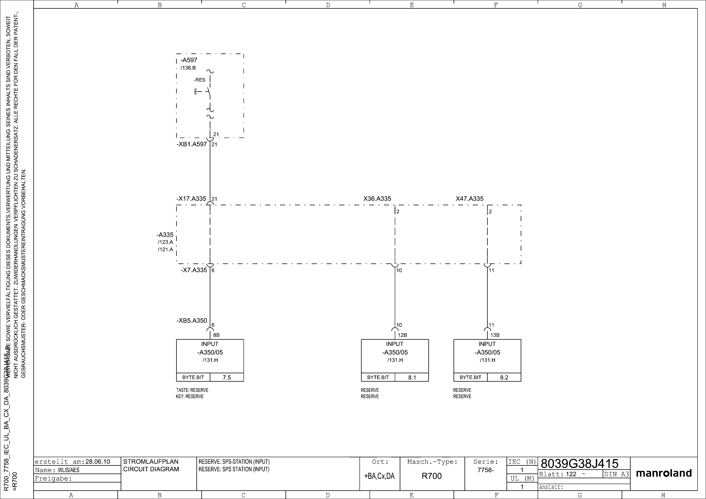

# +BA_Cx_DA — Sheet 122 of 247 — RESERVE: SPS STATION (INPUT)

**RESERVE: SPS STATION (INPUT)**

> Part of the manroland **R700** printing press IEC/UL circuit diagrams.
> Drawing class: **Stromlaufplan / Circuit diagram** (DIN A3).
> Document `+BA_Cx_DA` covers the **Printing units / main switch cabinet** machine section.

## At a glance

| Field | Value |
|---|---|
| Document | `+BA_Cx_DA`  (8039G38J415) |
| Sheet | **122** of 247 |
| Section (DE) | RESERVE: SPS STATION (INPUT) |
| Section (EN) | RESERVE: SPS STATION (INPUT) |
| Section type | CIRCUIT — Circuit diagram |
| Machine type | `R700` |
| Series | `7758` |
| Created | 28.06.10 |
| Replaces | — |
| Columns used | B, C, E, F |
| Path numbers | — |
| Labels on sheet | 47 |
| Cross-refs out | 6 |
| Cross-refs in | 16 |

**Previous:** [+BA_Cx_DA sheet 121](SHEET_0121.md) · **Next:** [+BA_Cx_DA sheet 123](SHEET_0123.md) · **Document TOC:** [_TOC.md](_TOC.md)  (+BA_Cx_DA) · **Master TOC:** [all sheets](../_MASTER_TOC.md)

## Sheet image (300 DPI, exact vector render)



_Rendered directly from the PDF vector layer at 300 DPI (1-bit), no OCR and no resampling. Use it to confirm anything ambiguous in the text below._

## Cross-references on this sheet

Each entry is a wire leaving this sheet. The printed token is `/sheet.column`; the link resolves to that sheet inside the same document.

| Ref | Target sheet | Col | Path | Destination on target | Target section | From col |
|---|---|---|---|---|---|---|
| `/136.B` | [+BA_Cx_DA sheet 136](SHEET_0136.md) | B | — | A597 | REFERENZMODUL | B |
| `/123.A` | [+BA_Cx_DA sheet 123](SHEET_0123.md) | A | — | — | RESERVE: SPS STATION (INPUT) | B |
| `/121.A` | [+BA_Cx_DA sheet 121](SHEET_0121.md) | A | — | — | RESERVE: SPS STATION (INPUT) | B |
| `/131.H` | [+BA_Cx_DA sheet 131](SHEET_0131.md) | H | — | — | REFERENZMODUL | C |
| `/131.H` | [+BA_Cx_DA sheet 131](SHEET_0131.md) | H | — | — | REFERENZMODUL | E |
| `/131.H` | [+BA_Cx_DA sheet 131](SHEET_0131.md) | H | — | — | REFERENZMODUL | F |

### Incoming references (sheets that point here)

Every other sheet that sends a wire to this one. `Back-ref` is the token printed on *that* sheet; `Path` is its line number.

| From sheet | Cols | Back-ref | Path | Refs | What continues there |
|---|---|---|---|---|---|
| [+BA_Cx_DA#121](SHEET_0121.md) | A | `/121.A` | — | 1 | — |
| [+BA_Cx_DA#123](SHEET_0123.md) | A | `/123.A` | — | 1 | — |
| [+BA_Cx_DA#131](SHEET_0131.md) | H | `/131.H` | — | 3 | — |
| [+BA_Cx_DA#136](SHEET_0136.md) | B | `/136.B` | — | 1 | — |
| [+BA_Cx_DA#143](SHEET_0143.md) | B | `/143.B` | — | 1 | — |
| [+BA_Cx_DA#161](SHEET_0161.md) | F | `/161.F` | — | 3 | — |
| [+BA_Cx_DA#163](SHEET_0163.md) | G | `/163.G` | — | 3 | — |
| [+BA_Cx_DA#173](SHEET_0173.md) | B | `/173.B` | — | 1 | — |
| [+BA_Cx_DA#180](SHEET_0180.md) | F | `/180.F` | — | 1 | — |
| [+BA_Cx_DA#182](SHEET_0182.md) | C | `/182.C` | — | 1 | — |


## Devices on this sheet

| Tag | Class | Class meaning (IEC) | Col | Sub | Terminal | Sign |
|---|---|---|---|---|---|---|
| `A350/05` | A | Baugruppe / assembly, module, PC board | C | 05 | — | — |
| `A350/05` | A | Baugruppe / assembly, module, PC board | E | 05 | — | — |
| `A597` | A | Baugruppe / assembly, module, PC board | B | — | — | — |
| `A350/05` | A | Baugruppe / assembly, module, PC board | F | 05 | — | — |
| `A335` | A | Baugruppe / assembly, module, PC board | B | — | — | — |
| `7.5` | — | cross-device reference | C | — | — | — |
| `X7.A335` | — | cross-device reference | B | — | — | — |
| `XB5.A350` | — | cross-device reference | B | — | — | — |
| `8.1` | — | cross-device reference | E | — | — | — |
| `XB1.A597` | — | cross-device reference | B | — | — | — |
| `X17.A335` | — | cross-device reference | B | — | — | — |
| `8.2` | — | cross-device reference | F | — | — | — |
| `X36.A335` | — | cross-device reference | E | — | — | — |
| `X47.A335` | — | cross-device reference | F | — | — | — |

## Potentials / nets

_No named potentials on this sheet._

## Wire-end annotations (grouped as printed)

A wire that continues elsewhere is annotated with a small cluster: the destination description, the path/line number `#NN`, and the `/sheet.column` cross reference. Each row below is one such cluster exactly as it is grouped on the drawing.

| Col | Y | Path | Cross-ref | Text on the wire |
|---|---|---|---|---|
| B | 96.7 | — | `/136.B` | `A597` |
| B | 131.1 | — | — | `RES` |
| C | 222.8 | — | — | `21` |
| B | 238.4 | — | — | `XB1.A597 21` |
| B | 330.5 | — | — | `X17.A335 21` |
| E | 330.5 | — | — | `X36.A335 X47.A335` |
| E | 353.2 | — | — | `2 2` |
| B | 391.5 | — | — | `A335` |
| B | 404.6 | — | `/123.A`, `/121.A` | — |
| B | 451.0 | — | — | `X7.A335 6` |
| E | 452.4 | — | — | `10` |
| F | 452.4 | — | — | `11` |
| B | 536.1 | — | — | `XB5.A350 6` |
| E | 544.6 | — | — | `10` |
| F | 544.6 | — | — | `11` |
| C | 561.5 | — | — | `8B` |
| E | 561.5 | — | — | `12B` |
| F | 561.5 | — | — | `13B` |
| C | 576.1 | — | — | `INPUT` |
| E | 576.1 | — | — | `INPUT` |
| F | 576.1 | — | — | `INPUT` |
| C | 589.9 | — | — | `A350/05` |
| E | 589.9 | — | — | `A350/05` |
| F | 589.9 | — | — | `A350/05` |
| C | 603.7 | — | `/131.H` | — |
| E | 603.7 | — | `/131.H` | — |
| F | 603.7 | — | `/131.H` | — |
| C | 632.7 | — | — | `BYTE.BIT 7.5` |
| E | 632.7 | — | — | `BYTE.BIT 8.1` |
| F | 632.7 | — | — | `BYTE.BIT 8.2` |
| B | 655.4 | — | — | `KEY: RESERVE TASTE: RESERVE` |
| E | 655.4 | — | — | `RESERVE RESERVE` |
| F | 655.4 | — | — | `RESERVE RESERVE` |


## Reconstructed tables

This sheet carries tabular content (pin map / terminal assignment / index). The grid below was rebuilt from the drawing's own rule lines, so each row is exactly one physical row of the table.

### Table 1 — 3 data rows × 2 columns (at x=297.6, y=90.7)

| A597 /136.B RES | 21 |
|---|---|
| `XB1.A597 X17.A335 X7.A335 XB5.A350` | `21 21 6 6 8B` |
| `INPUT` | `A350/05 /131.H` |
| `BYTE.BIT` | `7.5` |


### Table 2 — 1 data rows × 2 columns (at x=609.4, y=572.6)

| INPUT | A350/05 /131.H |
|---|---|
| `BYTE.BIT` | `8.1` |


### Table 3 — 1 data rows × 2 columns (at x=765.4, y=572.6)

| INPUT | A350/05 /131.H |
|---|---|
| `BYTE.BIT` | `8.2` |


## Notes and free text on this sheet

| Text | Col | Y (pt) |
|---|---|---|
| `8B` | C | 561.53 |
| `INPUT` | C | 576.07 |
| `BYTE.BIT` | B | 633.32 |
| `TASTE: RESERVE` | B | 655.4 |
| `KEY: RESERVE` | B | 666.02 |
| `12B` | E | 561.55 |
| `INPUT` | E | 576.07 |
| `BYTE.BIT` | E | 633.32 |
| `RESERVE` | E | 655.39 |
| `RES` | B | 131.13 |
| `13B` | F | 561.55 |
| `INPUT` | F | 576.07 |
| `BYTE.BIT` | F | 633.32 |
| `RESERVE` | F | 655.39 |

## Complete label inventory (exact text from the drawing)

Every text object inside the drawing area of this sheet, in DIN reading order (column A→H, then top→bottom). This is the authoritative list: if a string is not here it is not printed on this sheet.

| Col | Y | X | Dir | Type | Text |
|---|---|---|---|---|---|
| B | 96.7 | 304.4 | → | device tag | `A597` |
| B | 110.5 | 304.7 | → | cross-reference | `/136.B` |
| B | 131.1 | 326.8 | → | text | `RES` |
| B | 238.4 | 297.9 | → | device ref | `XB1.A597` |
| B | 330.5 | 297.6 | → | device ref | `X17.A335` |
| B | 391.5 | 264.2 | → | device tag | `A335` |
| B | 404.6 | 266.5 | → | cross-reference | `/123.A` |
| B | 417.0 | 266.5 | → | cross-reference | `/121.A` |
| B | 451.0 | 305.0 | → | device ref | `X7.A335` |
| B | 536.1 | 297.9 | → | device ref | `XB5.A350` |
| B | 633.3 | 307.6 | → | text | `BYTE.BIT` |
| B | 655.4 | 297.4 | → | text | `TASTE: RESERVE` |
| B | 666.0 | 296.8 | → | text | `KEY: RESERVE` |
| C | 222.8 | 359.7 | → | number | `21` |
| C | 239.9 | 356.9 | → | number | `21` |
| C | 332.0 | 356.9 | → | number | `21` |
| C | 452.5 | 356.9 | → | number | `6` |
| C | 544.6 | 356.9 | → | number | `6` |
| C | 561.5 | 359.7 | → | text | `8B` |
| C | 576.1 | 339.4 | → | text | `INPUT` |
| C | 589.9 | 332.9 | → | device tag | `A350/05` |
| C | 603.7 | 341.9 | → | cross-reference | `/131.H` |
| C | 632.7 | 375.9 | → | device ref | `7.5` |
| E | 330.5 | 612.9 | → | device ref | `X36.A335` |
| E | 353.2 | 668.7 | → | number | `2` |
| E | 452.5 | 668.1 | → | number | `10` |
| E | 544.6 | 668.1 | → | number | `10` |
| E | 561.5 | 671.0 | → | text | `12B` |
| E | 576.1 | 651.3 | → | text | `INPUT` |
| E | 589.9 | 644.7 | → | device tag | `A350/05` |
| E | 603.7 | 653.7 | → | cross-reference | `/131.H` |
| E | 632.7 | 688.5 | → | device ref | `8.1` |
| E | 633.3 | 619.4 | → | text | `BYTE.BIT` |
| E | 655.4 | 608.6 | → | text | `RESERVE` |
| E | 666.0 | 608.6 | → | text | `RESERVE` |
| F | 330.5 | 768.8 | → | device ref | `X47.A335` |
| F | 353.2 | 824.6 | → | number | `2` |
| F | 452.5 | 824.0 | → | number | `11` |
| F | 544.6 | 824.0 | → | number | `11` |
| F | 561.5 | 826.9 | → | text | `13B` |
| F | 576.1 | 807.2 | → | text | `INPUT` |
| F | 589.9 | 800.6 | → | device tag | `A350/05` |
| F | 603.7 | 809.6 | → | cross-reference | `/131.H` |
| F | 632.7 | 843.6 | → | device ref | `8.2` |
| F | 633.3 | 775.3 | → | text | `BYTE.BIT` |
| F | 655.4 | 764.5 | → | text | `RESERVE` |
| F | 666.0 | 764.5 | → | text | `RESERVE` |

## Reading-order text block

The same content as a plain block, grouped by DIN column — convenient to paste or to match against a visual description.

```text
=== Column B ===
  96.7  304.4  devtag       A597
 110.5  304.7  xref         /136.B
 131.1  326.8  text         RES
 238.4  297.9  devref       XB1.A597
 330.5  297.6  devref       X17.A335
 391.5  264.2  devtag       A335
 404.6  266.5  xref         /123.A
 417.0  266.5  xref         /121.A
 451.0  305.0  devref       X7.A335
 536.1  297.9  devref       XB5.A350
 633.3  307.6  text         BYTE.BIT
 655.4  297.4  text         TASTE: RESERVE
 666.0  296.8  text         KEY: RESERVE
=== Column C ===
 222.8  359.7  numeric      21
 239.9  356.9  numeric      21
 332.0  356.9  numeric      21
 452.5  356.9  numeric      6
 544.6  356.9  numeric      6
 561.5  359.7  text         8B
 576.1  339.4  text         INPUT
 589.9  332.9  devtag       A350/05
 603.7  341.9  xref         /131.H
 632.7  375.9  devref       7.5
=== Column E ===
 330.5  612.9  devref       X36.A335
 353.2  668.7  numeric      2
 452.5  668.1  numeric      10
 544.6  668.1  numeric      10
 561.5  671.0  text         12B
 576.1  651.3  text         INPUT
 589.9  644.7  devtag       A350/05
 603.7  653.7  xref         /131.H
 632.7  688.5  devref       8.1
 633.3  619.4  text         BYTE.BIT
 655.4  608.6  text         RESERVE
 666.0  608.6  text         RESERVE
=== Column F ===
 330.5  768.8  devref       X47.A335
 353.2  824.6  numeric      2
 452.5  824.0  numeric      11
 544.6  824.0  numeric      11
 561.5  826.9  text         13B
 576.1  807.2  text         INPUT
 589.9  800.6  devtag       A350/05
 603.7  809.6  xref         /131.H
 632.7  843.6  devref       8.2
 633.3  775.3  text         BYTE.BIT
 655.4  764.5  text         RESERVE
 666.0  764.5  text         RESERVE
```

---
_Generated from the PDF vector text layer; no OCR. Source: `R700_7758_IEC_UL_BA_CX_DA_8039G38J415_p`, sheet 122._
