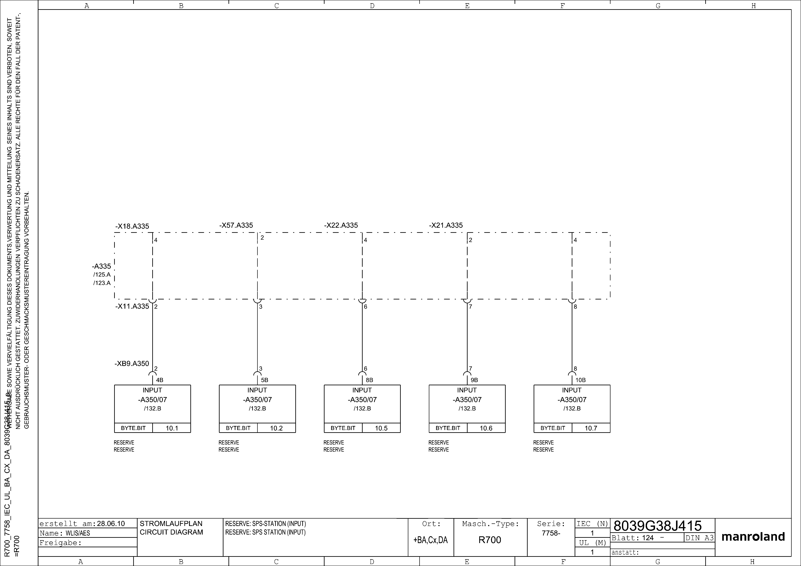

# +BA_Cx_DA — Sheet 124 of 247 — RESERVE: SPS STATION (INPUT)

**RESERVE: SPS STATION (INPUT)**

> Part of the manroland **R700** printing press IEC/UL circuit diagrams.
> Drawing class: **Stromlaufplan / Circuit diagram** (DIN A3).
> Document `+BA_Cx_DA` covers the **Printing units / main switch cabinet** machine section.

## At a glance

| Field | Value |
|---|---|
| Document | `+BA_Cx_DA`  (8039G38J415) |
| Sheet | **124** of 247 |
| Section (DE) | RESERVE: SPS STATION (INPUT) |
| Section (EN) | RESERVE: SPS STATION (INPUT) |
| Section type | CIRCUIT — Circuit diagram |
| Machine type | `R700` |
| Series | `7758` |
| Created | 28.06.10 |
| Replaces | — |
| Columns used | A, B, C, D, E, F |
| Path numbers | — |
| Labels on sheet | 64 |
| Cross-refs out | 7 |
| Cross-refs in | 22 |

**Previous:** [+BA_Cx_DA sheet 123](SHEET_0123.md) · **Next:** [+BA_Cx_DA sheet 125](SHEET_0125.md) · **Document TOC:** [_TOC.md](_TOC.md)  (+BA_Cx_DA) · **Master TOC:** [all sheets](../_MASTER_TOC.md)

## Sheet image (300 DPI, exact vector render)



_Rendered directly from the PDF vector layer at 300 DPI (1-bit), no OCR and no resampling. Use it to confirm anything ambiguous in the text below._

## Cross-references on this sheet

Each entry is a wire leaving this sheet. The printed token is `/sheet.column`; the link resolves to that sheet inside the same document.

| Ref | Target sheet | Col | Path | Destination on target | Target section | From col |
|---|---|---|---|---|---|---|
| `/125.A` | [+BA_Cx_DA sheet 125](SHEET_0125.md) | A | — | — | RESERVE: SPS STATION (INPUT) | A |
| `/123.A` | [+BA_Cx_DA sheet 123](SHEET_0123.md) | A | — | — | RESERVE: SPS STATION (INPUT) | A |
| `/132.B` | [+BA_Cx_DA sheet 132](SHEET_0132.md) | B | — | — | REFERENZMODUL | B |
| `/132.B` | [+BA_Cx_DA sheet 132](SHEET_0132.md) | B | — | — | REFERENZMODUL | C |
| `/132.B` | [+BA_Cx_DA sheet 132](SHEET_0132.md) | B | — | — | REFERENZMODUL | D |
| `/132.B` | [+BA_Cx_DA sheet 132](SHEET_0132.md) | B | — | — | REFERENZMODUL | E |
| `/132.B` | [+BA_Cx_DA sheet 132](SHEET_0132.md) | B | — | — | REFERENZMODUL | F |

### Incoming references (sheets that point here)

Every other sheet that sends a wire to this one. `Back-ref` is the token printed on *that* sheet; `Path` is its line number.

| From sheet | Cols | Back-ref | Path | Refs | What continues there |
|---|---|---|---|---|---|
| [+BA_Cx_DA#123](SHEET_0123.md) | A | `/123.A` | — | 1 | — |
| [+BA_Cx_DA#125](SHEET_0125.md) | A | `/125.A` | — | 1 | — |
| [+BA_Cx_DA#132](SHEET_0132.md) | B | `/132.B` | — | 5 | — |
| [+BA_Cx_DA#166](SHEET_0166.md) | G | `/166.G` | — | 5 | — |
| [+BA_Cx_DA#168](SHEET_0168.md) | G | `/168.G` | — | 5 | — |
| [+BA_Cx_DA#173](SHEET_0173.md) | F | `/173.F` | — | 1 | — |
| [+BA_Cx_DA#174](SHEET_0174.md) | B, E | `/174.B`, `/174.E` | — | 3 | — |
| [+BA_Cx_DA#183](SHEET_0183.md) | A | `/183.A` | — | 1 | — |


## Devices on this sheet

| Tag | Class | Class meaning (IEC) | Col | Sub | Terminal | Sign |
|---|---|---|---|---|---|---|
| `A350/07` | A | Baugruppe / assembly, module, PC board | B | 07 | — | — |
| `A335` | A | Baugruppe / assembly, module, PC board | A | — | — | — |
| `A350/07` | A | Baugruppe / assembly, module, PC board | D | 07 | — | — |
| `A350/07` | A | Baugruppe / assembly, module, PC board | E | 07 | — | — |
| `A350/07` | A | Baugruppe / assembly, module, PC board | F | 07 | — | — |
| `A350/07` | A | Baugruppe / assembly, module, PC board | C | 07 | — | — |
| `10.1` | — | cross-device reference | B | — | — | — |
| `X11.A335` | — | cross-device reference | A | — | — | — |
| `XB9.A350` | — | cross-device reference | A | — | — | — |
| `10.5` | — | cross-device reference | D | — | — | — |
| `10.6` | — | cross-device reference | E | — | — | — |
| `10.7` | — | cross-device reference | F | — | — | — |
| `10.2` | — | cross-device reference | C | — | — | — |
| `X18.A335` | — | cross-device reference | A | — | — | — |
| `X22.A335` | — | cross-device reference | D | — | — | — |
| `X21.A335` | — | cross-device reference | E | — | — | — |
| `X57.A335` | — | cross-device reference | C | — | — | — |

## Potentials / nets

_No named potentials on this sheet._

## Wire-end annotations (grouped as printed)

A wire that continues elsewhere is annotated with a small cluster: the destination description, the path/line number `#NN`, and the `/sheet.column` cross reference. Each row below is one such cluster exactly as it is grouped on the drawing.

| Col | Y | Path | Cross-ref | Text on the wire |
|---|---|---|---|---|
| C | 330.5 | — | — | `X57.A335` |
| D | 330.5 | — | — | `X22.A335` |
| E | 330.5 | — | — | `X21.A335` |
| A | 332.0 | — | — | `X18.A335` |
| C | 349.7 | — | — | `2` |
| B | 353.2 | — | — | `4` |
| D | 353.2 | — | — | `4` |
| E | 353.2 | — | — | `2` |
| F | 353.2 | — | — | `4` |
| A | 391.5 | — | — | `A335` |
| A | 404.6 | — | `/125.A`, `/123.A` | — |
| B | 451.0 | — | — | `X11.A335 2` |
| C | 452.4 | — | — | `3` |
| D | 452.4 | — | — | `6` |
| E | 452.4 | — | — | `7` |
| F | 452.4 | — | — | `8` |
| B | 536.1 | — | — | `XB9.A350 2` |
| C | 544.6 | — | — | `3` |
| D | 544.6 | — | — | `6` |
| E | 544.6 | — | — | `7` |
| F | 544.6 | — | — | `8` |
| B | 561.5 | — | — | `4B` |
| C | 561.5 | — | — | `5B` |
| D | 561.5 | — | — | `8B` |
| E | 561.5 | — | — | `9B` |
| F | 561.5 | — | — | `10B` |
| B | 576.1 | — | — | `INPUT` |
| C | 576.1 | — | — | `INPUT` |
| D | 576.1 | — | — | `INPUT` |
| E | 576.1 | — | — | `INPUT` |
| F | 576.1 | — | — | `INPUT` |
| B | 589.9 | — | — | `A350/07` |
| C | 589.9 | — | — | `A350/07` |
| D | 589.9 | — | — | `A350/07` |
| E | 589.9 | — | — | `A350/07` |
| F | 589.9 | — | — | `A350/07` |
| B | 603.7 | — | `/132.B` | — |
| C | 603.7 | — | `/132.B` | — |
| D | 603.7 | — | `/132.B` | — |
| E | 603.7 | — | `/132.B` | — |
| F | 603.7 | — | `/132.B` | — |
| B | 632.8 | — | — | `BYTE.BIT 10.1` |
| C | 632.8 | — | — | `BYTE.BIT 10.2` |
| D | 632.8 | — | — | `BYTE.BIT 10.5` |
| E | 632.8 | — | — | `BYTE.BIT 10.6` |
| F | 632.8 | — | — | `BYTE.BIT 10.7` |
| A | 655.4 | — | — | `RESERVE RESERVE` |
| B | 655.4 | — | — | `RESERVE RESERVE` |
| D | 655.4 | — | — | `RESERVE RESERVE` |
| E | 655.4 | — | — | `RESERVE RESERVE` |
| F | 655.4 | — | — | `RESERVE RESERVE` |


## Reconstructed tables

This sheet carries tabular content (pin map / terminal assignment / index). The grid below was rebuilt from the drawing's own rule lines, so each row is exactly one physical row of the table.

### Table 1 — 1 data rows × 2 columns (at x=170.1, y=572.6)

| INPUT | A350/07 /132.B |
|---|---|
| `BYTE.BIT` | `10.1` |


### Table 2 — 1 data rows × 2 columns (at x=326.0, y=572.6)

| INPUT | A350/07 /132.B |
|---|---|
| `BYTE.BIT` | `10.2` |


### Table 3 — 1 data rows × 2 columns (at x=481.9, y=572.6)

| INPUT | A350/07 /132.B |
|---|---|
| `BYTE.BIT` | `10.5` |


### Table 4 — 1 data rows × 2 columns (at x=637.8, y=572.6)

| INPUT | A350/07 /132.B |
|---|---|
| `BYTE.BIT` | `10.6` |


### Table 5 — 1 data rows × 2 columns (at x=793.7, y=572.6)

| INPUT | A350/07 /132.B |
|---|---|
| `BYTE.BIT` | `10.7` |


## Notes and free text on this sheet

| Text | Col | Y (pt) |
|---|---|---|
| `4B` | B | 561.53 |
| `INPUT` | B | 576.07 |
| `BYTE.BIT` | A | 633.32 |
| `RESERVE` | A | 655.39 |
| `8B` | D | 561.53 |
| `INPUT` | D | 576.07 |
| `BYTE.BIT` | D | 633.32 |
| `RESERVE` | D | 655.39 |
| `9B` | E | 561.53 |
| `INPUT` | E | 576.07 |
| `BYTE.BIT` | E | 633.32 |
| `RESERVE` | E | 655.39 |
| `10B` | F | 561.55 |
| `INPUT` | F | 576.07 |
| `BYTE.BIT` | F | 633.32 |
| `RESERVE` | F | 655.39 |
| `5B` | C | 561.53 |
| `INPUT` | C | 576.07 |
| `BYTE.BIT` | C | 633.32 |
| `RESERVE` | B | 655.39 |

## Complete label inventory (exact text from the drawing)

Every text object inside the drawing area of this sheet, in DIN reading order (column A→H, then top→bottom). This is the authoritative list: if a string is not here it is not printed on this sheet.

| Col | Y | X | Dir | Type | Text |
|---|---|---|---|---|---|
| A | 332.0 | 171.5 | → | device ref | `X18.A335` |
| A | 391.5 | 136.6 | → | device tag | `A335` |
| A | 404.6 | 138.9 | → | cross-reference | `/125.A` |
| A | 417.0 | 138.9 | → | cross-reference | `/123.A` |
| A | 451.0 | 171.5 | → | device ref | `X11.A335` |
| A | 536.1 | 170.4 | → | device ref | `XB9.A350` |
| A | 633.3 | 180.0 | → | text | `BYTE.BIT` |
| A | 655.4 | 169.2 | → | text | `RESERVE` |
| A | 666.0 | 169.2 | → | text | `RESERVE` |
| B | 353.2 | 229.3 | → | number | `4` |
| B | 452.5 | 229.3 | → | number | `2` |
| B | 544.6 | 229.3 | → | number | `2` |
| B | 561.5 | 232.2 | → | text | `4B` |
| B | 576.1 | 211.9 | → | text | `INPUT` |
| B | 589.9 | 205.4 | → | device tag | `A350/07` |
| B | 603.7 | 214.2 | → | cross-reference | `/132.B` |
| B | 632.8 | 246.2 | → | device ref | `10.1` |
| B | 655.4 | 325.1 | → | text | `RESERVE` |
| B | 666.0 | 325.1 | → | text | `RESERVE` |
| C | 330.5 | 326.0 | → | device ref | `X57.A335` |
| C | 349.7 | 387.5 | → | number | `2` |
| C | 452.5 | 385.2 | → | number | `3` |
| C | 544.6 | 385.2 | → | number | `3` |
| C | 561.5 | 388.1 | → | text | `5B` |
| C | 576.1 | 367.8 | → | text | `INPUT` |
| C | 589.9 | 361.3 | → | device tag | `A350/07` |
| C | 603.7 | 370.1 | → | cross-reference | `/132.B` |
| C | 632.8 | 401.2 | → | device ref | `10.2` |
| C | 633.3 | 335.9 | → | text | `BYTE.BIT` |
| D | 330.5 | 481.9 | → | device ref | `X22.A335` |
| D | 353.2 | 541.1 | → | number | `4` |
| D | 452.5 | 541.1 | → | number | `6` |
| D | 544.6 | 541.1 | → | number | `6` |
| D | 561.5 | 544.0 | → | text | `8B` |
| D | 576.1 | 523.7 | → | text | `INPUT` |
| D | 589.9 | 517.2 | → | device tag | `A350/07` |
| D | 603.7 | 526.0 | → | cross-reference | `/132.B` |
| D | 632.8 | 557.1 | → | device ref | `10.5` |
| D | 633.3 | 491.8 | → | text | `BYTE.BIT` |
| D | 655.4 | 481.0 | → | text | `RESERVE` |
| D | 666.0 | 481.0 | → | text | `RESERVE` |
| E | 330.5 | 637.8 | → | device ref | `X21.A335` |
| E | 353.2 | 697.0 | → | number | `2` |
| E | 452.5 | 697.0 | → | number | `7` |
| E | 544.6 | 697.0 | → | number | `7` |
| E | 561.5 | 699.9 | → | text | `9B` |
| E | 576.1 | 679.6 | → | text | `INPUT` |
| E | 589.9 | 673.1 | → | device tag | `A350/07` |
| E | 603.7 | 681.9 | → | cross-reference | `/132.B` |
| E | 632.8 | 713.1 | → | device ref | `10.6` |
| E | 633.3 | 647.7 | → | text | `BYTE.BIT` |
| E | 655.4 | 636.9 | → | text | `RESERVE` |
| E | 666.0 | 636.9 | → | text | `RESERVE` |
| F | 353.2 | 852.9 | → | number | `4` |
| F | 452.5 | 852.9 | → | number | `8` |
| F | 544.6 | 852.9 | → | number | `8` |
| F | 561.5 | 855.2 | → | text | `10B` |
| F | 576.1 | 835.5 | → | text | `INPUT` |
| F | 589.9 | 829.0 | → | device tag | `A350/07` |
| F | 603.7 | 837.8 | → | cross-reference | `/132.B` |
| F | 632.8 | 869.0 | → | device ref | `10.7` |
| F | 633.3 | 803.6 | → | text | `BYTE.BIT` |
| F | 655.4 | 792.9 | → | text | `RESERVE` |
| F | 666.0 | 792.9 | → | text | `RESERVE` |

## Reading-order text block

The same content as a plain block, grouped by DIN column — convenient to paste or to match against a visual description.

```text
=== Column A ===
 332.0  171.5  devref       X18.A335
 391.5  136.6  devtag       A335
 404.6  138.9  xref         /125.A
 417.0  138.9  xref         /123.A
 451.0  171.5  devref       X11.A335
 536.1  170.4  devref       XB9.A350
 633.3  180.0  text         BYTE.BIT
 655.4  169.2  text         RESERVE
 666.0  169.2  text         RESERVE
=== Column B ===
 353.2  229.3  numeric      4
 452.5  229.3  numeric      2
 544.6  229.3  numeric      2
 561.5  232.2  text         4B
 576.1  211.9  text         INPUT
 589.9  205.4  devtag       A350/07
 603.7  214.2  xref         /132.B
 632.8  246.2  devref       10.1
 655.4  325.1  text         RESERVE
 666.0  325.1  text         RESERVE
=== Column C ===
 330.5  326.0  devref       X57.A335
 349.7  387.5  numeric      2
 452.5  385.2  numeric      3
 544.6  385.2  numeric      3
 561.5  388.1  text         5B
 576.1  367.8  text         INPUT
 589.9  361.3  devtag       A350/07
 603.7  370.1  xref         /132.B
 632.8  401.2  devref       10.2
 633.3  335.9  text         BYTE.BIT
=== Column D ===
 330.5  481.9  devref       X22.A335
 353.2  541.1  numeric      4
 452.5  541.1  numeric      6
 544.6  541.1  numeric      6
 561.5  544.0  text         8B
 576.1  523.7  text         INPUT
 589.9  517.2  devtag       A350/07
 603.7  526.0  xref         /132.B
 632.8  557.1  devref       10.5
 633.3  491.8  text         BYTE.BIT
 655.4  481.0  text         RESERVE
 666.0  481.0  text         RESERVE
=== Column E ===
 330.5  637.8  devref       X21.A335
 353.2  697.0  numeric      2
 452.5  697.0  numeric      7
 544.6  697.0  numeric      7
 561.5  699.9  text         9B
 576.1  679.6  text         INPUT
 589.9  673.1  devtag       A350/07
 603.7  681.9  xref         /132.B
 632.8  713.1  devref       10.6
 633.3  647.7  text         BYTE.BIT
 655.4  636.9  text         RESERVE
 666.0  636.9  text         RESERVE
=== Column F ===
 353.2  852.9  numeric      4
 452.5  852.9  numeric      8
 544.6  852.9  numeric      8
 561.5  855.2  text         10B
 576.1  835.5  text         INPUT
 589.9  829.0  devtag       A350/07
 603.7  837.8  xref         /132.B
 632.8  869.0  devref       10.7
 633.3  803.6  text         BYTE.BIT
 655.4  792.9  text         RESERVE
 666.0  792.9  text         RESERVE
```

---
_Generated from the PDF vector text layer; no OCR. Source: `R700_7758_IEC_UL_BA_CX_DA_8039G38J415_p`, sheet 124._
