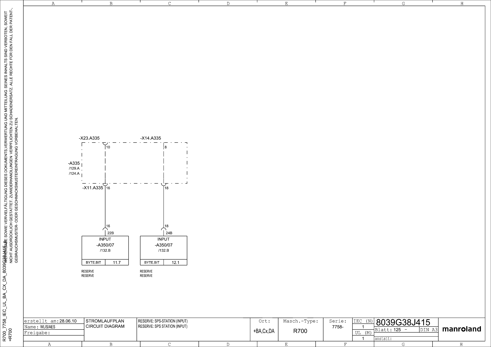

# +BA_Cx_DA — Sheet 125 of 247 — RESERVE: SPS STATION (INPUT)

**RESERVE: SPS STATION (INPUT)**

> Part of the manroland **R700** printing press IEC/UL circuit diagrams.
> Drawing class: **Stromlaufplan / Circuit diagram** (DIN A3).
> Document `+BA_Cx_DA` covers the **Printing units / main switch cabinet** machine section.

## At a glance

| Field | Value |
|---|---|
| Document | `+BA_Cx_DA`  (8039G38J415) |
| Sheet | **125** of 247 |
| Section (DE) | RESERVE: SPS STATION (INPUT) |
| Section (EN) | RESERVE: SPS STATION (INPUT) |
| Section type | CIRCUIT — Circuit diagram |
| Machine type | `R700` |
| Series | `7758` |
| Created | 28.06.10 |
| Replaces | — |
| Columns used | A, B, C |
| Path numbers | — |
| Labels on sheet | 28 |
| Cross-refs out | 4 |
| Cross-refs in | 10 |

**Previous:** [+BA_Cx_DA sheet 124](SHEET_0124.md) · **Next:** [+BA_Cx_DA sheet 126](SHEET_0126.md) · **Document TOC:** [_TOC.md](_TOC.md)  (+BA_Cx_DA) · **Master TOC:** [all sheets](../_MASTER_TOC.md)

## Sheet image (300 DPI, exact vector render)



_Rendered directly from the PDF vector layer at 300 DPI (1-bit), no OCR and no resampling. Use it to confirm anything ambiguous in the text below._

## Cross-references on this sheet

Each entry is a wire leaving this sheet. The printed token is `/sheet.column`; the link resolves to that sheet inside the same document.

| Ref | Target sheet | Col | Path | Destination on target | Target section | From col |
|---|---|---|---|---|---|---|
| `/129.A` | [+BA_Cx_DA sheet 129](SHEET_0129.md) | A | — | — | RESERVE: SPS STATION (OUTPUT) | A |
| `/124.A` | [+BA_Cx_DA sheet 124](SHEET_0124.md) | A | — | — | RESERVE: SPS STATION (INPUT) | A |
| `/132.B` | [+BA_Cx_DA sheet 132](SHEET_0132.md) | B | — | — | REFERENZMODUL | B |
| `/132.B` | [+BA_Cx_DA sheet 132](SHEET_0132.md) | B | — | — | REFERENZMODUL | C |

### Incoming references (sheets that point here)

Every other sheet that sends a wire to this one. `Back-ref` is the token printed on *that* sheet; `Path` is its line number.

| From sheet | Cols | Back-ref | Path | Refs | What continues there |
|---|---|---|---|---|---|
| [+BA_Cx_DA#124](SHEET_0124.md) | A | `/124.A` | — | 1 | — |
| [+BA_Cx_DA#129](SHEET_0129.md) | A | `/129.A` | — | 1 | — |
| [+BA_Cx_DA#132](SHEET_0132.md) | B | `/132.B` | — | 2 | — |
| [+BA_Cx_DA#166](SHEET_0166.md) | G | `/166.G` | — | 2 | — |
| [+BA_Cx_DA#168](SHEET_0168.md) | G | `/168.G` | — | 2 | — |
| [+BA_Cx_DA#170](SHEET_0170.md) | H | `/170.H` | — | 1 | — |
| [+BA_Cx_DA#174](SHEET_0174.md) | G | `/174.G` | — | 1 | — |


## Devices on this sheet

| Tag | Class | Class meaning (IEC) | Col | Sub | Terminal | Sign |
|---|---|---|---|---|---|---|
| `A350/07` | A | Baugruppe / assembly, module, PC board | B | 07 | — | — |
| `A335` | A | Baugruppe / assembly, module, PC board | A | — | — | — |
| `A350/07` | A | Baugruppe / assembly, module, PC board | C | 07 | — | — |
| `11.7` | — | cross-device reference | B | — | — | — |
| `X11.A335` | — | cross-device reference | B | — | — | — |
| `12.1` | — | cross-device reference | C | — | — | — |
| `X23.A335` | — | cross-device reference | B | — | — | — |
| `X14.A335` | — | cross-device reference | C | — | — | — |

## Potentials / nets

_No named potentials on this sheet._

## Wire-end annotations (grouped as printed)

A wire that continues elsewhere is annotated with a small cluster: the destination description, the path/line number `#NN`, and the `/sheet.column` cross reference. Each row below is one such cluster exactly as it is grouped on the drawing.

| Col | Y | Path | Cross-ref | Text on the wire |
|---|---|---|---|---|
| B | 330.5 | — | — | `X23.A335` |
| C | 330.5 | — | — | `X14.A335` |
| B | 353.2 | — | — | `10` |
| C | 353.2 | — | — | `8` |
| A | 391.5 | — | — | `A335` |
| A | 404.6 | — | `/129.A`, `/124.A` | — |
| B | 451.0 | — | — | `X11.A335 16` |
| C | 452.4 | — | — | `18` |
| B | 544.6 | — | — | `16` |
| C | 544.6 | — | — | `18` |
| B | 561.5 | — | — | `22B` |
| C | 561.5 | — | — | `24B` |
| B | 576.1 | — | — | `INPUT` |
| C | 576.1 | — | — | `INPUT` |
| B | 589.9 | — | — | `A350/07` |
| C | 589.9 | — | — | `A350/07` |
| B | 603.7 | — | `/132.B` | — |
| C | 603.7 | — | `/132.B` | — |
| B | 632.8 | — | — | `BYTE.BIT 11.7` |
| C | 632.8 | — | — | `BYTE.BIT 12.1` |
| B | 655.4 | — | — | `RESERVE RESERVE` |
| C | 655.4 | — | — | `RESERVE RESERVE` |


## Reconstructed tables

This sheet carries tabular content (pin map / terminal assignment / index). The grid below was rebuilt from the drawing's own rule lines, so each row is exactly one physical row of the table.

### Table 1 — 1 data rows × 2 columns (at x=198.4, y=572.6)

| INPUT | A350/07 /132.B |
|---|---|
| `BYTE.BIT` | `11.7` |


### Table 2 — 1 data rows × 2 columns (at x=340.2, y=572.6)

| INPUT | A350/07 /132.B |
|---|---|
| `BYTE.BIT` | `12.1` |


## Notes and free text on this sheet

| Text | Col | Y (pt) |
|---|---|---|
| `22B` | B | 561.55 |
| `INPUT` | B | 576.07 |
| `BYTE.BIT` | B | 633.32 |
| `RESERVE` | B | 655.39 |
| `24B` | C | 561.55 |
| `INPUT` | C | 576.07 |
| `BYTE.BIT` | C | 633.32 |
| `RESERVE` | C | 655.39 |

## Complete label inventory (exact text from the drawing)

Every text object inside the drawing area of this sheet, in DIN reading order (column A→H, then top→bottom). This is the authoritative list: if a string is not here it is not printed on this sheet.

| Col | Y | X | Dir | Type | Text |
|---|---|---|---|---|---|
| A | 391.5 | 165.0 | → | device tag | `A335` |
| A | 404.6 | 167.2 | → | cross-reference | `/129.A` |
| A | 417.0 | 167.2 | → | cross-reference | `/124.A` |
| B | 330.5 | 191.3 | → | device ref | `X23.A335` |
| B | 353.2 | 257.1 | → | number | `10` |
| B | 451.0 | 199.8 | → | device ref | `X11.A335` |
| B | 452.5 | 257.1 | → | number | `16` |
| B | 544.6 | 257.1 | → | number | `16` |
| B | 561.5 | 260.5 | → | text | `22B` |
| B | 576.1 | 240.2 | → | text | `INPUT` |
| B | 589.9 | 233.7 | → | device tag | `A350/07` |
| B | 603.7 | 242.5 | → | cross-reference | `/132.B` |
| B | 632.8 | 273.7 | → | device ref | `11.7` |
| B | 633.3 | 208.3 | → | text | `BYTE.BIT` |
| B | 655.4 | 197.6 | → | text | `RESERVE` |
| B | 666.0 | 197.6 | → | text | `RESERVE` |
| C | 330.5 | 340.2 | → | device ref | `X14.A335` |
| C | 353.2 | 399.4 | → | number | `8` |
| C | 452.5 | 398.8 | → | number | `18` |
| C | 544.6 | 398.8 | → | number | `18` |
| C | 561.5 | 402.2 | → | text | `24B` |
| C | 576.1 | 382.0 | → | text | `INPUT` |
| C | 589.9 | 375.4 | → | device tag | `A350/07` |
| C | 603.7 | 384.2 | → | cross-reference | `/132.B` |
| C | 632.8 | 416.3 | → | device ref | `12.1` |
| C | 633.3 | 350.1 | → | text | `BYTE.BIT` |
| C | 655.4 | 339.3 | → | text | `RESERVE` |
| C | 666.0 | 339.3 | → | text | `RESERVE` |

## Reading-order text block

The same content as a plain block, grouped by DIN column — convenient to paste or to match against a visual description.

```text
=== Column A ===
 391.5  165.0  devtag       A335
 404.6  167.2  xref         /129.A
 417.0  167.2  xref         /124.A
=== Column B ===
 330.5  191.3  devref       X23.A335
 353.2  257.1  numeric      10
 451.0  199.8  devref       X11.A335
 452.5  257.1  numeric      16
 544.6  257.1  numeric      16
 561.5  260.5  text         22B
 576.1  240.2  text         INPUT
 589.9  233.7  devtag       A350/07
 603.7  242.5  xref         /132.B
 632.8  273.7  devref       11.7
 633.3  208.3  text         BYTE.BIT
 655.4  197.6  text         RESERVE
 666.0  197.6  text         RESERVE
=== Column C ===
 330.5  340.2  devref       X14.A335
 353.2  399.4  numeric      8
 452.5  398.8  numeric      18
 544.6  398.8  numeric      18
 561.5  402.2  text         24B
 576.1  382.0  text         INPUT
 589.9  375.4  devtag       A350/07
 603.7  384.2  xref         /132.B
 632.8  416.3  devref       12.1
 633.3  350.1  text         BYTE.BIT
 655.4  339.3  text         RESERVE
 666.0  339.3  text         RESERVE
```

---
_Generated from the PDF vector text layer; no OCR. Source: `R700_7758_IEC_UL_BA_CX_DA_8039G38J415_p`, sheet 125._
