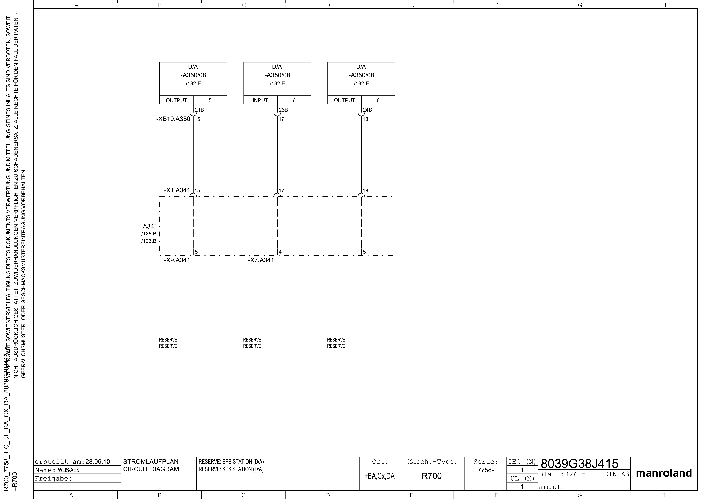

# +BA_Cx_DA — Sheet 127 of 247 — RESERVE: SPS STATION (D/A)

**RESERVE: SPS STATION (D/A)**

> Part of the manroland **R700** printing press IEC/UL circuit diagrams.
> Drawing class: **Stromlaufplan / Circuit diagram** (DIN A3).
> Document `+BA_Cx_DA` covers the **Printing units / main switch cabinet** machine section.

## At a glance

| Field | Value |
|---|---|
| Document | `+BA_Cx_DA`  (8039G38J415) |
| Sheet | **127** of 247 |
| Section (DE) | RESERVE: SPS STATION (D/A) |
| Section (EN) | RESERVE: SPS STATION (D/A) |
| Section type | CIRCUIT — Circuit diagram |
| Machine type | `R700` |
| Series | `7758` |
| Created | 28.06.10 |
| Replaces | — |
| Columns used | B, C, D, E |
| Path numbers | — |
| Labels on sheet | 40 |
| Cross-refs out | 5 |
| Cross-refs in | 14 |

**Previous:** [+BA_Cx_DA sheet 126](SHEET_0126.md) · **Next:** [+BA_Cx_DA sheet 128](SHEET_0128.md) · **Document TOC:** [_TOC.md](_TOC.md)  (+BA_Cx_DA) · **Master TOC:** [all sheets](../_MASTER_TOC.md)

## Sheet image (300 DPI, exact vector render)



_Rendered directly from the PDF vector layer at 300 DPI (1-bit), no OCR and no resampling. Use it to confirm anything ambiguous in the text below._

## Cross-references on this sheet

Each entry is a wire leaving this sheet. The printed token is `/sheet.column`; the link resolves to that sheet inside the same document.

| Ref | Target sheet | Col | Path | Destination on target | Target section | From col |
|---|---|---|---|---|---|---|
| `/132.E` | [+BA_Cx_DA sheet 132](SHEET_0132.md) | E | — | — | REFERENZMODUL | B |
| `/132.E` | [+BA_Cx_DA sheet 132](SHEET_0132.md) | E | — | — | REFERENZMODUL | C |
| `/132.E` | [+BA_Cx_DA sheet 132](SHEET_0132.md) | E | — | — | REFERENZMODUL | D |
| `/128.B` | [+BA_Cx_DA sheet 128](SHEET_0128.md) | B | — | — | RESERVE: SPS STATION (D/A) | B |
| `/126.B` | [+BA_Cx_DA sheet 126](SHEET_0126.md) | B | — | — | RESERVE: SPS STATION (D/A) | B |

### Incoming references (sheets that point here)

Every other sheet that sends a wire to this one. `Back-ref` is the token printed on *that* sheet; `Path` is its line number.

| From sheet | Cols | Back-ref | Path | Refs | What continues there |
|---|---|---|---|---|---|
| [+BA_Cx_DA#126](SHEET_0126.md) | A | `/126.A` | — | 1 | — |
| [+BA_Cx_DA#128](SHEET_0128.md) | B | `/128.B` | — | 1 | — |
| [+BA_Cx_DA#132](SHEET_0132.md) | E | `/132.E` | — | 3 | — |
| [+BA_Cx_DA#141](SHEET_0141.md) | D | `/141.D` | — | 3 | — |
| [+BA_Cx_DA#163](SHEET_0163.md) | H | `/163.H` | — | 2 | — |
| [+BA_Cx_DA#166](SHEET_0166.md) | E | `/166.E` | — | 1 | — |
| [+BA_Cx_DA#167](SHEET_0167.md) | C | `/167.C` | — | 3 | — |


## Devices on this sheet

| Tag | Class | Class meaning (IEC) | Col | Sub | Terminal | Sign |
|---|---|---|---|---|---|---|
| `A341` | A | Baugruppe / assembly, module, PC board | B | — | — | — |
| `A350/08` | A | Baugruppe / assembly, module, PC board | B | 08 | — | — |
| `A350/08` | A | Baugruppe / assembly, module, PC board | D | 08 | — | — |
| `A350/08` | A | Baugruppe / assembly, module, PC board | C | 08 | — | — |
| `X1.A341` | — | cross-device reference | B | — | — | — |
| `XB10.A350` | — | cross-device reference | B | — | — | — |
| `X9.A341` | — | cross-device reference | B | — | — | — |
| `X7.A341` | — | cross-device reference | C | — | — | — |

## Potentials / nets

_No named potentials on this sheet._

## Wire-end annotations (grouped as printed)

A wire that continues elsewhere is annotated with a small cluster: the destination description, the path/line number `#NN`, and the `/sheet.column` cross reference. Each row below is one such cluster exactly as it is grouped on the drawing.

| Col | Y | Path | Cross-ref | Text on the wire |
|---|---|---|---|---|
| B | 108.3 | — | — | `D/A` |
| C | 108.3 | — | — | `D/A` |
| D | 108.3 | — | — | `D/A` |
| B | 122.2 | — | — | `A350/08` |
| C | 122.2 | — | — | `A350/08` |
| D | 122.2 | — | — | `A350/08` |
| B | 137.0 | — | `/132.E` | — |
| C | 137.0 | — | `/132.E` | — |
| D | 137.0 | — | `/132.E` | — |
| B | 165.4 | — | — | `OUTPUT 5` |
| C | 165.4 | — | — | `INPUT 6` |
| D | 165.4 | — | — | `OUTPUT 6` |
| B | 181.7 | — | — | `21B` |
| C | 181.7 | — | — | `23B` |
| D | 181.7 | — | — | `24B` |
| B | 195.9 | — | — | `XB10.A350 15` |
| D | 197.3 | — | — | `17 18` |
| B | 316.4 | — | — | `X1.A341 15` |
| D | 317.8 | — | — | `17 18` |
| B | 377.3 | — | — | `A341` |
| B | 390.4 | — | `/128.B`, `/126.B` | — |
| B | 421.3 | — | — | `X9.A341 5` |
| D | 421.3 | — | — | `X7.A341 4 5` |
| B | 570.4 | — | — | `RESERVE RESERVE` |
| C | 570.4 | — | — | `RESERVE RESERVE` |
| D | 570.4 | — | — | `RESERVE RESERVE` |


## Reconstructed tables

This sheet carries tabular content (pin map / terminal assignment / index). The grid below was rebuilt from the drawing's own rule lines, so each row is exactly one physical row of the table.

### Table 1 — 1 data rows × 2 columns (at x=269.3, y=104.9)

| D/A | A350/08 /132.E |
|---|---|
| `OUTPUT` | `5` |


### Table 2 — 1 data rows × 2 columns (at x=411.0, y=104.9)

| D/A | A350/08 /132.E |
|---|---|
| `INPUT` | `6` |


### Table 3 — 1 data rows × 2 columns (at x=552.8, y=104.9)

| D/A | A350/08 /132.E |
|---|---|
| `OUTPUT` | `6` |


## Notes and free text on this sheet

| Text | Col | Y (pt) |
|---|---|---|
| `21B` | B | 181.7 |
| `D/A` | B | 108.3 |
| `OUTPUT` | B | 165.41 |
| `RESERVE` | B | 570.35 |
| `24B` | D | 181.7 |
| `D/A` | D | 108.3 |
| `OUTPUT` | D | 165.41 |
| `RESERVE` | D | 570.35 |
| `23B` | C | 181.7 |
| `D/A` | C | 108.3 |
| `INPUT` | C | 165.4 |
| `RESERVE` | C | 570.35 |

## Complete label inventory (exact text from the drawing)

Every text object inside the drawing area of this sheet, in DIN reading order (column A→H, then top→bottom). This is the authoritative list: if a string is not here it is not printed on this sheet.

| Col | Y | X | Dir | Type | Text |
|---|---|---|---|---|---|
| B | 108.3 | 317.2 | → | text | `D/A` |
| B | 122.2 | 304.6 | → | device tag | `A350/08` |
| B | 137.0 | 313.5 | → | cross-reference | `/132.E` |
| B | 165.4 | 279.6 | → | text | `OUTPUT` |
| B | 181.7 | 328.5 | → | text | `21B` |
| B | 195.9 | 263.6 | → | device ref | `XB10.A350` |
| B | 197.3 | 328.0 | → | number | `15` |
| B | 316.4 | 276.7 | → | device ref | `X1.A341` |
| B | 317.8 | 328.0 | → | number | `15` |
| B | 377.3 | 237.3 | → | device tag | `A341` |
| B | 390.4 | 238.4 | → | cross-reference | `/128.B` |
| B | 402.8 | 238.4 | → | cross-reference | `/126.B` |
| B | 421.3 | 328.5 | → | number | `5` |
| B | 434.0 | 276.7 | → | device ref | `X9.A341` |
| B | 570.3 | 268.4 | → | text | `RESERVE` |
| B | 581.0 | 268.4 | → | text | `RESERVE` |
| C | 108.3 | 458.9 | → | text | `D/A` |
| C | 122.2 | 446.3 | → | device tag | `A350/08` |
| C | 137.0 | 455.2 | → | cross-reference | `/132.E` |
| C | 165.4 | 351.9 | → | number | `5` |
| C | 165.4 | 425.9 | → | text | `INPUT` |
| C | 181.7 | 470.3 | → | text | `23B` |
| C | 197.3 | 469.7 | → | number | `17` |
| C | 317.8 | 469.7 | → | number | `17` |
| C | 421.3 | 470.3 | → | number | `4` |
| C | 434.0 | 418.4 | → | device ref | `X7.A341` |
| C | 570.3 | 410.2 | → | text | `RESERVE` |
| C | 581.0 | 410.2 | → | text | `RESERVE` |
| D | 108.3 | 600.7 | → | text | `D/A` |
| D | 122.2 | 588.0 | → | device tag | `A350/08` |
| D | 137.0 | 597.0 | → | cross-reference | `/132.E` |
| D | 165.4 | 493.7 | → | number | `6` |
| D | 165.4 | 563.1 | → | text | `OUTPUT` |
| D | 181.7 | 612.0 | → | text | `24B` |
| D | 197.3 | 611.4 | → | number | `18` |
| D | 317.8 | 611.4 | → | number | `18` |
| D | 421.3 | 612.0 | → | number | `5` |
| D | 570.3 | 551.9 | → | text | `RESERVE` |
| D | 581.0 | 551.9 | → | text | `RESERVE` |
| E | 165.4 | 635.4 | → | number | `6` |

## Reading-order text block

The same content as a plain block, grouped by DIN column — convenient to paste or to match against a visual description.

```text
=== Column B ===
 108.3  317.2  text         D/A
 122.2  304.6  devtag       A350/08
 137.0  313.5  xref         /132.E
 165.4  279.6  text         OUTPUT
 181.7  328.5  text         21B
 195.9  263.6  devref       XB10.A350
 197.3  328.0  numeric      15
 316.4  276.7  devref       X1.A341
 317.8  328.0  numeric      15
 377.3  237.3  devtag       A341
 390.4  238.4  xref         /128.B
 402.8  238.4  xref         /126.B
 421.3  328.5  numeric      5
 434.0  276.7  devref       X9.A341
 570.3  268.4  text         RESERVE
 581.0  268.4  text         RESERVE
=== Column C ===
 108.3  458.9  text         D/A
 122.2  446.3  devtag       A350/08
 137.0  455.2  xref         /132.E
 165.4  351.9  numeric      5
 165.4  425.9  text         INPUT
 181.7  470.3  text         23B
 197.3  469.7  numeric      17
 317.8  469.7  numeric      17
 421.3  470.3  numeric      4
 434.0  418.4  devref       X7.A341
 570.3  410.2  text         RESERVE
 581.0  410.2  text         RESERVE
=== Column D ===
 108.3  600.7  text         D/A
 122.2  588.0  devtag       A350/08
 137.0  597.0  xref         /132.E
 165.4  493.7  numeric      6
 165.4  563.1  text         OUTPUT
 181.7  612.0  text         24B
 197.3  611.4  numeric      18
 317.8  611.4  numeric      18
 421.3  612.0  numeric      5
 570.3  551.9  text         RESERVE
 581.0  551.9  text         RESERVE
=== Column E ===
 165.4  635.4  numeric      6
```

---
_Generated from the PDF vector text layer; no OCR. Source: `R700_7758_IEC_UL_BA_CX_DA_8039G38J415_p`, sheet 127._
