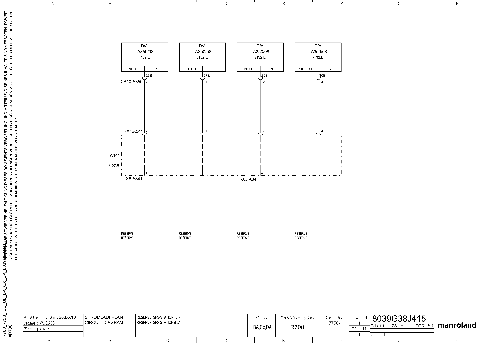

# +BA_Cx_DA — Sheet 128 of 247 — RESERVE: SPS STATION (D/A)

**RESERVE: SPS STATION (D/A)**

> Part of the manroland **R700** printing press IEC/UL circuit diagrams.
> Drawing class: **Stromlaufplan / Circuit diagram** (DIN A3).
> Document `+BA_Cx_DA` covers the **Printing units / main switch cabinet** machine section.

## At a glance

| Field | Value |
|---|---|
| Document | `+BA_Cx_DA`  (8039G38J415) |
| Sheet | **128** of 247 |
| Section (DE) | RESERVE: SPS STATION (D/A) |
| Section (EN) | RESERVE: SPS STATION (D/A) |
| Section type | CIRCUIT — Circuit diagram |
| Machine type | `R700` |
| Series | `7758` |
| Created | 28.06.10 |
| Replaces | — |
| Columns used | B, C, D, E, F |
| Path numbers | — |
| Labels on sheet | 50 |
| Cross-refs out | 5 |
| Cross-refs in | 17 |

**Previous:** [+BA_Cx_DA sheet 127](SHEET_0127.md) · **Next:** [+BA_Cx_DA sheet 129](SHEET_0129.md) · **Document TOC:** [_TOC.md](_TOC.md)  (+BA_Cx_DA) · **Master TOC:** [all sheets](../_MASTER_TOC.md)

## Sheet image (300 DPI, exact vector render)



_Rendered directly from the PDF vector layer at 300 DPI (1-bit), no OCR and no resampling. Use it to confirm anything ambiguous in the text below._

## Cross-references on this sheet

Each entry is a wire leaving this sheet. The printed token is `/sheet.column`; the link resolves to that sheet inside the same document.

| Ref | Target sheet | Col | Path | Destination on target | Target section | From col |
|---|---|---|---|---|---|---|
| `/132.E` | [+BA_Cx_DA sheet 132](SHEET_0132.md) | E | — | — | REFERENZMODUL | C |
| `/132.E` | [+BA_Cx_DA sheet 132](SHEET_0132.md) | E | — | — | REFERENZMODUL | D |
| `/132.E` | [+BA_Cx_DA sheet 132](SHEET_0132.md) | E | — | — | REFERENZMODUL | E |
| `/132.E` | [+BA_Cx_DA sheet 132](SHEET_0132.md) | E | — | — | REFERENZMODUL | F |
| `/127.B` | [+BA_Cx_DA sheet 127](SHEET_0127.md) | B | — | — | RESERVE: SPS STATION (D/A) | B |

### Incoming references (sheets that point here)

Every other sheet that sends a wire to this one. `Back-ref` is the token printed on *that* sheet; `Path` is its line number.

| From sheet | Cols | Back-ref | Path | Refs | What continues there |
|---|---|---|---|---|---|
| [+BA_Cx_DA#127](SHEET_0127.md) | B | `/127.B` | — | 1 | — |
| [+BA_Cx_DA#132](SHEET_0132.md) | E | `/132.E` | — | 4 | — |
| [+BA_Cx_DA#141](SHEET_0141.md) | D | `/141.D` | — | 4 | — |
| [+BA_Cx_DA#156](SHEET_0156.md) | H | `/156.H` | — | 2 | — |
| [+BA_Cx_DA#161](SHEET_0161.md) | B | `/161.B` | — | 2 | — |
| [+BA_Cx_DA#167](SHEET_0167.md) | C | `/167.C` | — | 4 | — |


## Devices on this sheet

| Tag | Class | Class meaning (IEC) | Col | Sub | Terminal | Sign |
|---|---|---|---|---|---|---|
| `A350/08` | A | Baugruppe / assembly, module, PC board | C | 08 | — | — |
| `A350/08` | A | Baugruppe / assembly, module, PC board | D | 08 | — | — |
| `A350/08` | A | Baugruppe / assembly, module, PC board | E | 08 | — | — |
| `A350/08` | A | Baugruppe / assembly, module, PC board | F | 08 | — | — |
| `A341` | A | Baugruppe / assembly, module, PC board | B | — | — | — |
| `X1.A341` | — | cross-device reference | B | — | — | — |
| `XB10.A350` | — | cross-device reference | B | — | — | — |
| `X3.A341` | — | cross-device reference | D | — | — | — |
| `X5.A341` | — | cross-device reference | B | — | — | — |

## Potentials / nets

_No named potentials on this sheet._

## Wire-end annotations (grouped as printed)

A wire that continues elsewhere is annotated with a small cluster: the destination description, the path/line number `#NN`, and the `/sheet.column` cross reference. Each row below is one such cluster exactly as it is grouped on the drawing.

| Col | Y | Path | Cross-ref | Text on the wire |
|---|---|---|---|---|
| C | 108.3 | — | — | `D/A` |
| D | 108.3 | — | — | `D/A` |
| E | 108.3 | — | — | `D/A` |
| F | 108.3 | — | — | `D/A` |
| C | 122.2 | — | — | `A350/08` |
| D | 122.2 | — | — | `A350/08` |
| E | 122.2 | — | — | `A350/08` |
| F | 122.2 | — | — | `A350/08` |
| C | 137.0 | — | `/132.E` | — |
| D | 137.0 | — | `/132.E` | — |
| E | 137.0 | — | `/132.E` | — |
| F | 137.0 | — | `/132.E` | — |
| C | 165.4 | — | — | `INPUT 7` |
| D | 165.4 | — | — | `OUTPUT 7` |
| E | 165.4 | — | — | `INPUT 8` |
| F | 165.4 | — | — | `OUTPUT 8` |
| C | 181.7 | — | — | `26B` |
| D | 181.7 | — | — | `27B` |
| E | 181.7 | — | — | `29B` |
| F | 181.7 | — | — | `30B` |
| C | 195.9 | — | — | `XB10.A350 20 21` |
| E | 197.3 | — | — | `23 24` |
| D | 317.8 | — | — | `X1.A341 20 21 23 24` |
| B | 377.3 | — | — | `A341` |
| B | 402.8 | — | `/127.B` | — |
| D | 421.3 | — | — | `X5.A341 4 5 X3.A341 4 5` |
| B | 570.4 | — | — | `RESERVE RESERVE` |
| C | 570.4 | — | — | `RESERVE RESERVE` |
| D | 570.4 | — | — | `RESERVE RESERVE` |
| E | 570.4 | — | — | `RESERVE RESERVE` |


## Reconstructed tables

This sheet carries tabular content (pin map / terminal assignment / index). The grid below was rebuilt from the drawing's own rule lines, so each row is exactly one physical row of the table.

### Table 1 — 1 data rows × 2 columns (at x=297.6, y=104.9)

| D/A | A350/08 /132.E |
|---|---|
| `INPUT` | `7` |


### Table 2 — 1 data rows × 2 columns (at x=439.4, y=104.9)

| D/A | A350/08 /132.E |
|---|---|
| `OUTPUT` | `7` |


### Table 3 — 1 data rows × 2 columns (at x=581.1, y=104.9)

| D/A | A350/08 /132.E |
|---|---|
| `INPUT` | `8` |


### Table 4 — 1 data rows × 2 columns (at x=722.8, y=104.9)

| D/A | A350/08 /132.E |
|---|---|
| `OUTPUT` | `8` |


## Notes and free text on this sheet

| Text | Col | Y (pt) |
|---|---|---|
| `26B` | C | 181.7 |
| `D/A` | C | 108.3 |
| `INPUT` | B | 165.4 |
| `RESERVE` | B | 570.35 |
| `27B` | D | 181.7 |
| `D/A` | D | 108.3 |
| `OUTPUT` | C | 165.41 |
| `RESERVE` | C | 570.35 |
| `29B` | E | 181.7 |
| `D/A` | E | 108.3 |
| `INPUT` | D | 165.4 |
| `RESERVE` | D | 570.35 |
| `30B` | F | 181.7 |
| `D/A` | F | 108.3 |
| `OUTPUT` | E | 165.41 |
| `RESERVE` | E | 570.35 |

## Complete label inventory (exact text from the drawing)

Every text object inside the drawing area of this sheet, in DIN reading order (column A→H, then top→bottom). This is the authoritative list: if a string is not here it is not printed on this sheet.

| Col | Y | X | Dir | Type | Text |
|---|---|---|---|---|---|
| B | 165.4 | 312.5 | → | text | `INPUT` |
| B | 195.9 | 292.0 | → | device ref | `XB10.A350` |
| B | 317.8 | 306.4 | → | device ref | `X1.A341` |
| B | 377.3 | 265.6 | → | device tag | `A341` |
| B | 402.8 | 266.7 | → | cross-reference | `/127.B` |
| B | 434.0 | 305.0 | → | device ref | `X5.A341` |
| B | 570.3 | 296.8 | → | text | `RESERVE` |
| B | 581.0 | 296.8 | → | text | `RESERVE` |
| C | 108.3 | 345.5 | → | text | `D/A` |
| C | 122.2 | 332.9 | → | device tag | `A350/08` |
| C | 137.0 | 341.9 | → | cross-reference | `/132.E` |
| C | 165.4 | 380.3 | → | number | `7` |
| C | 165.4 | 449.7 | → | text | `OUTPUT` |
| C | 181.7 | 356.9 | → | text | `26B` |
| C | 197.3 | 356.9 | → | number | `20` |
| C | 317.8 | 356.9 | → | number | `20` |
| C | 421.3 | 356.9 | → | number | `4` |
| C | 570.3 | 438.5 | → | text | `RESERVE` |
| C | 581.0 | 438.5 | → | text | `RESERVE` |
| D | 108.3 | 487.3 | → | text | `D/A` |
| D | 122.2 | 474.7 | → | device tag | `A350/08` |
| D | 137.0 | 483.6 | → | cross-reference | `/132.E` |
| D | 165.4 | 522.0 | → | number | `7` |
| D | 165.4 | 596.0 | → | text | `INPUT` |
| D | 181.7 | 498.6 | → | text | `27B` |
| D | 197.3 | 498.6 | → | number | `21` |
| D | 317.8 | 498.6 | → | number | `21` |
| D | 421.3 | 498.6 | → | number | `5` |
| D | 435.4 | 589.9 | → | device ref | `X3.A341` |
| D | 570.3 | 580.3 | → | text | `RESERVE` |
| D | 581.0 | 580.3 | → | text | `RESERVE` |
| E | 108.3 | 629.0 | → | text | `D/A` |
| E | 122.2 | 616.4 | → | device tag | `A350/08` |
| E | 137.0 | 625.3 | → | cross-reference | `/132.E` |
| E | 165.4 | 663.7 | → | number | `8` |
| E | 165.4 | 733.2 | → | text | `OUTPUT` |
| E | 181.7 | 640.3 | → | text | `29B` |
| E | 197.3 | 640.3 | → | number | `23` |
| E | 317.8 | 640.3 | → | number | `23` |
| E | 421.3 | 640.3 | → | number | `4` |
| E | 570.3 | 722.0 | → | text | `RESERVE` |
| E | 581.0 | 722.0 | → | text | `RESERVE` |
| F | 108.3 | 770.7 | → | text | `D/A` |
| F | 122.2 | 758.1 | → | device tag | `A350/08` |
| F | 137.0 | 767.1 | → | cross-reference | `/132.E` |
| F | 165.4 | 805.5 | → | number | `8` |
| F | 181.7 | 782.1 | → | text | `30B` |
| F | 197.3 | 782.1 | → | number | `24` |
| F | 317.8 | 782.1 | → | number | `24` |
| F | 421.3 | 782.1 | → | number | `5` |

## Reading-order text block

The same content as a plain block, grouped by DIN column — convenient to paste or to match against a visual description.

```text
=== Column B ===
 165.4  312.5  text         INPUT
 195.9  292.0  devref       XB10.A350
 317.8  306.4  devref       X1.A341
 377.3  265.6  devtag       A341
 402.8  266.7  xref         /127.B
 434.0  305.0  devref       X5.A341
 570.3  296.8  text         RESERVE
 581.0  296.8  text         RESERVE
=== Column C ===
 108.3  345.5  text         D/A
 122.2  332.9  devtag       A350/08
 137.0  341.9  xref         /132.E
 165.4  380.3  numeric      7
 165.4  449.7  text         OUTPUT
 181.7  356.9  text         26B
 197.3  356.9  numeric      20
 317.8  356.9  numeric      20
 421.3  356.9  numeric      4
 570.3  438.5  text         RESERVE
 581.0  438.5  text         RESERVE
=== Column D ===
 108.3  487.3  text         D/A
 122.2  474.7  devtag       A350/08
 137.0  483.6  xref         /132.E
 165.4  522.0  numeric      7
 165.4  596.0  text         INPUT
 181.7  498.6  text         27B
 197.3  498.6  numeric      21
 317.8  498.6  numeric      21
 421.3  498.6  numeric      5
 435.4  589.9  devref       X3.A341
 570.3  580.3  text         RESERVE
 581.0  580.3  text         RESERVE
=== Column E ===
 108.3  629.0  text         D/A
 122.2  616.4  devtag       A350/08
 137.0  625.3  xref         /132.E
 165.4  663.7  numeric      8
 165.4  733.2  text         OUTPUT
 181.7  640.3  text         29B
 197.3  640.3  numeric      23
 317.8  640.3  numeric      23
 421.3  640.3  numeric      4
 570.3  722.0  text         RESERVE
 581.0  722.0  text         RESERVE
=== Column F ===
 108.3  770.7  text         D/A
 122.2  758.1  devtag       A350/08
 137.0  767.1  xref         /132.E
 165.4  805.5  numeric      8
 181.7  782.1  text         30B
 197.3  782.1  numeric      24
 317.8  782.1  numeric      24
 421.3  782.1  numeric      5
```

---
_Generated from the PDF vector text layer; no OCR. Source: `R700_7758_IEC_UL_BA_CX_DA_8039G38J415_p`, sheet 128._
