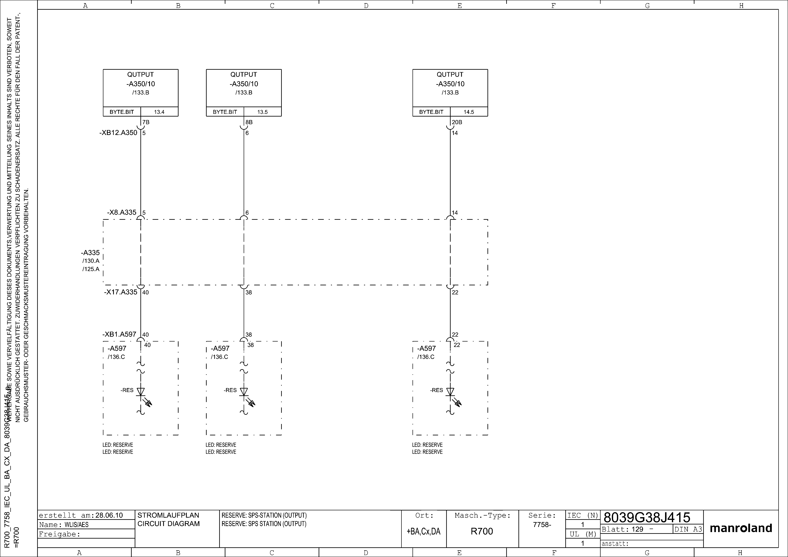

# +BA_Cx_DA — Sheet 129 of 247 — RESERVE: SPS STATION (OUTPUT)

**RESERVE: SPS STATION (OUTPUT)**

> Part of the manroland **R700** printing press IEC/UL circuit diagrams.
> Drawing class: **Stromlaufplan / Circuit diagram** (DIN A3).
> Document `+BA_Cx_DA` covers the **Printing units / main switch cabinet** machine section.

## At a glance

| Field | Value |
|---|---|
| Document | `+BA_Cx_DA`  (8039G38J415) |
| Sheet | **129** of 247 |
| Section (DE) | RESERVE: SPS STATION (OUTPUT) |
| Section (EN) | RESERVE: SPS STATION (OUTPUT) |
| Section type | CIRCUIT — Circuit diagram |
| Machine type | `R700` |
| Series | `7758` |
| Created | 28.06.10 |
| Replaces | — |
| Columns used | A, B, C, E |
| Path numbers | — |
| Labels on sheet | 55 |
| Cross-refs out | 8 |
| Cross-refs in | 20 |

**Previous:** [+BA_Cx_DA sheet 128](SHEET_0128.md) · **Next:** [+BA_Cx_DA sheet 130](SHEET_0130.md) · **Document TOC:** [_TOC.md](_TOC.md)  (+BA_Cx_DA) · **Master TOC:** [all sheets](../_MASTER_TOC.md)

## Sheet image (300 DPI, exact vector render)



_Rendered directly from the PDF vector layer at 300 DPI (1-bit), no OCR and no resampling. Use it to confirm anything ambiguous in the text below._

## Cross-references on this sheet

Each entry is a wire leaving this sheet. The printed token is `/sheet.column`; the link resolves to that sheet inside the same document.

| Ref | Target sheet | Col | Path | Destination on target | Target section | From col |
|---|---|---|---|---|---|---|
| `/133.B` | [+BA_Cx_DA sheet 133](SHEET_0133.md) | B | — | — | REFERENZMODUL | B |
| `/133.B` | [+BA_Cx_DA sheet 133](SHEET_0133.md) | B | — | — | REFERENZMODUL | C |
| `/133.B` | [+BA_Cx_DA sheet 133](SHEET_0133.md) | B | — | — | REFERENZMODUL | E |
| `/130.A` | [+BA_Cx_DA sheet 130](SHEET_0130.md) | A | — | — | RESERVE: SPS STATION (OUTPUT) | A |
| `/125.A` | [+BA_Cx_DA sheet 125](SHEET_0125.md) | A | — | — | RESERVE: SPS STATION (INPUT) | A |
| `/136.C` | [+BA_Cx_DA sheet 136](SHEET_0136.md) | C | — | A597 | REFERENZMODUL | A |
| `/136.C` | [+BA_Cx_DA sheet 136](SHEET_0136.md) | C | — | A597 | REFERENZMODUL | B |
| `/136.C` | [+BA_Cx_DA sheet 136](SHEET_0136.md) | C | — | A597 | REFERENZMODUL | E |

### Incoming references (sheets that point here)

Every other sheet that sends a wire to this one. `Back-ref` is the token printed on *that* sheet; `Path` is its line number.

| From sheet | Cols | Back-ref | Path | Refs | What continues there |
|---|---|---|---|---|---|
| [+BA_Cx_DA#125](SHEET_0125.md) | A | `/125.A` | — | 1 | — |
| [+BA_Cx_DA#130](SHEET_0130.md) | A | `/130.A` | — | 1 | — |
| [+BA_Cx_DA#133](SHEET_0133.md) | B | `/133.B` | — | 3 | — |
| [+BA_Cx_DA#136](SHEET_0136.md) | C | `/136.C` | — | 3 | — |
| [+BA_Cx_DA#143](SHEET_0143.md) | B, C | `/143.B`, `/143.C` | — | 3 | — |
| [+BA_Cx_DA#165](SHEET_0165.md) | E | `/165.E` | — | 3 | — |
| [+BA_Cx_DA#169](SHEET_0169.md) | G | `/169.G` | — | 3 | — |
| [+BA_Cx_DA#173](SHEET_0173.md) | B, C | `/173.B`, `/173.C` | — | 3 | — |


## Devices on this sheet

| Tag | Class | Class meaning (IEC) | Col | Sub | Terminal | Sign |
|---|---|---|---|---|---|---|
| `A597` | A | Baugruppe / assembly, module, PC board | B | — | — | — |
| `A597` | A | Baugruppe / assembly, module, PC board | A | — | — | — |
| `A597` | A | Baugruppe / assembly, module, PC board | E | — | — | — |
| `A350/10` | A | Baugruppe / assembly, module, PC board | C | 10 | — | — |
| `A350/10` | A | Baugruppe / assembly, module, PC board | E | 10 | — | — |
| `A350/10` | A | Baugruppe / assembly, module, PC board | B | 10 | — | — |
| `A335` | A | Baugruppe / assembly, module, PC board | A | — | — | — |
| `XB1.A597` | — | cross-device reference | A | — | — | — |
| `13.5` | — | cross-device reference | C | — | — | — |
| `14.5` | — | cross-device reference | E | — | — | — |
| `13.4` | — | cross-device reference | B | — | — | — |
| `XB12.A350` | — | cross-device reference | A | — | — | — |
| `X8.A335` | — | cross-device reference | A | — | — | — |
| `X17.A335` | — | cross-device reference | A | — | — | — |

## Potentials / nets

_No named potentials on this sheet._

## Wire-end annotations (grouped as printed)

A wire that continues elsewhere is annotated with a small cluster: the destination description, the path/line number `#NN`, and the `/sheet.column` cross reference. Each row below is one such cluster exactly as it is grouped on the drawing.

| Col | Y | Path | Cross-ref | Text on the wire |
|---|---|---|---|---|
| B | 108.3 | — | — | `QUTPUT` |
| C | 108.3 | — | — | `QUTPUT` |
| E | 108.3 | — | — | `QUTPUT` |
| B | 122.2 | — | — | `A350/10` |
| C | 122.2 | — | — | `A350/10` |
| E | 122.2 | — | — | `A350/10` |
| B | 136.0 | — | `/133.B` | — |
| C | 136.0 | — | `/133.B` | — |
| E | 136.0 | — | `/133.B` | — |
| B | 165.6 | — | — | `BYTE.BIT 13.4` |
| C | 165.6 | — | — | `BYTE.BIT 13.5` |
| E | 165.6 | — | — | `BYTE.BIT 14.5` |
| B | 181.0 | — | — | `7B` |
| C | 181.0 | — | — | `8B` |
| E | 181.0 | — | — | `20B` |
| A | 195.9 | — | — | `XB12.A350 5` |
| C | 197.3 | — | — | `6` |
| E | 197.3 | — | — | `14` |
| A | 316.4 | — | — | `X8.A335 5` |
| D | 317.8 | — | — | `6 14` |
| A | 377.3 | — | — | `A335` |
| A | 390.4 | — | `/130.A`, `/125.A` | — |
| A | 436.8 | — | — | `X17.A335 40` |
| D | 438.3 | — | — | `38 22` |
| A | 500.6 | — | — | `XB1.A597 40` |
| C | 502.1 | — | — | `38` |
| E | 502.1 | — | — | `22` |
| B | 517.6 | — | — | `40` |
| C | 517.6 | — | — | `38` |
| E | 517.6 | — | — | `22` |
| A | 521.9 | — | `/136.C` | `A597` |
| B | 521.9 | — | `/136.C` | `A597` |
| E | 521.9 | — | `/136.C` | `A597` |
| A | 586.1 | — | — | `RES` |
| C | 586.1 | — | — | `RES` |
| E | 586.1 | — | — | `RES` |
| A | 669.6 | — | — | `LED: RESERVE LED: RESERVE` |
| B | 669.6 | — | — | `LED: RESERVE LED: RESERVE` |
| E | 669.6 | — | — | `LED: RESERVE LED: RESERVE` |


## Reconstructed tables

This sheet carries tabular content (pin map / terminal assignment / index). The grid below was rebuilt from the drawing's own rule lines, so each row is exactly one physical row of the table.

### Table 1 — 3 data rows × 2 columns (at x=155.9, y=104.9)

| QUTPUT | A350/10 /133.B |
|---|---|
| `BYTE.BIT` | `13.4` |
| `XB12.A350 X8.A335 X17.A335 XB1.A597` | `7B 5 5 40 40` |
| `A597 /136.C RES` | `40` |


### Table 2 — 3 data rows × 2 columns (at x=311.8, y=104.9)

| QUTPUT | A350/10 /133.B |
|---|---|
| `BYTE.BIT` | `13.5` |
|  | `8B 6 6 38 38` |
| `A597 /136.C RES` | `38` |


### Table 3 — 3 data rows × 2 columns (at x=623.6, y=104.9)

| QUTPUT | A350/10 /133.B |
|---|---|
| `BYTE.BIT` | `14.5` |
|  | `20B 14 14 22 22` |
| `A597 /136.C RES` | `22` |


## Notes and free text on this sheet

| Text | Col | Y (pt) |
|---|---|---|
| `RES` | C | 586.09 |
| `LED: RESERVE` | B | 669.57 |
| `RES` | A | 586.09 |
| `LED: RESERVE` | A | 669.57 |
| `RES` | E | 586.09 |
| `LED: RESERVE` | E | 669.57 |
| `8B` | C | 180.98 |
| `QUTPUT` | C | 108.33 |
| `BYTE.BIT` | B | 165.6 |
| `20B` | E | 181 |
| `QUTPUT` | E | 108.33 |
| `BYTE.BIT` | E | 165.6 |
| `7B` | B | 180.98 |
| `QUTPUT` | B | 108.33 |
| `BYTE.BIT` | A | 165.6 |

## Complete label inventory (exact text from the drawing)

Every text object inside the drawing area of this sheet, in DIN reading order (column A→H, then top→bottom). This is the authoritative list: if a string is not here it is not printed on this sheet.

| Col | Y | X | Dir | Type | Text |
|---|---|---|---|---|---|
| A | 165.6 | 165.8 | → | text | `BYTE.BIT` |
| A | 195.9 | 150.2 | → | device ref | `XB12.A350` |
| A | 316.4 | 161.9 | → | device ref | `X8.A335` |
| A | 377.3 | 122.5 | → | device tag | `A335` |
| A | 390.4 | 124.7 | → | cross-reference | `/130.A` |
| A | 402.8 | 124.7 | → | cross-reference | `/125.A` |
| A | 436.8 | 157.3 | → | device ref | `X17.A335` |
| A | 500.6 | 154.8 | → | device ref | `XB1.A597` |
| A | 521.9 | 162.7 | → | device tag | `A597` |
| A | 535.7 | 163.0 | → | cross-reference | `/136.C` |
| A | 586.1 | 182.3 | → | text | `RES` |
| A | 669.6 | 155.1 | → | text | `LED: RESERVE` |
| A | 680.2 | 155.1 | → | text | `LED: RESERVE` |
| B | 108.3 | 192.3 | → | text | `QUTPUT` |
| B | 122.2 | 191.2 | → | device tag | `A350/10` |
| B | 136.0 | 200.0 | → | cross-reference | `/133.B` |
| B | 165.6 | 232.7 | → | device ref | `13.4` |
| B | 165.6 | 321.7 | → | text | `BYTE.BIT` |
| B | 181.0 | 215.1 | → | text | `7B` |
| B | 197.3 | 215.1 | → | number | `5` |
| B | 317.8 | 215.1 | → | number | `5` |
| B | 438.3 | 215.1 | → | number | `40` |
| B | 502.1 | 215.1 | → | number | `40` |
| B | 517.6 | 218.0 | → | number | `40` |
| B | 521.9 | 318.6 | → | device tag | `A597` |
| B | 535.7 | 318.9 | → | cross-reference | `/136.C` |
| B | 669.6 | 311.0 | → | text | `LED: RESERVE` |
| B | 680.2 | 311.0 | → | text | `LED: RESERVE` |
| C | 108.3 | 348.2 | → | text | `QUTPUT` |
| C | 122.2 | 347.1 | → | device tag | `A350/10` |
| C | 136.0 | 355.9 | → | cross-reference | `/133.B` |
| C | 165.6 | 388.6 | → | device ref | `13.5` |
| C | 181.0 | 371.1 | → | text | `8B` |
| C | 197.3 | 371.1 | → | number | `6` |
| C | 317.8 | 371.1 | → | number | `6` |
| C | 438.3 | 371.1 | → | number | `38` |
| C | 502.1 | 371.1 | → | number | `38` |
| C | 517.6 | 373.9 | → | number | `38` |
| C | 586.1 | 338.2 | → | text | `RES` |
| E | 108.3 | 660.0 | → | text | `QUTPUT` |
| E | 122.2 | 658.9 | → | device tag | `A350/10` |
| E | 136.0 | 667.7 | → | cross-reference | `/133.B` |
| E | 165.6 | 633.5 | → | text | `BYTE.BIT` |
| E | 165.6 | 700.4 | → | device ref | `14.5` |
| E | 181.0 | 682.9 | → | text | `20B` |
| E | 197.3 | 682.3 | → | number | `14` |
| E | 317.8 | 682.3 | → | number | `14` |
| E | 438.3 | 682.9 | → | number | `22` |
| E | 502.1 | 682.9 | → | number | `22` |
| E | 517.6 | 685.7 | → | number | `22` |
| E | 521.9 | 630.4 | → | device tag | `A597` |
| E | 535.7 | 630.7 | → | cross-reference | `/136.C` |
| E | 586.1 | 650.0 | → | text | `RES` |
| E | 669.6 | 622.8 | → | text | `LED: RESERVE` |
| E | 680.2 | 622.8 | → | text | `LED: RESERVE` |

## Reading-order text block

The same content as a plain block, grouped by DIN column — convenient to paste or to match against a visual description.

```text
=== Column A ===
 165.6  165.8  text         BYTE.BIT
 195.9  150.2  devref       XB12.A350
 316.4  161.9  devref       X8.A335
 377.3  122.5  devtag       A335
 390.4  124.7  xref         /130.A
 402.8  124.7  xref         /125.A
 436.8  157.3  devref       X17.A335
 500.6  154.8  devref       XB1.A597
 521.9  162.7  devtag       A597
 535.7  163.0  xref         /136.C
 586.1  182.3  text         RES
 669.6  155.1  text         LED: RESERVE
 680.2  155.1  text         LED: RESERVE
=== Column B ===
 108.3  192.3  text         QUTPUT
 122.2  191.2  devtag       A350/10
 136.0  200.0  xref         /133.B
 165.6  232.7  devref       13.4
 165.6  321.7  text         BYTE.BIT
 181.0  215.1  text         7B
 197.3  215.1  numeric      5
 317.8  215.1  numeric      5
 438.3  215.1  numeric      40
 502.1  215.1  numeric      40
 517.6  218.0  numeric      40
 521.9  318.6  devtag       A597
 535.7  318.9  xref         /136.C
 669.6  311.0  text         LED: RESERVE
 680.2  311.0  text         LED: RESERVE
=== Column C ===
 108.3  348.2  text         QUTPUT
 122.2  347.1  devtag       A350/10
 136.0  355.9  xref         /133.B
 165.6  388.6  devref       13.5
 181.0  371.1  text         8B
 197.3  371.1  numeric      6
 317.8  371.1  numeric      6
 438.3  371.1  numeric      38
 502.1  371.1  numeric      38
 517.6  373.9  numeric      38
 586.1  338.2  text         RES
=== Column E ===
 108.3  660.0  text         QUTPUT
 122.2  658.9  devtag       A350/10
 136.0  667.7  xref         /133.B
 165.6  633.5  text         BYTE.BIT
 165.6  700.4  devref       14.5
 181.0  682.9  text         20B
 197.3  682.3  numeric      14
 317.8  682.3  numeric      14
 438.3  682.9  numeric      22
 502.1  682.9  numeric      22
 517.6  685.7  numeric      22
 521.9  630.4  devtag       A597
 535.7  630.7  xref         /136.C
 586.1  650.0  text         RES
 669.6  622.8  text         LED: RESERVE
 680.2  622.8  text         LED: RESERVE
```

---
_Generated from the PDF vector text layer; no OCR. Source: `R700_7758_IEC_UL_BA_CX_DA_8039G38J415_p`, sheet 129._
