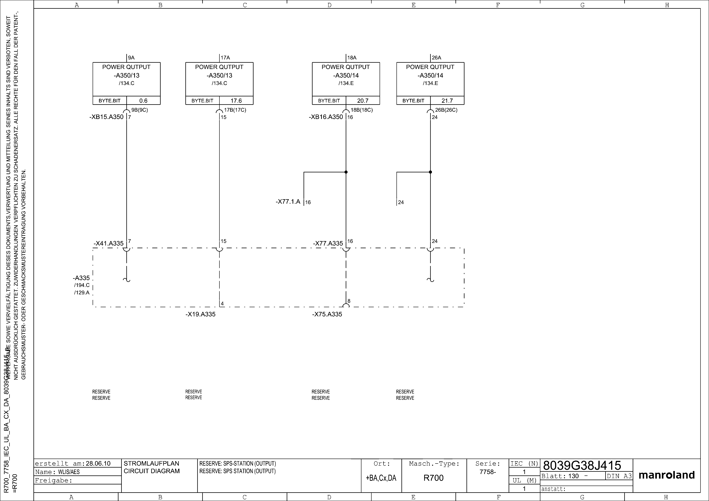

# +BA_Cx_DA — Sheet 130 of 247 — RESERVE: SPS STATION (OUTPUT)

**RESERVE: SPS STATION (OUTPUT)**

> Part of the manroland **R700** printing press IEC/UL circuit diagrams.
> Drawing class: **Stromlaufplan / Circuit diagram** (DIN A3).
> Document `+BA_Cx_DA` covers the **Printing units / main switch cabinet** machine section.

## At a glance

| Field | Value |
|---|---|
| Document | `+BA_Cx_DA`  (8039G38J415) |
| Sheet | **130** of 247 |
| Section (DE) | RESERVE: SPS STATION (OUTPUT) |
| Section (EN) | RESERVE: SPS STATION (OUTPUT) |
| Section type | CIRCUIT — Circuit diagram |
| Machine type | `R700` |
| Series | `7758` |
| Created | 28.06.10 |
| Replaces | — |
| Columns used | A, B, C, D, E |
| Path numbers | — |
| Labels on sheet | 58 |
| Cross-refs out | 6 |
| Cross-refs in | 18 |

**Previous:** [+BA_Cx_DA sheet 129](SHEET_0129.md) · **Next:** [+BA_Cx_DA sheet 131](SHEET_0131.md) · **Document TOC:** [_TOC.md](_TOC.md)  (+BA_Cx_DA) · **Master TOC:** [all sheets](../_MASTER_TOC.md)

## Sheet image (300 DPI, exact vector render)



_Rendered directly from the PDF vector layer at 300 DPI (1-bit), no OCR and no resampling. Use it to confirm anything ambiguous in the text below._

## Cross-references on this sheet

Each entry is a wire leaving this sheet. The printed token is `/sheet.column`; the link resolves to that sheet inside the same document.

| Ref | Target sheet | Col | Path | Destination on target | Target section | From col |
|---|---|---|---|---|---|---|
| `/134.E` | [+BA_Cx_DA sheet 134](SHEET_0134.md) | E | — | — | REFERENZMODUL | D |
| `/134.E` | [+BA_Cx_DA sheet 134](SHEET_0134.md) | E | — | — | REFERENZMODUL | E |
| `/134.C` | [+BA_Cx_DA sheet 134](SHEET_0134.md) | C | — | — | REFERENZMODUL | B |
| `/134.C` | [+BA_Cx_DA sheet 134](SHEET_0134.md) | C | — | — | REFERENZMODUL | C |
| `/194.C` | [+BA_Cx_DA sheet 194](SHEET_0194.md) | C | — | — | OPTION: WASCHVORRICHTUNG MIT BÜRSTE | A |
| `/129.A` | [+BA_Cx_DA sheet 129](SHEET_0129.md) | A | — | — | RESERVE: SPS STATION (OUTPUT) | A |

### Incoming references (sheets that point here)

Every other sheet that sends a wire to this one. `Back-ref` is the token printed on *that* sheet; `Path` is its line number.

| From sheet | Cols | Back-ref | Path | Refs | What continues there |
|---|---|---|---|---|---|
| [+BA_Cx_DA#129](SHEET_0129.md) | A | `/129.A` | — | 1 | — |
| [+BA_Cx_DA#134](SHEET_0134.md) | C, E | `/134.C`, `/134.E` | — | 4 | — |
| [+BA_Cx_DA#171](SHEET_0171.md) | G | `/171.G` | — | 2 | — |
| [+BA_Cx_DA#172](SHEET_0172.md) | F | `/172.F` | — | 2 | — |
| [+BA_Cx_DA#173](SHEET_0173.md) | H | `/173.H` | — | 1 | — |
| [+BA_Cx_DA#181](SHEET_0181.md) | F | `/181.F` | — | 2 | — |
| [+BA_Cx_DA#184](SHEET_0184.md) | G | `/184.G` | — | 1 | — |
| [+BA_Cx_DA#185](SHEET_0185.md) | E, G | `/185.E`, `/185.G` | — | 4 | — |
| [+BA_Cx_DA#194](SHEET_0194.md) | C | `/194.C` | — | 1 | — |


## Devices on this sheet

| Tag | Class | Class meaning (IEC) | Col | Sub | Terminal | Sign |
|---|---|---|---|---|---|---|
| `A350/14` | A | Baugruppe / assembly, module, PC board | D | 14 | — | — |
| `A350/14` | A | Baugruppe / assembly, module, PC board | E | 14 | — | — |
| `A350/13` | A | Baugruppe / assembly, module, PC board | C | 13 | — | — |
| `A350/13` | A | Baugruppe / assembly, module, PC board | B | 13 | — | — |
| `A335` | A | Baugruppe / assembly, module, PC board | A | — | — | — |
| `X77.A335` | — | cross-device reference | D | — | — | — |
| `20.7` | — | cross-device reference | D | — | — | — |
| `21.7` | — | cross-device reference | E | — | — | — |
| `XB16.A350` | — | cross-device reference | D | — | — | — |
| `X77.1.A` | — | cross-device reference | D | — | — | — |
| `17.6` | — | cross-device reference | C | — | — | — |
| `0.6` | — | cross-device reference | B | — | — | — |
| `XB15.A350` | — | cross-device reference | A | — | — | — |
| `X41.A335` | — | cross-device reference | A | — | — | — |
| `X75.A335` | — | cross-device reference | D | — | — | — |
| `X19.A335` | — | cross-device reference | B | — | — | — |

## Potentials / nets

_No named potentials on this sheet._

## Wire-end annotations (grouped as printed)

A wire that continues elsewhere is annotated with a small cluster: the destination description, the path/line number `#NN`, and the `/sheet.column` cross reference. Each row below is one such cluster exactly as it is grouped on the drawing.

| Col | Y | Path | Cross-ref | Text on the wire |
|---|---|---|---|---|
| B | 93.1 | — | — | `9A` |
| C | 93.1 | — | — | `17A` |
| D | 93.1 | — | — | `18A` |
| E | 93.1 | — | — | `26A` |
| B | 108.3 | — | — | `POWER QUTPUT` |
| C | 108.3 | — | — | `POWER QUTPUT` |
| D | 108.3 | — | — | `POWER QUTPUT` |
| E | 108.3 | — | — | `POWER QUTPUT` |
| B | 122.2 | — | — | `A350/13` |
| C | 122.2 | — | — | `A350/13` |
| D | 122.2 | — | — | `A350/14` |
| E | 122.2 | — | — | `A350/14` |
| B | 136.0 | — | `/134.C` | — |
| C | 136.0 | — | `/134.C` | — |
| D | 136.0 | — | `/134.E` | — |
| E | 136.0 | — | `/134.E` | — |
| B | 165.0 | — | — | `BYTE.BIT 0.6` |
| C | 165.0 | — | — | `BYTE.BIT 17.6` |
| D | 165.0 | — | — | `BYTE.BIT 20.7` |
| E | 165.0 | — | — | `BYTE.BIT 21.7` |
| B | 181.0 | — | — | `9B(9C)` |
| C | 181.0 | — | — | `17B(17C)` |
| D | 181.0 | — | — | `18B(18C)` |
| E | 181.0 | — | — | `26B(26C)` |
| A | 191.6 | — | — | `XB15.A350 7` |
| E | 191.6 | — | — | `XB16.A350 16 24` |
| C | 193.1 | — | — | `15` |
| D | 334.1 | — | — | `X77.1.A 16 24` |
| A | 401.4 | — | — | `X41.A335 7` |
| C | 401.4 | — | — | `15` |
| E | 401.4 | — | — | `X77.A335 16 24` |
| A | 462.4 | — | — | `A335` |
| A | 475.4 | — | `/194.C`, `/129.A` | — |
| D | 502.1 | — | — | `8` |
| C | 506.3 | — | — | `4` |
| C | 523.3 | — | — | `X19.A335 X75.A335` |
| A | 655.4 | — | — | `RESERVE RESERVE` |
| D | 655.4 | — | — | `RESERVE RESERVE` |
| E | 655.4 | — | — | `RESERVE RESERVE` |
| B | 655.6 | — | — | `RESERVE RESERVE` |


## Reconstructed tables

This sheet carries tabular content (pin map / terminal assignment / index). The grid below was rebuilt from the drawing's own rule lines, so each row is exactly one physical row of the table.

### Table 1 — 2 data rows × 2 columns (at x=155.9, y=104.9)

| POWER | QUTPUT A350/13 /134.C |
|---|---|
| `BYTE.BIT` | `0.6` |
| `XB15.A350` | `9B(9C) 7` |


### Table 2 — 2 data rows × 2 columns (at x=311.8, y=104.9)

| POWER | QUTPUT A350/13 /134.C |
|---|---|
| `BYTE.BIT` | `17.6` |
|  | `17B(17C) 15` |


### Table 3 — 2 data rows × 2 columns (at x=524.4, y=104.9)

| POWER | QUTPUT A350/14 /134.E |
|---|---|
| `BYTE.BIT` | `20.7` |
| `XB16.A350` | `18B(18C) 16` |


### Table 4 — 2 data rows × 2 columns (at x=666.1, y=104.9)

| POWER | QUTPUT A350/14 /134.E |
|---|---|
| `BYTE.BIT` | `21.7` |
|  | `26B(26C) 24` |


## Notes and free text on this sheet

| Text | Col | Y (pt) |
|---|---|---|
| `18A` | D | 93.12 |
| `18B(18C)` | D | 181.03 |
| `POWER QUTPUT` | D | 108.28 |
| `BYTE.BIT` | D | 165.6 |
| `RESERVE` | D | 655.39 |
| `26A` | E | 93.12 |
| `26B(26C)` | E | 181.03 |
| `POWER QUTPUT` | E | 108.28 |
| `BYTE.BIT` | E | 165.6 |
| `RESERVE` | E | 655.39 |
| `17A` | C | 93.12 |
| `17B(17C)` | C | 181.03 |
| `POWER QUTPUT` | C | 108.28 |
| `BYTE.BIT` | B | 165.6 |
| `RESERVE` | B | 655.58 |
| `9A` | B | 93.1 |
| `9B(9C)` | B | 181.03 |
| `POWER QUTPUT` | B | 108.28 |
| `BYTE.BIT` | A | 165.6 |
| `RESERVE` | A | 655.39 |

## Complete label inventory (exact text from the drawing)

Every text object inside the drawing area of this sheet, in DIN reading order (column A→H, then top→bottom). This is the authoritative list: if a string is not here it is not printed on this sheet.

| Col | Y | X | Dir | Type | Text |
|---|---|---|---|---|---|
| A | 165.6 | 165.8 | → | text | `BYTE.BIT` |
| A | 191.6 | 150.2 | → | device ref | `XB15.A350` |
| A | 404.2 | 157.3 | → | device ref | `X41.A335` |
| A | 462.3 | 122.5 | → | device tag | `A335` |
| A | 475.4 | 124.7 | → | cross-reference | `/194.C` |
| A | 487.8 | 124.7 | → | cross-reference | `/129.A` |
| A | 655.4 | 155.1 | → | text | `RESERVE` |
| A | 666.0 | 155.1 | → | text | `RESERVE` |
| B | 93.1 | 215.1 | → | text | `9A` |
| B | 108.3 | 171.8 | → | text | `POWER QUTPUT` |
| B | 122.2 | 191.2 | → | device tag | `A350/13` |
| B | 136.0 | 199.8 | → | cross-reference | `/134.C` |
| B | 165.0 | 234.1 | → | device ref | `0.6` |
| B | 165.6 | 321.7 | → | text | `BYTE.BIT` |
| B | 181.0 | 220.8 | → | text | `9B(9C)` |
| B | 193.1 | 215.1 | → | number | `7` |
| B | 401.4 | 215.1 | → | number | `7` |
| B | 523.3 | 311.8 | → | device ref | `X19.A335` |
| B | 655.6 | 311.2 | → | text | `RESERVE` |
| B | 665.5 | 311.2 | → | text | `RESERVE` |
| C | 93.1 | 370.5 | → | text | `17A` |
| C | 108.3 | 327.7 | → | text | `POWER QUTPUT` |
| C | 122.2 | 347.1 | → | device tag | `A350/13` |
| C | 136.0 | 355.7 | → | cross-reference | `/134.C` |
| C | 165.0 | 387.1 | → | device ref | `17.6` |
| C | 181.0 | 376.2 | → | text | `17B(17C)` |
| C | 193.1 | 370.5 | → | number | `15` |
| C | 401.4 | 370.5 | → | number | `15` |
| C | 506.3 | 371.1 | → | number | `4` |
| D | 93.1 | 583.1 | → | text | `18A` |
| D | 108.3 | 540.3 | → | text | `POWER QUTPUT` |
| D | 122.2 | 559.7 | → | device tag | `A350/14` |
| D | 136.0 | 568.6 | → | cross-reference | `/134.E` |
| D | 165.0 | 600.0 | → | device ref | `20.7` |
| D | 165.6 | 534.3 | → | text | `BYTE.BIT` |
| D | 181.0 | 588.8 | → | text | `18B(18C)` |
| D | 191.6 | 518.7 | → | device ref | `XB16.A350` |
| D | 193.1 | 583.1 | → | number | `16` |
| D | 334.1 | 463.2 | → | device ref | `X77.1.A` |
| D | 336.2 | 512.2 | → | number | `16` |
| D | 401.4 | 583.1 | → | number | `16` |
| D | 404.2 | 525.8 | → | device ref | `X77.A335` |
| D | 502.1 | 583.7 | → | number | `8` |
| D | 523.3 | 524.4 | → | device ref | `X75.A335` |
| D | 655.4 | 523.6 | → | text | `RESERVE` |
| D | 666.0 | 523.6 | → | text | `RESERVE` |
| E | 93.1 | 725.4 | → | text | `26A` |
| E | 108.3 | 682.0 | → | text | `POWER QUTPUT` |
| E | 122.2 | 701.4 | → | device tag | `A350/14` |
| E | 136.0 | 710.4 | → | cross-reference | `/134.E` |
| E | 165.0 | 741.7 | → | device ref | `21.7` |
| E | 165.6 | 676.1 | → | text | `BYTE.BIT` |
| E | 181.0 | 731.1 | → | text | `26B(26C)` |
| E | 193.1 | 725.4 | → | number | `24` |
| E | 336.2 | 668.7 | → | number | `24` |
| E | 401.4 | 725.4 | → | number | `24` |
| E | 655.4 | 665.3 | → | text | `RESERVE` |
| E | 666.0 | 665.3 | → | text | `RESERVE` |

## Reading-order text block

The same content as a plain block, grouped by DIN column — convenient to paste or to match against a visual description.

```text
=== Column A ===
 165.6  165.8  text         BYTE.BIT
 191.6  150.2  devref       XB15.A350
 404.2  157.3  devref       X41.A335
 462.3  122.5  devtag       A335
 475.4  124.7  xref         /194.C
 487.8  124.7  xref         /129.A
 655.4  155.1  text         RESERVE
 666.0  155.1  text         RESERVE
=== Column B ===
  93.1  215.1  text         9A
 108.3  171.8  text         POWER QUTPUT
 122.2  191.2  devtag       A350/13
 136.0  199.8  xref         /134.C
 165.0  234.1  devref       0.6
 165.6  321.7  text         BYTE.BIT
 181.0  220.8  text         9B(9C)
 193.1  215.1  numeric      7
 401.4  215.1  numeric      7
 523.3  311.8  devref       X19.A335
 655.6  311.2  text         RESERVE
 665.5  311.2  text         RESERVE
=== Column C ===
  93.1  370.5  text         17A
 108.3  327.7  text         POWER QUTPUT
 122.2  347.1  devtag       A350/13
 136.0  355.7  xref         /134.C
 165.0  387.1  devref       17.6
 181.0  376.2  text         17B(17C)
 193.1  370.5  numeric      15
 401.4  370.5  numeric      15
 506.3  371.1  numeric      4
=== Column D ===
  93.1  583.1  text         18A
 108.3  540.3  text         POWER QUTPUT
 122.2  559.7  devtag       A350/14
 136.0  568.6  xref         /134.E
 165.0  600.0  devref       20.7
 165.6  534.3  text         BYTE.BIT
 181.0  588.8  text         18B(18C)
 191.6  518.7  devref       XB16.A350
 193.1  583.1  numeric      16
 334.1  463.2  devref       X77.1.A
 336.2  512.2  numeric      16
 401.4  583.1  numeric      16
 404.2  525.8  devref       X77.A335
 502.1  583.7  numeric      8
 523.3  524.4  devref       X75.A335
 655.4  523.6  text         RESERVE
 666.0  523.6  text         RESERVE
=== Column E ===
  93.1  725.4  text         26A
 108.3  682.0  text         POWER QUTPUT
 122.2  701.4  devtag       A350/14
 136.0  710.4  xref         /134.E
 165.0  741.7  devref       21.7
 165.6  676.1  text         BYTE.BIT
 181.0  731.1  text         26B(26C)
 193.1  725.4  numeric      24
 336.2  668.7  numeric      24
 401.4  725.4  numeric      24
 655.4  665.3  text         RESERVE
 666.0  665.3  text         RESERVE
```

---
_Generated from the PDF vector text layer; no OCR. Source: `R700_7758_IEC_UL_BA_CX_DA_8039G38J415_p`, sheet 130._
