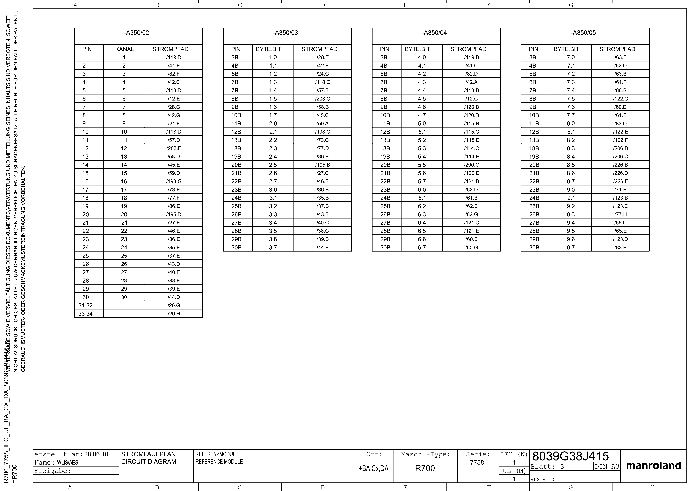

# +BA_Cx_DA — Sheet 131 of 247 — REFERENZMODUL

**REFERENCE MODULE**

> Part of the manroland **R700** printing press IEC/UL circuit diagrams.
> Drawing class: **Stromlaufplan / Circuit diagram** (DIN A3).
> Document `+BA_Cx_DA` covers the **Printing units / main switch cabinet** machine section.

## At a glance

| Field | Value |
|---|---|
| Document | `+BA_Cx_DA`  (8039G38J415) |
| Sheet | **131** of 247 |
| Section (DE) | REFERENZMODUL |
| Section (EN) | REFERENCE MODULE |
| Section type | REFERENCE_MODULE — Reference module |
| Machine type | `R700` |
| Series | `7758` |
| Created | 28.06.10 |
| Replaces | — |
| Columns used | A, B, C, D, E, F, G, H |
| Path numbers | — |
| Labels on sheet | 326 |
| Cross-refs out | 104 |
| Cross-refs in | 104 |

**Previous:** [+BA_Cx_DA sheet 130](SHEET_0130.md) · **Next:** [+BA_Cx_DA sheet 132](SHEET_0132.md) · **Document TOC:** [_TOC.md](_TOC.md)  (+BA_Cx_DA) · **Master TOC:** [all sheets](../_MASTER_TOC.md)

## Sheet image (300 DPI, exact vector render)



_Rendered directly from the PDF vector layer at 300 DPI (1-bit), no OCR and no resampling. Use it to confirm anything ambiguous in the text below._

## Cross-references on this sheet

Each entry is a wire leaving this sheet. The printed token is `/sheet.column`; the link resolves to that sheet inside the same document.

| Ref | Target sheet | Col | Path | Destination on target | Target section | From col |
|---|---|---|---|---|---|---|
| `/28.E` | [+BA_Cx_DA sheet 28](SHEET_0028.md) | E | — | — | BUSVERBINDUNGEN: STOP SICHERN | D |
| `/63.F` | [+BA_Cx_DA sheet 63](SHEET_0063.md) | F | — | — | MASCHINENBEDIENUNG: BEDIENUNGKOMMANDOS | H |
| `/119.B` | [+BA_Cx_DA sheet 119](SHEET_0119.md) | B | — | — | RESERVE: SPS STATION (INPUT) | F |
| `/119.D` | [+BA_Cx_DA sheet 119](SHEET_0119.md) | D | — | — | RESERVE: SPS STATION (INPUT) | B |
| `/41.E` | [+BA_Cx_DA sheet 41](SHEET_0041.md) | E | — | — | SCHUTZEINRICHTUNGEN | B |
| `/42.F` | [+BA_Cx_DA sheet 42](SHEET_0042.md) | F | — | — | SCHUTZEINRICHTUNGEN | D |
| `/41.C` | [+BA_Cx_DA sheet 41](SHEET_0041.md) | C | — | — | SCHUTZEINRICHTUNGEN | F |
| `/62.D` | [+BA_Cx_DA sheet 62](SHEET_0062.md) | D | — | — | MASCHINENBEDIENUNG: BEDIENUNGKOMMANDOS | H |
| `/63.B` | [+BA_Cx_DA sheet 63](SHEET_0063.md) | B | — | — | MASCHINENBEDIENUNG: BEDIENUNGKOMMANDOS | H |
| `/82.F` | [+BA_Cx_DA sheet 82](SHEET_0082.md) | F | — | — | FARBWERK | B |
| `/24.C` | [+BA_Cx_DA sheet 24](SHEET_0024.md) | C | — | — | BUSVERBINDUNGEN: NOT AUS | D |
| `/82.D` | [+BA_Cx_DA sheet 82](SHEET_0082.md) | D | — | — | FARBWERK | F |
| `/42.A` | [+BA_Cx_DA sheet 42](SHEET_0042.md) | A | — | — | SCHUTZEINRICHTUNGEN | F |
| `/61.F` | [+BA_Cx_DA sheet 61](SHEET_0061.md) | F | — | — | MASCHINENBEDIENUNG: BEDIENUNGKOMMANDOS | H |
| `/42.C` | [+BA_Cx_DA sheet 42](SHEET_0042.md) | C | — | — | SCHUTZEINRICHTUNGEN | B |
| `/118.C` | [+BA_Cx_DA sheet 118](SHEET_0118.md) | C | — | — | RESERVE: SPS STATION (INPUT) | D |
| `/57.B` | [+BA_Cx_DA sheet 57](SHEET_0057.md) | B | — | — | MASCHINENBEDIENUNG: LAUFKOMMANDOS | D |
| `/88.B` | [+BA_Cx_DA sheet 88](SHEET_0088.md) | B | — | — | WASCHVORRICHTUNG | H |
| `/113.B` | [+BA_Cx_DA sheet 113](SHEET_0113.md) | B | — | — | PPL 2 | F |
| `/113.D` | [+BA_Cx_DA sheet 113](SHEET_0113.md) | D | — | — | PPL 2 | B |
| `/12.E` | [+BA_Cx_DA sheet 12](SHEET_0012.md) | E | — | — | SPANNUNGSVERSORGUNG, SCHALTSCHRANKBELÜFTUNG | B |
| `/12.C` | [+BA_Cx_DA sheet 12](SHEET_0012.md) | C | — | — | SPANNUNGSVERSORGUNG, SCHALTSCHRANKBELÜFTUNG | F |
| `/203.C` | [+BA_Cx_DA sheet 203](SHEET_0203.md) | C | — | — | OPTION: | D |
| `/122.C` | [+BA_Cx_DA sheet 122](SHEET_0122.md) | C | — | — | RESERVE: SPS STATION (INPUT) | H |
| `/58.B` | [+BA_Cx_DA sheet 58](SHEET_0058.md) | B | — | — | MASCHINENBEDIENUNG: LAUFKOMMANDOS | D |
| `/120.B` | [+BA_Cx_DA sheet 120](SHEET_0120.md) | B | — | — | RESERVE: SPS STATION (INPUT) | F |
| `/28.G` | [+BA_Cx_DA sheet 28](SHEET_0028.md) | G | — | — | BUSVERBINDUNGEN: STOP SICHERN | B |
| `/60.D` | [+BA_Cx_DA sheet 60](SHEET_0060.md) | D | — | — | MASCHINENBEDIENUNG: BEDIENUNGKOMMANDOS | H |
| `/61.E` | [+BA_Cx_DA sheet 61](SHEET_0061.md) | E | — | — | MASCHINENBEDIENUNG: BEDIENUNGKOMMANDOS | H |
| `/42.G` | [+BA_Cx_DA sheet 42](SHEET_0042.md) | G | — | — | SCHUTZEINRICHTUNGEN | B |
| `/45.C` | [+BA_Cx_DA sheet 45](SHEET_0045.md) | C | — | — | SCHUTZEINRICHTUNGEN | D |
| `/120.D` | [+BA_Cx_DA sheet 120](SHEET_0120.md) | D | — | — | RESERVE: SPS STATION (INPUT) | F |
| `/59.A` | [+BA_Cx_DA sheet 59](SHEET_0059.md) | A | — | — | MASCHINENBEDIENUNG: LAUFKOMMANDOS | D |
| `/24.F` | [+BA_Cx_DA sheet 24](SHEET_0024.md) | F | — | — | BUSVERBINDUNGEN: NOT AUS | B |
| `/115.B` | [+BA_Cx_DA sheet 115](SHEET_0115.md) | B | — | — | PPL 2 | F |
| `/83.D` | [+BA_Cx_DA sheet 83](SHEET_0083.md) | D | — | — | FARBWERK | H |
| `/122.E` | [+BA_Cx_DA sheet 122](SHEET_0122.md) | E | — | — | RESERVE: SPS STATION (INPUT) | H |
| `/118.D` | [+BA_Cx_DA sheet 118](SHEET_0118.md) | D | — | — | RESERVE: SPS STATION (INPUT) | B |
| `/198.C` | [+BA_Cx_DA sheet 198](SHEET_0198.md) | C | — | — | OPTION: WASCHVORRICHTUNG MIT BÜRSTE | D |
| `/115.C` | [+BA_Cx_DA sheet 115](SHEET_0115.md) | C | — | — | PPL 2 | F |
| `/115.E` | [+BA_Cx_DA sheet 115](SHEET_0115.md) | E | — | — | PPL 2 | F |
| `/122.F` | [+BA_Cx_DA sheet 122](SHEET_0122.md) | F | — | — | RESERVE: SPS STATION (INPUT) | H |
| `/57.D` | [+BA_Cx_DA sheet 57](SHEET_0057.md) | D | — | — | MASCHINENBEDIENUNG: LAUFKOMMANDOS | B |
| `/73.C` | [+BA_Cx_DA sheet 73](SHEET_0073.md) | C | — | — | FEUCHTWERK | D |
| `/206.B` | [+BA_Cx_DA sheet 206](SHEET_0206.md) | B | — | — | OPTION: AUTOMATISCHE FARBZUFÜHRUNG | H |
| `/203.F` | [+BA_Cx_DA sheet 203](SHEET_0203.md) | F | — | — | OPTION: | B |
| `/77.D` | [+BA_Cx_DA sheet 77](SHEET_0077.md) | D | — | — | FARBWERK | D |
| `/114.C` | [+BA_Cx_DA sheet 114](SHEET_0114.md) | C | — | — | PPL 2 | F |
| `/86.B` | [+BA_Cx_DA sheet 86](SHEET_0086.md) | B | — | — | WASCHVORRICHTUNG | D |
| `/114.E` | [+BA_Cx_DA sheet 114](SHEET_0114.md) | E | — | — | PPL 2 | F |
| `/58.D` | [+BA_Cx_DA sheet 58](SHEET_0058.md) | D | — | — | MASCHINENBEDIENUNG: LAUFKOMMANDOS | B |
| `/206.C` | [+BA_Cx_DA sheet 206](SHEET_0206.md) | C | — | — | OPTION: AUTOMATISCHE FARBZUFÜHRUNG | H |
| `/45.E` | [+BA_Cx_DA sheet 45](SHEET_0045.md) | E | — | — | SCHUTZEINRICHTUNGEN | B |
| `/195.B` | [+BA_Cx_DA sheet 195](SHEET_0195.md) | B | — | — | OPTION: WASCHVORRICHTUNG MIT BÜRSTE | D |
| `/226.B` | [+BA_Cx_DA sheet 226](SHEET_0226.md) | B | — | — | OPTION: ZWISCHENTROCKNER VORBEREITUNG | H |
| `/200.G` | [+BA_Cx_DA sheet 200](SHEET_0200.md) | G | — | — | OPTION: APL | F |
| `/120.E` | [+BA_Cx_DA sheet 120](SHEET_0120.md) | E | — | — | RESERVE: SPS STATION (INPUT) | F |
| `/59.D` | [+BA_Cx_DA sheet 59](SHEET_0059.md) | D | — | — | MASCHINENBEDIENUNG: LAUFKOMMANDOS | B |
| `/27.C` | [+BA_Cx_DA sheet 27](SHEET_0027.md) | C | — | — | BUSVERBINDUNGEN: NOT AUS | D |
| `/226.D` | [+BA_Cx_DA sheet 226](SHEET_0226.md) | D | — | — | OPTION: ZWISCHENTROCKNER VORBEREITUNG | H |
| `/46.B` | [+BA_Cx_DA sheet 46](SHEET_0046.md) | B | — | — | SCHUTZEINRICHTUNGEN | D |
| `/121.B` | [+BA_Cx_DA sheet 121](SHEET_0121.md) | B | — | — | RESERVE: SPS STATION (INPUT) | F |
| `/226.F` | [+BA_Cx_DA sheet 226](SHEET_0226.md) | F | — | — | OPTION: ZWISCHENTROCKNER VORBEREITUNG | H |
| `/198.G` | [+BA_Cx_DA sheet 198](SHEET_0198.md) | G | — | — | OPTION: WASCHVORRICHTUNG MIT BÜRSTE | B |
| `/73.E` | [+BA_Cx_DA sheet 73](SHEET_0073.md) | E | — | — | FEUCHTWERK | B |
| `/36.B` | [+BA_Cx_DA sheet 36](SHEET_0036.md) | B | — | — | SCHUTZEINRICHTUNGEN | D |
| `/71.B` | [+BA_Cx_DA sheet 71](SHEET_0071.md) | B | — | — | ÖLUMLAUFSCHMIERUNG | H |
| `/63.D` | [+BA_Cx_DA sheet 63](SHEET_0063.md) | D | — | — | MASCHINENBEDIENUNG: BEDIENUNGKOMMANDOS | F |
| `/35.B` | [+BA_Cx_DA sheet 35](SHEET_0035.md) | B | — | — | SCHUTZEINRICHTUNGEN | D |
| `/61.B` | [+BA_Cx_DA sheet 61](SHEET_0061.md) | B | — | — | MASCHINENBEDIENUNG: BEDIENUNGKOMMANDOS | F |
| `/77.F` | [+BA_Cx_DA sheet 77](SHEET_0077.md) | F | — | — | FARBWERK | B |
| `/123.B` | [+BA_Cx_DA sheet 123](SHEET_0123.md) | B | — | — | RESERVE: SPS STATION (INPUT) | H |
| `/86.E` | [+BA_Cx_DA sheet 86](SHEET_0086.md) | E | — | — | WASCHVORRICHTUNG | B |
| `/37.B` | [+BA_Cx_DA sheet 37](SHEET_0037.md) | B | — | — | SCHUTZEINRICHTUNGEN | D |
| `/62.B` | [+BA_Cx_DA sheet 62](SHEET_0062.md) | B | — | — | MASCHINENBEDIENUNG: BEDIENUNGKOMMANDOS | F |
| `/123.C` | [+BA_Cx_DA sheet 123](SHEET_0123.md) | C | — | — | RESERVE: SPS STATION (INPUT) | H |
| `/43.B` | [+BA_Cx_DA sheet 43](SHEET_0043.md) | B | — | — | SCHUTZEINRICHTUNGEN | D |
| `/62.G` | [+BA_Cx_DA sheet 62](SHEET_0062.md) | G | — | — | MASCHINENBEDIENUNG: BEDIENUNGKOMMANDOS | F |
| `/195.D` | [+BA_Cx_DA sheet 195](SHEET_0195.md) | D | — | — | OPTION: WASCHVORRICHTUNG MIT BÜRSTE | B |
| `/77.H` | [+BA_Cx_DA sheet 77](SHEET_0077.md) | H | — | — | FARBWERK | H |
| `/27.E` | [+BA_Cx_DA sheet 27](SHEET_0027.md) | E | — | — | BUSVERBINDUNGEN: NOT AUS | B |
| `/40.C` | [+BA_Cx_DA sheet 40](SHEET_0040.md) | C | — | — | SCHUTZEINRICHTUNGEN | D |
| `/65.C` | [+BA_Cx_DA sheet 65](SHEET_0065.md) | C | — | — | DRUCKANSTELLUNG | H |
| `/121.C` | [+BA_Cx_DA sheet 121](SHEET_0121.md) | C | — | — | RESERVE: SPS STATION (INPUT) | F |
| `/46.E` | [+BA_Cx_DA sheet 46](SHEET_0046.md) | E | — | — | SCHUTZEINRICHTUNGEN | B |
| `/65.E` | [+BA_Cx_DA sheet 65](SHEET_0065.md) | E | — | — | DRUCKANSTELLUNG | H |
| `/121.E` | [+BA_Cx_DA sheet 121](SHEET_0121.md) | E | — | — | RESERVE: SPS STATION (INPUT) | F |
| `/38.C` | [+BA_Cx_DA sheet 38](SHEET_0038.md) | C | — | — | SCHUTZEINRICHTUNGEN | D |
| `/36.E` | [+BA_Cx_DA sheet 36](SHEET_0036.md) | E | — | — | SCHUTZEINRICHTUNGEN | B |
| `/39.B` | [+BA_Cx_DA sheet 39](SHEET_0039.md) | B | — | — | SCHUTZEINRICHTUNGEN | D |
| `/60.B` | [+BA_Cx_DA sheet 60](SHEET_0060.md) | B | — | — | MASCHINENBEDIENUNG: BEDIENUNGKOMMANDOS | F |
| `/123.D` | [+BA_Cx_DA sheet 123](SHEET_0123.md) | D | — | — | RESERVE: SPS STATION (INPUT) | H |
| `/35.E` | [+BA_Cx_DA sheet 35](SHEET_0035.md) | E | — | — | SCHUTZEINRICHTUNGEN | B |
| `/44.B` | [+BA_Cx_DA sheet 44](SHEET_0044.md) | B | — | — | SCHUTZEINRICHTUNGEN | D |
| `/83.B` | [+BA_Cx_DA sheet 83](SHEET_0083.md) | B | — | — | FARBWERK | H |
| `/60.G` | [+BA_Cx_DA sheet 60](SHEET_0060.md) | G | — | — | MASCHINENBEDIENUNG: BEDIENUNGKOMMANDOS | F |
| `/37.E` | [+BA_Cx_DA sheet 37](SHEET_0037.md) | E | — | — | SCHUTZEINRICHTUNGEN | B |
| `/43.D` | [+BA_Cx_DA sheet 43](SHEET_0043.md) | D | — | — | SCHUTZEINRICHTUNGEN | B |
| `/40.E` | [+BA_Cx_DA sheet 40](SHEET_0040.md) | E | — | — | SCHUTZEINRICHTUNGEN | B |
| `/38.E` | [+BA_Cx_DA sheet 38](SHEET_0038.md) | E | — | — | SCHUTZEINRICHTUNGEN | B |
| `/39.E` | [+BA_Cx_DA sheet 39](SHEET_0039.md) | E | — | — | SCHUTZEINRICHTUNGEN | B |
| `/44.D` | [+BA_Cx_DA sheet 44](SHEET_0044.md) | D | — | — | SCHUTZEINRICHTUNGEN | B |
| `/20.G` | [+BA_Cx_DA sheet 20](SHEET_0020.md) | G | — | — | BUSVERBINDUNGEN: SICHERHEITSBUS | B |
| `/20.H` | [+BA_Cx_DA sheet 20](SHEET_0020.md) | H | — | — | BUSVERBINDUNGEN: SICHERHEITSBUS | B |

### Incoming references (sheets that point here)

Every other sheet that sends a wire to this one. `Back-ref` is the token printed on *that* sheet; `Path` is its line number.

| From sheet | Cols | Back-ref | Path | Refs | What continues there |
|---|---|---|---|---|---|
| [+BA_Cx_DA#12](SHEET_0012.md) | B, E | `/12.B`, `/12.E` | — | 2 | — |
| [+BA_Cx_DA#20](SHEET_0020.md) | G, H | `/20.G`, `/20.H` | — | 2 | — |
| [+BA_Cx_DA#24](SHEET_0024.md) | C, F | `/24.C`, `/24.F` | — | 2 | — |
| [+BA_Cx_DA#27](SHEET_0027.md) | C, E | `/27.C`, `/27.E` | — | 2 | — |
| [+BA_Cx_DA#28](SHEET_0028.md) | E, G | `/28.E`, `/28.G` | — | 2 | — |
| [+BA_Cx_DA#35](SHEET_0035.md) | B, E | `/35.B`, `/35.E` | — | 2 | — |
| [+BA_Cx_DA#36](SHEET_0036.md) | B, E | `/36.B`, `/36.E` | — | 2 | — |
| [+BA_Cx_DA#37](SHEET_0037.md) | B, E | `/37.B`, `/37.E` | — | 2 | — |
| [+BA_Cx_DA#38](SHEET_0038.md) | C, E | `/38.C`, `/38.E` | — | 2 | — |
| [+BA_Cx_DA#39](SHEET_0039.md) | B, E | `/39.B`, `/39.E` | — | 2 | — |
| [+BA_Cx_DA#40](SHEET_0040.md) | B, E | `/40.B`, `/40.E` | — | 2 | — |
| [+BA_Cx_DA#41](SHEET_0041.md) | C, E | `/41.C`, `/41.E` | — | 2 | — |
| [+BA_Cx_DA#42](SHEET_0042.md) | A, C, E, G | `/42.A`, `/42.C`, `/42.E`, `/42.G` | — | 4 | — |
| [+BA_Cx_DA#43](SHEET_0043.md) | A, D | `/43.A`, `/43.D` | — | 2 | — |
| [+BA_Cx_DA#44](SHEET_0044.md) | A, D | `/44.A`, `/44.D` | — | 2 | — |
| [+BA_Cx_DA#45](SHEET_0045.md) | B, E | `/45.B`, `/45.E` | — | 2 | — |
| [+BA_Cx_DA#46](SHEET_0046.md) | B, E | `/46.B`, `/46.E` | — | 2 | — |
| [+BA_Cx_DA#57](SHEET_0057.md) | A, D | `/57.A`, `/57.D` | — | 2 | — |
| [+BA_Cx_DA#58](SHEET_0058.md) | A, D | `/58.A`, `/58.D` | — | 2 | — |
| [+BA_Cx_DA#59](SHEET_0059.md) | A, D | `/59.A`, `/59.D` | — | 2 | — |
| [+BA_Cx_DA#60](SHEET_0060.md) | B, D, G | `/60.B`, `/60.D`, `/60.G` | — | 3 | — |
| [+BA_Cx_DA#61](SHEET_0061.md) | B, E, F | `/61.B`, `/61.E`, `/61.F` | — | 3 | — |
| [+BA_Cx_DA#62](SHEET_0062.md) | A, D, G | `/62.A`, `/62.D`, `/62.G` | — | 3 | — |
| [+BA_Cx_DA#63](SHEET_0063.md) | B, D, F | `/63.B`, `/63.D`, `/63.F` | — | 3 | — |
| [+BA_Cx_DA#65](SHEET_0065.md) | C, E | `/65.C`, `/65.E` | — | 2 | — |
| [+BA_Cx_DA#71](SHEET_0071.md) | B | `/71.B` | — | 1 | — |
| [+BA_Cx_DA#73](SHEET_0073.md) | C, E | `/73.C`, `/73.E` | — | 2 | — |
| [+BA_Cx_DA#77](SHEET_0077.md) | D, F, H | `/77.D`, `/77.F`, `/77.H` | — | 3 | — |
| [+BA_Cx_DA#82](SHEET_0082.md) | D, F | `/82.D`, `/82.F` | — | 2 | — |
| [+BA_Cx_DA#83](SHEET_0083.md) | B, D | `/83.B`, `/83.D` | — | 2 | — |
| [+BA_Cx_DA#86](SHEET_0086.md) | B, E | `/86.B`, `/86.E` | — | 2 | — |
| [+BA_Cx_DA#88](SHEET_0088.md) | B | `/88.B` | — | 1 | — |
| [+BA_Cx_DA#113](SHEET_0113.md) | B, D | `/113.B`, `/113.D` | — | 2 | — |
| [+BA_Cx_DA#114](SHEET_0114.md) | C, E | `/114.C`, `/114.E` | — | 2 | — |
| [+BA_Cx_DA#115](SHEET_0115.md) | B, C, E | `/115.B`, `/115.C`, `/115.E` | — | 3 | — |
| [+BA_Cx_DA#118](SHEET_0118.md) | C, D | `/118.C`, `/118.D` | — | 2 | — |
| [+BA_Cx_DA#119](SHEET_0119.md) | A, D | `/119.A`, `/119.D` | — | 2 | — |
| [+BA_Cx_DA#120](SHEET_0120.md) | B, C, E | `/120.B`, `/120.C`, `/120.E` | — | 3 | — |
| [+BA_Cx_DA#121](SHEET_0121.md) | A, C, E | `/121.A`, `/121.C`, `/121.E` | — | 3 | — |
| [+BA_Cx_DA#122](SHEET_0122.md) | C, E, F | `/122.C`, `/122.E`, `/122.F` | — | 3 | — |
| [+BA_Cx_DA#123](SHEET_0123.md) | B, C, D | `/123.B`, `/123.C`, `/123.D` | — | 3 | — |
| [+BA_Cx_DA#195](SHEET_0195.md) | B, D | `/195.B`, `/195.D` | — | 2 | — |
| [+BA_Cx_DA#198](SHEET_0198.md) | C, G | `/198.C`, `/198.G` | — | 2 | — |
| [+BA_Cx_DA#200](SHEET_0200.md) | G | `/200.G` | — | 1 | — |
| [+BA_Cx_DA#203](SHEET_0203.md) | C, F | `/203.C`, `/203.F` | — | 2 | — |
| [+BA_Cx_DA#206](SHEET_0206.md) | B, C | `/206.B`, `/206.C` | — | 2 | — |
| [+BA_Cx_DA#226](SHEET_0226.md) | B, D, F | `/226.B`, `/226.D`, `/226.F` | — | 3 | — |


## Devices on this sheet

| Tag | Class | Class meaning (IEC) | Col | Sub | Terminal | Sign |
|---|---|---|---|---|---|---|
| `A350/03` | A | Baugruppe / assembly, module, PC board | D | 03 | — | — |
| `A350/04` | A | Baugruppe / assembly, module, PC board | E | 04 | — | — |
| `A350/05` | A | Baugruppe / assembly, module, PC board | G | 05 | — | — |
| `A350/02` | A | Baugruppe / assembly, module, PC board | B | 02 | — | — |
| `1.0` | — | cross-device reference | C | — | — | — |
| `1.1` | — | cross-device reference | C | — | — | — |
| `1.2` | — | cross-device reference | C | — | — | — |
| `1.3` | — | cross-device reference | C | — | — | — |
| `1.4` | — | cross-device reference | C | — | — | — |
| `1.5` | — | cross-device reference | C | — | — | — |
| `1.6` | — | cross-device reference | C | — | — | — |
| `1.7` | — | cross-device reference | C | — | — | — |
| `2.0` | — | cross-device reference | C | — | — | — |
| `2.1` | — | cross-device reference | C | — | — | — |
| `2.2` | — | cross-device reference | C | — | — | — |
| `2.3` | — | cross-device reference | C | — | — | — |
| `2.4` | — | cross-device reference | C | — | — | — |
| `2.5` | — | cross-device reference | C | — | — | — |
| `2.6` | — | cross-device reference | C | — | — | — |
| `2.7` | — | cross-device reference | C | — | — | — |
| `3.0` | — | cross-device reference | C | — | — | — |
| `3.1` | — | cross-device reference | C | — | — | — |
| `3.2` | — | cross-device reference | C | — | — | — |
| `3.3` | — | cross-device reference | C | — | — | — |
| `3.4` | — | cross-device reference | C | — | — | — |
| `3.5` | — | cross-device reference | C | — | — | — |
| `3.6` | — | cross-device reference | C | — | — | — |
| `3.7` | — | cross-device reference | C | — | — | — |
| `4.0` | — | cross-device reference | E | — | — | — |
| `4.1` | — | cross-device reference | E | — | — | — |
| `4.2` | — | cross-device reference | E | — | — | — |
| `4.3` | — | cross-device reference | E | — | — | — |
| `4.4` | — | cross-device reference | E | — | — | — |
| `4.5` | — | cross-device reference | E | — | — | — |
| `4.6` | — | cross-device reference | E | — | — | — |
| `4.7` | — | cross-device reference | E | — | — | — |
| `5.0` | — | cross-device reference | E | — | — | — |
| `5.1` | — | cross-device reference | E | — | — | — |
| `5.2` | — | cross-device reference | E | — | — | — |
| `5.3` | — | cross-device reference | E | — | — | — |
| `5.4` | — | cross-device reference | E | — | — | — |
| `5.5` | — | cross-device reference | E | — | — | — |
| `5.6` | — | cross-device reference | E | — | — | — |
| `5.7` | — | cross-device reference | E | — | — | — |
| `6.0` | — | cross-device reference | E | — | — | — |
| `6.1` | — | cross-device reference | E | — | — | — |
| `6.2` | — | cross-device reference | E | — | — | — |
| `6.3` | — | cross-device reference | E | — | — | — |
| `6.4` | — | cross-device reference | E | — | — | — |
| `6.5` | — | cross-device reference | E | — | — | — |
| `6.6` | — | cross-device reference | E | — | — | — |
| `6.7` | — | cross-device reference | E | — | — | — |
| `7.0` | — | cross-device reference | G | — | — | — |
| `7.1` | — | cross-device reference | G | — | — | — |
| `7.2` | — | cross-device reference | G | — | — | — |
| `7.3` | — | cross-device reference | G | — | — | — |
| `7.4` | — | cross-device reference | G | — | — | — |
| `7.5` | — | cross-device reference | G | — | — | — |
| `7.6` | — | cross-device reference | G | — | — | — |
| `7.7` | — | cross-device reference | G | — | — | — |
| `8.0` | — | cross-device reference | G | — | — | — |
| `8.1` | — | cross-device reference | G | — | — | — |
| `8.2` | — | cross-device reference | G | — | — | — |
| `8.3` | — | cross-device reference | G | — | — | — |
| `8.4` | — | cross-device reference | G | — | — | — |
| `8.5` | — | cross-device reference | G | — | — | — |
| `8.6` | — | cross-device reference | G | — | — | — |
| `8.7` | — | cross-device reference | G | — | — | — |
| `9.0` | — | cross-device reference | G | — | — | — |
| `9.1` | — | cross-device reference | G | — | — | — |
| `9.2` | — | cross-device reference | G | — | — | — |
| `9.3` | — | cross-device reference | G | — | — | — |
| `9.4` | — | cross-device reference | G | — | — | — |
| `9.5` | — | cross-device reference | G | — | — | — |
| `9.6` | — | cross-device reference | G | — | — | — |
| `9.7` | — | cross-device reference | G | — | — | — |

## Potentials / nets

_No named potentials on this sheet._

## Wire-end annotations (grouped as printed)

A wire that continues elsewhere is annotated with a small cluster: the destination description, the path/line number `#NN`, and the `/sheet.column` cross reference. Each row below is one such cluster exactly as it is grouped on the drawing.

| Col | Y | Path | Cross-ref | Text on the wire |
|---|---|---|---|---|
| B | 51.3 | — | — | `A350/02` |
| D | 51.3 | — | — | `A350/03` |
| E | 51.3 | — | — | `A350/04` |
| G | 51.3 | — | — | `A350/05` |
| A | 80.0 | — | — | `PIN` |
| B | 80.0 | — | — | `KANAL STROMPFAD` |
| C | 80.0 | — | — | `PIN BYTE.BIT` |
| D | 80.0 | — | — | `STROMPFAD` |
| E | 80.0 | — | — | `PIN BYTE.BIT` |
| F | 80.0 | — | — | `STROMPFAD` |
| G | 80.0 | — | — | `PIN BYTE.BIT` |
| H | 80.0 | — | — | `STROMPFAD` |
| A | 94.2 | — | — | `1 10 11 12 13 14 15 16 17 18 19 2 3 4 5 6 7 8 9 20 21 22 23 24` |
| B | 94.2 | — | — | `10 12 13 14 15 16 17 18 19 20 22 23 24 11 21 2 3 4 5 6 7 8 9 1` |
| C | 94.2 | — | — | `10B 11B 12B 13B 18B 19B 3B 4B 5B 6B 7B 8B 9B 20B 21B 22B 23B 24B 25B 26B 27B 28B 29B 30B` |
| C | 94.2 | — | — | `1.0 1.2 1.3 1.4 1.5 1.6 1.7 2.0 2.2 2.3 2.4 2.5 2.6 2.7 3.0 3.2 3.3 3.4 3.5 3.6 3.7 1.1 2.1 3.1` |
| E | 94.2 | — | — | `10B 11B 12B 13B 18B 19B 3B 4B 5B 6B 7B 8B 9B 20B 21B 22B 23B 24B 25B 26B 27B 28B 29B 30B` |
| E | 94.2 | — | — | `4.0 4.2 4.3 4.4 4.5 4.6 4.7 5.0 5.2 5.3 5.4 5.5 5.6 5.7 6.0 6.2 6.3 6.4 6.5 6.6 6.7 4.1 5.1 6.1` |
| G | 94.2 | — | — | `10B 11B 12B 13B 18B 19B 3B 4B 5B 6B 7B 8B 9B 20B 21B 22B 23B 24B 25B 26B 27B 28B 29B 30B` |
| G | 94.2 | — | — | `7.0 7.2 7.3 7.4 7.5 7.6 7.7 8.0 8.2 8.3 8.4 8.5 8.6 8.7 9.0 9.2 9.3 9.4 9.5 9.6 9.7 7.1 8.1 9.1` |
| B | 94.5 | — | `/119.D` | — |
| D | 94.5 | — | `/28.E` | — |
| F | 94.5 | — | `/119.B` | — |
| H | 94.5 | — | `/63.F` | — |
| B | 108.7 | — | `/41.E` | — |
| D | 108.7 | — | `/42.F` | — |
| F | 108.7 | — | `/41.C` | — |
| H | 108.7 | — | `/62.D` | — |
| H | 122.8 | — | `/63.B` | — |
| B | 122.9 | — | `/82.F` | — |
| D | 122.9 | — | `/24.C` | — |
| F | 122.9 | — | `/82.D` | — |
| F | 137.0 | — | `/42.A` | — |
| H | 137.0 | — | `/61.F` | — |
| B | 137.1 | — | `/42.C` | — |
| D | 137.1 | — | `/118.C` | — |
| B | 151.2 | — | `/113.D` | — |
| D | 151.2 | — | `/57.B` | — |
| F | 151.2 | — | `/113.B` | — |
| H | 151.2 | — | `/88.B` | — |
| B | 165.4 | — | `/12.E` | — |
| D | 165.4 | — | `/203.C` | — |
| F | 165.4 | — | `/12.C` | — |
| H | 165.4 | — | `/122.C` | — |
| D | 179.5 | — | `/58.B` | — |
| B | 179.6 | — | `/28.G` | — |
| F | 179.6 | — | `/120.B` | — |
| H | 179.6 | — | `/60.D` | — |
| B | 193.7 | — | `/42.G` | — |
| H | 193.7 | — | `/61.E` | — |
| D | 193.8 | — | `/45.C` | — |
| F | 193.8 | — | `/120.D` | — |
| B | 207.9 | — | `/24.F` | — |
| D | 207.9 | — | `/59.A` | — |
| F | 207.9 | — | `/115.B` | — |
| H | 207.9 | — | `/83.D` | — |
| B | 222.1 | — | `/118.D` | — |
| D | 222.1 | — | `/198.C` | — |
| F | 222.1 | — | `/115.C` | — |
| H | 222.1 | — | `/122.E` | — |
| F | 236.2 | — | `/115.E` | — |
| B | 236.3 | — | `/57.D` | — |
| D | 236.3 | — | `/73.C` | — |
| H | 236.3 | — | `/122.F` | — |
| B | 250.4 | — | `/203.F` | — |
| D | 250.4 | — | `/77.D` | — |
| F | 250.4 | — | `/114.C` | — |
| H | 250.4 | — | `/206.B` | — |
| B | 264.6 | — | `/58.D` | — |
| D | 264.6 | — | `/86.B` | — |
| F | 264.6 | — | `/114.E` | — |
| H | 264.6 | — | `/206.C` | — |
| B | 278.8 | — | `/45.E` | — |
| D | 278.8 | — | `/195.B` | — |
| F | 278.8 | — | `/200.G` | — |
| H | 278.8 | — | `/226.B` | — |
| F | 292.9 | — | `/120.E` | — |
| B | 293.0 | — | `/59.D` | — |
| D | 293.0 | — | `/27.C` | — |
| H | 293.0 | — | `/226.D` | — |
| B | 307.1 | — | `/198.G` | — |
| D | 307.1 | — | `/46.B` | — |
| F | 307.1 | — | `/121.B` | — |
| H | 307.1 | — | `/226.F` | — |
| B | 321.3 | — | `/73.E` | — |
| D | 321.3 | — | `/36.B` | — |
| F | 321.3 | — | `/63.D` | — |
| H | 321.3 | — | `/71.B` | — |
| D | 335.4 | — | `/35.B` | — |
| F | 335.4 | — | `/61.B` | — |
| B | 335.5 | — | `/77.F` | — |
| H | 335.5 | — | `/123.B` | — |
| B | 349.6 | — | `/86.E` | — |
| D | 349.6 | — | `/37.B` | — |
| F | 349.6 | — | `/62.B` | — |
| H | 349.7 | — | `/123.C` | — |
| B | 363.8 | — | `/195.D` | — |
| D | 363.8 | — | `/43.B` | — |
| F | 363.8 | — | `/62.G` | — |
| H | 363.8 | — | `/77.H` | — |
| B | 378.0 | — | `/27.E` | — |
| D | 378.0 | — | `/40.C` | — |
| F | 378.0 | — | `/121.C` | — |
| H | 378.0 | — | `/65.C` | — |
| B | 392.1 | — | `/46.E` | — |
| F | 392.1 | — | `/121.E` | — |
| H | 392.1 | — | `/65.E` | — |
| D | 392.2 | — | `/38.C` | — |
| B | 406.3 | — | `/36.E` | — |
| D | 406.3 | — | `/39.B` | — |
| F | 406.3 | — | `/60.B` | — |
| H | 406.4 | — | `/123.D` | — |
| B | 420.5 | — | `/35.E` | — |
| D | 420.5 | — | `/44.B` | — |
| F | 420.5 | — | `/60.G` | — |
| H | 420.5 | — | `/83.B` | — |
| A | 434.4 | — | — | `31 32 33 34 25 26 27 28 29 30` |
| B | 434.7 | — | — | `25` |
| B | 434.7 | — | `/37.E` | — |
| B | 448.9 | — | — | `26` |
| B | 448.9 | — | `/43.D` | — |
| B | 463.0 | — | `/40.E` | — |
| B | 463.1 | — | — | `27` |
| B | 477.2 | — | — | `28` |
| B | 477.2 | — | `/38.E` | — |
| B | 491.4 | — | — | `29` |
| B | 491.4 | — | `/39.E` | — |
| B | 505.6 | — | — | `30` |
| B | 505.6 | — | `/44.D` | — |
| B | 519.7 | — | `/20.G` | — |
| B | 533.9 | — | `/20.H` | — |


## Reconstructed tables

This sheet carries tabular content (pin map / terminal assignment / index). The grid below was rebuilt from the drawing's own rule lines, so each row is exactly one physical row of the table.

### Table 1 — 32 data rows × 3 columns (at x=127.6, y=48.2) — **A350/02**

| PIN | KANAL | STROMPFAD |
|---|---|---|
| `1` | `1` | `/119.D` |
| `2` | `2` | `/41.E` |
| `3` | `3` | `/82.F` |
| `4` | `4` | `/42.C` |
| `5` | `5` | `/113.D` |
| `6` | `6` | `/12.E` |
| `7` | `7` | `/28.G` |
| `8` | `8` | `/42.G` |
| `9` | `9` | `/24.F` |
| `10` | `10` | `/118.D` |
| `11` | `11` | `/57.D` |
| `12` | `12` | `/203.F` |
| `13` | `13` | `/58.D` |
| `14` | `14` | `/45.E` |
| `15` | `15` | `/59.D` |
| `16` | `16` | `/198.G` |
| `17` | `17` | `/73.E` |
| `18` | `18` | `/77.F` |
| `19` | `19` | `/86.E` |
| `20` | `20` | `/195.D` |
| `21` | `21` | `/27.E` |
| `22` | `22` | `/46.E` |
| `23` | `23` | `/36.E` |
| `24` | `24` | `/35.E` |
| `25` | `25` | `/37.E` |
| `26` | `26` | `/43.D` |
| `27` | `27` | `/40.E` |
| `28` | `28` | `/38.E` |
| `29` | `29` | `/39.E` |
| `30` | `30` | `/44.D` |
| `31 32` |  | `/20.G` |
| `33 34` |  | `/20.H` |


### Table 2 — 24 data rows × 3 columns (at x=382.7, y=48.2) — **A350/03**

| PIN | BYTE.BIT | STROMPFAD |
|---|---|---|
| `3B` | `1.0` | `/28.E` |
| `4B` | `1.1` | `/42.F` |
| `5B` | `1.2` | `/24.C` |
| `6B` | `1.3` | `/118.C` |
| `7B` | `1.4` | `/57.B` |
| `8B` | `1.5` | `/203.C` |
| `9B` | `1.6` | `/58.B` |
| `10B` | `1.7` | `/45.C` |
| `11B` | `2.0` | `/59.A` |
| `12B` | `2.1` | `/198.C` |
| `13B` | `2.2` | `/73.C` |
| `18B` | `2.3` | `/77.D` |
| `19B` | `2.4` | `/86.B` |
| `20B` | `2.5` | `/195.B` |
| `21B` | `2.6` | `/27.C` |
| `22B` | `2.7` | `/46.B` |
| `23B` | `3.0` | `/36.B` |
| `24B` | `3.1` | `/35.B` |
| `25B` | `3.2` | `/37.B` |
| `26B` | `3.3` | `/43.B` |
| `27B` | `3.4` | `/40.C` |
| `28B` | `3.5` | `/38.C` |
| `29B` | `3.6` | `/39.B` |
| `30B` | `3.7` | `/44.B` |


### Table 3 — 24 data rows × 3 columns (at x=637.8, y=48.2) — **A350/04**

| PIN | BYTE.BIT | STROMPFAD |
|---|---|---|
| `3B` | `4.0` | `/119.B` |
| `4B` | `4.1` | `/41.C` |
| `5B` | `4.2` | `/82.D` |
| `6B` | `4.3` | `/42.A` |
| `7B` | `4.4` | `/113.B` |
| `8B` | `4.5` | `/12.C` |
| `9B` | `4.6` | `/120.B` |
| `10B` | `4.7` | `/120.D` |
| `11B` | `5.0` | `/115.B` |
| `12B` | `5.1` | `/115.C` |
| `13B` | `5.2` | `/115.E` |
| `18B` | `5.3` | `/114.C` |
| `19B` | `5.4` | `/114.E` |
| `20B` | `5.5` | `/200.G` |
| `21B` | `5.6` | `/120.E` |
| `22B` | `5.7` | `/121.B` |
| `23B` | `6.0` | `/63.D` |
| `24B` | `6.1` | `/61.B` |
| `25B` | `6.2` | `/62.B` |
| `26B` | `6.3` | `/62.G` |
| `27B` | `6.4` | `/121.C` |
| `28B` | `6.5` | `/121.E` |
| `29B` | `6.6` | `/60.B` |
| `30B` | `6.7` | `/60.G` |


### Table 4 — 24 data rows × 3 columns (at x=892.9, y=48.2) — **A350/05**

| PIN | BYTE.BIT | STROMPFAD |
|---|---|---|
| `3B` | `7.0` | `/63.F` |
| `4B` | `7.1` | `/62.D` |
| `5B` | `7.2` | `/63.B` |
| `6B` | `7.3` | `/61.F` |
| `7B` | `7.4` | `/88.B` |
| `8B` | `7.5` | `/122.C` |
| `9B` | `7.6` | `/60.D` |
| `10B` | `7.7` | `/61.E` |
| `11B` | `8.0` | `/83.D` |
| `12B` | `8.1` | `/122.E` |
| `13B` | `8.2` | `/122.F` |
| `18B` | `8.3` | `/206.B` |
| `19B` | `8.4` | `/206.C` |
| `20B` | `8.5` | `/226.B` |
| `21B` | `8.6` | `/226.D` |
| `22B` | `8.7` | `/226.F` |
| `23B` | `9.0` | `/71.B` |
| `24B` | `9.1` | `/123.B` |
| `25B` | `9.2` | `/123.C` |
| `26B` | `9.3` | `/77.H` |
| `27B` | `9.4` | `/65.C` |
| `28B` | `9.5` | `/65.E` |
| `29B` | `9.6` | `/123.D` |
| `30B` | `9.7` | `/83.B` |


## Notes and free text on this sheet

| Text | Col | Y (pt) |
|---|---|---|
| `3B` | C | 94.18 |
| `4B` | C | 108.35 |
| `5B` | C | 122.53 |
| `6B` | C | 136.7 |
| `7B` | C | 150.87 |
| `8B` | C | 165.05 |
| `9B` | C | 179.22 |
| `10B` | C | 193.4 |
| `11B` | C | 207.57 |
| `12B` | C | 221.74 |
| `13B` | C | 235.92 |
| `18B` | C | 250.09 |
| `19B` | C | 264.26 |
| `20B` | C | 278.44 |
| `21B` | C | 292.61 |
| `22B` | C | 306.78 |
| `23B` | C | 320.96 |
| `24B` | C | 335.13 |
| `25B` | C | 349.3 |
| `26B` | C | 363.48 |
| `27B` | C | 377.65 |
| `28B` | C | 391.82 |
| `29B` | C | 406 |
| `30B` | C | 420.17 |
| `PIN` | C | 80.02 |
| `BYTE.BIT` | C | 80 |
| `STROMPFAD` | D | 79.98 |
| `3B` | E | 94.18 |
| `4B` | E | 108.35 |
| `5B` | E | 122.53 |
| `6B` | E | 136.7 |
| `7B` | E | 150.87 |
| `8B` | E | 165.05 |
| `9B` | E | 179.22 |
| `10B` | E | 193.4 |
| `11B` | E | 207.57 |
| `12B` | E | 221.74 |
| `13B` | E | 235.92 |
| `18B` | E | 250.09 |
| `19B` | E | 264.26 |
| `20B` | E | 278.44 |
| `21B` | E | 292.61 |
| `22B` | E | 306.78 |
| `23B` | E | 320.96 |
| `24B` | E | 335.13 |
| `25B` | E | 349.3 |
| `26B` | E | 363.48 |
| `27B` | E | 377.65 |
| `28B` | E | 391.82 |
| `29B` | E | 406 |
| `30B` | E | 420.17 |
| `PIN` | E | 80.02 |
| `BYTE.BIT` | E | 80 |
| `STROMPFAD` | F | 79.98 |
| `3B` | G | 94.18 |
| `4B` | G | 108.35 |
| `5B` | G | 122.53 |
| `6B` | G | 136.7 |
| `7B` | G | 150.87 |
| `8B` | G | 165.05 |
| `9B` | G | 179.22 |
| `10B` | G | 193.4 |
| `11B` | G | 207.57 |
| `12B` | G | 221.74 |
| `13B` | G | 235.92 |
| `18B` | G | 250.09 |
| `19B` | G | 264.26 |
| `20B` | G | 278.44 |
| `21B` | G | 292.61 |
| `22B` | G | 306.78 |
| `23B` | G | 320.96 |
| `24B` | G | 335.13 |
| `25B` | G | 349.3 |
| `26B` | G | 363.48 |
| `27B` | G | 377.65 |
| `28B` | G | 391.82 |
| `29B` | G | 406 |
| `30B` | G | 420.17 |
| `PIN` | G | 80.02 |
| `BYTE.BIT` | G | 80 |
| `STROMPFAD` | H | 79.98 |
| `PIN` | A | 80.02 |
| `STROMPFAD` | B | 79.98 |
| `KANAL` | B | 79.99 |

## Complete label inventory (exact text from the drawing)

Every text object inside the drawing area of this sheet, in DIN reading order (column A→H, then top→bottom). This is the authoritative list: if a string is not here it is not printed on this sheet.

| Col | Y | X | Dir | Type | Text |
|---|---|---|---|---|---|
| A | 80.0 | 140.9 | → | text | `PIN` |
| A | 94.2 | 140.9 | → | number | `1` |
| A | 108.4 | 141.4 | → | number | `2` |
| A | 122.5 | 141.4 | → | number | `3` |
| A | 136.7 | 141.4 | → | number | `4` |
| A | 150.9 | 141.4 | → | number | `5` |
| A | 165.1 | 141.4 | → | number | `6` |
| A | 179.2 | 141.4 | → | number | `7` |
| A | 193.4 | 141.4 | → | number | `8` |
| A | 207.6 | 141.4 | → | number | `9` |
| A | 221.8 | 140.9 | → | number | `10` |
| A | 235.9 | 140.9 | → | number | `11` |
| A | 250.1 | 140.9 | → | number | `12` |
| A | 264.3 | 140.9 | → | number | `13` |
| A | 278.5 | 140.9 | → | number | `14` |
| A | 292.6 | 140.9 | → | number | `15` |
| A | 306.8 | 140.9 | → | number | `16` |
| A | 321.0 | 140.9 | → | number | `17` |
| A | 335.1 | 140.9 | → | number | `18` |
| A | 349.3 | 140.9 | → | number | `19` |
| A | 363.5 | 141.4 | → | number | `20` |
| A | 377.7 | 141.4 | → | number | `21` |
| A | 391.8 | 141.4 | → | number | `22` |
| A | 406.0 | 141.4 | → | number | `23` |
| A | 420.2 | 141.4 | → | number | `24` |
| A | 434.4 | 141.4 | → | number | `25` |
| A | 448.5 | 141.4 | → | number | `26` |
| A | 462.7 | 141.4 | → | number | `27` |
| A | 476.9 | 141.4 | → | number | `28` |
| A | 491.0 | 141.4 | → | number | `29` |
| A | 505.2 | 141.4 | → | number | `30` |
| A | 519.4 | 134.4 | → | number | `31 32` |
| A | 533.5 | 134.4 | → | number | `33 34` |
| B | 51.3 | 212.5 | → | device tag | `A350/02` |
| B | 80.0 | 197.6 | → | text | `KANAL` |
| B | 80.0 | 261.6 | → | text | `STROMPFAD` |
| B | 94.2 | 210.5 | → | number | `1` |
| B | 94.5 | 284.9 | → | cross-reference | `/119.D` |
| B | 108.4 | 209.9 | → | number | `2` |
| B | 108.7 | 287.6 | → | cross-reference | `/41.E` |
| B | 122.5 | 209.9 | → | number | `3` |
| B | 122.9 | 287.7 | → | cross-reference | `/82.F` |
| B | 136.7 | 209.9 | → | number | `4` |
| B | 137.1 | 287.3 | → | cross-reference | `/42.C` |
| B | 150.9 | 209.9 | → | number | `5` |
| B | 151.2 | 284.9 | → | cross-reference | `/113.D` |
| B | 165.1 | 209.9 | → | number | `6` |
| B | 165.4 | 287.6 | → | cross-reference | `/12.E` |
| B | 179.2 | 209.9 | → | number | `7` |
| B | 179.6 | 287.1 | → | cross-reference | `/28.G` |
| B | 193.4 | 209.9 | → | number | `8` |
| B | 193.7 | 287.1 | → | cross-reference | `/42.G` |
| B | 207.6 | 209.9 | → | number | `9` |
| B | 207.9 | 287.7 | → | cross-reference | `/24.F` |
| B | 221.8 | 206.9 | → | number | `10` |
| B | 222.1 | 284.9 | → | cross-reference | `/118.D` |
| B | 235.9 | 207.8 | → | number | `11` |
| B | 236.3 | 287.3 | → | cross-reference | `/57.D` |
| B | 250.1 | 206.9 | → | number | `12` |
| B | 250.4 | 285.3 | → | cross-reference | `/203.F` |
| B | 264.3 | 206.9 | → | number | `13` |
| B | 264.6 | 287.3 | → | cross-reference | `/58.D` |
| B | 278.5 | 206.9 | → | number | `14` |
| B | 278.8 | 287.6 | → | cross-reference | `/45.E` |
| B | 292.6 | 206.9 | → | number | `15` |
| B | 293.0 | 287.3 | → | cross-reference | `/59.D` |
| B | 306.8 | 206.9 | → | number | `16` |
| B | 307.1 | 284.7 | → | cross-reference | `/198.G` |
| B | 321.0 | 206.9 | → | number | `17` |
| B | 321.3 | 287.6 | → | cross-reference | `/73.E` |
| B | 335.1 | 206.9 | → | number | `18` |
| B | 335.5 | 287.7 | → | cross-reference | `/77.F` |
| B | 349.3 | 206.9 | → | number | `19` |
| B | 349.6 | 287.6 | → | cross-reference | `/86.E` |
| B | 363.5 | 207.2 | → | number | `20` |
| B | 363.8 | 284.9 | → | cross-reference | `/195.D` |
| B | 377.7 | 208.1 | → | number | `21` |
| B | 378.0 | 287.6 | → | cross-reference | `/27.E` |
| B | 391.8 | 207.2 | → | number | `22` |
| B | 392.1 | 287.6 | → | cross-reference | `/46.E` |
| B | 406.0 | 207.2 | → | number | `23` |
| B | 406.3 | 287.6 | → | cross-reference | `/36.E` |
| B | 420.2 | 207.2 | → | number | `24` |
| B | 420.5 | 287.6 | → | cross-reference | `/35.E` |
| B | 434.7 | 207.8 | → | number | `25` |
| B | 434.7 | 287.6 | → | cross-reference | `/37.E` |
| B | 448.9 | 207.8 | → | number | `26` |
| B | 448.9 | 287.3 | → | cross-reference | `/43.D` |
| B | 463.0 | 287.6 | → | cross-reference | `/40.E` |
| B | 463.1 | 207.8 | → | number | `27` |
| B | 477.2 | 287.6 | → | cross-reference | `/38.E` |
| B | 477.3 | 207.8 | → | number | `28` |
| B | 491.4 | 207.8 | → | number | `29` |
| B | 491.4 | 287.6 | → | cross-reference | `/39.E` |
| B | 505.6 | 207.8 | → | number | `30` |
| B | 505.6 | 287.3 | → | cross-reference | `/44.D` |
| B | 519.7 | 287.1 | → | cross-reference | `/20.G` |
| B | 533.9 | 287.6 | → | cross-reference | `/20.H` |
| C | 80.0 | 396.0 | → | text | `PIN` |
| C | 80.0 | 438.5 | → | text | `BYTE.BIT` |
| C | 94.2 | 396.6 | → | text | `3B` |
| C | 94.2 | 460.6 | → | device ref | `1.0` |
| C | 108.3 | 461.5 | → | device ref | `1.1` |
| C | 108.4 | 396.6 | → | text | `4B` |
| C | 122.5 | 396.6 | → | text | `5B` |
| C | 122.5 | 460.6 | → | device ref | `1.2` |
| C | 136.7 | 396.6 | → | text | `6B` |
| C | 136.7 | 460.6 | → | device ref | `1.3` |
| C | 150.9 | 396.6 | → | text | `7B` |
| C | 150.9 | 460.6 | → | device ref | `1.4` |
| C | 165.0 | 396.6 | → | text | `8B` |
| C | 165.0 | 460.6 | → | device ref | `1.5` |
| C | 179.2 | 396.6 | → | text | `9B` |
| C | 179.2 | 460.6 | → | device ref | `1.6` |
| C | 193.4 | 396.0 | → | text | `10B` |
| C | 193.4 | 460.6 | → | device ref | `1.7` |
| C | 207.5 | 460.9 | → | device ref | `2.0` |
| C | 207.6 | 396.0 | → | text | `11B` |
| C | 221.7 | 396.0 | → | text | `12B` |
| C | 221.7 | 461.8 | → | device ref | `2.1` |
| C | 235.9 | 396.0 | → | text | `13B` |
| C | 235.9 | 460.9 | → | device ref | `2.2` |
| C | 250.1 | 396.0 | → | text | `18B` |
| C | 250.1 | 460.9 | → | device ref | `2.3` |
| C | 264.2 | 460.9 | → | device ref | `2.4` |
| C | 264.3 | 396.0 | → | text | `19B` |
| C | 278.4 | 396.6 | → | text | `20B` |
| C | 278.4 | 460.9 | → | device ref | `2.5` |
| C | 292.6 | 396.6 | → | text | `21B` |
| C | 292.6 | 460.9 | → | device ref | `2.6` |
| C | 306.8 | 396.6 | → | text | `22B` |
| C | 306.8 | 460.9 | → | device ref | `2.7` |
| C | 320.9 | 460.9 | → | device ref | `3.0` |
| C | 321.0 | 396.6 | → | text | `23B` |
| C | 335.1 | 396.6 | → | text | `24B` |
| C | 335.1 | 461.8 | → | device ref | `3.1` |
| C | 349.3 | 396.6 | → | text | `25B` |
| C | 349.3 | 460.9 | → | device ref | `3.2` |
| C | 363.5 | 396.6 | → | text | `26B` |
| C | 363.5 | 460.9 | → | device ref | `3.3` |
| C | 377.6 | 396.6 | → | text | `27B` |
| C | 377.6 | 460.9 | → | device ref | `3.4` |
| C | 391.8 | 396.6 | → | text | `28B` |
| C | 391.8 | 460.9 | → | device ref | `3.5` |
| C | 406.0 | 396.6 | → | text | `29B` |
| C | 406.0 | 460.9 | → | device ref | `3.6` |
| C | 420.1 | 460.9 | → | device ref | `3.7` |
| C | 420.2 | 396.6 | → | text | `30B` |
| D | 51.3 | 467.6 | → | device tag | `A350/03` |
| D | 80.0 | 516.8 | → | text | `STROMPFAD` |
| D | 94.5 | 542.7 | → | cross-reference | `/28.E` |
| D | 108.7 | 542.8 | → | cross-reference | `/42.F` |
| D | 122.9 | 542.4 | → | cross-reference | `/24.C` |
| D | 137.1 | 540.0 | → | cross-reference | `/118.C` |
| D | 151.2 | 542.6 | → | cross-reference | `/57.B` |
| D | 165.4 | 540.0 | → | cross-reference | `/203.C` |
| D | 179.5 | 542.6 | → | cross-reference | `/58.B` |
| D | 193.7 | 542.4 | → | cross-reference | `/45.C` |
| D | 207.9 | 542.4 | → | cross-reference | `/59.A` |
| D | 222.1 | 540.0 | → | cross-reference | `/198.C` |
| D | 236.3 | 542.4 | → | cross-reference | `/73.C` |
| D | 250.4 | 542.4 | → | cross-reference | `/77.D` |
| D | 264.6 | 542.6 | → | cross-reference | `/86.B` |
| D | 278.8 | 540.1 | → | cross-reference | `/195.B` |
| D | 293.0 | 542.4 | → | cross-reference | `/27.C` |
| D | 307.1 | 542.6 | → | cross-reference | `/46.B` |
| D | 321.3 | 542.6 | → | cross-reference | `/36.B` |
| D | 335.4 | 542.6 | → | cross-reference | `/35.B` |
| D | 349.6 | 542.6 | → | cross-reference | `/37.B` |
| D | 363.8 | 542.6 | → | cross-reference | `/43.B` |
| D | 378.0 | 542.4 | → | cross-reference | `/40.C` |
| D | 392.2 | 542.4 | → | cross-reference | `/38.C` |
| D | 406.3 | 542.6 | → | cross-reference | `/39.B` |
| D | 420.5 | 542.6 | → | cross-reference | `/44.B` |
| E | 51.3 | 722.7 | → | device tag | `A350/04` |
| E | 80.0 | 651.1 | → | text | `PIN` |
| E | 80.0 | 693.6 | → | text | `BYTE.BIT` |
| E | 94.2 | 651.7 | → | text | `3B` |
| E | 94.2 | 716.0 | → | device ref | `4.0` |
| E | 108.3 | 716.9 | → | device ref | `4.1` |
| E | 108.4 | 651.7 | → | text | `4B` |
| E | 122.5 | 651.7 | → | text | `5B` |
| E | 122.5 | 716.0 | → | device ref | `4.2` |
| E | 136.7 | 651.7 | → | text | `6B` |
| E | 136.7 | 716.0 | → | device ref | `4.3` |
| E | 150.9 | 651.7 | → | text | `7B` |
| E | 150.9 | 716.0 | → | device ref | `4.4` |
| E | 165.0 | 651.7 | → | text | `8B` |
| E | 165.0 | 716.0 | → | device ref | `4.5` |
| E | 179.2 | 651.7 | → | text | `9B` |
| E | 179.2 | 716.0 | → | device ref | `4.6` |
| E | 193.4 | 651.1 | → | text | `10B` |
| E | 193.4 | 716.0 | → | device ref | `4.7` |
| E | 207.5 | 716.0 | → | device ref | `5.0` |
| E | 207.6 | 651.1 | → | text | `11B` |
| E | 221.7 | 651.1 | → | text | `12B` |
| E | 221.7 | 716.9 | → | device ref | `5.1` |
| E | 235.9 | 651.1 | → | text | `13B` |
| E | 235.9 | 716.0 | → | device ref | `5.2` |
| E | 250.1 | 651.1 | → | text | `18B` |
| E | 250.1 | 716.0 | → | device ref | `5.3` |
| E | 264.2 | 716.0 | → | device ref | `5.4` |
| E | 264.3 | 651.1 | → | text | `19B` |
| E | 278.4 | 651.7 | → | text | `20B` |
| E | 278.4 | 716.0 | → | device ref | `5.5` |
| E | 292.6 | 651.7 | → | text | `21B` |
| E | 292.6 | 716.0 | → | device ref | `5.6` |
| E | 306.8 | 651.7 | → | text | `22B` |
| E | 306.8 | 716.0 | → | device ref | `5.7` |
| E | 320.9 | 716.0 | → | device ref | `6.0` |
| E | 321.0 | 651.7 | → | text | `23B` |
| E | 335.1 | 651.7 | → | text | `24B` |
| E | 335.1 | 716.9 | → | device ref | `6.1` |
| E | 349.3 | 651.7 | → | text | `25B` |
| E | 349.3 | 716.0 | → | device ref | `6.2` |
| E | 363.5 | 651.7 | → | text | `26B` |
| E | 363.5 | 716.0 | → | device ref | `6.3` |
| E | 377.6 | 651.7 | → | text | `27B` |
| E | 377.6 | 716.0 | → | device ref | `6.4` |
| E | 391.8 | 651.7 | → | text | `28B` |
| E | 391.8 | 716.0 | → | device ref | `6.5` |
| E | 406.0 | 651.7 | → | text | `29B` |
| E | 406.0 | 716.0 | → | device ref | `6.6` |
| E | 420.1 | 716.0 | → | device ref | `6.7` |
| E | 420.2 | 651.7 | → | text | `30B` |
| F | 80.0 | 771.9 | → | text | `STROMPFAD` |
| F | 94.5 | 795.3 | → | cross-reference | `/119.B` |
| F | 108.7 | 797.5 | → | cross-reference | `/41.C` |
| F | 122.9 | 797.5 | → | cross-reference | `/82.D` |
| F | 137.0 | 797.5 | → | cross-reference | `/42.A` |
| F | 151.2 | 795.3 | → | cross-reference | `/113.B` |
| F | 165.4 | 797.5 | → | cross-reference | `/12.C` |
| F | 179.6 | 795.3 | → | cross-reference | `/120.B` |
| F | 193.8 | 795.1 | → | cross-reference | `/120.D` |
| F | 207.9 | 795.3 | → | cross-reference | `/115.B` |
| F | 222.1 | 795.1 | → | cross-reference | `/115.C` |
| F | 236.2 | 795.4 | → | cross-reference | `/115.E` |
| F | 250.4 | 795.1 | → | cross-reference | `/114.C` |
| F | 264.6 | 795.4 | → | cross-reference | `/114.E` |
| F | 278.8 | 795.0 | → | cross-reference | `/200.G` |
| F | 292.9 | 795.4 | → | cross-reference | `/120.E` |
| F | 307.1 | 795.3 | → | cross-reference | `/121.B` |
| F | 321.3 | 797.5 | → | cross-reference | `/63.D` |
| F | 335.4 | 797.7 | → | cross-reference | `/61.B` |
| F | 349.6 | 797.7 | → | cross-reference | `/62.B` |
| F | 363.8 | 797.4 | → | cross-reference | `/62.G` |
| F | 378.0 | 795.1 | → | cross-reference | `/121.C` |
| F | 392.2 | 795.4 | → | cross-reference | `/121.E` |
| F | 406.3 | 797.7 | → | cross-reference | `/60.B` |
| F | 420.5 | 797.4 | → | cross-reference | `/60.G` |
| G | 51.3 | 977.8 | → | device tag | `A350/05` |
| G | 80.0 | 906.2 | → | text | `PIN` |
| G | 80.0 | 948.8 | → | text | `BYTE.BIT` |
| G | 94.2 | 906.8 | → | text | `3B` |
| G | 94.2 | 971.1 | → | device ref | `7.0` |
| G | 108.3 | 972.0 | → | device ref | `7.1` |
| G | 108.4 | 906.8 | → | text | `4B` |
| G | 122.5 | 906.8 | → | text | `5B` |
| G | 122.5 | 971.1 | → | device ref | `7.2` |
| G | 136.7 | 906.8 | → | text | `6B` |
| G | 136.7 | 971.1 | → | device ref | `7.3` |
| G | 150.9 | 906.8 | → | text | `7B` |
| G | 150.9 | 971.1 | → | device ref | `7.4` |
| G | 165.0 | 906.8 | → | text | `8B` |
| G | 165.0 | 971.1 | → | device ref | `7.5` |
| G | 179.2 | 906.8 | → | text | `9B` |
| G | 179.2 | 971.1 | → | device ref | `7.6` |
| G | 193.4 | 906.2 | → | text | `10B` |
| G | 193.4 | 971.1 | → | device ref | `7.7` |
| G | 207.5 | 971.1 | → | device ref | `8.0` |
| G | 207.6 | 906.2 | → | text | `11B` |
| G | 221.7 | 906.2 | → | text | `12B` |
| G | 221.7 | 972.0 | → | device ref | `8.1` |
| G | 235.9 | 906.2 | → | text | `13B` |
| G | 235.9 | 971.1 | → | device ref | `8.2` |
| G | 250.1 | 906.2 | → | text | `18B` |
| G | 250.1 | 971.1 | → | device ref | `8.3` |
| G | 264.2 | 971.1 | → | device ref | `8.4` |
| G | 264.3 | 906.2 | → | text | `19B` |
| G | 278.4 | 906.8 | → | text | `20B` |
| G | 278.4 | 971.1 | → | device ref | `8.5` |
| G | 292.6 | 906.8 | → | text | `21B` |
| G | 292.6 | 971.1 | → | device ref | `8.6` |
| G | 306.8 | 906.8 | → | text | `22B` |
| G | 306.8 | 971.1 | → | device ref | `8.7` |
| G | 320.9 | 971.1 | → | device ref | `9.0` |
| G | 321.0 | 906.8 | → | text | `23B` |
| G | 335.1 | 906.8 | → | text | `24B` |
| G | 335.1 | 972.0 | → | device ref | `9.1` |
| G | 349.3 | 906.8 | → | text | `25B` |
| G | 349.3 | 971.1 | → | device ref | `9.2` |
| G | 363.5 | 906.8 | → | text | `26B` |
| G | 363.5 | 971.1 | → | device ref | `9.3` |
| G | 377.6 | 906.8 | → | text | `27B` |
| G | 377.6 | 971.1 | → | device ref | `9.4` |
| G | 391.8 | 906.8 | → | text | `28B` |
| G | 391.8 | 971.1 | → | device ref | `9.5` |
| G | 406.0 | 906.8 | → | text | `29B` |
| G | 406.0 | 971.1 | → | device ref | `9.6` |
| G | 420.1 | 971.1 | → | device ref | `9.7` |
| G | 420.2 | 906.8 | → | text | `30B` |
| H | 80.0 | 1027.0 | → | text | `STROMPFAD` |
| H | 94.5 | 1053.1 | → | cross-reference | `/63.F` |
| H | 108.7 | 1052.6 | → | cross-reference | `/62.D` |
| H | 122.8 | 1052.8 | → | cross-reference | `/63.B` |
| H | 137.0 | 1053.1 | → | cross-reference | `/61.F` |
| H | 151.2 | 1052.8 | → | cross-reference | `/88.B` |
| H | 165.4 | 1050.2 | → | cross-reference | `/122.C` |
| H | 179.6 | 1052.6 | → | cross-reference | `/60.D` |
| H | 193.7 | 1052.9 | → | cross-reference | `/61.E` |
| H | 207.9 | 1052.6 | → | cross-reference | `/83.D` |
| H | 222.1 | 1050.5 | → | cross-reference | `/122.E` |
| H | 236.3 | 1050.7 | → | cross-reference | `/122.F` |
| H | 250.4 | 1050.4 | → | cross-reference | `/206.B` |
| H | 264.6 | 1050.2 | → | cross-reference | `/206.C` |
| H | 278.8 | 1050.4 | → | cross-reference | `/226.B` |
| H | 293.0 | 1050.2 | → | cross-reference | `/226.D` |
| H | 307.1 | 1050.7 | → | cross-reference | `/226.F` |
| H | 321.3 | 1052.8 | → | cross-reference | `/71.B` |
| H | 335.5 | 1050.4 | → | cross-reference | `/123.B` |
| H | 349.7 | 1050.2 | → | cross-reference | `/123.C` |
| H | 363.8 | 1052.9 | → | cross-reference | `/77.H` |
| H | 378.0 | 1052.6 | → | cross-reference | `/65.C` |
| H | 392.1 | 1052.9 | → | cross-reference | `/65.E` |
| H | 406.4 | 1050.2 | → | cross-reference | `/123.D` |
| H | 420.5 | 1052.8 | → | cross-reference | `/83.B` |

## Reading-order text block

The same content as a plain block, grouped by DIN column — convenient to paste or to match against a visual description.

```text
=== Column A ===
  80.0  140.9  text         PIN
  94.2  140.9  numeric      1
 108.4  141.4  numeric      2
 122.5  141.4  numeric      3
 136.7  141.4  numeric      4
 150.9  141.4  numeric      5
 165.1  141.4  numeric      6
 179.2  141.4  numeric      7
 193.4  141.4  numeric      8
 207.6  141.4  numeric      9
 221.8  140.9  numeric      10
 235.9  140.9  numeric      11
 250.1  140.9  numeric      12
 264.3  140.9  numeric      13
 278.5  140.9  numeric      14
 292.6  140.9  numeric      15
 306.8  140.9  numeric      16
 321.0  140.9  numeric      17
 335.1  140.9  numeric      18
 349.3  140.9  numeric      19
 363.5  141.4  numeric      20
 377.7  141.4  numeric      21
 391.8  141.4  numeric      22
 406.0  141.4  numeric      23
 420.2  141.4  numeric      24
 434.4  141.4  numeric      25
 448.5  141.4  numeric      26
 462.7  141.4  numeric      27
 476.9  141.4  numeric      28
 491.0  141.4  numeric      29
 505.2  141.4  numeric      30
 519.4  134.4  numeric      31 32
 533.5  134.4  numeric      33 34
=== Column B ===
  51.3  212.5  devtag       A350/02
  80.0  197.6  text         KANAL
  80.0  261.6  text         STROMPFAD
  94.2  210.5  numeric      1
  94.5  284.9  xref         /119.D
 108.4  209.9  numeric      2
 108.7  287.6  xref         /41.E
 122.5  209.9  numeric      3
 122.9  287.7  xref         /82.F
 136.7  209.9  numeric      4
 137.1  287.3  xref         /42.C
 150.9  209.9  numeric      5
 151.2  284.9  xref         /113.D
 165.1  209.9  numeric      6
 165.4  287.6  xref         /12.E
 179.2  209.9  numeric      7
 179.6  287.1  xref         /28.G
 193.4  209.9  numeric      8
 193.7  287.1  xref         /42.G
 207.6  209.9  numeric      9
 207.9  287.7  xref         /24.F
 221.8  206.9  numeric      10
 222.1  284.9  xref         /118.D
 235.9  207.8  numeric      11
 236.3  287.3  xref         /57.D
 250.1  206.9  numeric      12
 250.4  285.3  xref         /203.F
 264.3  206.9  numeric      13
 264.6  287.3  xref         /58.D
 278.5  206.9  numeric      14
 278.8  287.6  xref         /45.E
 292.6  206.9  numeric      15
 293.0  287.3  xref         /59.D
 306.8  206.9  numeric      16
 307.1  284.7  xref         /198.G
 321.0  206.9  numeric      17
 321.3  287.6  xref         /73.E
 335.1  206.9  numeric      18
 335.5  287.7  xref         /77.F
 349.3  206.9  numeric      19
 349.6  287.6  xref         /86.E
 363.5  207.2  numeric      20
 363.8  284.9  xref         /195.D
 377.7  208.1  numeric      21
 378.0  287.6  xref         /27.E
 391.8  207.2  numeric      22
 392.1  287.6  xref         /46.E
 406.0  207.2  numeric      23
 406.3  287.6  xref         /36.E
 420.2  207.2  numeric      24
 420.5  287.6  xref         /35.E
 434.7  207.8  numeric      25
 434.7  287.6  xref         /37.E
 448.9  207.8  numeric      26
 448.9  287.3  xref         /43.D
 463.0  287.6  xref         /40.E
 463.1  207.8  numeric      27
 477.2  287.6  xref         /38.E
 477.3  207.8  numeric      28
 491.4  207.8  numeric      29
 491.4  287.6  xref         /39.E
 505.6  207.8  numeric      30
 505.6  287.3  xref         /44.D
 519.7  287.1  xref         /20.G
 533.9  287.6  xref         /20.H
=== Column C ===
  80.0  396.0  text         PIN
  80.0  438.5  text         BYTE.BIT
  94.2  396.6  text         3B
  94.2  460.6  devref       1.0
 108.3  461.5  devref       1.1
 108.4  396.6  text         4B
 122.5  396.6  text         5B
 122.5  460.6  devref       1.2
 136.7  396.6  text         6B
 136.7  460.6  devref       1.3
 150.9  396.6  text         7B
 150.9  460.6  devref       1.4
 165.0  396.6  text         8B
 165.0  460.6  devref       1.5
 179.2  396.6  text         9B
 179.2  460.6  devref       1.6
 193.4  396.0  text         10B
 193.4  460.6  devref       1.7
 207.5  460.9  devref       2.0
 207.6  396.0  text         11B
 221.7  396.0  text         12B
 221.7  461.8  devref       2.1
 235.9  396.0  text         13B
 235.9  460.9  devref       2.2
 250.1  396.0  text         18B
 250.1  460.9  devref       2.3
 264.2  460.9  devref       2.4
 264.3  396.0  text         19B
 278.4  396.6  text         20B
 278.4  460.9  devref       2.5
 292.6  396.6  text         21B
 292.6  460.9  devref       2.6
 306.8  396.6  text         22B
 306.8  460.9  devref       2.7
 320.9  460.9  devref       3.0
 321.0  396.6  text         23B
 335.1  396.6  text         24B
 335.1  461.8  devref       3.1
 349.3  396.6  text         25B
 349.3  460.9  devref       3.2
 363.5  396.6  text         26B
 363.5  460.9  devref       3.3
 377.6  396.6  text         27B
 377.6  460.9  devref       3.4
 391.8  396.6  text         28B
 391.8  460.9  devref       3.5
 406.0  396.6  text         29B
 406.0  460.9  devref       3.6
 420.1  460.9  devref       3.7
 420.2  396.6  text         30B
=== Column D ===
  51.3  467.6  devtag       A350/03
  80.0  516.8  text         STROMPFAD
  94.5  542.7  xref         /28.E
 108.7  542.8  xref         /42.F
 122.9  542.4  xref         /24.C
 137.1  540.0  xref         /118.C
 151.2  542.6  xref         /57.B
 165.4  540.0  xref         /203.C
 179.5  542.6  xref         /58.B
 193.7  542.4  xref         /45.C
 207.9  542.4  xref         /59.A
 222.1  540.0  xref         /198.C
 236.3  542.4  xref         /73.C
 250.4  542.4  xref         /77.D
 264.6  542.6  xref         /86.B
 278.8  540.1  xref         /195.B
 293.0  542.4  xref         /27.C
 307.1  542.6  xref         /46.B
 321.3  542.6  xref         /36.B
 335.4  542.6  xref         /35.B
 349.6  542.6  xref         /37.B
 363.8  542.6  xref         /43.B
 378.0  542.4  xref         /40.C
 392.2  542.4  xref         /38.C
 406.3  542.6  xref         /39.B
 420.5  542.6  xref         /44.B
=== Column E ===
  51.3  722.7  devtag       A350/04
  80.0  651.1  text         PIN
  80.0  693.6  text         BYTE.BIT
  94.2  651.7  text         3B
  94.2  716.0  devref       4.0
 108.3  716.9  devref       4.1
 108.4  651.7  text         4B
 122.5  651.7  text         5B
 122.5  716.0  devref       4.2
 136.7  651.7  text         6B
 136.7  716.0  devref       4.3
 150.9  651.7  text         7B
 150.9  716.0  devref       4.4
 165.0  651.7  text         8B
 165.0  716.0  devref       4.5
 179.2  651.7  text         9B
 179.2  716.0  devref       4.6
 193.4  651.1  text         10B
 193.4  716.0  devref       4.7
 207.5  716.0  devref       5.0
 207.6  651.1  text         11B
 221.7  651.1  text         12B
 221.7  716.9  devref       5.1
 235.9  651.1  text         13B
 235.9  716.0  devref       5.2
 250.1  651.1  text         18B
 250.1  716.0  devref       5.3
 264.2  716.0  devref       5.4
 264.3  651.1  text         19B
 278.4  651.7  text         20B
 278.4  716.0  devref       5.5
 292.6  651.7  text         21B
 292.6  716.0  devref       5.6
 306.8  651.7  text         22B
 306.8  716.0  devref       5.7
 320.9  716.0  devref       6.0
 321.0  651.7  text         23B
 335.1  651.7  text         24B
 335.1  716.9  devref       6.1
 349.3  651.7  text         25B
 349.3  716.0  devref       6.2
 363.5  651.7  text         26B
 363.5  716.0  devref       6.3
 377.6  651.7  text         27B
 377.6  716.0  devref       6.4
 391.8  651.7  text         28B
 391.8  716.0  devref       6.5
 406.0  651.7  text         29B
 406.0  716.0  devref       6.6
 420.1  716.0  devref       6.7
 420.2  651.7  text         30B
=== Column F ===
  80.0  771.9  text         STROMPFAD
  94.5  795.3  xref         /119.B
 108.7  797.5  xref         /41.C
 122.9  797.5  xref         /82.D
 137.0  797.5  xref         /42.A
 151.2  795.3  xref         /113.B
 165.4  797.5  xref         /12.C
 179.6  795.3  xref         /120.B
 193.8  795.1  xref         /120.D
 207.9  795.3  xref         /115.B
 222.1  795.1  xref         /115.C
 236.2  795.4  xref         /115.E
 250.4  795.1  xref         /114.C
 264.6  795.4  xref         /114.E
 278.8  795.0  xref         /200.G
 292.9  795.4  xref         /120.E
 307.1  795.3  xref         /121.B
 321.3  797.5  xref         /63.D
 335.4  797.7  xref         /61.B
 349.6  797.7  xref         /62.B
 363.8  797.4  xref         /62.G
 378.0  795.1  xref         /121.C
 392.2  795.4  xref         /121.E
 406.3  797.7  xref         /60.B
 420.5  797.4  xref         /60.G
=== Column G ===
  51.3  977.8  devtag       A350/05
  80.0  906.2  text         PIN
  80.0  948.8  text         BYTE.BIT
  94.2  906.8  text         3B
  94.2  971.1  devref       7.0
 108.3  972.0  devref       7.1
 108.4  906.8  text         4B
 122.5  906.8  text         5B
 122.5  971.1  devref       7.2
 136.7  906.8  text         6B
 136.7  971.1  devref       7.3
 150.9  906.8  text         7B
 150.9  971.1  devref       7.4
 165.0  906.8  text         8B
 165.0  971.1  devref       7.5
 179.2  906.8  text         9B
 179.2  971.1  devref       7.6
 193.4  906.2  text         10B
 193.4  971.1  devref       7.7
 207.5  971.1  devref       8.0
 207.6  906.2  text         11B
 221.7  906.2  text         12B
 221.7  972.0  devref       8.1
 235.9  906.2  text         13B
 235.9  971.1  devref       8.2
 250.1  906.2  text         18B
 250.1  971.1  devref       8.3
 264.2  971.1  devref       8.4
 264.3  906.2  text         19B
 278.4  906.8  text         20B
 278.4  971.1  devref       8.5
 292.6  906.8  text         21B
 292.6  971.1  devref       8.6
 306.8  906.8  text         22B
 306.8  971.1  devref       8.7
 320.9  971.1  devref       9.0
 321.0  906.8  text         23B
 335.1  906.8  text         24B
 335.1  972.0  devref       9.1
 349.3  906.8  text         25B
 349.3  971.1  devref       9.2
 363.5  906.8  text         26B
 363.5  971.1  devref       9.3
 377.6  906.8  text         27B
 377.6  971.1  devref       9.4
 391.8  906.8  text         28B
 391.8  971.1  devref       9.5
 406.0  906.8  text         29B
 406.0  971.1  devref       9.6
 420.1  971.1  devref       9.7
 420.2  906.8  text         30B
=== Column H ===
  80.0 1027.0  text         STROMPFAD
  94.5 1053.1  xref         /63.F
 108.7 1052.6  xref         /62.D
 122.8 1052.8  xref         /63.B
 137.0 1053.1  xref         /61.F
 151.2 1052.8  xref         /88.B
 165.4 1050.2  xref         /122.C
 179.6 1052.6  xref         /60.D
 193.7 1052.9  xref         /61.E
 207.9 1052.6  xref         /83.D
 222.1 1050.5  xref         /122.E
 236.3 1050.7  xref         /122.F
 250.4 1050.4  xref         /206.B
 264.6 1050.2  xref         /206.C
 278.8 1050.4  xref         /226.B
 293.0 1050.2  xref         /226.D
 307.1 1050.7  xref         /226.F
 321.3 1052.8  xref         /71.B
 335.5 1050.4  xref         /123.B
 349.7 1050.2  xref         /123.C
 363.8 1052.9  xref         /77.H
 378.0 1052.6  xref         /65.C
 392.1 1052.9  xref         /65.E
 406.4 1050.2  xref         /123.D
 420.5 1052.8  xref         /83.B
```

---
_Generated from the PDF vector text layer; no OCR. Source: `R700_7758_IEC_UL_BA_CX_DA_8039G38J415_p`, sheet 131._
