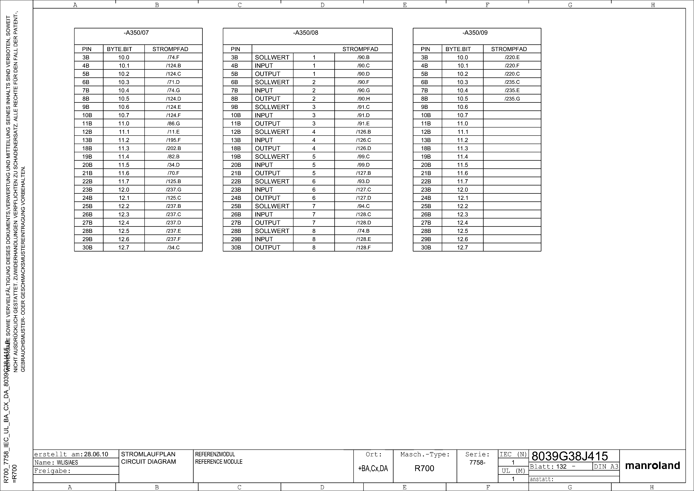

# +BA_Cx_DA — Sheet 132 of 247 — REFERENZMODUL

**REFERENCE MODULE**

> Part of the manroland **R700** printing press IEC/UL circuit diagrams.
> Drawing class: **Stromlaufplan / Circuit diagram** (DIN A3).
> Document `+BA_Cx_DA` covers the **Printing units / main switch cabinet** machine section.

## At a glance

| Field | Value |
|---|---|
| Document | `+BA_Cx_DA`  (8039G38J415) |
| Sheet | **132** of 247 |
| Section (DE) | REFERENZMODUL |
| Section (EN) | REFERENCE MODULE |
| Section type | REFERENCE_MODULE — Reference module |
| Machine type | `R700` |
| Series | `7758` |
| Created | 28.06.10 |
| Replaces | — |
| Columns used | A, B, C, D, E, F |
| Path numbers | — |
| Labels on sheet | 233 |
| Cross-refs out | 54 |
| Cross-refs in | 54 |

**Previous:** [+BA_Cx_DA sheet 131](SHEET_0131.md) · **Next:** [+BA_Cx_DA sheet 133](SHEET_0133.md) · **Document TOC:** [_TOC.md](_TOC.md)  (+BA_Cx_DA) · **Master TOC:** [all sheets](../_MASTER_TOC.md)

## Sheet image (300 DPI, exact vector render)



_Rendered directly from the PDF vector layer at 300 DPI (1-bit), no OCR and no resampling. Use it to confirm anything ambiguous in the text below._

## Cross-references on this sheet

Each entry is a wire leaving this sheet. The printed token is `/sheet.column`; the link resolves to that sheet inside the same document.

| Ref | Target sheet | Col | Path | Destination on target | Target section | From col |
|---|---|---|---|---|---|---|
| `/90.B` | [+BA_Cx_DA sheet 90](SHEET_0090.md) | B | — | — | BOGENFÜHRUNG | E |
| `/74.F` | [+BA_Cx_DA sheet 74](SHEET_0074.md) | F | — | — | FEUCHTWERK | B |
| `/220.E` | [+BA_Cx_DA sheet 220](SHEET_0220.md) | E | — | — | OPTION: FORMAT 780x1040 | F |
| `/124.B` | [+BA_Cx_DA sheet 124](SHEET_0124.md) | B | — | — | RESERVE: SPS STATION (INPUT) | B |
| `/220.F` | [+BA_Cx_DA sheet 220](SHEET_0220.md) | F | — | — | OPTION: FORMAT 780x1040 | F |
| `/90.C` | [+BA_Cx_DA sheet 90](SHEET_0090.md) | C | — | — | BOGENFÜHRUNG | E |
| `/90.D` | [+BA_Cx_DA sheet 90](SHEET_0090.md) | D | — | — | BOGENFÜHRUNG | E |
| `/124.C` | [+BA_Cx_DA sheet 124](SHEET_0124.md) | C | — | — | RESERVE: SPS STATION (INPUT) | B |
| `/220.C` | [+BA_Cx_DA sheet 220](SHEET_0220.md) | C | — | — | OPTION: FORMAT 780x1040 | F |
| `/90.F` | [+BA_Cx_DA sheet 90](SHEET_0090.md) | F | — | — | BOGENFÜHRUNG | E |
| `/71.D` | [+BA_Cx_DA sheet 71](SHEET_0071.md) | D | — | — | ÖLUMLAUFSCHMIERUNG | B |
| `/235.C` | [+BA_Cx_DA sheet 235](SHEET_0235.md) | C | — | — | OPTION: INLINECOATER SMART | F |
| `/74.G` | [+BA_Cx_DA sheet 74](SHEET_0074.md) | G | — | — | FEUCHTWERK | B |
| `/90.G` | [+BA_Cx_DA sheet 90](SHEET_0090.md) | G | — | — | BOGENFÜHRUNG | E |
| `/235.E` | [+BA_Cx_DA sheet 235](SHEET_0235.md) | E | — | — | OPTION: INLINECOATER SMART | F |
| `/90.H` | [+BA_Cx_DA sheet 90](SHEET_0090.md) | H | — | — | BOGENFÜHRUNG | E |
| `/235.G` | [+BA_Cx_DA sheet 235](SHEET_0235.md) | G | — | — | OPTION: INLINECOATER SMART | F |
| `/124.D` | [+BA_Cx_DA sheet 124](SHEET_0124.md) | D | — | — | RESERVE: SPS STATION (INPUT) | B |
| `/124.E` | [+BA_Cx_DA sheet 124](SHEET_0124.md) | E | — | — | RESERVE: SPS STATION (INPUT) | B |
| `/91.C` | [+BA_Cx_DA sheet 91](SHEET_0091.md) | C | — | — | BOGENFÜHRUNG WENDETROMMEL | E |
| `/124.F` | [+BA_Cx_DA sheet 124](SHEET_0124.md) | F | — | — | RESERVE: SPS STATION (INPUT) | B |
| `/91.D` | [+BA_Cx_DA sheet 91](SHEET_0091.md) | D | — | — | BOGENFÜHRUNG WENDETROMMEL | E |
| `/91.E` | [+BA_Cx_DA sheet 91](SHEET_0091.md) | E | — | — | BOGENFÜHRUNG WENDETROMMEL | E |
| `/86.G` | [+BA_Cx_DA sheet 86](SHEET_0086.md) | G | — | — | WASCHVORRICHTUNG | B |
| `/11.E` | [+BA_Cx_DA sheet 11](SHEET_0011.md) | E | — | — | SPANNUNGSVERSORGUNG, SCHALTSCHRANKBELÜFTUNG | B |
| `/126.B` | [+BA_Cx_DA sheet 126](SHEET_0126.md) | B | — | — | RESERVE: SPS STATION (D/A) | E |
| `/195.F` | [+BA_Cx_DA sheet 195](SHEET_0195.md) | F | — | — | OPTION: WASCHVORRICHTUNG MIT BÜRSTE | B |
| `/126.C` | [+BA_Cx_DA sheet 126](SHEET_0126.md) | C | — | — | RESERVE: SPS STATION (D/A) | E |
| `/202.B` | [+BA_Cx_DA sheet 202](SHEET_0202.md) | B | — | — | OPTION: | B |
| `/126.D` | [+BA_Cx_DA sheet 126](SHEET_0126.md) | D | — | — | RESERVE: SPS STATION (D/A) | E |
| `/82.B` | [+BA_Cx_DA sheet 82](SHEET_0082.md) | B | — | — | FARBWERK | B |
| `/99.C` | [+BA_Cx_DA sheet 99](SHEET_0099.md) | C | — | — | BLAS/SAUGLUFT MIT MOTORVENTILEINSTELLUNG | E |
| `/34.D` | [+BA_Cx_DA sheet 34](SHEET_0034.md) | D | — | — | BUSVERBINDUNGEN: RESERVE SIGNALE | B |
| `/99.D` | [+BA_Cx_DA sheet 99](SHEET_0099.md) | D | — | — | BLAS/SAUGLUFT MIT MOTORVENTILEINSTELLUNG | E |
| `/70.F` | [+BA_Cx_DA sheet 70](SHEET_0070.md) | F | — | — | ÖLUMLAUFSCHMIERUNG | B |
| `/127.B` | [+BA_Cx_DA sheet 127](SHEET_0127.md) | B | — | — | RESERVE: SPS STATION (D/A) | E |
| `/125.B` | [+BA_Cx_DA sheet 125](SHEET_0125.md) | B | — | — | RESERVE: SPS STATION (INPUT) | B |
| `/93.D` | [+BA_Cx_DA sheet 93](SHEET_0093.md) | D | — | — | BOGENFÜHRUNG (BLASROHRE) | E |
| `/237.G` | [+BA_Cx_DA sheet 237](SHEET_0237.md) | G | — | — | OPTION: INLINECOATER SMART | B |
| `/127.C` | [+BA_Cx_DA sheet 127](SHEET_0127.md) | C | — | — | RESERVE: SPS STATION (D/A) | E |
| `/125.C` | [+BA_Cx_DA sheet 125](SHEET_0125.md) | C | — | — | RESERVE: SPS STATION (INPUT) | B |
| `/127.D` | [+BA_Cx_DA sheet 127](SHEET_0127.md) | D | — | — | RESERVE: SPS STATION (D/A) | E |
| `/237.B` | [+BA_Cx_DA sheet 237](SHEET_0237.md) | B | — | — | OPTION: INLINECOATER SMART | B |
| `/94.C` | [+BA_Cx_DA sheet 94](SHEET_0094.md) | C | — | — | BOGENFÜHRUNG (BLASROHRE) | E |
| `/237.C` | [+BA_Cx_DA sheet 237](SHEET_0237.md) | C | — | — | OPTION: INLINECOATER SMART | B |
| `/128.C` | [+BA_Cx_DA sheet 128](SHEET_0128.md) | C | — | — | RESERVE: SPS STATION (D/A) | E |
| `/237.D` | [+BA_Cx_DA sheet 237](SHEET_0237.md) | D | — | — | OPTION: INLINECOATER SMART | B |
| `/128.D` | [+BA_Cx_DA sheet 128](SHEET_0128.md) | D | — | — | RESERVE: SPS STATION (D/A) | E |
| `/74.B` | [+BA_Cx_DA sheet 74](SHEET_0074.md) | B | — | — | FEUCHTWERK | E |
| `/237.E` | [+BA_Cx_DA sheet 237](SHEET_0237.md) | E | — | — | OPTION: INLINECOATER SMART | B |
| `/128.E` | [+BA_Cx_DA sheet 128](SHEET_0128.md) | E | — | — | RESERVE: SPS STATION (D/A) | E |
| `/237.F` | [+BA_Cx_DA sheet 237](SHEET_0237.md) | F | — | — | OPTION: INLINECOATER SMART | B |
| `/128.F` | [+BA_Cx_DA sheet 128](SHEET_0128.md) | F | — | — | RESERVE: SPS STATION (D/A) | E |
| `/34.C` | [+BA_Cx_DA sheet 34](SHEET_0034.md) | C | — | — | BUSVERBINDUNGEN: RESERVE SIGNALE | B |

### Incoming references (sheets that point here)

Every other sheet that sends a wire to this one. `Back-ref` is the token printed on *that* sheet; `Path` is its line number.

| From sheet | Cols | Back-ref | Path | Refs | What continues there |
|---|---|---|---|---|---|
| [+BA_Cx_DA#11](SHEET_0011.md) | E | `/11.E` | — | 1 | — |
| [+BA_Cx_DA#34](SHEET_0034.md) | B, D | `/34.B`, `/34.D` | — | 2 | — |
| [+BA_Cx_DA#70](SHEET_0070.md) | F | `/70.F` | — | 1 | — |
| [+BA_Cx_DA#71](SHEET_0071.md) | D | `/71.D` | — | 1 | — |
| [+BA_Cx_DA#74](SHEET_0074.md) | B, F, G | `/74.B`, `/74.F`, `/74.G` | — | 3 | — |
| [+BA_Cx_DA#82](SHEET_0082.md) | B | `/82.B` | — | 1 | — |
| [+BA_Cx_DA#86](SHEET_0086.md) | G | `/86.G` | — | 1 | — |
| [+BA_Cx_DA#90](SHEET_0090.md) | B, C, D, F, G, H | `/90.B`, `/90.C`, `/90.D`, `/90.F`, `/90.G`, `/90.H` | — | 6 | — |
| [+BA_Cx_DA#91](SHEET_0091.md) | C, D, E | `/91.C`, `/91.D`, `/91.E` | — | 3 | — |
| [+BA_Cx_DA#93](SHEET_0093.md) | D | `/93.D` | — | 1 | — |
| [+BA_Cx_DA#94](SHEET_0094.md) | C | `/94.C` | — | 1 | — |
| [+BA_Cx_DA#99](SHEET_0099.md) | C, D | `/99.C`, `/99.D` | — | 2 | — |
| [+BA_Cx_DA#124](SHEET_0124.md) | B, C, D, E, F | `/124.B`, `/124.C`, `/124.D`, `/124.E`, `/124.F` | — | 5 | — |
| [+BA_Cx_DA#125](SHEET_0125.md) | B, C | `/125.B`, `/125.C` | — | 2 | — |
| [+BA_Cx_DA#126](SHEET_0126.md) | B, C, D | `/126.B`, `/126.C`, `/126.D` | — | 3 | — |
| [+BA_Cx_DA#127](SHEET_0127.md) | B, C, D | `/127.B`, `/127.C`, `/127.D` | — | 3 | — |
| [+BA_Cx_DA#128](SHEET_0128.md) | C, D, E, F | `/128.C`, `/128.D`, `/128.E`, `/128.F` | — | 4 | — |
| [+BA_Cx_DA#195](SHEET_0195.md) | F | `/195.F` | — | 1 | — |
| [+BA_Cx_DA#202](SHEET_0202.md) | B | `/202.B` | — | 1 | — |
| [+BA_Cx_DA#220](SHEET_0220.md) | C, E, F | `/220.C`, `/220.E`, `/220.F` | — | 3 | — |
| [+BA_Cx_DA#235](SHEET_0235.md) | C, E, G | `/235.C`, `/235.E`, `/235.G` | — | 3 | — |
| [+BA_Cx_DA#237](SHEET_0237.md) | B, C, D, E, F, G | `/237.B`, `/237.C`, `/237.D`, `/237.E`, `/237.F`, `/237.G` | — | 6 | — |


## Devices on this sheet

| Tag | Class | Class meaning (IEC) | Col | Sub | Terminal | Sign |
|---|---|---|---|---|---|---|
| `A350/07` | A | Baugruppe / assembly, module, PC board | B | 07 | — | — |
| `A350/08` | A | Baugruppe / assembly, module, PC board | D | 08 | — | — |
| `A350/09` | A | Baugruppe / assembly, module, PC board | F | 09 | — | — |
| `10.0` | — | cross-device reference | B | — | — | — |
| `10.1` | — | cross-device reference | B | — | — | — |
| `10.2` | — | cross-device reference | B | — | — | — |
| `10.3` | — | cross-device reference | B | — | — | — |
| `10.4` | — | cross-device reference | B | — | — | — |
| `10.5` | — | cross-device reference | B | — | — | — |
| `10.6` | — | cross-device reference | B | — | — | — |
| `10.7` | — | cross-device reference | B | — | — | — |
| `11.0` | — | cross-device reference | B | — | — | — |
| `11.1` | — | cross-device reference | B | — | — | — |
| `11.2` | — | cross-device reference | B | — | — | — |
| `11.3` | — | cross-device reference | B | — | — | — |
| `11.4` | — | cross-device reference | B | — | — | — |
| `11.5` | — | cross-device reference | B | — | — | — |
| `11.6` | — | cross-device reference | B | — | — | — |
| `11.7` | — | cross-device reference | B | — | — | — |
| `12.0` | — | cross-device reference | B | — | — | — |
| `12.1` | — | cross-device reference | B | — | — | — |
| `12.2` | — | cross-device reference | B | — | — | — |
| `12.3` | — | cross-device reference | B | — | — | — |
| `12.4` | — | cross-device reference | B | — | — | — |
| `12.5` | — | cross-device reference | B | — | — | — |
| `12.6` | — | cross-device reference | B | — | — | — |
| `12.7` | — | cross-device reference | B | — | — | — |
| `10.0` | — | cross-device reference | F | — | — | — |
| `10.1` | — | cross-device reference | F | — | — | — |
| `10.2` | — | cross-device reference | F | — | — | — |
| `10.3` | — | cross-device reference | F | — | — | — |
| `10.4` | — | cross-device reference | F | — | — | — |
| `10.5` | — | cross-device reference | F | — | — | — |
| `10.6` | — | cross-device reference | F | — | — | — |
| `10.7` | — | cross-device reference | F | — | — | — |
| `11.0` | — | cross-device reference | F | — | — | — |
| `11.1` | — | cross-device reference | F | — | — | — |
| `11.2` | — | cross-device reference | F | — | — | — |
| `11.3` | — | cross-device reference | F | — | — | — |
| `11.4` | — | cross-device reference | F | — | — | — |
| `11.5` | — | cross-device reference | F | — | — | — |
| `11.6` | — | cross-device reference | F | — | — | — |
| `11.7` | — | cross-device reference | F | — | — | — |
| `12.0` | — | cross-device reference | F | — | — | — |
| `12.1` | — | cross-device reference | F | — | — | — |
| `12.2` | — | cross-device reference | F | — | — | — |
| `12.3` | — | cross-device reference | F | — | — | — |
| `12.4` | — | cross-device reference | F | — | — | — |
| `12.5` | — | cross-device reference | F | — | — | — |
| `12.6` | — | cross-device reference | F | — | — | — |
| `12.7` | — | cross-device reference | F | — | — | — |

## Potentials / nets

_No named potentials on this sheet._

## Wire-end annotations (grouped as printed)

A wire that continues elsewhere is annotated with a small cluster: the destination description, the path/line number `#NN`, and the `/sheet.column` cross reference. Each row below is one such cluster exactly as it is grouped on the drawing.

| Col | Y | Path | Cross-ref | Text on the wire |
|---|---|---|---|---|
| B | 51.3 | — | — | `A350/07` |
| D | 51.3 | — | — | `A350/08` |
| F | 51.3 | — | — | `A350/09` |
| A | 80.0 | — | — | `PIN BYTE.BIT` |
| B | 80.0 | — | — | `STROMPFAD` |
| D | 80.0 | — | — | `10B 11B 12B 13B 18B 19B 3B 4B 5B 6B 7B 8B 9B 20B 21B 22B 23B 24B 25B 26B 27B 28B 29B 30B STROMPFAD` |
| C | 80.0 | — | — | `PIN` |
| E | 80.0 | — | — | `PIN BYTE.BIT` |
| F | 80.0 | — | — | `STROMPFAD` |
| C | 93.8 | — | — | `INPUT INPUT INPUT INPUT INPUT INPUT INPUT INPUT SOLLWERT OUTPUT SOLLWERT OUTPUT SOLLWERT OUTPUT SOLLWERT OUTPUT SOLLWERT OUTPUT SOLLWERT OUTPUT SOLLWERT OUTPUT SOLLWERT OUTPUT` |
| A | 94.2 | — | — | `10B 11B 12B 13B 18B 19B 3B 4B 5B 6B 7B 8B 9B 20B 21B 22B 23B 24B 25B 26B 27B 28B 29B 30B` |
| B | 94.2 | — | — | `10.0 10.2 10.3 10.4 10.5 10.6 10.7 11.0 11.2 11.3 11.4 11.5 11.6 11.7 12.0 12.2 12.3 12.4 12.5 12.6 12.7 10.1 11.1 12.1` |
| D | 94.2 | — | — | `2 2 2 3 3 3 4 4 4 5 5 5 6 6 6 7 7 7 8 8 8 1 1 1` |
| E | 94.2 | — | — | `10B 11B 12B 13B 18B 19B 3B 4B 5B 6B 7B 8B 9B 20B 21B 22B 23B 24B 25B 26B 27B 28B 29B 30B` |
| F | 94.2 | — | — | `10.0 10.2 10.3 10.4 10.5 10.6 10.7 11.0 11.2 11.3 11.4 11.5 11.6 11.7 12.0 12.2 12.3 12.4 12.5 12.6 12.7 10.1 11.1 12.1` |
| B | 94.5 | — | `/74.F` | — |
| E | 94.5 | — | `/90.B` | — |
| F | 94.5 | — | `/220.E` | — |
| B | 108.7 | — | `/124.B` | — |
| E | 108.7 | — | `/90.C` | — |
| F | 108.7 | — | `/220.F` | — |
| B | 122.9 | — | `/124.C` | — |
| E | 122.9 | — | `/90.D` | — |
| F | 122.9 | — | `/220.C` | — |
| E | 137.0 | — | `/90.F` | — |
| B | 137.1 | — | `/71.D` | — |
| F | 137.1 | — | `/235.C` | — |
| B | 151.2 | — | `/74.G` | — |
| E | 151.2 | — | `/90.G` | — |
| F | 151.2 | — | `/235.E` | — |
| B | 165.4 | — | `/124.D` | — |
| E | 165.4 | — | `/90.H` | — |
| F | 165.4 | — | `/235.G` | — |
| B | 179.6 | — | `/124.E` | — |
| E | 179.6 | — | `/91.C` | — |
| B | 193.7 | — | `/124.F` | — |
| E | 193.8 | — | `/91.D` | — |
| B | 207.9 | — | `/86.G` | — |
| E | 207.9 | — | `/91.E` | — |
| B | 222.1 | — | `/11.E` | — |
| E | 222.1 | — | `/126.B` | — |
| B | 236.3 | — | `/195.F` | — |
| E | 236.3 | — | `/126.C` | — |
| B | 250.4 | — | `/202.B` | — |
| E | 250.4 | — | `/126.D` | — |
| B | 264.6 | — | `/82.B` | — |
| E | 264.6 | — | `/99.C` | — |
| B | 278.8 | — | `/34.D` | — |
| E | 278.8 | — | `/99.D` | — |
| B | 292.9 | — | `/70.F` | — |
| E | 292.9 | — | `/127.B` | — |
| B | 307.1 | — | `/125.B` | — |
| E | 307.1 | — | `/93.D` | — |
| B | 321.3 | — | `/237.G` | — |
| E | 321.3 | — | `/127.C` | — |
| B | 335.5 | — | `/125.C` | — |
| E | 335.5 | — | `/127.D` | — |
| B | 349.6 | — | `/237.B` | — |
| E | 349.6 | — | `/94.C` | — |
| B | 363.8 | — | `/237.C` | — |
| E | 363.8 | — | `/128.C` | — |
| B | 378.0 | — | `/237.D` | — |
| E | 378.0 | — | `/128.D` | — |
| B | 392.1 | — | `/237.E` | — |
| E | 392.1 | — | `/74.B` | — |
| B | 406.3 | — | `/237.F` | — |
| E | 406.3 | — | `/128.E` | — |
| B | 420.5 | — | `/34.C` | — |
| E | 420.5 | — | `/128.F` | — |


## Reconstructed tables

This sheet carries tabular content (pin map / terminal assignment / index). The grid below was rebuilt from the drawing's own rule lines, so each row is exactly one physical row of the table.

### Table 1 — 24 data rows × 3 columns (at x=127.6, y=48.2) — **A350/07**

| PIN | BYTE.BIT | STROMPFAD |
|---|---|---|
| `3B` | `10.0` | `/74.F` |
| `4B` | `10.1` | `/124.B` |
| `5B` | `10.2` | `/124.C` |
| `6B` | `10.3` | `/71.D` |
| `7B` | `10.4` | `/74.G` |
| `8B` | `10.5` | `/124.D` |
| `9B` | `10.6` | `/124.E` |
| `10B` | `10.7` | `/124.F` |
| `11B` | `11.0` | `/86.G` |
| `12B` | `11.1` | `/11.E` |
| `13B` | `11.2` | `/195.F` |
| `18B` | `11.3` | `/202.B` |
| `19B` | `11.4` | `/82.B` |
| `20B` | `11.5` | `/34.D` |
| `21B` | `11.6` | `/70.F` |
| `22B` | `11.7` | `/125.B` |
| `23B` | `12.0` | `/237.G` |
| `24B` | `12.1` | `/125.C` |
| `25B` | `12.2` | `/237.B` |
| `26B` | `12.3` | `/237.C` |
| `27B` | `12.4` | `/237.D` |
| `28B` | `12.5` | `/237.E` |
| `29B` | `12.6` | `/237.F` |
| `30B` | `12.7` | `/34.C` |


### Table 2 — 24 data rows × 4 columns (at x=382.7, y=48.2) — **A350/08**

| PIN |  |  | STROMPFAD |
|---|---|---|---|
| `3B` | `SOLLWERT` | `1` | `/90.B` |
| `4B` | `INPUT` | `1` | `/90.C` |
| `5B` | `OUTPUT` | `1` | `/90.D` |
| `6B` | `SOLLWERT` | `2` | `/90.F` |
| `7B` | `INPUT` | `2` | `/90.G` |
| `8B` | `OUTPUT` | `2` | `/90.H` |
| `9B` | `SOLLWERT` | `3` | `/91.C` |
| `10B` | `INPUT` | `3` | `/91.D` |
| `11B` | `OUTPUT` | `3` | `/91.E` |
| `12B` | `SOLLWERT` | `4` | `/126.B` |
| `13B` | `INPUT` | `4` | `/126.C` |
| `18B` | `OUTPUT` | `4` | `/126.D` |
| `19B` | `SOLLWERT` | `5` | `/99.C` |
| `20B` | `INPUT` | `5` | `/99.D` |
| `21B` | `OUTPUT` | `5` | `/127.B` |
| `22B` | `SOLLWERT` | `6` | `/93.D` |
| `23B` | `INPUT` | `6` | `/127.C` |
| `24B` | `OUTPUT` | `6` | `/127.D` |
| `25B` | `SOLLWERT` | `7` | `/94.C` |
| `26B` | `INPUT` | `7` | `/128.C` |
| `27B` | `OUTPUT` | `7` | `/128.D` |
| `28B` | `SOLLWERT` | `8` | `/74.B` |
| `29B` | `INPUT` | `8` | `/128.E` |
| `30B` | `OUTPUT` | `8` | `/128.F` |


### Table 3 — 24 data rows × 3 columns (at x=708.7, y=48.2) — **A350/09**

| PIN | BYTE.BIT | STROMPFAD |
|---|---|---|
| `3B` | `10.0` | `/220.E` |
| `4B` | `10.1` | `/220.F` |
| `5B` | `10.2` | `/220.C` |
| `6B` | `10.3` | `/235.C` |
| `7B` | `10.4` | `/235.E` |
| `8B` | `10.5` | `/235.G` |
| `9B` | `10.6` |  |
| `10B` | `10.7` |  |
| `11B` | `11.0` |  |
| `12B` | `11.1` |  |
| `13B` | `11.2` |  |
| `18B` | `11.3` |  |
| `19B` | `11.4` |  |
| `20B` | `11.5` |  |
| `21B` | `11.6` |  |
| `22B` | `11.7` |  |
| `23B` | `12.0` |  |
| `24B` | `12.1` |  |
| `25B` | `12.2` |  |
| `26B` | `12.3` |  |
| `27B` | `12.4` |  |
| `28B` | `12.5` |  |
| `29B` | `12.6` |  |
| `30B` | `12.7` |  |


## Notes and free text on this sheet

| Text | Col | Y (pt) |
|---|---|---|
| `3B` | A | 94.18 |
| `4B` | A | 108.35 |
| `5B` | A | 122.53 |
| `6B` | A | 136.7 |
| `7B` | A | 150.87 |
| `8B` | A | 165.05 |
| `9B` | A | 179.22 |
| `10B` | A | 193.4 |
| `11B` | A | 207.57 |
| `12B` | A | 221.74 |
| `13B` | A | 235.92 |
| `18B` | A | 250.09 |
| `19B` | A | 264.26 |
| `20B` | A | 278.44 |
| `21B` | A | 292.61 |
| `22B` | A | 306.78 |
| `23B` | A | 320.96 |
| `24B` | A | 335.13 |
| `25B` | A | 349.3 |
| `26B` | A | 363.48 |
| `27B` | A | 377.65 |
| `28B` | A | 391.82 |
| `29B` | A | 406 |
| `30B` | A | 420.17 |
| `PIN` | A | 80.02 |
| `BYTE.BIT` | B | 80 |
| `STROMPFAD` | B | 79.98 |
| `STROMPFAD` | D | 79.98 |
| `3B` | C | 94.18 |
| `4B` | C | 108.35 |
| `5B` | C | 122.53 |
| `6B` | C | 136.7 |
| `7B` | C | 150.87 |
| `8B` | C | 165.05 |
| `9B` | C | 179.22 |
| `10B` | C | 193.4 |
| `11B` | C | 207.57 |
| `12B` | C | 221.74 |
| `13B` | C | 235.92 |
| `18B` | C | 250.09 |
| `19B` | C | 264.26 |
| `20B` | C | 278.44 |
| `21B` | C | 292.61 |
| `22B` | C | 306.78 |
| `23B` | C | 320.96 |
| `24B` | C | 335.13 |
| `25B` | C | 349.3 |
| `26B` | C | 363.48 |
| `27B` | C | 377.65 |
| `28B` | C | 391.82 |
| `29B` | C | 406 |
| `30B` | C | 420.17 |
| `PIN` | C | 80.02 |
| `SOLLWERT` | C | 93.79 |
| `INPUT` | C | 108.07 |
| `OUTPUT` | C | 122.19 |
| `3B` | E | 94.18 |
| `4B` | E | 108.35 |
| `5B` | E | 122.53 |
| `6B` | E | 136.7 |
| `7B` | E | 150.87 |
| `8B` | E | 165.05 |
| `9B` | E | 179.22 |
| `10B` | E | 193.4 |
| `11B` | E | 207.57 |
| `12B` | E | 221.74 |
| `13B` | E | 235.92 |
| `18B` | E | 250.09 |
| `19B` | E | 264.26 |
| `20B` | E | 278.44 |
| `21B` | E | 292.61 |
| `22B` | E | 306.78 |
| `23B` | E | 320.96 |
| `24B` | E | 335.13 |
| `25B` | E | 349.3 |
| `26B` | E | 363.48 |
| `27B` | E | 377.65 |
| `28B` | E | 391.82 |
| `29B` | E | 406 |
| `30B` | E | 420.17 |
| `PIN` | E | 80.02 |
| `BYTE.BIT` | F | 80 |
| `STROMPFAD` | F | 79.98 |

## Complete label inventory (exact text from the drawing)

Every text object inside the drawing area of this sheet, in DIN reading order (column A→H, then top→bottom). This is the authoritative list: if a string is not here it is not printed on this sheet.

| Col | Y | X | Dir | Type | Text |
|---|---|---|---|---|---|
| A | 80.0 | 140.9 | → | text | `PIN` |
| A | 94.2 | 141.4 | → | text | `3B` |
| A | 108.4 | 141.4 | → | text | `4B` |
| A | 122.5 | 141.4 | → | text | `5B` |
| A | 136.7 | 141.4 | → | text | `6B` |
| A | 150.9 | 141.4 | → | text | `7B` |
| A | 165.0 | 141.4 | → | text | `8B` |
| A | 179.2 | 141.4 | → | text | `9B` |
| A | 193.4 | 140.9 | → | text | `10B` |
| A | 207.6 | 140.9 | → | text | `11B` |
| A | 221.7 | 140.9 | → | text | `12B` |
| A | 235.9 | 140.9 | → | text | `13B` |
| A | 250.1 | 140.9 | → | text | `18B` |
| A | 264.3 | 140.9 | → | text | `19B` |
| A | 278.4 | 141.4 | → | text | `20B` |
| A | 292.6 | 141.4 | → | text | `21B` |
| A | 306.8 | 141.4 | → | text | `22B` |
| A | 321.0 | 141.4 | → | text | `23B` |
| A | 335.1 | 141.4 | → | text | `24B` |
| A | 349.3 | 141.4 | → | text | `25B` |
| A | 363.5 | 141.4 | → | text | `26B` |
| A | 377.6 | 141.4 | → | text | `27B` |
| A | 391.8 | 141.4 | → | text | `28B` |
| A | 406.0 | 141.4 | → | text | `29B` |
| A | 420.2 | 141.4 | → | text | `30B` |
| B | 51.3 | 212.5 | → | device tag | `A350/07` |
| B | 80.0 | 183.4 | → | text | `BYTE.BIT` |
| B | 80.0 | 261.6 | → | text | `STROMPFAD` |
| B | 94.2 | 202.8 | → | device ref | `10.0` |
| B | 94.5 | 287.7 | → | cross-reference | `/74.F` |
| B | 108.3 | 203.7 | → | device ref | `10.1` |
| B | 108.7 | 285.0 | → | cross-reference | `/124.B` |
| B | 122.5 | 202.8 | → | device ref | `10.2` |
| B | 122.9 | 284.9 | → | cross-reference | `/124.C` |
| B | 136.7 | 202.8 | → | device ref | `10.3` |
| B | 137.1 | 287.3 | → | cross-reference | `/71.D` |
| B | 150.9 | 202.8 | → | device ref | `10.4` |
| B | 151.2 | 287.1 | → | cross-reference | `/74.G` |
| B | 165.0 | 202.8 | → | device ref | `10.5` |
| B | 165.4 | 284.9 | → | cross-reference | `/124.D` |
| B | 179.2 | 202.8 | → | device ref | `10.6` |
| B | 179.6 | 285.2 | → | cross-reference | `/124.E` |
| B | 193.4 | 202.8 | → | device ref | `10.7` |
| B | 193.7 | 285.3 | → | cross-reference | `/124.F` |
| B | 207.6 | 202.8 | → | device ref | `11.0` |
| B | 207.9 | 287.1 | → | cross-reference | `/86.G` |
| B | 221.7 | 203.7 | → | device ref | `11.1` |
| B | 222.1 | 287.6 | → | cross-reference | `/11.E` |
| B | 235.9 | 202.8 | → | device ref | `11.2` |
| B | 236.3 | 285.3 | → | cross-reference | `/195.F` |
| B | 250.1 | 202.8 | → | device ref | `11.3` |
| B | 250.4 | 285.0 | → | cross-reference | `/202.B` |
| B | 264.2 | 202.8 | → | device ref | `11.4` |
| B | 264.6 | 287.4 | → | cross-reference | `/82.B` |
| B | 278.4 | 202.8 | → | device ref | `11.5` |
| B | 278.8 | 287.3 | → | cross-reference | `/34.D` |
| B | 292.6 | 202.8 | → | device ref | `11.6` |
| B | 292.9 | 287.7 | → | cross-reference | `/70.F` |
| B | 306.8 | 202.8 | → | device ref | `11.7` |
| B | 307.1 | 285.0 | → | cross-reference | `/125.B` |
| B | 320.9 | 202.8 | → | device ref | `12.0` |
| B | 321.3 | 284.7 | → | cross-reference | `/237.G` |
| B | 335.1 | 203.7 | → | device ref | `12.1` |
| B | 335.5 | 284.9 | → | cross-reference | `/125.C` |
| B | 349.3 | 202.8 | → | device ref | `12.2` |
| B | 349.6 | 285.0 | → | cross-reference | `/237.B` |
| B | 363.5 | 202.8 | → | device ref | `12.3` |
| B | 363.8 | 284.9 | → | cross-reference | `/237.C` |
| B | 377.6 | 202.8 | → | device ref | `12.4` |
| B | 378.0 | 284.9 | → | cross-reference | `/237.D` |
| B | 391.8 | 202.8 | → | device ref | `12.5` |
| B | 392.2 | 285.2 | → | cross-reference | `/237.E` |
| B | 406.0 | 202.8 | → | device ref | `12.6` |
| B | 406.3 | 285.3 | → | cross-reference | `/237.F` |
| B | 420.2 | 202.8 | → | device ref | `12.7` |
| B | 420.5 | 287.3 | → | cross-reference | `/34.C` |
| C | 80.0 | 396.0 | → | text | `PIN` |
| C | 93.8 | 437.4 | → | text | `SOLLWERT` |
| C | 94.2 | 396.6 | → | text | `3B` |
| C | 108.1 | 437.1 | → | text | `INPUT` |
| C | 108.4 | 396.6 | → | text | `4B` |
| C | 122.2 | 437.4 | → | text | `OUTPUT` |
| C | 122.5 | 396.6 | → | text | `5B` |
| C | 136.3 | 437.4 | → | text | `SOLLWERT` |
| C | 136.7 | 396.6 | → | text | `6B` |
| C | 150.6 | 437.1 | → | text | `INPUT` |
| C | 150.9 | 396.6 | → | text | `7B` |
| C | 164.7 | 437.4 | → | text | `OUTPUT` |
| C | 165.0 | 396.6 | → | text | `8B` |
| C | 178.8 | 437.4 | → | text | `SOLLWERT` |
| C | 179.2 | 396.6 | → | text | `9B` |
| C | 193.1 | 437.1 | → | text | `INPUT` |
| C | 193.4 | 396.0 | → | text | `10B` |
| C | 207.2 | 437.4 | → | text | `OUTPUT` |
| C | 207.6 | 396.0 | → | text | `11B` |
| C | 221.3 | 437.4 | → | text | `SOLLWERT` |
| C | 221.7 | 396.0 | → | text | `12B` |
| C | 235.6 | 437.1 | → | text | `INPUT` |
| C | 235.9 | 396.0 | → | text | `13B` |
| C | 249.8 | 437.4 | → | text | `OUTPUT` |
| C | 250.1 | 396.0 | → | text | `18B` |
| C | 263.9 | 437.4 | → | text | `SOLLWERT` |
| C | 264.3 | 396.0 | → | text | `19B` |
| C | 278.2 | 437.1 | → | text | `INPUT` |
| C | 278.4 | 396.6 | → | text | `20B` |
| C | 292.3 | 437.4 | → | text | `OUTPUT` |
| C | 292.6 | 396.6 | → | text | `21B` |
| C | 306.4 | 437.4 | → | text | `SOLLWERT` |
| C | 306.8 | 396.6 | → | text | `22B` |
| C | 320.7 | 437.1 | → | text | `INPUT` |
| C | 321.0 | 396.6 | → | text | `23B` |
| C | 334.8 | 437.4 | → | text | `OUTPUT` |
| C | 335.1 | 396.6 | → | text | `24B` |
| C | 348.9 | 437.4 | → | text | `SOLLWERT` |
| C | 349.3 | 396.6 | → | text | `25B` |
| C | 363.2 | 437.1 | → | text | `INPUT` |
| C | 363.5 | 396.6 | → | text | `26B` |
| C | 377.3 | 437.4 | → | text | `OUTPUT` |
| C | 377.6 | 396.6 | → | text | `27B` |
| C | 391.4 | 437.4 | → | text | `SOLLWERT` |
| C | 391.8 | 396.6 | → | text | `28B` |
| C | 405.7 | 437.1 | → | text | `INPUT` |
| C | 406.0 | 396.6 | → | text | `29B` |
| C | 419.8 | 437.4 | → | text | `OUTPUT` |
| C | 420.2 | 396.6 | → | text | `30B` |
| D | 51.3 | 503.0 | → | device tag | `A350/08` |
| D | 80.0 | 587.6 | → | text | `STROMPFAD` |
| D | 94.2 | 536.5 | → | number | `1` |
| D | 108.4 | 536.5 | → | number | `1` |
| D | 122.5 | 536.5 | → | number | `1` |
| D | 136.7 | 535.9 | → | number | `2` |
| D | 150.9 | 535.9 | → | number | `2` |
| D | 165.1 | 535.9 | → | number | `2` |
| D | 179.2 | 535.9 | → | number | `3` |
| D | 193.4 | 535.9 | → | number | `3` |
| D | 207.6 | 535.9 | → | number | `3` |
| D | 221.8 | 535.9 | → | number | `4` |
| D | 235.9 | 535.9 | → | number | `4` |
| D | 250.1 | 535.9 | → | number | `4` |
| D | 264.3 | 535.9 | → | number | `5` |
| D | 278.5 | 535.9 | → | number | `5` |
| D | 292.6 | 535.9 | → | number | `5` |
| D | 306.8 | 535.9 | → | number | `6` |
| D | 321.0 | 535.9 | → | number | `6` |
| D | 335.1 | 535.9 | → | number | `6` |
| D | 349.3 | 535.9 | → | number | `7` |
| D | 363.5 | 535.9 | → | number | `7` |
| D | 377.7 | 535.9 | → | number | `7` |
| D | 391.8 | 535.9 | → | number | `8` |
| D | 406.0 | 535.9 | → | number | `8` |
| D | 420.2 | 535.9 | → | number | `8` |
| E | 80.0 | 722.0 | → | text | `PIN` |
| E | 94.2 | 722.6 | → | text | `3B` |
| E | 94.5 | 613.4 | → | cross-reference | `/90.B` |
| E | 108.4 | 722.6 | → | text | `4B` |
| E | 108.7 | 613.3 | → | cross-reference | `/90.C` |
| E | 122.5 | 722.6 | → | text | `5B` |
| E | 122.9 | 613.3 | → | cross-reference | `/90.D` |
| E | 136.7 | 722.6 | → | text | `6B` |
| E | 137.0 | 613.7 | → | cross-reference | `/90.F` |
| E | 150.9 | 722.6 | → | text | `7B` |
| E | 151.2 | 613.1 | → | cross-reference | `/90.G` |
| E | 165.0 | 722.6 | → | text | `8B` |
| E | 165.4 | 613.6 | → | cross-reference | `/90.H` |
| E | 179.2 | 722.6 | → | text | `9B` |
| E | 179.6 | 613.3 | → | cross-reference | `/91.C` |
| E | 193.4 | 722.0 | → | text | `10B` |
| E | 193.7 | 613.3 | → | cross-reference | `/91.D` |
| E | 207.6 | 722.0 | → | text | `11B` |
| E | 207.9 | 613.6 | → | cross-reference | `/91.E` |
| E | 221.7 | 722.0 | → | text | `12B` |
| E | 222.1 | 611.0 | → | cross-reference | `/126.B` |
| E | 235.9 | 722.0 | → | text | `13B` |
| E | 236.3 | 610.9 | → | cross-reference | `/126.C` |
| E | 250.1 | 722.0 | → | text | `18B` |
| E | 250.4 | 610.9 | → | cross-reference | `/126.D` |
| E | 264.3 | 722.0 | → | text | `19B` |
| E | 264.6 | 613.3 | → | cross-reference | `/99.C` |
| E | 278.4 | 722.6 | → | text | `20B` |
| E | 278.8 | 613.3 | → | cross-reference | `/99.D` |
| E | 292.6 | 722.6 | → | text | `21B` |
| E | 292.9 | 611.0 | → | cross-reference | `/127.B` |
| E | 306.8 | 722.6 | → | text | `22B` |
| E | 307.1 | 613.3 | → | cross-reference | `/93.D` |
| E | 321.0 | 722.6 | → | text | `23B` |
| E | 321.3 | 610.9 | → | cross-reference | `/127.C` |
| E | 335.1 | 722.6 | → | text | `24B` |
| E | 335.5 | 610.9 | → | cross-reference | `/127.D` |
| E | 349.3 | 722.6 | → | text | `25B` |
| E | 349.7 | 613.3 | → | cross-reference | `/94.C` |
| E | 363.5 | 722.6 | → | text | `26B` |
| E | 363.8 | 610.9 | → | cross-reference | `/128.C` |
| E | 377.6 | 722.6 | → | text | `27B` |
| E | 378.0 | 610.9 | → | cross-reference | `/128.D` |
| E | 391.8 | 722.6 | → | text | `28B` |
| E | 392.1 | 613.4 | → | cross-reference | `/74.B` |
| E | 406.0 | 722.6 | → | text | `29B` |
| E | 406.3 | 611.1 | → | cross-reference | `/128.E` |
| E | 420.2 | 722.6 | → | text | `30B` |
| E | 420.5 | 611.3 | → | cross-reference | `/128.F` |
| F | 51.3 | 793.6 | → | device tag | `A350/09` |
| F | 80.0 | 764.5 | → | text | `BYTE.BIT` |
| F | 80.0 | 842.7 | → | text | `STROMPFAD` |
| F | 94.2 | 783.9 | → | device ref | `10.0` |
| F | 94.5 | 866.3 | → | cross-reference | `/220.E` |
| F | 108.3 | 784.8 | → | device ref | `10.1` |
| F | 108.7 | 866.4 | → | cross-reference | `/220.F` |
| F | 122.5 | 783.9 | → | device ref | `10.2` |
| F | 122.9 | 866.0 | → | cross-reference | `/220.C` |
| F | 136.7 | 783.9 | → | device ref | `10.3` |
| F | 137.1 | 866.0 | → | cross-reference | `/235.C` |
| F | 150.9 | 783.9 | → | device ref | `10.4` |
| F | 151.2 | 866.3 | → | cross-reference | `/235.E` |
| F | 165.0 | 783.9 | → | device ref | `10.5` |
| F | 165.4 | 865.8 | → | cross-reference | `/235.G` |
| F | 179.2 | 783.9 | → | device ref | `10.6` |
| F | 193.4 | 783.9 | → | device ref | `10.7` |
| F | 207.6 | 783.9 | → | device ref | `11.0` |
| F | 221.7 | 784.8 | → | device ref | `11.1` |
| F | 235.9 | 783.9 | → | device ref | `11.2` |
| F | 250.1 | 783.9 | → | device ref | `11.3` |
| F | 264.2 | 783.9 | → | device ref | `11.4` |
| F | 278.4 | 783.9 | → | device ref | `11.5` |
| F | 292.6 | 783.9 | → | device ref | `11.6` |
| F | 306.8 | 783.9 | → | device ref | `11.7` |
| F | 320.9 | 783.9 | → | device ref | `12.0` |
| F | 335.1 | 784.8 | → | device ref | `12.1` |
| F | 349.3 | 783.9 | → | device ref | `12.2` |
| F | 363.5 | 783.9 | → | device ref | `12.3` |
| F | 377.6 | 783.9 | → | device ref | `12.4` |
| F | 391.8 | 783.9 | → | device ref | `12.5` |
| F | 406.0 | 783.9 | → | device ref | `12.6` |
| F | 420.2 | 783.9 | → | device ref | `12.7` |

## Reading-order text block

The same content as a plain block, grouped by DIN column — convenient to paste or to match against a visual description.

```text
=== Column A ===
  80.0  140.9  text         PIN
  94.2  141.4  text         3B
 108.4  141.4  text         4B
 122.5  141.4  text         5B
 136.7  141.4  text         6B
 150.9  141.4  text         7B
 165.0  141.4  text         8B
 179.2  141.4  text         9B
 193.4  140.9  text         10B
 207.6  140.9  text         11B
 221.7  140.9  text         12B
 235.9  140.9  text         13B
 250.1  140.9  text         18B
 264.3  140.9  text         19B
 278.4  141.4  text         20B
 292.6  141.4  text         21B
 306.8  141.4  text         22B
 321.0  141.4  text         23B
 335.1  141.4  text         24B
 349.3  141.4  text         25B
 363.5  141.4  text         26B
 377.6  141.4  text         27B
 391.8  141.4  text         28B
 406.0  141.4  text         29B
 420.2  141.4  text         30B
=== Column B ===
  51.3  212.5  devtag       A350/07
  80.0  183.4  text         BYTE.BIT
  80.0  261.6  text         STROMPFAD
  94.2  202.8  devref       10.0
  94.5  287.7  xref         /74.F
 108.3  203.7  devref       10.1
 108.7  285.0  xref         /124.B
 122.5  202.8  devref       10.2
 122.9  284.9  xref         /124.C
 136.7  202.8  devref       10.3
 137.1  287.3  xref         /71.D
 150.9  202.8  devref       10.4
 151.2  287.1  xref         /74.G
 165.0  202.8  devref       10.5
 165.4  284.9  xref         /124.D
 179.2  202.8  devref       10.6
 179.6  285.2  xref         /124.E
 193.4  202.8  devref       10.7
 193.7  285.3  xref         /124.F
 207.6  202.8  devref       11.0
 207.9  287.1  xref         /86.G
 221.7  203.7  devref       11.1
 222.1  287.6  xref         /11.E
 235.9  202.8  devref       11.2
 236.3  285.3  xref         /195.F
 250.1  202.8  devref       11.3
 250.4  285.0  xref         /202.B
 264.2  202.8  devref       11.4
 264.6  287.4  xref         /82.B
 278.4  202.8  devref       11.5
 278.8  287.3  xref         /34.D
 292.6  202.8  devref       11.6
 292.9  287.7  xref         /70.F
 306.8  202.8  devref       11.7
 307.1  285.0  xref         /125.B
 320.9  202.8  devref       12.0
 321.3  284.7  xref         /237.G
 335.1  203.7  devref       12.1
 335.5  284.9  xref         /125.C
 349.3  202.8  devref       12.2
 349.6  285.0  xref         /237.B
 363.5  202.8  devref       12.3
 363.8  284.9  xref         /237.C
 377.6  202.8  devref       12.4
 378.0  284.9  xref         /237.D
 391.8  202.8  devref       12.5
 392.2  285.2  xref         /237.E
 406.0  202.8  devref       12.6
 406.3  285.3  xref         /237.F
 420.2  202.8  devref       12.7
 420.5  287.3  xref         /34.C
=== Column C ===
  80.0  396.0  text         PIN
  93.8  437.4  text         SOLLWERT
  94.2  396.6  text         3B
 108.1  437.1  text         INPUT
 108.4  396.6  text         4B
 122.2  437.4  text         OUTPUT
 122.5  396.6  text         5B
 136.3  437.4  text         SOLLWERT
 136.7  396.6  text         6B
 150.6  437.1  text         INPUT
 150.9  396.6  text         7B
 164.7  437.4  text         OUTPUT
 165.0  396.6  text         8B
 178.8  437.4  text         SOLLWERT
 179.2  396.6  text         9B
 193.1  437.1  text         INPUT
 193.4  396.0  text         10B
 207.2  437.4  text         OUTPUT
 207.6  396.0  text         11B
 221.3  437.4  text         SOLLWERT
 221.7  396.0  text         12B
 235.6  437.1  text         INPUT
 235.9  396.0  text         13B
 249.8  437.4  text         OUTPUT
 250.1  396.0  text         18B
 263.9  437.4  text         SOLLWERT
 264.3  396.0  text         19B
 278.2  437.1  text         INPUT
 278.4  396.6  text         20B
 292.3  437.4  text         OUTPUT
 292.6  396.6  text         21B
 306.4  437.4  text         SOLLWERT
 306.8  396.6  text         22B
 320.7  437.1  text         INPUT
 321.0  396.6  text         23B
 334.8  437.4  text         OUTPUT
 335.1  396.6  text         24B
 348.9  437.4  text         SOLLWERT
 349.3  396.6  text         25B
 363.2  437.1  text         INPUT
 363.5  396.6  text         26B
 377.3  437.4  text         OUTPUT
 377.6  396.6  text         27B
 391.4  437.4  text         SOLLWERT
 391.8  396.6  text         28B
 405.7  437.1  text         INPUT
 406.0  396.6  text         29B
 419.8  437.4  text         OUTPUT
 420.2  396.6  text         30B
=== Column D ===
  51.3  503.0  devtag       A350/08
  80.0  587.6  text         STROMPFAD
  94.2  536.5  numeric      1
 108.4  536.5  numeric      1
 122.5  536.5  numeric      1
 136.7  535.9  numeric      2
 150.9  535.9  numeric      2
 165.1  535.9  numeric      2
 179.2  535.9  numeric      3
 193.4  535.9  numeric      3
 207.6  535.9  numeric      3
 221.8  535.9  numeric      4
 235.9  535.9  numeric      4
 250.1  535.9  numeric      4
 264.3  535.9  numeric      5
 278.5  535.9  numeric      5
 292.6  535.9  numeric      5
 306.8  535.9  numeric      6
 321.0  535.9  numeric      6
 335.1  535.9  numeric      6
 349.3  535.9  numeric      7
 363.5  535.9  numeric      7
 377.7  535.9  numeric      7
 391.8  535.9  numeric      8
 406.0  535.9  numeric      8
 420.2  535.9  numeric      8
=== Column E ===
  80.0  722.0  text         PIN
  94.2  722.6  text         3B
  94.5  613.4  xref         /90.B
 108.4  722.6  text         4B
 108.7  613.3  xref         /90.C
 122.5  722.6  text         5B
 122.9  613.3  xref         /90.D
 136.7  722.6  text         6B
 137.0  613.7  xref         /90.F
 150.9  722.6  text         7B
 151.2  613.1  xref         /90.G
 165.0  722.6  text         8B
 165.4  613.6  xref         /90.H
 179.2  722.6  text         9B
 179.6  613.3  xref         /91.C
 193.4  722.0  text         10B
 193.7  613.3  xref         /91.D
 207.6  722.0  text         11B
 207.9  613.6  xref         /91.E
 221.7  722.0  text         12B
 222.1  611.0  xref         /126.B
 235.9  722.0  text         13B
 236.3  610.9  xref         /126.C
 250.1  722.0  text         18B
 250.4  610.9  xref         /126.D
 264.3  722.0  text         19B
 264.6  613.3  xref         /99.C
 278.4  722.6  text         20B
 278.8  613.3  xref         /99.D
 292.6  722.6  text         21B
 292.9  611.0  xref         /127.B
 306.8  722.6  text         22B
 307.1  613.3  xref         /93.D
 321.0  722.6  text         23B
 321.3  610.9  xref         /127.C
 335.1  722.6  text         24B
 335.5  610.9  xref         /127.D
 349.3  722.6  text         25B
 349.7  613.3  xref         /94.C
 363.5  722.6  text         26B
 363.8  610.9  xref         /128.C
 377.6  722.6  text         27B
 378.0  610.9  xref         /128.D
 391.8  722.6  text         28B
 392.1  613.4  xref         /74.B
 406.0  722.6  text         29B
 406.3  611.1  xref         /128.E
 420.2  722.6  text         30B
 420.5  611.3  xref         /128.F
=== Column F ===
  51.3  793.6  devtag       A350/09
  80.0  764.5  text         BYTE.BIT
  80.0  842.7  text         STROMPFAD
  94.2  783.9  devref       10.0
  94.5  866.3  xref         /220.E
 108.3  784.8  devref       10.1
 108.7  866.4  xref         /220.F
 122.5  783.9  devref       10.2
 122.9  866.0  xref         /220.C
 136.7  783.9  devref       10.3
 137.1  866.0  xref         /235.C
 150.9  783.9  devref       10.4
 151.2  866.3  xref         /235.E
 165.0  783.9  devref       10.5
 165.4  865.8  xref         /235.G
 179.2  783.9  devref       10.6
 193.4  783.9  devref       10.7
 207.6  783.9  devref       11.0
 221.7  784.8  devref       11.1
 235.9  783.9  devref       11.2
 250.1  783.9  devref       11.3
 264.2  783.9  devref       11.4
 278.4  783.9  devref       11.5
 292.6  783.9  devref       11.6
 306.8  783.9  devref       11.7
 320.9  783.9  devref       12.0
 335.1  784.8  devref       12.1
 349.3  783.9  devref       12.2
 363.5  783.9  devref       12.3
 377.6  783.9  devref       12.4
 391.8  783.9  devref       12.5
 406.0  783.9  devref       12.6
 420.2  783.9  devref       12.7
```

---
_Generated from the PDF vector text layer; no OCR. Source: `R700_7758_IEC_UL_BA_CX_DA_8039G38J415_p`, sheet 132._
