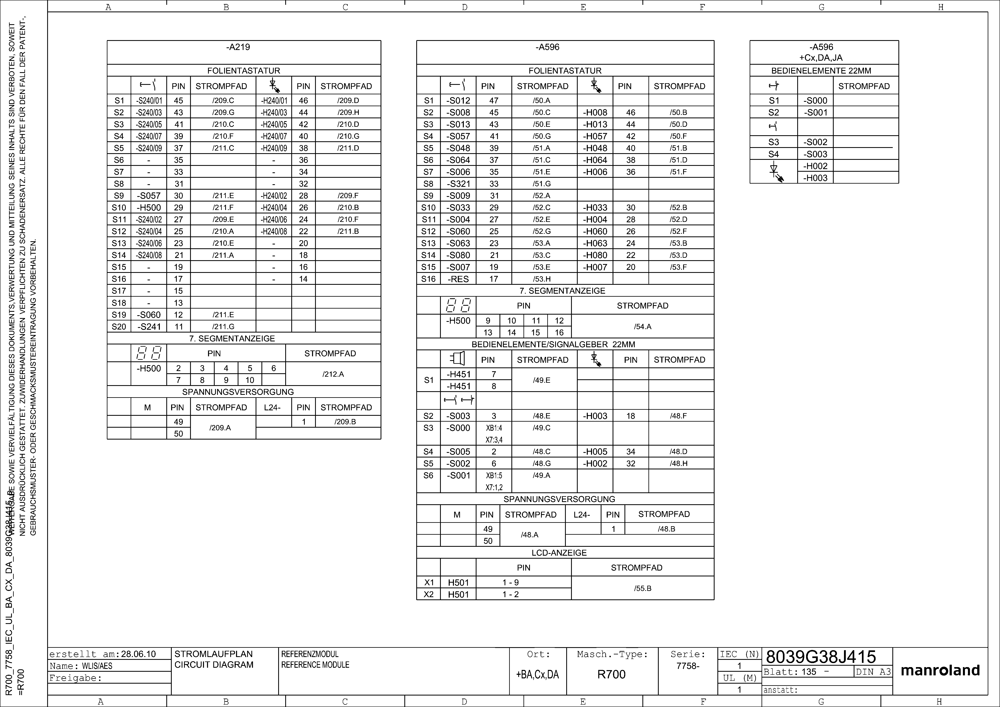

# +BA_Cx_DA — Sheet 135 of 247 — REFERENZMODUL

**REFERENCE MODULE**

> Part of the manroland **R700** printing press IEC/UL circuit diagrams.
> Drawing class: **Stromlaufplan / Circuit diagram** (DIN A3).
> Document `+BA_Cx_DA` covers the **Printing units / main switch cabinet** machine section.

## At a glance

| Field | Value |
|---|---|
| Document | `+BA_Cx_DA`  (8039G38J415) |
| Sheet | **135** of 247 |
| Section (DE) | REFERENZMODUL |
| Section (EN) | REFERENCE MODULE |
| Section type | REFERENCE_MODULE — Reference module |
| Machine type | `R700` |
| Series | `7758` |
| Created | 28.06.10 |
| Replaces | — |
| Columns used | A, B, C, D, E, F, G |
| Path numbers | — |
| Labels on sheet | 329 |
| Cross-refs out | 66 |
| Cross-refs in | 66 |

**Previous:** [+BA_Cx_DA sheet 134](SHEET_0134.md) · **Next:** [+BA_Cx_DA sheet 136](SHEET_0136.md) · **Document TOC:** [_TOC.md](_TOC.md)  (+BA_Cx_DA) · **Master TOC:** [all sheets](../_MASTER_TOC.md)

## Sheet image (300 DPI, exact vector render)



_Rendered directly from the PDF vector layer at 300 DPI (1-bit), no OCR and no resampling. Use it to confirm anything ambiguous in the text below._

## Cross-references on this sheet

Each entry is a wire leaving this sheet. The printed token is `/sheet.column`; the link resolves to that sheet inside the same document.

| Ref | Target sheet | Col | Path | Destination on target | Target section | From col |
|---|---|---|---|---|---|---|
| `/50.A` | [+BA_Cx_DA sheet 50](SHEET_0050.md) | A | — | — | ANLAGEBEDIENUNG | E |
| `/209.C` | [+BA_Cx_DA sheet 209](SHEET_0209.md) | C | — | — | OPTION: | B |
| `/209.D` | [+BA_Cx_DA sheet 209](SHEET_0209.md) | D | — | — | OPTION: | C |
| `/50.B` | [+BA_Cx_DA sheet 50](SHEET_0050.md) | B | — | — | ANLAGEBEDIENUNG | F |
| `/209.G` | [+BA_Cx_DA sheet 209](SHEET_0209.md) | G | — | — | OPTION: | B |
| `/50.C` | [+BA_Cx_DA sheet 50](SHEET_0050.md) | C | — | — | ANLAGEBEDIENUNG | E |
| `/209.H` | [+BA_Cx_DA sheet 209](SHEET_0209.md) | H | — | — | OPTION: | C |
| `/50.E` | [+BA_Cx_DA sheet 50](SHEET_0050.md) | E | — | — | ANLAGEBEDIENUNG | E |
| `/50.D` | [+BA_Cx_DA sheet 50](SHEET_0050.md) | D | — | — | ANLAGEBEDIENUNG | F |
| `/210.C` | [+BA_Cx_DA sheet 210](SHEET_0210.md) | C | — | — | OPTION: | B |
| `/210.D` | [+BA_Cx_DA sheet 210](SHEET_0210.md) | D | — | — | OPTION: | C |
| `/50.F` | [+BA_Cx_DA sheet 50](SHEET_0050.md) | F | — | — | ANLAGEBEDIENUNG | F |
| `/210.F` | [+BA_Cx_DA sheet 210](SHEET_0210.md) | F | — | — | OPTION: | B |
| `/50.G` | [+BA_Cx_DA sheet 50](SHEET_0050.md) | G | — | — | ANLAGEBEDIENUNG | E |
| `/210.G` | [+BA_Cx_DA sheet 210](SHEET_0210.md) | G | — | — | OPTION: | C |
| `/51.A` | [+BA_Cx_DA sheet 51](SHEET_0051.md) | A | — | — | ANLAGEBEDIENUNG | E |
| `/51.B` | [+BA_Cx_DA sheet 51](SHEET_0051.md) | B | — | — | ANLAGEBEDIENUNG | F |
| `/211.C` | [+BA_Cx_DA sheet 211](SHEET_0211.md) | C | — | — | OPTION: | B |
| `/211.D` | [+BA_Cx_DA sheet 211](SHEET_0211.md) | D | — | — | OPTION: | C |
| `/51.C` | [+BA_Cx_DA sheet 51](SHEET_0051.md) | C | — | — | ANLAGEBEDIENUNG | E |
| `/51.D` | [+BA_Cx_DA sheet 51](SHEET_0051.md) | D | — | — | ANLAGEBEDIENUNG | F |
| `/51.E` | [+BA_Cx_DA sheet 51](SHEET_0051.md) | E | — | — | ANLAGEBEDIENUNG | E |
| `/51.F` | [+BA_Cx_DA sheet 51](SHEET_0051.md) | F | — | — | ANLAGEBEDIENUNG | F |
| `/51.G` | [+BA_Cx_DA sheet 51](SHEET_0051.md) | G | — | — | ANLAGEBEDIENUNG | E |
| `/52.A` | [+BA_Cx_DA sheet 52](SHEET_0052.md) | A | — | — | ANLAGEBEDIENUNG | E |
| `/211.E` | [+BA_Cx_DA sheet 211](SHEET_0211.md) | E | — | — | OPTION: | B |
| `/209.F` | [+BA_Cx_DA sheet 209](SHEET_0209.md) | F | — | — | OPTION: | C |
| `/52.B` | [+BA_Cx_DA sheet 52](SHEET_0052.md) | B | — | — | ANLAGEBEDIENUNG | F |
| `/210.B` | [+BA_Cx_DA sheet 210](SHEET_0210.md) | B | — | — | OPTION: | C |
| `/211.F` | [+BA_Cx_DA sheet 211](SHEET_0211.md) | F | — | — | OPTION: | B |
| `/52.C` | [+BA_Cx_DA sheet 52](SHEET_0052.md) | C | — | — | ANLAGEBEDIENUNG | E |
| `/52.E` | [+BA_Cx_DA sheet 52](SHEET_0052.md) | E | — | — | ANLAGEBEDIENUNG | E |
| `/209.E` | [+BA_Cx_DA sheet 209](SHEET_0209.md) | E | — | — | OPTION: | B |
| `/210.F` | [+BA_Cx_DA sheet 210](SHEET_0210.md) | F | — | — | OPTION: | C |
| `/52.D` | [+BA_Cx_DA sheet 52](SHEET_0052.md) | D | — | — | ANLAGEBEDIENUNG | F |
| `/210.A` | [+BA_Cx_DA sheet 210](SHEET_0210.md) | A | — | — | OPTION: | B |
| `/211.B` | [+BA_Cx_DA sheet 211](SHEET_0211.md) | B | — | — | OPTION: | C |
| `/52.F` | [+BA_Cx_DA sheet 52](SHEET_0052.md) | F | — | — | ANLAGEBEDIENUNG | F |
| `/52.G` | [+BA_Cx_DA sheet 52](SHEET_0052.md) | G | — | — | ANLAGEBEDIENUNG | E |
| `/53.A` | [+BA_Cx_DA sheet 53](SHEET_0053.md) | A | — | — | ANLAGEBEDIENUNG | E |
| `/53.B` | [+BA_Cx_DA sheet 53](SHEET_0053.md) | B | — | — | ANLAGEBEDIENUNG | F |
| `/210.E` | [+BA_Cx_DA sheet 210](SHEET_0210.md) | E | — | — | OPTION: | B |
| `/211.A` | [+BA_Cx_DA sheet 211](SHEET_0211.md) | A | — | — | OPTION: | B |
| `/53.C` | [+BA_Cx_DA sheet 53](SHEET_0053.md) | C | — | — | ANLAGEBEDIENUNG | E |
| `/53.D` | [+BA_Cx_DA sheet 53](SHEET_0053.md) | D | — | — | ANLAGEBEDIENUNG | F |
| `/53.E` | [+BA_Cx_DA sheet 53](SHEET_0053.md) | E | — | — | ANLAGEBEDIENUNG | E |
| `/53.F` | [+BA_Cx_DA sheet 53](SHEET_0053.md) | F | — | — | ANLAGEBEDIENUNG | F |
| `/53.H` | [+BA_Cx_DA sheet 53](SHEET_0053.md) | H | — | — | ANLAGEBEDIENUNG | E |
| `/211.E` | [+BA_Cx_DA sheet 211](SHEET_0211.md) | E | — | — | OPTION: | B |
| `/54.A` | [+BA_Cx_DA sheet 54](SHEET_0054.md) | A | — | — | ANLAGEBEDIENUNG | F |
| `/211.G` | [+BA_Cx_DA sheet 211](SHEET_0211.md) | G | — | — | OPTION: | B |
| `/212.A` | [+BA_Cx_DA sheet 212](SHEET_0212.md) | A | — | — | OPTION: | C |
| `/49.E` | [+BA_Cx_DA sheet 49](SHEET_0049.md) | E | — | — | ANLAGEBEDIENUNG | E |
| `/48.E` | [+BA_Cx_DA sheet 48](SHEET_0048.md) | E | — | — | ANLAGEBEDIENUNG | E |
| `/48.F` | [+BA_Cx_DA sheet 48](SHEET_0048.md) | F | — | — | ANLAGEBEDIENUNG | F |
| `/209.B` | [+BA_Cx_DA sheet 209](SHEET_0209.md) | B | — | — | OPTION: | C |
| `/209.A` | [+BA_Cx_DA sheet 209](SHEET_0209.md) | A | — | — | OPTION: | B |
| `/49.C` | [+BA_Cx_DA sheet 49](SHEET_0049.md) | C | — | — | ANLAGEBEDIENUNG | E |
| `/48.C` | [+BA_Cx_DA sheet 48](SHEET_0048.md) | C | — | — | ANLAGEBEDIENUNG | E |
| `/48.D` | [+BA_Cx_DA sheet 48](SHEET_0048.md) | D | — | — | ANLAGEBEDIENUNG | F |
| `/48.G` | [+BA_Cx_DA sheet 48](SHEET_0048.md) | G | — | — | ANLAGEBEDIENUNG | E |
| `/48.H` | [+BA_Cx_DA sheet 48](SHEET_0048.md) | H | — | — | ANLAGEBEDIENUNG | F |
| `/49.A` | [+BA_Cx_DA sheet 49](SHEET_0049.md) | A | — | — | ANLAGEBEDIENUNG | E |
| `/48.B` | [+BA_Cx_DA sheet 48](SHEET_0048.md) | B | — | — | ANLAGEBEDIENUNG | F |
| `/48.A` | [+BA_Cx_DA sheet 48](SHEET_0048.md) | A | — | — | ANLAGEBEDIENUNG | E |
| `/55.B` | [+BA_Cx_DA sheet 55](SHEET_0055.md) | B | — | — | ANLAGEBEDIENUNG | F |

### Incoming references (sheets that point here)

Every other sheet that sends a wire to this one. `Back-ref` is the token printed on *that* sheet; `Path` is its line number.

| From sheet | Cols | Back-ref | Path | Refs | What continues there |
|---|---|---|---|---|---|
| [+BA_Cx_DA#48](SHEET_0048.md) | A, B, C, D, E, F, G, H | `/48.A`, `/48.B`, `/48.C`, `/48.D`, `/48.E`, `/48.F`, `/48.G`, `/48.H` | — | 8 | A596 |
| [+BA_Cx_DA#49](SHEET_0049.md) | A, C, E | `/49.A`, `/49.C`, `/49.E` | — | 3 | A596 |
| [+BA_Cx_DA#50](SHEET_0050.md) | A, B, C, D, E, F, G | `/50.A`, `/50.B`, `/50.C`, `/50.D`, `/50.E`, `/50.F`, `/50.G` | — | 7 | A596 |
| [+BA_Cx_DA#51](SHEET_0051.md) | A, B, C, D, E, F, G | `/51.A`, `/51.B`, `/51.C`, `/51.D`, `/51.E`, `/51.F`, `/51.G` | — | 7 | A596 |
| [+BA_Cx_DA#52](SHEET_0052.md) | A, B, C, D, E, F, G | `/52.A`, `/52.B`, `/52.C`, `/52.D`, `/52.E`, `/52.F`, `/52.G` | — | 7 | A596 |
| [+BA_Cx_DA#53](SHEET_0053.md) | A, B, C, D, E, F, H | `/53.A`, `/53.B`, `/53.C`, `/53.D`, `/53.E`, `/53.F`, `/53.H` | — | 7 | A596 |
| [+BA_Cx_DA#54](SHEET_0054.md) | A | `/54.A` | — | 1 | — |
| [+BA_Cx_DA#55](SHEET_0055.md) | B | `/55.B` | — | 1 | A596 |
| [+BA_Cx_DA#209](SHEET_0209.md) | A, B, C, D, E, F, G, H | `/209.A`, `/209.B`, `/209.C`, `/209.D`, `/209.E`, `/209.F`, `/209.G`, `/209.H` | — | 8 | A219 |
| [+BA_Cx_DA#210](SHEET_0210.md) | A, B, C, D, E, F, G | `/210.A`, `/210.B`, `/210.C`, `/210.D`, `/210.E`, `/210.F`, `/210.G` | — | 8 | A219 |
| [+BA_Cx_DA#211](SHEET_0211.md) | A, B, C, D, E, F, G | `/211.A`, `/211.B`, `/211.C`, `/211.D`, `/211.E`, `/211.F`, `/211.G` | — | 8 | A219 |
| [+BA_Cx_DA#212](SHEET_0212.md) | A | `/212.A` | — | 1 | A219 |


## Devices on this sheet

| Tag | Class | Class meaning (IEC) | Col | Sub | Terminal | Sign |
|---|---|---|---|---|---|---|
| `S1` | S | Schalter / switch | A | — | — | — |
| `S2` | S | Schalter / switch | A | — | — | — |
| `S3` | S | Schalter / switch | A | — | — | — |
| `S4` | S | Schalter / switch | A | — | — | — |
| `S5` | S | Schalter / switch | A | — | — | — |
| `S6` | S | Schalter / switch | A | — | — | — |
| `S7` | S | Schalter / switch | A | — | — | — |
| `S8` | S | Schalter / switch | A | — | — | — |
| `S9` | S | Schalter / switch | A | — | — | — |
| `S10` | S | Schalter / switch | A | — | — | — |
| `S11` | S | Schalter / switch | A | — | — | — |
| `S12` | S | Schalter / switch | A | — | — | — |
| `S13` | S | Schalter / switch | A | — | — | — |
| `S14` | S | Schalter / switch | A | — | — | — |
| `S15` | S | Schalter / switch | A | — | — | — |
| `S16` | S | Schalter / switch | A | — | — | — |
| `S17` | S | Schalter / switch | A | — | — | — |
| `S18` | S | Schalter / switch | A | — | — | — |
| `S19` | S | Schalter / switch | A | — | — | — |
| `S20` | S | Schalter / switch | A | — | — | — |
| `S240/01` | S | Schalter / switch | A | 01 | — | — |
| `S240/03` | S | Schalter / switch | A | 03 | — | — |
| `S240/05` | S | Schalter / switch | A | 05 | — | — |
| `S240/07` | S | Schalter / switch | A | 07 | — | — |
| `S240/09` | S | Schalter / switch | A | 09 | — | — |
| `S057` | S | Schalter / switch | A | — | — | — |
| `S240/02` | S | Schalter / switch | A | 02 | — | — |
| `S240/04` | S | Schalter / switch | A | 04 | — | — |
| `S240/06` | S | Schalter / switch | A | 06 | — | — |
| `S240/08` | S | Schalter / switch | A | 08 | — | — |
| `S060` | S | Schalter / switch | A | — | — | — |
| `S241` | S | Schalter / switch | A | — | — | — |
| `H240/01` | H | Signalleuchte / indicator lamp | B | 01 | — | — |
| `H240/03` | H | Signalleuchte / indicator lamp | B | 03 | — | — |
| `H240/05` | H | Signalleuchte / indicator lamp | B | 05 | — | — |
| `H240/07` | H | Signalleuchte / indicator lamp | B | 07 | — | — |
| `H240/09` | H | Signalleuchte / indicator lamp | B | 09 | — | — |
| `H240/02` | H | Signalleuchte / indicator lamp | B | 02 | — | — |
| `H240/04` | H | Signalleuchte / indicator lamp | B | 04 | — | — |
| `H240/06` | H | Signalleuchte / indicator lamp | B | 06 | — | — |
| `H240/08` | H | Signalleuchte / indicator lamp | B | 08 | — | — |
| `A219` | A | Baugruppe / assembly, module, PC board | B | — | — | — |
| `S1` | S | Schalter / switch | D | — | — | — |
| `S2` | S | Schalter / switch | D | — | — | — |
| `S3` | S | Schalter / switch | D | — | — | — |
| `S4` | S | Schalter / switch | D | — | — | — |
| `S5` | S | Schalter / switch | D | — | — | — |
| `S6` | S | Schalter / switch | D | — | — | — |
| `S7` | S | Schalter / switch | D | — | — | — |
| `S8` | S | Schalter / switch | D | — | — | — |
| `S9` | S | Schalter / switch | D | — | — | — |
| `S10` | S | Schalter / switch | D | — | — | — |
| `S11` | S | Schalter / switch | D | — | — | — |
| `S12` | S | Schalter / switch | D | — | — | — |
| `S13` | S | Schalter / switch | D | — | — | — |
| `S14` | S | Schalter / switch | D | — | — | — |
| `S15` | S | Schalter / switch | D | — | — | — |
| `S16` | S | Schalter / switch | D | — | — | — |
| `S1` | S | Schalter / switch | D | — | — | — |
| `S2` | S | Schalter / switch | D | — | — | — |
| `S3` | S | Schalter / switch | D | — | — | — |
| `S012` | S | Schalter / switch | D | — | — | — |
| `S008` | S | Schalter / switch | D | — | — | — |
| `S013` | S | Schalter / switch | D | — | — | — |
| `S057` | S | Schalter / switch | D | — | — | — |
| `S048` | S | Schalter / switch | D | — | — | — |
| `S064` | S | Schalter / switch | D | — | — | — |
| `S006` | S | Schalter / switch | D | — | — | — |
| `S321` | S | Schalter / switch | D | — | — | — |
| `S009` | S | Schalter / switch | D | — | — | — |
| `S033` | S | Schalter / switch | D | — | — | — |
| `S004` | S | Schalter / switch | D | — | — | — |
| `S060` | S | Schalter / switch | D | — | — | — |
| `S063` | S | Schalter / switch | D | — | — | — |
| `S080` | S | Schalter / switch | D | — | — | — |
| `S007` | S | Schalter / switch | D | — | — | — |
| `S003` | S | Schalter / switch | D | — | — | — |
| `S000` | S | Schalter / switch | D | — | — | — |
| `S4` | S | Schalter / switch | D | — | — | — |
| `S5` | S | Schalter / switch | D | — | — | — |
| `S6` | S | Schalter / switch | D | — | — | — |
| `S005` | S | Schalter / switch | D | — | — | — |
| `S002` | S | Schalter / switch | D | — | — | — |
| `S001` | S | Schalter / switch | D | — | — | — |
| `XB1:4` | XB |  | D | — | 4 | — |
| `XB1:5` | XB |  | D | — | 5 | — |
| `X1` | X | Klemme / terminal, plug connector | D | — | — | — |
| `X2` | X | Klemme / terminal, plug connector | D | — | — | — |
| `A596` | A | Baugruppe / assembly, module, PC board | E | — | — | — |
| `S1` | S | Schalter / switch | G | — | — | — |
| `S2` | S | Schalter / switch | G | — | — | — |
| `S3` | S | Schalter / switch | G | — | — | — |
| `S4` | S | Schalter / switch | G | — | — | — |
| `S000` | S | Schalter / switch | G | — | — | — |
| `S001` | S | Schalter / switch | G | — | — | — |
| `S002` | S | Schalter / switch | G | — | — | — |
| `S003` | S | Schalter / switch | G | — | — | — |
| `A596` | A | Baugruppe / assembly, module, PC board | G | — | — | — |

## Potentials / nets

| Potential | Count | Columns | Attached devices | Terminals |
|---|---|---|---|---|
| `H002` | 2 | E, G | — | — |
| `H003` | 2 | E, G | — | — |
| `H004` | 1 | E | — | — |
| `H005` | 1 | E | — | — |
| `H006` | 1 | E | — | — |
| `H007` | 1 | E | — | — |
| `H008` | 1 | E | — | — |
| `H013` | 1 | E | — | — |
| `H033` | 1 | E | — | — |
| `H048` | 1 | E | — | — |
| `H057` | 1 | E | — | — |
| `H060` | 1 | E | — | — |
| `H063` | 1 | E | — | — |
| `H064` | 1 | E | — | — |
| `H080` | 1 | E | — | — |
| `H451` | 2 | D | — | — |
| `H500` | 3 | A, D | — | — |
| `H501` | 2 | D | — | — |
| `L24` | 2 | B, E | — | — |


A potential such as `L24+/4` or `M24+` is a named supply/return rail; every place it appears on this sheet is electrically common.

## Wire-end annotations (grouped as printed)

A wire that continues elsewhere is annotated with a small cluster: the destination description, the path/line number `#NN`, and the `/sheet.column` cross reference. Each row below is one such cluster exactly as it is grouped on the drawing.

| Col | Y | Path | Cross-ref | Text on the wire |
|---|---|---|---|---|
| B | 51.3 | — | — | `A219` |
| E | 51.3 | — | — | `A596` |
| G | 51.3 | — | — | `+Cx,DA,JA A596` |
| B | 80.0 | — | — | `FOLIENTASTATUR` |
| E | 80.0 | — | — | `FOLIENTASTATUR` |
| G | 80.0 | — | — | `BEDIENELEMENTE 22MM` |
| B | 98.4 | — | — | `PIN STROMPFAD` |
| C | 98.4 | — | — | `PIN STROMPFAD` |
| E | 98.4 | — | — | `STROMPFAD` |
| F | 98.4 | — | — | `STROMPFAD` |
| G | 98.4 | — | — | `STROMPFAD` |
| D | 98.5 | — | — | `PIN` |
| E | 98.5 | — | — | `PIN` |
| D | 115.1 | — | — | `S012 S008 S013 S057 S048 S064 S006` |
| G | 115.1 | — | — | `S2 S1` |
| G | 115.1 | — | — | `S000` |
| A | 115.4 | — | — | `S10 S2 S3 S4 S5 S6 S7 S8 S9 S1` |
| D | 115.4 | — | — | `S10 S2 S3 S4 S5 S6 S7 S8 S9 S1` |
| B | 115.5 | — | — | `19 17 45 43 39 37 35 33 30 29 27 25 23 41 31 21` |
| C | 115.5 | — | — | `46` |
| D | 115.5 | — | — | `19 17 47 45 43 39 37 35 33 29 27 25 23 41 31 21` |
| B | 115.8 | — | `/209.C` | — |
| C | 115.8 | — | `/209.D` | — |
| E | 115.8 | — | `/50.A` | — |
| A | 116.3 | — | — | `S240/01` |
| B | 116.3 | — | — | `H240/01` |
| E | 129.3 | — | — | `H008 H013 H057 H048 H064 H006` |
| G | 129.3 | — | — | `S001` |
| C | 129.6 | — | — | `44 42 40 38 36 34` |
| E | 129.6 | — | — | `46 44 42 40 38 36` |
| F | 129.9 | — | `/50.B` | — |
| B | 130.0 | — | `/209.G` | — |
| C | 130.0 | — | `/209.H` | — |
| E | 130.0 | — | `/50.C` | — |
| A | 130.5 | — | — | `S240/03` |
| B | 130.6 | — | — | `H240/03` |
| E | 144.1 | — | `/50.E` | — |
| F | 144.1 | — | `/50.D` | — |
| B | 144.2 | — | `/210.C` | — |
| C | 144.2 | — | `/210.D` | — |
| A | 144.7 | — | — | `S240/05` |
| B | 144.7 | — | — | `H240/05` |
| B | 158.3 | — | `/210.F` | — |
| C | 158.3 | — | `/210.G` | — |
| E | 158.3 | — | `/50.G` | — |
| F | 158.3 | — | `/50.F` | — |
| A | 158.9 | — | — | `S240/07` |
| B | 158.9 | — | — | `H240/07` |
| G | 164.7 | — | — | `S3 S4` |
| G | 164.7 | — | — | `H002 H003 S002 S003` |
| E | 172.4 | — | `/51.A` | — |
| F | 172.4 | — | `/51.B` | — |
| B | 172.5 | — | `/211.C` | — |
| C | 172.5 | — | `/211.D` | — |
| A | 173.1 | — | — | `S240/09` |
| B | 173.1 | — | — | `H240/09` |
| E | 186.7 | — | `/51.C` | — |
| F | 186.7 | — | `/51.D` | — |
| E | 200.8 | — | `/51.E` | — |
| F | 200.8 | — | `/51.F` | — |
| D | 214.3 | — | — | `S009 S033 S004 S060 S063 S080 S007 S321` |
| C | 214.7 | — | — | `32 28` |
| E | 215.0 | — | `/51.G` | — |
| A | 228.5 | — | — | `H500 S057` |
| B | 229.2 | — | `/211.E` | — |
| C | 229.2 | — | `/209.F` | — |
| E | 229.2 | — | `/52.A` | — |
| B | 229.8 | — | — | `H240/02` |
| E | 242.7 | — | — | `H033 H004 H060 H063 H080 H007` |
| C | 243.0 | — | — | `18 16 26 24 22 20` |
| E | 243.0 | — | — | `30 28 26 24 22 20` |
| B | 243.3 | — | `/211.F` | — |
| C | 243.3 | — | `/210.B` | — |
| E | 243.3 | — | `/52.C` | — |
| F | 243.3 | — | `/52.B` | — |
| B | 243.9 | — | — | `H240/04` |
| A | 257.2 | — | — | `S12 S13 S14 S15 S16 S11` |
| D | 257.2 | — | — | `S12 S13 S14 S15 S16 S11` |
| B | 257.5 | — | `/209.E` | — |
| C | 257.5 | — | `/210.F` | — |
| E | 257.5 | — | `/52.E` | — |
| F | 257.5 | — | `/52.D` | — |
| A | 258.1 | — | — | `S240/02` |
| B | 258.1 | — | — | `H240/06` |
| B | 271.7 | — | `/210.A` | — |
| C | 271.7 | — | `/211.B` | — |
| E | 271.7 | — | `/52.G` | — |
| F | 271.7 | — | `/52.F` | — |
| A | 272.3 | — | — | `S240/04` |
| B | 272.3 | — | — | `H240/08` |
| E | 285.8 | — | `/53.A` | — |
| F | 285.8 | — | `/53.B` | — |
| B | 285.9 | — | `/210.E` | — |
| A | 286.4 | — | — | `S240/06` |
| B | 300.0 | — | `/211.A` | — |
| E | 300.1 | — | `/53.C` | — |
| F | 300.1 | — | `/53.D` | — |
| A | 300.6 | — | — | `S240/08` |
| E | 314.2 | — | `/53.E` | — |
| F | 314.2 | — | `/53.F` | — |
| D | 327.7 | — | — | `RES` |
| B | 328.1 | — | — | `S17 S18 S19 14` |
| E | 328.4 | — | `/53.H` | — |
| B | 342.2 | — | — | `15 13 12` |
| E | 342.2 | — | — | `7. SEGMENTANZEIGE` |
| D | 359.9 | — | — | `PIN` |
| F | 359.9 | — | — | `STROMPFAD` |
| A | 370.2 | — | — | `S060` |
| B | 370.9 | — | `/211.E` | — |
| D | 377.3 | — | — | `H500` |
| D | 377.7 | — | — | `13 9 10 14 15 11 12 16` |
| A | 384.4 | — | — | `S241` |
| A | 384.7 | — | — | `S20 11` |
| B | 385.1 | — | `/211.G` | — |
| F | 385.1 | — | `/54.A` | — |
| B | 398.9 | — | — | `7. SEGMENTANZEIGE` |
| E | 406.0 | — | — | `BEDIENELEMENTE/SIGNALGEBER 22MM` |
| B | 416.6 | — | — | `PIN` |
| C | 416.6 | — | — | `STROMPFAD` |
| F | 424.1 | — | — | `STROMPFAD` |
| D | 424.4 | — | — | `PIN` |
| E | 424.4 | — | — | `STROMPFAD` |
| E | 424.4 | — | — | `PIN` |
| A | 434.0 | — | — | `H500` |
| B | 434.4 | — | — | `2` |
| B | 434.4 | — | — | `7 3 8 4 9 10 5` |
| B | 434.4 | — | — | `6` |
| D | 441.1 | — | — | `H451 H451` |
| D | 441.4 | — | — | `7 8` |
| C | 441.8 | — | `/212.A` | — |
| D | 448.5 | — | — | `S1` |
| E | 448.8 | — | `/49.E` | — |
| B | 462.7 | — | — | `SPANNUNGSVERSORGUNG` |
| B | 481.1 | — | — | `M PIN STROMPFAD L24 PIN STROMPFAD` |
| D | 490.7 | — | — | `S003 S000` |
| E | 490.7 | — | — | `H003` |
| D | 491.0 | — | — | `S2 S3` |
| D | 491.1 | — | — | `3` |
| E | 491.1 | — | — | `18` |
| E | 491.4 | — | `/48.E` | — |
| F | 491.4 | — | `/48.F` | — |
| B | 498.1 | — | — | `49 50 1` |
| C | 498.4 | — | `/209.B` | — |
| B | 505.5 | — | `/209.A` | — |
| E | 505.6 | — | `/49.C` | — |
| D | 506.4 | — | — | `XB1:4` |
| D | 520.5 | — | — | `X7:3,4` |
| D | 533.2 | — | — | `S005 S002` |
| E | 533.2 | — | — | `H005 H002` |
| D | 533.5 | — | — | `S4 S5 S6` |
| D | 533.6 | — | — | `2 6` |
| E | 533.6 | — | — | `34 32` |
| E | 533.9 | — | `/48.C` | — |
| F | 533.9 | — | `/48.D` | — |
| E | 548.1 | — | `/48.G` | — |
| F | 548.1 | — | `/48.H` | — |
| D | 561.6 | — | — | `S001` |
| E | 562.2 | — | `/49.A` | — |
| D | 563.1 | — | — | `XB1:5` |
| D | 577.2 | — | — | `X7:1,2` |
| E | 590.2 | — | — | `SPANNUNGSVERSORGUNG` |
| F | 607.9 | — | — | `STROMPFAD` |
| E | 608.6 | — | — | `M PIN STROMPFAD L24 PIN` |
| E | 625.7 | — | — | `49 50 1` |
| F | 626.0 | — | `/48.B` | — |
| E | 633.1 | — | `/48.A` | — |
| E | 654.0 | — | — | `LCD ANZEIGE` |
| E | 671.7 | — | — | `STROMPFAD` |
| D | 671.8 | — | — | `PIN` |
| D | 689.1 | — | — | `H501 H501 1 9 1 2` |
| D | 689.5 | — | — | `X2 X1` |
| F | 696.9 | — | `/55.B` | — |


## Reconstructed tables

This sheet carries tabular content (pin map / terminal assignment / index). The grid below was rebuilt from the drawing's own rule lines, so each row is exactly one physical row of the table.

### Table 1 — 28 data rows × 6 columns (at x=127.6, y=48.2) — **A219 FOLIENTASTATUR**

|  |  | PIN |  | STROMPFAD |  |
|---|---|---|---|---|---|
| `S1` | `S240/01` | `45` |  | `/209.C` |  |
| `S2` | `S240/03` | `43` |  | `/209.G` |  |
| `S3` | `S240/05` | `41` |  | `/210.C` |  |
| `S4` | `S240/07` | `39` |  | `/210.F` |  |
| `S5` | `S240/09` | `37` |  | `/211.C` |  |
| `S6` |  | `35` |  |  |  |
| `S7` |  | `33` |  |  |  |
| `S8` |  | `31` |  |  |  |
| `S9` | `S057` | `30` |  | `/211.E` |  |
| `S10` | `H500` | `29` |  | `/211.F` |  |
| `S11` | `S240/02` | `27` |  | `/209.E` |  |
| `S12` | `S240/04` | `25` |  | `/210.A` |  |
| `S13` | `S240/06` | `23` |  | `/210.E` |  |
| `S14` | `S240/08` | `21` |  | `/211.A` |  |
| `S15` |  | `19` |  |  |  |
| `S16` |  | `17` |  |  |  |
| `S17` |  | `15` |  |  |  |
| `S18` |  | `13` |  |  |  |
| `S19` | `S060` | `12` |  | `/211.E` |  |
| `S20` | `S241` | `11` |  | `/211.G` |  |
|  |  |  | `7.` | `SEGMENTANZEIGE` |  |
|  |  |  |  | `PIN` |  |
|  | `H500` | `2` | `3` | `4` | `5` |
|  |  | `7` | `8` | `9` | `10` |
|  |  |  |  | `SPANNUNGSVERSORGUNG` |  |
|  | `M` | `PIN` |  | `STROMPFAD` |  |
|  |  | `49` |  |  |  |
|  |  | `50` |  | `/209.A` |  |


### Table 2 — 11 data rows × 1 columns (at x=311.8, y=48.2)

| C1 |
|---|
| `H240/01` |
| `H240/03` |
| `H240/05` |
| `H240/07` |
| `H240/09` |
| `H240/02` |
| `H240/04` |
| `H240/06` |
| `H240/08` |
| `6` |
| `L24` |


### Table 3 — 20 data rows × 2 columns (at x=347.2, y=48.2)

| PIN | STROMPFAD |
|---|---|
| `46` | `/209.D` |
| `44` | `/209.H` |
| `42` | `/210.D` |
| `40` | `/210.G` |
| `38` | `/211.D` |
| `36` |  |
| `34` |  |
| `32` |  |
| `28` | `/209.F` |
| `26` | `/210.B` |
| `24` | `/210.F` |
| `22` | `/211.B` |
| `20` |  |
| `18` |  |
| `16` |  |
| `14` |  |
|  | `STROMPFAD` |
|  | `/212.A` |
| `PIN` | `STROMPFAD` |
| `1` | `/209.B` |


### Table 4 — 27 data rows × 2 columns (at x=496.1, y=48.2)

| S1 | S012 |
|---|---|
| `S2` | `S008` |
| `S3` | `S013` |
| `S4` | `S057` |
| `S5` | `S048` |
| `S6` | `S064` |
| `S7` | `S006` |
| `S8` | `S321` |
| `S9` | `S009` |
| `S10` | `S033` |
| `S11` | `S004` |
| `S12` | `S060` |
| `S13` | `S063` |
| `S14` | `S080` |
| `S15` | `S007` |
| `S16` | `RES` |
|  | `H500` |
|  | `H451` |
| `S1` |  |
|  | `H451` |
| `S2` | `S003` |
| `S3` | `S000` |
| `S4` | `S005` |
| `S5` | `S002` |
| `S6` | `S001` |
|  | `M` |
| `X1` | `H501` |
| `X2` | `H501` |


### Table 5 — 39 data rows × 6 columns (at x=566.9, y=48.2) — **A596 FOLIENTASTATUR**

| PIN |  |  | STROMPFAD |  |  |
|---|---|---|---|---|---|
| `47` |  |  | `/50.A` |  |  |
| `45` |  |  | `/50.C` |  |  |
| `43` |  |  | `/50.E` |  |  |
| `41` |  |  | `/50.G` |  |  |
| `39` |  |  | `/51.A` |  |  |
| `37` |  |  | `/51.C` |  |  |
| `35` |  |  | `/51.E` |  |  |
| `33` |  |  | `/51.G` |  |  |
| `31` |  |  | `/52.A` |  |  |
| `29` |  |  | `/52.C` |  |  |
| `27` |  |  | `/52.E` |  |  |
| `25` |  |  | `/52.G` |  |  |
| `23` |  |  | `/53.A` |  |  |
| `21` |  |  | `/53.C` |  |  |
| `19` |  |  | `/53.E` |  |  |
| `17` |  |  | `/53.H` |  |  |
|  |  | `7.` |  |  | `SEGMENTANZEIGE` |
|  |  |  | `PIN` |  |  |
| `9` | `10` |  | `11` | `12` |  |
| `13` | `14` |  | `15` | `16` |  |
|  |  |  | `BEDIENELEMENTE/SIGNALGEBER` |  |  |
| `PIN` |  |  | `STROMPFAD` |  |  |
| `7` |  |  |  |  |  |
|  |  |  | `/49.E` |  |  |
| `8` |  |  |  |  |  |
| `3` |  |  | `/48.E` |  |  |
| `XB1:4` |  |  | `/49.C` |  |  |
| `X7:3,4` |  |  |  |  |  |
| `2` |  |  | `/48.C` |  |  |
| `6` |  |  | `/48.G` |  |  |
| `XB1:5 X7:1,2` |  |  | `/49.A` |  |  |
|  |  |  |  | `SPANNUNGSVERSORGUNG` |  |
| `PIN` |  |  | `STROMPFAD` |  |  |
| `49` |  |  |  |  |  |
| `50` |  |  | `/48.A` |  |  |
|  |  |  |  | `LCD ANZEIGE` |  |
|  |  |  | `PIN` |  |  |
|  | `1` | `9` |  |  |  |
|  | `1` | `2` |  |  |  |


### Table 6 — 16 data rows × 1 columns (at x=687.4, y=48.2)

| C1 |
|---|
| `H008` |
| `H013` |
| `H057` |
| `H048` |
| `H064` |
| `H006` |
| `H033` |
| `H004` |
| `H060` |
| `H063` |
| `H080` |
| `H007` |
| `H003` |
| `H005` |
| `H002` |
| `L24` |


### Table 7 — 23 data rows × 3 columns (at x=729.9, y=48.2)

| PIN |  | STROMPFAD |
|---|---|---|
|  | `46` | `/50.B` |
|  | `44` | `/50.D` |
|  | `42` | `/50.F` |
|  | `40` | `/51.B` |
|  | `38` | `/51.D` |
|  | `36` | `/51.F` |
|  | `30` | `/52.B` |
|  | `28` | `/52.D` |
|  | `26` | `/52.F` |
|  | `24` | `/53.B` |
|  | `22` | `/53.D` |
|  | `20` | `/53.F` |
|  | `STROMPFAD` |  |
|  | `/54.A` |  |
| `22MM` |  |  |
|  | `PIN` | `STROMPFAD` |
|  | `18` | `/48.F` |
|  | `34` | `/48.D` |
|  | `32` | `/48.H` |
| `PIN` |  | `STROMPFAD` |
| `1` |  | `/48.B` |
|  | `STROMPFAD` |  |
|  | `/55.B` |  |


### Table 8 — 6 data rows × 4 columns (at x=892.9, y=48.2) — **A596 +Cx,DA,JA BEDIENELEMENTE 22MM**

|  |  |  | STROMPFAD |
|---|---|---|---|
|  | `S1` | `S000` |  |
| `S2` |  | `S001` |  |
| `S3` |  | `S002` |  |
| `S4` |  | `S003` |  |
|  |  | `H002` |  |
|  |  | `H003` |  |


## Notes and free text on this sheet

| Text | Col | Y (pt) |
|---|---|---|
| `PIN` | B | 98.45 |
| `STROMPFAD` | B | 98.41 |
| `FOLIENTASTATUR` | B | 80 |
| `PIN` | C | 98.45 |
| `STROMPFAD` | C | 98.41 |
| `7. SEGMENTANZEIGE` | B | 398.88 |
| `SPANNUNGSVERSORGUNG` | B | 462.66 |
| `M` | A | 481.06 |
| `PIN` | D | 98.45 |
| `BEDIENELEMENTE/SIGNALGEBER 22MM` | E | 405.97 |
| `RES` | D | 327.73 |
| `STROMPFAD` | E | 98.41 |
| `FOLIENTASTATUR` | E | 80 |
| `PIN` | E | 98.45 |
| `STROMPFAD` | F | 98.41 |
| `7. SEGMENTANZEIGE` | E | 342.19 |
| `X7:3,4` | D | 520.53 |
| `M` | D | 608.62 |
| `LCD ANZEIGE` | E | 654 |
| `SPANNUNGSVERSORGUNG` | E | 590.21 |
| `X7:1,2` | D | 577.23 |
| `STROMPFAD` | G | 98.41 |
| `BEDIENELEMENTE 22MM` | G | 79.99 |
| `+Cx,DA,JA` | G | 64.07 |

## Complete label inventory (exact text from the drawing)

Every text object inside the drawing area of this sheet, in DIN reading order (column A→H, then top→bottom). This is the authoritative list: if a string is not here it is not printed on this sheet.

| Col | Y | X | Dir | Type | Text |
|---|---|---|---|---|---|
| A | 115.4 | 136.5 | → | device tag | `S1` |
| A | 116.3 | 162.4 | → | device tag | `S240/01` |
| A | 129.6 | 135.6 | → | device tag | `S2` |
| A | 130.5 | 161.9 | → | device tag | `S240/03` |
| A | 143.8 | 135.6 | → | device tag | `S3` |
| A | 144.7 | 161.9 | → | device tag | `S240/05` |
| A | 158.0 | 135.6 | → | device tag | `S4` |
| A | 158.9 | 161.9 | → | device tag | `S240/07` |
| A | 172.1 | 135.6 | → | device tag | `S5` |
| A | 173.1 | 161.9 | → | device tag | `S240/09` |
| A | 186.3 | 135.6 | → | device tag | `S6` |
| A | 200.5 | 135.6 | → | device tag | `S7` |
| A | 214.7 | 135.6 | → | device tag | `S8` |
| A | 228.5 | 163.1 | → | device tag | `S057` |
| A | 228.8 | 135.6 | → | device tag | `S9` |
| A | 242.7 | 162.9 | → | potential | `H500` |
| A | 243.0 | 132.9 | → | device tag | `S10` |
| A | 257.2 | 133.8 | → | device tag | `S11` |
| A | 258.1 | 161.9 | → | device tag | `S240/02` |
| A | 271.4 | 132.9 | → | device tag | `S12` |
| A | 272.3 | 161.9 | → | device tag | `S240/04` |
| A | 285.5 | 132.9 | → | device tag | `S13` |
| A | 286.4 | 161.9 | → | device tag | `S240/06` |
| A | 299.7 | 132.9 | → | device tag | `S14` |
| A | 300.6 | 161.9 | → | device tag | `S240/08` |
| A | 313.9 | 132.9 | → | device tag | `S15` |
| A | 328.0 | 132.9 | → | device tag | `S16` |
| A | 342.2 | 132.9 | → | device tag | `S17` |
| A | 356.4 | 132.9 | → | device tag | `S18` |
| A | 370.2 | 163.1 | → | device tag | `S060` |
| A | 370.6 | 132.9 | → | device tag | `S19` |
| A | 384.4 | 163.8 | → | device tag | `S241` |
| A | 384.7 | 132.9 | → | device tag | `S20` |
| A | 434.0 | 162.9 | → | potential | `H500` |
| A | 481.1 | 171.6 | → | text | `M` |
| B | 51.3 | 269.4 | → | device tag | `A219` |
| B | 80.0 | 246.9 | → | text | `FOLIENTASTATUR` |
| B | 98.4 | 204.5 | → | text | `PIN` |
| B | 98.4 | 232.9 | → | text | `STROMPFAD` |
| B | 115.5 | 207.2 | → | number | `45` |
| B | 115.8 | 253.0 | → | cross-reference | `/209.C` |
| B | 116.3 | 311.0 | → | device tag | `H240/01` |
| B | 129.6 | 207.2 | → | number | `43` |
| B | 130.0 | 252.9 | → | cross-reference | `/209.G` |
| B | 130.5 | 310.5 | → | device tag | `H240/03` |
| B | 143.8 | 208.1 | → | number | `41` |
| B | 144.1 | 253.0 | → | cross-reference | `/210.C` |
| B | 144.7 | 310.5 | → | device tag | `H240/05` |
| B | 158.0 | 207.2 | → | number | `39` |
| B | 158.3 | 253.4 | → | cross-reference | `/210.F` |
| B | 158.9 | 310.5 | → | device tag | `H240/07` |
| B | 172.2 | 207.2 | → | number | `37` |
| B | 172.5 | 253.0 | → | cross-reference | `/211.C` |
| B | 173.1 | 310.5 | → | device tag | `H240/09` |
| B | 186.3 | 207.2 | → | number | `35` |
| B | 200.5 | 207.2 | → | number | `33` |
| B | 214.7 | 208.1 | → | number | `31` |
| B | 228.8 | 207.2 | → | number | `30` |
| B | 229.2 | 253.3 | → | cross-reference | `/211.E` |
| B | 229.8 | 310.5 | → | device tag | `H240/02` |
| B | 243.0 | 207.2 | → | number | `29` |
| B | 243.3 | 253.4 | → | cross-reference | `/211.F` |
| B | 243.9 | 310.5 | → | device tag | `H240/04` |
| B | 257.2 | 207.2 | → | number | `27` |
| B | 257.5 | 253.3 | → | cross-reference | `/209.E` |
| B | 258.1 | 310.5 | → | device tag | `H240/06` |
| B | 271.4 | 207.2 | → | number | `25` |
| B | 271.7 | 253.0 | → | cross-reference | `/210.A` |
| B | 272.3 | 310.5 | → | device tag | `H240/08` |
| B | 285.5 | 207.2 | → | number | `23` |
| B | 285.9 | 253.3 | → | cross-reference | `/210.E` |
| B | 299.7 | 208.1 | → | number | `21` |
| B | 300.0 | 253.0 | → | cross-reference | `/211.A` |
| B | 313.9 | 206.9 | → | number | `19` |
| B | 328.1 | 206.9 | → | number | `17` |
| B | 342.2 | 206.9 | → | number | `15` |
| B | 356.4 | 206.9 | → | number | `13` |
| B | 370.6 | 206.9 | → | number | `12` |
| B | 370.9 | 253.3 | → | cross-reference | `/211.E` |
| B | 384.7 | 207.8 | → | number | `11` |
| B | 385.1 | 252.9 | → | cross-reference | `/211.G` |
| B | 398.9 | 225.4 | → | text | `7. SEGMENTANZEIGE` |
| B | 416.6 | 247.0 | → | text | `PIN` |
| B | 434.4 | 209.9 | → | number | `2` |
| B | 434.4 | 238.3 | → | number | `3` |
| B | 434.4 | 266.6 | → | number | `4` |
| B | 434.4 | 294.9 | → | number | `5` |
| B | 434.4 | 323.3 | → | number | `6` |
| B | 448.5 | 209.9 | → | number | `7` |
| B | 448.5 | 238.3 | → | number | `8` |
| B | 448.5 | 266.6 | → | number | `9` |
| B | 448.5 | 292.0 | → | number | `10` |
| B | 462.7 | 217.0 | → | text | `SPANNUNGSVERSORGUNG` |
| B | 481.1 | 203.1 | → | text | `PIN` |
| B | 481.1 | 232.9 | → | text | `STROMPFAD` |
| B | 481.1 | 314.5 | → | potential | `L24` |
| B | 498.1 | 207.2 | → | number | `49` |
| B | 505.5 | 249.4 | → | cross-reference | `/209.A` |
| B | 512.3 | 207.2 | → | number | `50` |
| C | 98.4 | 353.3 | → | text | `PIN` |
| C | 98.4 | 381.7 | → | text | `STROMPFAD` |
| C | 115.5 | 356.0 | → | number | `46` |
| C | 115.8 | 401.8 | → | cross-reference | `/209.D` |
| C | 129.6 | 356.0 | → | number | `44` |
| C | 130.0 | 402.1 | → | cross-reference | `/209.H` |
| C | 143.8 | 356.0 | → | number | `42` |
| C | 144.1 | 401.8 | → | cross-reference | `/210.D` |
| C | 158.0 | 356.0 | → | number | `40` |
| C | 158.3 | 401.7 | → | cross-reference | `/210.G` |
| C | 172.2 | 356.0 | → | number | `38` |
| C | 172.5 | 401.8 | → | cross-reference | `/211.D` |
| C | 186.3 | 356.0 | → | number | `36` |
| C | 200.5 | 356.0 | → | number | `34` |
| C | 214.7 | 356.0 | → | number | `32` |
| C | 228.8 | 356.0 | → | number | `28` |
| C | 229.2 | 402.2 | → | cross-reference | `/209.F` |
| C | 243.0 | 356.0 | → | number | `26` |
| C | 243.3 | 402.0 | → | cross-reference | `/210.B` |
| C | 257.2 | 356.0 | → | number | `24` |
| C | 257.5 | 402.2 | → | cross-reference | `/210.F` |
| C | 271.4 | 356.0 | → | number | `22` |
| C | 271.7 | 402.0 | → | cross-reference | `/211.B` |
| C | 285.5 | 356.0 | → | number | `20` |
| C | 299.7 | 355.7 | → | number | `18` |
| C | 313.9 | 355.7 | → | number | `16` |
| C | 328.1 | 355.7 | → | number | `14` |
| C | 416.6 | 362.6 | → | text | `STROMPFAD` |
| C | 441.8 | 384.1 | → | cross-reference | `/212.A` |
| C | 481.1 | 353.3 | → | text | `PIN` |
| C | 481.1 | 381.7 | → | text | `STROMPFAD` |
| C | 498.1 | 359.3 | → | number | `1` |
| C | 498.5 | 398.4 | → | cross-reference | `/209.B` |
| D | 98.4 | 573.0 | → | text | `PIN` |
| D | 115.1 | 531.6 | → | device tag | `S012` |
| D | 115.4 | 505.0 | → | device tag | `S1` |
| D | 115.5 | 582.8 | → | number | `47` |
| D | 129.3 | 531.6 | → | device tag | `S008` |
| D | 129.6 | 504.1 | → | device tag | `S2` |
| D | 129.6 | 582.8 | → | number | `45` |
| D | 143.5 | 531.6 | → | device tag | `S013` |
| D | 143.8 | 504.1 | → | device tag | `S3` |
| D | 143.8 | 582.8 | → | number | `43` |
| D | 157.6 | 531.6 | → | device tag | `S057` |
| D | 158.0 | 504.1 | → | device tag | `S4` |
| D | 158.0 | 583.7 | → | number | `41` |
| D | 171.8 | 531.6 | → | device tag | `S048` |
| D | 172.1 | 504.1 | → | device tag | `S5` |
| D | 172.2 | 582.8 | → | number | `39` |
| D | 186.0 | 531.6 | → | device tag | `S064` |
| D | 186.3 | 504.1 | → | device tag | `S6` |
| D | 186.3 | 582.8 | → | number | `37` |
| D | 200.1 | 531.6 | → | device tag | `S006` |
| D | 200.5 | 504.1 | → | device tag | `S7` |
| D | 200.5 | 582.8 | → | number | `35` |
| D | 214.3 | 532.3 | → | device tag | `S321` |
| D | 214.7 | 504.1 | → | device tag | `S8` |
| D | 214.7 | 582.8 | → | number | `33` |
| D | 228.5 | 531.6 | → | device tag | `S009` |
| D | 228.8 | 504.1 | → | device tag | `S9` |
| D | 228.8 | 583.7 | → | number | `31` |
| D | 242.7 | 531.6 | → | device tag | `S033` |
| D | 243.0 | 501.4 | → | device tag | `S10` |
| D | 243.0 | 582.8 | → | number | `29` |
| D | 256.8 | 531.6 | → | device tag | `S004` |
| D | 257.2 | 502.3 | → | device tag | `S11` |
| D | 257.2 | 582.8 | → | number | `27` |
| D | 271.0 | 531.6 | → | device tag | `S060` |
| D | 271.4 | 501.4 | → | device tag | `S12` |
| D | 271.4 | 582.8 | → | number | `25` |
| D | 285.2 | 531.6 | → | device tag | `S063` |
| D | 285.5 | 501.4 | → | device tag | `S13` |
| D | 285.5 | 582.8 | → | number | `23` |
| D | 299.4 | 531.6 | → | device tag | `S080` |
| D | 299.7 | 501.4 | → | device tag | `S14` |
| D | 299.7 | 583.7 | → | number | `21` |
| D | 313.5 | 531.6 | → | device tag | `S007` |
| D | 313.9 | 501.4 | → | device tag | `S15` |
| D | 313.9 | 582.5 | → | number | `19` |
| D | 327.7 | 533.2 | → | text | `RES` |
| D | 328.0 | 501.4 | → | device tag | `S16` |
| D | 328.1 | 582.5 | → | number | `17` |
| D | 359.9 | 615.5 | → | text | `PIN` |
| D | 377.3 | 531.4 | → | potential | `H500` |
| D | 377.7 | 578.4 | → | number | `9` |
| D | 377.7 | 603.8 | → | number | `10` |
| D | 391.8 | 575.4 | → | number | `13` |
| D | 391.8 | 603.8 | → | number | `14` |
| D | 424.4 | 573.0 | → | text | `PIN` |
| D | 441.1 | 532.1 | → | potential | `H451` |
| D | 441.4 | 585.5 | → | number | `7` |
| D | 448.5 | 505.0 | → | device tag | `S1` |
| D | 455.3 | 532.1 | → | potential | `H451` |
| D | 455.6 | 585.5 | → | number | `8` |
| D | 490.7 | 531.6 | → | device tag | `S003` |
| D | 491.0 | 504.1 | → | device tag | `S2` |
| D | 491.0 | 585.5 | → | number | `3` |
| D | 504.9 | 531.6 | → | device tag | `S000` |
| D | 505.2 | 504.1 | → | device tag | `S3` |
| D | 506.4 | 578.8 | → | device tag | `XB1:4` |
| D | 520.5 | 578.2 | → | text | `X7:3,4` |
| D | 533.2 | 531.6 | → | device tag | `S005` |
| D | 533.5 | 504.1 | → | device tag | `S4` |
| D | 533.6 | 585.5 | → | number | `2` |
| D | 547.4 | 531.6 | → | device tag | `S002` |
| D | 547.7 | 504.1 | → | device tag | `S5` |
| D | 547.7 | 585.5 | → | number | `6` |
| D | 561.6 | 532.3 | → | device tag | `S001` |
| D | 561.9 | 504.1 | → | device tag | `S6` |
| D | 563.1 | 578.8 | → | device tag | `XB1:5` |
| D | 577.2 | 578.2 | → | text | `X7:1,2` |
| D | 608.6 | 540.1 | → | text | `M` |
| D | 608.7 | 571.6 | → | text | `PIN` |
| D | 625.7 | 575.7 | → | number | `49` |
| D | 639.9 | 575.7 | → | number | `50` |
| D | 671.8 | 615.5 | → | text | `PIN` |
| D | 689.1 | 533.5 | → | potential | `H501` |
| D | 689.4 | 598.0 | → | number | `1 9` |
| D | 689.5 | 505.3 | → | device tag | `X1` |
| D | 703.3 | 533.5 | → | potential | `H501` |
| D | 703.6 | 504.4 | → | device tag | `X2` |
| D | 703.6 | 598.0 | → | number | `1 2` |
| E | 51.3 | 637.9 | → | device tag | `A596` |
| E | 80.0 | 629.6 | → | text | `FOLIENTASTATUR` |
| E | 98.4 | 615.5 | → | text | `STROMPFAD` |
| E | 98.4 | 736.0 | → | text | `PIN` |
| E | 115.8 | 634.5 | → | cross-reference | `/50.A` |
| E | 129.3 | 694.3 | → | potential | `H008` |
| E | 129.6 | 745.8 | → | number | `46` |
| E | 130.0 | 634.5 | → | cross-reference | `/50.C` |
| E | 143.5 | 694.3 | → | potential | `H013` |
| E | 143.8 | 745.8 | → | number | `44` |
| E | 144.1 | 634.8 | → | cross-reference | `/50.E` |
| E | 157.6 | 694.3 | → | potential | `H057` |
| E | 158.0 | 745.8 | → | number | `42` |
| E | 158.3 | 634.4 | → | cross-reference | `/50.G` |
| E | 171.8 | 694.3 | → | potential | `H048` |
| E | 172.2 | 745.8 | → | number | `40` |
| E | 172.5 | 634.5 | → | cross-reference | `/51.A` |
| E | 186.0 | 694.3 | → | potential | `H064` |
| E | 186.3 | 745.8 | → | number | `38` |
| E | 186.7 | 634.5 | → | cross-reference | `/51.C` |
| E | 200.1 | 694.3 | → | potential | `H006` |
| E | 200.5 | 745.8 | → | number | `36` |
| E | 200.8 | 634.8 | → | cross-reference | `/51.E` |
| E | 215.0 | 634.4 | → | cross-reference | `/51.G` |
| E | 229.1 | 634.5 | → | cross-reference | `/52.A` |
| E | 242.7 | 694.3 | → | potential | `H033` |
| E | 243.0 | 745.8 | → | number | `30` |
| E | 243.4 | 634.5 | → | cross-reference | `/52.C` |
| E | 256.8 | 694.3 | → | potential | `H004` |
| E | 257.2 | 745.8 | → | number | `28` |
| E | 257.5 | 634.8 | → | cross-reference | `/52.E` |
| E | 271.0 | 694.3 | → | potential | `H060` |
| E | 271.4 | 745.8 | → | number | `26` |
| E | 271.7 | 634.4 | → | cross-reference | `/52.G` |
| E | 285.2 | 694.3 | → | potential | `H063` |
| E | 285.5 | 745.8 | → | number | `24` |
| E | 285.8 | 634.5 | → | cross-reference | `/53.A` |
| E | 299.4 | 694.3 | → | potential | `H080` |
| E | 299.7 | 745.8 | → | number | `22` |
| E | 300.0 | 634.5 | → | cross-reference | `/53.C` |
| E | 313.5 | 694.3 | → | potential | `H007` |
| E | 313.9 | 745.8 | → | number | `20` |
| E | 314.2 | 634.8 | → | cross-reference | `/53.E` |
| E | 328.4 | 634.8 | → | cross-reference | `/53.H` |
| E | 342.2 | 618.7 | → | text | `7. SEGMENTANZEIGE` |
| E | 377.7 | 633.0 | → | number | `11` |
| E | 377.7 | 660.5 | → | number | `12` |
| E | 391.8 | 632.1 | → | number | `15` |
| E | 391.8 | 660.5 | → | number | `16` |
| E | 406.0 | 561.7 | → | text | `BEDIENELEMENTE/SIGNALGEBER 22MM` |
| E | 424.4 | 615.5 | → | text | `STROMPFAD` |
| E | 424.4 | 743.1 | → | text | `PIN` |
| E | 448.8 | 634.8 | → | cross-reference | `/49.E` |
| E | 490.7 | 694.3 | → | potential | `H003` |
| E | 491.0 | 745.5 | → | number | `18` |
| E | 491.4 | 634.8 | → | cross-reference | `/48.E` |
| E | 505.6 | 634.5 | → | cross-reference | `/49.C` |
| E | 533.2 | 694.3 | → | potential | `H005` |
| E | 533.6 | 745.8 | → | number | `34` |
| E | 533.9 | 634.5 | → | cross-reference | `/48.C` |
| E | 547.4 | 694.3 | → | potential | `H002` |
| E | 547.7 | 745.8 | → | number | `32` |
| E | 548.1 | 634.4 | → | cross-reference | `/48.G` |
| E | 562.2 | 634.5 | → | cross-reference | `/49.A` |
| E | 590.2 | 599.7 | → | text | `SPANNUNGSVERSORGUNG` |
| E | 608.6 | 601.4 | → | text | `STROMPFAD` |
| E | 608.7 | 683.0 | → | potential | `L24` |
| E | 608.7 | 721.8 | → | text | `PIN` |
| E | 625.7 | 727.8 | → | number | `1` |
| E | 633.1 | 620.4 | → | cross-reference | `/48.A` |
| E | 654.0 | 633.1 | → | text | `LCD ANZEIGE` |
| E | 671.7 | 727.5 | → | text | `STROMPFAD` |
| F | 98.4 | 778.5 | → | text | `STROMPFAD` |
| F | 129.9 | 797.7 | → | cross-reference | `/50.B` |
| F | 144.1 | 797.5 | → | cross-reference | `/50.D` |
| F | 158.3 | 798.0 | → | cross-reference | `/50.F` |
| F | 172.5 | 797.7 | → | cross-reference | `/51.B` |
| F | 186.7 | 797.5 | → | cross-reference | `/51.D` |
| F | 200.8 | 798.0 | → | cross-reference | `/51.F` |
| F | 243.3 | 797.7 | → | cross-reference | `/52.B` |
| F | 257.5 | 797.5 | → | cross-reference | `/52.D` |
| F | 271.7 | 798.0 | → | cross-reference | `/52.F` |
| F | 285.8 | 797.7 | → | cross-reference | `/53.B` |
| F | 300.0 | 797.5 | → | cross-reference | `/53.D` |
| F | 314.2 | 798.0 | → | cross-reference | `/53.F` |
| F | 359.9 | 734.6 | → | text | `STROMPFAD` |
| F | 385.1 | 755.0 | → | cross-reference | `/54.A` |
| F | 424.1 | 778.5 | → | text | `STROMPFAD` |
| F | 491.4 | 798.0 | → | cross-reference | `/48.F` |
| F | 533.9 | 797.5 | → | cross-reference | `/48.D` |
| F | 548.1 | 797.8 | → | cross-reference | `/48.H` |
| F | 607.9 | 760.1 | → | text | `STROMPFAD` |
| F | 626.0 | 783.5 | → | cross-reference | `/48.B` |
| F | 696.9 | 755.1 | → | cross-reference | `/55.B` |
| G | 51.3 | 963.9 | → | device tag | `A596` |
| G | 64.1 | 951.7 | → | text | `+Cx,DA,JA` |
| G | 80.0 | 918.4 | → | text | `BEDIENELEMENTE 22MM` |
| G | 98.4 | 998.2 | → | text | `STROMPFAD` |
| G | 115.1 | 915.4 | → | device tag | `S1` |
| G | 115.1 | 956.8 | → | device tag | `S000` |
| G | 129.3 | 914.7 | → | device tag | `S2` |
| G | 129.3 | 957.5 | → | device tag | `S001` |
| G | 164.7 | 914.7 | → | device tag | `S3` |
| G | 164.7 | 956.8 | → | device tag | `S002` |
| G | 178.9 | 914.7 | → | device tag | `S4` |
| G | 178.9 | 956.8 | → | device tag | `S003` |
| G | 193.1 | 956.6 | → | potential | `H002` |
| G | 207.2 | 956.6 | → | potential | `H003` |

## Reading-order text block

The same content as a plain block, grouped by DIN column — convenient to paste or to match against a visual description.

```text
=== Column A ===
 115.4  136.5  devtag       S1
 116.3  162.4  devtag       S240/01
 129.6  135.6  devtag       S2
 130.5  161.9  devtag       S240/03
 143.8  135.6  devtag       S3
 144.7  161.9  devtag       S240/05
 158.0  135.6  devtag       S4
 158.9  161.9  devtag       S240/07
 172.1  135.6  devtag       S5
 173.1  161.9  devtag       S240/09
 186.3  135.6  devtag       S6
 200.5  135.6  devtag       S7
 214.7  135.6  devtag       S8
 228.5  163.1  devtag       S057
 228.8  135.6  devtag       S9
 242.7  162.9  net          H500
 243.0  132.9  devtag       S10
 257.2  133.8  devtag       S11
 258.1  161.9  devtag       S240/02
 271.4  132.9  devtag       S12
 272.3  161.9  devtag       S240/04
 285.5  132.9  devtag       S13
 286.4  161.9  devtag       S240/06
 299.7  132.9  devtag       S14
 300.6  161.9  devtag       S240/08
 313.9  132.9  devtag       S15
 328.0  132.9  devtag       S16
 342.2  132.9  devtag       S17
 356.4  132.9  devtag       S18
 370.2  163.1  devtag       S060
 370.6  132.9  devtag       S19
 384.4  163.8  devtag       S241
 384.7  132.9  devtag       S20
 434.0  162.9  net          H500
 481.1  171.6  text         M
=== Column B ===
  51.3  269.4  devtag       A219
  80.0  246.9  text         FOLIENTASTATUR
  98.4  204.5  text         PIN
  98.4  232.9  text         STROMPFAD
 115.5  207.2  numeric      45
 115.8  253.0  xref         /209.C
 116.3  311.0  devtag       H240/01
 129.6  207.2  numeric      43
 130.0  252.9  xref         /209.G
 130.5  310.5  devtag       H240/03
 143.8  208.1  numeric      41
 144.1  253.0  xref         /210.C
 144.7  310.5  devtag       H240/05
 158.0  207.2  numeric      39
 158.3  253.4  xref         /210.F
 158.9  310.5  devtag       H240/07
 172.2  207.2  numeric      37
 172.5  253.0  xref         /211.C
 173.1  310.5  devtag       H240/09
 186.3  207.2  numeric      35
 200.5  207.2  numeric      33
 214.7  208.1  numeric      31
 228.8  207.2  numeric      30
 229.2  253.3  xref         /211.E
 229.8  310.5  devtag       H240/02
 243.0  207.2  numeric      29
 243.3  253.4  xref         /211.F
 243.9  310.5  devtag       H240/04
 257.2  207.2  numeric      27
 257.5  253.3  xref         /209.E
 258.1  310.5  devtag       H240/06
 271.4  207.2  numeric      25
 271.7  253.0  xref         /210.A
 272.3  310.5  devtag       H240/08
 285.5  207.2  numeric      23
 285.9  253.3  xref         /210.E
 299.7  208.1  numeric      21
 300.0  253.0  xref         /211.A
 313.9  206.9  numeric      19
 328.1  206.9  numeric      17
 342.2  206.9  numeric      15
 356.4  206.9  numeric      13
 370.6  206.9  numeric      12
 370.9  253.3  xref         /211.E
 384.7  207.8  numeric      11
 385.1  252.9  xref         /211.G
 398.9  225.4  text         7. SEGMENTANZEIGE
 416.6  247.0  text         PIN
 434.4  209.9  numeric      2
 434.4  238.3  numeric      3
 434.4  266.6  numeric      4
 434.4  294.9  numeric      5
 434.4  323.3  numeric      6
 448.5  209.9  numeric      7
 448.5  238.3  numeric      8
 448.5  266.6  numeric      9
 448.5  292.0  numeric      10
 462.7  217.0  text         SPANNUNGSVERSORGUNG
 481.1  203.1  text         PIN
 481.1  232.9  text         STROMPFAD
 481.1  314.5  net          L24
 498.1  207.2  numeric      49
 505.5  249.4  xref         /209.A
 512.3  207.2  numeric      50
=== Column C ===
  98.4  353.3  text         PIN
  98.4  381.7  text         STROMPFAD
 115.5  356.0  numeric      46
 115.8  401.8  xref         /209.D
 129.6  356.0  numeric      44
 130.0  402.1  xref         /209.H
 143.8  356.0  numeric      42
 144.1  401.8  xref         /210.D
 158.0  356.0  numeric      40
 158.3  401.7  xref         /210.G
 172.2  356.0  numeric      38
 172.5  401.8  xref         /211.D
 186.3  356.0  numeric      36
 200.5  356.0  numeric      34
 214.7  356.0  numeric      32
 228.8  356.0  numeric      28
 229.2  402.2  xref         /209.F
 243.0  356.0  numeric      26
 243.3  402.0  xref         /210.B
 257.2  356.0  numeric      24
 257.5  402.2  xref         /210.F
 271.4  356.0  numeric      22
 271.7  402.0  xref         /211.B
 285.5  356.0  numeric      20
 299.7  355.7  numeric      18
 313.9  355.7  numeric      16
 328.1  355.7  numeric      14
 416.6  362.6  text         STROMPFAD
 441.8  384.1  xref         /212.A
 481.1  353.3  text         PIN
 481.1  381.7  text         STROMPFAD
 498.1  359.3  numeric      1
 498.5  398.4  xref         /209.B
=== Column D ===
  98.4  573.0  text         PIN
 115.1  531.6  devtag       S012
 115.4  505.0  devtag       S1
 115.5  582.8  numeric      47
 129.3  531.6  devtag       S008
 129.6  504.1  devtag       S2
 129.6  582.8  numeric      45
 143.5  531.6  devtag       S013
 143.8  504.1  devtag       S3
 143.8  582.8  numeric      43
 157.6  531.6  devtag       S057
 158.0  504.1  devtag       S4
 158.0  583.7  numeric      41
 171.8  531.6  devtag       S048
 172.1  504.1  devtag       S5
 172.2  582.8  numeric      39
 186.0  531.6  devtag       S064
 186.3  504.1  devtag       S6
 186.3  582.8  numeric      37
 200.1  531.6  devtag       S006
 200.5  504.1  devtag       S7
 200.5  582.8  numeric      35
 214.3  532.3  devtag       S321
 214.7  504.1  devtag       S8
 214.7  582.8  numeric      33
 228.5  531.6  devtag       S009
 228.8  504.1  devtag       S9
 228.8  583.7  numeric      31
 242.7  531.6  devtag       S033
 243.0  501.4  devtag       S10
 243.0  582.8  numeric      29
 256.8  531.6  devtag       S004
 257.2  502.3  devtag       S11
 257.2  582.8  numeric      27
 271.0  531.6  devtag       S060
 271.4  501.4  devtag       S12
 271.4  582.8  numeric      25
 285.2  531.6  devtag       S063
 285.5  501.4  devtag       S13
 285.5  582.8  numeric      23
 299.4  531.6  devtag       S080
 299.7  501.4  devtag       S14
 299.7  583.7  numeric      21
 313.5  531.6  devtag       S007
 313.9  501.4  devtag       S15
 313.9  582.5  numeric      19
 327.7  533.2  text         RES
 328.0  501.4  devtag       S16
 328.1  582.5  numeric      17
 359.9  615.5  text         PIN
 377.3  531.4  net          H500
 377.7  578.4  numeric      9
 377.7  603.8  numeric      10
 391.8  575.4  numeric      13
 391.8  603.8  numeric      14
 424.4  573.0  text         PIN
 441.1  532.1  net          H451
 441.4  585.5  numeric      7
 448.5  505.0  devtag       S1
 455.3  532.1  net          H451
 455.6  585.5  numeric      8
 490.7  531.6  devtag       S003
 491.0  504.1  devtag       S2
 491.0  585.5  numeric      3
 504.9  531.6  devtag       S000
 505.2  504.1  devtag       S3
 506.4  578.8  devtag       XB1:4
 520.5  578.2  text         X7:3,4
 533.2  531.6  devtag       S005
 533.5  504.1  devtag       S4
 533.6  585.5  numeric      2
 547.4  531.6  devtag       S002
 547.7  504.1  devtag       S5
 547.7  585.5  numeric      6
 561.6  532.3  devtag       S001
 561.9  504.1  devtag       S6
 563.1  578.8  devtag       XB1:5
 577.2  578.2  text         X7:1,2
 608.6  540.1  text         M
 608.7  571.6  text         PIN
 625.7  575.7  numeric      49
 639.9  575.7  numeric      50
 671.8  615.5  text         PIN
 689.1  533.5  net          H501
 689.4  598.0  numeric      1 9
 689.5  505.3  devtag       X1
 703.3  533.5  net          H501
 703.6  504.4  devtag       X2
 703.6  598.0  numeric      1 2
=== Column E ===
  51.3  637.9  devtag       A596
  80.0  629.6  text         FOLIENTASTATUR
  98.4  615.5  text         STROMPFAD
  98.4  736.0  text         PIN
 115.8  634.5  xref         /50.A
 129.3  694.3  net          H008
 129.6  745.8  numeric      46
 130.0  634.5  xref         /50.C
 143.5  694.3  net          H013
 143.8  745.8  numeric      44
 144.1  634.8  xref         /50.E
 157.6  694.3  net          H057
 158.0  745.8  numeric      42
 158.3  634.4  xref         /50.G
 171.8  694.3  net          H048
 172.2  745.8  numeric      40
 172.5  634.5  xref         /51.A
 186.0  694.3  net          H064
 186.3  745.8  numeric      38
 186.7  634.5  xref         /51.C
 200.1  694.3  net          H006
 200.5  745.8  numeric      36
 200.8  634.8  xref         /51.E
 215.0  634.4  xref         /51.G
 229.1  634.5  xref         /52.A
 242.7  694.3  net          H033
 243.0  745.8  numeric      30
 243.4  634.5  xref         /52.C
 256.8  694.3  net          H004
 257.2  745.8  numeric      28
 257.5  634.8  xref         /52.E
 271.0  694.3  net          H060
 271.4  745.8  numeric      26
 271.7  634.4  xref         /52.G
 285.2  694.3  net          H063
 285.5  745.8  numeric      24
 285.8  634.5  xref         /53.A
 299.4  694.3  net          H080
 299.7  745.8  numeric      22
 300.0  634.5  xref         /53.C
 313.5  694.3  net          H007
 313.9  745.8  numeric      20
 314.2  634.8  xref         /53.E
 328.4  634.8  xref         /53.H
 342.2  618.7  text         7. SEGMENTANZEIGE
 377.7  633.0  numeric      11
 377.7  660.5  numeric      12
 391.8  632.1  numeric      15
 391.8  660.5  numeric      16
 406.0  561.7  text         BEDIENELEMENTE/SIGNALGEBER 22MM
 424.4  615.5  text         STROMPFAD
 424.4  743.1  text         PIN
 448.8  634.8  xref         /49.E
 490.7  694.3  net          H003
 491.0  745.5  numeric      18
 491.4  634.8  xref         /48.E
 505.6  634.5  xref         /49.C
 533.2  694.3  net          H005
 533.6  745.8  numeric      34
 533.9  634.5  xref         /48.C
 547.4  694.3  net          H002
 547.7  745.8  numeric      32
 548.1  634.4  xref         /48.G
 562.2  634.5  xref         /49.A
 590.2  599.7  text         SPANNUNGSVERSORGUNG
 608.6  601.4  text         STROMPFAD
 608.7  683.0  net          L24
 608.7  721.8  text         PIN
 625.7  727.8  numeric      1
 633.1  620.4  xref         /48.A
 654.0  633.1  text         LCD ANZEIGE
 671.7  727.5  text         STROMPFAD
=== Column F ===
  98.4  778.5  text         STROMPFAD
 129.9  797.7  xref         /50.B
 144.1  797.5  xref         /50.D
 158.3  798.0  xref         /50.F
 172.5  797.7  xref         /51.B
 186.7  797.5  xref         /51.D
 200.8  798.0  xref         /51.F
 243.3  797.7  xref         /52.B
 257.5  797.5  xref         /52.D
 271.7  798.0  xref         /52.F
 285.8  797.7  xref         /53.B
 300.0  797.5  xref         /53.D
 314.2  798.0  xref         /53.F
 359.9  734.6  text         STROMPFAD
 385.1  755.0  xref         /54.A
 424.1  778.5  text         STROMPFAD
 491.4  798.0  xref         /48.F
 533.9  797.5  xref         /48.D
 548.1  797.8  xref         /48.H
 607.9  760.1  text         STROMPFAD
 626.0  783.5  xref         /48.B
 696.9  755.1  xref         /55.B
=== Column G ===
  51.3  963.9  devtag       A596
  64.1  951.7  text         +Cx,DA,JA
  80.0  918.4  text         BEDIENELEMENTE 22MM
  98.4  998.2  text         STROMPFAD
 115.1  915.4  devtag       S1
 115.1  956.8  devtag       S000
 129.3  914.7  devtag       S2
 129.3  957.5  devtag       S001
 164.7  914.7  devtag       S3
 164.7  956.8  devtag       S002
 178.9  914.7  devtag       S4
 178.9  956.8  devtag       S003
 193.1  956.6  net          H002
 207.2  956.6  net          H003
```

---
_Generated from the PDF vector text layer; no OCR. Source: `R700_7758_IEC_UL_BA_CX_DA_8039G38J415_p`, sheet 135._
