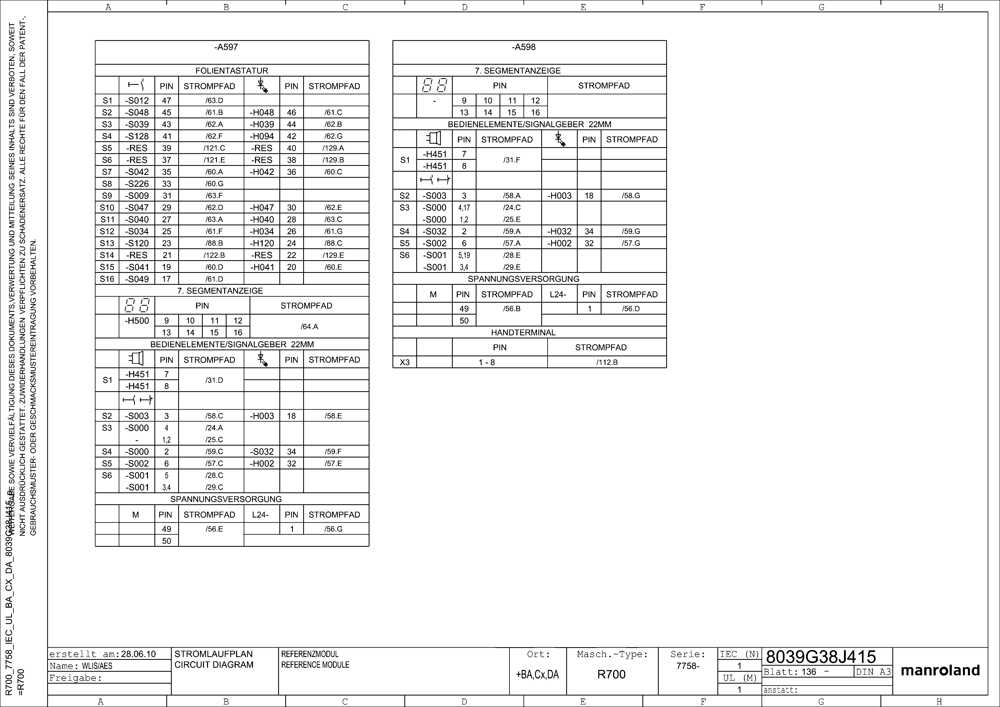

# +BA_Cx_DA — Sheet 136 of 247 — REFERENZMODUL

**REFERENCE MODULE**

> Part of the manroland **R700** printing press IEC/UL circuit diagrams.
> Drawing class: **Stromlaufplan / Circuit diagram** (DIN A3).
> Document `+BA_Cx_DA` covers the **Printing units / main switch cabinet** machine section.

## At a glance

| Field | Value |
|---|---|
| Document | `+BA_Cx_DA`  (8039G38J415) |
| Sheet | **136** of 247 |
| Section (DE) | REFERENZMODUL |
| Section (EN) | REFERENCE MODULE |
| Section type | REFERENCE_MODULE — Reference module |
| Machine type | `R700` |
| Series | `7758` |
| Created | 28.06.10 |
| Replaces | — |
| Columns used | A, B, C, D, E |
| Path numbers | — |
| Labels on sheet | 252 |
| Cross-refs out | 56 |
| Cross-refs in | 56 |

**Previous:** [+BA_Cx_DA sheet 135](SHEET_0135.md) · **Next:** [+BA_Cx_DA sheet 137](SHEET_0137.md) · **Document TOC:** [_TOC.md](_TOC.md)  (+BA_Cx_DA) · **Master TOC:** [all sheets](../_MASTER_TOC.md)

## Sheet image (300 DPI, exact vector render)



_Rendered directly from the PDF vector layer at 300 DPI (1-bit), no OCR and no resampling. Use it to confirm anything ambiguous in the text below._

## Cross-references on this sheet

Each entry is a wire leaving this sheet. The printed token is `/sheet.column`; the link resolves to that sheet inside the same document.

| Ref | Target sheet | Col | Path | Destination on target | Target section | From col |
|---|---|---|---|---|---|---|
| `/63.D` | [+BA_Cx_DA sheet 63](SHEET_0063.md) | D | — | — | MASCHINENBEDIENUNG: BEDIENUNGKOMMANDOS | B |
| `/61.B` | [+BA_Cx_DA sheet 61](SHEET_0061.md) | B | — | — | MASCHINENBEDIENUNG: BEDIENUNGKOMMANDOS | B |
| `/61.C` | [+BA_Cx_DA sheet 61](SHEET_0061.md) | C | — | — | MASCHINENBEDIENUNG: BEDIENUNGKOMMANDOS | C |
| `/62.A` | [+BA_Cx_DA sheet 62](SHEET_0062.md) | A | — | — | MASCHINENBEDIENUNG: BEDIENUNGKOMMANDOS | B |
| `/62.B` | [+BA_Cx_DA sheet 62](SHEET_0062.md) | B | — | — | MASCHINENBEDIENUNG: BEDIENUNGKOMMANDOS | C |
| `/62.F` | [+BA_Cx_DA sheet 62](SHEET_0062.md) | F | — | — | MASCHINENBEDIENUNG: BEDIENUNGKOMMANDOS | B |
| `/62.G` | [+BA_Cx_DA sheet 62](SHEET_0062.md) | G | — | — | MASCHINENBEDIENUNG: BEDIENUNGKOMMANDOS | C |
| `/129.A` | [+BA_Cx_DA sheet 129](SHEET_0129.md) | A | — | — | RESERVE: SPS STATION (OUTPUT) | C |
| `/121.C` | [+BA_Cx_DA sheet 121](SHEET_0121.md) | C | — | — | RESERVE: SPS STATION (INPUT) | B |
| `/121.E` | [+BA_Cx_DA sheet 121](SHEET_0121.md) | E | — | — | RESERVE: SPS STATION (INPUT) | B |
| `/129.B` | [+BA_Cx_DA sheet 129](SHEET_0129.md) | B | — | — | RESERVE: SPS STATION (OUTPUT) | C |
| `/31.F` | [+BA_Cx_DA sheet 31](SHEET_0031.md) | F | — | — | BUSVERBINDUNGEN: SIGNALSCHLEIFE | D |
| `/60.A` | [+BA_Cx_DA sheet 60](SHEET_0060.md) | A | — | — | MASCHINENBEDIENUNG: BEDIENUNGKOMMANDOS | B |
| `/60.C` | [+BA_Cx_DA sheet 60](SHEET_0060.md) | C | — | — | MASCHINENBEDIENUNG: BEDIENUNGKOMMANDOS | C |
| `/60.G` | [+BA_Cx_DA sheet 60](SHEET_0060.md) | G | — | — | MASCHINENBEDIENUNG: BEDIENUNGKOMMANDOS | B |
| `/58.A` | [+BA_Cx_DA sheet 58](SHEET_0058.md) | A | — | — | MASCHINENBEDIENUNG: LAUFKOMMANDOS | D |
| `/63.F` | [+BA_Cx_DA sheet 63](SHEET_0063.md) | F | — | — | MASCHINENBEDIENUNG: BEDIENUNGKOMMANDOS | B |
| `/58.G` | [+BA_Cx_DA sheet 58](SHEET_0058.md) | G | — | — | MASCHINENBEDIENUNG: LAUFKOMMANDOS | E |
| `/62.E` | [+BA_Cx_DA sheet 62](SHEET_0062.md) | E | — | — | MASCHINENBEDIENUNG: BEDIENUNGKOMMANDOS | C |
| `/62.D` | [+BA_Cx_DA sheet 62](SHEET_0062.md) | D | — | — | MASCHINENBEDIENUNG: BEDIENUNGKOMMANDOS | B |
| `/24.C` | [+BA_Cx_DA sheet 24](SHEET_0024.md) | C | — | — | BUSVERBINDUNGEN: NOT AUS | D |
| `/63.A` | [+BA_Cx_DA sheet 63](SHEET_0063.md) | A | — | — | MASCHINENBEDIENUNG: BEDIENUNGKOMMANDOS | B |
| `/25.E` | [+BA_Cx_DA sheet 25](SHEET_0025.md) | E | — | — | BUSVERBINDUNGEN: NOT AUS | D |
| `/63.C` | [+BA_Cx_DA sheet 63](SHEET_0063.md) | C | — | — | MASCHINENBEDIENUNG: BEDIENUNGKOMMANDOS | C |
| `/59.A` | [+BA_Cx_DA sheet 59](SHEET_0059.md) | A | — | — | MASCHINENBEDIENUNG: LAUFKOMMANDOS | D |
| `/61.F` | [+BA_Cx_DA sheet 61](SHEET_0061.md) | F | — | — | MASCHINENBEDIENUNG: BEDIENUNGKOMMANDOS | B |
| `/61.G` | [+BA_Cx_DA sheet 61](SHEET_0061.md) | G | — | — | MASCHINENBEDIENUNG: BEDIENUNGKOMMANDOS | C |
| `/59.G` | [+BA_Cx_DA sheet 59](SHEET_0059.md) | G | — | — | MASCHINENBEDIENUNG: LAUFKOMMANDOS | E |
| `/88.B` | [+BA_Cx_DA sheet 88](SHEET_0088.md) | B | — | — | WASCHVORRICHTUNG | B |
| `/57.A` | [+BA_Cx_DA sheet 57](SHEET_0057.md) | A | — | — | MASCHINENBEDIENUNG: LAUFKOMMANDOS | D |
| `/57.G` | [+BA_Cx_DA sheet 57](SHEET_0057.md) | G | — | — | MASCHINENBEDIENUNG: LAUFKOMMANDOS | E |
| `/88.C` | [+BA_Cx_DA sheet 88](SHEET_0088.md) | C | — | — | WASCHVORRICHTUNG | C |
| `/28.E` | [+BA_Cx_DA sheet 28](SHEET_0028.md) | E | — | — | BUSVERBINDUNGEN: STOP SICHERN | D |
| `/122.B` | [+BA_Cx_DA sheet 122](SHEET_0122.md) | B | — | — | RESERVE: SPS STATION (INPUT) | B |
| `/129.E` | [+BA_Cx_DA sheet 129](SHEET_0129.md) | E | — | — | RESERVE: SPS STATION (OUTPUT) | C |
| `/60.E` | [+BA_Cx_DA sheet 60](SHEET_0060.md) | E | — | — | MASCHINENBEDIENUNG: BEDIENUNGKOMMANDOS | C |
| `/29.E` | [+BA_Cx_DA sheet 29](SHEET_0029.md) | E | — | — | BUSVERBINDUNGEN: STOP SICHERN | D |
| `/60.D` | [+BA_Cx_DA sheet 60](SHEET_0060.md) | D | — | — | MASCHINENBEDIENUNG: BEDIENUNGKOMMANDOS | B |
| `/61.D` | [+BA_Cx_DA sheet 61](SHEET_0061.md) | D | — | — | MASCHINENBEDIENUNG: BEDIENUNGKOMMANDOS | B |
| `/56.B` | [+BA_Cx_DA sheet 56](SHEET_0056.md) | B | — | — | MASCHINENBEDIENUNG: SPANNUNGSVERSORGUNG | E |
| `/56.D` | [+BA_Cx_DA sheet 56](SHEET_0056.md) | D | — | — | MASCHINENBEDIENUNG: SPANNUNGSVERSORGUNG | E |
| `/64.A` | [+BA_Cx_DA sheet 64](SHEET_0064.md) | A | — | — | MASCHINENBEDIENUNG: BEDIENUNGKOMMANDOS | C |
| `/112.B` | [+BA_Cx_DA sheet 112](SHEET_0112.md) | B | — | — | HANDTERMINAL | E |
| `/31.D` | [+BA_Cx_DA sheet 31](SHEET_0031.md) | D | — | — | BUSVERBINDUNGEN: SIGNALSCHLEIFE | B |
| `/58.E` | [+BA_Cx_DA sheet 58](SHEET_0058.md) | E | — | — | MASCHINENBEDIENUNG: LAUFKOMMANDOS | C |
| `/58.C` | [+BA_Cx_DA sheet 58](SHEET_0058.md) | C | — | — | MASCHINENBEDIENUNG: LAUFKOMMANDOS | B |
| `/24.A` | [+BA_Cx_DA sheet 24](SHEET_0024.md) | A | — | — | BUSVERBINDUNGEN: NOT AUS | B |
| `/25.C` | [+BA_Cx_DA sheet 25](SHEET_0025.md) | C | — | — | BUSVERBINDUNGEN: NOT AUS | B |
| `/59.F` | [+BA_Cx_DA sheet 59](SHEET_0059.md) | F | — | — | MASCHINENBEDIENUNG: LAUFKOMMANDOS | C |
| `/59.C` | [+BA_Cx_DA sheet 59](SHEET_0059.md) | C | — | — | MASCHINENBEDIENUNG: LAUFKOMMANDOS | B |
| `/57.E` | [+BA_Cx_DA sheet 57](SHEET_0057.md) | E | — | — | MASCHINENBEDIENUNG: LAUFKOMMANDOS | C |
| `/57.C` | [+BA_Cx_DA sheet 57](SHEET_0057.md) | C | — | — | MASCHINENBEDIENUNG: LAUFKOMMANDOS | B |
| `/28.C` | [+BA_Cx_DA sheet 28](SHEET_0028.md) | C | — | — | BUSVERBINDUNGEN: STOP SICHERN | B |
| `/29.C` | [+BA_Cx_DA sheet 29](SHEET_0029.md) | C | — | — | BUSVERBINDUNGEN: STOP SICHERN | B |
| `/56.E` | [+BA_Cx_DA sheet 56](SHEET_0056.md) | E | — | — | MASCHINENBEDIENUNG: SPANNUNGSVERSORGUNG | B |
| `/56.G` | [+BA_Cx_DA sheet 56](SHEET_0056.md) | G | — | — | MASCHINENBEDIENUNG: SPANNUNGSVERSORGUNG | B |

### Incoming references (sheets that point here)

Every other sheet that sends a wire to this one. `Back-ref` is the token printed on *that* sheet; `Path` is its line number.

| From sheet | Cols | Back-ref | Path | Refs | What continues there |
|---|---|---|---|---|---|
| [+BA_Cx_DA#24](SHEET_0024.md) | A, C | `/24.A`, `/24.C` | — | 2 | A597; A598 |
| [+BA_Cx_DA#25](SHEET_0025.md) | C, E | `/25.C`, `/25.E` | — | 2 | A597; A598 |
| [+BA_Cx_DA#28](SHEET_0028.md) | C, E | `/28.C`, `/28.E` | — | 2 | A597; A598 |
| [+BA_Cx_DA#29](SHEET_0029.md) | C, E | `/29.C`, `/29.E` | — | 2 | A597; A598 |
| [+BA_Cx_DA#31](SHEET_0031.md) | D, F | `/31.D`, `/31.F` | — | 2 | A597; A598 |
| [+BA_Cx_DA#56](SHEET_0056.md) | B, D, E, G | `/56.B`, `/56.D`, `/56.E`, `/56.G` | — | 4 | A597; A598 |
| [+BA_Cx_DA#57](SHEET_0057.md) | A, D, E, G | `/57.A`, `/57.D`, `/57.E`, `/57.G` | — | 4 | A597; A598 |
| [+BA_Cx_DA#58](SHEET_0058.md) | A, D, E, G | `/58.A`, `/58.D`, `/58.E`, `/58.G` | — | 4 | A597; A598 |
| [+BA_Cx_DA#59](SHEET_0059.md) | A, C, F, G | `/59.A`, `/59.C`, `/59.F`, `/59.G` | — | 4 | A597; A598 |
| [+BA_Cx_DA#60](SHEET_0060.md) | A, C, D, E, G | `/60.A`, `/60.C`, `/60.D`, `/60.E`, `/60.G` | — | 5 | A597 |
| [+BA_Cx_DA#61](SHEET_0061.md) | B, C, D, F, G | `/61.B`, `/61.C`, `/61.D`, `/61.F`, `/61.G` | — | 5 | A597 |
| [+BA_Cx_DA#62](SHEET_0062.md) | A, C, D, E, F, G | `/62.A`, `/62.C`, `/62.D`, `/62.E`, `/62.F`, `/62.G` | — | 6 | A597 |
| [+BA_Cx_DA#63](SHEET_0063.md) | A, C, D, F | `/63.A`, `/63.C`, `/63.D`, `/63.F` | — | 4 | A597 |
| [+BA_Cx_DA#64](SHEET_0064.md) | A | `/64.A` | — | 1 | A597 |
| [+BA_Cx_DA#88](SHEET_0088.md) | B, C | `/88.B`, `/88.C` | — | 2 | A597 |
| [+BA_Cx_DA#112](SHEET_0112.md) | B | `/112.B` | — | 1 | A598 |
| [+BA_Cx_DA#121](SHEET_0121.md) | C, E | `/121.C`, `/121.E` | — | 2 | A597 |
| [+BA_Cx_DA#122](SHEET_0122.md) | B | `/122.B` | — | 1 | A597 |
| [+BA_Cx_DA#129](SHEET_0129.md) | A, B, E | `/129.A`, `/129.B`, `/129.E` | — | 3 | A597 |


## Devices on this sheet

| Tag | Class | Class meaning (IEC) | Col | Sub | Terminal | Sign |
|---|---|---|---|---|---|---|
| `S1` | S | Schalter / switch | A | — | — | — |
| `S2` | S | Schalter / switch | A | — | — | — |
| `S3` | S | Schalter / switch | A | — | — | — |
| `S4` | S | Schalter / switch | A | — | — | — |
| `S5` | S | Schalter / switch | A | — | — | — |
| `S6` | S | Schalter / switch | A | — | — | — |
| `S7` | S | Schalter / switch | A | — | — | — |
| `S8` | S | Schalter / switch | A | — | — | — |
| `S9` | S | Schalter / switch | A | — | — | — |
| `S10` | S | Schalter / switch | A | — | — | — |
| `S11` | S | Schalter / switch | A | — | — | — |
| `S12` | S | Schalter / switch | A | — | — | — |
| `S13` | S | Schalter / switch | A | — | — | — |
| `S14` | S | Schalter / switch | A | — | — | — |
| `S15` | S | Schalter / switch | A | — | — | — |
| `S16` | S | Schalter / switch | A | — | — | — |
| `S1` | S | Schalter / switch | A | — | — | — |
| `S2` | S | Schalter / switch | A | — | — | — |
| `S3` | S | Schalter / switch | A | — | — | — |
| `S012` | S | Schalter / switch | A | — | — | — |
| `S048` | S | Schalter / switch | A | — | — | — |
| `S039` | S | Schalter / switch | A | — | — | — |
| `S128` | S | Schalter / switch | A | — | — | — |
| `S042` | S | Schalter / switch | A | — | — | — |
| `S226` | S | Schalter / switch | A | — | — | — |
| `S009` | S | Schalter / switch | A | — | — | — |
| `S047` | S | Schalter / switch | A | — | — | — |
| `S040` | S | Schalter / switch | A | — | — | — |
| `S034` | S | Schalter / switch | A | — | — | — |
| `S120` | S | Schalter / switch | A | — | — | — |
| `S041` | S | Schalter / switch | A | — | — | — |
| `S049` | S | Schalter / switch | A | — | — | — |
| `S003` | S | Schalter / switch | A | — | — | — |
| `S000` | S | Schalter / switch | A | — | — | — |
| `S4` | S | Schalter / switch | A | — | — | — |
| `S5` | S | Schalter / switch | A | — | — | — |
| `S6` | S | Schalter / switch | A | — | — | — |
| `S000` | S | Schalter / switch | A | — | — | — |
| `S002` | S | Schalter / switch | A | — | — | — |
| `S001` | S | Schalter / switch | A | — | — | — |
| `S001` | S | Schalter / switch | A | — | — | — |
| `S032` | S | Schalter / switch | B | — | — | — |
| `A597` | A | Baugruppe / assembly, module, PC board | B | — | — | — |
| `S1` | S | Schalter / switch | D | — | — | — |
| `S2` | S | Schalter / switch | C | — | — | — |
| `S3` | S | Schalter / switch | C | — | — | — |
| `S003` | S | Schalter / switch | D | — | — | — |
| `S000` | S | Schalter / switch | D | — | — | — |
| `S4` | S | Schalter / switch | C | — | — | — |
| `S5` | S | Schalter / switch | C | — | — | — |
| `S6` | S | Schalter / switch | C | — | — | — |
| `S000` | S | Schalter / switch | D | — | — | — |
| `S032` | S | Schalter / switch | D | — | — | — |
| `S002` | S | Schalter / switch | D | — | — | — |
| `S001` | S | Schalter / switch | D | — | — | — |
| `X3` | X | Klemme / terminal, plug connector | C | — | — | — |
| `S001` | S | Schalter / switch | D | — | — | — |
| `A598` | A | Baugruppe / assembly, module, PC board | E | — | — | — |

## Potentials / nets

| Potential | Count | Columns | Attached devices | Terminals |
|---|---|---|---|---|
| `H002` | 2 | B, E | — | — |
| `H003` | 2 | B, E | — | — |
| `H032` | 1 | E | — | — |
| `H034` | 1 | B | — | — |
| `H039` | 1 | B | — | — |
| `H040` | 1 | B | — | — |
| `H041` | 1 | B | — | — |
| `H042` | 1 | B | — | — |
| `H047` | 1 | B | — | — |
| `H048` | 1 | B | — | — |
| `H094` | 1 | B | — | — |
| `H120` | 1 | B | — | — |
| `H451` | 4 | A, D | — | — |
| `H500` | 1 | A | — | — |
| `L24` | 2 | B, E | — | — |


A potential such as `L24+/4` or `M24+` is a named supply/return rail; every place it appears on this sheet is electrically common.

## Wire-end annotations (grouped as printed)

A wire that continues elsewhere is annotated with a small cluster: the destination description, the path/line number `#NN`, and the `/sheet.column` cross reference. Each row below is one such cluster exactly as it is grouped on the drawing.

| Col | Y | Path | Cross-ref | Text on the wire |
|---|---|---|---|---|
| B | 51.3 | — | — | `A597` |
| E | 51.3 | — | — | `A598` |
| B | 80.0 | — | — | `FOLIENTASTATUR` |
| D | 80.0 | — | — | `7. SEGMENTANZEIGE` |
| D | 97.7 | — | — | `PIN` |
| E | 97.7 | — | — | `STROMPFAD` |
| B | 98.4 | — | — | `PIN STROMPFAD` |
| C | 98.4 | — | — | `PIN STROMPFAD` |
| A | 115.1 | — | — | `S012 S048 S039 S128` |
| A | 115.4 | — | — | `S10 S2 S3 S4 S5 S6 S7 S8 S9 S1` |
| A | 115.5 | — | — | `19 17 47 45 43 39 37 35 33 29 27 25 23 41 31 21` |
| D | 115.5 | — | — | `13 10 14 15 11 12 16` |
| D | 115.5 | — | — | `9` |
| B | 115.8 | — | `/63.D` | — |
| B | 129.3 | — | — | `H048 H039 H094` |
| C | 129.6 | — | — | `46 44 42 40 38 36` |
| B | 129.9 | — | `/61.B` | — |
| C | 130.0 | — | `/61.C` | — |
| E | 143.8 | — | — | `BEDIENELEMENTE/SIGNALGEBER 22MM` |
| B | 144.1 | — | `/62.A` | — |
| C | 144.1 | — | `/62.B` | — |
| B | 158.3 | — | `/62.F` | — |
| C | 158.3 | — | `/62.G` | — |
| E | 161.9 | — | — | `PIN PIN STROMPFAD` |
| D | 162.2 | — | — | `STROMPFAD` |
| A | 171.8 | — | — | `S042 S226 S009 S047 S040 S034 S120 RES RES` |
| B | 171.8 | — | — | `H042 RES RES` |
| B | 172.5 | — | `/121.C` | — |
| C | 172.5 | — | `/129.A` | — |
| D | 178.9 | — | — | `H451 H451` |
| D | 179.2 | — | — | `S1 7 8` |
| B | 186.6 | — | `/121.E` | — |
| C | 186.6 | — | `/129.B` | — |
| D | 186.6 | — | `/31.F` | — |
| B | 200.8 | — | `/60.A` | — |
| C | 200.8 | — | `/60.C` | — |
| B | 215.0 | — | `/60.G` | — |
| D | 228.5 | — | — | `S003 S000` |
| E | 228.5 | — | — | `H003` |
| C | 228.8 | — | — | `S2 S3` |
| D | 228.8 | — | — | `3` |
| E | 228.8 | — | — | `18` |
| B | 229.2 | — | `/63.F` | — |
| D | 229.2 | — | `/58.A` | — |
| E | 229.2 | — | `/58.G` | — |
| B | 242.7 | — | — | `H047 H040 H034 H120` |
| C | 243.0 | — | — | `30 28 26 24 22 20` |
| B | 243.3 | — | `/62.D` | — |
| C | 243.3 | — | `/62.E` | — |
| D | 243.3 | — | `/24.C` | — |
| D | 244.1 | — | — | `4,17` |
| D | 256.8 | — | — | `S000 S032 S002 5,19 1,2 34 32` |
| A | 257.2 | — | — | `S12 S13 S14 S15 S16 S11` |
| B | 257.5 | — | `/63.A` | — |
| C | 257.5 | — | `/63.C` | — |
| D | 257.5 | — | `/25.E` | — |
| E | 271.0 | — | — | `H032 H002` |
| C | 271.3 | — | — | `S4 S5 S6` |
| D | 271.4 | — | — | `2 6` |
| B | 271.7 | — | `/61.F` | — |
| C | 271.7 | — | `/61.G` | — |
| D | 271.7 | — | `/59.A` | — |
| E | 271.7 | — | `/59.G` | — |
| B | 285.8 | — | `/88.B` | — |
| D | 285.8 | — | `/57.A` | — |
| C | 285.9 | — | `/88.C` | — |
| E | 285.9 | — | `/57.G` | — |
| A | 299.4 | — | — | `S049 S041 RES` |
| B | 299.4 | — | — | `H041 RES` |
| D | 299.4 | — | — | `S001` |
| B | 300.0 | — | `/122.B` | — |
| C | 300.0 | — | `/129.E` | — |
| D | 300.0 | — | `/28.E` | — |
| D | 313.5 | — | — | `S001 3,4` |
| B | 314.2 | — | `/60.D` | — |
| C | 314.2 | — | `/60.E` | — |
| D | 314.2 | — | `/29.E` | — |
| D | 328.0 | — | — | `SPANNUNGSVERSORGUNG` |
| B | 328.4 | — | `/61.D` | — |
| B | 342.2 | — | — | `7. SEGMENTANZEIGE` |
| E | 346.4 | — | — | `M PIN STROMPFAD L24 PIN STROMPFAD` |
| B | 359.9 | — | — | `PIN` |
| C | 359.9 | — | — | `STROMPFAD` |
| E | 363.5 | — | — | `49 50 HANDTERMINAL 1` |
| E | 363.8 | — | `/56.B`, `/56.D` | — |
| A | 377.3 | — | — | `H500` |
| B | 377.7 | — | — | `13 10 14 15 11 12 16` |
| A | 377.7 | — | — | `9` |
| C | 385.1 | — | `/64.A` | — |
| B | 406.0 | — | — | `BEDIENELEMENTE/SIGNALGEBER 22MM` |
| E | 409.5 | — | — | `PIN STROMPFAD` |
| B | 424.1 | — | — | `PIN PIN STROMPFAD` |
| B | 424.4 | — | — | `STROMPFAD` |
| C | 427.2 | — | — | `X3` |
| D | 427.2 | — | — | `1 8` |
| E | 427.6 | — | `/112.B` | — |
| A | 441.1 | — | — | `H451 H451` |
| A | 441.4 | — | — | `S1 7 8` |
| B | 448.9 | — | `/31.D` | — |
| A | 490.7 | — | — | `S003 S000` |
| B | 490.7 | — | — | `H003` |
| A | 491.0 | — | — | `S2 S3` |
| A | 491.1 | — | — | `3` |
| C | 491.1 | — | — | `18` |
| B | 491.4 | — | `/58.C` | — |
| C | 491.4 | — | `/58.E` | — |
| B | 505.5 | — | `/24.A` | — |
| A | 506.3 | — | — | `4` |
| B | 519.7 | — | `/25.C` | — |
| A | 520.4 | — | — | `1,2` |
| A | 533.2 | — | — | `S000 S002` |
| B | 533.2 | — | — | `H002 S032` |
| A | 533.5 | — | — | `S4 S5 S6` |
| A | 533.6 | — | — | `2 6` |
| B | 533.6 | — | — | `5 34 32` |
| B | 533.9 | — | `/59.C` | — |
| C | 533.9 | — | `/59.F` | — |
| C | 548.0 | — | `/57.E` | — |
| B | 548.1 | — | `/57.C` | — |
| A | 561.6 | — | — | `S001 S001` |
| B | 562.2 | — | `/28.C` | — |
| B | 576.4 | — | `/29.C` | — |
| A | 577.2 | — | — | `3,4` |
| B | 590.2 | — | — | `SPANNUNGSVERSORGUNG` |
| B | 608.6 | — | — | `M PIN STROMPFAD L24 PIN STROMPFAD` |
| B | 625.7 | — | — | `49 50 1` |
| B | 626.0 | — | `/56.E`, `/56.G` | — |


## Reconstructed tables

This sheet carries tabular content (pin map / terminal assignment / index). The grid below was rebuilt from the drawing's own rule lines, so each row is exactly one physical row of the table.

### Table 1 — 24 data rows × 2 columns (at x=113.4, y=48.2)

| S1 | S012 |
|---|---|
| `S2` | `S048` |
| `S3` | `S039` |
| `S4` | `S128` |
| `S5` | `RES` |
| `S6` | `RES` |
| `S7` | `S042` |
| `S8` | `S226` |
| `S9` | `S009` |
| `S10` | `S047` |
| `S11` | `S040` |
| `S12` | `S034` |
| `S13` | `S120` |
| `S14` | `RES` |
| `S15` | `S041` |
| `S16` | `S049` |
|  | `H500` |
|  | `H451` |
| `S1` | `H451` |
| `S2` | `S003` |
| `S3` | `S000` |
| `S4` | `S000` |
| `S5` | `S002` |
| `S6` | `S001 S001` |
|  | `M` |


### Table 2 — 33 data rows × 4 columns (at x=184.3, y=48.2) — **A597 FOLIENTASTATUR**

| PIN |  | STROMPFAD |  |
|---|---|---|---|
| `47` |  | `/63.D` |  |
| `45` |  | `/61.B` |  |
| `43` |  | `/62.A` |  |
| `41` |  | `/62.F` |  |
| `39` |  | `/121.C` |  |
| `37` |  | `/121.E` |  |
| `35` |  | `/60.A` |  |
| `33` |  | `/60.G` |  |
| `31` |  | `/63.F` |  |
| `29` |  | `/62.D` |  |
| `27` |  | `/63.A` |  |
| `25` |  | `/61.F` |  |
| `23` |  | `/88.B` |  |
| `21` |  | `/122.B` |  |
| `19` |  | `/60.D` |  |
| `17` |  | `/61.D` |  |
|  | `7.` | `SEGMENTANZEIGE` |  |
|  |  | `PIN` |  |
| `9` | `10` | `11` | `12` |
| `13` | `14` | `15` | `16` |
|  |  | `BEDIENELEMENTE/SIGNALGEBER` |  |
| `PIN` |  | `STROMPFAD` |  |
| `7` |  |  |  |
| `8` |  | `/31.D` |  |
| `3` |  | `/58.C` |  |
| `4 1,2` |  | `/24.A /25.C` |  |
| `2` |  | `/59.C` |  |
| `6` |  | `/57.C` |  |
| `5 3,4` |  | `/28.C /29.C` |  |
|  |  | `SPANNUNGSVERSORGUNG` |  |
| `PIN` |  | `STROMPFAD` |  |
| `49` |  | `/56.E` |  |
| `50` |  |  |  |


### Table 3 — 21 data rows × 3 columns (at x=297.6, y=48.2)

|  | PIN | STROMPFAD |
|---|---|---|
| `H048` | `46` | `/61.C` |
| `H039` | `44` | `/62.B` |
| `H094` | `42` | `/62.G` |
| `RES` | `40` | `/129.A` |
| `RES` | `38` | `/129.B` |
| `H042` | `36` | `/60.C` |
| `H047` | `30` | `/62.E` |
| `H040` | `28` | `/63.C` |
| `H034` | `26` | `/61.G` |
| `H120` | `24` | `/88.C` |
| `RES` | `22` | `/129.E` |
| `H041` | `20` | `/60.E` |
|  |  | `STROMPFAD` |
|  |  | `/64.A` |
|  | `22MM` |  |
|  | `PIN` | `STROMPFAD` |
| `H003` | `18` | `/58.E` |
| `S032` | `34` | `/59.F` |
| `H002` | `32` | `/57.E` |
| `L24` | `PIN` | `STROMPFAD` |
|  | `1` | `/56.G` |


### Table 4 — 8 data rows × 2 columns (at x=467.7, y=48.2) — **H451 S1**

| S2 | S003 |
|---|---|
| `S3` | `S000` |
|  | `S000` |
| `S4` | `S032` |
| `S5` | `S002` |
| `S6` | `S001` |
|  | `S001` |
|  | `M` |
| `X3` |  |


### Table 5 — 17 data rows × 4 columns (at x=538.6, y=48.2) — **A598 7. SEGMENTANZEIGE PIN 9 10 11 12 13 14 15 16 BEDIENELEMENTE/SIGNALGEBER**

| PIN |  | STROMPFAD |  |
|---|---|---|---|
| `7` |  |  |  |
|  |  | `/31.F` |  |
| `8` |  |  |  |
| `3` |  | `/58.A` |  |
| `4,17` |  | `/24.C` |  |
| `1,2` |  | `/25.E` |  |
| `2` |  | `/59.A` |  |
| `6` |  | `/57.A` |  |
| `5,19` |  | `/28.E` |  |
| `3,4` |  | `/29.E` |  |
|  |  |  | `SPANNUNGSVERSORGUNG` |
| `PIN` |  | `STROMPFAD` |  |
| `49` |  | `/56.B` |  |
| `50` |  |  |  |
|  |  | `HANDTERMINAL` |  |
|  | `PIN` |  |  |
|  | `1 8` |  |  |


### Table 6 — 9 data rows × 3 columns (at x=652.0, y=48.2)

|  |  | STROMPFAD |
|---|---|---|
|  | `22MM` |  |
|  | `PIN` | `STROMPFAD` |
| `H003` | `18` | `/58.G` |
| `H032` | `34` | `/59.G` |
| `H002` | `32` | `/57.G` |
| `L24` | `PIN` | `STROMPFAD` |
|  | `1` | `/56.D` |
|  |  | `STROMPFAD` |
|  |  | `/112.B` |


## Notes and free text on this sheet

| Text | Col | Y (pt) |
|---|---|---|
| `PIN` | A | 98.45 |
| `STROMPFAD` | B | 98.41 |
| `FOLIENTASTATUR` | B | 80 |
| `PIN` | C | 98.45 |
| `STROMPFAD` | C | 98.41 |
| `7. SEGMENTANZEIGE` | B | 342.19 |
| `PIN` | B | 359.94 |
| `BEDIENELEMENTE/SIGNALGEBER 22MM` | B | 405.97 |
| `RES` | A | 171.82 |
| `RES` | B | 171.82 |
| `SPANNUNGSVERSORGUNG` | B | 590.21 |
| `M` | A | 608.62 |
| `7. SEGMENTANZEIGE` | D | 79.98 |
| `PIN` | D | 97.74 |
| `BEDIENELEMENTE/SIGNALGEBER 22MM` | E | 143.76 |
| `STROMPFAD` | D | 162.19 |
| `PIN` | E | 162.23 |
| `STROMPFAD` | E | 161.9 |
| `SPANNUNGSVERSORGUNG` | D | 328.01 |
| `M` | D | 346.41 |
| `HANDTERMINAL` | D | 391.8 |

## Complete label inventory (exact text from the drawing)

Every text object inside the drawing area of this sheet, in DIN reading order (column A→H, then top→bottom). This is the authoritative list: if a string is not here it is not printed on this sheet.

| Col | Y | X | Dir | Type | Text |
|---|---|---|---|---|---|
| A | 98.4 | 190.3 | → | text | `PIN` |
| A | 115.1 | 149.0 | → | device tag | `S012` |
| A | 115.4 | 122.3 | → | device tag | `S1` |
| A | 115.5 | 193.0 | → | number | `47` |
| A | 129.3 | 149.0 | → | device tag | `S048` |
| A | 129.6 | 121.5 | → | device tag | `S2` |
| A | 129.6 | 193.0 | → | number | `45` |
| A | 143.5 | 149.0 | → | device tag | `S039` |
| A | 143.8 | 121.5 | → | device tag | `S3` |
| A | 143.8 | 193.0 | → | number | `43` |
| A | 157.6 | 149.0 | → | device tag | `S128` |
| A | 158.0 | 121.5 | → | device tag | `S4` |
| A | 171.8 | 150.5 | → | text | `RES` |
| A | 172.1 | 121.5 | → | device tag | `S5` |
| A | 172.2 | 193.0 | → | number | `39` |
| A | 186.0 | 150.5 | → | text | `RES` |
| A | 186.3 | 121.5 | → | device tag | `S6` |
| A | 186.3 | 193.0 | → | number | `37` |
| A | 200.1 | 149.0 | → | device tag | `S042` |
| A | 200.5 | 121.5 | → | device tag | `S7` |
| A | 200.5 | 193.0 | → | number | `35` |
| A | 214.3 | 149.0 | → | device tag | `S226` |
| A | 214.7 | 121.5 | → | device tag | `S8` |
| A | 214.7 | 193.0 | → | number | `33` |
| A | 228.5 | 149.0 | → | device tag | `S009` |
| A | 228.8 | 121.5 | → | device tag | `S9` |
| A | 242.7 | 149.0 | → | device tag | `S047` |
| A | 243.0 | 118.8 | → | device tag | `S10` |
| A | 243.0 | 193.0 | → | number | `29` |
| A | 256.8 | 149.0 | → | device tag | `S040` |
| A | 257.2 | 119.6 | → | device tag | `S11` |
| A | 257.2 | 193.0 | → | number | `27` |
| A | 271.0 | 149.0 | → | device tag | `S034` |
| A | 271.4 | 118.8 | → | device tag | `S12` |
| A | 271.4 | 193.0 | → | number | `25` |
| A | 285.2 | 149.0 | → | device tag | `S120` |
| A | 285.5 | 118.8 | → | device tag | `S13` |
| A | 285.5 | 193.0 | → | number | `23` |
| A | 299.4 | 150.5 | → | text | `RES` |
| A | 299.7 | 118.8 | → | device tag | `S14` |
| A | 313.5 | 149.7 | → | device tag | `S041` |
| A | 313.9 | 118.8 | → | device tag | `S15` |
| A | 313.9 | 192.8 | → | number | `19` |
| A | 327.7 | 149.0 | → | device tag | `S049` |
| A | 328.0 | 118.8 | → | device tag | `S16` |
| A | 328.1 | 192.8 | → | number | `17` |
| A | 377.3 | 148.7 | → | potential | `H500` |
| A | 377.7 | 195.7 | → | number | `9` |
| A | 391.8 | 192.8 | → | number | `13` |
| A | 424.4 | 190.3 | → | text | `PIN` |
| A | 441.1 | 149.4 | → | potential | `H451` |
| A | 441.4 | 195.7 | → | number | `7` |
| A | 448.5 | 122.3 | → | device tag | `S1` |
| A | 455.3 | 149.4 | → | potential | `H451` |
| A | 455.6 | 195.7 | → | number | `8` |
| A | 490.7 | 149.0 | → | device tag | `S003` |
| A | 491.0 | 121.5 | → | device tag | `S2` |
| A | 491.0 | 195.7 | → | number | `3` |
| A | 504.9 | 149.0 | → | device tag | `S000` |
| A | 505.2 | 121.5 | → | device tag | `S3` |
| A | 506.3 | 196.4 | → | number | `4` |
| A | 520.4 | 193.1 | → | number | `1,2` |
| A | 533.2 | 149.0 | → | device tag | `S000` |
| A | 533.5 | 121.5 | → | device tag | `S4` |
| A | 533.6 | 195.7 | → | number | `2` |
| A | 547.4 | 149.0 | → | device tag | `S002` |
| A | 547.7 | 121.5 | → | device tag | `S5` |
| A | 547.7 | 195.7 | → | number | `6` |
| A | 561.6 | 149.7 | → | device tag | `S001` |
| A | 561.9 | 121.5 | → | device tag | `S6` |
| A | 563.0 | 196.4 | → | number | `5` |
| A | 575.7 | 149.7 | → | device tag | `S001` |
| A | 577.2 | 193.5 | → | number | `3,4` |
| A | 608.6 | 157.5 | → | text | `M` |
| A | 608.7 | 188.9 | → | text | `PIN` |
| A | 625.7 | 193.0 | → | number | `49` |
| A | 639.9 | 193.0 | → | number | `50` |
| B | 51.3 | 255.3 | → | device tag | `A597` |
| B | 80.0 | 232.7 | → | text | `FOLIENTASTATUR` |
| B | 98.4 | 218.7 | → | text | `STROMPFAD` |
| B | 115.8 | 244.8 | → | cross-reference | `/63.D` |
| B | 129.3 | 297.5 | → | potential | `H048` |
| B | 129.9 | 244.9 | → | cross-reference | `/61.B` |
| B | 143.5 | 297.5 | → | potential | `H039` |
| B | 144.1 | 244.8 | → | cross-reference | `/62.A` |
| B | 157.6 | 297.5 | → | potential | `H094` |
| B | 158.0 | 193.9 | → | number | `41` |
| B | 158.3 | 245.2 | → | cross-reference | `/62.F` |
| B | 171.8 | 299.3 | → | text | `RES` |
| B | 172.5 | 242.4 | → | cross-reference | `/121.C` |
| B | 186.0 | 299.3 | → | text | `RES` |
| B | 186.6 | 242.6 | → | cross-reference | `/121.E` |
| B | 200.1 | 297.5 | → | potential | `H042` |
| B | 200.8 | 244.8 | → | cross-reference | `/60.A` |
| B | 215.0 | 244.6 | → | cross-reference | `/60.G` |
| B | 228.8 | 193.9 | → | number | `31` |
| B | 229.2 | 245.2 | → | cross-reference | `/63.F` |
| B | 242.7 | 297.5 | → | potential | `H047` |
| B | 243.4 | 244.8 | → | cross-reference | `/62.D` |
| B | 256.8 | 297.5 | → | potential | `H040` |
| B | 257.5 | 244.8 | → | cross-reference | `/63.A` |
| B | 271.0 | 297.5 | → | potential | `H034` |
| B | 271.7 | 245.2 | → | cross-reference | `/61.F` |
| B | 285.2 | 297.5 | → | potential | `H120` |
| B | 285.8 | 244.9 | → | cross-reference | `/88.B` |
| B | 299.4 | 299.3 | → | text | `RES` |
| B | 299.7 | 193.9 | → | number | `21` |
| B | 300.0 | 242.5 | → | cross-reference | `/122.B` |
| B | 313.5 | 298.2 | → | potential | `H041` |
| B | 314.2 | 244.8 | → | cross-reference | `/60.D` |
| B | 328.4 | 244.8 | → | cross-reference | `/61.D` |
| B | 342.2 | 211.2 | → | text | `7. SEGMENTANZEIGE` |
| B | 359.9 | 232.9 | → | text | `PIN` |
| B | 377.7 | 221.1 | → | number | `10` |
| B | 377.7 | 250.3 | → | number | `11` |
| B | 377.7 | 277.8 | → | number | `12` |
| B | 391.8 | 221.1 | → | number | `14` |
| B | 391.8 | 249.4 | → | number | `15` |
| B | 391.8 | 277.8 | → | number | `16` |
| B | 406.0 | 179.0 | → | text | `BEDIENELEMENTE/SIGNALGEBER 22MM` |
| B | 424.4 | 218.7 | → | text | `STROMPFAD` |
| B | 448.9 | 244.8 | → | cross-reference | `/31.D` |
| B | 490.7 | 297.5 | → | potential | `H003` |
| B | 491.4 | 244.8 | → | cross-reference | `/58.C` |
| B | 505.5 | 244.8 | → | cross-reference | `/24.A` |
| B | 519.7 | 244.8 | → | cross-reference | `/25.C` |
| B | 533.2 | 297.8 | → | device tag | `S032` |
| B | 533.9 | 244.8 | → | cross-reference | `/59.C` |
| B | 547.4 | 297.5 | → | potential | `H002` |
| B | 548.1 | 244.8 | → | cross-reference | `/57.C` |
| B | 562.3 | 244.8 | → | cross-reference | `/28.C` |
| B | 576.4 | 244.8 | → | cross-reference | `/29.C` |
| B | 590.2 | 202.8 | → | text | `SPANNUNGSVERSORGUNG` |
| B | 608.6 | 218.7 | → | text | `STROMPFAD` |
| B | 608.7 | 300.3 | → | potential | `L24` |
| B | 626.0 | 245.1 | → | cross-reference | `/56.E` |
| C | 98.4 | 339.2 | → | text | `PIN` |
| C | 98.4 | 367.5 | → | text | `STROMPFAD` |
| C | 129.6 | 341.9 | → | number | `46` |
| C | 130.0 | 386.5 | → | cross-reference | `/61.C` |
| C | 143.8 | 341.9 | → | number | `44` |
| C | 144.1 | 386.6 | → | cross-reference | `/62.B` |
| C | 158.0 | 341.9 | → | number | `42` |
| C | 158.3 | 386.4 | → | cross-reference | `/62.G` |
| C | 172.2 | 341.9 | → | number | `40` |
| C | 172.5 | 384.1 | → | cross-reference | `/129.A` |
| C | 186.3 | 341.9 | → | number | `38` |
| C | 186.6 | 384.2 | → | cross-reference | `/129.B` |
| C | 200.5 | 341.9 | → | number | `36` |
| C | 200.8 | 386.5 | → | cross-reference | `/60.C` |
| C | 228.8 | 475.8 | → | device tag | `S2` |
| C | 243.0 | 341.9 | → | number | `30` |
| C | 243.0 | 475.8 | → | device tag | `S3` |
| C | 243.3 | 386.8 | → | cross-reference | `/62.E` |
| C | 257.2 | 341.9 | → | number | `28` |
| C | 257.5 | 386.5 | → | cross-reference | `/63.C` |
| C | 271.3 | 475.8 | → | device tag | `S4` |
| C | 271.4 | 341.9 | → | number | `26` |
| C | 271.7 | 386.4 | → | cross-reference | `/61.G` |
| C | 285.5 | 341.9 | → | number | `24` |
| C | 285.5 | 475.8 | → | device tag | `S5` |
| C | 285.9 | 386.5 | → | cross-reference | `/88.C` |
| C | 299.7 | 341.9 | → | number | `22` |
| C | 299.7 | 475.8 | → | device tag | `S6` |
| C | 300.0 | 384.4 | → | cross-reference | `/129.E` |
| C | 313.9 | 341.9 | → | number | `20` |
| C | 314.2 | 386.8 | → | cross-reference | `/60.E` |
| C | 359.9 | 334.2 | → | text | `STROMPFAD` |
| C | 385.1 | 358.2 | → | cross-reference | `/64.A` |
| C | 424.1 | 367.5 | → | text | `STROMPFAD` |
| C | 424.4 | 339.2 | → | text | `PIN` |
| C | 427.3 | 476.1 | → | device tag | `X3` |
| C | 491.0 | 341.6 | → | number | `18` |
| C | 491.4 | 386.8 | → | cross-reference | `/58.E` |
| C | 533.6 | 341.9 | → | number | `34` |
| C | 533.9 | 386.9 | → | cross-reference | `/59.F` |
| C | 547.7 | 341.9 | → | number | `32` |
| C | 548.0 | 386.8 | → | cross-reference | `/57.E` |
| C | 608.6 | 367.5 | → | text | `STROMPFAD` |
| C | 608.7 | 339.2 | → | text | `PIN` |
| C | 625.7 | 345.1 | → | number | `1` |
| C | 626.0 | 386.4 | → | cross-reference | `/56.G` |
| D | 80.0 | 565.5 | → | text | `7. SEGMENTANZEIGE` |
| D | 97.7 | 587.2 | → | text | `PIN` |
| D | 115.5 | 550.1 | → | number | `9` |
| D | 115.5 | 575.4 | → | number | `10` |
| D | 115.5 | 604.6 | → | number | `11` |
| D | 129.6 | 547.1 | → | number | `13` |
| D | 129.6 | 575.4 | → | number | `14` |
| D | 129.6 | 603.8 | → | number | `15` |
| D | 162.2 | 544.7 | → | text | `PIN` |
| D | 162.2 | 573.0 | → | text | `STROMPFAD` |
| D | 178.9 | 503.7 | → | potential | `H451` |
| D | 179.2 | 550.1 | → | number | `7` |
| D | 186.3 | 476.6 | → | device tag | `S1` |
| D | 186.6 | 599.5 | → | cross-reference | `/31.F` |
| D | 193.1 | 503.7 | → | potential | `H451` |
| D | 193.4 | 550.1 | → | number | `8` |
| D | 228.5 | 503.3 | → | device tag | `S003` |
| D | 228.8 | 550.1 | → | number | `3` |
| D | 229.1 | 599.1 | → | cross-reference | `/58.A` |
| D | 242.7 | 503.3 | → | device tag | `S000` |
| D | 243.4 | 599.1 | → | cross-reference | `/24.C` |
| D | 244.1 | 545.9 | → | number | `4,17` |
| D | 256.8 | 503.3 | → | device tag | `S000` |
| D | 257.5 | 599.4 | → | cross-reference | `/25.E` |
| D | 258.2 | 547.5 | → | number | `1,2` |
| D | 271.0 | 503.3 | → | device tag | `S032` |
| D | 271.4 | 550.1 | → | number | `2` |
| D | 271.7 | 599.1 | → | cross-reference | `/59.A` |
| D | 285.2 | 503.3 | → | device tag | `S002` |
| D | 285.5 | 550.1 | → | number | `6` |
| D | 285.8 | 599.1 | → | cross-reference | `/57.A` |
| D | 299.4 | 504.0 | → | device tag | `S001` |
| D | 300.0 | 599.4 | → | cross-reference | `/28.E` |
| D | 300.8 | 545.9 | → | number | `5,19` |
| D | 313.5 | 504.0 | → | device tag | `S001` |
| D | 314.2 | 599.4 | → | cross-reference | `/29.E` |
| D | 315.0 | 547.8 | → | number | `3,4` |
| D | 328.0 | 557.1 | → | text | `SPANNUNGSVERSORGUNG` |
| D | 346.4 | 511.8 | → | text | `M` |
| D | 346.4 | 573.0 | → | text | `STROMPFAD` |
| D | 346.5 | 543.3 | → | text | `PIN` |
| D | 363.5 | 547.4 | → | number | `49` |
| D | 363.8 | 599.2 | → | cross-reference | `/56.B` |
| D | 377.7 | 547.4 | → | number | `50` |
| D | 391.8 | 584.8 | → | text | `HANDTERMINAL` |
| D | 409.6 | 587.2 | → | text | `PIN` |
| D | 427.2 | 569.6 | → | number | `1 8` |
| E | 51.3 | 609.6 | → | device tag | `A598` |
| E | 97.7 | 688.5 | → | text | `STROMPFAD` |
| E | 115.5 | 632.1 | → | number | `12` |
| E | 129.6 | 632.1 | → | number | `16` |
| E | 143.8 | 533.3 | → | text | `BEDIENELEMENTE/SIGNALGEBER 22MM` |
| E | 161.9 | 721.8 | → | text | `STROMPFAD` |
| E | 162.2 | 693.5 | → | text | `PIN` |
| E | 228.5 | 651.8 | → | potential | `H003` |
| E | 228.8 | 695.9 | → | number | `18` |
| E | 229.2 | 740.7 | → | cross-reference | `/58.G` |
| E | 271.0 | 651.8 | → | potential | `H032` |
| E | 271.4 | 696.2 | → | number | `34` |
| E | 271.7 | 740.7 | → | cross-reference | `/59.G` |
| E | 285.2 | 651.8 | → | potential | `H002` |
| E | 285.5 | 696.2 | → | number | `32` |
| E | 285.9 | 740.7 | → | cross-reference | `/57.G` |
| E | 346.4 | 654.7 | → | potential | `L24` |
| E | 346.4 | 721.8 | → | text | `STROMPFAD` |
| E | 346.5 | 693.5 | → | text | `PIN` |
| E | 363.5 | 699.4 | → | number | `1` |
| E | 363.8 | 740.8 | → | cross-reference | `/56.D` |
| E | 409.5 | 685.0 | → | text | `STROMPFAD` |
| E | 427.6 | 710.2 | → | cross-reference | `/112.B` |

## Reading-order text block

The same content as a plain block, grouped by DIN column — convenient to paste or to match against a visual description.

```text
=== Column A ===
  98.4  190.3  text         PIN
 115.1  149.0  devtag       S012
 115.4  122.3  devtag       S1
 115.5  193.0  numeric      47
 129.3  149.0  devtag       S048
 129.6  121.5  devtag       S2
 129.6  193.0  numeric      45
 143.5  149.0  devtag       S039
 143.8  121.5  devtag       S3
 143.8  193.0  numeric      43
 157.6  149.0  devtag       S128
 158.0  121.5  devtag       S4
 171.8  150.5  text         RES
 172.1  121.5  devtag       S5
 172.2  193.0  numeric      39
 186.0  150.5  text         RES
 186.3  121.5  devtag       S6
 186.3  193.0  numeric      37
 200.1  149.0  devtag       S042
 200.5  121.5  devtag       S7
 200.5  193.0  numeric      35
 214.3  149.0  devtag       S226
 214.7  121.5  devtag       S8
 214.7  193.0  numeric      33
 228.5  149.0  devtag       S009
 228.8  121.5  devtag       S9
 242.7  149.0  devtag       S047
 243.0  118.8  devtag       S10
 243.0  193.0  numeric      29
 256.8  149.0  devtag       S040
 257.2  119.6  devtag       S11
 257.2  193.0  numeric      27
 271.0  149.0  devtag       S034
 271.4  118.8  devtag       S12
 271.4  193.0  numeric      25
 285.2  149.0  devtag       S120
 285.5  118.8  devtag       S13
 285.5  193.0  numeric      23
 299.4  150.5  text         RES
 299.7  118.8  devtag       S14
 313.5  149.7  devtag       S041
 313.9  118.8  devtag       S15
 313.9  192.8  numeric      19
 327.7  149.0  devtag       S049
 328.0  118.8  devtag       S16
 328.1  192.8  numeric      17
 377.3  148.7  net          H500
 377.7  195.7  numeric      9
 391.8  192.8  numeric      13
 424.4  190.3  text         PIN
 441.1  149.4  net          H451
 441.4  195.7  numeric      7
 448.5  122.3  devtag       S1
 455.3  149.4  net          H451
 455.6  195.7  numeric      8
 490.7  149.0  devtag       S003
 491.0  121.5  devtag       S2
 491.0  195.7  numeric      3
 504.9  149.0  devtag       S000
 505.2  121.5  devtag       S3
 506.3  196.4  numeric      4
 520.4  193.1  numeric      1,2
 533.2  149.0  devtag       S000
 533.5  121.5  devtag       S4
 533.6  195.7  numeric      2
 547.4  149.0  devtag       S002
 547.7  121.5  devtag       S5
 547.7  195.7  numeric      6
 561.6  149.7  devtag       S001
 561.9  121.5  devtag       S6
 563.0  196.4  numeric      5
 575.7  149.7  devtag       S001
 577.2  193.5  numeric      3,4
 608.6  157.5  text         M
 608.7  188.9  text         PIN
 625.7  193.0  numeric      49
 639.9  193.0  numeric      50
=== Column B ===
  51.3  255.3  devtag       A597
  80.0  232.7  text         FOLIENTASTATUR
  98.4  218.7  text         STROMPFAD
 115.8  244.8  xref         /63.D
 129.3  297.5  net          H048
 129.9  244.9  xref         /61.B
 143.5  297.5  net          H039
 144.1  244.8  xref         /62.A
 157.6  297.5  net          H094
 158.0  193.9  numeric      41
 158.3  245.2  xref         /62.F
 171.8  299.3  text         RES
 172.5  242.4  xref         /121.C
 186.0  299.3  text         RES
 186.6  242.6  xref         /121.E
 200.1  297.5  net          H042
 200.8  244.8  xref         /60.A
 215.0  244.6  xref         /60.G
 228.8  193.9  numeric      31
 229.2  245.2  xref         /63.F
 242.7  297.5  net          H047
 243.4  244.8  xref         /62.D
 256.8  297.5  net          H040
 257.5  244.8  xref         /63.A
 271.0  297.5  net          H034
 271.7  245.2  xref         /61.F
 285.2  297.5  net          H120
 285.8  244.9  xref         /88.B
 299.4  299.3  text         RES
 299.7  193.9  numeric      21
 300.0  242.5  xref         /122.B
 313.5  298.2  net          H041
 314.2  244.8  xref         /60.D
 328.4  244.8  xref         /61.D
 342.2  211.2  text         7. SEGMENTANZEIGE
 359.9  232.9  text         PIN
 377.7  221.1  numeric      10
 377.7  250.3  numeric      11
 377.7  277.8  numeric      12
 391.8  221.1  numeric      14
 391.8  249.4  numeric      15
 391.8  277.8  numeric      16
 406.0  179.0  text         BEDIENELEMENTE/SIGNALGEBER 22MM
 424.4  218.7  text         STROMPFAD
 448.9  244.8  xref         /31.D
 490.7  297.5  net          H003
 491.4  244.8  xref         /58.C
 505.5  244.8  xref         /24.A
 519.7  244.8  xref         /25.C
 533.2  297.8  devtag       S032
 533.9  244.8  xref         /59.C
 547.4  297.5  net          H002
 548.1  244.8  xref         /57.C
 562.3  244.8  xref         /28.C
 576.4  244.8  xref         /29.C
 590.2  202.8  text         SPANNUNGSVERSORGUNG
 608.6  218.7  text         STROMPFAD
 608.7  300.3  net          L24
 626.0  245.1  xref         /56.E
=== Column C ===
  98.4  339.2  text         PIN
  98.4  367.5  text         STROMPFAD
 129.6  341.9  numeric      46
 130.0  386.5  xref         /61.C
 143.8  341.9  numeric      44
 144.1  386.6  xref         /62.B
 158.0  341.9  numeric      42
 158.3  386.4  xref         /62.G
 172.2  341.9  numeric      40
 172.5  384.1  xref         /129.A
 186.3  341.9  numeric      38
 186.6  384.2  xref         /129.B
 200.5  341.9  numeric      36
 200.8  386.5  xref         /60.C
 228.8  475.8  devtag       S2
 243.0  341.9  numeric      30
 243.0  475.8  devtag       S3
 243.3  386.8  xref         /62.E
 257.2  341.9  numeric      28
 257.5  386.5  xref         /63.C
 271.3  475.8  devtag       S4
 271.4  341.9  numeric      26
 271.7  386.4  xref         /61.G
 285.5  341.9  numeric      24
 285.5  475.8  devtag       S5
 285.9  386.5  xref         /88.C
 299.7  341.9  numeric      22
 299.7  475.8  devtag       S6
 300.0  384.4  xref         /129.E
 313.9  341.9  numeric      20
 314.2  386.8  xref         /60.E
 359.9  334.2  text         STROMPFAD
 385.1  358.2  xref         /64.A
 424.1  367.5  text         STROMPFAD
 424.4  339.2  text         PIN
 427.3  476.1  devtag       X3
 491.0  341.6  numeric      18
 491.4  386.8  xref         /58.E
 533.6  341.9  numeric      34
 533.9  386.9  xref         /59.F
 547.7  341.9  numeric      32
 548.0  386.8  xref         /57.E
 608.6  367.5  text         STROMPFAD
 608.7  339.2  text         PIN
 625.7  345.1  numeric      1
 626.0  386.4  xref         /56.G
=== Column D ===
  80.0  565.5  text         7. SEGMENTANZEIGE
  97.7  587.2  text         PIN
 115.5  550.1  numeric      9
 115.5  575.4  numeric      10
 115.5  604.6  numeric      11
 129.6  547.1  numeric      13
 129.6  575.4  numeric      14
 129.6  603.8  numeric      15
 162.2  544.7  text         PIN
 162.2  573.0  text         STROMPFAD
 178.9  503.7  net          H451
 179.2  550.1  numeric      7
 186.3  476.6  devtag       S1
 186.6  599.5  xref         /31.F
 193.1  503.7  net          H451
 193.4  550.1  numeric      8
 228.5  503.3  devtag       S003
 228.8  550.1  numeric      3
 229.1  599.1  xref         /58.A
 242.7  503.3  devtag       S000
 243.4  599.1  xref         /24.C
 244.1  545.9  numeric      4,17
 256.8  503.3  devtag       S000
 257.5  599.4  xref         /25.E
 258.2  547.5  numeric      1,2
 271.0  503.3  devtag       S032
 271.4  550.1  numeric      2
 271.7  599.1  xref         /59.A
 285.2  503.3  devtag       S002
 285.5  550.1  numeric      6
 285.8  599.1  xref         /57.A
 299.4  504.0  devtag       S001
 300.0  599.4  xref         /28.E
 300.8  545.9  numeric      5,19
 313.5  504.0  devtag       S001
 314.2  599.4  xref         /29.E
 315.0  547.8  numeric      3,4
 328.0  557.1  text         SPANNUNGSVERSORGUNG
 346.4  511.8  text         M
 346.4  573.0  text         STROMPFAD
 346.5  543.3  text         PIN
 363.5  547.4  numeric      49
 363.8  599.2  xref         /56.B
 377.7  547.4  numeric      50
 391.8  584.8  text         HANDTERMINAL
 409.6  587.2  text         PIN
 427.2  569.6  numeric      1 8
=== Column E ===
  51.3  609.6  devtag       A598
  97.7  688.5  text         STROMPFAD
 115.5  632.1  numeric      12
 129.6  632.1  numeric      16
 143.8  533.3  text         BEDIENELEMENTE/SIGNALGEBER 22MM
 161.9  721.8  text         STROMPFAD
 162.2  693.5  text         PIN
 228.5  651.8  net          H003
 228.8  695.9  numeric      18
 229.2  740.7  xref         /58.G
 271.0  651.8  net          H032
 271.4  696.2  numeric      34
 271.7  740.7  xref         /59.G
 285.2  651.8  net          H002
 285.5  696.2  numeric      32
 285.9  740.7  xref         /57.G
 346.4  654.7  net          L24
 346.4  721.8  text         STROMPFAD
 346.5  693.5  text         PIN
 363.5  699.4  numeric      1
 363.8  740.8  xref         /56.D
 409.5  685.0  text         STROMPFAD
 427.6  710.2  xref         /112.B
```

---
_Generated from the PDF vector text layer; no OCR. Source: `R700_7758_IEC_UL_BA_CX_DA_8039G38J415_p`, sheet 136._
