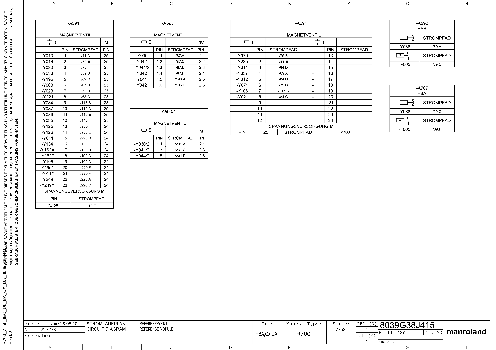

# +BA_Cx_DA — Sheet 137 of 247 — REFERENZMODUL

**REFERENCE MODULE**

> Part of the manroland **R700** printing press IEC/UL circuit diagrams.
> Drawing class: **Stromlaufplan / Circuit diagram** (DIN A3).
> Document `+BA_Cx_DA` covers the **Printing units / main switch cabinet** machine section.

## At a glance

| Field | Value |
|---|---|
| Document | `+BA_Cx_DA`  (8039G38J415) |
| Sheet | **137** of 247 |
| Section (DE) | REFERENZMODUL |
| Section (EN) | REFERENCE MODULE |
| Section type | REFERENCE_MODULE — Reference module |
| Machine type | `R700` |
| Series | `7758` |
| Created | 28.06.10 |
| Replaces | — |
| Columns used | A, B, C, D, E, F, G, H |
| Path numbers | — |
| Labels on sheet | 220 |
| Cross-refs out | 46 |
| Cross-refs in | 46 |

**Previous:** [+BA_Cx_DA sheet 136](SHEET_0136.md) · **Next:** [+BA_Cx_DA sheet 138](SHEET_0138.md) · **Document TOC:** [_TOC.md](_TOC.md)  (+BA_Cx_DA) · **Master TOC:** [all sheets](../_MASTER_TOC.md)

## Sheet image (300 DPI, exact vector render)



_Rendered directly from the PDF vector layer at 300 DPI (1-bit), no OCR and no resampling. Use it to confirm anything ambiguous in the text below._

## Cross-references on this sheet

Each entry is a wire leaving this sheet. The printed token is `/sheet.column`; the link resolves to that sheet inside the same document.

| Ref | Target sheet | Col | Path | Destination on target | Target section | From col |
|---|---|---|---|---|---|---|
| `/69.A` | [+BA_Cx_DA sheet 69](SHEET_0069.md) | A | — | — | DRUCKLUFT ABSTELLEN | G |
| `/41.A` | [+BA_Cx_DA sheet 41](SHEET_0041.md) | A | — | — | SCHUTZEINRICHTUNGEN | B |
| `/87.A` | [+BA_Cx_DA sheet 87](SHEET_0087.md) | A | — | — | WASCHVORRICHTUNG | C |
| `/75.B` | [+BA_Cx_DA sheet 75](SHEET_0075.md) | B | — | — | FEUCHTWERK | E |
| `/75.E` | [+BA_Cx_DA sheet 75](SHEET_0075.md) | E | — | — | FEUCHTWERK | B |
| `/83.E` | [+BA_Cx_DA sheet 83](SHEET_0083.md) | E | — | — | FARBWERK | E |
| `/87.C` | [+BA_Cx_DA sheet 87](SHEET_0087.md) | C | — | — | WASCHVORRICHTUNG | C |
| `/69.C` | [+BA_Cx_DA sheet 69](SHEET_0069.md) | C | — | — | DRUCKLUFT ABSTELLEN | G |
| `/87.E` | [+BA_Cx_DA sheet 87](SHEET_0087.md) | E | — | — | WASCHVORRICHTUNG | C |
| `/75.F` | [+BA_Cx_DA sheet 75](SHEET_0075.md) | F | — | — | FEUCHTWERK | B |
| `/84.D` | [+BA_Cx_DA sheet 84](SHEET_0084.md) | D | — | — | FARBWERK | E |
| `/89.B` | [+BA_Cx_DA sheet 89](SHEET_0089.md) | B | — | — | WASCHVORRICHTUNG | B |
| `/89.A` | [+BA_Cx_DA sheet 89](SHEET_0089.md) | A | — | — | WASCHVORRICHTUNG | E |
| `/87.F` | [+BA_Cx_DA sheet 87](SHEET_0087.md) | F | — | — | WASCHVORRICHTUNG | C |
| `/196.A` | [+BA_Cx_DA sheet 196](SHEET_0196.md) | A | — | — | OPTION: WASCHVORRICHTUNG MIT BÜRSTE | C |
| `/84.G` | [+BA_Cx_DA sheet 84](SHEET_0084.md) | G | — | — | FARBWERK | E |
| `/89.C` | [+BA_Cx_DA sheet 89](SHEET_0089.md) | C | — | — | WASCHVORRICHTUNG | B |
| `/67.D` | [+BA_Cx_DA sheet 67](SHEET_0067.md) | D | — | — | TRENNBLÄSER / | B |
| `/75.C` | [+BA_Cx_DA sheet 75](SHEET_0075.md) | C | — | — | FEUCHTWERK | E |
| `/196.C` | [+BA_Cx_DA sheet 196](SHEET_0196.md) | C | — | — | OPTION: WASCHVORRICHTUNG MIT BÜRSTE | C |
| `/68.B` | [+BA_Cx_DA sheet 68](SHEET_0068.md) | B | — | — | SEITENMARKEN: ZIEHEN | B |
| `/217.B` | [+BA_Cx_DA sheet 217](SHEET_0217.md) | B | — | — | OPTION: FARBFLUSS UMSCHALTEN | E |
| `/68.C` | [+BA_Cx_DA sheet 68](SHEET_0068.md) | C | — | — | SEITENMARKEN: ZIEHEN | B |
| `/84.C` | [+BA_Cx_DA sheet 84](SHEET_0084.md) | C | — | — | FARBWERK | E |
| `/116.B` | [+BA_Cx_DA sheet 116](SHEET_0116.md) | B | — | — | PPL 2 | B |
| `/116.A` | [+BA_Cx_DA sheet 116](SHEET_0116.md) | A | — | — | PPL 2 | B |
| `/69.G` | [+BA_Cx_DA sheet 69](SHEET_0069.md) | G | — | — | DRUCKLUFT ABSTELLEN | H |
| `/116.E` | [+BA_Cx_DA sheet 116](SHEET_0116.md) | E | — | — | PPL 2 | B |
| `/116.F` | [+BA_Cx_DA sheet 116](SHEET_0116.md) | F | — | — | PPL 2 | B |
| `/200.F` | [+BA_Cx_DA sheet 200](SHEET_0200.md) | F | — | — | OPTION: APL | B |
| `/69.F` | [+BA_Cx_DA sheet 69](SHEET_0069.md) | F | — | — | DRUCKLUFT ABSTELLEN | G |
| `/200.E` | [+BA_Cx_DA sheet 200](SHEET_0200.md) | E | — | — | OPTION: APL | B |
| `/19.G` | [+BA_Cx_DA sheet 19](SHEET_0019.md) | G | — | — | SPANNUNGSVERSORGUNG: MAGNETVENTILBLOCK | F |
| `/220.D` | [+BA_Cx_DA sheet 220](SHEET_0220.md) | D | — | — | OPTION: FORMAT 780x1040 | B |
| `/196.E` | [+BA_Cx_DA sheet 196](SHEET_0196.md) | E | — | — | OPTION: WASCHVORRICHTUNG MIT BÜRSTE | B |
| `/231.A` | [+BA_Cx_DA sheet 231](SHEET_0231.md) | A | — | — | OPTION: WASCHMITTELWECHSELBETRIEB | C |
| `/199.B` | [+BA_Cx_DA sheet 199](SHEET_0199.md) | B | — | — | OPTION: WASCHVORRICHTUNG MIT BÜRSTE | B |
| `/231.C` | [+BA_Cx_DA sheet 231](SHEET_0231.md) | C | — | — | OPTION: WASCHMITTELWECHSELBETRIEB | C |
| `/231.F` | [+BA_Cx_DA sheet 231](SHEET_0231.md) | F | — | — | OPTION: WASCHMITTELWECHSELBETRIEB | C |
| `/199.C` | [+BA_Cx_DA sheet 199](SHEET_0199.md) | C | — | — | OPTION: WASCHVORRICHTUNG MIT BÜRSTE | B |
| `/100.A` | [+BA_Cx_DA sheet 100](SHEET_0100.md) | A | — | — | WASCHMITTELVERSORGUNG | B |
| `/229.F` | [+BA_Cx_DA sheet 229](SHEET_0229.md) | F | — | — | OPTION: WASCHMITTELWECHSELBETRIEB | B |
| `/220.F` | [+BA_Cx_DA sheet 220](SHEET_0220.md) | F | — | — | OPTION: FORMAT 780x1040 | B |
| `/220.A` | [+BA_Cx_DA sheet 220](SHEET_0220.md) | A | — | — | OPTION: FORMAT 780x1040 | B |
| `/220.C` | [+BA_Cx_DA sheet 220](SHEET_0220.md) | C | — | — | OPTION: FORMAT 780x1040 | B |
| `/19.F` | [+BA_Cx_DA sheet 19](SHEET_0019.md) | F | — | — | SPANNUNGSVERSORGUNG: MAGNETVENTILBLOCK | B |

### Incoming references (sheets that point here)

Every other sheet that sends a wire to this one. `Back-ref` is the token printed on *that* sheet; `Path` is its line number.

| From sheet | Cols | Back-ref | Path | Refs | What continues there |
|---|---|---|---|---|---|
| [+BA_Cx_DA#19](SHEET_0019.md) | F, G | `/19.F`, `/19.G` | — | 2 | A591; A594 |
| [+BA_Cx_DA#41](SHEET_0041.md) | A | `/41.A` | — | 1 | A591 |
| [+BA_Cx_DA#67](SHEET_0067.md) | D | `/67.D` | — | 1 | A591 |
| [+BA_Cx_DA#68](SHEET_0068.md) | B, C | `/68.B`, `/68.C` | — | 2 | A591 |
| [+BA_Cx_DA#69](SHEET_0069.md) | A, C, F, G | `/69.A`, `/69.C`, `/69.F`, `/69.G` | — | 4 | — |
| [+BA_Cx_DA#75](SHEET_0075.md) | B, C, E, F | `/75.B`, `/75.C`, `/75.E`, `/75.F` | — | 4 | A591; A594 |
| [+BA_Cx_DA#83](SHEET_0083.md) | E | `/83.E` | — | 1 | A594 |
| [+BA_Cx_DA#84](SHEET_0084.md) | C, D, G | `/84.C`, `/84.D`, `/84.G` | — | 3 | A594 |
| [+BA_Cx_DA#87](SHEET_0087.md) | A, C, E, F | `/87.A`, `/87.C`, `/87.E`, `/87.F` | — | 4 | A593 |
| [+BA_Cx_DA#89](SHEET_0089.md) | A, B, D | `/89.A`, `/89.B`, `/89.D` | — | 3 | A591; A594 |
| [+BA_Cx_DA#100](SHEET_0100.md) | B | `/100.B` | — | 1 | A591 |
| [+BA_Cx_DA#116](SHEET_0116.md) | A, B, E, F | `/116.A`, `/116.B`, `/116.E`, `/116.F` | — | 4 | A591 |
| [+BA_Cx_DA#196](SHEET_0196.md) | A, C, E | `/196.A`, `/196.C`, `/196.E` | — | 3 | A591; A593 |
| [+BA_Cx_DA#199](SHEET_0199.md) | B, C | `/199.B`, `/199.C` | — | 2 | A591 |
| [+BA_Cx_DA#200](SHEET_0200.md) | E, F | `/200.E`, `/200.F` | — | 2 | A591 |
| [+BA_Cx_DA#217](SHEET_0217.md) | B | `/217.B` | — | 1 | A594 |
| [+BA_Cx_DA#220](SHEET_0220.md) | B, C, D, F | `/220.B`, `/220.C`, `/220.D`, `/220.F` | — | 4 | A591 |
| [+BA_Cx_DA#229](SHEET_0229.md) | F | `/229.F` | — | 1 | A591 |
| [+BA_Cx_DA#231](SHEET_0231.md) | A, D, F | `/231.A`, `/231.D`, `/231.F` | — | 3 | A593/1 |


## Devices on this sheet

| Tag | Class | Class meaning (IEC) | Col | Sub | Terminal | Sign |
|---|---|---|---|---|---|---|
| `Y013` | Y | Magnetventil / solenoid valve, actuator | A | — | — | — |
| `Y018` | Y | Magnetventil / solenoid valve, actuator | A | — | — | — |
| `Y020` | Y | Magnetventil / solenoid valve, actuator | A | — | — | — |
| `Y033` | Y | Magnetventil / solenoid valve, actuator | A | — | — | — |
| `Y196` | Y | Magnetventil / solenoid valve, actuator | A | — | — | — |
| `Y003` | Y | Magnetventil / solenoid valve, actuator | A | — | — | — |
| `Y023` | Y | Magnetventil / solenoid valve, actuator | A | — | — | — |
| `Y221` | Y | Magnetventil / solenoid valve, actuator | A | — | — | — |
| `Y084` | Y | Magnetventil / solenoid valve, actuator | A | — | — | — |
| `Y087` | Y | Magnetventil / solenoid valve, actuator | A | — | — | — |
| `Y086` | Y | Magnetventil / solenoid valve, actuator | A | — | — | — |
| `Y085` | Y | Magnetventil / solenoid valve, actuator | A | — | — | — |
| `Y125` | Y | Magnetventil / solenoid valve, actuator | A | — | — | — |
| `Y126` | Y | Magnetventil / solenoid valve, actuator | A | — | — | — |
| `Y011` | Y | Magnetventil / solenoid valve, actuator | A | — | — | — |
| `Y134` | Y | Magnetventil / solenoid valve, actuator | A | — | — | — |
| `Y195` | Y | Magnetventil / solenoid valve, actuator | A | — | — | — |
| `Y195/1` | Y | Magnetventil / solenoid valve, actuator | A | 1 | — | — |
| `Y011/1` | Y | Magnetventil / solenoid valve, actuator | A | 1 | — | — |
| `Y249` | Y | Magnetventil / solenoid valve, actuator | A | — | — | — |
| `Y249/1` | Y | Magnetventil / solenoid valve, actuator | A | 1 | — | — |
| `A591` | A | Baugruppe / assembly, module, PC board | A | — | — | — |
| `Y030` | Y | Magnetventil / solenoid valve, actuator | B | — | — | — |
| `Y042` | Y | Magnetventil / solenoid valve, actuator | C | — | — | — |
| `Y044/2` | Y | Magnetventil / solenoid valve, actuator | B | 2 | — | — |
| `Y042` | Y | Magnetventil / solenoid valve, actuator | C | — | — | — |
| `Y041` | Y | Magnetventil / solenoid valve, actuator | C | — | — | — |
| `Y042` | Y | Magnetventil / solenoid valve, actuator | C | — | — | — |
| `A593` | A | Baugruppe / assembly, module, PC board | C | — | — | — |
| `Y030/2` | Y | Magnetventil / solenoid valve, actuator | B | 2 | — | — |
| `Y041/2` | Y | Magnetventil / solenoid valve, actuator | B | 2 | — | — |
| `Y044/2` | Y | Magnetventil / solenoid valve, actuator | B | 2 | — | — |
| `A593/1` | A | Baugruppe / assembly, module, PC board | C | 1 | — | — |
| `Y070` | Y | Magnetventil / solenoid valve, actuator | D | — | — | — |
| `Y285` | Y | Magnetventil / solenoid valve, actuator | D | — | — | — |
| `Y014` | Y | Magnetventil / solenoid valve, actuator | D | — | — | — |
| `Y037` | Y | Magnetventil / solenoid valve, actuator | D | — | — | — |
| `Y012` | Y | Magnetventil / solenoid valve, actuator | D | — | — | — |
| `Y071` | Y | Magnetventil / solenoid valve, actuator | D | — | — | — |
| `Y106` | Y | Magnetventil / solenoid valve, actuator | D | — | — | — |
| `Y021` | Y | Magnetventil / solenoid valve, actuator | D | — | — | — |
| `A594` | A | Baugruppe / assembly, module, PC board | E | — | — | — |
| `Y088` | Y | Magnetventil / solenoid valve, actuator | G | — | — | — |
| `F005` | F | Schutz / protection device (fuse, circuit breaker) | G | — | — | — |
| `A592` | A | Baugruppe / assembly, module, PC board | G | — | — | — |
| `Y088` | Y | Magnetventil / solenoid valve, actuator | G | — | — | — |
| `F005` | F | Schutz / protection device (fuse, circuit breaker) | G | — | — | — |
| `A707` | A | Baugruppe / assembly, module, PC board | G | — | — | — |
| `1.1` | — | cross-device reference | C | — | — | — |
| `1.2` | — | cross-device reference | C | — | — | — |
| `1.3` | — | cross-device reference | C | — | — | — |
| `1.4` | — | cross-device reference | C | — | — | — |
| `2.1` | — | cross-device reference | D | — | — | — |
| `2.2` | — | cross-device reference | D | — | — | — |
| `2.3` | — | cross-device reference | D | — | — | — |
| `2.4` | — | cross-device reference | D | — | — | — |
| `1.5` | — | cross-device reference | C | — | — | — |
| `2.5` | — | cross-device reference | D | — | — | — |
| `1.6` | — | cross-device reference | C | — | — | — |
| `2.6` | — | cross-device reference | D | — | — | — |
| `1.1` | — | cross-device reference | C | — | — | — |
| `1.3` | — | cross-device reference | C | — | — | — |
| `1.5` | — | cross-device reference | C | — | — | — |
| `2.1` | — | cross-device reference | D | — | — | — |
| `2.3` | — | cross-device reference | D | — | — | — |
| `2.5` | — | cross-device reference | D | — | — | — |

## Potentials / nets

| Potential | Count | Columns | Attached devices | Terminals |
|---|---|---|---|---|
| `0V` | 1 | D | — | — |


A potential such as `L24+/4` or `M24+` is a named supply/return rail; every place it appears on this sheet is electrically common.

## Wire-end annotations (grouped as printed)

A wire that continues elsewhere is annotated with a small cluster: the destination description, the path/line number `#NN`, and the `/sheet.column` cross reference. Each row below is one such cluster exactly as it is grouped on the drawing.

| Col | Y | Path | Cross-ref | Text on the wire |
|---|---|---|---|---|
| A | 51.3 | — | — | `A591` |
| C | 51.3 | — | — | `A593` |
| E | 51.3 | — | — | `A594` |
| G | 51.3 | — | — | `A592` |
| G | 64.0 | — | — | `+AB` |
| E | 79.7 | — | — | `MAGNETVENTIL` |
| A | 80.0 | — | — | `MAGNETVENTIL` |
| C | 80.0 | — | — | `MAGNETVENTIL` |
| G | 86.8 | — | — | `STROMPFAD` |
| B | 97.7 | — | — | `M` |
| D | 98.4 | — | — | `0V` |
| G | 108.1 | — | — | `Y088` |
| G | 108.7 | — | `/69.A` | — |
| E | 115.1 | — | — | `SPANNUNGSVERSORGUNG M 13 14 15 16 17 18 19 20 22 23 24 21 STROMPFAD` |
| E | 115.1 | — | — | `STROMPFAD` |
| E | 115.2 | — | — | `PIN PIN` |
| B | 115.4 | — | — | `STROMPFAD` |
| C | 115.4 | — | — | `Y030 STROMPFAD` |
| A | 115.5 | — | — | `PIN` |
| B | 115.5 | — | — | `PIN` |
| C | 115.5 | — | — | `PIN` |
| C | 115.5 | — | — | `PIN` |
| D | 129.2 | — | — | `10 12 11 3 5 8 9 2 4 6 7 1` |
| G | 129.3 | — | — | `STROMPFAD` |
| A | 129.4 | — | — | `Y013 Y018 Y020 Y033 Y196 Y003 Y023` |
| D | 129.4 | — | — | `Y070 Y285 Y014 Y037 Y012` |
| A | 129.6 | — | — | `Y162A 17 25 25 25 25 25 25 25 25 25 25 25 25 24 24 24 24` |
| A | 129.6 | — | — | `2 3 4 5 6 7 8 1` |
| C | 129.6 | — | — | `1.2 1.3 1.4 1.1` |
| D | 129.6 | — | — | `2.2 2.3 2.4 2.1` |
| G | 129.6 | — | — | `P` |
| B | 129.9 | — | `/41.A` | — |
| C | 129.9 | — | `/87.A` | — |
| E | 129.9 | — | `/75.B` | — |
| B | 143.5 | — | — | `Y044/2 Y042` |
| B | 144.1 | — | `/75.E` | — |
| C | 144.1 | — | `/87.C` | — |
| E | 144.1 | — | `/83.E` | — |
| G | 150.5 | — | — | `F005` |
| G | 151.2 | — | `/69.C` | — |
| B | 158.3 | — | `/75.F` | — |
| C | 158.3 | — | `/87.E` | — |
| E | 158.3 | — | `/84.D` | — |
| C | 171.9 | — | — | `Y042` |
| B | 172.4 | — | `/89.B` | — |
| E | 172.4 | — | `/89.A` | — |
| C | 172.5 | — | `/87.F` | — |
| C | 186.0 | — | — | `Y042 Y041 1.5 1.6 2.5 2.6` |
| C | 186.6 | — | `/196.A` | — |
| B | 186.7 | — | `/89.C` | — |
| E | 186.7 | — | `/84.G` | — |
| D | 200.2 | — | — | `Y106 Y071` |
| B | 200.8 | — | `/67.D` | — |
| C | 200.8 | — | `/196.C` | — |
| E | 200.8 | — | `/75.C` | — |
| G | 207.2 | — | — | `A707` |
| B | 215.0 | — | `/68.B` | — |
| E | 215.0 | — | `/217.B` | — |
| G | 219.9 | — | — | `+BA` |
| A | 228.6 | — | — | `Y084 Y087 Y086 Y085 Y125 Y126 Y221` |
| D | 228.6 | — | — | `Y021` |
| B | 229.2 | — | `/68.C` | — |
| E | 229.2 | — | `/84.C` | — |
| G | 242.7 | — | — | `STROMPFAD` |
| A | 243.0 | — | — | `10 12 13 14 15 11 9` |
| B | 243.3 | — | `/116.B` | — |
| B | 257.5 | — | `/116.A` | — |
| C | 263.9 | — | — | `A593/1` |
| G | 264.0 | — | — | `Y088` |
| H | 264.6 | — | `/69.G` | — |
| B | 271.7 | — | `/116.E` | — |
| G | 285.2 | — | — | `STROMPFAD` |
| G | 285.5 | — | — | `P` |
| B | 285.9 | — | `/116.F` | — |
| C | 292.6 | — | — | `MAGNETVENTIL` |
| B | 300.0 | — | `/200.F` | — |
| G | 306.4 | — | — | `F005` |
| G | 307.1 | — | `/69.F` | — |
| D | 311.0 | — | — | `M` |
| E | 313.5 | — | — | `PIN 25 STROMPFAD` |
| B | 314.2 | — | `/200.E` | — |
| F | 314.2 | — | `/19.G` | — |
| A | 327.8 | — | — | `Y011` |
| C | 328.0 | — | — | `Y030/2 Y041/2 Y044/2 STROMPFAD` |
| C | 328.1 | — | — | `PIN` |
| C | 328.1 | — | — | `PIN` |
| B | 328.4 | — | `/220.D` | — |
| A | 342.0 | — | — | `Y134 16` |
| C | 342.2 | — | — | `1.3 1.5 1.1` |
| D | 342.2 | — | — | `2.3 2.5 2.1` |
| B | 342.6 | — | `/196.E` | — |
| C | 342.6 | — | `/231.A` | — |
| A | 356.4 | — | — | `Y195 19 24 24` |
| B | 356.7 | — | `/199.B` | — |
| C | 356.8 | — | `/231.C` | — |
| A | 370.3 | — | — | `Y162E 18` |
| B | 370.9 | — | `/199.C` | — |
| C | 370.9 | — | `/231.F` | — |
| B | 384.8 | — | — | `24 24` |
| B | 385.1 | — | `/100.A` | — |
| A | 398.6 | — | — | `Y195/1 20` |
| B | 399.2 | — | `/229.F` | — |
| A | 412.8 | — | — | `Y011/1` |
| A | 413.1 | — | — | `22 23 21` |
| B | 413.1 | — | — | `24 24 24` |
| B | 413.4 | — | `/220.F` | — |
| A | 427.0 | — | — | `Y249/1 Y249` |
| B | 427.6 | — | `/220.A` | — |
| B | 441.8 | — | `/220.C` | — |
| A | 455.6 | — | — | `SPANNUNGSVERSORGUNG M` |
| A | 474.0 | — | — | `PIN STROMPFAD` |
| A | 491.0 | — | — | `24,25` |
| B | 491.4 | — | `/19.F` | — |


## Reconstructed tables

This sheet carries tabular content (pin map / terminal assignment / index). The grid below was rebuilt from the drawing's own rule lines, so each row is exactly one physical row of the table.

### Table 1 — 26 data rows × 4 columns (at x=85.0, y=48.2) — **A591 MAGNETVENTIL M**

|  | PIN | STROMPFAD | PIN |
|---|---|---|---|
| `Y013` | `1` | `/41.A` | `25` |
| `Y018` | `2` | `/75.E` | `25` |
| `Y020` | `3` | `/75.F` | `25` |
| `Y033` | `4` | `/89.B` | `25` |
| `Y196` | `5` | `/89.C` | `25` |
| `Y003` | `6` | `/67.D` | `25` |
| `Y023` | `7` | `/68.B` | `25` |
| `Y221` | `8` | `/68.C` | `25` |
| `Y084` | `9` | `/116.B` | `25` |
| `Y087` | `10` | `/116.A` | `25` |
| `Y086` | `11` | `/116.E` | `25` |
| `Y085` | `12` | `/116.F` | `25` |
| `Y125` | `13` | `/200.F` | `24` |
| `Y126` | `14` | `/200.E` | `24` |
| `Y011` | `15` | `/220.D` | `24` |
| `Y134` | `16` | `/196.E` | `24` |
| `Y162A` | `17` | `/199.B` | `24` |
| `Y162E` | `18` | `/199.C` | `24` |
| `Y195` | `19` | `/100.A` | `24` |
| `Y195/1` | `20` | `/229.F` | `24` |
| `Y011/1` | `21` | `/220.F` | `24` |
| `Y249` | `22` | `/220.A` | `24` |
| `Y249/1` | `23` | `/220.C` | `24` |
|  |  | `SPANNUNGSVERSORGUNG` | `M` |
| `PIN` |  | `STROMPFAD` |  |
| `24,25` |  | `/19.F` |  |


### Table 2 — 13 data rows × 4 columns (at x=311.8, y=48.2) — **A593 MAGNETVENTIL 0V**

|  | PIN | STROMPFAD | PIN |
|---|---|---|---|
| `Y030` | `1.1` | `/87.A` | `2.1` |
| `Y042` | `1.2` | `/87.C` | `2.2` |
| `Y044/2` | `1.3` | `/87.E` | `2.3` |
| `Y042` | `1.4` | `/87.F` | `2.4` |
| `Y041` | `1.5` | `/196.A` | `2.5` |
| `Y042` | `1.6` | `/196.C` | `2.6` |
|  |  | `A593/1` |  |
|  |  | `MAGNETVENTIL` |  |
|  |  |  | `M` |
|  | `PIN` | `STROMPFAD` | `PIN` |
| `Y030/2` | `1.1` | `/231.A` | `2.1` |
| `Y041/2` | `1.3` | `/231.C` | `2.3` |
| `Y044/2` | `1.5` | `/231.F` | `2.5` |


### Table 3 — 14 data rows × 6 columns (at x=552.8, y=48.2) — **A594 MAGNETVENTIL**

|  | PIN | STROMPFAD |  | PIN | STROMPFAD |
|---|---|---|---|---|---|
| `Y070` | `1` | `/75.B` |  | `13` |  |
| `Y285` | `2` | `/83.E` |  | `14` |  |
| `Y014` | `3` | `/84.D` |  | `15` |  |
| `Y037` | `4` | `/89.A` |  | `16` |  |
| `Y012` | `5` | `/84.G` |  | `17` |  |
| `Y071` | `6` | `/75.C` |  | `18` |  |
| `Y106` | `7` | `/217.B` |  | `19` |  |
| `Y021` | `8` | `/84.C` |  | `20` |  |
|  | `9` |  |  | `21` |  |
|  | `10` |  |  | `22` |  |
|  | `11` |  |  | `23` |  |
|  | `12` |  |  | `24` |  |
|  |  | `SPANNUNGSVERSORGUNG` |  | `M` |  |
| `PIN` |  | `25 STROMPFAD` |  |  | `/19.G` |


### Table 4 — 8 data rows × 2 columns (at x=935.4, y=48.2) — **A592 +AB**

|  | STROMPFAD |
|---|---|
| `Y088` | `/69.A` |
| `P` | `STROMPFAD` |
| `F005` | `/69.C` |
|  | `A707 +BA` |
|  | `STROMPFAD` |
| `Y088` | `/69.G` |
| `P` | `STROMPFAD` |
| `F005` | `/69.F` |


## Notes and free text on this sheet

| Text | Col | Y (pt) |
|---|---|---|
| `PIN` | A | 115.46 |
| `MAGNETVENTIL` | A | 79.99 |
| `STROMPFAD` | B | 115.41 |
| `M` | B | 97.67 |
| `PIN` | B | 115.46 |
| `Y162A` | A | 356.12 |
| `Y162E` | A | 370.29 |
| `SPANNUNGSVERSORGUNG M` | A | 455.56 |
| `PIN` | C | 115.46 |
| `MAGNETVENTIL` | C | 79.99 |
| `STROMPFAD` | C | 115.41 |
| `M` | D | 310.98 |
| `STROMPFAD` | E | 115.11 |
| `STROMPFAD` | F | 115.11 |
| `SPANNUNGSVERSORGUNG M` | E | 299.37 |
| `MAGNETVENTIL` | E | 79.69 |
| `PIN` | D | 115.2 |
| `PIN` | F | 115.2 |
| `P` | G | 129.6 |
| `STROMPFAD` | G | 86.76 |
| `+AB` | G | 64.01 |
| `+BA` | G | 219.92 |

## Complete label inventory (exact text from the drawing)

Every text object inside the drawing area of this sheet, in DIN reading order (column A→H, then top→bottom). This is the authoritative list: if a string is not here it is not printed on this sheet.

| Col | Y | X | Dir | Type | Text |
|---|---|---|---|---|---|
| A | 51.3 | 162.4 | → | device tag | `A591` |
| A | 80.0 | 143.1 | → | text | `MAGNETVENTIL` |
| A | 115.5 | 147.8 | → | text | `PIN` |
| A | 129.4 | 99.6 | → | device tag | `Y013` |
| A | 129.6 | 153.8 | → | number | `1` |
| A | 143.5 | 99.6 | → | device tag | `Y018` |
| A | 143.8 | 153.2 | → | number | `2` |
| A | 157.7 | 99.6 | → | device tag | `Y020` |
| A | 158.0 | 153.2 | → | number | `3` |
| A | 171.9 | 99.6 | → | device tag | `Y033` |
| A | 172.2 | 153.2 | → | number | `4` |
| A | 186.1 | 99.6 | → | device tag | `Y196` |
| A | 186.3 | 153.2 | → | number | `5` |
| A | 200.2 | 99.6 | → | device tag | `Y003` |
| A | 200.5 | 153.2 | → | number | `6` |
| A | 214.4 | 99.6 | → | device tag | `Y023` |
| A | 214.7 | 153.2 | → | number | `7` |
| A | 228.6 | 100.3 | → | device tag | `Y221` |
| A | 228.8 | 153.2 | → | number | `8` |
| A | 242.7 | 99.6 | → | device tag | `Y084` |
| A | 243.0 | 153.2 | → | number | `9` |
| A | 256.9 | 99.6 | → | device tag | `Y087` |
| A | 257.2 | 150.2 | → | number | `10` |
| A | 271.1 | 99.6 | → | device tag | `Y086` |
| A | 271.4 | 151.1 | → | number | `11` |
| A | 285.3 | 99.6 | → | device tag | `Y085` |
| A | 285.5 | 150.2 | → | number | `12` |
| A | 299.4 | 99.6 | → | device tag | `Y125` |
| A | 299.7 | 150.2 | → | number | `13` |
| A | 313.6 | 99.6 | → | device tag | `Y126` |
| A | 313.9 | 150.2 | → | number | `14` |
| A | 327.8 | 100.3 | → | device tag | `Y011` |
| A | 328.1 | 150.2 | → | number | `15` |
| A | 342.0 | 99.6 | → | device tag | `Y134` |
| A | 342.2 | 150.2 | → | number | `16` |
| A | 356.1 | 95.7 | → | text | `Y162A` |
| A | 356.4 | 150.2 | → | number | `17` |
| A | 370.3 | 96.1 | → | text | `Y162E` |
| A | 370.6 | 150.2 | → | number | `18` |
| A | 384.5 | 99.6 | → | device tag | `Y195` |
| A | 384.7 | 150.2 | → | number | `19` |
| A | 398.6 | 96.0 | → | device tag | `Y195/1` |
| A | 398.9 | 150.5 | → | number | `20` |
| A | 412.8 | 96.0 | → | device tag | `Y011/1` |
| A | 413.1 | 151.4 | → | number | `21` |
| A | 427.0 | 99.6 | → | device tag | `Y249` |
| A | 427.3 | 150.5 | → | number | `22` |
| A | 441.2 | 96.0 | → | device tag | `Y249/1` |
| A | 441.4 | 150.5 | → | number | `23` |
| A | 455.6 | 106.7 | → | text | `SPANNUNGSVERSORGUNG M` |
| A | 474.0 | 120.9 | → | text | `PIN` |
| A | 491.0 | 115.4 | → | number | `24,25` |
| B | 97.7 | 251.0 | → | text | `M` |
| B | 115.4 | 174.8 | → | text | `STROMPFAD` |
| B | 115.5 | 247.0 | → | text | `PIN` |
| B | 129.4 | 326.4 | → | device tag | `Y030` |
| B | 129.6 | 249.7 | → | number | `25` |
| B | 129.9 | 195.2 | → | cross-reference | `/41.A` |
| B | 143.8 | 249.7 | → | number | `25` |
| B | 144.1 | 195.4 | → | cross-reference | `/75.E` |
| B | 157.7 | 322.0 | → | device tag | `Y044/2` |
| B | 158.0 | 249.7 | → | number | `25` |
| B | 158.3 | 195.6 | → | cross-reference | `/75.F` |
| B | 172.2 | 249.7 | → | number | `25` |
| B | 172.5 | 195.3 | → | cross-reference | `/89.B` |
| B | 186.3 | 249.7 | → | number | `25` |
| B | 186.7 | 195.2 | → | cross-reference | `/89.C` |
| B | 200.5 | 249.7 | → | number | `25` |
| B | 200.8 | 195.2 | → | cross-reference | `/67.D` |
| B | 214.7 | 249.7 | → | number | `25` |
| B | 215.0 | 195.3 | → | cross-reference | `/68.B` |
| B | 228.8 | 249.7 | → | number | `25` |
| B | 229.2 | 195.2 | → | cross-reference | `/68.C` |
| B | 243.0 | 249.7 | → | number | `25` |
| B | 243.3 | 192.9 | → | cross-reference | `/116.B` |
| B | 257.2 | 249.7 | → | number | `25` |
| B | 257.5 | 192.8 | → | cross-reference | `/116.A` |
| B | 271.4 | 249.7 | → | number | `25` |
| B | 271.7 | 193.0 | → | cross-reference | `/116.E` |
| B | 285.5 | 249.7 | → | number | `25` |
| B | 285.9 | 193.2 | → | cross-reference | `/116.F` |
| B | 299.7 | 249.7 | → | number | `24` |
| B | 300.0 | 193.2 | → | cross-reference | `/200.F` |
| B | 313.9 | 249.7 | → | number | `24` |
| B | 314.2 | 193.0 | → | cross-reference | `/200.E` |
| B | 328.1 | 249.7 | → | number | `24` |
| B | 328.4 | 192.8 | → | cross-reference | `/220.D` |
| B | 341.9 | 322.0 | → | device tag | `Y030/2` |
| B | 342.2 | 249.7 | → | number | `24` |
| B | 342.5 | 193.0 | → | cross-reference | `/196.E` |
| B | 356.1 | 322.0 | → | device tag | `Y041/2` |
| B | 356.4 | 249.7 | → | number | `24` |
| B | 356.7 | 192.9 | → | cross-reference | `/199.B` |
| B | 370.3 | 322.0 | → | device tag | `Y044/2` |
| B | 370.6 | 249.7 | → | number | `24` |
| B | 370.9 | 192.8 | → | cross-reference | `/199.C` |
| B | 384.7 | 249.7 | → | number | `24` |
| B | 385.1 | 192.8 | → | cross-reference | `/100.A` |
| B | 398.9 | 249.7 | → | number | `24` |
| B | 399.2 | 193.2 | → | cross-reference | `/229.F` |
| B | 413.1 | 249.7 | → | number | `24` |
| B | 413.4 | 193.2 | → | cross-reference | `/220.F` |
| B | 427.3 | 249.7 | → | number | `24` |
| B | 427.6 | 192.8 | → | cross-reference | `/220.A` |
| B | 441.4 | 249.7 | → | number | `24` |
| B | 441.8 | 192.8 | → | cross-reference | `/220.C` |
| B | 474.0 | 188.9 | → | text | `STROMPFAD` |
| B | 491.4 | 209.8 | → | cross-reference | `/19.F` |
| C | 51.3 | 388.5 | → | device tag | `A593` |
| C | 80.0 | 369.9 | → | text | `MAGNETVENTIL` |
| C | 115.4 | 402.9 | → | text | `STROMPFAD` |
| C | 115.5 | 374.6 | → | text | `PIN` |
| C | 115.5 | 474.0 | → | text | `PIN` |
| C | 129.6 | 376.4 | → | device ref | `1.1` |
| C | 129.9 | 421.9 | → | cross-reference | `/87.A` |
| C | 143.5 | 328.3 | → | device tag | `Y042` |
| C | 143.8 | 375.6 | → | device ref | `1.2` |
| C | 144.1 | 421.9 | → | cross-reference | `/87.C` |
| C | 157.9 | 375.6 | → | device ref | `1.3` |
| C | 158.3 | 422.2 | → | cross-reference | `/87.E` |
| C | 171.9 | 328.3 | → | device tag | `Y042` |
| C | 172.1 | 375.6 | → | device ref | `1.4` |
| C | 172.5 | 422.4 | → | cross-reference | `/87.F` |
| C | 186.0 | 329.0 | → | device tag | `Y041` |
| C | 186.3 | 375.6 | → | device ref | `1.5` |
| C | 186.6 | 419.5 | → | cross-reference | `/196.A` |
| C | 200.2 | 328.3 | → | device tag | `Y042` |
| C | 200.5 | 375.6 | → | device ref | `1.6` |
| C | 200.8 | 419.5 | → | cross-reference | `/196.C` |
| C | 263.9 | 384.8 | → | device tag | `A593/1` |
| C | 292.6 | 369.9 | → | text | `MAGNETVENTIL` |
| C | 328.0 | 402.9 | → | text | `STROMPFAD` |
| C | 328.1 | 374.6 | → | text | `PIN` |
| C | 328.1 | 474.0 | → | text | `PIN` |
| C | 342.2 | 376.4 | → | device ref | `1.1` |
| C | 342.5 | 419.5 | → | cross-reference | `/231.A` |
| C | 356.4 | 375.6 | → | device ref | `1.3` |
| C | 356.7 | 419.5 | → | cross-reference | `/231.C` |
| C | 370.5 | 375.6 | → | device ref | `1.5` |
| C | 370.9 | 420.0 | → | cross-reference | `/231.F` |
| D | 98.4 | 477.1 | → | potential | `0V` |
| D | 115.2 | 615.0 | → | text | `PIN` |
| D | 129.4 | 567.4 | → | device tag | `Y070` |
| D | 129.6 | 478.8 | → | device ref | `2.1` |
| D | 143.5 | 567.4 | → | device tag | `Y285` |
| D | 143.8 | 477.9 | → | device ref | `2.2` |
| D | 157.6 | 620.6 | → | number | `3` |
| D | 157.7 | 567.4 | → | device tag | `Y014` |
| D | 157.9 | 477.9 | → | device ref | `2.3` |
| D | 171.9 | 567.4 | → | device tag | `Y037` |
| D | 172.1 | 477.9 | → | device ref | `2.4` |
| D | 185.9 | 620.6 | → | number | `5` |
| D | 186.1 | 567.4 | → | device tag | `Y012` |
| D | 186.3 | 477.9 | → | device ref | `2.5` |
| D | 200.2 | 568.1 | → | device tag | `Y071` |
| D | 200.5 | 477.9 | → | device ref | `2.6` |
| D | 214.4 | 567.4 | → | device tag | `Y106` |
| D | 228.5 | 620.6 | → | number | `8` |
| D | 228.6 | 568.1 | → | device tag | `Y021` |
| D | 242.6 | 620.6 | → | number | `9` |
| D | 256.8 | 617.4 | → | number | `10` |
| D | 285.2 | 617.4 | → | number | `12` |
| D | 311.0 | 479.2 | → | text | `M` |
| D | 313.6 | 572.5 | → | text | `PIN` |
| D | 342.2 | 478.8 | → | device ref | `2.1` |
| D | 356.4 | 477.9 | → | device ref | `2.3` |
| D | 370.5 | 477.9 | → | device ref | `2.5` |
| E | 51.3 | 708.8 | → | device tag | `A594` |
| E | 79.7 | 688.5 | → | text | `MAGNETVENTIL` |
| E | 115.1 | 647.0 | → | text | `STROMPFAD` |
| E | 129.2 | 621.1 | → | number | `1` |
| E | 129.9 | 670.1 | → | cross-reference | `/75.B` |
| E | 143.4 | 620.8 | → | number | `2` |
| E | 144.1 | 670.3 | → | cross-reference | `/83.E` |
| E | 158.3 | 670.0 | → | cross-reference | `/84.D` |
| E | 171.8 | 620.8 | → | number | `4` |
| E | 172.5 | 670.0 | → | cross-reference | `/89.A` |
| E | 186.6 | 669.8 | → | cross-reference | `/84.G` |
| E | 200.1 | 620.8 | → | number | `6` |
| E | 200.8 | 670.0 | → | cross-reference | `/75.C` |
| E | 214.3 | 620.8 | → | number | `7` |
| E | 215.0 | 667.7 | → | cross-reference | `/217.B` |
| E | 229.2 | 670.0 | → | cross-reference | `/84.C` |
| E | 271.0 | 618.1 | → | number | `11` |
| E | 299.4 | 645.3 | → | text | `SPANNUNGSVERSORGUNG M` |
| E | 313.5 | 632.0 | → | number | `25` |
| E | 313.5 | 682.4 | → | text | `STROMPFAD` |
| F | 115.1 | 817.1 | → | text | `STROMPFAD` |
| F | 115.2 | 785.1 | → | text | `PIN` |
| F | 129.2 | 787.5 | → | number | `13` |
| F | 143.4 | 787.5 | → | number | `14` |
| F | 157.6 | 787.5 | → | number | `15` |
| F | 171.8 | 787.5 | → | number | `16` |
| F | 185.9 | 787.5 | → | number | `17` |
| F | 200.1 | 787.5 | → | number | `18` |
| F | 214.3 | 787.5 | → | number | `19` |
| F | 228.5 | 787.9 | → | number | `20` |
| F | 242.6 | 788.6 | → | number | `21` |
| F | 256.8 | 787.9 | → | number | `22` |
| F | 271.0 | 787.9 | → | number | `23` |
| F | 285.2 | 787.9 | → | number | `24` |
| F | 314.2 | 818.6 | → | cross-reference | `/19.G` |
| G | 51.3 | 999.4 | → | device tag | `A592` |
| G | 64.0 | 1003.2 | → | text | `+AB` |
| G | 86.8 | 1015.5 | → | text | `STROMPFAD` |
| G | 108.1 | 957.1 | → | device tag | `Y088` |
| G | 108.7 | 1038.5 | → | cross-reference | `/69.A` |
| G | 129.3 | 1015.5 | → | text | `STROMPFAD` |
| G | 129.6 | 957.0 | → | text | `P` |
| G | 150.5 | 957.1 | → | device tag | `F005` |
| G | 151.2 | 1038.5 | → | cross-reference | `/69.C` |
| G | 207.2 | 999.4 | → | device tag | `A707` |
| G | 219.9 | 1002.8 | → | text | `+BA` |
| G | 242.7 | 1015.5 | → | text | `STROMPFAD` |
| G | 264.0 | 957.1 | → | device tag | `Y088` |
| G | 285.2 | 1015.5 | → | text | `STROMPFAD` |
| G | 285.5 | 957.0 | → | text | `P` |
| G | 306.4 | 957.1 | → | device tag | `F005` |
| G | 307.1 | 1038.9 | → | cross-reference | `/69.F` |
| H | 264.6 | 1038.3 | → | cross-reference | `/69.G` |

## Reading-order text block

The same content as a plain block, grouped by DIN column — convenient to paste or to match against a visual description.

```text
=== Column A ===
  51.3  162.4  devtag       A591
  80.0  143.1  text         MAGNETVENTIL
 115.5  147.8  text         PIN
 129.4   99.6  devtag       Y013
 129.6  153.8  numeric      1
 143.5   99.6  devtag       Y018
 143.8  153.2  numeric      2
 157.7   99.6  devtag       Y020
 158.0  153.2  numeric      3
 171.9   99.6  devtag       Y033
 172.2  153.2  numeric      4
 186.1   99.6  devtag       Y196
 186.3  153.2  numeric      5
 200.2   99.6  devtag       Y003
 200.5  153.2  numeric      6
 214.4   99.6  devtag       Y023
 214.7  153.2  numeric      7
 228.6  100.3  devtag       Y221
 228.8  153.2  numeric      8
 242.7   99.6  devtag       Y084
 243.0  153.2  numeric      9
 256.9   99.6  devtag       Y087
 257.2  150.2  numeric      10
 271.1   99.6  devtag       Y086
 271.4  151.1  numeric      11
 285.3   99.6  devtag       Y085
 285.5  150.2  numeric      12
 299.4   99.6  devtag       Y125
 299.7  150.2  numeric      13
 313.6   99.6  devtag       Y126
 313.9  150.2  numeric      14
 327.8  100.3  devtag       Y011
 328.1  150.2  numeric      15
 342.0   99.6  devtag       Y134
 342.2  150.2  numeric      16
 356.1   95.7  text         Y162A
 356.4  150.2  numeric      17
 370.3   96.1  text         Y162E
 370.6  150.2  numeric      18
 384.5   99.6  devtag       Y195
 384.7  150.2  numeric      19
 398.6   96.0  devtag       Y195/1
 398.9  150.5  numeric      20
 412.8   96.0  devtag       Y011/1
 413.1  151.4  numeric      21
 427.0   99.6  devtag       Y249
 427.3  150.5  numeric      22
 441.2   96.0  devtag       Y249/1
 441.4  150.5  numeric      23
 455.6  106.7  text         SPANNUNGSVERSORGUNG M
 474.0  120.9  text         PIN
 491.0  115.4  numeric      24,25
=== Column B ===
  97.7  251.0  text         M
 115.4  174.8  text         STROMPFAD
 115.5  247.0  text         PIN
 129.4  326.4  devtag       Y030
 129.6  249.7  numeric      25
 129.9  195.2  xref         /41.A
 143.8  249.7  numeric      25
 144.1  195.4  xref         /75.E
 157.7  322.0  devtag       Y044/2
 158.0  249.7  numeric      25
 158.3  195.6  xref         /75.F
 172.2  249.7  numeric      25
 172.5  195.3  xref         /89.B
 186.3  249.7  numeric      25
 186.7  195.2  xref         /89.C
 200.5  249.7  numeric      25
 200.8  195.2  xref         /67.D
 214.7  249.7  numeric      25
 215.0  195.3  xref         /68.B
 228.8  249.7  numeric      25
 229.2  195.2  xref         /68.C
 243.0  249.7  numeric      25
 243.3  192.9  xref         /116.B
 257.2  249.7  numeric      25
 257.5  192.8  xref         /116.A
 271.4  249.7  numeric      25
 271.7  193.0  xref         /116.E
 285.5  249.7  numeric      25
 285.9  193.2  xref         /116.F
 299.7  249.7  numeric      24
 300.0  193.2  xref         /200.F
 313.9  249.7  numeric      24
 314.2  193.0  xref         /200.E
 328.1  249.7  numeric      24
 328.4  192.8  xref         /220.D
 341.9  322.0  devtag       Y030/2
 342.2  249.7  numeric      24
 342.5  193.0  xref         /196.E
 356.1  322.0  devtag       Y041/2
 356.4  249.7  numeric      24
 356.7  192.9  xref         /199.B
 370.3  322.0  devtag       Y044/2
 370.6  249.7  numeric      24
 370.9  192.8  xref         /199.C
 384.7  249.7  numeric      24
 385.1  192.8  xref         /100.A
 398.9  249.7  numeric      24
 399.2  193.2  xref         /229.F
 413.1  249.7  numeric      24
 413.4  193.2  xref         /220.F
 427.3  249.7  numeric      24
 427.6  192.8  xref         /220.A
 441.4  249.7  numeric      24
 441.8  192.8  xref         /220.C
 474.0  188.9  text         STROMPFAD
 491.4  209.8  xref         /19.F
=== Column C ===
  51.3  388.5  devtag       A593
  80.0  369.9  text         MAGNETVENTIL
 115.4  402.9  text         STROMPFAD
 115.5  374.6  text         PIN
 115.5  474.0  text         PIN
 129.6  376.4  devref       1.1
 129.9  421.9  xref         /87.A
 143.5  328.3  devtag       Y042
 143.8  375.6  devref       1.2
 144.1  421.9  xref         /87.C
 157.9  375.6  devref       1.3
 158.3  422.2  xref         /87.E
 171.9  328.3  devtag       Y042
 172.1  375.6  devref       1.4
 172.5  422.4  xref         /87.F
 186.0  329.0  devtag       Y041
 186.3  375.6  devref       1.5
 186.6  419.5  xref         /196.A
 200.2  328.3  devtag       Y042
 200.5  375.6  devref       1.6
 200.8  419.5  xref         /196.C
 263.9  384.8  devtag       A593/1
 292.6  369.9  text         MAGNETVENTIL
 328.0  402.9  text         STROMPFAD
 328.1  374.6  text         PIN
 328.1  474.0  text         PIN
 342.2  376.4  devref       1.1
 342.5  419.5  xref         /231.A
 356.4  375.6  devref       1.3
 356.7  419.5  xref         /231.C
 370.5  375.6  devref       1.5
 370.9  420.0  xref         /231.F
=== Column D ===
  98.4  477.1  net          0V
 115.2  615.0  text         PIN
 129.4  567.4  devtag       Y070
 129.6  478.8  devref       2.1
 143.5  567.4  devtag       Y285
 143.8  477.9  devref       2.2
 157.6  620.6  numeric      3
 157.7  567.4  devtag       Y014
 157.9  477.9  devref       2.3
 171.9  567.4  devtag       Y037
 172.1  477.9  devref       2.4
 185.9  620.6  numeric      5
 186.1  567.4  devtag       Y012
 186.3  477.9  devref       2.5
 200.2  568.1  devtag       Y071
 200.5  477.9  devref       2.6
 214.4  567.4  devtag       Y106
 228.5  620.6  numeric      8
 228.6  568.1  devtag       Y021
 242.6  620.6  numeric      9
 256.8  617.4  numeric      10
 285.2  617.4  numeric      12
 311.0  479.2  text         M
 313.6  572.5  text         PIN
 342.2  478.8  devref       2.1
 356.4  477.9  devref       2.3
 370.5  477.9  devref       2.5
=== Column E ===
  51.3  708.8  devtag       A594
  79.7  688.5  text         MAGNETVENTIL
 115.1  647.0  text         STROMPFAD
 129.2  621.1  numeric      1
 129.9  670.1  xref         /75.B
 143.4  620.8  numeric      2
 144.1  670.3  xref         /83.E
 158.3  670.0  xref         /84.D
 171.8  620.8  numeric      4
 172.5  670.0  xref         /89.A
 186.6  669.8  xref         /84.G
 200.1  620.8  numeric      6
 200.8  670.0  xref         /75.C
 214.3  620.8  numeric      7
 215.0  667.7  xref         /217.B
 229.2  670.0  xref         /84.C
 271.0  618.1  numeric      11
 299.4  645.3  text         SPANNUNGSVERSORGUNG M
 313.5  632.0  numeric      25
 313.5  682.4  text         STROMPFAD
=== Column F ===
 115.1  817.1  text         STROMPFAD
 115.2  785.1  text         PIN
 129.2  787.5  numeric      13
 143.4  787.5  numeric      14
 157.6  787.5  numeric      15
 171.8  787.5  numeric      16
 185.9  787.5  numeric      17
 200.1  787.5  numeric      18
 214.3  787.5  numeric      19
 228.5  787.9  numeric      20
 242.6  788.6  numeric      21
 256.8  787.9  numeric      22
 271.0  787.9  numeric      23
 285.2  787.9  numeric      24
 314.2  818.6  xref         /19.G
=== Column G ===
  51.3  999.4  devtag       A592
  64.0 1003.2  text         +AB
  86.8 1015.5  text         STROMPFAD
 108.1  957.1  devtag       Y088
 108.7 1038.5  xref         /69.A
 129.3 1015.5  text         STROMPFAD
 129.6  957.0  text         P
 150.5  957.1  devtag       F005
 151.2 1038.5  xref         /69.C
 207.2  999.4  devtag       A707
 219.9 1002.8  text         +BA
 242.7 1015.5  text         STROMPFAD
 264.0  957.1  devtag       Y088
 285.2 1015.5  text         STROMPFAD
 285.5  957.0  text         P
 306.4  957.1  devtag       F005
 307.1 1038.9  xref         /69.F
=== Column H ===
 264.6 1038.3  xref         /69.G
```

---
_Generated from the PDF vector text layer; no OCR. Source: `R700_7758_IEC_UL_BA_CX_DA_8039G38J415_p`, sheet 137._
