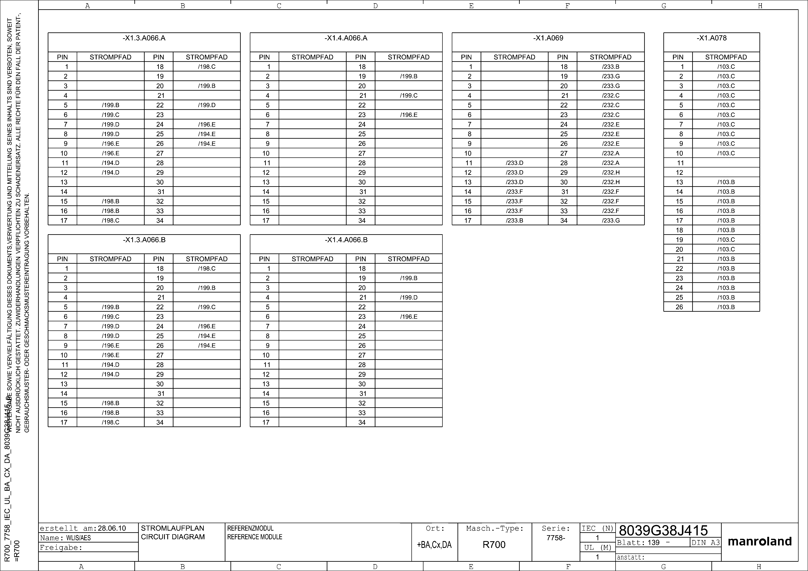

# +BA_Cx_DA — Sheet 139 of 247 — REFERENZMODUL

**REFERENCE MODULE**

> Part of the manroland **R700** printing press IEC/UL circuit diagrams.
> Drawing class: **Stromlaufplan / Circuit diagram** (DIN A3).
> Document `+BA_Cx_DA` covers the **Printing units / main switch cabinet** machine section.

## At a glance

| Field | Value |
|---|---|
| Document | `+BA_Cx_DA`  (8039G38J415) |
| Sheet | **139** of 247 |
| Section (DE) | REFERENZMODUL |
| Section (EN) | REFERENCE MODULE |
| Section type | REFERENCE_MODULE — Reference module |
| Machine type | `R700` |
| Series | `7758` |
| Created | 28.06.10 |
| Replaces | — |
| Columns used | A, B, C, D, E, F, G, H |
| Path numbers | — |
| Labels on sheet | 312 |
| Cross-refs out | 88 |
| Cross-refs in | 0 |

**Previous:** [+BA_Cx_DA sheet 138](SHEET_0138.md) · **Next:** [+BA_Cx_DA sheet 140](SHEET_0140.md) · **Document TOC:** [_TOC.md](_TOC.md)  (+BA_Cx_DA) · **Master TOC:** [all sheets](../_MASTER_TOC.md)

## Sheet image (300 DPI, exact vector render)



_Rendered directly from the PDF vector layer at 300 DPI (1-bit), no OCR and no resampling. Use it to confirm anything ambiguous in the text below._

## Cross-references on this sheet

Each entry is a wire leaving this sheet. The printed token is `/sheet.column`; the link resolves to that sheet inside the same document.

| Ref | Target sheet | Col | Path | Destination on target | Target section | From col |
|---|---|---|---|---|---|---|
| `/233.B` | [+BA_Cx_DA sheet 233](SHEET_0233.md) | B | — | — | OPTION: WASCHMITTELWECHSELBETRIEB | F |
| `/198.C` | [+BA_Cx_DA sheet 198](SHEET_0198.md) | C | — | — | OPTION: WASCHVORRICHTUNG MIT BÜRSTE | B |
| `/103.C` | [+BA_Cx_DA sheet 103](SHEET_0103.md) | C | — | — | FARBSCHIEBER | H |
| `/199.B` | [+BA_Cx_DA sheet 199](SHEET_0199.md) | B | — | — | OPTION: WASCHVORRICHTUNG MIT BÜRSTE | D |
| `/233.G` | [+BA_Cx_DA sheet 233](SHEET_0233.md) | G | — | — | OPTION: WASCHMITTELWECHSELBETRIEB | F |
| `/103.C` | [+BA_Cx_DA sheet 103](SHEET_0103.md) | C | — | — | FARBSCHIEBER | H |
| `/199.B` | [+BA_Cx_DA sheet 199](SHEET_0199.md) | B | — | — | OPTION: WASCHVORRICHTUNG MIT BÜRSTE | B |
| `/233.G` | [+BA_Cx_DA sheet 233](SHEET_0233.md) | G | — | — | OPTION: WASCHMITTELWECHSELBETRIEB | F |
| `/103.C` | [+BA_Cx_DA sheet 103](SHEET_0103.md) | C | — | — | FARBSCHIEBER | H |
| `/199.C` | [+BA_Cx_DA sheet 199](SHEET_0199.md) | C | — | — | OPTION: WASCHVORRICHTUNG MIT BÜRSTE | D |
| `/232.C` | [+BA_Cx_DA sheet 232](SHEET_0232.md) | C | — | — | OPTION: WASCHMITTELWECHSELBETRIEB | F |
| `/103.C` | [+BA_Cx_DA sheet 103](SHEET_0103.md) | C | — | — | FARBSCHIEBER | H |
| `/199.B` | [+BA_Cx_DA sheet 199](SHEET_0199.md) | B | — | — | OPTION: WASCHVORRICHTUNG MIT BÜRSTE | A |
| `/199.D` | [+BA_Cx_DA sheet 199](SHEET_0199.md) | D | — | — | OPTION: WASCHVORRICHTUNG MIT BÜRSTE | B |
| `/232.C` | [+BA_Cx_DA sheet 232](SHEET_0232.md) | C | — | — | OPTION: WASCHMITTELWECHSELBETRIEB | F |
| `/103.C` | [+BA_Cx_DA sheet 103](SHEET_0103.md) | C | — | — | FARBSCHIEBER | H |
| `/196.E` | [+BA_Cx_DA sheet 196](SHEET_0196.md) | E | — | — | OPTION: WASCHVORRICHTUNG MIT BÜRSTE | D |
| `/199.C` | [+BA_Cx_DA sheet 199](SHEET_0199.md) | C | — | — | OPTION: WASCHVORRICHTUNG MIT BÜRSTE | A |
| `/232.C` | [+BA_Cx_DA sheet 232](SHEET_0232.md) | C | — | — | OPTION: WASCHMITTELWECHSELBETRIEB | F |
| `/103.C` | [+BA_Cx_DA sheet 103](SHEET_0103.md) | C | — | — | FARBSCHIEBER | H |
| `/196.E` | [+BA_Cx_DA sheet 196](SHEET_0196.md) | E | — | — | OPTION: WASCHVORRICHTUNG MIT BÜRSTE | B |
| `/232.E` | [+BA_Cx_DA sheet 232](SHEET_0232.md) | E | — | — | OPTION: WASCHMITTELWECHSELBETRIEB | F |
| `/199.D` | [+BA_Cx_DA sheet 199](SHEET_0199.md) | D | — | — | OPTION: WASCHVORRICHTUNG MIT BÜRSTE | A |
| `/103.C` | [+BA_Cx_DA sheet 103](SHEET_0103.md) | C | — | — | FARBSCHIEBER | H |
| `/194.E` | [+BA_Cx_DA sheet 194](SHEET_0194.md) | E | — | — | OPTION: WASCHVORRICHTUNG MIT BÜRSTE | B |
| `/232.E` | [+BA_Cx_DA sheet 232](SHEET_0232.md) | E | — | — | OPTION: WASCHMITTELWECHSELBETRIEB | F |
| `/199.D` | [+BA_Cx_DA sheet 199](SHEET_0199.md) | D | — | — | OPTION: WASCHVORRICHTUNG MIT BÜRSTE | A |
| `/103.C` | [+BA_Cx_DA sheet 103](SHEET_0103.md) | C | — | — | FARBSCHIEBER | H |
| `/196.E` | [+BA_Cx_DA sheet 196](SHEET_0196.md) | E | — | — | OPTION: WASCHVORRICHTUNG MIT BÜRSTE | A |
| `/194.E` | [+BA_Cx_DA sheet 194](SHEET_0194.md) | E | — | — | OPTION: WASCHVORRICHTUNG MIT BÜRSTE | B |
| `/232.E` | [+BA_Cx_DA sheet 232](SHEET_0232.md) | E | — | — | OPTION: WASCHMITTELWECHSELBETRIEB | F |
| `/103.C` | [+BA_Cx_DA sheet 103](SHEET_0103.md) | C | — | — | FARBSCHIEBER | H |
| `/196.E` | [+BA_Cx_DA sheet 196](SHEET_0196.md) | E | — | — | OPTION: WASCHVORRICHTUNG MIT BÜRSTE | A |
| `/232.A` | [+BA_Cx_DA sheet 232](SHEET_0232.md) | A | — | — | OPTION: WASCHMITTELWECHSELBETRIEB | F |
| `/103.C` | [+BA_Cx_DA sheet 103](SHEET_0103.md) | C | — | — | FARBSCHIEBER | H |
| `/232.A` | [+BA_Cx_DA sheet 232](SHEET_0232.md) | A | — | — | OPTION: WASCHMITTELWECHSELBETRIEB | F |
| `/194.D` | [+BA_Cx_DA sheet 194](SHEET_0194.md) | D | — | — | OPTION: WASCHVORRICHTUNG MIT BÜRSTE | A |
| `/233.D` | [+BA_Cx_DA sheet 233](SHEET_0233.md) | D | — | — | OPTION: WASCHMITTELWECHSELBETRIEB | E |
| `/194.D` | [+BA_Cx_DA sheet 194](SHEET_0194.md) | D | — | — | OPTION: WASCHVORRICHTUNG MIT BÜRSTE | A |
| `/233.D` | [+BA_Cx_DA sheet 233](SHEET_0233.md) | D | — | — | OPTION: WASCHMITTELWECHSELBETRIEB | E |
| `/232.H` | [+BA_Cx_DA sheet 232](SHEET_0232.md) | H | — | — | OPTION: WASCHMITTELWECHSELBETRIEB | F |
| `/103.B` | [+BA_Cx_DA sheet 103](SHEET_0103.md) | B | — | — | FARBSCHIEBER | H |
| `/233.D` | [+BA_Cx_DA sheet 233](SHEET_0233.md) | D | — | — | OPTION: WASCHMITTELWECHSELBETRIEB | E |
| `/232.H` | [+BA_Cx_DA sheet 232](SHEET_0232.md) | H | — | — | OPTION: WASCHMITTELWECHSELBETRIEB | F |
| `/103.B` | [+BA_Cx_DA sheet 103](SHEET_0103.md) | B | — | — | FARBSCHIEBER | H |
| `/233.F` | [+BA_Cx_DA sheet 233](SHEET_0233.md) | F | — | — | OPTION: WASCHMITTELWECHSELBETRIEB | E |
| `/232.F` | [+BA_Cx_DA sheet 232](SHEET_0232.md) | F | — | — | OPTION: WASCHMITTELWECHSELBETRIEB | F |
| `/198.B` | [+BA_Cx_DA sheet 198](SHEET_0198.md) | B | — | — | OPTION: WASCHVORRICHTUNG MIT BÜRSTE | A |
| `/103.B` | [+BA_Cx_DA sheet 103](SHEET_0103.md) | B | — | — | FARBSCHIEBER | H |
| `/233.F` | [+BA_Cx_DA sheet 233](SHEET_0233.md) | F | — | — | OPTION: WASCHMITTELWECHSELBETRIEB | E |
| `/232.F` | [+BA_Cx_DA sheet 232](SHEET_0232.md) | F | — | — | OPTION: WASCHMITTELWECHSELBETRIEB | F |
| `/198.B` | [+BA_Cx_DA sheet 198](SHEET_0198.md) | B | — | — | OPTION: WASCHVORRICHTUNG MIT BÜRSTE | A |
| `/103.B` | [+BA_Cx_DA sheet 103](SHEET_0103.md) | B | — | — | FARBSCHIEBER | H |
| `/233.F` | [+BA_Cx_DA sheet 233](SHEET_0233.md) | F | — | — | OPTION: WASCHMITTELWECHSELBETRIEB | E |
| `/232.F` | [+BA_Cx_DA sheet 232](SHEET_0232.md) | F | — | — | OPTION: WASCHMITTELWECHSELBETRIEB | F |
| `/233.B` | [+BA_Cx_DA sheet 233](SHEET_0233.md) | B | — | — | OPTION: WASCHMITTELWECHSELBETRIEB | E |
| `/103.B` | [+BA_Cx_DA sheet 103](SHEET_0103.md) | B | — | — | FARBSCHIEBER | H |
| `/233.G` | [+BA_Cx_DA sheet 233](SHEET_0233.md) | G | — | — | OPTION: WASCHMITTELWECHSELBETRIEB | F |
| `/198.C` | [+BA_Cx_DA sheet 198](SHEET_0198.md) | C | — | — | OPTION: WASCHVORRICHTUNG MIT BÜRSTE | A |
| `/103.B` | [+BA_Cx_DA sheet 103](SHEET_0103.md) | B | — | — | FARBSCHIEBER | H |
| `/103.C` | [+BA_Cx_DA sheet 103](SHEET_0103.md) | C | — | — | FARBSCHIEBER | H |
| `/103.C` | [+BA_Cx_DA sheet 103](SHEET_0103.md) | C | — | — | FARBSCHIEBER | H |
| `/103.B` | [+BA_Cx_DA sheet 103](SHEET_0103.md) | B | — | — | FARBSCHIEBER | H |
| `/103.B` | [+BA_Cx_DA sheet 103](SHEET_0103.md) | B | — | — | FARBSCHIEBER | H |
| `/198.C` | [+BA_Cx_DA sheet 198](SHEET_0198.md) | C | — | — | OPTION: WASCHVORRICHTUNG MIT BÜRSTE | B |
| `/199.B` | [+BA_Cx_DA sheet 199](SHEET_0199.md) | B | — | — | OPTION: WASCHVORRICHTUNG MIT BÜRSTE | D |
| `/103.B` | [+BA_Cx_DA sheet 103](SHEET_0103.md) | B | — | — | FARBSCHIEBER | H |
| `/199.B` | [+BA_Cx_DA sheet 199](SHEET_0199.md) | B | — | — | OPTION: WASCHVORRICHTUNG MIT BÜRSTE | B |
| `/103.B` | [+BA_Cx_DA sheet 103](SHEET_0103.md) | B | — | — | FARBSCHIEBER | H |
| `/103.B` | [+BA_Cx_DA sheet 103](SHEET_0103.md) | B | — | — | FARBSCHIEBER | H |
| `/199.D` | [+BA_Cx_DA sheet 199](SHEET_0199.md) | D | — | — | OPTION: WASCHVORRICHTUNG MIT BÜRSTE | D |
| `/199.B` | [+BA_Cx_DA sheet 199](SHEET_0199.md) | B | — | — | OPTION: WASCHVORRICHTUNG MIT BÜRSTE | A |
| `/103.B` | [+BA_Cx_DA sheet 103](SHEET_0103.md) | B | — | — | FARBSCHIEBER | H |
| `/199.C` | [+BA_Cx_DA sheet 199](SHEET_0199.md) | C | — | — | OPTION: WASCHVORRICHTUNG MIT BÜRSTE | B |
| `/196.E` | [+BA_Cx_DA sheet 196](SHEET_0196.md) | E | — | — | OPTION: WASCHVORRICHTUNG MIT BÜRSTE | D |
| `/199.C` | [+BA_Cx_DA sheet 199](SHEET_0199.md) | C | — | — | OPTION: WASCHVORRICHTUNG MIT BÜRSTE | A |
| `/196.E` | [+BA_Cx_DA sheet 196](SHEET_0196.md) | E | — | — | OPTION: WASCHVORRICHTUNG MIT BÜRSTE | B |
| `/199.D` | [+BA_Cx_DA sheet 199](SHEET_0199.md) | D | — | — | OPTION: WASCHVORRICHTUNG MIT BÜRSTE | A |
| `/194.E` | [+BA_Cx_DA sheet 194](SHEET_0194.md) | E | — | — | OPTION: WASCHVORRICHTUNG MIT BÜRSTE | B |
| `/199.D` | [+BA_Cx_DA sheet 199](SHEET_0199.md) | D | — | — | OPTION: WASCHVORRICHTUNG MIT BÜRSTE | A |
| `/196.E` | [+BA_Cx_DA sheet 196](SHEET_0196.md) | E | — | — | OPTION: WASCHVORRICHTUNG MIT BÜRSTE | A |
| `/194.E` | [+BA_Cx_DA sheet 194](SHEET_0194.md) | E | — | — | OPTION: WASCHVORRICHTUNG MIT BÜRSTE | B |
| `/196.E` | [+BA_Cx_DA sheet 196](SHEET_0196.md) | E | — | — | OPTION: WASCHVORRICHTUNG MIT BÜRSTE | A |
| `/194.D` | [+BA_Cx_DA sheet 194](SHEET_0194.md) | D | — | — | OPTION: WASCHVORRICHTUNG MIT BÜRSTE | A |
| `/194.D` | [+BA_Cx_DA sheet 194](SHEET_0194.md) | D | — | — | OPTION: WASCHVORRICHTUNG MIT BÜRSTE | A |
| `/198.B` | [+BA_Cx_DA sheet 198](SHEET_0198.md) | B | — | — | OPTION: WASCHVORRICHTUNG MIT BÜRSTE | A |
| `/198.B` | [+BA_Cx_DA sheet 198](SHEET_0198.md) | B | — | — | OPTION: WASCHVORRICHTUNG MIT BÜRSTE | A |
| `/198.C` | [+BA_Cx_DA sheet 198](SHEET_0198.md) | C | — | — | OPTION: WASCHVORRICHTUNG MIT BÜRSTE | A |

## Devices on this sheet

| Tag | Class | Class meaning (IEC) | Col | Sub | Terminal | Sign |
|---|---|---|---|---|---|---|
| `X1.3.A066.A` | — | cross-device reference | B | — | — | — |
| `X1.3.A066.B` | — | cross-device reference | B | — | — | — |
| `X1.4.A066.A` | — | cross-device reference | D | — | — | — |
| `X1.4.A066.B` | — | cross-device reference | D | — | — | — |
| `X1.A078` | — | cross-device reference | G | — | — | — |
| `X1.A069` | — | cross-device reference | F | — | — | — |

## Potentials / nets

_No named potentials on this sheet._

## Wire-end annotations (grouped as printed)

A wire that continues elsewhere is annotated with a small cluster: the destination description, the path/line number `#NN`, and the `/sheet.column` cross reference. Each row below is one such cluster exactly as it is grouped on the drawing.

| Col | Y | Path | Cross-ref | Text on the wire |
|---|---|---|---|---|
| B | 51.3 | — | — | `X1.3.A066.A` |
| D | 51.3 | — | — | `X1.4.A066.A` |
| F | 51.3 | — | — | `X1.A069` |
| G | 51.3 | — | — | `X1.A078` |
| A | 80.0 | — | — | `PIN STROMPFAD` |
| B | 80.0 | — | — | `PIN 18 19 20 22 23 24 25 26 27 28 29 30 32 33 34 21 31 STROMPFAD` |
| C | 80.0 | — | — | `PIN STROMPFAD` |
| D | 80.0 | — | — | `PIN 18 19 20 22 23 24 25 26 27 28 29 30 32 33 34 21 31 STROMPFAD` |
| E | 80.0 | — | — | `PIN STROMPFAD` |
| F | 80.0 | — | — | `PIN 18 19 20 22 23 24 25 26 27 28 29 30 32 33 34 21 31 STROMPFAD` |
| G | 80.0 | — | — | `PIN STROMPFAD` |
| A | 94.2 | — | — | `2 3 4 5 6 7 8 9 1` |
| C | 94.2 | — | — | `2 3 4 5 6 7 8 9 1` |
| E | 94.2 | — | — | `2 3 4 5 6 7 8 9 1` |
| G | 94.2 | — | — | `2 3 4 5 6 7 8 9 1` |
| B | 94.5 | — | `/198.C` | — |
| F | 94.5 | — | `/233.B` | — |
| H | 94.5 | — | `/103.C` | — |
| D | 108.7 | — | `/199.B` | — |
| F | 108.7 | — | `/233.G` | — |
| H | 108.7 | — | `/103.C` | — |
| B | 122.9 | — | `/199.B` | — |
| F | 122.9 | — | `/233.G` | — |
| H | 122.9 | — | `/103.C` | — |
| D | 137.1 | — | `/199.C` | — |
| F | 137.1 | — | `/232.C` | — |
| H | 137.1 | — | `/103.C` | — |
| A | 151.2 | — | `/199.B` | — |
| B | 151.2 | — | `/199.D` | — |
| F | 151.2 | — | `/232.C` | — |
| H | 151.2 | — | `/103.C` | — |
| A | 165.4 | — | `/199.C` | — |
| D | 165.4 | — | `/196.E` | — |
| F | 165.4 | — | `/232.C` | — |
| H | 165.4 | — | `/103.C` | — |
| A | 179.6 | — | `/199.D` | — |
| B | 179.6 | — | `/196.E` | — |
| F | 179.6 | — | `/232.E` | — |
| H | 179.6 | — | `/103.C` | — |
| B | 193.7 | — | `/194.E` | — |
| F | 193.7 | — | `/232.E` | — |
| A | 193.8 | — | `/199.D` | — |
| H | 193.8 | — | `/103.C` | — |
| A | 207.9 | — | `/196.E` | — |
| B | 207.9 | — | `/194.E` | — |
| F | 207.9 | — | `/232.E` | — |
| H | 207.9 | — | `/103.C` | — |
| A | 221.8 | — | — | `10 12 13 14 15 16 17 11` |
| C | 221.8 | — | — | `10 12 13 14 15 16 17 11` |
| E | 221.8 | — | — | `10 12 13 14 15 16 17 11` |
| G | 221.8 | — | — | `10 12 13 14 15 16 17 18 19 20 11` |
| A | 222.1 | — | `/196.E` | — |
| F | 222.1 | — | `/232.A` | — |
| H | 222.1 | — | `/103.C` | — |
| F | 236.2 | — | `/232.A` | — |
| A | 236.3 | — | `/194.D` | — |
| E | 236.3 | — | `/233.D` | — |
| A | 250.4 | — | `/194.D` | — |
| E | 250.4 | — | `/233.D` | — |
| F | 250.4 | — | `/232.H` | — |
| E | 264.6 | — | `/233.D` | — |
| F | 264.6 | — | `/232.H` | — |
| H | 264.6 | — | `/103.B` | — |
| E | 278.8 | — | `/233.F` | — |
| F | 278.8 | — | `/232.F` | — |
| H | 278.8 | — | `/103.B` | — |
| A | 292.9 | — | `/198.B` | — |
| E | 292.9 | — | `/233.F` | — |
| F | 292.9 | — | `/232.F` | — |
| H | 292.9 | — | `/103.B` | — |
| A | 307.1 | — | `/198.B` | — |
| E | 307.1 | — | `/233.F` | — |
| F | 307.1 | — | `/232.F` | — |
| H | 307.1 | — | `/103.B` | — |
| A | 321.3 | — | `/198.C` | — |
| E | 321.3 | — | `/233.B` | — |
| F | 321.3 | — | `/233.G` | — |
| H | 321.3 | — | `/103.B` | — |
| H | 335.5 | — | `/103.B` | — |
| B | 349.0 | — | — | `X1.3.A066.B` |
| D | 349.0 | — | — | `X1.4.A066.B` |
| H | 349.7 | — | `/103.C` | — |
| H | 363.8 | — | `/103.C` | — |
| A | 377.6 | — | — | `PIN STROMPFAD` |
| B | 377.6 | — | — | `PIN 18 19 20 22 23 24 25 26 27 28 29 30 32 33 34 21 31 STROMPFAD` |
| C | 377.6 | — | — | `PIN STROMPFAD` |
| D | 377.6 | — | — | `PIN 18 19 20 22 23 24 25 26 27 28 29 30 32 33 34 21 31 STROMPFAD` |
| G | 377.7 | — | — | `22 23 24 25 26 21` |
| H | 378.0 | — | `/103.B` | — |
| A | 391.8 | — | — | `2 3 4 5 6 7 8 9 1` |
| C | 391.8 | — | — | `2 3 4 5 6 7 8 9 1` |
| H | 392.1 | — | `/103.B` | — |
| B | 392.2 | — | `/198.C` | — |
| D | 406.3 | — | `/199.B` | — |
| H | 406.3 | — | `/103.B` | — |
| B | 420.5 | — | `/199.B` | — |
| H | 420.5 | — | `/103.B` | — |
| D | 434.7 | — | `/199.D` | — |
| H | 434.7 | — | `/103.B` | — |
| A | 448.9 | — | `/199.B` | — |
| B | 448.9 | — | `/199.C` | — |
| H | 448.9 | — | `/103.B` | — |
| D | 463.0 | — | `/196.E` | — |
| A | 463.1 | — | `/199.C` | — |
| A | 477.2 | — | `/199.D` | — |
| B | 477.2 | — | `/196.E` | — |
| A | 491.4 | — | `/199.D` | — |
| B | 491.4 | — | `/194.E` | — |
| A | 505.5 | — | `/196.E` | — |
| B | 505.5 | — | `/194.E` | — |
| A | 519.4 | — | — | `10 12 13 14 15 16 17 11` |
| C | 519.4 | — | — | `10 12 13 14 15 16 17 11` |
| A | 519.7 | — | `/196.E` | — |
| A | 533.9 | — | `/194.D` | — |
| A | 548.1 | — | `/194.D` | — |
| A | 590.6 | — | `/198.B` | — |
| A | 604.8 | — | `/198.B` | — |
| A | 619.0 | — | `/198.C` | — |


## Reconstructed tables

This sheet carries tabular content (pin map / terminal assignment / index). The grid below was rebuilt from the drawing's own rule lines, so each row is exactly one physical row of the table.

### Table 1 — 36 data rows × 4 columns (at x=70.9, y=48.2) — **X1.3.A066.A**

| PIN | STROMPFAD | PIN | STROMPFAD |
|---|---|---|---|
| `1` |  | `18` | `/198.C` |
| `2` |  | `19` |  |
| `3` |  | `20` | `/199.B` |
| `4` |  | `21` |  |
| `5` | `/199.B` | `22` | `/199.D` |
| `6` | `/199.C` | `23` |  |
| `7` | `/199.D` | `24` | `/196.E` |
| `8` | `/199.D` | `25` | `/194.E` |
| `9` | `/196.E` | `26` | `/194.E` |
| `10` | `/196.E` | `27` |  |
| `11` | `/194.D` | `28` |  |
| `12` | `/194.D` | `29` |  |
| `13` |  | `30` |  |
| `14` |  | `31` |  |
| `15` | `/198.B` | `32` |  |
| `16` | `/198.B` | `33` |  |
| `17` | `/198.C` | `34` |  |
|  |  | `X1.3.A066.B` |  |
| `PIN` | `STROMPFAD` | `PIN` | `STROMPFAD` |
| `1` |  | `18` | `/198.C` |
| `2` |  | `19` |  |
| `3` |  | `20` | `/199.B` |
| `4` |  | `21` |  |
| `5` | `/199.B` | `22` | `/199.C` |
| `6` | `/199.C` | `23` |  |
| `7` | `/199.D` | `24` | `/196.E` |
| `8` | `/199.D` | `25` | `/194.E` |
| `9` | `/196.E` | `26` | `/194.E` |
| `10` | `/196.E` | `27` |  |
| `11` | `/194.D` | `28` |  |
| `12` | `/194.D` | `29` |  |
| `13` |  | `30` |  |
| `14` |  | `31` |  |
| `15` | `/198.B` | `32` |  |
| `16` | `/198.B` | `33` |  |
| `17` | `/198.C` | `34` |  |


### Table 2 — 36 data rows × 4 columns (at x=368.5, y=48.2) — **X1.4.A066.A**

| PIN | STROMPFAD | PIN | STROMPFAD |
|---|---|---|---|
| `1` |  | `18` |  |
| `2` |  | `19` | `/199.B` |
| `3` |  | `20` |  |
| `4` |  | `21` | `/199.C` |
| `5` |  | `22` |  |
| `6` |  | `23` | `/196.E` |
| `7` |  | `24` |  |
| `8` |  | `25` |  |
| `9` |  | `26` |  |
| `10` |  | `27` |  |
| `11` |  | `28` |  |
| `12` |  | `29` |  |
| `13` |  | `30` |  |
| `14` |  | `31` |  |
| `15` |  | `32` |  |
| `16` |  | `33` |  |
| `17` |  | `34` |  |
|  |  | `X1.4.A066.B` |  |
| `PIN` | `STROMPFAD` | `PIN` | `STROMPFAD` |
| `1` |  | `18` |  |
| `2` |  | `19` | `/199.B` |
| `3` |  | `20` |  |
| `4` |  | `21` | `/199.D` |
| `5` |  | `22` |  |
| `6` |  | `23` | `/196.E` |
| `7` |  | `24` |  |
| `8` |  | `25` |  |
| `9` |  | `26` |  |
| `10` |  | `27` |  |
| `11` |  | `28` |  |
| `12` |  | `29` |  |
| `13` |  | `30` |  |
| `14` |  | `31` |  |
| `15` |  | `32` |  |
| `16` |  | `33` |  |
| `17` |  | `34` |  |


### Table 3 — 17 data rows × 4 columns (at x=666.1, y=48.2) — **X1.A069**

| PIN | STROMPFAD | PIN | STROMPFAD |
|---|---|---|---|
| `1` |  | `18` | `/233.B` |
| `2` |  | `19` | `/233.G` |
| `3` |  | `20` | `/233.G` |
| `4` |  | `21` | `/232.C` |
| `5` |  | `22` | `/232.C` |
| `6` |  | `23` | `/232.C` |
| `7` |  | `24` | `/232.E` |
| `8` |  | `25` | `/232.E` |
| `9` |  | `26` | `/232.E` |
| `10` |  | `27` | `/232.A` |
| `11` | `/233.D` | `28` | `/232.A` |
| `12` | `/233.D` | `29` | `/232.H` |
| `13` | `/233.D` | `30` | `/232.H` |
| `14` | `/233.F` | `31` | `/232.F` |
| `15` | `/233.F` | `32` | `/232.F` |
| `16` | `/233.F` | `33` | `/232.F` |
| `17` | `/233.B` | `34` | `/233.G` |


### Table 4 — 26 data rows × 2 columns (at x=978.0, y=48.2) — **X1.A078**

| PIN | STROMPFAD |
|---|---|
| `1` | `/103.C` |
| `2` | `/103.C` |
| `3` | `/103.C` |
| `4` | `/103.C` |
| `5` | `/103.C` |
| `6` | `/103.C` |
| `7` | `/103.C` |
| `8` | `/103.C` |
| `9` | `/103.C` |
| `10` | `/103.C` |
| `11` |  |
| `12` |  |
| `13` | `/103.B` |
| `14` | `/103.B` |
| `15` | `/103.B` |
| `16` | `/103.B` |
| `17` | `/103.B` |
| `18` | `/103.B` |
| `19` | `/103.C` |
| `20` | `/103.C` |
| `21` | `/103.B` |
| `22` | `/103.B` |
| `23` | `/103.B` |
| `24` | `/103.B` |
| `25` | `/103.B` |
| `26` | `/103.B` |


## Notes and free text on this sheet

| Text | Col | Y (pt) |
|---|---|---|
| `PIN` | A | 80.02 |
| `STROMPFAD` | A | 79.98 |
| `PIN` | B | 80.02 |
| `STROMPFAD` | B | 79.98 |
| `PIN` | C | 80.02 |
| `STROMPFAD` | C | 79.98 |
| `PIN` | D | 80.02 |
| `STROMPFAD` | D | 79.98 |
| `PIN` | G | 80.02 |
| `STROMPFAD` | H | 79.98 |
| `PIN` | E | 80.02 |
| `STROMPFAD` | E | 79.98 |
| `PIN` | F | 80.02 |
| `STROMPFAD` | F | 79.98 |

## Complete label inventory (exact text from the drawing)

Every text object inside the drawing area of this sheet, in DIN reading order (column A→H, then top→bottom). This is the authoritative list: if a string is not here it is not printed on this sheet.

| Col | Y | X | Dir | Type | Text |
|---|---|---|---|---|---|
| A | 80.0 | 84.0 | → | text | `PIN` |
| A | 80.0 | 132.2 | → | text | `STROMPFAD` |
| A | 94.2 | 95.8 | → | number | `1` |
| A | 108.4 | 94.1 | → | number | `2` |
| A | 122.5 | 94.1 | → | number | `3` |
| A | 136.7 | 94.1 | → | number | `4` |
| A | 150.9 | 94.1 | → | number | `5` |
| A | 151.2 | 150.4 | → | cross-reference | `/199.B` |
| A | 165.1 | 94.1 | → | number | `6` |
| A | 165.4 | 150.2 | → | cross-reference | `/199.C` |
| A | 179.2 | 94.1 | → | number | `7` |
| A | 179.6 | 150.2 | → | cross-reference | `/199.D` |
| A | 193.4 | 94.1 | → | number | `8` |
| A | 193.8 | 150.2 | → | cross-reference | `/199.D` |
| A | 207.6 | 94.1 | → | number | `9` |
| A | 207.9 | 150.5 | → | cross-reference | `/196.E` |
| A | 221.8 | 88.7 | → | number | `10` |
| A | 222.1 | 150.5 | → | cross-reference | `/196.E` |
| A | 235.9 | 90.4 | → | number | `11` |
| A | 236.3 | 150.2 | → | cross-reference | `/194.D` |
| A | 250.1 | 88.7 | → | number | `12` |
| A | 250.4 | 150.2 | → | cross-reference | `/194.D` |
| A | 264.3 | 88.7 | → | number | `13` |
| A | 278.5 | 88.7 | → | number | `14` |
| A | 292.6 | 88.7 | → | number | `15` |
| A | 292.9 | 150.4 | → | cross-reference | `/198.B` |
| A | 306.8 | 88.7 | → | number | `16` |
| A | 307.1 | 150.4 | → | cross-reference | `/198.B` |
| A | 321.0 | 88.7 | → | number | `17` |
| A | 321.3 | 150.2 | → | cross-reference | `/198.C` |
| A | 377.6 | 132.2 | → | text | `STROMPFAD` |
| A | 377.7 | 84.0 | → | text | `PIN` |
| A | 391.8 | 95.8 | → | number | `1` |
| A | 406.0 | 94.1 | → | number | `2` |
| A | 420.2 | 94.1 | → | number | `3` |
| A | 434.4 | 94.1 | → | number | `4` |
| A | 448.5 | 94.1 | → | number | `5` |
| A | 448.8 | 150.4 | → | cross-reference | `/199.B` |
| A | 462.7 | 94.1 | → | number | `6` |
| A | 463.0 | 150.2 | → | cross-reference | `/199.C` |
| A | 476.9 | 94.1 | → | number | `7` |
| A | 477.2 | 150.2 | → | cross-reference | `/199.D` |
| A | 491.0 | 94.1 | → | number | `8` |
| A | 491.4 | 150.2 | → | cross-reference | `/199.D` |
| A | 505.2 | 94.1 | → | number | `9` |
| A | 505.5 | 150.5 | → | cross-reference | `/196.E` |
| A | 519.4 | 88.7 | → | number | `10` |
| A | 519.7 | 150.5 | → | cross-reference | `/196.E` |
| A | 533.6 | 90.4 | → | number | `11` |
| A | 533.9 | 150.2 | → | cross-reference | `/194.D` |
| A | 547.7 | 88.7 | → | number | `12` |
| A | 548.1 | 150.2 | → | cross-reference | `/194.D` |
| A | 561.9 | 88.7 | → | number | `13` |
| A | 576.1 | 88.7 | → | number | `14` |
| A | 590.3 | 88.7 | → | number | `15` |
| A | 590.6 | 150.4 | → | cross-reference | `/198.B` |
| A | 604.4 | 88.7 | → | number | `16` |
| A | 604.8 | 150.4 | → | cross-reference | `/198.B` |
| A | 618.6 | 88.7 | → | number | `17` |
| A | 619.0 | 150.2 | → | cross-reference | `/198.C` |
| B | 51.3 | 180.9 | → | device ref | `X1.3.A066.A` |
| B | 80.0 | 225.8 | → | text | `PIN` |
| B | 80.0 | 274.0 | → | text | `STROMPFAD` |
| B | 94.2 | 230.5 | → | number | `18` |
| B | 94.5 | 292.0 | → | cross-reference | `/198.C` |
| B | 108.4 | 230.5 | → | number | `19` |
| B | 122.5 | 230.5 | → | number | `20` |
| B | 122.9 | 292.1 | → | cross-reference | `/199.B` |
| B | 136.7 | 232.2 | → | number | `21` |
| B | 150.9 | 230.5 | → | number | `22` |
| B | 151.2 | 292.0 | → | cross-reference | `/199.D` |
| B | 165.1 | 230.5 | → | number | `23` |
| B | 179.2 | 230.5 | → | number | `24` |
| B | 179.6 | 292.3 | → | cross-reference | `/196.E` |
| B | 193.4 | 230.5 | → | number | `25` |
| B | 193.7 | 292.3 | → | cross-reference | `/194.E` |
| B | 207.6 | 230.5 | → | number | `26` |
| B | 207.9 | 292.3 | → | cross-reference | `/194.E` |
| B | 221.8 | 230.5 | → | number | `27` |
| B | 235.9 | 230.5 | → | number | `28` |
| B | 250.1 | 230.5 | → | number | `29` |
| B | 264.3 | 230.5 | → | number | `30` |
| B | 278.5 | 232.2 | → | number | `31` |
| B | 292.6 | 230.5 | → | number | `32` |
| B | 306.8 | 230.5 | → | number | `33` |
| B | 321.0 | 230.5 | → | number | `34` |
| B | 349.0 | 181.3 | → | device ref | `X1.3.A066.B` |
| B | 377.6 | 274.0 | → | text | `STROMPFAD` |
| B | 377.7 | 225.8 | → | text | `PIN` |
| B | 391.8 | 230.5 | → | number | `18` |
| B | 392.2 | 292.0 | → | cross-reference | `/198.C` |
| B | 406.0 | 230.5 | → | number | `19` |
| B | 420.2 | 230.5 | → | number | `20` |
| B | 420.5 | 292.1 | → | cross-reference | `/199.B` |
| B | 434.4 | 232.2 | → | number | `21` |
| B | 448.5 | 230.5 | → | number | `22` |
| B | 448.9 | 292.0 | → | cross-reference | `/199.C` |
| B | 462.7 | 230.5 | → | number | `23` |
| B | 476.9 | 230.5 | → | number | `24` |
| B | 477.2 | 292.3 | → | cross-reference | `/196.E` |
| B | 491.0 | 230.5 | → | number | `25` |
| B | 491.4 | 292.3 | → | cross-reference | `/194.E` |
| B | 505.2 | 230.5 | → | number | `26` |
| B | 505.5 | 292.3 | → | cross-reference | `/194.E` |
| B | 519.4 | 230.5 | → | number | `27` |
| B | 533.6 | 230.5 | → | number | `28` |
| B | 547.7 | 230.5 | → | number | `29` |
| B | 561.9 | 230.5 | → | number | `30` |
| B | 576.1 | 232.2 | → | number | `31` |
| B | 590.3 | 230.5 | → | number | `32` |
| B | 604.4 | 230.5 | → | number | `33` |
| B | 618.6 | 230.5 | → | number | `34` |
| C | 80.0 | 381.7 | → | text | `PIN` |
| C | 80.0 | 429.9 | → | text | `STROMPFAD` |
| C | 94.2 | 393.4 | → | number | `1` |
| C | 108.4 | 391.7 | → | number | `2` |
| C | 122.5 | 391.7 | → | number | `3` |
| C | 136.7 | 391.7 | → | number | `4` |
| C | 150.9 | 391.7 | → | number | `5` |
| C | 165.1 | 391.7 | → | number | `6` |
| C | 179.2 | 391.7 | → | number | `7` |
| C | 193.4 | 391.7 | → | number | `8` |
| C | 207.6 | 391.7 | → | number | `9` |
| C | 221.8 | 386.4 | → | number | `10` |
| C | 235.9 | 388.1 | → | number | `11` |
| C | 250.1 | 386.4 | → | number | `12` |
| C | 264.3 | 386.4 | → | number | `13` |
| C | 278.5 | 386.4 | → | number | `14` |
| C | 292.6 | 386.4 | → | number | `15` |
| C | 306.8 | 386.4 | → | number | `16` |
| C | 321.0 | 386.4 | → | number | `17` |
| C | 377.6 | 429.9 | → | text | `STROMPFAD` |
| C | 377.7 | 381.7 | → | text | `PIN` |
| C | 391.8 | 393.4 | → | number | `1` |
| C | 406.0 | 391.7 | → | number | `2` |
| C | 420.2 | 391.7 | → | number | `3` |
| C | 434.4 | 391.7 | → | number | `4` |
| C | 448.5 | 391.7 | → | number | `5` |
| C | 462.7 | 391.7 | → | number | `6` |
| C | 476.9 | 391.7 | → | number | `7` |
| C | 491.0 | 391.7 | → | number | `8` |
| C | 505.2 | 391.7 | → | number | `9` |
| C | 519.4 | 386.4 | → | number | `10` |
| C | 533.6 | 388.1 | → | number | `11` |
| C | 547.7 | 386.4 | → | number | `12` |
| C | 561.9 | 386.4 | → | number | `13` |
| C | 576.1 | 386.4 | → | number | `14` |
| C | 590.3 | 386.4 | → | number | `15` |
| C | 604.4 | 386.4 | → | number | `16` |
| C | 618.6 | 386.4 | → | number | `17` |
| D | 51.3 | 478.5 | → | device ref | `X1.4.A066.A` |
| D | 80.0 | 523.4 | → | text | `PIN` |
| D | 80.0 | 571.6 | → | text | `STROMPFAD` |
| D | 94.2 | 528.1 | → | number | `18` |
| D | 108.4 | 528.1 | → | number | `19` |
| D | 108.7 | 589.7 | → | cross-reference | `/199.B` |
| D | 122.5 | 528.1 | → | number | `20` |
| D | 136.7 | 529.8 | → | number | `21` |
| D | 137.1 | 589.6 | → | cross-reference | `/199.C` |
| D | 150.9 | 528.1 | → | number | `22` |
| D | 165.1 | 528.1 | → | number | `23` |
| D | 165.4 | 589.9 | → | cross-reference | `/196.E` |
| D | 179.2 | 528.1 | → | number | `24` |
| D | 193.4 | 528.1 | → | number | `25` |
| D | 207.6 | 528.1 | → | number | `26` |
| D | 221.8 | 528.1 | → | number | `27` |
| D | 235.9 | 528.1 | → | number | `28` |
| D | 250.1 | 528.1 | → | number | `29` |
| D | 264.3 | 528.1 | → | number | `30` |
| D | 278.5 | 529.8 | → | number | `31` |
| D | 292.6 | 528.1 | → | number | `32` |
| D | 306.8 | 528.1 | → | number | `33` |
| D | 321.0 | 528.1 | → | number | `34` |
| D | 349.0 | 478.9 | → | device ref | `X1.4.A066.B` |
| D | 377.6 | 571.6 | → | text | `STROMPFAD` |
| D | 377.7 | 523.4 | → | text | `PIN` |
| D | 391.8 | 528.1 | → | number | `18` |
| D | 406.0 | 528.1 | → | number | `19` |
| D | 406.3 | 589.7 | → | cross-reference | `/199.B` |
| D | 420.2 | 528.1 | → | number | `20` |
| D | 434.4 | 529.8 | → | number | `21` |
| D | 434.7 | 589.6 | → | cross-reference | `/199.D` |
| D | 448.5 | 528.1 | → | number | `22` |
| D | 462.7 | 528.1 | → | number | `23` |
| D | 463.0 | 589.9 | → | cross-reference | `/196.E` |
| D | 476.9 | 528.1 | → | number | `24` |
| D | 491.0 | 528.1 | → | number | `25` |
| D | 505.2 | 528.1 | → | number | `26` |
| D | 519.4 | 528.1 | → | number | `27` |
| D | 533.6 | 528.1 | → | number | `28` |
| D | 547.7 | 528.1 | → | number | `29` |
| D | 561.9 | 528.1 | → | number | `30` |
| D | 576.1 | 529.8 | → | number | `31` |
| D | 590.3 | 528.1 | → | number | `32` |
| D | 604.4 | 528.1 | → | number | `33` |
| D | 618.6 | 528.1 | → | number | `34` |
| E | 80.0 | 679.3 | → | text | `PIN` |
| E | 80.0 | 727.5 | → | text | `STROMPFAD` |
| E | 94.2 | 691.1 | → | number | `1` |
| E | 108.4 | 689.4 | → | number | `2` |
| E | 122.5 | 689.4 | → | number | `3` |
| E | 136.7 | 689.4 | → | number | `4` |
| E | 150.9 | 689.4 | → | number | `5` |
| E | 165.1 | 689.4 | → | number | `6` |
| E | 179.2 | 689.4 | → | number | `7` |
| E | 193.4 | 689.4 | → | number | `8` |
| E | 207.6 | 689.4 | → | number | `9` |
| E | 221.8 | 684.0 | → | number | `10` |
| E | 235.9 | 685.7 | → | number | `11` |
| E | 236.3 | 745.5 | → | cross-reference | `/233.D` |
| E | 250.1 | 684.0 | → | number | `12` |
| E | 250.4 | 745.5 | → | cross-reference | `/233.D` |
| E | 264.3 | 684.0 | → | number | `13` |
| E | 264.6 | 745.5 | → | cross-reference | `/233.D` |
| E | 278.5 | 684.0 | → | number | `14` |
| E | 278.8 | 745.9 | → | cross-reference | `/233.F` |
| E | 292.6 | 684.0 | → | number | `15` |
| E | 293.0 | 745.9 | → | cross-reference | `/233.F` |
| E | 306.8 | 684.0 | → | number | `16` |
| E | 307.1 | 745.9 | → | cross-reference | `/233.F` |
| E | 321.0 | 684.0 | → | number | `17` |
| E | 321.3 | 745.7 | → | cross-reference | `/233.B` |
| F | 51.3 | 785.9 | → | device ref | `X1.A069` |
| F | 80.0 | 821.1 | → | text | `PIN` |
| F | 80.0 | 869.2 | → | text | `STROMPFAD` |
| F | 94.2 | 825.7 | → | number | `18` |
| F | 94.5 | 887.4 | → | cross-reference | `/233.B` |
| F | 108.4 | 825.7 | → | number | `19` |
| F | 108.7 | 887.1 | → | cross-reference | `/233.G` |
| F | 122.5 | 825.7 | → | number | `20` |
| F | 122.9 | 887.1 | → | cross-reference | `/233.G` |
| F | 136.7 | 827.4 | → | number | `21` |
| F | 137.1 | 887.2 | → | cross-reference | `/232.C` |
| F | 150.9 | 825.7 | → | number | `22` |
| F | 151.2 | 887.2 | → | cross-reference | `/232.C` |
| F | 165.1 | 825.7 | → | number | `23` |
| F | 165.4 | 887.2 | → | cross-reference | `/232.C` |
| F | 179.2 | 825.7 | → | number | `24` |
| F | 179.6 | 887.5 | → | cross-reference | `/232.E` |
| F | 193.4 | 825.7 | → | number | `25` |
| F | 193.7 | 887.5 | → | cross-reference | `/232.E` |
| F | 207.6 | 825.7 | → | number | `26` |
| F | 207.9 | 887.5 | → | cross-reference | `/232.E` |
| F | 221.8 | 825.7 | → | number | `27` |
| F | 222.1 | 887.2 | → | cross-reference | `/232.A` |
| F | 235.9 | 825.7 | → | number | `28` |
| F | 236.2 | 887.2 | → | cross-reference | `/232.A` |
| F | 250.1 | 825.7 | → | number | `29` |
| F | 250.4 | 887.5 | → | cross-reference | `/232.H` |
| F | 264.3 | 825.7 | → | number | `30` |
| F | 264.6 | 887.5 | → | cross-reference | `/232.H` |
| F | 278.5 | 827.4 | → | number | `31` |
| F | 278.8 | 887.7 | → | cross-reference | `/232.F` |
| F | 292.6 | 825.7 | → | number | `32` |
| F | 293.0 | 887.7 | → | cross-reference | `/232.F` |
| F | 306.8 | 825.7 | → | number | `33` |
| F | 307.1 | 887.7 | → | cross-reference | `/232.F` |
| F | 321.0 | 825.7 | → | number | `34` |
| F | 321.3 | 887.1 | → | cross-reference | `/233.G` |
| G | 51.3 | 1026.9 | → | device ref | `X1.A078` |
| G | 80.0 | 991.1 | → | text | `PIN` |
| G | 94.2 | 1002.9 | → | number | `1` |
| G | 108.4 | 1001.2 | → | number | `2` |
| G | 122.5 | 1001.2 | → | number | `3` |
| G | 136.7 | 1001.2 | → | number | `4` |
| G | 150.9 | 1001.2 | → | number | `5` |
| G | 165.1 | 1001.2 | → | number | `6` |
| G | 179.2 | 1001.2 | → | number | `7` |
| G | 193.4 | 1001.2 | → | number | `8` |
| G | 207.6 | 1001.2 | → | number | `9` |
| G | 221.8 | 995.8 | → | number | `10` |
| G | 235.9 | 997.5 | → | number | `11` |
| G | 250.1 | 995.8 | → | number | `12` |
| G | 264.3 | 995.8 | → | number | `13` |
| G | 278.5 | 995.8 | → | number | `14` |
| G | 292.6 | 995.8 | → | number | `15` |
| G | 306.8 | 995.8 | → | number | `16` |
| G | 321.0 | 995.8 | → | number | `17` |
| G | 335.1 | 995.8 | → | number | `18` |
| G | 349.3 | 995.8 | → | number | `19` |
| G | 363.5 | 995.8 | → | number | `20` |
| G | 377.7 | 997.5 | → | number | `21` |
| G | 391.8 | 995.8 | → | number | `22` |
| G | 406.0 | 995.8 | → | number | `23` |
| G | 420.2 | 995.8 | → | number | `24` |
| G | 434.4 | 995.8 | → | number | `25` |
| G | 448.5 | 995.8 | → | number | `26` |
| H | 80.0 | 1039.3 | → | text | `STROMPFAD` |
| H | 94.5 | 1057.3 | → | cross-reference | `/103.C` |
| H | 108.7 | 1057.3 | → | cross-reference | `/103.C` |
| H | 122.9 | 1057.3 | → | cross-reference | `/103.C` |
| H | 137.1 | 1057.3 | → | cross-reference | `/103.C` |
| H | 151.2 | 1057.3 | → | cross-reference | `/103.C` |
| H | 165.4 | 1057.3 | → | cross-reference | `/103.C` |
| H | 179.6 | 1057.3 | → | cross-reference | `/103.C` |
| H | 193.8 | 1057.3 | → | cross-reference | `/103.C` |
| H | 207.9 | 1057.3 | → | cross-reference | `/103.C` |
| H | 222.1 | 1057.3 | → | cross-reference | `/103.C` |
| H | 264.6 | 1057.5 | → | cross-reference | `/103.B` |
| H | 278.8 | 1057.5 | → | cross-reference | `/103.B` |
| H | 292.9 | 1057.5 | → | cross-reference | `/103.B` |
| H | 307.1 | 1057.5 | → | cross-reference | `/103.B` |
| H | 321.3 | 1057.5 | → | cross-reference | `/103.B` |
| H | 335.5 | 1057.5 | → | cross-reference | `/103.B` |
| H | 349.7 | 1057.3 | → | cross-reference | `/103.C` |
| H | 363.8 | 1057.3 | → | cross-reference | `/103.C` |
| H | 378.0 | 1057.5 | → | cross-reference | `/103.B` |
| H | 392.2 | 1057.5 | → | cross-reference | `/103.B` |
| H | 406.3 | 1057.5 | → | cross-reference | `/103.B` |
| H | 420.5 | 1057.5 | → | cross-reference | `/103.B` |
| H | 434.7 | 1057.5 | → | cross-reference | `/103.B` |
| H | 448.8 | 1057.5 | → | cross-reference | `/103.B` |

## Reading-order text block

The same content as a plain block, grouped by DIN column — convenient to paste or to match against a visual description.

```text
=== Column A ===
  80.0   84.0  text         PIN
  80.0  132.2  text         STROMPFAD
  94.2   95.8  numeric      1
 108.4   94.1  numeric      2
 122.5   94.1  numeric      3
 136.7   94.1  numeric      4
 150.9   94.1  numeric      5
 151.2  150.4  xref         /199.B
 165.1   94.1  numeric      6
 165.4  150.2  xref         /199.C
 179.2   94.1  numeric      7
 179.6  150.2  xref         /199.D
 193.4   94.1  numeric      8
 193.8  150.2  xref         /199.D
 207.6   94.1  numeric      9
 207.9  150.5  xref         /196.E
 221.8   88.7  numeric      10
 222.1  150.5  xref         /196.E
 235.9   90.4  numeric      11
 236.3  150.2  xref         /194.D
 250.1   88.7  numeric      12
 250.4  150.2  xref         /194.D
 264.3   88.7  numeric      13
 278.5   88.7  numeric      14
 292.6   88.7  numeric      15
 292.9  150.4  xref         /198.B
 306.8   88.7  numeric      16
 307.1  150.4  xref         /198.B
 321.0   88.7  numeric      17
 321.3  150.2  xref         /198.C
 377.6  132.2  text         STROMPFAD
 377.7   84.0  text         PIN
 391.8   95.8  numeric      1
 406.0   94.1  numeric      2
 420.2   94.1  numeric      3
 434.4   94.1  numeric      4
 448.5   94.1  numeric      5
 448.8  150.4  xref         /199.B
 462.7   94.1  numeric      6
 463.0  150.2  xref         /199.C
 476.9   94.1  numeric      7
 477.2  150.2  xref         /199.D
 491.0   94.1  numeric      8
 491.4  150.2  xref         /199.D
 505.2   94.1  numeric      9
 505.5  150.5  xref         /196.E
 519.4   88.7  numeric      10
 519.7  150.5  xref         /196.E
 533.6   90.4  numeric      11
 533.9  150.2  xref         /194.D
 547.7   88.7  numeric      12
 548.1  150.2  xref         /194.D
 561.9   88.7  numeric      13
 576.1   88.7  numeric      14
 590.3   88.7  numeric      15
 590.6  150.4  xref         /198.B
 604.4   88.7  numeric      16
 604.8  150.4  xref         /198.B
 618.6   88.7  numeric      17
 619.0  150.2  xref         /198.C
=== Column B ===
  51.3  180.9  devref       X1.3.A066.A
  80.0  225.8  text         PIN
  80.0  274.0  text         STROMPFAD
  94.2  230.5  numeric      18
  94.5  292.0  xref         /198.C
 108.4  230.5  numeric      19
 122.5  230.5  numeric      20
 122.9  292.1  xref         /199.B
 136.7  232.2  numeric      21
 150.9  230.5  numeric      22
 151.2  292.0  xref         /199.D
 165.1  230.5  numeric      23
 179.2  230.5  numeric      24
 179.6  292.3  xref         /196.E
 193.4  230.5  numeric      25
 193.7  292.3  xref         /194.E
 207.6  230.5  numeric      26
 207.9  292.3  xref         /194.E
 221.8  230.5  numeric      27
 235.9  230.5  numeric      28
 250.1  230.5  numeric      29
 264.3  230.5  numeric      30
 278.5  232.2  numeric      31
 292.6  230.5  numeric      32
 306.8  230.5  numeric      33
 321.0  230.5  numeric      34
 349.0  181.3  devref       X1.3.A066.B
 377.6  274.0  text         STROMPFAD
 377.7  225.8  text         PIN
 391.8  230.5  numeric      18
 392.2  292.0  xref         /198.C
 406.0  230.5  numeric      19
 420.2  230.5  numeric      20
 420.5  292.1  xref         /199.B
 434.4  232.2  numeric      21
 448.5  230.5  numeric      22
 448.9  292.0  xref         /199.C
 462.7  230.5  numeric      23
 476.9  230.5  numeric      24
 477.2  292.3  xref         /196.E
 491.0  230.5  numeric      25
 491.4  292.3  xref         /194.E
 505.2  230.5  numeric      26
 505.5  292.3  xref         /194.E
 519.4  230.5  numeric      27
 533.6  230.5  numeric      28
 547.7  230.5  numeric      29
 561.9  230.5  numeric      30
 576.1  232.2  numeric      31
 590.3  230.5  numeric      32
 604.4  230.5  numeric      33
 618.6  230.5  numeric      34
=== Column C ===
  80.0  381.7  text         PIN
  80.0  429.9  text         STROMPFAD
  94.2  393.4  numeric      1
 108.4  391.7  numeric      2
 122.5  391.7  numeric      3
 136.7  391.7  numeric      4
 150.9  391.7  numeric      5
 165.1  391.7  numeric      6
 179.2  391.7  numeric      7
 193.4  391.7  numeric      8
 207.6  391.7  numeric      9
 221.8  386.4  numeric      10
 235.9  388.1  numeric      11
 250.1  386.4  numeric      12
 264.3  386.4  numeric      13
 278.5  386.4  numeric      14
 292.6  386.4  numeric      15
 306.8  386.4  numeric      16
 321.0  386.4  numeric      17
 377.6  429.9  text         STROMPFAD
 377.7  381.7  text         PIN
 391.8  393.4  numeric      1
 406.0  391.7  numeric      2
 420.2  391.7  numeric      3
 434.4  391.7  numeric      4
 448.5  391.7  numeric      5
 462.7  391.7  numeric      6
 476.9  391.7  numeric      7
 491.0  391.7  numeric      8
 505.2  391.7  numeric      9
 519.4  386.4  numeric      10
 533.6  388.1  numeric      11
 547.7  386.4  numeric      12
 561.9  386.4  numeric      13
 576.1  386.4  numeric      14
 590.3  386.4  numeric      15
 604.4  386.4  numeric      16
 618.6  386.4  numeric      17
=== Column D ===
  51.3  478.5  devref       X1.4.A066.A
  80.0  523.4  text         PIN
  80.0  571.6  text         STROMPFAD
  94.2  528.1  numeric      18
 108.4  528.1  numeric      19
 108.7  589.7  xref         /199.B
 122.5  528.1  numeric      20
 136.7  529.8  numeric      21
 137.1  589.6  xref         /199.C
 150.9  528.1  numeric      22
 165.1  528.1  numeric      23
 165.4  589.9  xref         /196.E
 179.2  528.1  numeric      24
 193.4  528.1  numeric      25
 207.6  528.1  numeric      26
 221.8  528.1  numeric      27
 235.9  528.1  numeric      28
 250.1  528.1  numeric      29
 264.3  528.1  numeric      30
 278.5  529.8  numeric      31
 292.6  528.1  numeric      32
 306.8  528.1  numeric      33
 321.0  528.1  numeric      34
 349.0  478.9  devref       X1.4.A066.B
 377.6  571.6  text         STROMPFAD
 377.7  523.4  text         PIN
 391.8  528.1  numeric      18
 406.0  528.1  numeric      19
 406.3  589.7  xref         /199.B
 420.2  528.1  numeric      20
 434.4  529.8  numeric      21
 434.7  589.6  xref         /199.D
 448.5  528.1  numeric      22
 462.7  528.1  numeric      23
 463.0  589.9  xref         /196.E
 476.9  528.1  numeric      24
 491.0  528.1  numeric      25
 505.2  528.1  numeric      26
 519.4  528.1  numeric      27
 533.6  528.1  numeric      28
 547.7  528.1  numeric      29
 561.9  528.1  numeric      30
 576.1  529.8  numeric      31
 590.3  528.1  numeric      32
 604.4  528.1  numeric      33
 618.6  528.1  numeric      34
=== Column E ===
  80.0  679.3  text         PIN
  80.0  727.5  text         STROMPFAD
  94.2  691.1  numeric      1
 108.4  689.4  numeric      2
 122.5  689.4  numeric      3
 136.7  689.4  numeric      4
 150.9  689.4  numeric      5
 165.1  689.4  numeric      6
 179.2  689.4  numeric      7
 193.4  689.4  numeric      8
 207.6  689.4  numeric      9
 221.8  684.0  numeric      10
 235.9  685.7  numeric      11
 236.3  745.5  xref         /233.D
 250.1  684.0  numeric      12
 250.4  745.5  xref         /233.D
 264.3  684.0  numeric      13
 264.6  745.5  xref         /233.D
 278.5  684.0  numeric      14
 278.8  745.9  xref         /233.F
 292.6  684.0  numeric      15
 293.0  745.9  xref         /233.F
 306.8  684.0  numeric      16
 307.1  745.9  xref         /233.F
 321.0  684.0  numeric      17
 321.3  745.7  xref         /233.B
=== Column F ===
  51.3  785.9  devref       X1.A069
  80.0  821.1  text         PIN
  80.0  869.2  text         STROMPFAD
  94.2  825.7  numeric      18
  94.5  887.4  xref         /233.B
 108.4  825.7  numeric      19
 108.7  887.1  xref         /233.G
 122.5  825.7  numeric      20
 122.9  887.1  xref         /233.G
 136.7  827.4  numeric      21
 137.1  887.2  xref         /232.C
 150.9  825.7  numeric      22
 151.2  887.2  xref         /232.C
 165.1  825.7  numeric      23
 165.4  887.2  xref         /232.C
 179.2  825.7  numeric      24
 179.6  887.5  xref         /232.E
 193.4  825.7  numeric      25
 193.7  887.5  xref         /232.E
 207.6  825.7  numeric      26
 207.9  887.5  xref         /232.E
 221.8  825.7  numeric      27
 222.1  887.2  xref         /232.A
 235.9  825.7  numeric      28
 236.2  887.2  xref         /232.A
 250.1  825.7  numeric      29
 250.4  887.5  xref         /232.H
 264.3  825.7  numeric      30
 264.6  887.5  xref         /232.H
 278.5  827.4  numeric      31
 278.8  887.7  xref         /232.F
 292.6  825.7  numeric      32
 293.0  887.7  xref         /232.F
 306.8  825.7  numeric      33
 307.1  887.7  xref         /232.F
 321.0  825.7  numeric      34
 321.3  887.1  xref         /233.G
=== Column G ===
  51.3 1026.9  devref       X1.A078
  80.0  991.1  text         PIN
  94.2 1002.9  numeric      1
 108.4 1001.2  numeric      2
 122.5 1001.2  numeric      3
 136.7 1001.2  numeric      4
 150.9 1001.2  numeric      5
 165.1 1001.2  numeric      6
 179.2 1001.2  numeric      7
 193.4 1001.2  numeric      8
 207.6 1001.2  numeric      9
 221.8  995.8  numeric      10
 235.9  997.5  numeric      11
 250.1  995.8  numeric      12
 264.3  995.8  numeric      13
 278.5  995.8  numeric      14
 292.6  995.8  numeric      15
 306.8  995.8  numeric      16
 321.0  995.8  numeric      17
 335.1  995.8  numeric      18
 349.3  995.8  numeric      19
 363.5  995.8  numeric      20
 377.7  997.5  numeric      21
 391.8  995.8  numeric      22
 406.0  995.8  numeric      23
 420.2  995.8  numeric      24
 434.4  995.8  numeric      25
 448.5  995.8  numeric      26
=== Column H ===
  80.0 1039.3  text         STROMPFAD
  94.5 1057.3  xref         /103.C
 108.7 1057.3  xref         /103.C
 122.9 1057.3  xref         /103.C
 137.1 1057.3  xref         /103.C
 151.2 1057.3  xref         /103.C
 165.4 1057.3  xref         /103.C
 179.6 1057.3  xref         /103.C
 193.8 1057.3  xref         /103.C
 207.9 1057.3  xref         /103.C
 222.1 1057.3  xref         /103.C
 264.6 1057.5  xref         /103.B
 278.8 1057.5  xref         /103.B
 292.9 1057.5  xref         /103.B
 307.1 1057.5  xref         /103.B
 321.3 1057.5  xref         /103.B
 335.5 1057.5  xref         /103.B
 349.7 1057.3  xref         /103.C
 363.8 1057.3  xref         /103.C
 378.0 1057.5  xref         /103.B
 392.2 1057.5  xref         /103.B
 406.3 1057.5  xref         /103.B
 420.5 1057.5  xref         /103.B
 434.7 1057.5  xref         /103.B
 448.8 1057.5  xref         /103.B
```

---
_Generated from the PDF vector text layer; no OCR. Source: `R700_7758_IEC_UL_BA_CX_DA_8039G38J415_p`, sheet 139._
