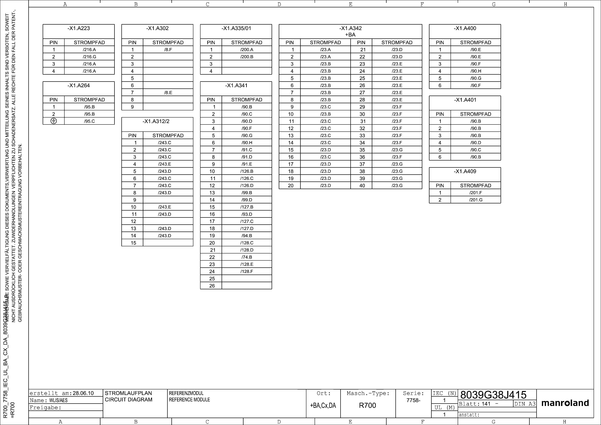

# +BA_Cx_DA — Sheet 141 of 247 — REFERENZMODUL

**REFERENCE MODULE**

> Part of the manroland **R700** printing press IEC/UL circuit diagrams.
> Drawing class: **Stromlaufplan / Circuit diagram** (DIN A3).
> Document `+BA_Cx_DA` covers the **Printing units / main switch cabinet** machine section.

## At a glance

| Field | Value |
|---|---|
| Document | `+BA_Cx_DA`  (8039G38J415) |
| Sheet | **141** of 247 |
| Section (DE) | REFERENZMODUL |
| Section (EN) | REFERENCE MODULE |
| Section type | REFERENCE_MODULE — Reference module |
| Machine type | `R700` |
| Series | `7758` |
| Created | 28.06.10 |
| Replaces | — |
| Columns used | A, B, C, D, E, F, G |
| Path numbers | — |
| Labels on sheet | 248 |
| Cross-refs out | 101 |
| Cross-refs in | 0 |

**Previous:** [+BA_Cx_DA sheet 140](SHEET_0140.md) · **Next:** [+BA_Cx_DA sheet 142](SHEET_0142.md) · **Document TOC:** [_TOC.md](_TOC.md)  (+BA_Cx_DA) · **Master TOC:** [all sheets](../_MASTER_TOC.md)

## Sheet image (300 DPI, exact vector render)



_Rendered directly from the PDF vector layer at 300 DPI (1-bit), no OCR and no resampling. Use it to confirm anything ambiguous in the text below._

## Cross-references on this sheet

Each entry is a wire leaving this sheet. The printed token is `/sheet.column`; the link resolves to that sheet inside the same document.

| Ref | Target sheet | Col | Path | Destination on target | Target section | From col |
|---|---|---|---|---|---|---|
| `/8.F` | [+BA_Cx_DA sheet 8](SHEET_0008.md) | F | — | — | SPANNUNGSVERSORGUNG, SCHALTSCHRANKBELÜFTUNG | B |
| `/23.A` | [+BA_Cx_DA sheet 23](SHEET_0023.md) | A | — | — | BUSVERBINDUNGEN: SICHERHEITSBUS | E |
| `/90.E` | [+BA_Cx_DA sheet 90](SHEET_0090.md) | E | — | — | BOGENFÜHRUNG | G |
| `/216.A` | [+BA_Cx_DA sheet 216](SHEET_0216.md) | A | — | — | OPTION: BLASEINRICHTUNG, FARBWERK | A |
| `/200.A` | [+BA_Cx_DA sheet 200](SHEET_0200.md) | A | — | — | OPTION: APL | D |
| `/23.D` | [+BA_Cx_DA sheet 23](SHEET_0023.md) | D | — | — | BUSVERBINDUNGEN: SICHERHEITSBUS | F |
| `/23.A` | [+BA_Cx_DA sheet 23](SHEET_0023.md) | A | — | — | BUSVERBINDUNGEN: SICHERHEITSBUS | E |
| `/90.E` | [+BA_Cx_DA sheet 90](SHEET_0090.md) | E | — | — | BOGENFÜHRUNG | G |
| `/200.B` | [+BA_Cx_DA sheet 200](SHEET_0200.md) | B | — | — | OPTION: APL | D |
| `/216.G` | [+BA_Cx_DA sheet 216](SHEET_0216.md) | G | — | — | OPTION: BLASEINRICHTUNG, FARBWERK | A |
| `/23.D` | [+BA_Cx_DA sheet 23](SHEET_0023.md) | D | — | — | BUSVERBINDUNGEN: SICHERHEITSBUS | F |
| `/23.B` | [+BA_Cx_DA sheet 23](SHEET_0023.md) | B | — | — | BUSVERBINDUNGEN: SICHERHEITSBUS | E |
| `/23.E` | [+BA_Cx_DA sheet 23](SHEET_0023.md) | E | — | — | BUSVERBINDUNGEN: SICHERHEITSBUS | F |
| `/216.A` | [+BA_Cx_DA sheet 216](SHEET_0216.md) | A | — | — | OPTION: BLASEINRICHTUNG, FARBWERK | A |
| `/90.F` | [+BA_Cx_DA sheet 90](SHEET_0090.md) | F | — | — | BOGENFÜHRUNG | G |
| `/23.B` | [+BA_Cx_DA sheet 23](SHEET_0023.md) | B | — | — | BUSVERBINDUNGEN: SICHERHEITSBUS | E |
| `/23.E` | [+BA_Cx_DA sheet 23](SHEET_0023.md) | E | — | — | BUSVERBINDUNGEN: SICHERHEITSBUS | F |
| `/216.A` | [+BA_Cx_DA sheet 216](SHEET_0216.md) | A | — | — | OPTION: BLASEINRICHTUNG, FARBWERK | A |
| `/90.H` | [+BA_Cx_DA sheet 90](SHEET_0090.md) | H | — | — | BOGENFÜHRUNG | G |
| `/23.B` | [+BA_Cx_DA sheet 23](SHEET_0023.md) | B | — | — | BUSVERBINDUNGEN: SICHERHEITSBUS | E |
| `/23.E` | [+BA_Cx_DA sheet 23](SHEET_0023.md) | E | — | — | BUSVERBINDUNGEN: SICHERHEITSBUS | F |
| `/90.G` | [+BA_Cx_DA sheet 90](SHEET_0090.md) | G | — | — | BOGENFÜHRUNG | G |
| `/23.B` | [+BA_Cx_DA sheet 23](SHEET_0023.md) | B | — | — | BUSVERBINDUNGEN: SICHERHEITSBUS | E |
| `/23.E` | [+BA_Cx_DA sheet 23](SHEET_0023.md) | E | — | — | BUSVERBINDUNGEN: SICHERHEITSBUS | F |
| `/90.F` | [+BA_Cx_DA sheet 90](SHEET_0090.md) | F | — | — | BOGENFÜHRUNG | G |
| `/8.E` | [+BA_Cx_DA sheet 8](SHEET_0008.md) | E | — | — | SPANNUNGSVERSORGUNG, SCHALTSCHRANKBELÜFTUNG | B |
| `/23.B` | [+BA_Cx_DA sheet 23](SHEET_0023.md) | B | — | — | BUSVERBINDUNGEN: SICHERHEITSBUS | E |
| `/23.E` | [+BA_Cx_DA sheet 23](SHEET_0023.md) | E | — | — | BUSVERBINDUNGEN: SICHERHEITSBUS | F |
| `/23.B` | [+BA_Cx_DA sheet 23](SHEET_0023.md) | B | — | — | BUSVERBINDUNGEN: SICHERHEITSBUS | E |
| `/23.E` | [+BA_Cx_DA sheet 23](SHEET_0023.md) | E | — | — | BUSVERBINDUNGEN: SICHERHEITSBUS | F |
| `/95.B` | [+BA_Cx_DA sheet 95](SHEET_0095.md) | B | — | — | BLAS/SAUGLUFT MIT MOTORVENTILEINSTELLUNG | A |
| `/90.B` | [+BA_Cx_DA sheet 90](SHEET_0090.md) | B | — | — | BOGENFÜHRUNG | D |
| `/23.F` | [+BA_Cx_DA sheet 23](SHEET_0023.md) | F | — | — | BUSVERBINDUNGEN: SICHERHEITSBUS | F |
| `/23.C` | [+BA_Cx_DA sheet 23](SHEET_0023.md) | C | — | — | BUSVERBINDUNGEN: SICHERHEITSBUS | E |
| `/95.B` | [+BA_Cx_DA sheet 95](SHEET_0095.md) | B | — | — | BLAS/SAUGLUFT MIT MOTORVENTILEINSTELLUNG | A |
| `/23.B` | [+BA_Cx_DA sheet 23](SHEET_0023.md) | B | — | — | BUSVERBINDUNGEN: SICHERHEITSBUS | E |
| `/23.F` | [+BA_Cx_DA sheet 23](SHEET_0023.md) | F | — | — | BUSVERBINDUNGEN: SICHERHEITSBUS | F |
| `/90.C` | [+BA_Cx_DA sheet 90](SHEET_0090.md) | C | — | — | BOGENFÜHRUNG | D |
| `/90.B` | [+BA_Cx_DA sheet 90](SHEET_0090.md) | B | — | — | BOGENFÜHRUNG | G |
| `/23.F` | [+BA_Cx_DA sheet 23](SHEET_0023.md) | F | — | — | BUSVERBINDUNGEN: SICHERHEITSBUS | F |
| `/95.C` | [+BA_Cx_DA sheet 95](SHEET_0095.md) | C | — | — | BLAS/SAUGLUFT MIT MOTORVENTILEINSTELLUNG | A |
| `/90.D` | [+BA_Cx_DA sheet 90](SHEET_0090.md) | D | — | — | BOGENFÜHRUNG | D |
| `/23.C` | [+BA_Cx_DA sheet 23](SHEET_0023.md) | C | — | — | BUSVERBINDUNGEN: SICHERHEITSBUS | E |
| `/90.B` | [+BA_Cx_DA sheet 90](SHEET_0090.md) | B | — | — | BOGENFÜHRUNG | G |
| `/90.F` | [+BA_Cx_DA sheet 90](SHEET_0090.md) | F | — | — | BOGENFÜHRUNG | D |
| `/23.F` | [+BA_Cx_DA sheet 23](SHEET_0023.md) | F | — | — | BUSVERBINDUNGEN: SICHERHEITSBUS | F |
| `/23.C` | [+BA_Cx_DA sheet 23](SHEET_0023.md) | C | — | — | BUSVERBINDUNGEN: SICHERHEITSBUS | E |
| `/90.B` | [+BA_Cx_DA sheet 90](SHEET_0090.md) | B | — | — | BOGENFÜHRUNG | G |
| `/23.F` | [+BA_Cx_DA sheet 23](SHEET_0023.md) | F | — | — | BUSVERBINDUNGEN: SICHERHEITSBUS | F |
| `/90.G` | [+BA_Cx_DA sheet 90](SHEET_0090.md) | G | — | — | BOGENFÜHRUNG | D |
| `/23.C` | [+BA_Cx_DA sheet 23](SHEET_0023.md) | C | — | — | BUSVERBINDUNGEN: SICHERHEITSBUS | E |
| `/23.F` | [+BA_Cx_DA sheet 23](SHEET_0023.md) | F | — | — | BUSVERBINDUNGEN: SICHERHEITSBUS | F |
| `/243.C` | [+BA_Cx_DA sheet 243](SHEET_0243.md) | C | — | — | OPTION: LEITSTANDBEDIENUNG | B |
| `/90.H` | [+BA_Cx_DA sheet 90](SHEET_0090.md) | H | — | — | BOGENFÜHRUNG | D |
| `/23.C` | [+BA_Cx_DA sheet 23](SHEET_0023.md) | C | — | — | BUSVERBINDUNGEN: SICHERHEITSBUS | E |
| `/90.D` | [+BA_Cx_DA sheet 90](SHEET_0090.md) | D | — | — | BOGENFÜHRUNG | G |
| `/23.G` | [+BA_Cx_DA sheet 23](SHEET_0023.md) | G | — | — | BUSVERBINDUNGEN: SICHERHEITSBUS | F |
| `/91.C` | [+BA_Cx_DA sheet 91](SHEET_0091.md) | C | — | — | BOGENFÜHRUNG WENDETROMMEL | D |
| `/23.D` | [+BA_Cx_DA sheet 23](SHEET_0023.md) | D | — | — | BUSVERBINDUNGEN: SICHERHEITSBUS | E |
| `/90.C` | [+BA_Cx_DA sheet 90](SHEET_0090.md) | C | — | — | BOGENFÜHRUNG | G |
| `/243.C` | [+BA_Cx_DA sheet 243](SHEET_0243.md) | C | — | — | OPTION: LEITSTANDBEDIENUNG | B |
| `/90.B` | [+BA_Cx_DA sheet 90](SHEET_0090.md) | B | — | — | BOGENFÜHRUNG | G |
| `/23.F` | [+BA_Cx_DA sheet 23](SHEET_0023.md) | F | — | — | BUSVERBINDUNGEN: SICHERHEITSBUS | F |
| `/91.D` | [+BA_Cx_DA sheet 91](SHEET_0091.md) | D | — | — | BOGENFÜHRUNG WENDETROMMEL | D |
| `/23.C` | [+BA_Cx_DA sheet 23](SHEET_0023.md) | C | — | — | BUSVERBINDUNGEN: SICHERHEITSBUS | E |
| `/243.C` | [+BA_Cx_DA sheet 243](SHEET_0243.md) | C | — | — | OPTION: LEITSTANDBEDIENUNG | B |
| `/91.E` | [+BA_Cx_DA sheet 91](SHEET_0091.md) | E | — | — | BOGENFÜHRUNG WENDETROMMEL | D |
| `/243.E` | [+BA_Cx_DA sheet 243](SHEET_0243.md) | E | — | — | OPTION: LEITSTANDBEDIENUNG | B |
| `/23.G` | [+BA_Cx_DA sheet 23](SHEET_0023.md) | G | — | — | BUSVERBINDUNGEN: SICHERHEITSBUS | F |
| `/23.D` | [+BA_Cx_DA sheet 23](SHEET_0023.md) | D | — | — | BUSVERBINDUNGEN: SICHERHEITSBUS | E |
| `/126.B` | [+BA_Cx_DA sheet 126](SHEET_0126.md) | B | — | — | RESERVE: SPS STATION (D/A) | D |
| `/23.G` | [+BA_Cx_DA sheet 23](SHEET_0023.md) | G | — | — | BUSVERBINDUNGEN: SICHERHEITSBUS | F |
| `/23.D` | [+BA_Cx_DA sheet 23](SHEET_0023.md) | D | — | — | BUSVERBINDUNGEN: SICHERHEITSBUS | E |
| `/243.D` | [+BA_Cx_DA sheet 243](SHEET_0243.md) | D | — | — | OPTION: LEITSTANDBEDIENUNG | B |
| `/23.G` | [+BA_Cx_DA sheet 23](SHEET_0023.md) | G | — | — | BUSVERBINDUNGEN: SICHERHEITSBUS | F |
| `/23.D` | [+BA_Cx_DA sheet 23](SHEET_0023.md) | D | — | — | BUSVERBINDUNGEN: SICHERHEITSBUS | E |
| `/243.C` | [+BA_Cx_DA sheet 243](SHEET_0243.md) | C | — | — | OPTION: LEITSTANDBEDIENUNG | B |
| `/126.C` | [+BA_Cx_DA sheet 126](SHEET_0126.md) | C | — | — | RESERVE: SPS STATION (D/A) | D |
| `/23.G` | [+BA_Cx_DA sheet 23](SHEET_0023.md) | G | — | — | BUSVERBINDUNGEN: SICHERHEITSBUS | F |
| `/243.C` | [+BA_Cx_DA sheet 243](SHEET_0243.md) | C | — | — | OPTION: LEITSTANDBEDIENUNG | B |
| `/126.D` | [+BA_Cx_DA sheet 126](SHEET_0126.md) | D | — | — | RESERVE: SPS STATION (D/A) | D |
| `/23.D` | [+BA_Cx_DA sheet 23](SHEET_0023.md) | D | — | — | BUSVERBINDUNGEN: SICHERHEITSBUS | E |
| `/99.B` | [+BA_Cx_DA sheet 99](SHEET_0099.md) | B | — | — | BLAS/SAUGLUFT MIT MOTORVENTILEINSTELLUNG | D |
| `/201.F` | [+BA_Cx_DA sheet 201](SHEET_0201.md) | F | — | — | OPTION: | G |
| `/243.D` | [+BA_Cx_DA sheet 243](SHEET_0243.md) | D | — | — | OPTION: LEITSTANDBEDIENUNG | B |
| `/99.D` | [+BA_Cx_DA sheet 99](SHEET_0099.md) | D | — | — | BLAS/SAUGLUFT MIT MOTORVENTILEINSTELLUNG | D |
| `/201.G` | [+BA_Cx_DA sheet 201](SHEET_0201.md) | G | — | — | OPTION: | G |
| `/243.E` | [+BA_Cx_DA sheet 243](SHEET_0243.md) | E | — | — | OPTION: LEITSTANDBEDIENUNG | B |
| `/127.B` | [+BA_Cx_DA sheet 127](SHEET_0127.md) | B | — | — | RESERVE: SPS STATION (D/A) | D |
| `/93.D` | [+BA_Cx_DA sheet 93](SHEET_0093.md) | D | — | — | BOGENFÜHRUNG (BLASROHRE) | D |
| `/243.D` | [+BA_Cx_DA sheet 243](SHEET_0243.md) | D | — | — | OPTION: LEITSTANDBEDIENUNG | B |
| `/127.C` | [+BA_Cx_DA sheet 127](SHEET_0127.md) | C | — | — | RESERVE: SPS STATION (D/A) | D |
| `/243.D` | [+BA_Cx_DA sheet 243](SHEET_0243.md) | D | — | — | OPTION: LEITSTANDBEDIENUNG | B |
| `/127.D` | [+BA_Cx_DA sheet 127](SHEET_0127.md) | D | — | — | RESERVE: SPS STATION (D/A) | D |
| `/94.B` | [+BA_Cx_DA sheet 94](SHEET_0094.md) | B | — | — | BOGENFÜHRUNG (BLASROHRE) | D |
| `/243.D` | [+BA_Cx_DA sheet 243](SHEET_0243.md) | D | — | — | OPTION: LEITSTANDBEDIENUNG | B |
| `/128.C` | [+BA_Cx_DA sheet 128](SHEET_0128.md) | C | — | — | RESERVE: SPS STATION (D/A) | D |
| `/128.D` | [+BA_Cx_DA sheet 128](SHEET_0128.md) | D | — | — | RESERVE: SPS STATION (D/A) | D |
| `/74.B` | [+BA_Cx_DA sheet 74](SHEET_0074.md) | B | — | — | FEUCHTWERK | D |
| `/128.E` | [+BA_Cx_DA sheet 128](SHEET_0128.md) | E | — | — | RESERVE: SPS STATION (D/A) | D |
| `/128.F` | [+BA_Cx_DA sheet 128](SHEET_0128.md) | F | — | — | RESERVE: SPS STATION (D/A) | D |

## Devices on this sheet

| Tag | Class | Class meaning (IEC) | Col | Sub | Terminal | Sign |
|---|---|---|---|---|---|---|
| `X1.A400` | — | cross-device reference | G | — | — | — |
| `X1.A401` | — | cross-device reference | G | — | — | — |
| `X1.A409` | — | cross-device reference | G | — | — | — |
| `X1.A223` | — | cross-device reference | A | — | — | — |
| `X1.A264` | — | cross-device reference | A | — | — | — |
| `X1.A302` | — | cross-device reference | B | — | — | — |
| `X1.A341` | — | cross-device reference | C | — | — | — |
| `X1.A342` | — | cross-device reference | E | — | — | — |

## Potentials / nets

_No named potentials on this sheet._

## Wire-end annotations (grouped as printed)

A wire that continues elsewhere is annotated with a small cluster: the destination description, the path/line number `#NN`, and the `/sheet.column` cross reference. Each row below is one such cluster exactly as it is grouped on the drawing.

| Col | Y | Path | Cross-ref | Text on the wire |
|---|---|---|---|---|
| A | 51.3 | — | — | `X1.A223` |
| B | 51.3 | — | — | `X1.A302` |
| C | 51.3 | — | — | `X1.A335/01` |
| E | 51.3 | — | — | `X1.A342` |
| G | 51.3 | — | — | `X1.A400` |
| E | 64.0 | — | — | `+BA` |
| A | 80.0 | — | — | `PIN 2 3 4 1 STROMPFAD` |
| B | 80.0 | — | — | `PIN 2 3 4 5 6 7 8 9 1 STROMPFAD` |
| C | 80.0 | — | — | `PIN 2 3 4 1 STROMPFAD` |
| D | 80.0 | — | — | `PIN STROMPFAD` |
| E | 80.0 | — | — | `PIN STROMPFAD` |
| G | 80.0 | — | — | `PIN 2 3 4 5 6 1 STROMPFAD` |
| D | 94.2 | — | — | `2 3 4 5 6 7 8 9 1` |
| E | 94.2 | — | — | `22 21` |
| A | 94.5 | — | `/216.A` | — |
| B | 94.5 | — | `/8.F` | — |
| D | 94.5 | — | `/200.A` | — |
| E | 94.5 | — | `/23.A` | — |
| F | 94.5 | — | `/23.D` | — |
| G | 94.5 | — | `/90.E` | — |
| A | 108.7 | — | `/216.G` | — |
| D | 108.7 | — | `/200.B` | — |
| E | 108.7 | — | `/23.A` | — |
| F | 108.7 | — | `/23.D` | — |
| G | 108.7 | — | `/90.E` | — |
| E | 122.5 | — | — | `23 24 25 26 27 28 29 30 32 33 34 35 36 37 38 39 40 31` |
| E | 122.8 | — | `/23.B` | — |
| F | 122.8 | — | `/23.E` | — |
| A | 122.9 | — | `/216.A` | — |
| G | 122.9 | — | `/90.F` | — |
| A | 137.0 | — | `/216.A` | — |
| E | 137.0 | — | `/23.B` | — |
| F | 137.0 | — | `/23.E` | — |
| G | 137.1 | — | `/90.H` | — |
| E | 151.2 | — | `/23.B` | — |
| F | 151.2 | — | `/23.E` | — |
| G | 151.2 | — | `/90.G` | — |
| A | 164.7 | — | — | `X1.A264` |
| C | 164.7 | — | — | `X1.A341` |
| E | 165.4 | — | `/23.B` | — |
| F | 165.4 | — | `/23.E` | — |
| G | 165.4 | — | `/90.F` | — |
| B | 179.5 | — | `/8.E` | — |
| E | 179.5 | — | `/23.B` | — |
| F | 179.5 | — | `/23.E` | — |
| G | 193.1 | — | — | `X1.A401` |
| A | 193.4 | — | — | `PIN 2 1 STROMPFAD` |
| C | 193.4 | — | — | `PIN STROMPFAD` |
| E | 193.7 | — | `/23.B` | — |
| F | 193.7 | — | `/23.E` | — |
| C | 207.6 | — | — | `2 3 4 5 6 7 8 9 1` |
| A | 207.9 | — | `/95.B` | — |
| D | 207.9 | — | `/90.B` | — |
| E | 207.9 | — | `/23.C` | — |
| F | 207.9 | — | `/23.F` | — |
| G | 221.7 | — | — | `PIN 2 3 4 5 6 1 STROMPFAD` |
| D | 221.8 | — | — | `10 12 13 14 15 16 17 18 19 11` |
| A | 222.1 | — | `/95.B` | — |
| D | 222.1 | — | `/90.C` | — |
| E | 222.1 | — | `/23.B` | — |
| F | 222.1 | — | `/23.F` | — |
| B | 235.6 | — | — | `X1.A312/2` |
| F | 236.2 | — | `/23.F` | — |
| G | 236.2 | — | `/90.B` | — |
| A | 236.3 | — | `/95.C` | — |
| D | 236.3 | — | `/90.D` | — |
| E | 236.3 | — | `/23.C` | — |
| D | 250.4 | — | `/90.F` | — |
| E | 250.4 | — | `/23.C` | — |
| F | 250.4 | — | `/23.F` | — |
| G | 250.4 | — | `/90.B` | — |
| B | 264.2 | — | — | `PIN 10 12 13 14 15 11 2 3 4 5 6 7 8 9 1 STROMPFAD` |
| D | 264.6 | — | `/90.G` | — |
| E | 264.6 | — | `/23.C` | — |
| F | 264.6 | — | `/23.F` | — |
| G | 264.6 | — | `/90.B` | — |
| B | 278.8 | — | `/243.C` | — |
| D | 278.8 | — | `/90.H` | — |
| E | 278.8 | — | `/23.C` | — |
| F | 278.8 | — | `/23.F` | — |
| G | 278.8 | — | `/90.D` | — |
| F | 292.9 | — | `/23.G` | — |
| B | 293.0 | — | `/243.C` | — |
| D | 293.0 | — | `/91.C` | — |
| E | 293.0 | — | `/23.D` | — |
| G | 293.0 | — | `/90.C` | — |
| B | 307.1 | — | `/243.C` | — |
| D | 307.1 | — | `/91.D` | — |
| E | 307.1 | — | `/23.C` | — |
| F | 307.1 | — | `/23.F` | — |
| G | 307.1 | — | `/90.B` | — |
| B | 321.3 | — | `/243.E` | — |
| D | 321.3 | — | `/91.E` | — |
| E | 321.3 | — | `/23.D` | — |
| F | 321.3 | — | `/23.G` | — |
| G | 334.8 | — | — | `X1.A409` |
| C | 335.1 | — | — | `10 12 13 14 15 16 17 18 19 20 11` |
| B | 335.5 | — | `/243.D` | — |
| D | 335.5 | — | `/126.B` | — |
| E | 335.5 | — | `/23.D` | — |
| F | 335.5 | — | `/23.G` | — |
| E | 349.6 | — | `/23.D` | — |
| F | 349.6 | — | `/23.G` | — |
| B | 349.7 | — | `/243.C` | — |
| D | 349.7 | — | `/126.C` | — |
| G | 363.4 | — | — | `PIN 2 1 STROMPFAD` |
| D | 363.5 | — | — | `20` |
| B | 363.8 | — | `/243.C` | — |
| D | 363.8 | — | `/126.D` | — |
| E | 363.8 | — | `/23.D` | — |
| F | 363.8 | — | `/23.G` | — |
| B | 378.0 | — | `/243.D` | — |
| D | 378.0 | — | `/99.B` | — |
| G | 378.0 | — | `/201.F` | — |
| D | 392.2 | — | `/99.D` | — |
| G | 392.2 | — | `/201.G` | — |
| B | 406.3 | — | `/243.E` | — |
| D | 406.3 | — | `/127.B` | — |
| B | 420.5 | — | `/243.D` | — |
| D | 420.5 | — | `/93.D` | — |
| D | 434.7 | — | `/127.C` | — |
| B | 448.9 | — | `/243.D` | — |
| D | 448.9 | — | `/127.D` | — |
| D | 463.0 | — | `/94.B` | — |
| B | 463.1 | — | `/243.D` | — |
| D | 477.2 | — | `/128.C` | — |
| C | 491.1 | — | — | `22 23 24 25 26 21` |
| D | 491.4 | — | `/128.D` | — |
| D | 505.5 | — | `/74.B` | — |
| D | 519.7 | — | `/128.E` | — |
| D | 533.9 | — | `/128.F` | — |


## Reconstructed tables

This sheet carries tabular content (pin map / terminal assignment / index). The grid below was rebuilt from the drawing's own rule lines, so each row is exactly one physical row of the table.

### Table 1 — 9 data rows × 2 columns (at x=85.0, y=48.2) — **X1.A223**

| PIN | STROMPFAD |
|---|---|
| `1` | `/216.A` |
| `2` | `/216.G` |
| `3` | `/216.A` |
| `4` | `/216.A` |
|  | `X1.A264` |
| `PIN` | `STROMPFAD` |
| `1` | `/95.B` |
| `2` | `/95.B` |
|  | `/95.C` |


### Table 2 — 26 data rows × 2 columns (at x=240.9, y=48.2) — **X1.A302**

| PIN | STROMPFAD |
|---|---|
| `1` | `/8.F` |
| `2` |  |
| `3` |  |
| `4` |  |
| `5` |  |
| `6` |  |
| `7` | `/8.E` |
| `8` |  |
| `9` |  |
|  | `X1.A312/2` |
| `PIN` | `STROMPFAD` |
| `1` | `/243.C` |
| `2` | `/243.C` |
| `3` | `/243.C` |
| `4` | `/243.E` |
| `5` | `/243.D` |
| `6` | `/243.C` |
| `7` | `/243.C` |
| `8` | `/243.D` |
| `9` |  |
| `10` | `/243.E` |
| `11` | `/243.D` |
| `12` |  |
| `13` | `/243.D` |
| `14` | `/243.D` |
| `15` |  |


### Table 3 — 32 data rows × 2 columns (at x=396.9, y=48.2) — **X1.A335/01**

| PIN | STROMPFAD |
|---|---|
| `1` | `/200.A` |
| `2` | `/200.B` |
| `3` |  |
| `4` |  |
|  | `X1.A341` |
| `PIN` | `STROMPFAD` |
| `1` | `/90.B` |
| `2` | `/90.C` |
| `3` | `/90.D` |
| `4` | `/90.F` |
| `5` | `/90.G` |
| `6` | `/90.H` |
| `7` | `/91.C` |
| `8` | `/91.D` |
| `9` | `/91.E` |
| `10` | `/126.B` |
| `11` | `/126.C` |
| `12` | `/126.D` |
| `13` | `/99.B` |
| `14` | `/99.D` |
| `15` | `/127.B` |
| `16` | `/93.D` |
| `17` | `/127.C` |
| `18` | `/127.D` |
| `19` | `/94.B` |
| `20` | `/128.C` |
| `21` | `/128.D` |
| `22` | `/74.B` |
| `23` | `/128.E` |
| `24` | `/128.F` |
| `25` |  |
| `26` |  |


### Table 4 — 20 data rows × 4 columns (at x=552.8, y=48.2) — **+BA X1.A342**

| PIN | STROMPFAD | PIN | STROMPFAD |
|---|---|---|---|
| `1` | `/23.A` | `21` | `/23.D` |
| `2` | `/23.A` | `22` | `/23.D` |
| `3` | `/23.B` | `23` | `/23.E` |
| `4` | `/23.B` | `24` | `/23.E` |
| `5` | `/23.B` | `25` | `/23.E` |
| `6` | `/23.B` | `26` | `/23.E` |
| `7` | `/23.B` | `27` | `/23.E` |
| `8` | `/23.B` | `28` | `/23.E` |
| `9` | `/23.C` | `29` | `/23.F` |
| `10` | `/23.B` | `30` | `/23.F` |
| `11` | `/23.C` | `31` | `/23.F` |
| `12` | `/23.C` | `32` | `/23.F` |
| `13` | `/23.C` | `33` | `/23.F` |
| `14` | `/23.C` | `34` | `/23.F` |
| `15` | `/23.D` | `35` | `/23.G` |
| `16` | `/23.C` | `36` | `/23.F` |
| `17` | `/23.D` | `37` | `/23.G` |
| `18` | `/23.D` | `38` | `/23.G` |
| `19` | `/23.D` | `39` | `/23.G` |
| `20` | `/23.D` | `40` | `/23.G` |


### Table 5 — 18 data rows × 2 columns (at x=850.4, y=48.2) — **X1.A400**

| PIN | STROMPFAD |
|---|---|
| `1` | `/90.E` |
| `2` | `/90.E` |
| `3` | `/90.F` |
| `4` | `/90.H` |
| `5` | `/90.G` |
| `6` | `/90.F` |
|  | `X1.A401` |
| `PIN` | `STROMPFAD` |
| `1` | `/90.B` |
| `2` | `/90.B` |
| `3` | `/90.B` |
| `4` | `/90.D` |
| `5` | `/90.C` |
| `6` | `/90.B` |
|  | `X1.A409` |
| `PIN` | `STROMPFAD` |
| `1` | `/201.F` |
| `2` | `/201.G` |


## Notes and free text on this sheet

| Text | Col | Y (pt) |
|---|---|---|
| `PIN` | F | 80.02 |
| `STROMPFAD` | G | 79.98 |
| `PIN` | A | 80.02 |
| `STROMPFAD` | A | 79.98 |
| `PIN` | B | 80.02 |
| `STROMPFAD` | B | 79.98 |
| `PIN` | C | 80.02 |
| `STROMPFAD` | D | 79.98 |
| `X1.A335/01` | C | 51.33 |
| `PIN` | D | 80.02 |
| `STROMPFAD` | E | 79.98 |
| `PIN` | E | 80.02 |
| `STROMPFAD` | F | 79.98 |
| `+BA` | E | 64.01 |
| `X1.A312/2` | B | 235.59 |

## Complete label inventory (exact text from the drawing)

Every text object inside the drawing area of this sheet, in DIN reading order (column A→H, then top→bottom). This is the authoritative list: if a string is not here it is not printed on this sheet.

| Col | Y | X | Dir | Type | Text |
|---|---|---|---|---|---|
| A | 51.3 | 133.9 | → | device ref | `X1.A223` |
| A | 80.0 | 98.2 | → | text | `PIN` |
| A | 80.0 | 146.4 | → | text | `STROMPFAD` |
| A | 94.2 | 104.2 | → | number | `1` |
| A | 94.5 | 164.4 | → | cross-reference | `/216.A` |
| A | 108.4 | 103.6 | → | number | `2` |
| A | 108.7 | 164.3 | → | cross-reference | `/216.G` |
| A | 122.5 | 103.6 | → | number | `3` |
| A | 122.9 | 164.4 | → | cross-reference | `/216.A` |
| A | 136.7 | 103.6 | → | number | `4` |
| A | 137.0 | 164.4 | → | cross-reference | `/216.A` |
| A | 164.7 | 133.9 | → | device ref | `X1.A264` |
| A | 193.4 | 98.2 | → | text | `PIN` |
| A | 193.4 | 146.4 | → | text | `STROMPFAD` |
| A | 207.6 | 104.2 | → | number | `1` |
| A | 207.9 | 167.0 | → | cross-reference | `/95.B` |
| A | 221.8 | 103.6 | → | number | `2` |
| A | 222.1 | 167.0 | → | cross-reference | `/95.B` |
| A | 236.3 | 166.8 | → | cross-reference | `/95.C` |
| B | 51.3 | 289.8 | → | device ref | `X1.A302` |
| B | 80.0 | 254.1 | → | text | `PIN` |
| B | 80.0 | 302.3 | → | text | `STROMPFAD` |
| B | 94.2 | 260.1 | → | number | `1` |
| B | 94.5 | 325.6 | → | cross-reference | `/8.F` |
| B | 108.4 | 259.5 | → | number | `2` |
| B | 122.5 | 259.5 | → | number | `3` |
| B | 136.7 | 259.5 | → | number | `4` |
| B | 150.9 | 259.5 | → | number | `5` |
| B | 165.1 | 259.5 | → | number | `6` |
| B | 179.2 | 259.5 | → | number | `7` |
| B | 179.5 | 325.4 | → | cross-reference | `/8.E` |
| B | 193.4 | 259.5 | → | number | `8` |
| B | 207.6 | 259.5 | → | number | `9` |
| B | 235.6 | 282.6 | → | text | `X1.A312/2` |
| B | 264.2 | 302.3 | → | text | `STROMPFAD` |
| B | 264.3 | 254.1 | → | text | `PIN` |
| B | 278.5 | 265.9 | → | number | `1` |
| B | 278.8 | 313.2 | → | cross-reference | `/243.C` |
| B | 292.6 | 264.2 | → | number | `2` |
| B | 293.0 | 313.2 | → | cross-reference | `/243.C` |
| B | 306.8 | 264.2 | → | number | `3` |
| B | 307.1 | 313.2 | → | cross-reference | `/243.C` |
| B | 321.0 | 264.2 | → | number | `4` |
| B | 321.3 | 313.5 | → | cross-reference | `/243.E` |
| B | 335.1 | 264.2 | → | number | `5` |
| B | 335.5 | 313.2 | → | cross-reference | `/243.D` |
| B | 349.3 | 264.2 | → | number | `6` |
| B | 349.7 | 313.2 | → | cross-reference | `/243.C` |
| B | 363.5 | 264.2 | → | number | `7` |
| B | 363.8 | 313.2 | → | cross-reference | `/243.C` |
| B | 377.7 | 264.2 | → | number | `8` |
| B | 378.0 | 313.2 | → | cross-reference | `/243.D` |
| B | 391.8 | 264.2 | → | number | `9` |
| B | 406.0 | 258.8 | → | number | `10` |
| B | 406.3 | 313.5 | → | cross-reference | `/243.E` |
| B | 420.2 | 260.5 | → | number | `11` |
| B | 420.5 | 313.2 | → | cross-reference | `/243.D` |
| B | 434.4 | 258.8 | → | number | `12` |
| B | 448.5 | 258.8 | → | number | `13` |
| B | 448.9 | 313.2 | → | cross-reference | `/243.D` |
| B | 462.7 | 258.8 | → | number | `14` |
| B | 463.0 | 313.2 | → | cross-reference | `/243.D` |
| B | 476.9 | 258.8 | → | number | `15` |
| C | 51.3 | 439.1 | → | text | `X1.A335/01` |
| C | 80.0 | 410.0 | → | text | `PIN` |
| C | 94.2 | 416.0 | → | number | `1` |
| C | 108.4 | 415.4 | → | number | `2` |
| C | 122.5 | 415.4 | → | number | `3` |
| C | 136.7 | 415.4 | → | number | `4` |
| C | 164.7 | 446.5 | → | device ref | `X1.A341` |
| C | 193.4 | 410.0 | → | text | `PIN` |
| C | 207.6 | 421.8 | → | number | `1` |
| C | 221.8 | 420.1 | → | number | `2` |
| C | 235.9 | 420.1 | → | number | `3` |
| C | 250.1 | 420.1 | → | number | `4` |
| C | 264.3 | 420.1 | → | number | `5` |
| C | 278.5 | 420.1 | → | number | `6` |
| C | 292.6 | 420.1 | → | number | `7` |
| C | 306.8 | 420.1 | → | number | `8` |
| C | 321.0 | 420.1 | → | number | `9` |
| C | 335.1 | 414.7 | → | number | `10` |
| C | 349.3 | 416.4 | → | number | `11` |
| C | 363.5 | 414.7 | → | number | `12` |
| C | 377.7 | 414.7 | → | number | `13` |
| C | 391.8 | 414.7 | → | number | `14` |
| C | 406.0 | 414.7 | → | number | `15` |
| C | 420.2 | 414.7 | → | number | `16` |
| C | 434.4 | 414.7 | → | number | `17` |
| C | 448.5 | 414.7 | → | number | `18` |
| C | 462.7 | 414.7 | → | number | `19` |
| C | 476.9 | 414.7 | → | number | `20` |
| C | 491.0 | 416.4 | → | number | `21` |
| C | 505.2 | 414.7 | → | number | `22` |
| C | 519.4 | 414.7 | → | number | `23` |
| C | 533.6 | 414.7 | → | number | `24` |
| C | 547.7 | 414.7 | → | number | `25` |
| C | 561.9 | 414.7 | → | number | `26` |
| D | 80.0 | 458.2 | → | text | `STROMPFAD` |
| D | 80.0 | 565.9 | → | text | `PIN` |
| D | 94.2 | 577.7 | → | number | `1` |
| D | 94.5 | 476.2 | → | cross-reference | `/200.A` |
| D | 108.4 | 576.0 | → | number | `2` |
| D | 108.7 | 476.4 | → | cross-reference | `/200.B` |
| D | 122.5 | 576.0 | → | number | `3` |
| D | 136.7 | 576.0 | → | number | `4` |
| D | 150.9 | 576.0 | → | number | `5` |
| D | 165.1 | 576.0 | → | number | `6` |
| D | 179.2 | 576.0 | → | number | `7` |
| D | 193.4 | 458.2 | → | text | `STROMPFAD` |
| D | 193.4 | 576.0 | → | number | `8` |
| D | 207.6 | 576.0 | → | number | `9` |
| D | 207.9 | 478.8 | → | cross-reference | `/90.B` |
| D | 221.8 | 570.6 | → | number | `10` |
| D | 222.1 | 478.6 | → | cross-reference | `/90.C` |
| D | 235.9 | 572.3 | → | number | `11` |
| D | 236.3 | 478.6 | → | cross-reference | `/90.D` |
| D | 250.1 | 570.6 | → | number | `12` |
| D | 250.4 | 479.1 | → | cross-reference | `/90.F` |
| D | 264.3 | 570.6 | → | number | `13` |
| D | 264.6 | 478.5 | → | cross-reference | `/90.G` |
| D | 278.5 | 570.6 | → | number | `14` |
| D | 278.8 | 478.9 | → | cross-reference | `/90.H` |
| D | 292.6 | 570.6 | → | number | `15` |
| D | 293.0 | 478.6 | → | cross-reference | `/91.C` |
| D | 306.8 | 570.6 | → | number | `16` |
| D | 307.1 | 478.6 | → | cross-reference | `/91.D` |
| D | 321.0 | 570.6 | → | number | `17` |
| D | 321.3 | 478.9 | → | cross-reference | `/91.E` |
| D | 335.1 | 570.6 | → | number | `18` |
| D | 335.5 | 476.4 | → | cross-reference | `/126.B` |
| D | 349.3 | 570.6 | → | number | `19` |
| D | 349.7 | 476.2 | → | cross-reference | `/126.C` |
| D | 363.5 | 570.6 | → | number | `20` |
| D | 363.8 | 476.2 | → | cross-reference | `/126.D` |
| D | 378.0 | 478.8 | → | cross-reference | `/99.B` |
| D | 392.2 | 478.6 | → | cross-reference | `/99.D` |
| D | 406.3 | 476.4 | → | cross-reference | `/127.B` |
| D | 420.5 | 478.6 | → | cross-reference | `/93.D` |
| D | 434.7 | 476.2 | → | cross-reference | `/127.C` |
| D | 448.9 | 476.2 | → | cross-reference | `/127.D` |
| D | 463.0 | 478.8 | → | cross-reference | `/94.B` |
| D | 477.2 | 476.2 | → | cross-reference | `/128.C` |
| D | 491.4 | 476.2 | → | cross-reference | `/128.D` |
| D | 505.5 | 478.8 | → | cross-reference | `/74.B` |
| D | 519.7 | 476.5 | → | cross-reference | `/128.E` |
| D | 533.9 | 476.6 | → | cross-reference | `/128.F` |
| E | 51.3 | 672.5 | → | device ref | `X1.A342` |
| E | 64.0 | 683.9 | → | text | `+BA` |
| E | 80.0 | 614.1 | → | text | `STROMPFAD` |
| E | 80.0 | 707.7 | → | text | `PIN` |
| E | 94.2 | 714.0 | → | number | `21` |
| E | 94.5 | 634.5 | → | cross-reference | `/23.A` |
| E | 108.4 | 712.3 | → | number | `22` |
| E | 108.7 | 634.5 | → | cross-reference | `/23.A` |
| E | 122.5 | 712.3 | → | number | `23` |
| E | 122.8 | 634.7 | → | cross-reference | `/23.B` |
| E | 136.7 | 712.3 | → | number | `24` |
| E | 137.0 | 634.7 | → | cross-reference | `/23.B` |
| E | 150.9 | 712.3 | → | number | `25` |
| E | 151.2 | 634.7 | → | cross-reference | `/23.B` |
| E | 165.1 | 712.3 | → | number | `26` |
| E | 165.4 | 634.7 | → | cross-reference | `/23.B` |
| E | 179.2 | 712.3 | → | number | `27` |
| E | 179.5 | 634.7 | → | cross-reference | `/23.B` |
| E | 193.4 | 712.3 | → | number | `28` |
| E | 193.7 | 634.7 | → | cross-reference | `/23.B` |
| E | 207.6 | 712.3 | → | number | `29` |
| E | 207.9 | 634.5 | → | cross-reference | `/23.C` |
| E | 221.8 | 712.3 | → | number | `30` |
| E | 222.1 | 634.7 | → | cross-reference | `/23.B` |
| E | 235.9 | 714.0 | → | number | `31` |
| E | 236.3 | 634.5 | → | cross-reference | `/23.C` |
| E | 250.1 | 712.3 | → | number | `32` |
| E | 250.4 | 634.5 | → | cross-reference | `/23.C` |
| E | 264.3 | 712.3 | → | number | `33` |
| E | 264.6 | 634.5 | → | cross-reference | `/23.C` |
| E | 278.5 | 712.3 | → | number | `34` |
| E | 278.8 | 634.5 | → | cross-reference | `/23.C` |
| E | 292.6 | 712.3 | → | number | `35` |
| E | 293.0 | 634.5 | → | cross-reference | `/23.D` |
| E | 306.8 | 712.3 | → | number | `36` |
| E | 307.1 | 634.5 | → | cross-reference | `/23.C` |
| E | 321.0 | 712.3 | → | number | `37` |
| E | 321.3 | 634.5 | → | cross-reference | `/23.D` |
| E | 335.1 | 712.3 | → | number | `38` |
| E | 335.5 | 634.5 | → | cross-reference | `/23.D` |
| E | 349.3 | 712.3 | → | number | `39` |
| E | 349.7 | 634.5 | → | cross-reference | `/23.D` |
| E | 363.5 | 712.3 | → | number | `40` |
| E | 363.8 | 634.5 | → | cross-reference | `/23.D` |
| F | 80.0 | 755.9 | → | text | `STROMPFAD` |
| F | 80.0 | 863.6 | → | text | `PIN` |
| F | 94.2 | 869.5 | → | number | `1` |
| F | 94.5 | 776.3 | → | cross-reference | `/23.D` |
| F | 108.4 | 869.0 | → | number | `2` |
| F | 108.7 | 776.3 | → | cross-reference | `/23.D` |
| F | 122.5 | 869.0 | → | number | `3` |
| F | 122.8 | 776.6 | → | cross-reference | `/23.E` |
| F | 136.7 | 869.0 | → | number | `4` |
| F | 137.0 | 776.6 | → | cross-reference | `/23.E` |
| F | 150.9 | 869.0 | → | number | `5` |
| F | 151.2 | 776.6 | → | cross-reference | `/23.E` |
| F | 165.1 | 869.0 | → | number | `6` |
| F | 165.4 | 776.6 | → | cross-reference | `/23.E` |
| F | 179.5 | 776.6 | → | cross-reference | `/23.E` |
| F | 193.7 | 776.6 | → | cross-reference | `/23.E` |
| F | 207.9 | 776.7 | → | cross-reference | `/23.F` |
| F | 221.8 | 863.6 | → | text | `PIN` |
| F | 222.1 | 776.7 | → | cross-reference | `/23.F` |
| F | 235.9 | 869.5 | → | number | `1` |
| F | 236.2 | 776.7 | → | cross-reference | `/23.F` |
| F | 250.1 | 869.0 | → | number | `2` |
| F | 250.4 | 776.7 | → | cross-reference | `/23.F` |
| F | 264.3 | 869.0 | → | number | `3` |
| F | 264.6 | 776.7 | → | cross-reference | `/23.F` |
| F | 278.5 | 869.0 | → | number | `4` |
| F | 278.8 | 776.7 | → | cross-reference | `/23.F` |
| F | 292.6 | 869.0 | → | number | `5` |
| F | 292.9 | 776.1 | → | cross-reference | `/23.G` |
| F | 306.8 | 869.0 | → | number | `6` |
| F | 307.1 | 776.7 | → | cross-reference | `/23.F` |
| F | 321.3 | 776.1 | → | cross-reference | `/23.G` |
| F | 335.5 | 776.1 | → | cross-reference | `/23.G` |
| F | 349.6 | 776.1 | → | cross-reference | `/23.G` |
| F | 363.5 | 863.6 | → | text | `PIN` |
| F | 363.8 | 776.1 | → | cross-reference | `/23.G` |
| F | 377.7 | 869.5 | → | number | `1` |
| F | 391.8 | 869.0 | → | number | `2` |
| G | 51.3 | 899.3 | → | device ref | `X1.A400` |
| G | 80.0 | 911.8 | → | text | `STROMPFAD` |
| G | 94.5 | 932.5 | → | cross-reference | `/90.E` |
| G | 108.7 | 932.5 | → | cross-reference | `/90.E` |
| G | 122.9 | 932.6 | → | cross-reference | `/90.F` |
| G | 137.1 | 932.5 | → | cross-reference | `/90.H` |
| G | 151.2 | 932.0 | → | cross-reference | `/90.G` |
| G | 165.4 | 932.6 | → | cross-reference | `/90.F` |
| G | 193.1 | 900.0 | → | device ref | `X1.A401` |
| G | 221.7 | 911.8 | → | text | `STROMPFAD` |
| G | 236.2 | 932.3 | → | cross-reference | `/90.B` |
| G | 250.4 | 932.3 | → | cross-reference | `/90.B` |
| G | 264.6 | 932.3 | → | cross-reference | `/90.B` |
| G | 278.8 | 932.2 | → | cross-reference | `/90.D` |
| G | 293.0 | 932.2 | → | cross-reference | `/90.C` |
| G | 307.1 | 932.3 | → | cross-reference | `/90.B` |
| G | 334.8 | 899.3 | → | device ref | `X1.A409` |
| G | 363.4 | 911.8 | → | text | `STROMPFAD` |
| G | 378.0 | 930.2 | → | cross-reference | `/201.F` |
| G | 392.2 | 929.6 | → | cross-reference | `/201.G` |

## Reading-order text block

The same content as a plain block, grouped by DIN column — convenient to paste or to match against a visual description.

```text
=== Column A ===
  51.3  133.9  devref       X1.A223
  80.0   98.2  text         PIN
  80.0  146.4  text         STROMPFAD
  94.2  104.2  numeric      1
  94.5  164.4  xref         /216.A
 108.4  103.6  numeric      2
 108.7  164.3  xref         /216.G
 122.5  103.6  numeric      3
 122.9  164.4  xref         /216.A
 136.7  103.6  numeric      4
 137.0  164.4  xref         /216.A
 164.7  133.9  devref       X1.A264
 193.4   98.2  text         PIN
 193.4  146.4  text         STROMPFAD
 207.6  104.2  numeric      1
 207.9  167.0  xref         /95.B
 221.8  103.6  numeric      2
 222.1  167.0  xref         /95.B
 236.3  166.8  xref         /95.C
=== Column B ===
  51.3  289.8  devref       X1.A302
  80.0  254.1  text         PIN
  80.0  302.3  text         STROMPFAD
  94.2  260.1  numeric      1
  94.5  325.6  xref         /8.F
 108.4  259.5  numeric      2
 122.5  259.5  numeric      3
 136.7  259.5  numeric      4
 150.9  259.5  numeric      5
 165.1  259.5  numeric      6
 179.2  259.5  numeric      7
 179.5  325.4  xref         /8.E
 193.4  259.5  numeric      8
 207.6  259.5  numeric      9
 235.6  282.6  text         X1.A312/2
 264.2  302.3  text         STROMPFAD
 264.3  254.1  text         PIN
 278.5  265.9  numeric      1
 278.8  313.2  xref         /243.C
 292.6  264.2  numeric      2
 293.0  313.2  xref         /243.C
 306.8  264.2  numeric      3
 307.1  313.2  xref         /243.C
 321.0  264.2  numeric      4
 321.3  313.5  xref         /243.E
 335.1  264.2  numeric      5
 335.5  313.2  xref         /243.D
 349.3  264.2  numeric      6
 349.7  313.2  xref         /243.C
 363.5  264.2  numeric      7
 363.8  313.2  xref         /243.C
 377.7  264.2  numeric      8
 378.0  313.2  xref         /243.D
 391.8  264.2  numeric      9
 406.0  258.8  numeric      10
 406.3  313.5  xref         /243.E
 420.2  260.5  numeric      11
 420.5  313.2  xref         /243.D
 434.4  258.8  numeric      12
 448.5  258.8  numeric      13
 448.9  313.2  xref         /243.D
 462.7  258.8  numeric      14
 463.0  313.2  xref         /243.D
 476.9  258.8  numeric      15
=== Column C ===
  51.3  439.1  text         X1.A335/01
  80.0  410.0  text         PIN
  94.2  416.0  numeric      1
 108.4  415.4  numeric      2
 122.5  415.4  numeric      3
 136.7  415.4  numeric      4
 164.7  446.5  devref       X1.A341
 193.4  410.0  text         PIN
 207.6  421.8  numeric      1
 221.8  420.1  numeric      2
 235.9  420.1  numeric      3
 250.1  420.1  numeric      4
 264.3  420.1  numeric      5
 278.5  420.1  numeric      6
 292.6  420.1  numeric      7
 306.8  420.1  numeric      8
 321.0  420.1  numeric      9
 335.1  414.7  numeric      10
 349.3  416.4  numeric      11
 363.5  414.7  numeric      12
 377.7  414.7  numeric      13
 391.8  414.7  numeric      14
 406.0  414.7  numeric      15
 420.2  414.7  numeric      16
 434.4  414.7  numeric      17
 448.5  414.7  numeric      18
 462.7  414.7  numeric      19
 476.9  414.7  numeric      20
 491.0  416.4  numeric      21
 505.2  414.7  numeric      22
 519.4  414.7  numeric      23
 533.6  414.7  numeric      24
 547.7  414.7  numeric      25
 561.9  414.7  numeric      26
=== Column D ===
  80.0  458.2  text         STROMPFAD
  80.0  565.9  text         PIN
  94.2  577.7  numeric      1
  94.5  476.2  xref         /200.A
 108.4  576.0  numeric      2
 108.7  476.4  xref         /200.B
 122.5  576.0  numeric      3
 136.7  576.0  numeric      4
 150.9  576.0  numeric      5
 165.1  576.0  numeric      6
 179.2  576.0  numeric      7
 193.4  458.2  text         STROMPFAD
 193.4  576.0  numeric      8
 207.6  576.0  numeric      9
 207.9  478.8  xref         /90.B
 221.8  570.6  numeric      10
 222.1  478.6  xref         /90.C
 235.9  572.3  numeric      11
 236.3  478.6  xref         /90.D
 250.1  570.6  numeric      12
 250.4  479.1  xref         /90.F
 264.3  570.6  numeric      13
 264.6  478.5  xref         /90.G
 278.5  570.6  numeric      14
 278.8  478.9  xref         /90.H
 292.6  570.6  numeric      15
 293.0  478.6  xref         /91.C
 306.8  570.6  numeric      16
 307.1  478.6  xref         /91.D
 321.0  570.6  numeric      17
 321.3  478.9  xref         /91.E
 335.1  570.6  numeric      18
 335.5  476.4  xref         /126.B
 349.3  570.6  numeric      19
 349.7  476.2  xref         /126.C
 363.5  570.6  numeric      20
 363.8  476.2  xref         /126.D
 378.0  478.8  xref         /99.B
 392.2  478.6  xref         /99.D
 406.3  476.4  xref         /127.B
 420.5  478.6  xref         /93.D
 434.7  476.2  xref         /127.C
 448.9  476.2  xref         /127.D
 463.0  478.8  xref         /94.B
 477.2  476.2  xref         /128.C
 491.4  476.2  xref         /128.D
 505.5  478.8  xref         /74.B
 519.7  476.5  xref         /128.E
 533.9  476.6  xref         /128.F
=== Column E ===
  51.3  672.5  devref       X1.A342
  64.0  683.9  text         +BA
  80.0  614.1  text         STROMPFAD
  80.0  707.7  text         PIN
  94.2  714.0  numeric      21
  94.5  634.5  xref         /23.A
 108.4  712.3  numeric      22
 108.7  634.5  xref         /23.A
 122.5  712.3  numeric      23
 122.8  634.7  xref         /23.B
 136.7  712.3  numeric      24
 137.0  634.7  xref         /23.B
 150.9  712.3  numeric      25
 151.2  634.7  xref         /23.B
 165.1  712.3  numeric      26
 165.4  634.7  xref         /23.B
 179.2  712.3  numeric      27
 179.5  634.7  xref         /23.B
 193.4  712.3  numeric      28
 193.7  634.7  xref         /23.B
 207.6  712.3  numeric      29
 207.9  634.5  xref         /23.C
 221.8  712.3  numeric      30
 222.1  634.7  xref         /23.B
 235.9  714.0  numeric      31
 236.3  634.5  xref         /23.C
 250.1  712.3  numeric      32
 250.4  634.5  xref         /23.C
 264.3  712.3  numeric      33
 264.6  634.5  xref         /23.C
 278.5  712.3  numeric      34
 278.8  634.5  xref         /23.C
 292.6  712.3  numeric      35
 293.0  634.5  xref         /23.D
 306.8  712.3  numeric      36
 307.1  634.5  xref         /23.C
 321.0  712.3  numeric      37
 321.3  634.5  xref         /23.D
 335.1  712.3  numeric      38
 335.5  634.5  xref         /23.D
 349.3  712.3  numeric      39
 349.7  634.5  xref         /23.D
 363.5  712.3  numeric      40
 363.8  634.5  xref         /23.D
=== Column F ===
  80.0  755.9  text         STROMPFAD
  80.0  863.6  text         PIN
  94.2  869.5  numeric      1
  94.5  776.3  xref         /23.D
 108.4  869.0  numeric      2
 108.7  776.3  xref         /23.D
 122.5  869.0  numeric      3
 122.8  776.6  xref         /23.E
 136.7  869.0  numeric      4
 137.0  776.6  xref         /23.E
 150.9  869.0  numeric      5
 151.2  776.6  xref         /23.E
 165.1  869.0  numeric      6
 165.4  776.6  xref         /23.E
 179.5  776.6  xref         /23.E
 193.7  776.6  xref         /23.E
 207.9  776.7  xref         /23.F
 221.8  863.6  text         PIN
 222.1  776.7  xref         /23.F
 235.9  869.5  numeric      1
 236.2  776.7  xref         /23.F
 250.1  869.0  numeric      2
 250.4  776.7  xref         /23.F
 264.3  869.0  numeric      3
 264.6  776.7  xref         /23.F
 278.5  869.0  numeric      4
 278.8  776.7  xref         /23.F
 292.6  869.0  numeric      5
 292.9  776.1  xref         /23.G
 306.8  869.0  numeric      6
 307.1  776.7  xref         /23.F
 321.3  776.1  xref         /23.G
 335.5  776.1  xref         /23.G
 349.6  776.1  xref         /23.G
 363.5  863.6  text         PIN
 363.8  776.1  xref         /23.G
 377.7  869.5  numeric      1
 391.8  869.0  numeric      2
=== Column G ===
  51.3  899.3  devref       X1.A400
  80.0  911.8  text         STROMPFAD
  94.5  932.5  xref         /90.E
 108.7  932.5  xref         /90.E
 122.9  932.6  xref         /90.F
 137.1  932.5  xref         /90.H
 151.2  932.0  xref         /90.G
 165.4  932.6  xref         /90.F
 193.1  900.0  devref       X1.A401
 221.7  911.8  text         STROMPFAD
 236.2  932.3  xref         /90.B
 250.4  932.3  xref         /90.B
 264.6  932.3  xref         /90.B
 278.8  932.2  xref         /90.D
 293.0  932.2  xref         /90.C
 307.1  932.3  xref         /90.B
 334.8  899.3  devref       X1.A409
 363.4  911.8  text         STROMPFAD
 378.0  930.2  xref         /201.F
 392.2  929.6  xref         /201.G
```

---
_Generated from the PDF vector text layer; no OCR. Source: `R700_7758_IEC_UL_BA_CX_DA_8039G38J415_p`, sheet 141._
