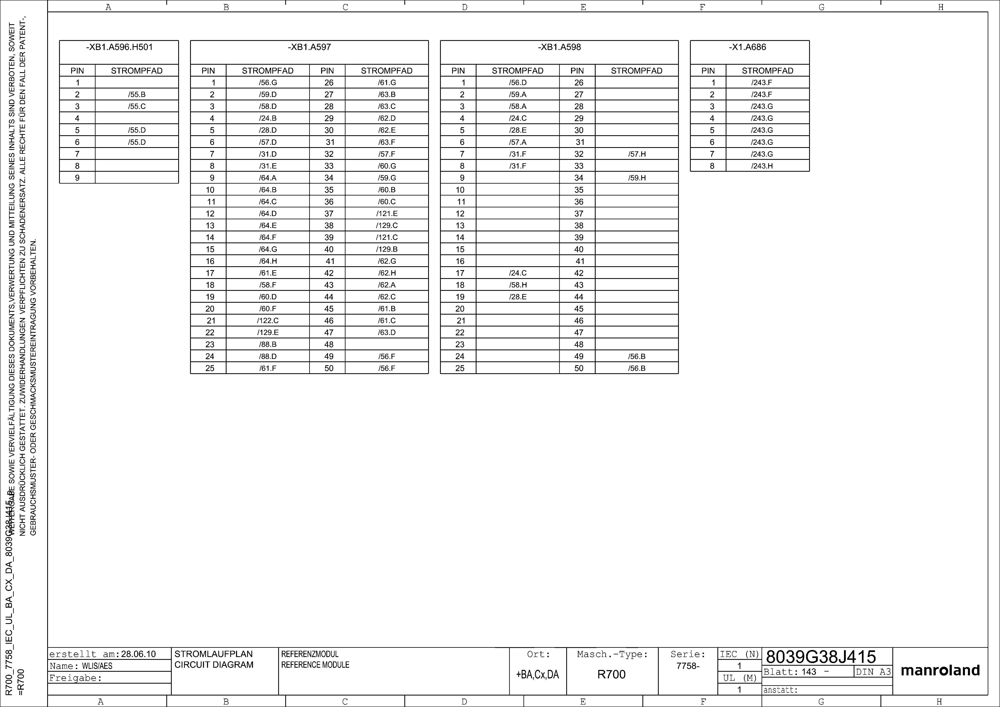

# +BA_Cx_DA — Sheet 143 of 247 — REFERENZMODUL

**REFERENCE MODULE**

> Part of the manroland **R700** printing press IEC/UL circuit diagrams.
> Drawing class: **Stromlaufplan / Circuit diagram** (DIN A3).
> Document `+BA_Cx_DA` covers the **Printing units / main switch cabinet** machine section.

## At a glance

| Field | Value |
|---|---|
| Document | `+BA_Cx_DA`  (8039G38J415) |
| Sheet | **143** of 247 |
| Section (DE) | REFERENZMODUL |
| Section (EN) | REFERENCE MODULE |
| Section type | REFERENCE_MODULE — Reference module |
| Machine type | `R700` |
| Series | `7758` |
| Created | 28.06.10 |
| Replaces | — |
| Columns used | A, B, C, D, E, F, G |
| Path numbers | — |
| Labels on sheet | 209 |
| Cross-refs out | 76 |
| Cross-refs in | 0 |

**Previous:** [+BA_Cx_DA sheet 142](SHEET_0142.md) · **Next:** [+BA_Cx_DA sheet 144](SHEET_0144.md) · **Document TOC:** [_TOC.md](_TOC.md)  (+BA_Cx_DA) · **Master TOC:** [all sheets](../_MASTER_TOC.md)

## Sheet image (300 DPI, exact vector render)



_Rendered directly from the PDF vector layer at 300 DPI (1-bit), no OCR and no resampling. Use it to confirm anything ambiguous in the text below._

## Cross-references on this sheet

Each entry is a wire leaving this sheet. The printed token is `/sheet.column`; the link resolves to that sheet inside the same document.

| Ref | Target sheet | Col | Path | Destination on target | Target section | From col |
|---|---|---|---|---|---|---|
| `/56.G` | [+BA_Cx_DA sheet 56](SHEET_0056.md) | G | — | — | MASCHINENBEDIENUNG: SPANNUNGSVERSORGUNG | B |
| `/61.G` | [+BA_Cx_DA sheet 61](SHEET_0061.md) | G | — | — | MASCHINENBEDIENUNG: BEDIENUNGKOMMANDOS | C |
| `/56.D` | [+BA_Cx_DA sheet 56](SHEET_0056.md) | D | — | — | MASCHINENBEDIENUNG: SPANNUNGSVERSORGUNG | D |
| `/243.F` | [+BA_Cx_DA sheet 243](SHEET_0243.md) | F | — | — | OPTION: LEITSTANDBEDIENUNG | G |
| `/55.B` | [+BA_Cx_DA sheet 55](SHEET_0055.md) | B | — | — | ANLAGEBEDIENUNG | A |
| `/63.B` | [+BA_Cx_DA sheet 63](SHEET_0063.md) | B | — | — | MASCHINENBEDIENUNG: BEDIENUNGKOMMANDOS | C |
| `/59.A` | [+BA_Cx_DA sheet 59](SHEET_0059.md) | A | — | — | MASCHINENBEDIENUNG: LAUFKOMMANDOS | D |
| `/243.F` | [+BA_Cx_DA sheet 243](SHEET_0243.md) | F | — | — | OPTION: LEITSTANDBEDIENUNG | G |
| `/59.D` | [+BA_Cx_DA sheet 59](SHEET_0059.md) | D | — | — | MASCHINENBEDIENUNG: LAUFKOMMANDOS | B |
| `/58.A` | [+BA_Cx_DA sheet 58](SHEET_0058.md) | A | — | — | MASCHINENBEDIENUNG: LAUFKOMMANDOS | D |
| `/55.C` | [+BA_Cx_DA sheet 55](SHEET_0055.md) | C | — | — | ANLAGEBEDIENUNG | A |
| `/58.D` | [+BA_Cx_DA sheet 58](SHEET_0058.md) | D | — | — | MASCHINENBEDIENUNG: LAUFKOMMANDOS | B |
| `/63.C` | [+BA_Cx_DA sheet 63](SHEET_0063.md) | C | — | — | MASCHINENBEDIENUNG: BEDIENUNGKOMMANDOS | C |
| `/243.G` | [+BA_Cx_DA sheet 243](SHEET_0243.md) | G | — | — | OPTION: LEITSTANDBEDIENUNG | G |
| `/24.B` | [+BA_Cx_DA sheet 24](SHEET_0024.md) | B | — | — | BUSVERBINDUNGEN: NOT AUS | B |
| `/62.D` | [+BA_Cx_DA sheet 62](SHEET_0062.md) | D | — | — | MASCHINENBEDIENUNG: BEDIENUNGKOMMANDOS | C |
| `/24.C` | [+BA_Cx_DA sheet 24](SHEET_0024.md) | C | — | — | BUSVERBINDUNGEN: NOT AUS | D |
| `/243.G` | [+BA_Cx_DA sheet 243](SHEET_0243.md) | G | — | — | OPTION: LEITSTANDBEDIENUNG | G |
| `/62.E` | [+BA_Cx_DA sheet 62](SHEET_0062.md) | E | — | — | MASCHINENBEDIENUNG: BEDIENUNGKOMMANDOS | C |
| `/28.E` | [+BA_Cx_DA sheet 28](SHEET_0028.md) | E | — | — | BUSVERBINDUNGEN: STOP SICHERN | D |
| `/243.G` | [+BA_Cx_DA sheet 243](SHEET_0243.md) | G | — | — | OPTION: LEITSTANDBEDIENUNG | G |
| `/55.D` | [+BA_Cx_DA sheet 55](SHEET_0055.md) | D | — | — | ANLAGEBEDIENUNG | A |
| `/28.D` | [+BA_Cx_DA sheet 28](SHEET_0028.md) | D | — | — | BUSVERBINDUNGEN: STOP SICHERN | B |
| `/57.A` | [+BA_Cx_DA sheet 57](SHEET_0057.md) | A | — | — | MASCHINENBEDIENUNG: LAUFKOMMANDOS | D |
| `/63.F` | [+BA_Cx_DA sheet 63](SHEET_0063.md) | F | — | — | MASCHINENBEDIENUNG: BEDIENUNGKOMMANDOS | C |
| `/55.D` | [+BA_Cx_DA sheet 55](SHEET_0055.md) | D | — | — | ANLAGEBEDIENUNG | A |
| `/57.D` | [+BA_Cx_DA sheet 57](SHEET_0057.md) | D | — | — | MASCHINENBEDIENUNG: LAUFKOMMANDOS | B |
| `/243.G` | [+BA_Cx_DA sheet 243](SHEET_0243.md) | G | — | — | OPTION: LEITSTANDBEDIENUNG | G |
| `/57.F` | [+BA_Cx_DA sheet 57](SHEET_0057.md) | F | — | — | MASCHINENBEDIENUNG: LAUFKOMMANDOS | C |
| `/31.F` | [+BA_Cx_DA sheet 31](SHEET_0031.md) | F | — | — | BUSVERBINDUNGEN: SIGNALSCHLEIFE | D |
| `/31.D` | [+BA_Cx_DA sheet 31](SHEET_0031.md) | D | — | — | BUSVERBINDUNGEN: SIGNALSCHLEIFE | B |
| `/57.H` | [+BA_Cx_DA sheet 57](SHEET_0057.md) | H | — | — | MASCHINENBEDIENUNG: LAUFKOMMANDOS | E |
| `/243.G` | [+BA_Cx_DA sheet 243](SHEET_0243.md) | G | — | — | OPTION: LEITSTANDBEDIENUNG | G |
| `/31.E` | [+BA_Cx_DA sheet 31](SHEET_0031.md) | E | — | — | BUSVERBINDUNGEN: SIGNALSCHLEIFE | B |
| `/60.G` | [+BA_Cx_DA sheet 60](SHEET_0060.md) | G | — | — | MASCHINENBEDIENUNG: BEDIENUNGKOMMANDOS | C |
| `/31.F` | [+BA_Cx_DA sheet 31](SHEET_0031.md) | F | — | — | BUSVERBINDUNGEN: SIGNALSCHLEIFE | D |
| `/243.H` | [+BA_Cx_DA sheet 243](SHEET_0243.md) | H | — | — | OPTION: LEITSTANDBEDIENUNG | G |
| `/64.A` | [+BA_Cx_DA sheet 64](SHEET_0064.md) | A | — | — | MASCHINENBEDIENUNG: BEDIENUNGKOMMANDOS | B |
| `/59.G` | [+BA_Cx_DA sheet 59](SHEET_0059.md) | G | — | — | MASCHINENBEDIENUNG: LAUFKOMMANDOS | C |
| `/59.H` | [+BA_Cx_DA sheet 59](SHEET_0059.md) | H | — | — | MASCHINENBEDIENUNG: LAUFKOMMANDOS | E |
| `/64.B` | [+BA_Cx_DA sheet 64](SHEET_0064.md) | B | — | — | MASCHINENBEDIENUNG: BEDIENUNGKOMMANDOS | B |
| `/60.B` | [+BA_Cx_DA sheet 60](SHEET_0060.md) | B | — | — | MASCHINENBEDIENUNG: BEDIENUNGKOMMANDOS | C |
| `/64.C` | [+BA_Cx_DA sheet 64](SHEET_0064.md) | C | — | — | MASCHINENBEDIENUNG: BEDIENUNGKOMMANDOS | B |
| `/60.C` | [+BA_Cx_DA sheet 60](SHEET_0060.md) | C | — | — | MASCHINENBEDIENUNG: BEDIENUNGKOMMANDOS | C |
| `/121.E` | [+BA_Cx_DA sheet 121](SHEET_0121.md) | E | — | — | RESERVE: SPS STATION (INPUT) | C |
| `/64.D` | [+BA_Cx_DA sheet 64](SHEET_0064.md) | D | — | — | MASCHINENBEDIENUNG: BEDIENUNGKOMMANDOS | B |
| `/64.E` | [+BA_Cx_DA sheet 64](SHEET_0064.md) | E | — | — | MASCHINENBEDIENUNG: BEDIENUNGKOMMANDOS | B |
| `/129.C` | [+BA_Cx_DA sheet 129](SHEET_0129.md) | C | — | — | RESERVE: SPS STATION (OUTPUT) | C |
| `/64.F` | [+BA_Cx_DA sheet 64](SHEET_0064.md) | F | — | — | MASCHINENBEDIENUNG: BEDIENUNGKOMMANDOS | B |
| `/121.C` | [+BA_Cx_DA sheet 121](SHEET_0121.md) | C | — | — | RESERVE: SPS STATION (INPUT) | C |
| `/129.B` | [+BA_Cx_DA sheet 129](SHEET_0129.md) | B | — | — | RESERVE: SPS STATION (OUTPUT) | C |
| `/64.G` | [+BA_Cx_DA sheet 64](SHEET_0064.md) | G | — | — | MASCHINENBEDIENUNG: BEDIENUNGKOMMANDOS | B |
| `/62.G` | [+BA_Cx_DA sheet 62](SHEET_0062.md) | G | — | — | MASCHINENBEDIENUNG: BEDIENUNGKOMMANDOS | C |
| `/64.H` | [+BA_Cx_DA sheet 64](SHEET_0064.md) | H | — | — | MASCHINENBEDIENUNG: BEDIENUNGKOMMANDOS | B |
| `/61.E` | [+BA_Cx_DA sheet 61](SHEET_0061.md) | E | — | — | MASCHINENBEDIENUNG: BEDIENUNGKOMMANDOS | B |
| `/62.H` | [+BA_Cx_DA sheet 62](SHEET_0062.md) | H | — | — | MASCHINENBEDIENUNG: BEDIENUNGKOMMANDOS | C |
| `/24.C` | [+BA_Cx_DA sheet 24](SHEET_0024.md) | C | — | — | BUSVERBINDUNGEN: NOT AUS | D |
| `/62.A` | [+BA_Cx_DA sheet 62](SHEET_0062.md) | A | — | — | MASCHINENBEDIENUNG: BEDIENUNGKOMMANDOS | C |
| `/58.F` | [+BA_Cx_DA sheet 58](SHEET_0058.md) | F | — | — | MASCHINENBEDIENUNG: LAUFKOMMANDOS | B |
| `/58.H` | [+BA_Cx_DA sheet 58](SHEET_0058.md) | H | — | — | MASCHINENBEDIENUNG: LAUFKOMMANDOS | D |
| `/28.E` | [+BA_Cx_DA sheet 28](SHEET_0028.md) | E | — | — | BUSVERBINDUNGEN: STOP SICHERN | D |
| `/60.D` | [+BA_Cx_DA sheet 60](SHEET_0060.md) | D | — | — | MASCHINENBEDIENUNG: BEDIENUNGKOMMANDOS | B |
| `/62.C` | [+BA_Cx_DA sheet 62](SHEET_0062.md) | C | — | — | MASCHINENBEDIENUNG: BEDIENUNGKOMMANDOS | C |
| `/61.B` | [+BA_Cx_DA sheet 61](SHEET_0061.md) | B | — | — | MASCHINENBEDIENUNG: BEDIENUNGKOMMANDOS | C |
| `/60.F` | [+BA_Cx_DA sheet 60](SHEET_0060.md) | F | — | — | MASCHINENBEDIENUNG: BEDIENUNGKOMMANDOS | B |
| `/61.C` | [+BA_Cx_DA sheet 61](SHEET_0061.md) | C | — | — | MASCHINENBEDIENUNG: BEDIENUNGKOMMANDOS | C |
| `/122.C` | [+BA_Cx_DA sheet 122](SHEET_0122.md) | C | — | — | RESERVE: SPS STATION (INPUT) | B |
| `/129.E` | [+BA_Cx_DA sheet 129](SHEET_0129.md) | E | — | — | RESERVE: SPS STATION (OUTPUT) | B |
| `/63.D` | [+BA_Cx_DA sheet 63](SHEET_0063.md) | D | — | — | MASCHINENBEDIENUNG: BEDIENUNGKOMMANDOS | C |
| `/88.B` | [+BA_Cx_DA sheet 88](SHEET_0088.md) | B | — | — | WASCHVORRICHTUNG | B |
| `/56.B` | [+BA_Cx_DA sheet 56](SHEET_0056.md) | B | — | — | MASCHINENBEDIENUNG: SPANNUNGSVERSORGUNG | E |
| `/56.F` | [+BA_Cx_DA sheet 56](SHEET_0056.md) | F | — | — | MASCHINENBEDIENUNG: SPANNUNGSVERSORGUNG | C |
| `/88.D` | [+BA_Cx_DA sheet 88](SHEET_0088.md) | D | — | — | WASCHVORRICHTUNG | B |
| `/56.B` | [+BA_Cx_DA sheet 56](SHEET_0056.md) | B | — | — | MASCHINENBEDIENUNG: SPANNUNGSVERSORGUNG | E |
| `/61.F` | [+BA_Cx_DA sheet 61](SHEET_0061.md) | F | — | — | MASCHINENBEDIENUNG: BEDIENUNGKOMMANDOS | B |
| `/56.F` | [+BA_Cx_DA sheet 56](SHEET_0056.md) | F | — | — | MASCHINENBEDIENUNG: SPANNUNGSVERSORGUNG | C |

## Devices on this sheet

| Tag | Class | Class meaning (IEC) | Col | Sub | Terminal | Sign |
|---|---|---|---|---|---|---|
| `XB1.A596.H501` | — | cross-device reference | A | — | — | — |
| `XB1.A597` | — | cross-device reference | C | — | — | — |
| `XB1.A598` | — | cross-device reference | E | — | — | — |
| `X1.A686` | — | cross-device reference | F | — | — | — |

## Potentials / nets

_No named potentials on this sheet._

## Wire-end annotations (grouped as printed)

A wire that continues elsewhere is annotated with a small cluster: the destination description, the path/line number `#NN`, and the `/sheet.column` cross reference. Each row below is one such cluster exactly as it is grouped on the drawing.

| Col | Y | Path | Cross-ref | Text on the wire |
|---|---|---|---|---|
| A | 51.3 | — | — | `XB1.A596.H501` |
| C | 51.3 | — | — | `XB1.A597` |
| E | 51.3 | — | — | `XB1.A598` |
| F | 51.3 | — | — | `X1.A686` |
| A | 80.0 | — | — | `PIN 2 3 4 5 6 7 8 9 1 STROMPFAD` |
| B | 80.0 | — | — | `PIN STROMPFAD` |
| C | 80.0 | — | — | `PIN STROMPFAD` |
| D | 80.0 | — | — | `PIN STROMPFAD` |
| E | 80.0 | — | — | `PIN STROMPFAD` |
| F | 80.0 | — | — | `PIN 2 3 4 5 6 7 8 1 STROMPFAD` |
| B | 94.2 | — | — | `2 3 4 5 6 7 8 9 1` |
| C | 94.2 | — | — | `26 27 28 29 30 32 33 34 35 36 37 38 39 40 42 43 44 45 46 47 48 49 50 31 41` |
| D | 94.2 | — | — | `2 3 4 5 6 7 8 9 1` |
| E | 94.2 | — | — | `26 27 28 29 30 32 33 34 35 36 37 38 39 40 42 43 44 45 46 47 48 49 50 31 41` |
| B | 94.5 | — | `/56.G` | — |
| C | 94.5 | — | `/61.G` | — |
| D | 94.5 | — | `/56.D` | — |
| G | 94.5 | — | `/243.F` | — |
| A | 108.7 | — | `/55.B` | — |
| B | 108.7 | — | `/59.D` | — |
| C | 108.7 | — | `/63.B` | — |
| D | 108.7 | — | `/59.A` | — |
| G | 108.7 | — | `/243.F` | — |
| D | 122.8 | — | `/58.A` | — |
| A | 122.9 | — | `/55.C` | — |
| B | 122.9 | — | `/58.D` | — |
| C | 122.9 | — | `/63.C` | — |
| G | 122.9 | — | `/243.G` | — |
| B | 137.0 | — | `/24.B` | — |
| C | 137.1 | — | `/62.D` | — |
| D | 137.1 | — | `/24.C` | — |
| G | 137.1 | — | `/243.G` | — |
| A | 151.2 | — | `/55.D` | — |
| B | 151.2 | — | `/28.D` | — |
| C | 151.2 | — | `/62.E` | — |
| D | 151.2 | — | `/28.E` | — |
| G | 151.2 | — | `/243.G` | — |
| A | 165.4 | — | `/55.D` | — |
| B | 165.4 | — | `/57.D` | — |
| C | 165.4 | — | `/63.F` | — |
| D | 165.4 | — | `/57.A` | — |
| G | 165.4 | — | `/243.G` | — |
| B | 179.6 | — | `/31.D` | — |
| C | 179.6 | — | `/57.F` | — |
| D | 179.6 | — | `/31.F` | — |
| E | 179.6 | — | `/57.H` | — |
| G | 179.6 | — | `/243.G` | — |
| B | 193.7 | — | `/31.E` | — |
| C | 193.7 | — | `/60.G` | — |
| D | 193.7 | — | `/31.F` | — |
| G | 193.8 | — | `/243.H` | — |
| B | 207.9 | — | `/64.A` | — |
| C | 207.9 | — | `/59.G` | — |
| E | 207.9 | — | `/59.H` | — |
| B | 221.8 | — | — | `10 12 13 14 15 16 17 18 19 20 11` |
| D | 221.8 | — | — | `10 12 13 14 15 16 17 18 19 20 11` |
| B | 222.1 | — | `/64.B` | — |
| C | 222.1 | — | `/60.B` | — |
| B | 236.3 | — | `/64.C` | — |
| C | 236.3 | — | `/60.C` | — |
| B | 250.4 | — | `/64.D` | — |
| C | 250.4 | — | `/121.E` | — |
| B | 264.6 | — | `/64.E` | — |
| C | 264.6 | — | `/129.C` | — |
| B | 278.8 | — | `/64.F` | — |
| C | 278.8 | — | `/121.C` | — |
| B | 292.9 | — | `/64.G` | — |
| C | 292.9 | — | `/129.B` | — |
| B | 307.1 | — | `/64.H` | — |
| C | 307.1 | — | `/62.G` | — |
| B | 321.3 | — | `/61.E` | — |
| C | 321.3 | — | `/62.H` | — |
| D | 321.3 | — | `/24.C` | — |
| C | 335.4 | — | `/62.A` | — |
| B | 335.5 | — | `/58.F` | — |
| D | 335.5 | — | `/58.H` | — |
| B | 349.6 | — | `/60.D` | — |
| C | 349.6 | — | `/62.C` | — |
| D | 349.6 | — | `/28.E` | — |
| B | 363.8 | — | `/60.F` | — |
| C | 363.8 | — | `/61.B` | — |
| B | 377.7 | — | — | `22 23 24 25 21` |
| D | 377.7 | — | — | `22 23 24 25 21` |
| B | 378.0 | — | `/122.C` | — |
| C | 378.0 | — | `/61.C` | — |
| B | 392.1 | — | `/129.E` | — |
| C | 392.2 | — | `/63.D` | — |
| B | 406.3 | — | `/88.B` | — |
| B | 420.5 | — | `/88.D` | — |
| C | 420.5 | — | `/56.F` | — |
| E | 420.5 | — | `/56.B` | — |
| B | 434.7 | — | `/61.F` | — |
| C | 434.7 | — | `/56.F` | — |
| E | 434.7 | — | `/56.B` | — |


## Reconstructed tables

This sheet carries tabular content (pin map / terminal assignment / index). The grid below was rebuilt from the drawing's own rule lines, so each row is exactly one physical row of the table.

### Table 1 — 9 data rows × 2 columns (at x=70.9, y=48.2) — **XB1.A596.H501**

| PIN | STROMPFAD |
|---|---|
| `1` |  |
| `2` | `/55.B` |
| `3` | `/55.C` |
| `4` |  |
| `5` | `/55.D` |
| `6` | `/55.D` |
| `7` |  |
| `8` |  |
| `9` |  |


### Table 2 — 25 data rows × 4 columns (at x=226.8, y=48.2) — **XB1.A597**

| PIN | STROMPFAD | PIN | STROMPFAD |
|---|---|---|---|
| `1` | `/56.G` | `26` | `/61.G` |
| `2` | `/59.D` | `27` | `/63.B` |
| `3` | `/58.D` | `28` | `/63.C` |
| `4` | `/24.B` | `29` | `/62.D` |
| `5` | `/28.D` | `30` | `/62.E` |
| `6` | `/57.D` | `31` | `/63.F` |
| `7` | `/31.D` | `32` | `/57.F` |
| `8` | `/31.E` | `33` | `/60.G` |
| `9` | `/64.A` | `34` | `/59.G` |
| `10` | `/64.B` | `35` | `/60.B` |
| `11` | `/64.C` | `36` | `/60.C` |
| `12` | `/64.D` | `37` | `/121.E` |
| `13` | `/64.E` | `38` | `/129.C` |
| `14` | `/64.F` | `39` | `/121.C` |
| `15` | `/64.G` | `40` | `/129.B` |
| `16` | `/64.H` | `41` | `/62.G` |
| `17` | `/61.E` | `42` | `/62.H` |
| `18` | `/58.F` | `43` | `/62.A` |
| `19` | `/60.D` | `44` | `/62.C` |
| `20` | `/60.F` | `45` | `/61.B` |
| `21` | `/122.C` | `46` | `/61.C` |
| `22` | `/129.E` | `47` | `/63.D` |
| `23` | `/88.B` | `48` |  |
| `24` | `/88.D` | `49` | `/56.F` |
| `25` | `/61.F` | `50` | `/56.F` |


### Table 3 — 25 data rows × 4 columns (at x=524.4, y=48.2) — **XB1.A598**

| PIN | STROMPFAD | PIN | STROMPFAD |
|---|---|---|---|
| `1` | `/56.D` | `26` |  |
| `2` | `/59.A` | `27` |  |
| `3` | `/58.A` | `28` |  |
| `4` | `/24.C` | `29` |  |
| `5` | `/28.E` | `30` |  |
| `6` | `/57.A` | `31` |  |
| `7` | `/31.F` | `32` | `/57.H` |
| `8` | `/31.F` | `33` |  |
| `9` |  | `34` | `/59.H` |
| `10` |  | `35` |  |
| `11` |  | `36` |  |
| `12` |  | `37` |  |
| `13` |  | `38` |  |
| `14` |  | `39` |  |
| `15` |  | `40` |  |
| `16` |  | `41` |  |
| `17` | `/24.C` | `42` |  |
| `18` | `/58.H` | `43` |  |
| `19` | `/28.E` | `44` |  |
| `20` |  | `45` |  |
| `21` |  | `46` |  |
| `22` |  | `47` |  |
| `23` |  | `48` |  |
| `24` |  | `49` | `/56.B` |
| `25` |  | `50` | `/56.B` |


### Table 4 — 8 data rows × 2 columns (at x=822.0, y=48.2) — **X1.A686**

| PIN | STROMPFAD |
|---|---|
| `1` | `/243.F` |
| `2` | `/243.F` |
| `3` | `/243.G` |
| `4` | `/243.G` |
| `5` | `/243.G` |
| `6` | `/243.G` |
| `7` | `/243.G` |
| `8` | `/243.H` |


## Notes and free text on this sheet

| Text | Col | Y (pt) |
|---|---|---|
| `PIN` | A | 80.02 |
| `STROMPFAD` | A | 79.98 |
| `PIN` | B | 80.02 |
| `STROMPFAD` | B | 79.98 |
| `PIN` | C | 80.02 |
| `STROMPFAD` | C | 79.98 |
| `PIN` | D | 80.02 |
| `STROMPFAD` | D | 79.98 |
| `PIN` | E | 80.02 |
| `STROMPFAD` | E | 79.98 |
| `PIN` | F | 80.02 |
| `STROMPFAD` | G | 79.98 |

## Complete label inventory (exact text from the drawing)

Every text object inside the drawing area of this sheet, in DIN reading order (column A→H, then top→bottom). This is the authoritative list: if a string is not here it is not printed on this sheet.

| Col | Y | X | Dir | Type | Text |
|---|---|---|---|---|---|
| A | 51.3 | 102.8 | → | device ref | `XB1.A596.H501` |
| A | 80.0 | 84.0 | → | text | `PIN` |
| A | 80.0 | 132.2 | → | text | `STROMPFAD` |
| A | 94.2 | 90.0 | → | number | `1` |
| A | 108.4 | 89.4 | → | number | `2` |
| A | 108.7 | 152.8 | → | cross-reference | `/55.B` |
| A | 122.5 | 89.4 | → | number | `3` |
| A | 122.9 | 152.6 | → | cross-reference | `/55.C` |
| A | 136.7 | 89.4 | → | number | `4` |
| A | 150.9 | 89.4 | → | number | `5` |
| A | 151.2 | 152.6 | → | cross-reference | `/55.D` |
| A | 165.1 | 89.4 | → | number | `6` |
| A | 165.4 | 152.6 | → | cross-reference | `/55.D` |
| A | 179.2 | 89.4 | → | number | `7` |
| A | 193.4 | 89.4 | → | number | `8` |
| A | 207.6 | 89.4 | → | number | `9` |
| B | 80.0 | 240.0 | → | text | `PIN` |
| B | 80.0 | 288.1 | → | text | `STROMPFAD` |
| B | 94.2 | 251.7 | → | number | `1` |
| B | 94.5 | 308.4 | → | cross-reference | `/56.G` |
| B | 108.4 | 250.0 | → | number | `2` |
| B | 108.7 | 308.6 | → | cross-reference | `/59.D` |
| B | 122.5 | 250.0 | → | number | `3` |
| B | 122.9 | 308.6 | → | cross-reference | `/58.D` |
| B | 136.7 | 250.0 | → | number | `4` |
| B | 137.0 | 308.7 | → | cross-reference | `/24.B` |
| B | 150.9 | 250.0 | → | number | `5` |
| B | 151.2 | 308.6 | → | cross-reference | `/28.D` |
| B | 165.1 | 250.0 | → | number | `6` |
| B | 165.4 | 308.6 | → | cross-reference | `/57.D` |
| B | 179.2 | 250.0 | → | number | `7` |
| B | 179.6 | 308.6 | → | cross-reference | `/31.D` |
| B | 193.4 | 250.0 | → | number | `8` |
| B | 193.7 | 308.8 | → | cross-reference | `/31.E` |
| B | 207.6 | 250.0 | → | number | `9` |
| B | 207.9 | 308.6 | → | cross-reference | `/64.A` |
| B | 221.8 | 244.6 | → | number | `10` |
| B | 222.1 | 308.7 | → | cross-reference | `/64.B` |
| B | 235.9 | 246.3 | → | number | `11` |
| B | 236.3 | 308.6 | → | cross-reference | `/64.C` |
| B | 250.1 | 244.6 | → | number | `12` |
| B | 250.4 | 308.6 | → | cross-reference | `/64.D` |
| B | 264.3 | 244.6 | → | number | `13` |
| B | 264.6 | 308.8 | → | cross-reference | `/64.E` |
| B | 278.5 | 244.6 | → | number | `14` |
| B | 278.8 | 309.0 | → | cross-reference | `/64.F` |
| B | 292.6 | 244.6 | → | number | `15` |
| B | 292.9 | 308.4 | → | cross-reference | `/64.G` |
| B | 306.8 | 244.6 | → | number | `16` |
| B | 307.1 | 308.8 | → | cross-reference | `/64.H` |
| B | 321.0 | 244.6 | → | number | `17` |
| B | 321.3 | 308.8 | → | cross-reference | `/61.E` |
| B | 335.1 | 244.6 | → | number | `18` |
| B | 335.5 | 309.0 | → | cross-reference | `/58.F` |
| B | 349.3 | 244.6 | → | number | `19` |
| B | 349.7 | 308.6 | → | cross-reference | `/60.D` |
| B | 363.5 | 244.6 | → | number | `20` |
| B | 363.8 | 309.0 | → | cross-reference | `/60.F` |
| B | 377.7 | 246.3 | → | number | `21` |
| B | 378.0 | 306.1 | → | cross-reference | `/122.C` |
| B | 391.8 | 244.6 | → | number | `22` |
| B | 392.2 | 306.4 | → | cross-reference | `/129.E` |
| B | 406.0 | 244.6 | → | number | `23` |
| B | 406.3 | 308.7 | → | cross-reference | `/88.B` |
| B | 420.2 | 244.6 | → | number | `24` |
| B | 420.5 | 308.6 | → | cross-reference | `/88.D` |
| B | 434.4 | 244.6 | → | number | `25` |
| B | 434.7 | 309.0 | → | cross-reference | `/61.F` |
| C | 51.3 | 343.0 | → | device ref | `XB1.A597` |
| C | 80.0 | 381.7 | → | text | `PIN` |
| C | 80.0 | 429.9 | → | text | `STROMPFAD` |
| C | 94.2 | 386.4 | → | number | `26` |
| C | 94.5 | 450.1 | → | cross-reference | `/61.G` |
| C | 108.4 | 386.4 | → | number | `27` |
| C | 108.7 | 450.4 | → | cross-reference | `/63.B` |
| C | 122.5 | 386.4 | → | number | `28` |
| C | 122.9 | 450.3 | → | cross-reference | `/63.C` |
| C | 136.7 | 386.4 | → | number | `29` |
| C | 137.1 | 450.3 | → | cross-reference | `/62.D` |
| C | 150.9 | 386.4 | → | number | `30` |
| C | 151.2 | 450.6 | → | cross-reference | `/62.E` |
| C | 165.1 | 388.1 | → | number | `31` |
| C | 165.4 | 450.7 | → | cross-reference | `/63.F` |
| C | 179.2 | 386.4 | → | number | `32` |
| C | 179.6 | 450.7 | → | cross-reference | `/57.F` |
| C | 193.4 | 386.4 | → | number | `33` |
| C | 193.7 | 450.1 | → | cross-reference | `/60.G` |
| C | 207.6 | 386.4 | → | number | `34` |
| C | 207.9 | 450.1 | → | cross-reference | `/59.G` |
| C | 221.8 | 386.4 | → | number | `35` |
| C | 222.1 | 450.4 | → | cross-reference | `/60.B` |
| C | 235.9 | 386.4 | → | number | `36` |
| C | 236.3 | 450.3 | → | cross-reference | `/60.C` |
| C | 250.1 | 386.4 | → | number | `37` |
| C | 250.4 | 448.2 | → | cross-reference | `/121.E` |
| C | 264.3 | 386.4 | → | number | `38` |
| C | 264.6 | 447.9 | → | cross-reference | `/129.C` |
| C | 278.5 | 386.4 | → | number | `39` |
| C | 278.8 | 447.9 | → | cross-reference | `/121.C` |
| C | 292.6 | 386.4 | → | number | `40` |
| C | 292.9 | 448.0 | → | cross-reference | `/129.B` |
| C | 306.8 | 388.1 | → | number | `41` |
| C | 307.1 | 450.1 | → | cross-reference | `/62.G` |
| C | 321.0 | 386.4 | → | number | `42` |
| C | 321.3 | 450.6 | → | cross-reference | `/62.H` |
| C | 335.1 | 386.4 | → | number | `43` |
| C | 335.4 | 450.3 | → | cross-reference | `/62.A` |
| C | 349.3 | 386.4 | → | number | `44` |
| C | 349.7 | 450.3 | → | cross-reference | `/62.C` |
| C | 363.5 | 386.4 | → | number | `45` |
| C | 363.8 | 450.4 | → | cross-reference | `/61.B` |
| C | 377.7 | 386.4 | → | number | `46` |
| C | 378.0 | 450.3 | → | cross-reference | `/61.C` |
| C | 391.8 | 386.4 | → | number | `47` |
| C | 392.2 | 450.3 | → | cross-reference | `/63.D` |
| C | 406.0 | 386.4 | → | number | `48` |
| C | 420.2 | 386.4 | → | number | `49` |
| C | 420.5 | 450.7 | → | cross-reference | `/56.F` |
| C | 434.4 | 386.4 | → | number | `50` |
| C | 434.7 | 450.7 | → | cross-reference | `/56.F` |
| D | 80.0 | 537.6 | → | text | `PIN` |
| D | 80.0 | 585.8 | → | text | `STROMPFAD` |
| D | 94.2 | 549.4 | → | number | `1` |
| D | 94.5 | 606.2 | → | cross-reference | `/56.D` |
| D | 108.4 | 547.7 | → | number | `2` |
| D | 108.7 | 606.2 | → | cross-reference | `/59.A` |
| D | 122.5 | 547.7 | → | number | `3` |
| D | 122.8 | 606.2 | → | cross-reference | `/58.A` |
| D | 136.7 | 547.7 | → | number | `4` |
| D | 137.1 | 606.2 | → | cross-reference | `/24.C` |
| D | 150.9 | 547.7 | → | number | `5` |
| D | 151.2 | 606.5 | → | cross-reference | `/28.E` |
| D | 165.1 | 547.7 | → | number | `6` |
| D | 165.4 | 606.2 | → | cross-reference | `/57.A` |
| D | 179.2 | 547.7 | → | number | `7` |
| D | 179.6 | 606.6 | → | cross-reference | `/31.F` |
| D | 193.4 | 547.7 | → | number | `8` |
| D | 193.7 | 606.6 | → | cross-reference | `/31.F` |
| D | 207.6 | 547.7 | → | number | `9` |
| D | 221.8 | 542.3 | → | number | `10` |
| D | 235.9 | 544.0 | → | number | `11` |
| D | 250.1 | 542.3 | → | number | `12` |
| D | 264.3 | 542.3 | → | number | `13` |
| D | 278.5 | 542.3 | → | number | `14` |
| D | 292.6 | 542.3 | → | number | `15` |
| D | 306.8 | 542.3 | → | number | `16` |
| D | 321.0 | 542.3 | → | number | `17` |
| D | 321.3 | 606.2 | → | cross-reference | `/24.C` |
| D | 335.1 | 542.3 | → | number | `18` |
| D | 335.5 | 606.5 | → | cross-reference | `/58.H` |
| D | 349.3 | 542.3 | → | number | `19` |
| D | 349.6 | 606.5 | → | cross-reference | `/28.E` |
| D | 363.5 | 542.3 | → | number | `20` |
| D | 377.7 | 544.0 | → | number | `21` |
| D | 391.8 | 542.3 | → | number | `22` |
| D | 406.0 | 542.3 | → | number | `23` |
| D | 420.2 | 542.3 | → | number | `24` |
| D | 434.4 | 542.3 | → | number | `25` |
| E | 51.3 | 640.6 | → | device ref | `XB1.A598` |
| E | 80.0 | 679.3 | → | text | `PIN` |
| E | 80.0 | 727.5 | → | text | `STROMPFAD` |
| E | 94.2 | 684.0 | → | number | `26` |
| E | 108.4 | 684.0 | → | number | `27` |
| E | 122.5 | 684.0 | → | number | `28` |
| E | 136.7 | 684.0 | → | number | `29` |
| E | 150.9 | 684.0 | → | number | `30` |
| E | 165.1 | 685.7 | → | number | `31` |
| E | 179.2 | 684.0 | → | number | `32` |
| E | 179.6 | 748.2 | → | cross-reference | `/57.H` |
| E | 193.4 | 684.0 | → | number | `33` |
| E | 207.6 | 684.0 | → | number | `34` |
| E | 207.9 | 748.2 | → | cross-reference | `/59.H` |
| E | 221.8 | 684.0 | → | number | `35` |
| E | 235.9 | 684.0 | → | number | `36` |
| E | 250.1 | 684.0 | → | number | `37` |
| E | 264.3 | 684.0 | → | number | `38` |
| E | 278.5 | 684.0 | → | number | `39` |
| E | 292.6 | 684.0 | → | number | `40` |
| E | 306.8 | 685.7 | → | number | `41` |
| E | 321.0 | 684.0 | → | number | `42` |
| E | 335.1 | 684.0 | → | number | `43` |
| E | 349.3 | 684.0 | → | number | `44` |
| E | 363.5 | 684.0 | → | number | `45` |
| E | 377.7 | 684.0 | → | number | `46` |
| E | 391.8 | 684.0 | → | number | `47` |
| E | 406.0 | 684.0 | → | number | `48` |
| E | 420.2 | 684.0 | → | number | `49` |
| E | 420.5 | 748.1 | → | cross-reference | `/56.B` |
| E | 434.4 | 684.0 | → | number | `50` |
| E | 434.7 | 748.1 | → | cross-reference | `/56.B` |
| F | 51.3 | 868.1 | → | device ref | `X1.A686` |
| F | 80.0 | 835.2 | → | text | `PIN` |
| F | 94.2 | 847.0 | → | number | `1` |
| F | 108.4 | 845.3 | → | number | `2` |
| F | 122.5 | 845.3 | → | number | `3` |
| F | 136.7 | 845.3 | → | number | `4` |
| F | 150.9 | 845.3 | → | number | `5` |
| F | 165.1 | 845.3 | → | number | `6` |
| F | 179.2 | 845.3 | → | number | `7` |
| F | 193.4 | 845.3 | → | number | `8` |
| G | 80.0 | 883.4 | → | text | `STROMPFAD` |
| G | 94.5 | 894.8 | → | cross-reference | `/243.F` |
| G | 108.7 | 894.8 | → | cross-reference | `/243.F` |
| G | 122.9 | 894.2 | → | cross-reference | `/243.G` |
| G | 137.1 | 894.2 | → | cross-reference | `/243.G` |
| G | 151.2 | 894.2 | → | cross-reference | `/243.G` |
| G | 165.4 | 894.2 | → | cross-reference | `/243.G` |
| G | 179.6 | 894.2 | → | cross-reference | `/243.G` |
| G | 193.8 | 894.6 | → | cross-reference | `/243.H` |

## Reading-order text block

The same content as a plain block, grouped by DIN column — convenient to paste or to match against a visual description.

```text
=== Column A ===
  51.3  102.8  devref       XB1.A596.H501
  80.0   84.0  text         PIN
  80.0  132.2  text         STROMPFAD
  94.2   90.0  numeric      1
 108.4   89.4  numeric      2
 108.7  152.8  xref         /55.B
 122.5   89.4  numeric      3
 122.9  152.6  xref         /55.C
 136.7   89.4  numeric      4
 150.9   89.4  numeric      5
 151.2  152.6  xref         /55.D
 165.1   89.4  numeric      6
 165.4  152.6  xref         /55.D
 179.2   89.4  numeric      7
 193.4   89.4  numeric      8
 207.6   89.4  numeric      9
=== Column B ===
  80.0  240.0  text         PIN
  80.0  288.1  text         STROMPFAD
  94.2  251.7  numeric      1
  94.5  308.4  xref         /56.G
 108.4  250.0  numeric      2
 108.7  308.6  xref         /59.D
 122.5  250.0  numeric      3
 122.9  308.6  xref         /58.D
 136.7  250.0  numeric      4
 137.0  308.7  xref         /24.B
 150.9  250.0  numeric      5
 151.2  308.6  xref         /28.D
 165.1  250.0  numeric      6
 165.4  308.6  xref         /57.D
 179.2  250.0  numeric      7
 179.6  308.6  xref         /31.D
 193.4  250.0  numeric      8
 193.7  308.8  xref         /31.E
 207.6  250.0  numeric      9
 207.9  308.6  xref         /64.A
 221.8  244.6  numeric      10
 222.1  308.7  xref         /64.B
 235.9  246.3  numeric      11
 236.3  308.6  xref         /64.C
 250.1  244.6  numeric      12
 250.4  308.6  xref         /64.D
 264.3  244.6  numeric      13
 264.6  308.8  xref         /64.E
 278.5  244.6  numeric      14
 278.8  309.0  xref         /64.F
 292.6  244.6  numeric      15
 292.9  308.4  xref         /64.G
 306.8  244.6  numeric      16
 307.1  308.8  xref         /64.H
 321.0  244.6  numeric      17
 321.3  308.8  xref         /61.E
 335.1  244.6  numeric      18
 335.5  309.0  xref         /58.F
 349.3  244.6  numeric      19
 349.7  308.6  xref         /60.D
 363.5  244.6  numeric      20
 363.8  309.0  xref         /60.F
 377.7  246.3  numeric      21
 378.0  306.1  xref         /122.C
 391.8  244.6  numeric      22
 392.2  306.4  xref         /129.E
 406.0  244.6  numeric      23
 406.3  308.7  xref         /88.B
 420.2  244.6  numeric      24
 420.5  308.6  xref         /88.D
 434.4  244.6  numeric      25
 434.7  309.0  xref         /61.F
=== Column C ===
  51.3  343.0  devref       XB1.A597
  80.0  381.7  text         PIN
  80.0  429.9  text         STROMPFAD
  94.2  386.4  numeric      26
  94.5  450.1  xref         /61.G
 108.4  386.4  numeric      27
 108.7  450.4  xref         /63.B
 122.5  386.4  numeric      28
 122.9  450.3  xref         /63.C
 136.7  386.4  numeric      29
 137.1  450.3  xref         /62.D
 150.9  386.4  numeric      30
 151.2  450.6  xref         /62.E
 165.1  388.1  numeric      31
 165.4  450.7  xref         /63.F
 179.2  386.4  numeric      32
 179.6  450.7  xref         /57.F
 193.4  386.4  numeric      33
 193.7  450.1  xref         /60.G
 207.6  386.4  numeric      34
 207.9  450.1  xref         /59.G
 221.8  386.4  numeric      35
 222.1  450.4  xref         /60.B
 235.9  386.4  numeric      36
 236.3  450.3  xref         /60.C
 250.1  386.4  numeric      37
 250.4  448.2  xref         /121.E
 264.3  386.4  numeric      38
 264.6  447.9  xref         /129.C
 278.5  386.4  numeric      39
 278.8  447.9  xref         /121.C
 292.6  386.4  numeric      40
 292.9  448.0  xref         /129.B
 306.8  388.1  numeric      41
 307.1  450.1  xref         /62.G
 321.0  386.4  numeric      42
 321.3  450.6  xref         /62.H
 335.1  386.4  numeric      43
 335.4  450.3  xref         /62.A
 349.3  386.4  numeric      44
 349.7  450.3  xref         /62.C
 363.5  386.4  numeric      45
 363.8  450.4  xref         /61.B
 377.7  386.4  numeric      46
 378.0  450.3  xref         /61.C
 391.8  386.4  numeric      47
 392.2  450.3  xref         /63.D
 406.0  386.4  numeric      48
 420.2  386.4  numeric      49
 420.5  450.7  xref         /56.F
 434.4  386.4  numeric      50
 434.7  450.7  xref         /56.F
=== Column D ===
  80.0  537.6  text         PIN
  80.0  585.8  text         STROMPFAD
  94.2  549.4  numeric      1
  94.5  606.2  xref         /56.D
 108.4  547.7  numeric      2
 108.7  606.2  xref         /59.A
 122.5  547.7  numeric      3
 122.8  606.2  xref         /58.A
 136.7  547.7  numeric      4
 137.1  606.2  xref         /24.C
 150.9  547.7  numeric      5
 151.2  606.5  xref         /28.E
 165.1  547.7  numeric      6
 165.4  606.2  xref         /57.A
 179.2  547.7  numeric      7
 179.6  606.6  xref         /31.F
 193.4  547.7  numeric      8
 193.7  606.6  xref         /31.F
 207.6  547.7  numeric      9
 221.8  542.3  numeric      10
 235.9  544.0  numeric      11
 250.1  542.3  numeric      12
 264.3  542.3  numeric      13
 278.5  542.3  numeric      14
 292.6  542.3  numeric      15
 306.8  542.3  numeric      16
 321.0  542.3  numeric      17
 321.3  606.2  xref         /24.C
 335.1  542.3  numeric      18
 335.5  606.5  xref         /58.H
 349.3  542.3  numeric      19
 349.6  606.5  xref         /28.E
 363.5  542.3  numeric      20
 377.7  544.0  numeric      21
 391.8  542.3  numeric      22
 406.0  542.3  numeric      23
 420.2  542.3  numeric      24
 434.4  542.3  numeric      25
=== Column E ===
  51.3  640.6  devref       XB1.A598
  80.0  679.3  text         PIN
  80.0  727.5  text         STROMPFAD
  94.2  684.0  numeric      26
 108.4  684.0  numeric      27
 122.5  684.0  numeric      28
 136.7  684.0  numeric      29
 150.9  684.0  numeric      30
 165.1  685.7  numeric      31
 179.2  684.0  numeric      32
 179.6  748.2  xref         /57.H
 193.4  684.0  numeric      33
 207.6  684.0  numeric      34
 207.9  748.2  xref         /59.H
 221.8  684.0  numeric      35
 235.9  684.0  numeric      36
 250.1  684.0  numeric      37
 264.3  684.0  numeric      38
 278.5  684.0  numeric      39
 292.6  684.0  numeric      40
 306.8  685.7  numeric      41
 321.0  684.0  numeric      42
 335.1  684.0  numeric      43
 349.3  684.0  numeric      44
 363.5  684.0  numeric      45
 377.7  684.0  numeric      46
 391.8  684.0  numeric      47
 406.0  684.0  numeric      48
 420.2  684.0  numeric      49
 420.5  748.1  xref         /56.B
 434.4  684.0  numeric      50
 434.7  748.1  xref         /56.B
=== Column F ===
  51.3  868.1  devref       X1.A686
  80.0  835.2  text         PIN
  94.2  847.0  numeric      1
 108.4  845.3  numeric      2
 122.5  845.3  numeric      3
 136.7  845.3  numeric      4
 150.9  845.3  numeric      5
 165.1  845.3  numeric      6
 179.2  845.3  numeric      7
 193.4  845.3  numeric      8
=== Column G ===
  80.0  883.4  text         STROMPFAD
  94.5  894.8  xref         /243.F
 108.7  894.8  xref         /243.F
 122.9  894.2  xref         /243.G
 137.1  894.2  xref         /243.G
 151.2  894.2  xref         /243.G
 165.4  894.2  xref         /243.G
 179.6  894.2  xref         /243.G
 193.8  894.6  xref         /243.H
```

---
_Generated from the PDF vector text layer; no OCR. Source: `R700_7758_IEC_UL_BA_CX_DA_8039G38J415_p`, sheet 143._
