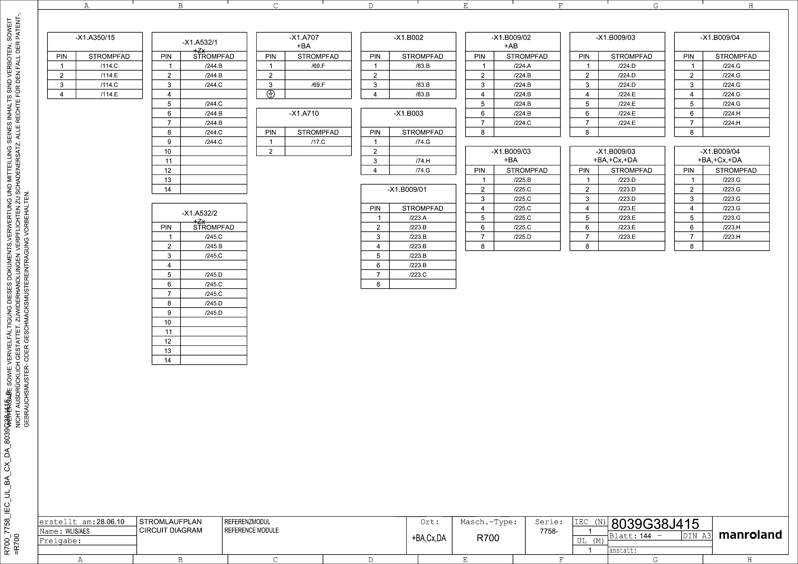

# +BA_Cx_DA — Sheet 144 of 247 — REFERENZMODUL

**REFERENCE MODULE**

> Part of the manroland **R700** printing press IEC/UL circuit diagrams.
> Drawing class: **Stromlaufplan / Circuit diagram** (DIN A3).
> Document `+BA_Cx_DA` covers the **Printing units / main switch cabinet** machine section.

## At a glance

| Field | Value |
|---|---|
| Document | `+BA_Cx_DA`  (8039G38J415) |
| Sheet | **144** of 247 |
| Section (DE) | REFERENZMODUL |
| Section (EN) | REFERENCE MODULE |
| Section type | REFERENCE_MODULE — Reference module |
| Machine type | `R700` |
| Series | `7758` |
| Created | 28.06.10 |
| Replaces | — |
| Columns used | A, B, C, D, E, F, G, H |
| Path numbers | — |
| Labels on sheet | 228 |
| Cross-refs out | 78 |
| Cross-refs in | 0 |

**Previous:** [+BA_Cx_DA sheet 143](SHEET_0143.md) · **Next:** [+BA_Cx_DA sheet 145](SHEET_0145.md) · **Document TOC:** [_TOC.md](_TOC.md)  (+BA_Cx_DA) · **Master TOC:** [all sheets](../_MASTER_TOC.md)

## Sheet image (300 DPI, exact vector render)



_Rendered directly from the PDF vector layer at 300 DPI (1-bit), no OCR and no resampling. Use it to confirm anything ambiguous in the text below._

## Cross-references on this sheet

Each entry is a wire leaving this sheet. The printed token is `/sheet.column`; the link resolves to that sheet inside the same document.

| Ref | Target sheet | Col | Path | Destination on target | Target section | From col |
|---|---|---|---|---|---|---|
| `/83.B` | [+BA_Cx_DA sheet 83](SHEET_0083.md) | B | — | — | FARBWERK | E |
| `/69.F` | [+BA_Cx_DA sheet 69](SHEET_0069.md) | F | — | — | DRUCKLUFT ABSTELLEN | C |
| `/244.B` | [+BA_Cx_DA sheet 244](SHEET_0244.md) | B | — | — | OPTION: INLINE COLORPILOT (ICP) | B |
| `/224.A` | [+BA_Cx_DA sheet 224](SHEET_0224.md) | A | — | — | OPTION: INLINEOBSERVER | F |
| `/224.G` | [+BA_Cx_DA sheet 224](SHEET_0224.md) | G | — | — | OPTION: INLINEOBSERVER | H |
| `/114.C` | [+BA_Cx_DA sheet 114](SHEET_0114.md) | C | — | — | PPL 2 | A |
| `/224.D` | [+BA_Cx_DA sheet 224](SHEET_0224.md) | D | — | — | OPTION: INLINEOBSERVER | G |
| `/114.E` | [+BA_Cx_DA sheet 114](SHEET_0114.md) | E | — | — | PPL 2 | A |
| `/244.B` | [+BA_Cx_DA sheet 244](SHEET_0244.md) | B | — | — | OPTION: INLINE COLORPILOT (ICP) | B |
| `/224.B` | [+BA_Cx_DA sheet 224](SHEET_0224.md) | B | — | — | OPTION: INLINEOBSERVER | F |
| `/224.G` | [+BA_Cx_DA sheet 224](SHEET_0224.md) | G | — | — | OPTION: INLINEOBSERVER | H |
| `/224.D` | [+BA_Cx_DA sheet 224](SHEET_0224.md) | D | — | — | OPTION: INLINEOBSERVER | G |
| `/83.B` | [+BA_Cx_DA sheet 83](SHEET_0083.md) | B | — | — | FARBWERK | E |
| `/69.F` | [+BA_Cx_DA sheet 69](SHEET_0069.md) | F | — | — | DRUCKLUFT ABSTELLEN | C |
| `/224.B` | [+BA_Cx_DA sheet 224](SHEET_0224.md) | B | — | — | OPTION: INLINEOBSERVER | F |
| `/224.G` | [+BA_Cx_DA sheet 224](SHEET_0224.md) | G | — | — | OPTION: INLINEOBSERVER | H |
| `/114.C` | [+BA_Cx_DA sheet 114](SHEET_0114.md) | C | — | — | PPL 2 | A |
| `/244.C` | [+BA_Cx_DA sheet 244](SHEET_0244.md) | C | — | — | OPTION: INLINE COLORPILOT (ICP) | B |
| `/224.D` | [+BA_Cx_DA sheet 224](SHEET_0224.md) | D | — | — | OPTION: INLINEOBSERVER | G |
| `/83.B` | [+BA_Cx_DA sheet 83](SHEET_0083.md) | B | — | — | FARBWERK | E |
| `/114.E` | [+BA_Cx_DA sheet 114](SHEET_0114.md) | E | — | — | PPL 2 | A |
| `/224.B` | [+BA_Cx_DA sheet 224](SHEET_0224.md) | B | — | — | OPTION: INLINEOBSERVER | F |
| `/224.E` | [+BA_Cx_DA sheet 224](SHEET_0224.md) | E | — | — | OPTION: INLINEOBSERVER | G |
| `/224.G` | [+BA_Cx_DA sheet 224](SHEET_0224.md) | G | — | — | OPTION: INLINEOBSERVER | H |
| `/224.B` | [+BA_Cx_DA sheet 224](SHEET_0224.md) | B | — | — | OPTION: INLINEOBSERVER | F |
| `/224.E` | [+BA_Cx_DA sheet 224](SHEET_0224.md) | E | — | — | OPTION: INLINEOBSERVER | G |
| `/224.G` | [+BA_Cx_DA sheet 224](SHEET_0224.md) | G | — | — | OPTION: INLINEOBSERVER | H |
| `/244.C` | [+BA_Cx_DA sheet 244](SHEET_0244.md) | C | — | — | OPTION: INLINE COLORPILOT (ICP) | B |
| `/244.B` | [+BA_Cx_DA sheet 244](SHEET_0244.md) | B | — | — | OPTION: INLINE COLORPILOT (ICP) | B |
| `/224.B` | [+BA_Cx_DA sheet 224](SHEET_0224.md) | B | — | — | OPTION: INLINEOBSERVER | F |
| `/224.E` | [+BA_Cx_DA sheet 224](SHEET_0224.md) | E | — | — | OPTION: INLINEOBSERVER | G |
| `/224.H` | [+BA_Cx_DA sheet 224](SHEET_0224.md) | H | — | — | OPTION: INLINEOBSERVER | H |
| `/244.B` | [+BA_Cx_DA sheet 244](SHEET_0244.md) | B | — | — | OPTION: INLINE COLORPILOT (ICP) | B |
| `/224.E` | [+BA_Cx_DA sheet 224](SHEET_0224.md) | E | — | — | OPTION: INLINEOBSERVER | G |
| `/224.C` | [+BA_Cx_DA sheet 224](SHEET_0224.md) | C | — | — | OPTION: INLINEOBSERVER | F |
| `/224.H` | [+BA_Cx_DA sheet 224](SHEET_0224.md) | H | — | — | OPTION: INLINEOBSERVER | H |
| `/17.C` | [+BA_Cx_DA sheet 17](SHEET_0017.md) | C | — | STROMPFAD PIN 1 2 | SPANNUNGSVERSORGUNG, SCHALTSCHRANKBELÜFTUNG | C |
| `/244.C` | [+BA_Cx_DA sheet 244](SHEET_0244.md) | C | — | — | OPTION: INLINE COLORPILOT (ICP) | B |
| `/74.G` | [+BA_Cx_DA sheet 74](SHEET_0074.md) | G | — | — | FEUCHTWERK | E |
| `/244.C` | [+BA_Cx_DA sheet 244](SHEET_0244.md) | C | — | — | OPTION: INLINE COLORPILOT (ICP) | B |
| `/74.H` | [+BA_Cx_DA sheet 74](SHEET_0074.md) | H | — | — | FEUCHTWERK | E |
| `/74.G` | [+BA_Cx_DA sheet 74](SHEET_0074.md) | G | — | — | FEUCHTWERK | E |
| `/225.B` | [+BA_Cx_DA sheet 225](SHEET_0225.md) | B | — | — | OPTION: INLINEOBSERVER | F |
| `/223.G` | [+BA_Cx_DA sheet 223](SHEET_0223.md) | G | — | — | OPTION: INLINEOBSERVER | H |
| `/223.D` | [+BA_Cx_DA sheet 223](SHEET_0223.md) | D | — | — | OPTION: INLINEOBSERVER | G |
| `/223.G` | [+BA_Cx_DA sheet 223](SHEET_0223.md) | G | — | — | OPTION: INLINEOBSERVER | H |
| `/225.C` | [+BA_Cx_DA sheet 225](SHEET_0225.md) | C | — | — | OPTION: INLINEOBSERVER | F |
| `/223.D` | [+BA_Cx_DA sheet 223](SHEET_0223.md) | D | — | — | OPTION: INLINEOBSERVER | G |
| `/223.G` | [+BA_Cx_DA sheet 223](SHEET_0223.md) | G | — | — | OPTION: INLINEOBSERVER | H |
| `/225.C` | [+BA_Cx_DA sheet 225](SHEET_0225.md) | C | — | — | OPTION: INLINEOBSERVER | F |
| `/223.D` | [+BA_Cx_DA sheet 223](SHEET_0223.md) | D | — | — | OPTION: INLINEOBSERVER | G |
| `/223.E` | [+BA_Cx_DA sheet 223](SHEET_0223.md) | E | — | — | OPTION: INLINEOBSERVER | G |
| `/223.G` | [+BA_Cx_DA sheet 223](SHEET_0223.md) | G | — | — | OPTION: INLINEOBSERVER | H |
| `/225.C` | [+BA_Cx_DA sheet 225](SHEET_0225.md) | C | — | — | OPTION: INLINEOBSERVER | F |
| `/223.A` | [+BA_Cx_DA sheet 223](SHEET_0223.md) | A | — | — | OPTION: INLINEOBSERVER | D |
| `/223.E` | [+BA_Cx_DA sheet 223](SHEET_0223.md) | E | — | — | OPTION: INLINEOBSERVER | G |
| `/223.G` | [+BA_Cx_DA sheet 223](SHEET_0223.md) | G | — | — | OPTION: INLINEOBSERVER | H |
| `/225.C` | [+BA_Cx_DA sheet 225](SHEET_0225.md) | C | — | — | OPTION: INLINEOBSERVER | F |
| `/223.B` | [+BA_Cx_DA sheet 223](SHEET_0223.md) | B | — | — | OPTION: INLINEOBSERVER | E |
| `/223.E` | [+BA_Cx_DA sheet 223](SHEET_0223.md) | E | — | — | OPTION: INLINEOBSERVER | G |
| `/225.C` | [+BA_Cx_DA sheet 225](SHEET_0225.md) | C | — | — | OPTION: INLINEOBSERVER | F |
| `/223.H` | [+BA_Cx_DA sheet 223](SHEET_0223.md) | H | — | — | OPTION: INLINEOBSERVER | H |
| `/223.B` | [+BA_Cx_DA sheet 223](SHEET_0223.md) | B | — | — | OPTION: INLINEOBSERVER | E |
| `/223.E` | [+BA_Cx_DA sheet 223](SHEET_0223.md) | E | — | — | OPTION: INLINEOBSERVER | G |
| `/245.C` | [+BA_Cx_DA sheet 245](SHEET_0245.md) | C | — | — | OPTION: INLINE COLORPILOT (ICP) | B |
| `/225.D` | [+BA_Cx_DA sheet 225](SHEET_0225.md) | D | — | — | OPTION: INLINEOBSERVER | F |
| `/223.H` | [+BA_Cx_DA sheet 223](SHEET_0223.md) | H | — | — | OPTION: INLINEOBSERVER | H |
| `/245.B` | [+BA_Cx_DA sheet 245](SHEET_0245.md) | B | — | — | OPTION: INLINE COLORPILOT (ICP) | B |
| `/223.B` | [+BA_Cx_DA sheet 223](SHEET_0223.md) | B | — | — | OPTION: INLINEOBSERVER | E |
| `/223.B` | [+BA_Cx_DA sheet 223](SHEET_0223.md) | B | — | — | OPTION: INLINEOBSERVER | E |
| `/245.C` | [+BA_Cx_DA sheet 245](SHEET_0245.md) | C | — | — | OPTION: INLINE COLORPILOT (ICP) | B |
| `/223.B` | [+BA_Cx_DA sheet 223](SHEET_0223.md) | B | — | — | OPTION: INLINEOBSERVER | E |
| `/245.D` | [+BA_Cx_DA sheet 245](SHEET_0245.md) | D | — | — | OPTION: INLINE COLORPILOT (ICP) | B |
| `/223.C` | [+BA_Cx_DA sheet 223](SHEET_0223.md) | C | — | — | OPTION: INLINEOBSERVER | E |
| `/245.C` | [+BA_Cx_DA sheet 245](SHEET_0245.md) | C | — | — | OPTION: INLINE COLORPILOT (ICP) | B |
| `/245.C` | [+BA_Cx_DA sheet 245](SHEET_0245.md) | C | — | — | OPTION: INLINE COLORPILOT (ICP) | B |
| `/245.D` | [+BA_Cx_DA sheet 245](SHEET_0245.md) | D | — | — | OPTION: INLINE COLORPILOT (ICP) | B |
| `/245.D` | [+BA_Cx_DA sheet 245](SHEET_0245.md) | D | — | — | OPTION: INLINE COLORPILOT (ICP) | B |

## Devices on this sheet

| Tag | Class | Class meaning (IEC) | Col | Sub | Terminal | Sign |
|---|---|---|---|---|---|---|
| `X1.B003` | — | cross-device reference | D | — | — | — |
| `X1.B002` | — | cross-device reference | D | — | — | — |
| `X1.A707` | — | cross-device reference | C | — | — | — |
| `X1.A710` | — | cross-device reference | C | — | — | — |

## Potentials / nets

_No named potentials on this sheet._

## Wire-end annotations (grouped as printed)

A wire that continues elsewhere is annotated with a small cluster: the destination description, the path/line number `#NN`, and the `/sheet.column` cross reference. Each row below is one such cluster exactly as it is grouped on the drawing.

| Col | Y | Path | Cross-ref | Text on the wire |
|---|---|---|---|---|
| A | 51.3 | — | — | `X1.A350/15` |
| C | 51.3 | — | — | `X1.A707` |
| D | 51.3 | — | — | `X1.B002` |
| E | 51.3 | — | — | `X1.B009/02` |
| G | 51.3 | — | — | `X1.B009/03` |
| H | 51.3 | — | — | `X1.B009/04` |
| B | 58.4 | — | — | `X1.A532/1` |
| C | 64.0 | — | — | `+BA` |
| E | 64.0 | — | — | `+AB` |
| B | 71.2 | — | — | `+Zx` |
| A | 80.0 | — | — | `PIN 2 3 4 1 STROMPFAD` |
| B | 80.0 | — | — | `PIN STROMPFAD` |
| C | 80.0 | — | — | `PIN 2 3 1 STROMPFAD` |
| D | 80.0 | — | — | `PIN 2 3 4 1 STROMPFAD` |
| E | 80.0 | — | — | `PIN 2 3 4 5 6 7 8 1 STROMPFAD` |
| G | 80.0 | — | — | `PIN 2 3 4 5 6 7 8 1 STROMPFAD` |
| H | 80.0 | — | — | `PIN 2 3 4 5 6 7 8 1 STROMPFAD` |
| B | 94.2 | — | — | `2 3 4 5 6 7 8 9 1` |
| A | 94.5 | — | `/114.C` | — |
| B | 94.5 | — | `/244.B` | — |
| C | 94.5 | — | `/69.F` | — |
| E | 94.5 | — | `/83.B` | — |
| F | 94.5 | — | `/224.A` | — |
| G | 94.5 | — | `/224.D` | — |
| H | 94.5 | — | `/224.G` | — |
| A | 108.7 | — | `/114.E` | — |
| B | 108.7 | — | `/244.B` | — |
| F | 108.7 | — | `/224.B` | — |
| G | 108.7 | — | `/224.D` | — |
| H | 108.7 | — | `/224.G` | — |
| E | 122.8 | — | `/83.B` | — |
| A | 122.9 | — | `/114.C` | — |
| B | 122.9 | — | `/244.C` | — |
| C | 122.9 | — | `/69.F` | — |
| F | 122.9 | — | `/224.B` | — |
| G | 122.9 | — | `/224.D` | — |
| H | 122.9 | — | `/224.G` | — |
| A | 137.0 | — | `/114.E` | — |
| E | 137.0 | — | `/83.B` | — |
| F | 137.0 | — | `/224.B` | — |
| G | 137.0 | — | `/224.E` | — |
| H | 137.1 | — | `/224.G` | — |
| B | 151.2 | — | `/244.C` | — |
| F | 151.2 | — | `/224.B` | — |
| G | 151.2 | — | `/224.E` | — |
| H | 151.2 | — | `/224.G` | — |
| C | 164.7 | — | — | `X1.A710` |
| D | 164.7 | — | — | `X1.B003` |
| B | 165.4 | — | `/244.B` | — |
| F | 165.4 | — | `/224.B` | — |
| G | 165.4 | — | `/224.E` | — |
| H | 165.4 | — | `/224.H` | — |
| B | 179.6 | — | `/244.B` | — |
| F | 179.6 | — | `/224.C` | — |
| G | 179.6 | — | `/224.E` | — |
| H | 179.6 | — | `/224.H` | — |
| C | 193.4 | — | `/17.C` | `PIN 2 1 STROMPFAD` |
| D | 193.4 | — | — | `PIN 2 3 4 1 STROMPFAD` |
| B | 193.8 | — | `/244.C` | — |
| B | 207.9 | — | `/244.C` | — |
| E | 207.9 | — | `/74.G` | — |
| E | 221.4 | — | — | `X1.B009/03` |
| G | 221.4 | — | — | `+BA,+Cx,+DA X1.B009/03` |
| H | 221.4 | — | — | `+BA,+Cx,+DA X1.B009/04` |
| B | 221.8 | — | — | `10 12 13 14 11` |
| E | 234.1 | — | — | `+BA` |
| E | 236.3 | — | `/74.H` | — |
| E | 250.1 | — | — | `PIN 2 3 4 5 6 7 8 1 STROMPFAD` |
| G | 250.1 | — | — | `PIN 2 3 4 5 6 7 8 1 STROMPFAD` |
| H | 250.1 | — | — | `PIN 2 3 4 5 6 7 8 1 STROMPFAD` |
| E | 250.4 | — | `/74.G` | — |
| F | 264.6 | — | `/225.B` | — |
| G | 264.6 | — | `/223.D` | — |
| H | 264.6 | — | `/223.G` | — |
| D | 278.1 | — | — | `X1.B009/01` |
| F | 278.8 | — | `/225.C` | — |
| G | 278.8 | — | `/223.D` | — |
| H | 278.8 | — | `/223.G` | — |
| F | 293.0 | — | `/225.C` | — |
| G | 293.0 | — | `/223.D` | — |
| H | 293.0 | — | `/223.G` | — |
| D | 306.8 | — | — | `PIN 2 3 4 5 6 7 8 1 STROMPFAD` |
| F | 307.1 | — | `/225.C` | — |
| G | 307.1 | — | `/223.E` | — |
| H | 307.1 | — | `/223.G` | — |
| B | 313.5 | — | — | `X1.A532/2` |
| D | 321.3 | — | `/223.A` | — |
| F | 321.3 | — | `/225.C` | — |
| G | 321.3 | — | `/223.E` | — |
| H | 321.3 | — | `/223.G` | — |
| B | 326.3 | — | — | `+Zx` |
| B | 335.1 | — | — | `PIN STROMPFAD` |
| E | 335.5 | — | `/223.B` | — |
| F | 335.5 | — | `/225.C` | — |
| G | 335.5 | — | `/223.E` | — |
| H | 335.5 | — | `/223.H` | — |
| B | 349.3 | — | — | `2 3 4 5 6 7 8 9 1` |
| E | 349.6 | — | `/223.B` | — |
| G | 349.6 | — | `/223.E` | — |
| B | 349.7 | — | `/245.C` | — |
| F | 349.7 | — | `/225.D` | — |
| H | 349.7 | — | `/223.H` | — |
| B | 363.8 | — | `/245.B` | — |
| E | 363.8 | — | `/223.B` | — |
| B | 378.0 | — | `/245.C` | — |
| E | 378.0 | — | `/223.B` | — |
| E | 392.1 | — | `/223.B` | — |
| B | 406.4 | — | `/245.D` | — |
| E | 406.4 | — | `/223.C` | — |
| B | 420.5 | — | `/245.C` | — |
| B | 434.7 | — | `/245.C` | — |
| B | 448.9 | — | `/245.D` | — |
| B | 463.1 | — | `/245.D` | — |
| B | 476.9 | — | — | `10 12 13 14 11` |


## Reconstructed tables

This sheet carries tabular content (pin map / terminal assignment / index). The grid below was rebuilt from the drawing's own rule lines, so each row is exactly one physical row of the table.

### Table 1 — 4 data rows × 2 columns (at x=70.9, y=48.2) — **X1.A350/15**

| PIN | STROMPFAD |
|---|---|
| `1` | `/114.C` |
| `2` | `/114.E` |
| `3` | `/114.C` |
| `4` | `/114.E` |


### Table 2 — 30 data rows × 2 columns (at x=226.8, y=48.2) — **X1.A532/1 +Zx**

| PIN | STROMPFAD |
|---|---|
| `1` | `/244.B` |
| `2` | `/244.B` |
| `3` | `/244.C` |
| `4` |  |
| `5` | `/244.C` |
| `6` | `/244.B` |
| `7` | `/244.B` |
| `8` | `/244.C` |
| `9` | `/244.C` |
| `10` |  |
| `11` |  |
| `12` |  |
| `13` |  |
| `14` |  |
|  | `X1.A532/2 +Zx` |
| `PIN` | `STROMPFAD` |
| `1` | `/245.C` |
| `2` | `/245.B` |
| `3` | `/245.C` |
| `4` |  |
| `5` | `/245.D` |
| `6` | `/245.C` |
| `7` | `/245.C` |
| `8` | `/245.D` |
| `9` | `/245.D` |
| `10` |  |
| `11` |  |
| `12` |  |
| `13` |  |
| `14` |  |


### Table 3 — 7 data rows × 2 columns (at x=382.7, y=48.2) — **X1.A707 +BA**

| PIN | STROMPFAD |
|---|---|
| `1` | `/69.F` |
| `2` |  |
| `3` | `/69.F` |
|  | `X1.A710` |
| `PIN` | `STROMPFAD` |
| `1` | `/17.C` |
| `2` |  |


### Table 4 — 20 data rows × 2 columns (at x=538.6, y=48.2) — **X1.B002**

| PIN | STROMPFAD |
|---|---|
| `1` | `/83.B` |
| `2` |  |
| `3` | `/83.B` |
| `4` | `/83.B` |
|  | `X1.B003` |
| `PIN` | `STROMPFAD` |
| `1` | `/74.G` |
| `2` |  |
| `3` | `/74.H` |
| `4` | `/74.G` |
|  | `X1.B009/01` |
| `PIN` | `STROMPFAD` |
| `1` | `/223.A` |
| `2` | `/223.B` |
| `3` | `/223.B` |
| `4` | `/223.B` |
| `5` | `/223.B` |
| `6` | `/223.B` |
| `7` | `/223.C` |
| `8` |  |


### Table 5 — 19 data rows × 2 columns (at x=694.5, y=48.2) — **X1.B009/02 +AB**

| PIN | STROMPFAD |
|---|---|
| `1` | `/224.A` |
| `2` | `/224.B` |
| `3` | `/224.B` |
| `4` | `/224.B` |
| `5` | `/224.B` |
| `6` | `/224.B` |
| `7` | `/224.C` |
| `8` |  |
|  | `X1.B009/03` |
|  | `+BA` |
| `PIN` | `STROMPFAD` |
| `1` | `/225.B` |
| `2` | `/225.C` |
| `3` | `/225.C` |
| `4` | `/225.C` |
| `5` | `/225.C` |
| `6` | `/225.C` |
| `7` | `/225.D` |
| `8` |  |


### Table 6 — 19 data rows × 2 columns (at x=850.4, y=48.2) — **X1.B009/03**

| PIN | STROMPFAD |
|---|---|
| `1` | `/224.D` |
| `2` | `/224.D` |
| `3` | `/224.D` |
| `4` | `/224.E` |
| `5` | `/224.E` |
| `6` | `/224.E` |
| `7` | `/224.E` |
| `8` |  |
|  | `X1.B009/03` |
|  | `+BA,+Cx,+DA` |
| `PIN` | `STROMPFAD` |
| `1` | `/223.D` |
| `2` | `/223.D` |
| `3` | `/223.D` |
| `4` | `/223.E` |
| `5` | `/223.E` |
| `6` | `/223.E` |
| `7` | `/223.E` |
| `8` |  |


### Table 7 — 19 data rows × 2 columns (at x=1006.3, y=48.2) — **X1.B009/04**

| PIN | STROMPFAD |
|---|---|
| `1` | `/224.G` |
| `2` | `/224.G` |
| `3` | `/224.G` |
| `4` | `/224.G` |
| `5` | `/224.G` |
| `6` | `/224.H` |
| `7` | `/224.H` |
| `8` |  |
|  | `X1.B009/04` |
|  | `+BA,+Cx,+DA` |
| `PIN` | `STROMPFAD` |
| `1` | `/223.G` |
| `2` | `/223.G` |
| `3` | `/223.G` |
| `4` | `/223.G` |
| `5` | `/223.G` |
| `6` | `/223.H` |
| `7` | `/223.H` |
| `8` |  |


## Notes and free text on this sheet

| Text | Col | Y (pt) |
|---|---|---|
| `PIN` | A | 80.02 |
| `STROMPFAD` | A | 79.98 |
| `X1.A350/15` | A | 51.33 |
| `PIN` | G | 80.02 |
| `STROMPFAD` | H | 79.98 |
| `X1.B009/04` | H | 51.33 |
| `+BA,+Cx,+DA` | H | 234.14 |
| `PIN` | F | 80.02 |
| `STROMPFAD` | G | 79.98 |
| `X1.B009/03` | G | 51.33 |
| `+BA,+Cx,+DA` | G | 234.14 |
| `PIN` | E | 80.02 |
| `STROMPFAD` | F | 79.98 |
| `X1.B009/02` | E | 51.33 |
| `+AB` | E | 64.01 |
| `X1.B009/03` | E | 221.41 |
| `+BA` | E | 234.09 |
| `PIN` | D | 193.41 |
| `STROMPFAD` | E | 193.37 |
| `X1.B009/01` | D | 278.1 |
| `PIN` | C | 80.02 |
| `STROMPFAD` | C | 79.98 |
| `+BA` | C | 64.01 |
| `PIN` | B | 80.02 |
| `STROMPFAD` | B | 79.98 |
| `X1.A532/1` | B | 58.42 |
| `+Zx` | B | 71.2 |
| `X1.A532/2` | B | 313.54 |

## Complete label inventory (exact text from the drawing)

Every text object inside the drawing area of this sheet, in DIN reading order (column A→H, then top→bottom). This is the authoritative list: if a string is not here it is not printed on this sheet.

| Col | Y | X | Dir | Type | Text |
|---|---|---|---|---|---|
| A | 51.3 | 112.4 | → | text | `X1.A350/15` |
| A | 80.0 | 84.0 | → | text | `PIN` |
| A | 80.0 | 132.2 | → | text | `STROMPFAD` |
| A | 94.2 | 90.0 | → | number | `1` |
| A | 94.5 | 150.2 | → | cross-reference | `/114.C` |
| A | 108.4 | 89.4 | → | number | `2` |
| A | 108.7 | 150.5 | → | cross-reference | `/114.E` |
| A | 122.5 | 89.4 | → | number | `3` |
| A | 122.9 | 150.2 | → | cross-reference | `/114.C` |
| A | 136.7 | 89.4 | → | number | `4` |
| A | 137.0 | 150.5 | → | cross-reference | `/114.E` |
| B | 58.4 | 272.0 | → | text | `X1.A532/1` |
| B | 71.2 | 288.4 | → | text | `+Zx` |
| B | 80.0 | 240.0 | → | text | `PIN` |
| B | 80.0 | 288.1 | → | text | `STROMPFAD` |
| B | 94.2 | 251.7 | → | number | `1` |
| B | 94.5 | 306.3 | → | cross-reference | `/244.B` |
| B | 108.4 | 250.0 | → | number | `2` |
| B | 108.7 | 306.3 | → | cross-reference | `/244.B` |
| B | 122.5 | 250.0 | → | number | `3` |
| B | 122.9 | 306.1 | → | cross-reference | `/244.C` |
| B | 136.7 | 250.0 | → | number | `4` |
| B | 150.9 | 250.0 | → | number | `5` |
| B | 151.2 | 306.1 | → | cross-reference | `/244.C` |
| B | 165.1 | 250.0 | → | number | `6` |
| B | 165.4 | 306.3 | → | cross-reference | `/244.B` |
| B | 179.2 | 250.0 | → | number | `7` |
| B | 179.6 | 306.3 | → | cross-reference | `/244.B` |
| B | 193.4 | 250.0 | → | number | `8` |
| B | 193.8 | 306.1 | → | cross-reference | `/244.C` |
| B | 207.6 | 250.0 | → | number | `9` |
| B | 207.9 | 306.1 | → | cross-reference | `/244.C` |
| B | 221.8 | 244.6 | → | number | `10` |
| B | 235.9 | 246.3 | → | number | `11` |
| B | 250.1 | 244.6 | → | number | `12` |
| B | 264.3 | 244.6 | → | number | `13` |
| B | 278.5 | 244.6 | → | number | `14` |
| B | 313.5 | 271.3 | → | text | `X1.A532/2` |
| B | 326.3 | 288.4 | → | text | `+Zx` |
| B | 335.1 | 240.0 | → | text | `PIN` |
| B | 335.1 | 288.1 | → | text | `STROMPFAD` |
| B | 349.3 | 251.7 | → | number | `1` |
| B | 349.7 | 306.1 | → | cross-reference | `/245.C` |
| B | 363.5 | 250.0 | → | number | `2` |
| B | 363.8 | 306.3 | → | cross-reference | `/245.B` |
| B | 377.7 | 250.0 | → | number | `3` |
| B | 378.0 | 306.1 | → | cross-reference | `/245.C` |
| B | 391.8 | 250.0 | → | number | `4` |
| B | 406.0 | 250.0 | → | number | `5` |
| B | 406.4 | 306.1 | → | cross-reference | `/245.D` |
| B | 420.2 | 250.0 | → | number | `6` |
| B | 420.5 | 306.1 | → | cross-reference | `/245.C` |
| B | 434.4 | 250.0 | → | number | `7` |
| B | 434.7 | 306.1 | → | cross-reference | `/245.C` |
| B | 448.5 | 250.0 | → | number | `8` |
| B | 448.9 | 306.1 | → | cross-reference | `/245.D` |
| B | 462.7 | 250.0 | → | number | `9` |
| B | 463.0 | 306.1 | → | cross-reference | `/245.D` |
| B | 476.9 | 244.6 | → | number | `10` |
| B | 491.0 | 246.3 | → | number | `11` |
| B | 505.2 | 244.6 | → | number | `12` |
| B | 519.4 | 244.6 | → | number | `13` |
| B | 533.6 | 244.6 | → | number | `14` |
| C | 51.3 | 431.6 | → | device ref | `X1.A707` |
| C | 64.0 | 442.9 | → | text | `+BA` |
| C | 80.0 | 395.9 | → | text | `PIN` |
| C | 80.0 | 444.0 | → | text | `STROMPFAD` |
| C | 94.2 | 401.8 | → | number | `1` |
| C | 94.5 | 464.9 | → | cross-reference | `/69.F` |
| C | 108.4 | 401.2 | → | number | `2` |
| C | 122.5 | 401.2 | → | number | `3` |
| C | 122.9 | 464.9 | → | cross-reference | `/69.F` |
| C | 164.7 | 431.6 | → | device ref | `X1.A710` |
| C | 193.4 | 395.9 | → | text | `PIN` |
| C | 193.4 | 444.0 | → | text | `STROMPFAD` |
| C | 207.6 | 401.8 | → | number | `1` |
| C | 207.9 | 464.5 | → | cross-reference | `/17.C` |
| C | 221.8 | 401.2 | → | number | `2` |
| D | 51.3 | 587.5 | → | device ref | `X1.B002` |
| D | 80.0 | 551.8 | → | text | `PIN` |
| D | 94.2 | 557.7 | → | number | `1` |
| D | 108.4 | 557.1 | → | number | `2` |
| D | 122.5 | 557.1 | → | number | `3` |
| D | 136.7 | 557.1 | → | number | `4` |
| D | 164.7 | 587.5 | → | device ref | `X1.B003` |
| D | 193.4 | 551.8 | → | text | `PIN` |
| D | 207.6 | 557.7 | → | number | `1` |
| D | 221.8 | 557.1 | → | number | `2` |
| D | 235.9 | 557.1 | → | number | `3` |
| D | 250.1 | 557.1 | → | number | `4` |
| D | 278.1 | 578.0 | → | text | `X1.B009/01` |
| D | 306.8 | 551.8 | → | text | `PIN` |
| D | 321.0 | 563.5 | → | number | `1` |
| D | 321.3 | 610.9 | → | cross-reference | `/223.A` |
| D | 335.1 | 561.8 | → | number | `2` |
| D | 349.3 | 561.8 | → | number | `3` |
| D | 363.5 | 561.8 | → | number | `4` |
| D | 377.7 | 561.8 | → | number | `5` |
| D | 391.8 | 561.8 | → | number | `6` |
| D | 406.0 | 561.8 | → | number | `7` |
| D | 420.2 | 561.8 | → | number | `8` |
| E | 51.3 | 733.2 | → | text | `X1.B009/02` |
| E | 64.0 | 752.3 | → | text | `+AB` |
| E | 80.0 | 600.0 | → | text | `STROMPFAD` |
| E | 80.0 | 707.7 | → | text | `PIN` |
| E | 94.2 | 719.4 | → | number | `1` |
| E | 94.5 | 620.5 | → | cross-reference | `/83.B` |
| E | 108.4 | 717.7 | → | number | `2` |
| E | 122.5 | 717.7 | → | number | `3` |
| E | 122.8 | 620.5 | → | cross-reference | `/83.B` |
| E | 136.7 | 717.7 | → | number | `4` |
| E | 137.0 | 620.5 | → | cross-reference | `/83.B` |
| E | 150.9 | 717.7 | → | number | `5` |
| E | 165.1 | 717.7 | → | number | `6` |
| E | 179.2 | 717.7 | → | number | `7` |
| E | 193.4 | 600.0 | → | text | `STROMPFAD` |
| E | 193.4 | 717.7 | → | number | `8` |
| E | 207.9 | 620.2 | → | cross-reference | `/74.G` |
| E | 221.4 | 733.2 | → | text | `X1.B009/03` |
| E | 234.1 | 751.9 | → | text | `+BA` |
| E | 236.3 | 620.6 | → | cross-reference | `/74.H` |
| E | 250.1 | 707.7 | → | text | `PIN` |
| E | 250.4 | 620.2 | → | cross-reference | `/74.G` |
| E | 264.3 | 719.4 | → | number | `1` |
| E | 278.5 | 717.7 | → | number | `2` |
| E | 292.6 | 717.7 | → | number | `3` |
| E | 306.8 | 600.0 | → | text | `STROMPFAD` |
| E | 306.8 | 717.7 | → | number | `4` |
| E | 321.0 | 717.7 | → | number | `5` |
| E | 335.1 | 717.7 | → | number | `6` |
| E | 335.5 | 611.0 | → | cross-reference | `/223.B` |
| E | 349.3 | 717.7 | → | number | `7` |
| E | 349.6 | 611.0 | → | cross-reference | `/223.B` |
| E | 363.5 | 717.7 | → | number | `8` |
| E | 363.8 | 611.0 | → | cross-reference | `/223.B` |
| E | 378.0 | 611.0 | → | cross-reference | `/223.B` |
| E | 392.2 | 611.0 | → | cross-reference | `/223.B` |
| E | 406.4 | 610.9 | → | cross-reference | `/223.C` |
| F | 80.0 | 755.9 | → | text | `STROMPFAD` |
| F | 80.0 | 863.6 | → | text | `PIN` |
| F | 94.2 | 875.3 | → | number | `1` |
| F | 94.5 | 766.8 | → | cross-reference | `/224.A` |
| F | 108.4 | 873.6 | → | number | `2` |
| F | 108.7 | 766.9 | → | cross-reference | `/224.B` |
| F | 122.5 | 873.6 | → | number | `3` |
| F | 122.9 | 766.9 | → | cross-reference | `/224.B` |
| F | 136.7 | 873.6 | → | number | `4` |
| F | 137.0 | 766.9 | → | cross-reference | `/224.B` |
| F | 150.9 | 873.6 | → | number | `5` |
| F | 151.2 | 766.9 | → | cross-reference | `/224.B` |
| F | 165.1 | 873.6 | → | number | `6` |
| F | 165.4 | 766.9 | → | cross-reference | `/224.B` |
| F | 179.2 | 873.6 | → | number | `7` |
| F | 179.6 | 766.8 | → | cross-reference | `/224.C` |
| F | 193.4 | 873.6 | → | number | `8` |
| F | 250.1 | 755.9 | → | text | `STROMPFAD` |
| F | 250.1 | 863.6 | → | text | `PIN` |
| F | 264.3 | 875.3 | → | number | `1` |
| F | 264.6 | 766.9 | → | cross-reference | `/225.B` |
| F | 278.5 | 873.6 | → | number | `2` |
| F | 278.8 | 766.8 | → | cross-reference | `/225.C` |
| F | 292.6 | 873.6 | → | number | `3` |
| F | 293.0 | 766.8 | → | cross-reference | `/225.C` |
| F | 306.8 | 873.6 | → | number | `4` |
| F | 307.1 | 766.8 | → | cross-reference | `/225.C` |
| F | 321.0 | 873.6 | → | number | `5` |
| F | 321.3 | 766.8 | → | cross-reference | `/225.C` |
| F | 335.1 | 873.6 | → | number | `6` |
| F | 335.5 | 766.8 | → | cross-reference | `/225.C` |
| F | 349.3 | 873.6 | → | number | `7` |
| F | 349.7 | 766.8 | → | cross-reference | `/225.D` |
| F | 363.5 | 873.6 | → | number | `8` |
| G | 51.3 | 889.1 | → | text | `X1.B009/03` |
| G | 80.0 | 911.8 | → | text | `STROMPFAD` |
| G | 80.0 | 1019.5 | → | text | `PIN` |
| G | 94.2 | 1031.2 | → | number | `1` |
| G | 94.5 | 922.7 | → | cross-reference | `/224.D` |
| G | 108.4 | 1029.5 | → | number | `2` |
| G | 108.7 | 922.7 | → | cross-reference | `/224.D` |
| G | 122.5 | 1029.5 | → | number | `3` |
| G | 122.9 | 922.7 | → | cross-reference | `/224.D` |
| G | 136.7 | 1029.5 | → | number | `4` |
| G | 137.0 | 923.0 | → | cross-reference | `/224.E` |
| G | 150.9 | 1029.5 | → | number | `5` |
| G | 151.2 | 923.0 | → | cross-reference | `/224.E` |
| G | 165.1 | 1029.5 | → | number | `6` |
| G | 165.4 | 923.0 | → | cross-reference | `/224.E` |
| G | 179.2 | 1029.5 | → | number | `7` |
| G | 179.6 | 923.0 | → | cross-reference | `/224.E` |
| G | 193.4 | 1029.5 | → | number | `8` |
| G | 221.4 | 889.1 | → | text | `X1.B009/03` |
| G | 234.1 | 885.1 | → | text | `+BA,+Cx,+DA` |
| G | 250.1 | 911.8 | → | text | `STROMPFAD` |
| G | 250.1 | 1019.5 | → | text | `PIN` |
| G | 264.3 | 1031.2 | → | number | `1` |
| G | 264.6 | 922.7 | → | cross-reference | `/223.D` |
| G | 278.5 | 1029.5 | → | number | `2` |
| G | 278.8 | 922.7 | → | cross-reference | `/223.D` |
| G | 292.6 | 1029.5 | → | number | `3` |
| G | 293.0 | 922.7 | → | cross-reference | `/223.D` |
| G | 306.8 | 1029.5 | → | number | `4` |
| G | 307.1 | 923.0 | → | cross-reference | `/223.E` |
| G | 321.0 | 1029.5 | → | number | `5` |
| G | 321.3 | 923.0 | → | cross-reference | `/223.E` |
| G | 335.1 | 1029.5 | → | number | `6` |
| G | 335.5 | 923.0 | → | cross-reference | `/223.E` |
| G | 349.3 | 1029.5 | → | number | `7` |
| G | 349.6 | 923.0 | → | cross-reference | `/223.E` |
| G | 363.5 | 1029.5 | → | number | `8` |
| H | 51.3 | 1045.0 | → | text | `X1.B009/04` |
| H | 80.0 | 1067.7 | → | text | `STROMPFAD` |
| H | 94.5 | 1078.4 | → | cross-reference | `/224.G` |
| H | 108.7 | 1078.4 | → | cross-reference | `/224.G` |
| H | 122.9 | 1078.4 | → | cross-reference | `/224.G` |
| H | 137.1 | 1078.4 | → | cross-reference | `/224.G` |
| H | 151.2 | 1078.4 | → | cross-reference | `/224.G` |
| H | 165.4 | 1078.9 | → | cross-reference | `/224.H` |
| H | 179.6 | 1078.9 | → | cross-reference | `/224.H` |
| H | 221.4 | 1045.0 | → | text | `X1.B009/04` |
| H | 234.1 | 1041.0 | → | text | `+BA,+Cx,+DA` |
| H | 250.1 | 1067.7 | → | text | `STROMPFAD` |
| H | 264.6 | 1078.4 | → | cross-reference | `/223.G` |
| H | 278.8 | 1078.4 | → | cross-reference | `/223.G` |
| H | 293.0 | 1078.4 | → | cross-reference | `/223.G` |
| H | 307.1 | 1078.4 | → | cross-reference | `/223.G` |
| H | 321.3 | 1078.4 | → | cross-reference | `/223.G` |
| H | 335.5 | 1078.9 | → | cross-reference | `/223.H` |
| H | 349.7 | 1078.9 | → | cross-reference | `/223.H` |

## Reading-order text block

The same content as a plain block, grouped by DIN column — convenient to paste or to match against a visual description.

```text
=== Column A ===
  51.3  112.4  text         X1.A350/15
  80.0   84.0  text         PIN
  80.0  132.2  text         STROMPFAD
  94.2   90.0  numeric      1
  94.5  150.2  xref         /114.C
 108.4   89.4  numeric      2
 108.7  150.5  xref         /114.E
 122.5   89.4  numeric      3
 122.9  150.2  xref         /114.C
 136.7   89.4  numeric      4
 137.0  150.5  xref         /114.E
=== Column B ===
  58.4  272.0  text         X1.A532/1
  71.2  288.4  text         +Zx
  80.0  240.0  text         PIN
  80.0  288.1  text         STROMPFAD
  94.2  251.7  numeric      1
  94.5  306.3  xref         /244.B
 108.4  250.0  numeric      2
 108.7  306.3  xref         /244.B
 122.5  250.0  numeric      3
 122.9  306.1  xref         /244.C
 136.7  250.0  numeric      4
 150.9  250.0  numeric      5
 151.2  306.1  xref         /244.C
 165.1  250.0  numeric      6
 165.4  306.3  xref         /244.B
 179.2  250.0  numeric      7
 179.6  306.3  xref         /244.B
 193.4  250.0  numeric      8
 193.8  306.1  xref         /244.C
 207.6  250.0  numeric      9
 207.9  306.1  xref         /244.C
 221.8  244.6  numeric      10
 235.9  246.3  numeric      11
 250.1  244.6  numeric      12
 264.3  244.6  numeric      13
 278.5  244.6  numeric      14
 313.5  271.3  text         X1.A532/2
 326.3  288.4  text         +Zx
 335.1  240.0  text         PIN
 335.1  288.1  text         STROMPFAD
 349.3  251.7  numeric      1
 349.7  306.1  xref         /245.C
 363.5  250.0  numeric      2
 363.8  306.3  xref         /245.B
 377.7  250.0  numeric      3
 378.0  306.1  xref         /245.C
 391.8  250.0  numeric      4
 406.0  250.0  numeric      5
 406.4  306.1  xref         /245.D
 420.2  250.0  numeric      6
 420.5  306.1  xref         /245.C
 434.4  250.0  numeric      7
 434.7  306.1  xref         /245.C
 448.5  250.0  numeric      8
 448.9  306.1  xref         /245.D
 462.7  250.0  numeric      9
 463.0  306.1  xref         /245.D
 476.9  244.6  numeric      10
 491.0  246.3  numeric      11
 505.2  244.6  numeric      12
 519.4  244.6  numeric      13
 533.6  244.6  numeric      14
=== Column C ===
  51.3  431.6  devref       X1.A707
  64.0  442.9  text         +BA
  80.0  395.9  text         PIN
  80.0  444.0  text         STROMPFAD
  94.2  401.8  numeric      1
  94.5  464.9  xref         /69.F
 108.4  401.2  numeric      2
 122.5  401.2  numeric      3
 122.9  464.9  xref         /69.F
 164.7  431.6  devref       X1.A710
 193.4  395.9  text         PIN
 193.4  444.0  text         STROMPFAD
 207.6  401.8  numeric      1
 207.9  464.5  xref         /17.C
 221.8  401.2  numeric      2
=== Column D ===
  51.3  587.5  devref       X1.B002
  80.0  551.8  text         PIN
  94.2  557.7  numeric      1
 108.4  557.1  numeric      2
 122.5  557.1  numeric      3
 136.7  557.1  numeric      4
 164.7  587.5  devref       X1.B003
 193.4  551.8  text         PIN
 207.6  557.7  numeric      1
 221.8  557.1  numeric      2
 235.9  557.1  numeric      3
 250.1  557.1  numeric      4
 278.1  578.0  text         X1.B009/01
 306.8  551.8  text         PIN
 321.0  563.5  numeric      1
 321.3  610.9  xref         /223.A
 335.1  561.8  numeric      2
 349.3  561.8  numeric      3
 363.5  561.8  numeric      4
 377.7  561.8  numeric      5
 391.8  561.8  numeric      6
 406.0  561.8  numeric      7
 420.2  561.8  numeric      8
=== Column E ===
  51.3  733.2  text         X1.B009/02
  64.0  752.3  text         +AB
  80.0  600.0  text         STROMPFAD
  80.0  707.7  text         PIN
  94.2  719.4  numeric      1
  94.5  620.5  xref         /83.B
 108.4  717.7  numeric      2
 122.5  717.7  numeric      3
 122.8  620.5  xref         /83.B
 136.7  717.7  numeric      4
 137.0  620.5  xref         /83.B
 150.9  717.7  numeric      5
 165.1  717.7  numeric      6
 179.2  717.7  numeric      7
 193.4  600.0  text         STROMPFAD
 193.4  717.7  numeric      8
 207.9  620.2  xref         /74.G
 221.4  733.2  text         X1.B009/03
 234.1  751.9  text         +BA
 236.3  620.6  xref         /74.H
 250.1  707.7  text         PIN
 250.4  620.2  xref         /74.G
 264.3  719.4  numeric      1
 278.5  717.7  numeric      2
 292.6  717.7  numeric      3
 306.8  600.0  text         STROMPFAD
 306.8  717.7  numeric      4
 321.0  717.7  numeric      5
 335.1  717.7  numeric      6
 335.5  611.0  xref         /223.B
 349.3  717.7  numeric      7
 349.6  611.0  xref         /223.B
 363.5  717.7  numeric      8
 363.8  611.0  xref         /223.B
 378.0  611.0  xref         /223.B
 392.2  611.0  xref         /223.B
 406.4  610.9  xref         /223.C
=== Column F ===
  80.0  755.9  text         STROMPFAD
  80.0  863.6  text         PIN
  94.2  875.3  numeric      1
  94.5  766.8  xref         /224.A
 108.4  873.6  numeric      2
 108.7  766.9  xref         /224.B
 122.5  873.6  numeric      3
 122.9  766.9  xref         /224.B
 136.7  873.6  numeric      4
 137.0  766.9  xref         /224.B
 150.9  873.6  numeric      5
 151.2  766.9  xref         /224.B
 165.1  873.6  numeric      6
 165.4  766.9  xref         /224.B
 179.2  873.6  numeric      7
 179.6  766.8  xref         /224.C
 193.4  873.6  numeric      8
 250.1  755.9  text         STROMPFAD
 250.1  863.6  text         PIN
 264.3  875.3  numeric      1
 264.6  766.9  xref         /225.B
 278.5  873.6  numeric      2
 278.8  766.8  xref         /225.C
 292.6  873.6  numeric      3
 293.0  766.8  xref         /225.C
 306.8  873.6  numeric      4
 307.1  766.8  xref         /225.C
 321.0  873.6  numeric      5
 321.3  766.8  xref         /225.C
 335.1  873.6  numeric      6
 335.5  766.8  xref         /225.C
 349.3  873.6  numeric      7
 349.7  766.8  xref         /225.D
 363.5  873.6  numeric      8
=== Column G ===
  51.3  889.1  text         X1.B009/03
  80.0  911.8  text         STROMPFAD
  80.0 1019.5  text         PIN
  94.2 1031.2  numeric      1
  94.5  922.7  xref         /224.D
 108.4 1029.5  numeric      2
 108.7  922.7  xref         /224.D
 122.5 1029.5  numeric      3
 122.9  922.7  xref         /224.D
 136.7 1029.5  numeric      4
 137.0  923.0  xref         /224.E
 150.9 1029.5  numeric      5
 151.2  923.0  xref         /224.E
 165.1 1029.5  numeric      6
 165.4  923.0  xref         /224.E
 179.2 1029.5  numeric      7
 179.6  923.0  xref         /224.E
 193.4 1029.5  numeric      8
 221.4  889.1  text         X1.B009/03
 234.1  885.1  text         +BA,+Cx,+DA
 250.1  911.8  text         STROMPFAD
 250.1 1019.5  text         PIN
 264.3 1031.2  numeric      1
 264.6  922.7  xref         /223.D
 278.5 1029.5  numeric      2
 278.8  922.7  xref         /223.D
 292.6 1029.5  numeric      3
 293.0  922.7  xref         /223.D
 306.8 1029.5  numeric      4
 307.1  923.0  xref         /223.E
 321.0 1029.5  numeric      5
 321.3  923.0  xref         /223.E
 335.1 1029.5  numeric      6
 335.5  923.0  xref         /223.E
 349.3 1029.5  numeric      7
 349.6  923.0  xref         /223.E
 363.5 1029.5  numeric      8
=== Column H ===
  51.3 1045.0  text         X1.B009/04
  80.0 1067.7  text         STROMPFAD
  94.5 1078.4  xref         /224.G
 108.7 1078.4  xref         /224.G
 122.9 1078.4  xref         /224.G
 137.1 1078.4  xref         /224.G
 151.2 1078.4  xref         /224.G
 165.4 1078.9  xref         /224.H
 179.6 1078.9  xref         /224.H
 221.4 1045.0  text         X1.B009/04
 234.1 1041.0  text         +BA,+Cx,+DA
 250.1 1067.7  text         STROMPFAD
 264.6 1078.4  xref         /223.G
 278.8 1078.4  xref         /223.G
 293.0 1078.4  xref         /223.G
 307.1 1078.4  xref         /223.G
 321.3 1078.4  xref         /223.G
 335.5 1078.9  xref         /223.H
 349.7 1078.9  xref         /223.H
```

---
_Generated from the PDF vector text layer; no OCR. Source: `R700_7758_IEC_UL_BA_CX_DA_8039G38J415_p`, sheet 144._
