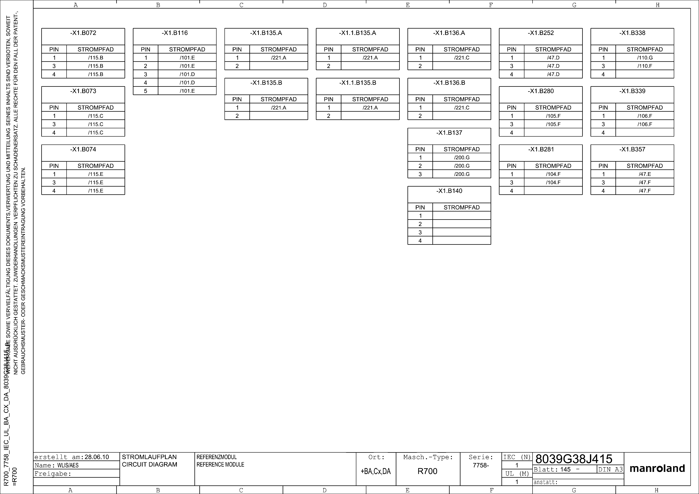

# +BA_Cx_DA — Sheet 145 of 247 — REFERENZMODUL

**REFERENCE MODULE**

> Part of the manroland **R700** printing press IEC/UL circuit diagrams.
> Drawing class: **Stromlaufplan / Circuit diagram** (DIN A3).
> Document `+BA_Cx_DA` covers the **Printing units / main switch cabinet** machine section.

## At a glance

| Field | Value |
|---|---|
| Document | `+BA_Cx_DA`  (8039G38J415) |
| Sheet | **145** of 247 |
| Section (DE) | REFERENZMODUL |
| Section (EN) | REFERENCE MODULE |
| Section type | REFERENCE_MODULE — Reference module |
| Machine type | `R700` |
| Series | `7758` |
| Created | 28.06.10 |
| Replaces | — |
| Columns used | A, B, C, D, E, F, G, H |
| Path numbers | — |
| Labels on sheet | 142 |
| Cross-refs out | 37 |
| Cross-refs in | 0 |

**Previous:** [+BA_Cx_DA sheet 144](SHEET_0144.md) · **Next:** [+BA_Cx_DA sheet 146](SHEET_0146.md) · **Document TOC:** [_TOC.md](_TOC.md)  (+BA_Cx_DA) · **Master TOC:** [all sheets](../_MASTER_TOC.md)

## Sheet image (300 DPI, exact vector render)



_Rendered directly from the PDF vector layer at 300 DPI (1-bit), no OCR and no resampling. Use it to confirm anything ambiguous in the text below._

## Cross-references on this sheet

Each entry is a wire leaving this sheet. The printed token is `/sheet.column`; the link resolves to that sheet inside the same document.

| Ref | Target sheet | Col | Path | Destination on target | Target section | From col |
|---|---|---|---|---|---|---|
| `/221.A` | [+BA_Cx_DA sheet 221](SHEET_0221.md) | A | — | STROMPFAD PIN 1 2 | OPTION: FORMAT 780x1040 | C |
| `/221.A` | [+BA_Cx_DA sheet 221](SHEET_0221.md) | A | — | STROMPFAD PIN 1 2 | OPTION: FORMAT 780x1040 | D |
| `/221.C` | [+BA_Cx_DA sheet 221](SHEET_0221.md) | C | — | STROMPFAD PIN 1 2 | OPTION: FORMAT 780x1040 | E |
| `/115.B` | [+BA_Cx_DA sheet 115](SHEET_0115.md) | B | — | — | PPL 2 | A |
| `/101.E` | [+BA_Cx_DA sheet 101](SHEET_0101.md) | E | — | — | FEHLBOGENKONTROLLE | B |
| `/47.D` | [+BA_Cx_DA sheet 47](SHEET_0047.md) | D | — | — | SCHUTZEINRICHTUNGEN | G |
| `/110.G` | [+BA_Cx_DA sheet 110](SHEET_0110.md) | G | — | — | MOTOR: BEDRUCKSTOFFEINSTELLUNG | H |
| `/115.B` | [+BA_Cx_DA sheet 115](SHEET_0115.md) | B | — | — | PPL 2 | A |
| `/101.E` | [+BA_Cx_DA sheet 101](SHEET_0101.md) | E | — | — | FEHLBOGENKONTROLLE | B |
| `/110.F` | [+BA_Cx_DA sheet 110](SHEET_0110.md) | F | — | — | MOTOR: BEDRUCKSTOFFEINSTELLUNG | H |
| `/47.D` | [+BA_Cx_DA sheet 47](SHEET_0047.md) | D | — | — | SCHUTZEINRICHTUNGEN | G |
| `/115.B` | [+BA_Cx_DA sheet 115](SHEET_0115.md) | B | — | — | PPL 2 | A |
| `/47.D` | [+BA_Cx_DA sheet 47](SHEET_0047.md) | D | — | — | SCHUTZEINRICHTUNGEN | G |
| `/101.D` | [+BA_Cx_DA sheet 101](SHEET_0101.md) | D | — | — | FEHLBOGENKONTROLLE | B |
| `/101.D` | [+BA_Cx_DA sheet 101](SHEET_0101.md) | D | — | — | FEHLBOGENKONTROLLE | B |
| `/101.E` | [+BA_Cx_DA sheet 101](SHEET_0101.md) | E | — | — | FEHLBOGENKONTROLLE | B |
| `/221.A` | [+BA_Cx_DA sheet 221](SHEET_0221.md) | A | — | STROMPFAD PIN 1 2 | OPTION: FORMAT 780x1040 | C |
| `/221.A` | [+BA_Cx_DA sheet 221](SHEET_0221.md) | A | — | STROMPFAD PIN 1 2 | OPTION: FORMAT 780x1040 | D |
| `/221.C` | [+BA_Cx_DA sheet 221](SHEET_0221.md) | C | — | STROMPFAD PIN 1 2 | OPTION: FORMAT 780x1040 | E |
| `/105.F` | [+BA_Cx_DA sheet 105](SHEET_0105.md) | F | — | — | MOTOR: SEITENREGISTER | G |
| `/106.F` | [+BA_Cx_DA sheet 106](SHEET_0106.md) | F | — | — | MOTOR: SCHRÄGREGISTER | H |
| `/115.C` | [+BA_Cx_DA sheet 115](SHEET_0115.md) | C | — | — | PPL 2 | A |
| `/105.F` | [+BA_Cx_DA sheet 105](SHEET_0105.md) | F | — | — | MOTOR: SEITENREGISTER | G |
| `/106.F` | [+BA_Cx_DA sheet 106](SHEET_0106.md) | F | — | — | MOTOR: SCHRÄGREGISTER | H |
| `/115.C` | [+BA_Cx_DA sheet 115](SHEET_0115.md) | C | — | — | PPL 2 | A |
| `/115.C` | [+BA_Cx_DA sheet 115](SHEET_0115.md) | C | — | — | PPL 2 | A |
| `/200.G` | [+BA_Cx_DA sheet 200](SHEET_0200.md) | G | — | — | OPTION: APL | F |
| `/200.G` | [+BA_Cx_DA sheet 200](SHEET_0200.md) | G | — | — | OPTION: APL | F |
| `/47.E` | [+BA_Cx_DA sheet 47](SHEET_0047.md) | E | — | — | SCHUTZEINRICHTUNGEN | H |
| `/115.E` | [+BA_Cx_DA sheet 115](SHEET_0115.md) | E | — | — | PPL 2 | A |
| `/104.F` | [+BA_Cx_DA sheet 104](SHEET_0104.md) | F | — | — | MOTOR: UMFANGSREGISTER | G |
| `/200.G` | [+BA_Cx_DA sheet 200](SHEET_0200.md) | G | — | — | OPTION: APL | F |
| `/115.E` | [+BA_Cx_DA sheet 115](SHEET_0115.md) | E | — | — | PPL 2 | A |
| `/47.F` | [+BA_Cx_DA sheet 47](SHEET_0047.md) | F | — | — | SCHUTZEINRICHTUNGEN | H |
| `/104.F` | [+BA_Cx_DA sheet 104](SHEET_0104.md) | F | — | — | MOTOR: UMFANGSREGISTER | G |
| `/47.F` | [+BA_Cx_DA sheet 47](SHEET_0047.md) | F | — | — | SCHUTZEINRICHTUNGEN | H |
| `/115.E` | [+BA_Cx_DA sheet 115](SHEET_0115.md) | E | — | — | PPL 2 | A |

## Devices on this sheet

| Tag | Class | Class meaning (IEC) | Col | Sub | Terminal | Sign |
|---|---|---|---|---|---|---|
| `X1.B116` | — | cross-device reference | B | — | — | — |
| `X1.B135.A` | — | cross-device reference | C | — | — | — |
| `X1.B135.B` | — | cross-device reference | C | — | — | — |
| `X1.B136.A` | — | cross-device reference | E | — | — | — |
| `X1.B136.B` | — | cross-device reference | F | — | — | — |
| `X1.1.B135.A` | — | cross-device reference | D | — | — | — |
| `X1.1.B135.B` | — | cross-device reference | D | — | — | — |
| `X1.B338` | — | cross-device reference | H | — | — | — |
| `X1.B339` | — | cross-device reference | H | — | — | — |
| `X1.B072` | — | cross-device reference | A | — | — | — |
| `X1.B073` | — | cross-device reference | A | — | — | — |
| `X1.B074` | — | cross-device reference | A | — | — | — |
| `X1.B280` | — | cross-device reference | G | — | — | — |
| `X1.B281` | — | cross-device reference | G | — | — | — |
| `X1.B252` | — | cross-device reference | G | — | — | — |
| `X1.B357` | — | cross-device reference | H | — | — | — |
| `X1.B137` | — | cross-device reference | F | — | — | — |
| `X1.B140` | — | cross-device reference | F | — | — | — |

## Potentials / nets

_No named potentials on this sheet._

## Wire-end annotations (grouped as printed)

A wire that continues elsewhere is annotated with a small cluster: the destination description, the path/line number `#NN`, and the `/sheet.column` cross reference. Each row below is one such cluster exactly as it is grouped on the drawing.

| Col | Y | Path | Cross-ref | Text on the wire |
|---|---|---|---|---|
| A | 51.3 | — | — | `X1.B072` |
| B | 51.3 | — | — | `X1.B116` |
| C | 51.3 | — | — | `X1.B135.A` |
| D | 51.3 | — | — | `X1.1.B135.A` |
| E | 51.3 | — | — | `X1.B136.A` |
| G | 51.3 | — | — | `X1.B252` |
| H | 51.3 | — | — | `X1.B338` |
| A | 80.0 | — | — | `PIN 3 4 1 STROMPFAD` |
| B | 80.0 | — | — | `PIN 2 3 4 5 1 STROMPFAD` |
| C | 80.0 | — | `/221.A` | `PIN 2 1 STROMPFAD` |
| D | 80.0 | — | `/221.A` | `PIN 2 1 STROMPFAD` |
| E | 80.0 | — | `/221.C` | `PIN 2 1 STROMPFAD` |
| G | 80.0 | — | — | `PIN 3 4 1 STROMPFAD` |
| H | 80.0 | — | — | `PIN 3 4 1 STROMPFAD` |
| A | 94.5 | — | `/115.B` | — |
| B | 94.5 | — | `/101.E` | — |
| G | 94.5 | — | `/47.D` | — |
| H | 94.5 | — | `/110.G` | — |
| A | 108.7 | — | `/115.B` | — |
| B | 108.7 | — | `/101.E` | — |
| G | 108.7 | — | `/47.D` | — |
| H | 108.7 | — | `/110.F` | — |
| A | 122.9 | — | `/115.B` | — |
| B | 122.9 | — | `/101.D` | — |
| G | 122.9 | — | `/47.D` | — |
| C | 136.4 | — | — | `X1.B135.B` |
| D | 136.4 | — | — | `X1.1.B135.B` |
| F | 136.4 | — | — | `X1.B136.B` |
| B | 137.1 | — | `/101.D` | — |
| A | 150.6 | — | — | `X1.B073` |
| G | 150.6 | — | — | `X1.B280` |
| H | 150.6 | — | — | `X1.B339` |
| B | 151.2 | — | `/101.E` | — |
| C | 165.0 | — | `/221.A` | `PIN 2 1 STROMPFAD` |
| D | 165.0 | — | `/221.A` | `PIN 2 1 STROMPFAD` |
| E | 165.0 | — | `/221.C` | `PIN 2 1 STROMPFAD` |
| A | 179.2 | — | — | `PIN 3 4 1 STROMPFAD` |
| G | 179.2 | — | — | `PIN 3 4 1 STROMPFAD` |
| H | 179.2 | — | — | `PIN 3 4 1 STROMPFAD` |
| G | 193.7 | — | `/105.F` | — |
| H | 193.7 | — | `/106.F` | — |
| A | 193.8 | — | `/115.C` | — |
| A | 207.9 | — | `/115.C` | — |
| G | 207.9 | — | `/105.F` | — |
| H | 207.9 | — | `/106.F` | — |
| F | 221.4 | — | — | `X1.B137` |
| A | 222.1 | — | `/115.C` | — |
| A | 249.8 | — | — | `X1.B074` |
| G | 249.8 | — | — | `X1.B281` |
| H | 249.8 | — | — | `X1.B357` |
| E | 250.1 | — | — | `PIN 2 3 1 STROMPFAD` |
| F | 264.6 | — | `/200.G` | — |
| A | 278.4 | — | — | `PIN 3 4 1 STROMPFAD` |
| G | 278.4 | — | — | `PIN 3 4 1 STROMPFAD` |
| H | 278.4 | — | — | `PIN 3 4 1 STROMPFAD` |
| F | 278.8 | — | `/200.G` | — |
| A | 292.9 | — | `/115.E` | — |
| G | 292.9 | — | `/104.F` | — |
| H | 292.9 | — | `/47.E` | — |
| F | 293.0 | — | `/200.G` | — |
| A | 307.1 | — | `/115.E` | — |
| G | 307.1 | — | `/104.F` | — |
| H | 307.1 | — | `/47.F` | — |
| F | 320.6 | — | — | `X1.B140` |
| A | 321.3 | — | `/115.E` | — |
| H | 321.3 | — | `/47.F` | — |
| E | 349.3 | — | — | `PIN 2 3 4 1 STROMPFAD` |


## Reconstructed tables

This sheet carries tabular content (pin map / terminal assignment / index). The grid below was rebuilt from the drawing's own rule lines, so each row is exactly one physical row of the table.

### Table 1 — 13 data rows × 2 columns (at x=70.9, y=48.2) — **X1.B072**

| PIN | STROMPFAD |
|---|---|
| `1` | `/115.B` |
| `3` | `/115.B` |
| `4` | `/115.B` |
|  | `X1.B073` |
| `PIN` | `STROMPFAD` |
| `1` | `/115.C` |
| `3` | `/115.C` |
| `4` | `/115.C` |
|  | `X1.B074` |
| `PIN` | `STROMPFAD` |
| `1` | `/115.E` |
| `3` | `/115.E` |
| `4` | `/115.E` |


### Table 2 — 5 data rows × 2 columns (at x=226.8, y=48.2) — **X1.B116**

| PIN | STROMPFAD |
|---|---|
| `1` | `/101.E` |
| `2` | `/101.E` |
| `3` | `/101.D` |
| `4` | `/101.D` |
| `5` | `/101.E` |


### Table 3 — 6 data rows × 2 columns (at x=382.7, y=48.2) — **X1.B135.A**

| PIN | STROMPFAD |
|---|---|
| `1` | `/221.A` |
| `2` |  |
|  | `X1.B135.B` |
| `PIN` | `STROMPFAD` |
| `1` | `/221.A` |
| `2` |  |


### Table 4 — 6 data rows × 2 columns (at x=538.6, y=48.2) — **X1.1.B135.A**

| PIN | STROMPFAD |
|---|---|
| `1` | `/221.A` |
| `2` |  |
|  | `X1.1.B135.B` |
| `PIN` | `STROMPFAD` |
| `1` | `/221.A` |
| `2` |  |


### Table 5 — 17 data rows × 2 columns (at x=694.5, y=48.2) — **X1.B136.A**

| PIN | STROMPFAD |
|---|---|
| `1` | `/221.C` |
| `2` |  |
|  | `X1.B136.B` |
| `PIN` | `STROMPFAD` |
| `1` | `/221.C` |
| `2` |  |
|  | `X1.B137` |
| `PIN` | `STROMPFAD` |
| `1` | `/200.G` |
| `2` | `/200.G` |
| `3` | `/200.G` |
|  | `X1.B140` |
| `PIN` | `STROMPFAD` |
| `1` |  |
| `2` |  |
| `3` |  |
| `4` |  |


### Table 6 — 13 data rows × 2 columns (at x=850.4, y=48.2) — **X1.B252**

| PIN | STROMPFAD |
|---|---|
| `1` | `/47.D` |
| `3` | `/47.D` |
| `4` | `/47.D` |
|  | `X1.B280` |
| `PIN` | `STROMPFAD` |
| `1` | `/105.F` |
| `3` | `/105.F` |
| `4` |  |
|  | `X1.B281` |
| `PIN` | `STROMPFAD` |
| `1` | `/104.F` |
| `3` | `/104.F` |
| `4` |  |


### Table 7 — 13 data rows × 2 columns (at x=1006.3, y=48.2) — **X1.B338**

| PIN | STROMPFAD |
|---|---|
| `1` | `/110.G` |
| `3` | `/110.F` |
| `4` |  |
|  | `X1.B339` |
| `PIN` | `STROMPFAD` |
| `1` | `/106.F` |
| `3` | `/106.F` |
| `4` |  |
|  | `X1.B357` |
| `PIN` | `STROMPFAD` |
| `1` | `/47.E` |
| `3` | `/47.F` |
| `4` | `/47.F` |


## Notes and free text on this sheet

| Text | Col | Y (pt) |
|---|---|---|
| `PIN` | B | 80.02 |
| `STROMPFAD` | B | 79.98 |
| `PIN` | C | 80.02 |
| `STROMPFAD` | C | 79.98 |
| `PIN` | E | 80.02 |
| `STROMPFAD` | F | 79.98 |
| `PIN` | D | 80.02 |
| `STROMPFAD` | E | 79.98 |
| `PIN` | G | 80.02 |
| `STROMPFAD` | H | 79.98 |
| `PIN` | A | 80.02 |
| `STROMPFAD` | A | 79.98 |
| `PIN` | F | 179.24 |
| `STROMPFAD` | G | 179.19 |

## Complete label inventory (exact text from the drawing)

Every text object inside the drawing area of this sheet, in DIN reading order (column A→H, then top→bottom). This is the authoritative list: if a string is not here it is not printed on this sheet.

| Col | Y | X | Dir | Type | Text |
|---|---|---|---|---|---|
| A | 51.3 | 119.8 | → | device ref | `X1.B072` |
| A | 80.0 | 84.0 | → | text | `PIN` |
| A | 80.0 | 132.2 | → | text | `STROMPFAD` |
| A | 94.2 | 90.0 | → | number | `1` |
| A | 94.5 | 150.4 | → | cross-reference | `/115.B` |
| A | 108.4 | 89.4 | → | number | `3` |
| A | 108.7 | 150.4 | → | cross-reference | `/115.B` |
| A | 122.5 | 89.4 | → | number | `4` |
| A | 122.9 | 150.4 | → | cross-reference | `/115.B` |
| A | 150.5 | 119.8 | → | device ref | `X1.B073` |
| A | 179.2 | 84.0 | → | text | `PIN` |
| A | 179.2 | 132.2 | → | text | `STROMPFAD` |
| A | 193.4 | 90.0 | → | number | `1` |
| A | 193.8 | 150.2 | → | cross-reference | `/115.C` |
| A | 207.6 | 89.4 | → | number | `3` |
| A | 207.9 | 150.2 | → | cross-reference | `/115.C` |
| A | 221.8 | 89.4 | → | number | `4` |
| A | 222.1 | 150.2 | → | cross-reference | `/115.C` |
| A | 249.8 | 119.8 | → | device ref | `X1.B074` |
| A | 278.4 | 84.0 | → | text | `PIN` |
| A | 278.4 | 132.2 | → | text | `STROMPFAD` |
| A | 292.6 | 90.0 | → | number | `1` |
| A | 292.9 | 150.5 | → | cross-reference | `/115.E` |
| A | 306.8 | 89.4 | → | number | `3` |
| A | 307.1 | 150.5 | → | cross-reference | `/115.E` |
| A | 321.0 | 89.4 | → | number | `4` |
| A | 321.3 | 150.5 | → | cross-reference | `/115.E` |
| B | 51.3 | 275.7 | → | device ref | `X1.B116` |
| B | 80.0 | 240.0 | → | text | `PIN` |
| B | 80.0 | 288.1 | → | text | `STROMPFAD` |
| B | 94.2 | 245.9 | → | number | `1` |
| B | 94.5 | 306.4 | → | cross-reference | `/101.E` |
| B | 108.4 | 245.3 | → | number | `2` |
| B | 108.7 | 306.4 | → | cross-reference | `/101.E` |
| B | 122.5 | 245.3 | → | number | `3` |
| B | 122.9 | 306.1 | → | cross-reference | `/101.D` |
| B | 136.7 | 245.3 | → | number | `4` |
| B | 137.1 | 306.1 | → | cross-reference | `/101.D` |
| B | 150.9 | 245.3 | → | number | `5` |
| B | 151.2 | 306.4 | → | cross-reference | `/101.E` |
| C | 51.3 | 426.2 | → | device ref | `X1.B135.A` |
| C | 80.0 | 395.9 | → | text | `PIN` |
| C | 80.0 | 444.0 | → | text | `STROMPFAD` |
| C | 94.2 | 401.8 | → | number | `1` |
| C | 94.5 | 462.0 | → | cross-reference | `/221.A` |
| C | 108.4 | 401.2 | → | number | `2` |
| C | 136.4 | 426.6 | → | device ref | `X1.B135.B` |
| C | 165.0 | 444.0 | → | text | `STROMPFAD` |
| C | 165.1 | 395.9 | → | text | `PIN` |
| C | 179.2 | 401.8 | → | number | `1` |
| C | 179.6 | 462.0 | → | cross-reference | `/221.A` |
| C | 193.4 | 401.2 | → | number | `2` |
| D | 51.3 | 577.7 | → | device ref | `X1.1.B135.A` |
| D | 80.0 | 551.8 | → | text | `PIN` |
| D | 94.2 | 557.7 | → | number | `1` |
| D | 108.4 | 557.1 | → | number | `2` |
| D | 136.4 | 578.1 | → | device ref | `X1.1.B135.B` |
| D | 165.1 | 551.8 | → | text | `PIN` |
| D | 179.2 | 557.7 | → | number | `1` |
| D | 193.4 | 557.1 | → | number | `2` |
| E | 51.3 | 738.0 | → | device ref | `X1.B136.A` |
| E | 80.0 | 600.0 | → | text | `STROMPFAD` |
| E | 80.0 | 707.7 | → | text | `PIN` |
| E | 94.2 | 713.6 | → | number | `1` |
| E | 94.5 | 618.0 | → | cross-reference | `/221.A` |
| E | 108.4 | 713.1 | → | number | `2` |
| E | 165.0 | 600.0 | → | text | `STROMPFAD` |
| E | 165.1 | 707.7 | → | text | `PIN` |
| E | 179.2 | 713.6 | → | number | `1` |
| E | 179.6 | 618.0 | → | cross-reference | `/221.A` |
| E | 193.4 | 713.1 | → | number | `2` |
| E | 250.1 | 707.7 | → | text | `PIN` |
| E | 264.3 | 713.6 | → | number | `1` |
| E | 278.5 | 713.1 | → | number | `2` |
| E | 292.6 | 713.1 | → | number | `3` |
| E | 349.3 | 707.7 | → | text | `PIN` |
| E | 363.5 | 713.6 | → | number | `1` |
| E | 377.7 | 713.1 | → | number | `2` |
| E | 391.8 | 713.1 | → | number | `3` |
| E | 406.0 | 713.1 | → | number | `4` |
| F | 80.0 | 755.9 | → | text | `STROMPFAD` |
| F | 80.0 | 863.6 | → | text | `PIN` |
| F | 94.2 | 869.5 | → | number | `1` |
| F | 94.5 | 773.9 | → | cross-reference | `/221.C` |
| F | 108.4 | 869.0 | → | number | `3` |
| F | 122.5 | 869.0 | → | number | `4` |
| F | 136.4 | 738.4 | → | device ref | `X1.B136.B` |
| F | 165.0 | 755.9 | → | text | `STROMPFAD` |
| F | 179.2 | 863.6 | → | text | `PIN` |
| F | 179.6 | 773.9 | → | cross-reference | `/221.C` |
| F | 193.4 | 869.5 | → | number | `1` |
| F | 207.6 | 869.0 | → | number | `3` |
| F | 221.4 | 743.4 | → | device ref | `X1.B137` |
| F | 221.8 | 869.0 | → | number | `4` |
| F | 250.1 | 755.9 | → | text | `STROMPFAD` |
| F | 264.6 | 773.7 | → | cross-reference | `/200.G` |
| F | 278.4 | 863.6 | → | text | `PIN` |
| F | 278.8 | 773.7 | → | cross-reference | `/200.G` |
| F | 292.6 | 869.5 | → | number | `1` |
| F | 293.0 | 773.7 | → | cross-reference | `/200.G` |
| F | 306.8 | 869.0 | → | number | `3` |
| F | 320.6 | 743.4 | → | device ref | `X1.B140` |
| F | 321.0 | 869.0 | → | number | `4` |
| F | 349.3 | 755.9 | → | text | `STROMPFAD` |
| G | 51.3 | 899.3 | → | device ref | `X1.B252` |
| G | 80.0 | 911.8 | → | text | `STROMPFAD` |
| G | 80.0 | 1019.5 | → | text | `PIN` |
| G | 94.2 | 1025.4 | → | number | `1` |
| G | 94.5 | 932.2 | → | cross-reference | `/47.D` |
| G | 108.4 | 1024.9 | → | number | `3` |
| G | 108.7 | 932.2 | → | cross-reference | `/47.D` |
| G | 122.5 | 1024.9 | → | number | `4` |
| G | 122.9 | 932.2 | → | cross-reference | `/47.D` |
| G | 150.5 | 899.3 | → | device ref | `X1.B280` |
| G | 179.2 | 911.8 | → | text | `STROMPFAD` |
| G | 179.2 | 1019.5 | → | text | `PIN` |
| G | 193.4 | 1025.4 | → | number | `1` |
| G | 193.7 | 930.2 | → | cross-reference | `/105.F` |
| G | 207.6 | 1024.9 | → | number | `3` |
| G | 207.9 | 930.2 | → | cross-reference | `/105.F` |
| G | 221.8 | 1024.9 | → | number | `4` |
| G | 249.8 | 900.0 | → | device ref | `X1.B281` |
| G | 278.4 | 911.8 | → | text | `STROMPFAD` |
| G | 278.4 | 1019.5 | → | text | `PIN` |
| G | 292.6 | 1025.4 | → | number | `1` |
| G | 293.0 | 930.2 | → | cross-reference | `/104.F` |
| G | 306.8 | 1024.9 | → | number | `3` |
| G | 307.1 | 930.2 | → | cross-reference | `/104.F` |
| G | 321.0 | 1024.9 | → | number | `4` |
| H | 51.3 | 1055.2 | → | device ref | `X1.B338` |
| H | 80.0 | 1067.7 | → | text | `STROMPFAD` |
| H | 94.5 | 1085.5 | → | cross-reference | `/110.G` |
| H | 108.7 | 1086.1 | → | cross-reference | `/110.F` |
| H | 150.5 | 1055.2 | → | device ref | `X1.B339` |
| H | 179.2 | 1067.7 | → | text | `STROMPFAD` |
| H | 193.7 | 1086.1 | → | cross-reference | `/106.F` |
| H | 207.9 | 1086.1 | → | cross-reference | `/106.F` |
| H | 249.8 | 1055.2 | → | device ref | `X1.B357` |
| H | 278.4 | 1067.7 | → | text | `STROMPFAD` |
| H | 292.9 | 1088.4 | → | cross-reference | `/47.E` |
| H | 307.1 | 1088.5 | → | cross-reference | `/47.F` |
| H | 321.3 | 1088.5 | → | cross-reference | `/47.F` |

## Reading-order text block

The same content as a plain block, grouped by DIN column — convenient to paste or to match against a visual description.

```text
=== Column A ===
  51.3  119.8  devref       X1.B072
  80.0   84.0  text         PIN
  80.0  132.2  text         STROMPFAD
  94.2   90.0  numeric      1
  94.5  150.4  xref         /115.B
 108.4   89.4  numeric      3
 108.7  150.4  xref         /115.B
 122.5   89.4  numeric      4
 122.9  150.4  xref         /115.B
 150.5  119.8  devref       X1.B073
 179.2   84.0  text         PIN
 179.2  132.2  text         STROMPFAD
 193.4   90.0  numeric      1
 193.8  150.2  xref         /115.C
 207.6   89.4  numeric      3
 207.9  150.2  xref         /115.C
 221.8   89.4  numeric      4
 222.1  150.2  xref         /115.C
 249.8  119.8  devref       X1.B074
 278.4   84.0  text         PIN
 278.4  132.2  text         STROMPFAD
 292.6   90.0  numeric      1
 292.9  150.5  xref         /115.E
 306.8   89.4  numeric      3
 307.1  150.5  xref         /115.E
 321.0   89.4  numeric      4
 321.3  150.5  xref         /115.E
=== Column B ===
  51.3  275.7  devref       X1.B116
  80.0  240.0  text         PIN
  80.0  288.1  text         STROMPFAD
  94.2  245.9  numeric      1
  94.5  306.4  xref         /101.E
 108.4  245.3  numeric      2
 108.7  306.4  xref         /101.E
 122.5  245.3  numeric      3
 122.9  306.1  xref         /101.D
 136.7  245.3  numeric      4
 137.1  306.1  xref         /101.D
 150.9  245.3  numeric      5
 151.2  306.4  xref         /101.E
=== Column C ===
  51.3  426.2  devref       X1.B135.A
  80.0  395.9  text         PIN
  80.0  444.0  text         STROMPFAD
  94.2  401.8  numeric      1
  94.5  462.0  xref         /221.A
 108.4  401.2  numeric      2
 136.4  426.6  devref       X1.B135.B
 165.0  444.0  text         STROMPFAD
 165.1  395.9  text         PIN
 179.2  401.8  numeric      1
 179.6  462.0  xref         /221.A
 193.4  401.2  numeric      2
=== Column D ===
  51.3  577.7  devref       X1.1.B135.A
  80.0  551.8  text         PIN
  94.2  557.7  numeric      1
 108.4  557.1  numeric      2
 136.4  578.1  devref       X1.1.B135.B
 165.1  551.8  text         PIN
 179.2  557.7  numeric      1
 193.4  557.1  numeric      2
=== Column E ===
  51.3  738.0  devref       X1.B136.A
  80.0  600.0  text         STROMPFAD
  80.0  707.7  text         PIN
  94.2  713.6  numeric      1
  94.5  618.0  xref         /221.A
 108.4  713.1  numeric      2
 165.0  600.0  text         STROMPFAD
 165.1  707.7  text         PIN
 179.2  713.6  numeric      1
 179.6  618.0  xref         /221.A
 193.4  713.1  numeric      2
 250.1  707.7  text         PIN
 264.3  713.6  numeric      1
 278.5  713.1  numeric      2
 292.6  713.1  numeric      3
 349.3  707.7  text         PIN
 363.5  713.6  numeric      1
 377.7  713.1  numeric      2
 391.8  713.1  numeric      3
 406.0  713.1  numeric      4
=== Column F ===
  80.0  755.9  text         STROMPFAD
  80.0  863.6  text         PIN
  94.2  869.5  numeric      1
  94.5  773.9  xref         /221.C
 108.4  869.0  numeric      3
 122.5  869.0  numeric      4
 136.4  738.4  devref       X1.B136.B
 165.0  755.9  text         STROMPFAD
 179.2  863.6  text         PIN
 179.6  773.9  xref         /221.C
 193.4  869.5  numeric      1
 207.6  869.0  numeric      3
 221.4  743.4  devref       X1.B137
 221.8  869.0  numeric      4
 250.1  755.9  text         STROMPFAD
 264.6  773.7  xref         /200.G
 278.4  863.6  text         PIN
 278.8  773.7  xref         /200.G
 292.6  869.5  numeric      1
 293.0  773.7  xref         /200.G
 306.8  869.0  numeric      3
 320.6  743.4  devref       X1.B140
 321.0  869.0  numeric      4
 349.3  755.9  text         STROMPFAD
=== Column G ===
  51.3  899.3  devref       X1.B252
  80.0  911.8  text         STROMPFAD
  80.0 1019.5  text         PIN
  94.2 1025.4  numeric      1
  94.5  932.2  xref         /47.D
 108.4 1024.9  numeric      3
 108.7  932.2  xref         /47.D
 122.5 1024.9  numeric      4
 122.9  932.2  xref         /47.D
 150.5  899.3  devref       X1.B280
 179.2  911.8  text         STROMPFAD
 179.2 1019.5  text         PIN
 193.4 1025.4  numeric      1
 193.7  930.2  xref         /105.F
 207.6 1024.9  numeric      3
 207.9  930.2  xref         /105.F
 221.8 1024.9  numeric      4
 249.8  900.0  devref       X1.B281
 278.4  911.8  text         STROMPFAD
 278.4 1019.5  text         PIN
 292.6 1025.4  numeric      1
 293.0  930.2  xref         /104.F
 306.8 1024.9  numeric      3
 307.1  930.2  xref         /104.F
 321.0 1024.9  numeric      4
=== Column H ===
  51.3 1055.2  devref       X1.B338
  80.0 1067.7  text         STROMPFAD
  94.5 1085.5  xref         /110.G
 108.7 1086.1  xref         /110.F
 150.5 1055.2  devref       X1.B339
 179.2 1067.7  text         STROMPFAD
 193.7 1086.1  xref         /106.F
 207.9 1086.1  xref         /106.F
 249.8 1055.2  devref       X1.B357
 278.4 1067.7  text         STROMPFAD
 292.9 1088.4  xref         /47.E
 307.1 1088.5  xref         /47.F
 321.3 1088.5  xref         /47.F
```

---
_Generated from the PDF vector text layer; no OCR. Source: `R700_7758_IEC_UL_BA_CX_DA_8039G38J415_p`, sheet 145._
