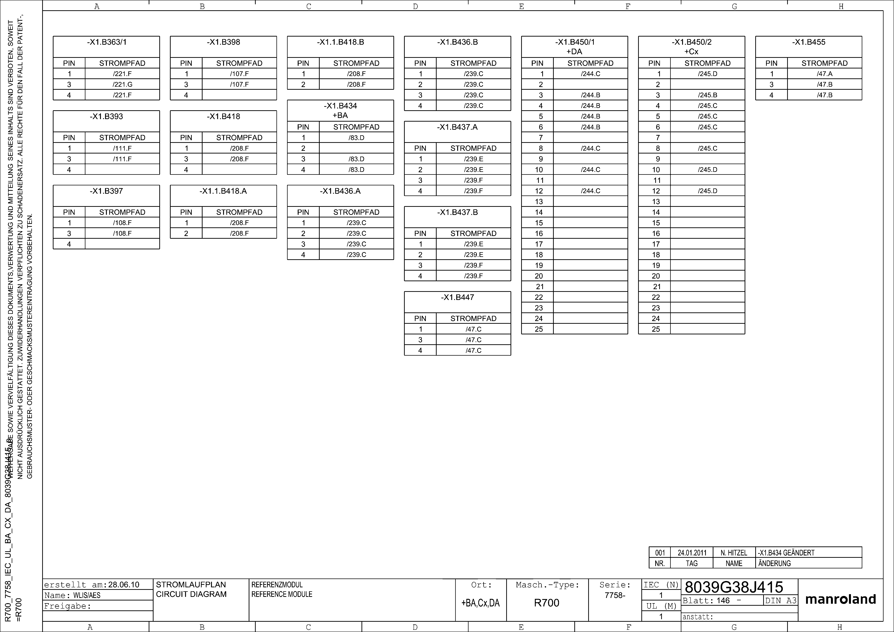

# +BA_Cx_DA — Sheet 146 of 247 — REFERENZMODUL

**REFERENCE MODULE**

> Part of the manroland **R700** printing press IEC/UL circuit diagrams.
> Drawing class: **Stromlaufplan / Circuit diagram** (DIN A3).
> Document `+BA_Cx_DA` covers the **Printing units / main switch cabinet** machine section.

## At a glance

| Field | Value |
|---|---|
| Document | `+BA_Cx_DA`  (8039G38J415) |
| Sheet | **146** of 247 |
| Section (DE) | REFERENZMODUL |
| Section (EN) | REFERENCE MODULE |
| Section type | REFERENCE_MODULE — Reference module |
| Machine type | `R700` |
| Series | `7758` |
| Created | 28.06.10 |
| Replaces | — |
| Columns used | A, B, C, D, E, F, G, H |
| Path numbers | — |
| Labels on sheet | 210 |
| Cross-refs out | 56 |
| Cross-refs in | 0 |

**Previous:** [+BA_Cx_DA sheet 145](SHEET_0145.md) · **Next:** [+BA_Cx_DA sheet 147](SHEET_0147.md) · **Document TOC:** [_TOC.md](_TOC.md)  (+BA_Cx_DA) · **Master TOC:** [all sheets](../_MASTER_TOC.md)

## Sheet image (300 DPI, exact vector render)



_Rendered directly from the PDF vector layer at 300 DPI (1-bit), no OCR and no resampling. Use it to confirm anything ambiguous in the text below._

## Cross-references on this sheet

Each entry is a wire leaving this sheet. The printed token is `/sheet.column`; the link resolves to that sheet inside the same document.

| Ref | Target sheet | Col | Path | Destination on target | Target section | From col |
|---|---|---|---|---|---|---|
| `/47.A` | [+BA_Cx_DA sheet 47](SHEET_0047.md) | A | — | — | SCHUTZEINRICHTUNGEN | H |
| `/221.F` | [+BA_Cx_DA sheet 221](SHEET_0221.md) | F | — | — | OPTION: FORMAT 780x1040 | A |
| `/107.F` | [+BA_Cx_DA sheet 107](SHEET_0107.md) | F | — | — | MOTOR: SEITENMARKE, A SEITE | B |
| `/208.F` | [+BA_Cx_DA sheet 208](SHEET_0208.md) | F | — | — | OPTION: | C |
| `/239.C` | [+BA_Cx_DA sheet 239](SHEET_0239.md) | C | — | — | OPTION: INLINECOATER SMART | E |
| `/244.C` | [+BA_Cx_DA sheet 244](SHEET_0244.md) | C | — | — | OPTION: INLINE COLORPILOT (ICP) | F |
| `/245.D` | [+BA_Cx_DA sheet 245](SHEET_0245.md) | D | — | — | OPTION: INLINE COLORPILOT (ICP) | G |
| `/47.B` | [+BA_Cx_DA sheet 47](SHEET_0047.md) | B | — | — | SCHUTZEINRICHTUNGEN | H |
| `/107.F` | [+BA_Cx_DA sheet 107](SHEET_0107.md) | F | — | — | MOTOR: SEITENMARKE, A SEITE | B |
| `/208.F` | [+BA_Cx_DA sheet 208](SHEET_0208.md) | F | — | — | OPTION: | C |
| `/221.G` | [+BA_Cx_DA sheet 221](SHEET_0221.md) | G | — | — | OPTION: FORMAT 780x1040 | A |
| `/239.C` | [+BA_Cx_DA sheet 239](SHEET_0239.md) | C | — | — | OPTION: INLINECOATER SMART | E |
| `/47.B` | [+BA_Cx_DA sheet 47](SHEET_0047.md) | B | — | — | SCHUTZEINRICHTUNGEN | H |
| `/244.B` | [+BA_Cx_DA sheet 244](SHEET_0244.md) | B | — | — | OPTION: INLINE COLORPILOT (ICP) | F |
| `/245.B` | [+BA_Cx_DA sheet 245](SHEET_0245.md) | B | — | — | OPTION: INLINE COLORPILOT (ICP) | G |
| `/221.F` | [+BA_Cx_DA sheet 221](SHEET_0221.md) | F | — | — | OPTION: FORMAT 780x1040 | A |
| `/239.C` | [+BA_Cx_DA sheet 239](SHEET_0239.md) | C | — | — | OPTION: INLINECOATER SMART | E |
| `/244.B` | [+BA_Cx_DA sheet 244](SHEET_0244.md) | B | — | — | OPTION: INLINE COLORPILOT (ICP) | F |
| `/239.C` | [+BA_Cx_DA sheet 239](SHEET_0239.md) | C | — | — | OPTION: INLINECOATER SMART | E |
| `/245.C` | [+BA_Cx_DA sheet 245](SHEET_0245.md) | C | — | — | OPTION: INLINE COLORPILOT (ICP) | G |
| `/244.B` | [+BA_Cx_DA sheet 244](SHEET_0244.md) | B | — | — | OPTION: INLINE COLORPILOT (ICP) | F |
| `/245.C` | [+BA_Cx_DA sheet 245](SHEET_0245.md) | C | — | — | OPTION: INLINE COLORPILOT (ICP) | G |
| `/244.B` | [+BA_Cx_DA sheet 244](SHEET_0244.md) | B | — | — | OPTION: INLINE COLORPILOT (ICP) | F |
| `/245.C` | [+BA_Cx_DA sheet 245](SHEET_0245.md) | C | — | — | OPTION: INLINE COLORPILOT (ICP) | G |
| `/83.D` | [+BA_Cx_DA sheet 83](SHEET_0083.md) | D | — | — | FARBWERK | C |
| `/111.F` | [+BA_Cx_DA sheet 111](SHEET_0111.md) | F | — | — | MOTOR: DECKMARKENHÖHENEINSTELLUNG | A |
| `/208.F` | [+BA_Cx_DA sheet 208](SHEET_0208.md) | F | — | — | OPTION: | B |
| `/244.C` | [+BA_Cx_DA sheet 244](SHEET_0244.md) | C | — | — | OPTION: INLINE COLORPILOT (ICP) | F |
| `/245.C` | [+BA_Cx_DA sheet 245](SHEET_0245.md) | C | — | — | OPTION: INLINE COLORPILOT (ICP) | G |
| `/239.E` | [+BA_Cx_DA sheet 239](SHEET_0239.md) | E | — | — | OPTION: INLINECOATER SMART | E |
| `/111.F` | [+BA_Cx_DA sheet 111](SHEET_0111.md) | F | — | — | MOTOR: DECKMARKENHÖHENEINSTELLUNG | A |
| `/208.F` | [+BA_Cx_DA sheet 208](SHEET_0208.md) | F | — | — | OPTION: | B |
| `/83.D` | [+BA_Cx_DA sheet 83](SHEET_0083.md) | D | — | — | FARBWERK | C |
| `/239.E` | [+BA_Cx_DA sheet 239](SHEET_0239.md) | E | — | — | OPTION: INLINECOATER SMART | E |
| `/83.D` | [+BA_Cx_DA sheet 83](SHEET_0083.md) | D | — | — | FARBWERK | C |
| `/244.C` | [+BA_Cx_DA sheet 244](SHEET_0244.md) | C | — | — | OPTION: INLINE COLORPILOT (ICP) | F |
| `/245.D` | [+BA_Cx_DA sheet 245](SHEET_0245.md) | D | — | — | OPTION: INLINE COLORPILOT (ICP) | G |
| `/239.F` | [+BA_Cx_DA sheet 239](SHEET_0239.md) | F | — | — | OPTION: INLINECOATER SMART | E |
| `/239.F` | [+BA_Cx_DA sheet 239](SHEET_0239.md) | F | — | — | OPTION: INLINECOATER SMART | E |
| `/244.C` | [+BA_Cx_DA sheet 244](SHEET_0244.md) | C | — | — | OPTION: INLINE COLORPILOT (ICP) | F |
| `/245.D` | [+BA_Cx_DA sheet 245](SHEET_0245.md) | D | — | — | OPTION: INLINE COLORPILOT (ICP) | G |
| `/108.F` | [+BA_Cx_DA sheet 108](SHEET_0108.md) | F | — | — | MOTOR: SEITENMARKE, B SEITE | A |
| `/208.F` | [+BA_Cx_DA sheet 208](SHEET_0208.md) | F | — | — | OPTION: | B |
| `/239.C` | [+BA_Cx_DA sheet 239](SHEET_0239.md) | C | — | — | OPTION: INLINECOATER SMART | C |
| `/108.F` | [+BA_Cx_DA sheet 108](SHEET_0108.md) | F | — | — | MOTOR: SEITENMARKE, B SEITE | A |
| `/208.F` | [+BA_Cx_DA sheet 208](SHEET_0208.md) | F | — | — | OPTION: | B |
| `/239.C` | [+BA_Cx_DA sheet 239](SHEET_0239.md) | C | — | — | OPTION: INLINECOATER SMART | C |
| `/239.E` | [+BA_Cx_DA sheet 239](SHEET_0239.md) | E | — | — | OPTION: INLINECOATER SMART | E |
| `/239.C` | [+BA_Cx_DA sheet 239](SHEET_0239.md) | C | — | — | OPTION: INLINECOATER SMART | C |
| `/239.E` | [+BA_Cx_DA sheet 239](SHEET_0239.md) | E | — | — | OPTION: INLINECOATER SMART | E |
| `/239.C` | [+BA_Cx_DA sheet 239](SHEET_0239.md) | C | — | — | OPTION: INLINECOATER SMART | C |
| `/239.F` | [+BA_Cx_DA sheet 239](SHEET_0239.md) | F | — | — | OPTION: INLINECOATER SMART | E |
| `/239.F` | [+BA_Cx_DA sheet 239](SHEET_0239.md) | F | — | — | OPTION: INLINECOATER SMART | E |
| `/47.C` | [+BA_Cx_DA sheet 47](SHEET_0047.md) | C | — | — | SCHUTZEINRICHTUNGEN | E |
| `/47.C` | [+BA_Cx_DA sheet 47](SHEET_0047.md) | C | — | — | SCHUTZEINRICHTUNGEN | E |
| `/47.C` | [+BA_Cx_DA sheet 47](SHEET_0047.md) | C | — | — | SCHUTZEINRICHTUNGEN | E |

## Devices on this sheet

| Tag | Class | Class meaning (IEC) | Col | Sub | Terminal | Sign |
|---|---|---|---|---|---|---|
| `X1.B393` | — | cross-device reference | A | — | — | — |
| `X1.B397` | — | cross-device reference | A | — | — | — |
| `X1.B398` | — | cross-device reference | B | — | — | — |
| `X1.B418` | — | cross-device reference | B | — | — | — |
| `X1.1.B418.A` | — | cross-device reference | B | — | — | — |
| `X1.1.B418.B` | — | cross-device reference | C | — | — | — |
| `X1.B434` | — | cross-device reference | C | — | — | — |
| `X1.B436.A` | — | cross-device reference | C | — | — | — |
| `X1.B436.B` | — | cross-device reference | D | — | — | — |
| `X1.B437.A` | — | cross-device reference | D | — | — | — |
| `X1.B455` | — | cross-device reference | H | — | — | — |
| `X1.B437.B` | — | cross-device reference | D | — | — | — |
| `X1.B447` | — | cross-device reference | D | — | — | — |
| `NR.` | — | cross-device reference | F | — | — | — |
| `24.01.2011` | — | cross-device reference | G | — | — | — |

## Potentials / nets

_No named potentials on this sheet._

## Wire-end annotations (grouped as printed)

A wire that continues elsewhere is annotated with a small cluster: the destination description, the path/line number `#NN`, and the `/sheet.column` cross reference. Each row below is one such cluster exactly as it is grouped on the drawing.

| Col | Y | Path | Cross-ref | Text on the wire |
|---|---|---|---|---|
| A | 51.3 | — | — | `X1.B363/1` |
| B | 51.3 | — | — | `X1.B398` |
| C | 51.3 | — | — | `X1.1.B418.B` |
| D | 51.3 | — | — | `X1.B436.B` |
| F | 51.3 | — | — | `X1.B450/1` |
| G | 51.3 | — | — | `X1.B450/2` |
| H | 51.3 | — | — | `X1.B455` |
| E | 64.0 | — | — | `+DA` |
| G | 64.1 | — | — | `+Cx` |
| A | 80.0 | — | — | `PIN 3 4 1 STROMPFAD` |
| B | 80.0 | — | — | `PIN 3 4 1 STROMPFAD` |
| C | 80.0 | — | — | `PIN 2 1 STROMPFAD` |
| D | 80.0 | — | — | `PIN 2 3 4 1 STROMPFAD` |
| E | 80.0 | — | — | `PIN STROMPFAD` |
| G | 80.0 | — | — | `PIN STROMPFAD` |
| H | 80.0 | — | — | `PIN 3 4 1 STROMPFAD` |
| E | 94.2 | — | — | `2 3 4 5 6 7 8 9 1` |
| F | 94.2 | — | — | `2 3 4 5 6 7 8 9 1` |
| A | 94.5 | — | `/221.F` | — |
| B | 94.5 | — | `/107.F` | — |
| C | 94.5 | — | `/208.F` | — |
| E | 94.5 | — | `/239.C` | — |
| F | 94.5 | — | `/244.C` | — |
| G | 94.5 | — | `/245.D` | — |
| H | 94.5 | — | `/47.A` | — |
| A | 108.7 | — | `/221.G` | — |
| B | 108.7 | — | `/107.F` | — |
| C | 108.7 | — | `/208.F` | — |
| E | 108.7 | — | `/239.C` | — |
| H | 108.7 | — | `/47.B` | — |
| H | 122.8 | — | `/47.B` | — |
| A | 122.9 | — | `/221.F` | — |
| E | 122.9 | — | `/239.C` | — |
| F | 122.9 | — | `/244.B` | — |
| G | 122.9 | — | `/245.B` | — |
| C | 136.4 | — | — | `X1.B434` |
| F | 137.0 | — | `/244.B` | — |
| E | 137.1 | — | `/239.C` | — |
| G | 137.1 | — | `/245.C` | — |
| C | 149.1 | — | — | `+BA` |
| A | 150.6 | — | — | `X1.B393` |
| B | 150.6 | — | — | `X1.B418` |
| F | 151.2 | — | `/244.B` | — |
| G | 151.2 | — | `/245.C` | — |
| D | 164.7 | — | — | `X1.B437.A` |
| C | 165.0 | — | — | `PIN 2 3 4 1 STROMPFAD` |
| F | 165.4 | — | `/244.B` | — |
| G | 165.4 | — | `/245.C` | — |
| A | 179.2 | — | — | `PIN 3 4 1 STROMPFAD` |
| B | 179.2 | — | — | `PIN 3 4 1 STROMPFAD` |
| C | 179.6 | — | `/83.D` | — |
| D | 193.4 | — | — | `PIN 2 3 4 1 STROMPFAD` |
| A | 193.7 | — | `/111.F` | — |
| B | 193.7 | — | `/208.F` | — |
| F | 193.8 | — | `/244.C` | — |
| G | 193.8 | — | `/245.C` | — |
| A | 207.9 | — | `/111.F` | — |
| B | 207.9 | — | `/208.F` | — |
| C | 207.9 | — | `/83.D` | — |
| E | 207.9 | — | `/239.E` | — |
| E | 221.8 | — | — | `10 12 13 14 15 16 17 18 19 20 11` |
| F | 221.8 | — | — | `10 12 13 14 15 16 17 18 19 20 11` |
| C | 222.1 | — | `/83.D` | — |
| E | 222.1 | — | `/239.E` | — |
| F | 222.1 | — | `/244.C` | — |
| G | 222.1 | — | `/245.D` | — |
| E | 236.3 | — | `/239.F` | — |
| A | 249.8 | — | — | `X1.B397` |
| B | 249.8 | — | — | `X1.1.B418.A` |
| C | 249.8 | — | — | `X1.B436.A` |
| E | 250.4 | — | `/239.F` | — |
| F | 250.4 | — | `/244.C` | — |
| G | 250.4 | — | `/245.D` | — |
| D | 278.1 | — | — | `X1.B437.B` |
| A | 278.4 | — | — | `PIN 3 4 1 STROMPFAD` |
| B | 278.4 | — | — | `PIN 2 1 STROMPFAD` |
| C | 278.4 | — | — | `PIN 2 3 4 1 STROMPFAD` |
| A | 292.9 | — | `/108.F` | — |
| B | 292.9 | — | `/208.F` | — |
| C | 293.0 | — | `/239.C` | — |
| D | 306.8 | — | — | `PIN 2 3 4 1 STROMPFAD` |
| A | 307.1 | — | `/108.F` | — |
| B | 307.1 | — | `/208.F` | — |
| C | 307.1 | — | `/239.C` | — |
| C | 321.3 | — | `/239.C` | — |
| E | 321.3 | — | `/239.E` | — |
| C | 335.5 | — | `/239.C` | — |
| E | 335.5 | — | `/239.E` | — |
| E | 349.6 | — | `/239.F` | — |
| E | 363.8 | — | `/239.F` | — |
| E | 377.7 | — | — | `22 23 24 25 21` |
| F | 377.7 | — | — | `22 23 24 25 21` |
| D | 391.5 | — | — | `X1.B447` |
| D | 420.1 | — | — | `PIN 3 4 1 STROMPFAD` |
| E | 434.7 | — | `/47.C` | — |
| E | 448.9 | — | `/47.C` | — |
| E | 463.0 | — | `/47.C` | — |
| G | 732.7 | — | — | `001 24.01.2011 N. HITZEL X1.B434 GEÄNDERT` |
| G | 747.0 | — | — | `NR. TAG NAME ÄNDERUNG` |


## Reconstructed tables

This sheet carries tabular content (pin map / terminal assignment / index). The grid below was rebuilt from the drawing's own rule lines, so each row is exactly one physical row of the table.

### Table 1 — 13 data rows × 2 columns (at x=70.9, y=48.2) — **X1.B363/1**

| PIN | STROMPFAD |
|---|---|
| `1` | `/221.F` |
| `3` | `/221.G` |
| `4` | `/221.F` |
|  | `X1.B393` |
| `PIN` | `STROMPFAD` |
| `1` | `/111.F` |
| `3` | `/111.F` |
| `4` |  |
|  | `X1.B397` |
| `PIN` | `STROMPFAD` |
| `1` | `/108.F` |
| `3` | `/108.F` |
| `4` |  |


### Table 2 — 12 data rows × 2 columns (at x=226.8, y=48.2) — **X1.B398**

| PIN | STROMPFAD |
|---|---|
| `1` | `/107.F` |
| `3` | `/107.F` |
| `4` |  |
|  | `X1.B418` |
| `PIN` | `STROMPFAD` |
| `1` | `/208.F` |
| `3` | `/208.F` |
| `4` |  |
|  | `X1.1.B418.A` |
| `PIN` | `STROMPFAD` |
| `1` | `/208.F` |
| `2` | `/208.F` |


### Table 3 — 15 data rows × 2 columns (at x=382.7, y=48.2) — **X1.1.B418.B**

| PIN | STROMPFAD |
|---|---|
| `1` | `/208.F` |
| `2` | `/208.F` |
|  | `X1.B434` |
|  | `+BA` |
| `PIN` | `STROMPFAD` |
| `1` | `/83.D` |
| `2` |  |
| `3` | `/83.D` |
| `4` | `/83.D` |
|  | `X1.B436.A` |
| `PIN` | `STROMPFAD` |
| `1` | `/239.C` |
| `2` | `/239.C` |
| `3` | `/239.C` |
| `4` | `/239.C` |


### Table 4 — 21 data rows × 2 columns (at x=538.6, y=48.2) — **X1.B436.B**

| PIN | STROMPFAD |
|---|---|
| `1` | `/239.C` |
| `2` | `/239.C` |
| `3` | `/239.C` |
| `4` | `/239.C` |
|  | `X1.B437.A` |
| `PIN` | `STROMPFAD` |
| `1` | `/239.E` |
| `2` | `/239.E` |
| `3` | `/239.F` |
| `4` | `/239.F` |
|  | `X1.B437.B` |
| `PIN` | `STROMPFAD` |
| `1` | `/239.E` |
| `2` | `/239.E` |
| `3` | `/239.F` |
| `4` | `/239.F` |
|  | `X1.B447` |
| `PIN` | `STROMPFAD` |
| `1` | `/47.C` |
| `3` | `/47.C` |
| `4` | `/47.C` |


### Table 5 — 25 data rows × 2 columns (at x=694.5, y=48.2) — **X1.B450/1 +DA**

| PIN | STROMPFAD |
|---|---|
| `1` | `/244.C` |
| `2` |  |
| `3` | `/244.B` |
| `4` | `/244.B` |
| `5` | `/244.B` |
| `6` | `/244.B` |
| `7` |  |
| `8` | `/244.C` |
| `9` |  |
| `10` | `/244.C` |
| `11` |  |
| `12` | `/244.C` |
| `13` |  |
| `14` |  |
| `15` |  |
| `16` |  |
| `17` |  |
| `18` |  |
| `19` |  |
| `20` |  |
| `21` |  |
| `22` |  |
| `23` |  |
| `24` |  |
| `25` |  |


### Table 6 — 25 data rows × 2 columns (at x=850.4, y=48.2) — **X1.B450/2 +Cx**

| PIN | STROMPFAD |
|---|---|
| `1` | `/245.D` |
| `2` |  |
| `3` | `/245.B` |
| `4` | `/245.C` |
| `5` | `/245.C` |
| `6` | `/245.C` |
| `7` |  |
| `8` | `/245.C` |
| `9` |  |
| `10` | `/245.D` |
| `11` |  |
| `12` | `/245.D` |
| `13` |  |
| `14` |  |
| `15` |  |
| `16` |  |
| `17` |  |
| `18` |  |
| `19` |  |
| `20` |  |
| `21` |  |
| `22` |  |
| `23` |  |
| `24` |  |
| `25` |  |


### Table 7 — 3 data rows × 2 columns (at x=1006.3, y=48.2) — **X1.B455**

| PIN | STROMPFAD |
|---|---|
| `1` | `/47.A` |
| `3` | `/47.B` |
| `4` | `/47.B` |


## Notes and free text on this sheet

| Text | Col | Y (pt) |
|---|---|---|
| `PIN` | A | 80.02 |
| `STROMPFAD` | A | 79.98 |
| `X1.B363/1` | A | 51.34 |
| `PIN` | B | 80.02 |
| `STROMPFAD` | B | 79.98 |
| `PIN` | C | 80.02 |
| `STROMPFAD` | C | 79.98 |
| `+BA` | C | 149.05 |
| `PIN` | D | 80.02 |
| `STROMPFAD` | E | 79.98 |
| `PIN` | G | 80.02 |
| `STROMPFAD` | H | 79.98 |
| `PIN` | E | 80.02 |
| `STROMPFAD` | F | 79.98 |
| `X1.B450/1` | F | 51.34 |
| `+DA` | E | 64.01 |
| `PIN` | F | 80.02 |
| `STROMPFAD` | G | 79.98 |
| `X1.B450/2` | G | 51.34 |
| `+Cx` | G | 64.12 |
| `TAG` | G | 747.05 |
| `NAME` | G | 747.05 |
| `ÄNDERUNG` | G | 747.11 |
| `N. HITZEL` | G | 732.94 |
| `X1.B434 GEÄNDERT` | G | 732.93 |

## Complete label inventory (exact text from the drawing)

Every text object inside the drawing area of this sheet, in DIN reading order (column A→H, then top→bottom). This is the authoritative list: if a string is not here it is not printed on this sheet.

| Col | Y | X | Dir | Type | Text |
|---|---|---|---|---|---|
| A | 51.3 | 116.1 | → | text | `X1.B363/1` |
| A | 80.0 | 84.0 | → | text | `PIN` |
| A | 80.0 | 132.2 | → | text | `STROMPFAD` |
| A | 94.2 | 90.0 | → | number | `1` |
| A | 94.5 | 150.7 | → | cross-reference | `/221.F` |
| A | 108.4 | 89.4 | → | number | `3` |
| A | 108.7 | 150.1 | → | cross-reference | `/221.G` |
| A | 122.5 | 89.4 | → | number | `4` |
| A | 122.9 | 150.7 | → | cross-reference | `/221.F` |
| A | 150.5 | 119.8 | → | device ref | `X1.B393` |
| A | 179.2 | 84.0 | → | text | `PIN` |
| A | 179.2 | 132.2 | → | text | `STROMPFAD` |
| A | 193.4 | 90.0 | → | number | `1` |
| A | 193.7 | 150.7 | → | cross-reference | `/111.F` |
| A | 207.6 | 89.4 | → | number | `3` |
| A | 207.9 | 150.7 | → | cross-reference | `/111.F` |
| A | 221.8 | 89.4 | → | number | `4` |
| A | 249.8 | 119.8 | → | device ref | `X1.B397` |
| A | 278.4 | 84.0 | → | text | `PIN` |
| A | 278.4 | 132.2 | → | text | `STROMPFAD` |
| A | 292.6 | 90.0 | → | number | `1` |
| A | 293.0 | 150.7 | → | cross-reference | `/108.F` |
| A | 306.8 | 89.4 | → | number | `3` |
| A | 307.1 | 150.7 | → | cross-reference | `/108.F` |
| A | 321.0 | 89.4 | → | number | `4` |
| B | 51.3 | 275.7 | → | device ref | `X1.B398` |
| B | 80.0 | 240.0 | → | text | `PIN` |
| B | 80.0 | 288.1 | → | text | `STROMPFAD` |
| B | 94.2 | 245.9 | → | number | `1` |
| B | 94.5 | 306.6 | → | cross-reference | `/107.F` |
| B | 108.4 | 245.3 | → | number | `3` |
| B | 108.7 | 306.6 | → | cross-reference | `/107.F` |
| B | 122.5 | 245.3 | → | number | `4` |
| B | 150.5 | 275.7 | → | device ref | `X1.B418` |
| B | 179.2 | 240.0 | → | text | `PIN` |
| B | 179.2 | 288.1 | → | text | `STROMPFAD` |
| B | 193.4 | 245.9 | → | number | `1` |
| B | 193.7 | 306.6 | → | cross-reference | `/208.F` |
| B | 207.6 | 245.3 | → | number | `3` |
| B | 207.9 | 306.6 | → | cross-reference | `/208.F` |
| B | 221.8 | 245.3 | → | number | `4` |
| B | 249.8 | 265.9 | → | device ref | `X1.1.B418.A` |
| B | 278.4 | 240.0 | → | text | `PIN` |
| B | 278.4 | 288.1 | → | text | `STROMPFAD` |
| B | 292.6 | 245.9 | → | number | `1` |
| B | 293.0 | 306.6 | → | cross-reference | `/208.F` |
| B | 306.8 | 245.3 | → | number | `2` |
| B | 307.1 | 306.6 | → | cross-reference | `/208.F` |
| C | 51.3 | 422.2 | → | device ref | `X1.1.B418.B` |
| C | 80.0 | 395.9 | → | text | `PIN` |
| C | 80.0 | 444.0 | → | text | `STROMPFAD` |
| C | 94.2 | 401.8 | → | number | `1` |
| C | 94.5 | 462.5 | → | cross-reference | `/208.F` |
| C | 108.4 | 401.2 | → | number | `2` |
| C | 108.7 | 462.5 | → | cross-reference | `/208.F` |
| C | 136.4 | 431.6 | → | device ref | `X1.B434` |
| C | 149.0 | 442.9 | → | text | `+BA` |
| C | 165.0 | 444.0 | → | text | `STROMPFAD` |
| C | 165.1 | 395.9 | → | text | `PIN` |
| C | 179.2 | 401.8 | → | number | `1` |
| C | 179.6 | 464.5 | → | cross-reference | `/83.D` |
| C | 193.4 | 401.2 | → | number | `2` |
| C | 207.6 | 401.2 | → | number | `3` |
| C | 207.9 | 464.5 | → | cross-reference | `/83.D` |
| C | 221.8 | 401.2 | → | number | `4` |
| C | 222.1 | 464.5 | → | cross-reference | `/83.D` |
| C | 249.8 | 426.2 | → | device ref | `X1.B436.A` |
| C | 278.4 | 395.9 | → | text | `PIN` |
| C | 278.4 | 444.0 | → | text | `STROMPFAD` |
| C | 292.6 | 401.8 | → | number | `1` |
| C | 293.0 | 462.0 | → | cross-reference | `/239.C` |
| C | 306.8 | 401.2 | → | number | `2` |
| C | 307.1 | 462.0 | → | cross-reference | `/239.C` |
| C | 321.0 | 401.2 | → | number | `3` |
| C | 321.3 | 462.0 | → | cross-reference | `/239.C` |
| C | 335.1 | 401.2 | → | number | `4` |
| C | 335.5 | 462.0 | → | cross-reference | `/239.C` |
| D | 51.3 | 582.5 | → | device ref | `X1.B436.B` |
| D | 80.0 | 551.8 | → | text | `PIN` |
| D | 94.2 | 557.7 | → | number | `1` |
| D | 108.4 | 557.1 | → | number | `2` |
| D | 122.5 | 557.1 | → | number | `3` |
| D | 136.7 | 557.1 | → | number | `4` |
| D | 164.7 | 582.1 | → | device ref | `X1.B437.A` |
| D | 193.4 | 551.8 | → | text | `PIN` |
| D | 207.6 | 557.7 | → | number | `1` |
| D | 221.8 | 557.1 | → | number | `2` |
| D | 235.9 | 557.1 | → | number | `3` |
| D | 250.1 | 557.1 | → | number | `4` |
| D | 278.1 | 582.5 | → | device ref | `X1.B437.B` |
| D | 306.8 | 551.8 | → | text | `PIN` |
| D | 321.0 | 557.7 | → | number | `1` |
| D | 335.1 | 557.1 | → | number | `2` |
| D | 349.3 | 557.1 | → | number | `3` |
| D | 363.5 | 557.1 | → | number | `4` |
| D | 391.5 | 587.5 | → | device ref | `X1.B447` |
| D | 420.2 | 551.8 | → | text | `PIN` |
| D | 434.4 | 557.7 | → | number | `1` |
| D | 448.5 | 557.1 | → | number | `3` |
| D | 462.7 | 557.1 | → | number | `4` |
| E | 64.0 | 754.4 | → | text | `+DA` |
| E | 80.0 | 600.0 | → | text | `STROMPFAD` |
| E | 80.0 | 707.7 | → | text | `PIN` |
| E | 94.2 | 719.4 | → | number | `1` |
| E | 94.5 | 618.0 | → | cross-reference | `/239.C` |
| E | 108.4 | 717.7 | → | number | `2` |
| E | 108.7 | 618.0 | → | cross-reference | `/239.C` |
| E | 122.5 | 717.7 | → | number | `3` |
| E | 122.9 | 618.0 | → | cross-reference | `/239.C` |
| E | 136.7 | 717.7 | → | number | `4` |
| E | 137.1 | 618.0 | → | cross-reference | `/239.C` |
| E | 150.9 | 717.7 | → | number | `5` |
| E | 165.1 | 717.7 | → | number | `6` |
| E | 179.2 | 717.7 | → | number | `7` |
| E | 193.4 | 600.0 | → | text | `STROMPFAD` |
| E | 193.4 | 717.7 | → | number | `8` |
| E | 207.6 | 717.7 | → | number | `9` |
| E | 207.9 | 618.2 | → | cross-reference | `/239.E` |
| E | 221.8 | 712.3 | → | number | `10` |
| E | 222.1 | 618.2 | → | cross-reference | `/239.E` |
| E | 235.9 | 714.0 | → | number | `11` |
| E | 236.3 | 618.4 | → | cross-reference | `/239.F` |
| E | 250.1 | 712.3 | → | number | `12` |
| E | 250.4 | 618.4 | → | cross-reference | `/239.F` |
| E | 264.3 | 712.3 | → | number | `13` |
| E | 278.5 | 712.3 | → | number | `14` |
| E | 292.6 | 712.3 | → | number | `15` |
| E | 306.8 | 600.0 | → | text | `STROMPFAD` |
| E | 306.8 | 712.3 | → | number | `16` |
| E | 321.0 | 712.3 | → | number | `17` |
| E | 321.3 | 618.2 | → | cross-reference | `/239.E` |
| E | 335.1 | 712.3 | → | number | `18` |
| E | 335.5 | 618.2 | → | cross-reference | `/239.E` |
| E | 349.3 | 712.3 | → | number | `19` |
| E | 349.6 | 618.4 | → | cross-reference | `/239.F` |
| E | 363.5 | 712.3 | → | number | `20` |
| E | 363.8 | 618.4 | → | cross-reference | `/239.F` |
| E | 377.7 | 714.0 | → | number | `21` |
| E | 391.8 | 712.3 | → | number | `22` |
| E | 406.0 | 712.3 | → | number | `23` |
| E | 420.1 | 600.0 | → | text | `STROMPFAD` |
| E | 420.2 | 712.3 | → | number | `24` |
| E | 434.4 | 712.3 | → | number | `25` |
| E | 434.7 | 620.4 | → | cross-reference | `/47.C` |
| E | 448.9 | 620.4 | → | cross-reference | `/47.C` |
| E | 463.0 | 620.4 | → | cross-reference | `/47.C` |
| F | 51.3 | 739.7 | → | text | `X1.B450/1` |
| F | 80.0 | 755.9 | → | text | `STROMPFAD` |
| F | 80.0 | 863.6 | → | text | `PIN` |
| F | 94.2 | 875.3 | → | number | `1` |
| F | 94.5 | 773.9 | → | cross-reference | `/244.C` |
| F | 108.4 | 873.6 | → | number | `2` |
| F | 122.5 | 873.6 | → | number | `3` |
| F | 122.9 | 774.0 | → | cross-reference | `/244.B` |
| F | 136.7 | 873.6 | → | number | `4` |
| F | 137.0 | 774.0 | → | cross-reference | `/244.B` |
| F | 150.9 | 873.6 | → | number | `5` |
| F | 151.2 | 774.0 | → | cross-reference | `/244.B` |
| F | 165.1 | 873.6 | → | number | `6` |
| F | 165.4 | 774.0 | → | cross-reference | `/244.B` |
| F | 179.2 | 873.6 | → | number | `7` |
| F | 193.4 | 873.6 | → | number | `8` |
| F | 193.8 | 773.9 | → | cross-reference | `/244.C` |
| F | 207.6 | 873.6 | → | number | `9` |
| F | 221.8 | 868.3 | → | number | `10` |
| F | 222.1 | 773.9 | → | cross-reference | `/244.C` |
| F | 235.9 | 870.0 | → | number | `11` |
| F | 250.1 | 868.3 | → | number | `12` |
| F | 250.4 | 773.9 | → | cross-reference | `/244.C` |
| F | 264.3 | 868.3 | → | number | `13` |
| F | 278.5 | 868.3 | → | number | `14` |
| F | 292.6 | 868.3 | → | number | `15` |
| F | 306.8 | 868.3 | → | number | `16` |
| F | 321.0 | 868.3 | → | number | `17` |
| F | 335.1 | 868.3 | → | number | `18` |
| F | 349.3 | 868.3 | → | number | `19` |
| F | 363.5 | 868.3 | → | number | `20` |
| F | 377.7 | 870.0 | → | number | `21` |
| F | 391.8 | 868.3 | → | number | `22` |
| F | 406.0 | 868.3 | → | number | `23` |
| F | 420.2 | 868.3 | → | number | `24` |
| F | 434.4 | 868.3 | → | number | `25` |
| F | 732.7 | 872.7 | → | number | `001` |
| F | 747.0 | 872.2 | → | device ref | `NR.` |
| G | 51.3 | 894.9 | → | text | `X1.B450/2` |
| G | 64.1 | 911.5 | → | text | `+Cx` |
| G | 80.0 | 911.8 | → | text | `STROMPFAD` |
| G | 80.0 | 1019.5 | → | text | `PIN` |
| G | 94.2 | 1025.4 | → | number | `1` |
| G | 94.5 | 929.8 | → | cross-reference | `/245.D` |
| G | 108.4 | 1024.9 | → | number | `3` |
| G | 122.5 | 1024.9 | → | number | `4` |
| G | 122.9 | 929.9 | → | cross-reference | `/245.B` |
| G | 137.1 | 929.8 | → | cross-reference | `/245.C` |
| G | 151.2 | 929.8 | → | cross-reference | `/245.C` |
| G | 165.4 | 929.8 | → | cross-reference | `/245.C` |
| G | 193.8 | 929.8 | → | cross-reference | `/245.C` |
| G | 222.1 | 929.8 | → | cross-reference | `/245.D` |
| G | 250.4 | 929.8 | → | cross-reference | `/245.D` |
| G | 732.9 | 902.9 | → | device ref | `24.01.2011` |
| G | 732.9 | 959.9 | → | text | `N. HITZEL` |
| G | 732.9 | 1009.6 | → | text | `X1.B434 GEÄNDERT` |
| G | 747.0 | 966.7 | → | text | `NAME` |
| G | 747.1 | 913.5 | → | text | `TAG` |
| G | 747.1 | 1010.1 | → | text | `ÄNDERUNG` |
| H | 51.3 | 1055.2 | → | device ref | `X1.B455` |
| H | 80.0 | 1067.7 | → | text | `STROMPFAD` |
| H | 94.5 | 1088.1 | → | cross-reference | `/47.A` |
| H | 108.7 | 1088.2 | → | cross-reference | `/47.B` |
| H | 122.8 | 1088.2 | → | cross-reference | `/47.B` |

## Reading-order text block

The same content as a plain block, grouped by DIN column — convenient to paste or to match against a visual description.

```text
=== Column A ===
  51.3  116.1  text         X1.B363/1
  80.0   84.0  text         PIN
  80.0  132.2  text         STROMPFAD
  94.2   90.0  numeric      1
  94.5  150.7  xref         /221.F
 108.4   89.4  numeric      3
 108.7  150.1  xref         /221.G
 122.5   89.4  numeric      4
 122.9  150.7  xref         /221.F
 150.5  119.8  devref       X1.B393
 179.2   84.0  text         PIN
 179.2  132.2  text         STROMPFAD
 193.4   90.0  numeric      1
 193.7  150.7  xref         /111.F
 207.6   89.4  numeric      3
 207.9  150.7  xref         /111.F
 221.8   89.4  numeric      4
 249.8  119.8  devref       X1.B397
 278.4   84.0  text         PIN
 278.4  132.2  text         STROMPFAD
 292.6   90.0  numeric      1
 293.0  150.7  xref         /108.F
 306.8   89.4  numeric      3
 307.1  150.7  xref         /108.F
 321.0   89.4  numeric      4
=== Column B ===
  51.3  275.7  devref       X1.B398
  80.0  240.0  text         PIN
  80.0  288.1  text         STROMPFAD
  94.2  245.9  numeric      1
  94.5  306.6  xref         /107.F
 108.4  245.3  numeric      3
 108.7  306.6  xref         /107.F
 122.5  245.3  numeric      4
 150.5  275.7  devref       X1.B418
 179.2  240.0  text         PIN
 179.2  288.1  text         STROMPFAD
 193.4  245.9  numeric      1
 193.7  306.6  xref         /208.F
 207.6  245.3  numeric      3
 207.9  306.6  xref         /208.F
 221.8  245.3  numeric      4
 249.8  265.9  devref       X1.1.B418.A
 278.4  240.0  text         PIN
 278.4  288.1  text         STROMPFAD
 292.6  245.9  numeric      1
 293.0  306.6  xref         /208.F
 306.8  245.3  numeric      2
 307.1  306.6  xref         /208.F
=== Column C ===
  51.3  422.2  devref       X1.1.B418.B
  80.0  395.9  text         PIN
  80.0  444.0  text         STROMPFAD
  94.2  401.8  numeric      1
  94.5  462.5  xref         /208.F
 108.4  401.2  numeric      2
 108.7  462.5  xref         /208.F
 136.4  431.6  devref       X1.B434
 149.0  442.9  text         +BA
 165.0  444.0  text         STROMPFAD
 165.1  395.9  text         PIN
 179.2  401.8  numeric      1
 179.6  464.5  xref         /83.D
 193.4  401.2  numeric      2
 207.6  401.2  numeric      3
 207.9  464.5  xref         /83.D
 221.8  401.2  numeric      4
 222.1  464.5  xref         /83.D
 249.8  426.2  devref       X1.B436.A
 278.4  395.9  text         PIN
 278.4  444.0  text         STROMPFAD
 292.6  401.8  numeric      1
 293.0  462.0  xref         /239.C
 306.8  401.2  numeric      2
 307.1  462.0  xref         /239.C
 321.0  401.2  numeric      3
 321.3  462.0  xref         /239.C
 335.1  401.2  numeric      4
 335.5  462.0  xref         /239.C
=== Column D ===
  51.3  582.5  devref       X1.B436.B
  80.0  551.8  text         PIN
  94.2  557.7  numeric      1
 108.4  557.1  numeric      2
 122.5  557.1  numeric      3
 136.7  557.1  numeric      4
 164.7  582.1  devref       X1.B437.A
 193.4  551.8  text         PIN
 207.6  557.7  numeric      1
 221.8  557.1  numeric      2
 235.9  557.1  numeric      3
 250.1  557.1  numeric      4
 278.1  582.5  devref       X1.B437.B
 306.8  551.8  text         PIN
 321.0  557.7  numeric      1
 335.1  557.1  numeric      2
 349.3  557.1  numeric      3
 363.5  557.1  numeric      4
 391.5  587.5  devref       X1.B447
 420.2  551.8  text         PIN
 434.4  557.7  numeric      1
 448.5  557.1  numeric      3
 462.7  557.1  numeric      4
=== Column E ===
  64.0  754.4  text         +DA
  80.0  600.0  text         STROMPFAD
  80.0  707.7  text         PIN
  94.2  719.4  numeric      1
  94.5  618.0  xref         /239.C
 108.4  717.7  numeric      2
 108.7  618.0  xref         /239.C
 122.5  717.7  numeric      3
 122.9  618.0  xref         /239.C
 136.7  717.7  numeric      4
 137.1  618.0  xref         /239.C
 150.9  717.7  numeric      5
 165.1  717.7  numeric      6
 179.2  717.7  numeric      7
 193.4  600.0  text         STROMPFAD
 193.4  717.7  numeric      8
 207.6  717.7  numeric      9
 207.9  618.2  xref         /239.E
 221.8  712.3  numeric      10
 222.1  618.2  xref         /239.E
 235.9  714.0  numeric      11
 236.3  618.4  xref         /239.F
 250.1  712.3  numeric      12
 250.4  618.4  xref         /239.F
 264.3  712.3  numeric      13
 278.5  712.3  numeric      14
 292.6  712.3  numeric      15
 306.8  600.0  text         STROMPFAD
 306.8  712.3  numeric      16
 321.0  712.3  numeric      17
 321.3  618.2  xref         /239.E
 335.1  712.3  numeric      18
 335.5  618.2  xref         /239.E
 349.3  712.3  numeric      19
 349.6  618.4  xref         /239.F
 363.5  712.3  numeric      20
 363.8  618.4  xref         /239.F
 377.7  714.0  numeric      21
 391.8  712.3  numeric      22
 406.0  712.3  numeric      23
 420.1  600.0  text         STROMPFAD
 420.2  712.3  numeric      24
 434.4  712.3  numeric      25
 434.7  620.4  xref         /47.C
 448.9  620.4  xref         /47.C
 463.0  620.4  xref         /47.C
=== Column F ===
  51.3  739.7  text         X1.B450/1
  80.0  755.9  text         STROMPFAD
  80.0  863.6  text         PIN
  94.2  875.3  numeric      1
  94.5  773.9  xref         /244.C
 108.4  873.6  numeric      2
 122.5  873.6  numeric      3
 122.9  774.0  xref         /244.B
 136.7  873.6  numeric      4
 137.0  774.0  xref         /244.B
 150.9  873.6  numeric      5
 151.2  774.0  xref         /244.B
 165.1  873.6  numeric      6
 165.4  774.0  xref         /244.B
 179.2  873.6  numeric      7
 193.4  873.6  numeric      8
 193.8  773.9  xref         /244.C
 207.6  873.6  numeric      9
 221.8  868.3  numeric      10
 222.1  773.9  xref         /244.C
 235.9  870.0  numeric      11
 250.1  868.3  numeric      12
 250.4  773.9  xref         /244.C
 264.3  868.3  numeric      13
 278.5  868.3  numeric      14
 292.6  868.3  numeric      15
 306.8  868.3  numeric      16
 321.0  868.3  numeric      17
 335.1  868.3  numeric      18
 349.3  868.3  numeric      19
 363.5  868.3  numeric      20
 377.7  870.0  numeric      21
 391.8  868.3  numeric      22
 406.0  868.3  numeric      23
 420.2  868.3  numeric      24
 434.4  868.3  numeric      25
 732.7  872.7  numeric      001
 747.0  872.2  devref       NR.
=== Column G ===
  51.3  894.9  text         X1.B450/2
  64.1  911.5  text         +Cx
  80.0  911.8  text         STROMPFAD
  80.0 1019.5  text         PIN
  94.2 1025.4  numeric      1
  94.5  929.8  xref         /245.D
 108.4 1024.9  numeric      3
 122.5 1024.9  numeric      4
 122.9  929.9  xref         /245.B
 137.1  929.8  xref         /245.C
 151.2  929.8  xref         /245.C
 165.4  929.8  xref         /245.C
 193.8  929.8  xref         /245.C
 222.1  929.8  xref         /245.D
 250.4  929.8  xref         /245.D
 732.9  902.9  devref       24.01.2011
 732.9  959.9  text         N. HITZEL
 732.9 1009.6  text         X1.B434 GEÄNDERT
 747.0  966.7  text         NAME
 747.1  913.5  text         TAG
 747.1 1010.1  text         ÄNDERUNG
=== Column H ===
  51.3 1055.2  devref       X1.B455
  80.0 1067.7  text         STROMPFAD
  94.5 1088.1  xref         /47.A
 108.7 1088.2  xref         /47.B
 122.8 1088.2  xref         /47.B
```

---
_Generated from the PDF vector text layer; no OCR. Source: `R700_7758_IEC_UL_BA_CX_DA_8039G38J415_p`, sheet 146._
