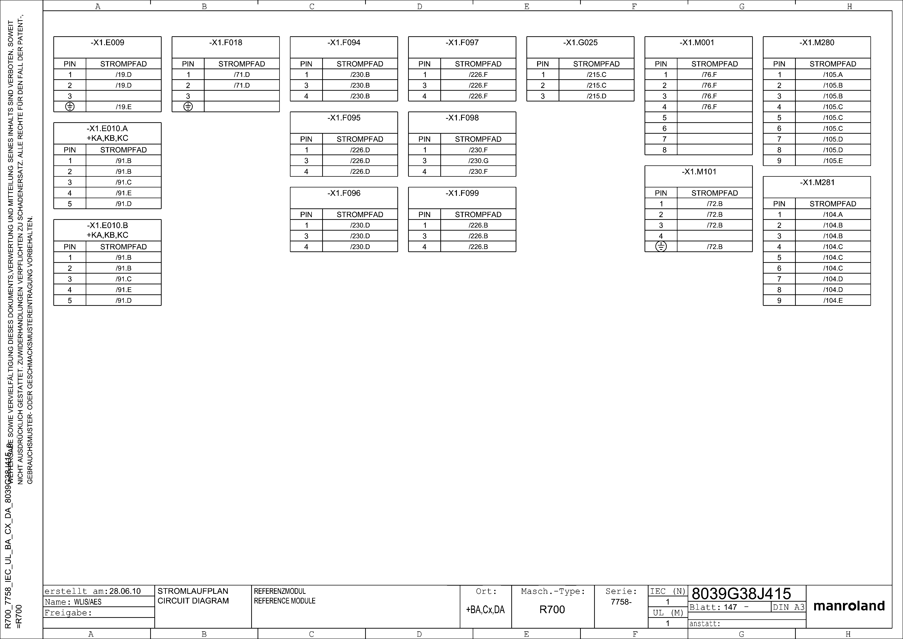

# +BA_Cx_DA — Sheet 147 of 247 — REFERENZMODUL

**REFERENCE MODULE**

> Part of the manroland **R700** printing press IEC/UL circuit diagrams.
> Drawing class: **Stromlaufplan / Circuit diagram** (DIN A3).
> Document `+BA_Cx_DA` covers the **Printing units / main switch cabinet** machine section.

## At a glance

| Field | Value |
|---|---|
| Document | `+BA_Cx_DA`  (8039G38J415) |
| Sheet | **147** of 247 |
| Section (DE) | REFERENZMODUL |
| Section (EN) | REFERENCE MODULE |
| Section type | REFERENCE_MODULE — Reference module |
| Machine type | `R700` |
| Series | `7758` |
| Created | 28.06.10 |
| Replaces | — |
| Columns used | A, B, C, D, E, F, G, H |
| Path numbers | — |
| Labels on sheet | 176 |
| Cross-refs out | 62 |
| Cross-refs in | 0 |

**Previous:** [+BA_Cx_DA sheet 146](SHEET_0146.md) · **Next:** [+BA_Cx_DA sheet 148](SHEET_0148.md) · **Document TOC:** [_TOC.md](_TOC.md)  (+BA_Cx_DA) · **Master TOC:** [all sheets](../_MASTER_TOC.md)

## Sheet image (300 DPI, exact vector render)



_Rendered directly from the PDF vector layer at 300 DPI (1-bit), no OCR and no resampling. Use it to confirm anything ambiguous in the text below._

## Cross-references on this sheet

Each entry is a wire leaving this sheet. The printed token is `/sheet.column`; the link resolves to that sheet inside the same document.

| Ref | Target sheet | Col | Path | Destination on target | Target section | From col |
|---|---|---|---|---|---|---|
| `/76.F` | [+BA_Cx_DA sheet 76](SHEET_0076.md) | F | — | — | FARBWERK | G |
| `/230.B` | [+BA_Cx_DA sheet 230](SHEET_0230.md) | B | — | — | OPTION: WASCHMITTELWECHSELBETRIEB | C |
| `/105.A` | [+BA_Cx_DA sheet 105](SHEET_0105.md) | A | — | — | MOTOR: SEITENREGISTER | H |
| `/19.D` | [+BA_Cx_DA sheet 19](SHEET_0019.md) | D | — | — | SPANNUNGSVERSORGUNG: MAGNETVENTILBLOCK | A |
| `/71.D` | [+BA_Cx_DA sheet 71](SHEET_0071.md) | D | — | — | ÖLUMLAUFSCHMIERUNG | B |
| `/226.F` | [+BA_Cx_DA sheet 226](SHEET_0226.md) | F | — | — | OPTION: ZWISCHENTROCKNER VORBEREITUNG | E |
| `/215.C` | [+BA_Cx_DA sheet 215](SHEET_0215.md) | C | — | — | OPTION: BLASEINRICHTUNG, FARBWERK | F |
| `/230.B` | [+BA_Cx_DA sheet 230](SHEET_0230.md) | B | — | — | OPTION: WASCHMITTELWECHSELBETRIEB | C |
| `/76.F` | [+BA_Cx_DA sheet 76](SHEET_0076.md) | F | — | — | FARBWERK | G |
| `/105.B` | [+BA_Cx_DA sheet 105](SHEET_0105.md) | B | — | — | MOTOR: SEITENREGISTER | H |
| `/226.F` | [+BA_Cx_DA sheet 226](SHEET_0226.md) | F | — | — | OPTION: ZWISCHENTROCKNER VORBEREITUNG | E |
| `/19.D` | [+BA_Cx_DA sheet 19](SHEET_0019.md) | D | — | — | SPANNUNGSVERSORGUNG: MAGNETVENTILBLOCK | A |
| `/71.D` | [+BA_Cx_DA sheet 71](SHEET_0071.md) | D | — | — | ÖLUMLAUFSCHMIERUNG | B |
| `/215.C` | [+BA_Cx_DA sheet 215](SHEET_0215.md) | C | — | — | OPTION: BLASEINRICHTUNG, FARBWERK | F |
| `/230.B` | [+BA_Cx_DA sheet 230](SHEET_0230.md) | B | — | — | OPTION: WASCHMITTELWECHSELBETRIEB | C |
| `/76.F` | [+BA_Cx_DA sheet 76](SHEET_0076.md) | F | — | — | FARBWERK | G |
| `/105.B` | [+BA_Cx_DA sheet 105](SHEET_0105.md) | B | — | — | MOTOR: SEITENREGISTER | H |
| `/226.F` | [+BA_Cx_DA sheet 226](SHEET_0226.md) | F | — | — | OPTION: ZWISCHENTROCKNER VORBEREITUNG | E |
| `/215.D` | [+BA_Cx_DA sheet 215](SHEET_0215.md) | D | — | — | OPTION: BLASEINRICHTUNG, FARBWERK | F |
| `/19.E` | [+BA_Cx_DA sheet 19](SHEET_0019.md) | E | — | — | SPANNUNGSVERSORGUNG: MAGNETVENTILBLOCK | A |
| `/76.F` | [+BA_Cx_DA sheet 76](SHEET_0076.md) | F | — | — | FARBWERK | G |
| `/105.C` | [+BA_Cx_DA sheet 105](SHEET_0105.md) | C | — | — | MOTOR: SEITENREGISTER | H |
| `/105.C` | [+BA_Cx_DA sheet 105](SHEET_0105.md) | C | — | — | MOTOR: SEITENREGISTER | H |
| `/105.C` | [+BA_Cx_DA sheet 105](SHEET_0105.md) | C | — | — | MOTOR: SEITENREGISTER | H |
| `/105.D` | [+BA_Cx_DA sheet 105](SHEET_0105.md) | D | — | — | MOTOR: SEITENREGISTER | H |
| `/230.F` | [+BA_Cx_DA sheet 230](SHEET_0230.md) | F | — | — | OPTION: WASCHMITTELWECHSELBETRIEB | E |
| `/226.D` | [+BA_Cx_DA sheet 226](SHEET_0226.md) | D | — | — | OPTION: ZWISCHENTROCKNER VORBEREITUNG | C |
| `/105.D` | [+BA_Cx_DA sheet 105](SHEET_0105.md) | D | — | — | MOTOR: SEITENREGISTER | H |
| `/91.B` | [+BA_Cx_DA sheet 91](SHEET_0091.md) | B | — | — | BOGENFÜHRUNG WENDETROMMEL | A |
| `/105.E` | [+BA_Cx_DA sheet 105](SHEET_0105.md) | E | — | — | MOTOR: SEITENREGISTER | H |
| `/230.G` | [+BA_Cx_DA sheet 230](SHEET_0230.md) | G | — | — | OPTION: WASCHMITTELWECHSELBETRIEB | E |
| `/226.D` | [+BA_Cx_DA sheet 226](SHEET_0226.md) | D | — | — | OPTION: ZWISCHENTROCKNER VORBEREITUNG | C |
| `/91.B` | [+BA_Cx_DA sheet 91](SHEET_0091.md) | B | — | — | BOGENFÜHRUNG WENDETROMMEL | A |
| `/230.F` | [+BA_Cx_DA sheet 230](SHEET_0230.md) | F | — | — | OPTION: WASCHMITTELWECHSELBETRIEB | E |
| `/226.D` | [+BA_Cx_DA sheet 226](SHEET_0226.md) | D | — | — | OPTION: ZWISCHENTROCKNER VORBEREITUNG | C |
| `/91.C` | [+BA_Cx_DA sheet 91](SHEET_0091.md) | C | — | — | BOGENFÜHRUNG WENDETROMMEL | A |
| `/91.E` | [+BA_Cx_DA sheet 91](SHEET_0091.md) | E | — | — | BOGENFÜHRUNG WENDETROMMEL | A |
| `/72.B` | [+BA_Cx_DA sheet 72](SHEET_0072.md) | B | — | — | FEUCHTWERK | G |
| `/91.D` | [+BA_Cx_DA sheet 91](SHEET_0091.md) | D | — | — | BOGENFÜHRUNG WENDETROMMEL | A |
| `/72.B` | [+BA_Cx_DA sheet 72](SHEET_0072.md) | B | — | — | FEUCHTWERK | G |
| `/104.A` | [+BA_Cx_DA sheet 104](SHEET_0104.md) | A | — | — | MOTOR: UMFANGSREGISTER | H |
| `/72.B` | [+BA_Cx_DA sheet 72](SHEET_0072.md) | B | — | — | FEUCHTWERK | G |
| `/226.B` | [+BA_Cx_DA sheet 226](SHEET_0226.md) | B | — | — | OPTION: ZWISCHENTROCKNER VORBEREITUNG | E |
| `/104.B` | [+BA_Cx_DA sheet 104](SHEET_0104.md) | B | — | — | MOTOR: UMFANGSREGISTER | H |
| `/230.D` | [+BA_Cx_DA sheet 230](SHEET_0230.md) | D | — | — | OPTION: WASCHMITTELWECHSELBETRIEB | C |
| `/226.B` | [+BA_Cx_DA sheet 226](SHEET_0226.md) | B | — | — | OPTION: ZWISCHENTROCKNER VORBEREITUNG | E |
| `/104.B` | [+BA_Cx_DA sheet 104](SHEET_0104.md) | B | — | — | MOTOR: UMFANGSREGISTER | H |
| `/230.D` | [+BA_Cx_DA sheet 230](SHEET_0230.md) | D | — | — | OPTION: WASCHMITTELWECHSELBETRIEB | C |
| `/72.B` | [+BA_Cx_DA sheet 72](SHEET_0072.md) | B | — | — | FEUCHTWERK | G |
| `/226.B` | [+BA_Cx_DA sheet 226](SHEET_0226.md) | B | — | — | OPTION: ZWISCHENTROCKNER VORBEREITUNG | E |
| `/230.D` | [+BA_Cx_DA sheet 230](SHEET_0230.md) | D | — | — | OPTION: WASCHMITTELWECHSELBETRIEB | C |
| `/104.C` | [+BA_Cx_DA sheet 104](SHEET_0104.md) | C | — | — | MOTOR: UMFANGSREGISTER | H |
| `/91.B` | [+BA_Cx_DA sheet 91](SHEET_0091.md) | B | — | — | BOGENFÜHRUNG WENDETROMMEL | A |
| `/104.C` | [+BA_Cx_DA sheet 104](SHEET_0104.md) | C | — | — | MOTOR: UMFANGSREGISTER | H |
| `/91.B` | [+BA_Cx_DA sheet 91](SHEET_0091.md) | B | — | — | BOGENFÜHRUNG WENDETROMMEL | A |
| `/104.C` | [+BA_Cx_DA sheet 104](SHEET_0104.md) | C | — | — | MOTOR: UMFANGSREGISTER | H |
| `/91.C` | [+BA_Cx_DA sheet 91](SHEET_0091.md) | C | — | — | BOGENFÜHRUNG WENDETROMMEL | A |
| `/104.D` | [+BA_Cx_DA sheet 104](SHEET_0104.md) | D | — | — | MOTOR: UMFANGSREGISTER | H |
| `/91.E` | [+BA_Cx_DA sheet 91](SHEET_0091.md) | E | — | — | BOGENFÜHRUNG WENDETROMMEL | A |
| `/104.D` | [+BA_Cx_DA sheet 104](SHEET_0104.md) | D | — | — | MOTOR: UMFANGSREGISTER | H |
| `/104.E` | [+BA_Cx_DA sheet 104](SHEET_0104.md) | E | — | — | MOTOR: UMFANGSREGISTER | H |
| `/91.D` | [+BA_Cx_DA sheet 91](SHEET_0091.md) | D | — | — | BOGENFÜHRUNG WENDETROMMEL | A |

## Devices on this sheet

| Tag | Class | Class meaning (IEC) | Col | Sub | Terminal | Sign |
|---|---|---|---|---|---|---|
| `X1.M001` | — | cross-device reference | G | — | — | — |
| `X1.M101` | — | cross-device reference | G | — | — | — |
| `X1.M280` | — | cross-device reference | H | — | — | — |
| `X1.M281` | — | cross-device reference | H | — | — | — |
| `X1.G025` | — | cross-device reference | F | — | — | — |
| `X1.F094` | — | cross-device reference | C | — | — | — |
| `X1.F095` | — | cross-device reference | C | — | — | — |
| `X1.F096` | — | cross-device reference | C | — | — | — |
| `X1.F097` | — | cross-device reference | D | — | — | — |
| `X1.F098` | — | cross-device reference | D | — | — | — |
| `X1.F099` | — | cross-device reference | D | — | — | — |
| `X1.F018` | — | cross-device reference | B | — | — | — |
| `X1.E009` | — | cross-device reference | A | — | — | — |
| `X1.E010.A` | — | cross-device reference | A | — | — | — |
| `X1.E010.B` | — | cross-device reference | A | — | — | — |

## Potentials / nets

_No named potentials on this sheet._

## Wire-end annotations (grouped as printed)

A wire that continues elsewhere is annotated with a small cluster: the destination description, the path/line number `#NN`, and the `/sheet.column` cross reference. Each row below is one such cluster exactly as it is grouped on the drawing.

| Col | Y | Path | Cross-ref | Text on the wire |
|---|---|---|---|---|
| A | 51.3 | — | — | `X1.E009` |
| B | 51.3 | — | — | `X1.F018` |
| C | 51.3 | — | — | `X1.F094` |
| D | 51.3 | — | — | `X1.F097` |
| F | 51.3 | — | — | `X1.G025` |
| G | 51.3 | — | — | `X1.M001` |
| H | 51.3 | — | — | `X1.M280` |
| A | 80.0 | — | — | `PIN 2 3 1 STROMPFAD` |
| B | 80.0 | — | — | `PIN 2 3 1 STROMPFAD` |
| C | 80.0 | — | — | `PIN 3 4 1 STROMPFAD` |
| D | 80.0 | — | — | `PIN 3 4 1 STROMPFAD` |
| E | 80.0 | — | — | `PIN 2 3 1 STROMPFAD` |
| G | 80.0 | — | — | `PIN 2 3 4 5 6 7 8 1 STROMPFAD` |
| H | 80.0 | — | — | `PIN 2 3 4 5 6 7 8 9 1 STROMPFAD` |
| A | 94.5 | — | `/19.D` | — |
| B | 94.5 | — | `/71.D` | — |
| C | 94.5 | — | `/230.B` | — |
| E | 94.5 | — | `/226.F` | — |
| F | 94.5 | — | `/215.C` | — |
| G | 94.5 | — | `/76.F` | — |
| H | 94.5 | — | `/105.A` | — |
| A | 108.7 | — | `/19.D` | — |
| B | 108.7 | — | `/71.D` | — |
| C | 108.7 | — | `/230.B` | — |
| E | 108.7 | — | `/226.F` | — |
| F | 108.7 | — | `/215.C` | — |
| G | 108.7 | — | `/76.F` | — |
| H | 108.7 | — | `/105.B` | — |
| C | 122.9 | — | `/230.B` | — |
| E | 122.9 | — | `/226.F` | — |
| F | 122.9 | — | `/215.D` | — |
| G | 122.9 | — | `/76.F` | — |
| H | 122.9 | — | `/105.B` | — |
| A | 137.0 | — | `/19.E` | — |
| G | 137.0 | — | `/76.F` | — |
| H | 137.1 | — | `/105.C` | — |
| C | 150.5 | — | — | `X1.F095` |
| D | 150.5 | — | — | `X1.F098` |
| H | 151.2 | — | `/105.C` | — |
| A | 164.7 | — | — | `+KA,KB,KC X1.E010.A` |
| H | 165.4 | — | `/105.C` | — |
| C | 179.2 | — | — | `PIN 3 4 1 STROMPFAD` |
| D | 179.2 | — | — | `PIN 3 4 1 STROMPFAD` |
| H | 179.6 | — | `/105.D` | — |
| A | 193.4 | — | — | `PIN 2 3 4 5 1 STROMPFAD` |
| E | 193.7 | — | `/230.F` | — |
| C | 193.8 | — | `/226.D` | — |
| H | 193.8 | — | `/105.D` | — |
| A | 207.9 | — | `/91.B` | — |
| C | 207.9 | — | `/226.D` | — |
| E | 207.9 | — | `/230.G` | — |
| H | 207.9 | — | `/105.E` | — |
| G | 221.4 | — | — | `X1.M101` |
| A | 222.1 | — | `/91.B` | — |
| C | 222.1 | — | `/226.D` | — |
| E | 222.1 | — | `/230.F` | — |
| H | 235.6 | — | — | `X1.M281` |
| A | 236.3 | — | `/91.C` | — |
| C | 249.8 | — | — | `X1.F096` |
| D | 249.8 | — | — | `X1.F099` |
| G | 250.1 | — | — | `PIN 2 3 4 1 STROMPFAD` |
| A | 250.4 | — | `/91.E` | — |
| H | 264.2 | — | — | `PIN 2 3 4 5 6 7 8 9 1 STROMPFAD` |
| A | 264.6 | — | `/91.D` | — |
| G | 264.6 | — | `/72.B` | — |
| C | 278.4 | — | — | `PIN 3 4 1 STROMPFAD` |
| D | 278.4 | — | — | `PIN 3 4 1 STROMPFAD` |
| G | 278.8 | — | `/72.B` | — |
| H | 278.8 | — | `/104.A` | — |
| A | 292.3 | — | — | `+KA,KB,KC X1.E010.B` |
| E | 292.9 | — | `/226.B` | — |
| G | 292.9 | — | `/72.B` | — |
| H | 292.9 | — | `/104.B` | — |
| C | 293.0 | — | `/230.D` | — |
| C | 307.1 | — | `/230.D` | — |
| E | 307.1 | — | `/226.B` | — |
| H | 307.1 | — | `/104.B` | — |
| A | 320.9 | — | — | `PIN 2 3 4 5 1 STROMPFAD` |
| C | 321.3 | — | `/230.D` | — |
| E | 321.3 | — | `/226.B` | — |
| G | 321.3 | — | `/72.B` | — |
| H | 321.3 | — | `/104.C` | — |
| A | 335.4 | — | `/91.B` | — |
| H | 335.5 | — | `/104.C` | — |
| A | 349.6 | — | `/91.B` | — |
| H | 349.7 | — | `/104.C` | — |
| A | 363.8 | — | `/91.C` | — |
| H | 363.8 | — | `/104.D` | — |
| A | 378.0 | — | `/91.E` | — |
| H | 378.0 | — | `/104.D` | — |
| H | 392.1 | — | `/104.E` | — |
| A | 392.2 | — | `/91.D` | — |


## Reconstructed tables

This sheet carries tabular content (pin map / terminal assignment / index). The grid below was rebuilt from the drawing's own rule lines, so each row is exactly one physical row of the table.

### Table 1 — 20 data rows × 2 columns (at x=70.9, y=48.2) — **X1.E009**

| PIN | STROMPFAD |
|---|---|
| `1` | `/19.D` |
| `2` | `/19.D` |
| `3` |  |
|  | `/19.E` |
|  | `X1.E010.A` |
|  | `+KA,KB,KC` |
| `PIN` | `STROMPFAD` |
| `1` | `/91.B` |
| `2` | `/91.B` |
| `3` | `/91.C` |
| `4` | `/91.E` |
| `5` | `/91.D` |
|  | `X1.E010.B` |
|  | `+KA,KB,KC` |
| `PIN` | `STROMPFAD` |
| `1` | `/91.B` |
| `2` | `/91.B` |
| `3` | `/91.C` |
| `4` | `/91.E` |
| `5` | `/91.D` |


### Table 2 — 3 data rows × 2 columns (at x=226.8, y=48.2) — **X1.F018**

| PIN | STROMPFAD |
|---|---|
| `1` | `/71.D` |
| `2` | `/71.D` |
| `3` |  |


### Table 3 — 13 data rows × 2 columns (at x=382.7, y=48.2) — **X1.F094**

| PIN | STROMPFAD |
|---|---|
| `1` | `/230.B` |
| `3` | `/230.B` |
| `4` | `/230.B` |
|  | `X1.F095` |
| `PIN` | `STROMPFAD` |
| `1` | `/226.D` |
| `3` | `/226.D` |
| `4` | `/226.D` |
|  | `X1.F096` |
| `PIN` | `STROMPFAD` |
| `1` | `/230.D` |
| `3` | `/230.D` |
| `4` | `/230.D` |


### Table 4 — 13 data rows × 2 columns (at x=538.6, y=48.2) — **X1.F097**

| PIN | STROMPFAD |
|---|---|
| `1` | `/226.F` |
| `3` | `/226.F` |
| `4` | `/226.F` |
|  | `X1.F098` |
| `PIN` | `STROMPFAD` |
| `1` | `/230.F` |
| `3` | `/230.G` |
| `4` | `/230.F` |
|  | `X1.F099` |
| `PIN` | `STROMPFAD` |
| `1` | `/226.B` |
| `3` | `/226.B` |
| `4` | `/226.B` |


### Table 5 — 3 data rows × 2 columns (at x=694.5, y=48.2) — **X1.G025**

| PIN | STROMPFAD |
|---|---|
| `1` | `/215.C` |
| `2` | `/215.C` |
| `3` | `/215.D` |


### Table 6 — 15 data rows × 2 columns (at x=850.4, y=48.2) — **X1.M001**

| PIN | STROMPFAD |
|---|---|
| `1` | `/76.F` |
| `2` | `/76.F` |
| `3` | `/76.F` |
| `4` | `/76.F` |
| `5` |  |
| `6` |  |
| `7` |  |
| `8` |  |
|  | `X1.M101` |
| `PIN` | `STROMPFAD` |
| `1` | `/72.B` |
| `2` | `/72.B` |
| `3` | `/72.B` |
| `4` |  |
|  | `/72.B` |


### Table 7 — 20 data rows × 2 columns (at x=1006.3, y=48.2) — **X1.M280**

| PIN | STROMPFAD |
|---|---|
| `1` | `/105.A` |
| `2` | `/105.B` |
| `3` | `/105.B` |
| `4` | `/105.C` |
| `5` | `/105.C` |
| `6` | `/105.C` |
| `7` | `/105.D` |
| `8` | `/105.D` |
| `9` | `/105.E` |
|  | `X1.M281` |
| `PIN` | `STROMPFAD` |
| `1` | `/104.A` |
| `2` | `/104.B` |
| `3` | `/104.B` |
| `4` | `/104.C` |
| `5` | `/104.C` |
| `6` | `/104.C` |
| `7` | `/104.D` |
| `8` | `/104.D` |
| `9` | `/104.E` |


## Notes and free text on this sheet

| Text | Col | Y (pt) |
|---|---|---|
| `PIN` | F | 80.02 |
| `STROMPFAD` | G | 79.98 |
| `PIN` | G | 80.02 |
| `STROMPFAD` | H | 79.98 |
| `PIN` | E | 80.02 |
| `STROMPFAD` | F | 79.98 |
| `PIN` | C | 80.02 |
| `STROMPFAD` | C | 79.98 |
| `PIN` | D | 80.02 |
| `STROMPFAD` | E | 79.98 |
| `PIN` | B | 80.02 |
| `STROMPFAD` | B | 79.98 |
| `PIN` | A | 80.02 |
| `STROMPFAD` | A | 79.98 |
| `+KA,KB,KC` | A | 177.42 |

## Complete label inventory (exact text from the drawing)

Every text object inside the drawing area of this sheet, in DIN reading order (column A→H, then top→bottom). This is the authoritative list: if a string is not here it is not printed on this sheet.

| Col | Y | X | Dir | Type | Text |
|---|---|---|---|---|---|
| A | 51.3 | 119.8 | → | device ref | `X1.E009` |
| A | 80.0 | 84.0 | → | text | `PIN` |
| A | 80.0 | 132.2 | → | text | `STROMPFAD` |
| A | 94.2 | 90.0 | → | number | `1` |
| A | 94.5 | 152.6 | → | cross-reference | `/19.D` |
| A | 108.4 | 89.4 | → | number | `2` |
| A | 108.7 | 152.6 | → | cross-reference | `/19.D` |
| A | 122.5 | 89.4 | → | number | `3` |
| A | 137.0 | 152.9 | → | cross-reference | `/19.E` |
| A | 164.7 | 114.4 | → | device ref | `X1.E010.A` |
| A | 177.4 | 114.2 | → | text | `+KA,KB,KC` |
| A | 193.4 | 84.0 | → | text | `PIN` |
| A | 193.4 | 132.2 | → | text | `STROMPFAD` |
| A | 207.6 | 90.0 | → | number | `1` |
| A | 207.9 | 152.8 | → | cross-reference | `/91.B` |
| A | 221.8 | 89.4 | → | number | `2` |
| A | 222.1 | 152.8 | → | cross-reference | `/91.B` |
| A | 235.9 | 89.4 | → | number | `3` |
| A | 236.3 | 152.6 | → | cross-reference | `/91.C` |
| A | 250.1 | 89.4 | → | number | `4` |
| A | 250.4 | 152.9 | → | cross-reference | `/91.E` |
| A | 264.3 | 89.4 | → | number | `5` |
| A | 264.6 | 152.6 | → | cross-reference | `/91.D` |
| A | 292.3 | 114.8 | → | device ref | `X1.E010.B` |
| A | 305.0 | 114.2 | → | text | `+KA,KB,KC` |
| A | 320.9 | 132.2 | → | text | `STROMPFAD` |
| A | 321.0 | 84.0 | → | text | `PIN` |
| A | 335.1 | 90.0 | → | number | `1` |
| A | 335.4 | 152.8 | → | cross-reference | `/91.B` |
| A | 349.3 | 89.4 | → | number | `2` |
| A | 349.6 | 152.8 | → | cross-reference | `/91.B` |
| A | 363.5 | 89.4 | → | number | `3` |
| A | 363.8 | 152.6 | → | cross-reference | `/91.C` |
| A | 377.7 | 89.4 | → | number | `4` |
| A | 378.0 | 152.9 | → | cross-reference | `/91.E` |
| A | 391.8 | 89.4 | → | number | `5` |
| A | 392.2 | 152.6 | → | cross-reference | `/91.D` |
| B | 51.3 | 276.0 | → | device ref | `X1.F018` |
| B | 80.0 | 240.0 | → | text | `PIN` |
| B | 80.0 | 288.1 | → | text | `STROMPFAD` |
| B | 94.2 | 245.9 | → | number | `1` |
| B | 94.5 | 308.6 | → | cross-reference | `/71.D` |
| B | 108.4 | 245.3 | → | number | `2` |
| B | 108.7 | 308.6 | → | cross-reference | `/71.D` |
| B | 122.5 | 245.3 | → | number | `3` |
| C | 51.3 | 431.9 | → | device ref | `X1.F094` |
| C | 80.0 | 395.9 | → | text | `PIN` |
| C | 80.0 | 444.0 | → | text | `STROMPFAD` |
| C | 94.2 | 401.8 | → | number | `1` |
| C | 94.5 | 462.2 | → | cross-reference | `/230.B` |
| C | 108.4 | 401.2 | → | number | `3` |
| C | 108.7 | 462.2 | → | cross-reference | `/230.B` |
| C | 122.5 | 401.2 | → | number | `4` |
| C | 122.9 | 462.2 | → | cross-reference | `/230.B` |
| C | 150.5 | 431.9 | → | device ref | `X1.F095` |
| C | 179.2 | 395.9 | → | text | `PIN` |
| C | 179.2 | 444.0 | → | text | `STROMPFAD` |
| C | 193.4 | 401.8 | → | number | `1` |
| C | 193.8 | 462.0 | → | cross-reference | `/226.D` |
| C | 207.6 | 401.2 | → | number | `3` |
| C | 207.9 | 462.0 | → | cross-reference | `/226.D` |
| C | 221.8 | 401.2 | → | number | `4` |
| C | 222.1 | 462.0 | → | cross-reference | `/226.D` |
| C | 249.8 | 431.9 | → | device ref | `X1.F096` |
| C | 278.4 | 395.9 | → | text | `PIN` |
| C | 278.4 | 444.0 | → | text | `STROMPFAD` |
| C | 292.6 | 401.8 | → | number | `1` |
| C | 293.0 | 462.0 | → | cross-reference | `/230.D` |
| C | 306.8 | 401.2 | → | number | `3` |
| C | 307.1 | 462.0 | → | cross-reference | `/230.D` |
| C | 321.0 | 401.2 | → | number | `4` |
| C | 321.3 | 462.0 | → | cross-reference | `/230.D` |
| D | 51.3 | 587.8 | → | device ref | `X1.F097` |
| D | 80.0 | 551.8 | → | text | `PIN` |
| D | 94.2 | 557.7 | → | number | `1` |
| D | 108.4 | 557.1 | → | number | `3` |
| D | 122.5 | 557.1 | → | number | `4` |
| D | 150.5 | 587.8 | → | device ref | `X1.F098` |
| D | 179.2 | 551.8 | → | text | `PIN` |
| D | 193.4 | 557.7 | → | number | `1` |
| D | 207.6 | 557.1 | → | number | `3` |
| D | 221.8 | 557.1 | → | number | `4` |
| D | 249.8 | 587.8 | → | device ref | `X1.F099` |
| D | 278.4 | 551.8 | → | text | `PIN` |
| D | 292.6 | 557.7 | → | number | `1` |
| D | 306.8 | 557.1 | → | number | `3` |
| D | 321.0 | 557.1 | → | number | `4` |
| E | 80.0 | 600.0 | → | text | `STROMPFAD` |
| E | 80.0 | 707.7 | → | text | `PIN` |
| E | 94.2 | 713.6 | → | number | `1` |
| E | 94.5 | 618.4 | → | cross-reference | `/226.F` |
| E | 108.4 | 713.1 | → | number | `2` |
| E | 108.7 | 618.4 | → | cross-reference | `/226.F` |
| E | 122.5 | 713.1 | → | number | `3` |
| E | 122.9 | 618.4 | → | cross-reference | `/226.F` |
| E | 179.2 | 600.0 | → | text | `STROMPFAD` |
| E | 193.7 | 618.4 | → | cross-reference | `/230.F` |
| E | 207.9 | 617.8 | → | cross-reference | `/230.G` |
| E | 222.1 | 618.4 | → | cross-reference | `/230.F` |
| E | 278.4 | 600.0 | → | text | `STROMPFAD` |
| E | 292.9 | 618.1 | → | cross-reference | `/226.B` |
| E | 307.1 | 618.1 | → | cross-reference | `/226.B` |
| E | 321.3 | 618.1 | → | cross-reference | `/226.B` |
| F | 51.3 | 742.8 | → | device ref | `X1.G025` |
| F | 80.0 | 755.9 | → | text | `STROMPFAD` |
| F | 80.0 | 863.6 | → | text | `PIN` |
| F | 94.2 | 875.3 | → | number | `1` |
| F | 94.5 | 773.9 | → | cross-reference | `/215.C` |
| F | 108.4 | 873.6 | → | number | `2` |
| F | 108.7 | 773.9 | → | cross-reference | `/215.C` |
| F | 122.5 | 873.6 | → | number | `3` |
| F | 122.9 | 773.9 | → | cross-reference | `/215.D` |
| F | 136.7 | 873.6 | → | number | `4` |
| F | 150.9 | 873.6 | → | number | `5` |
| F | 165.1 | 873.6 | → | number | `6` |
| F | 179.2 | 873.6 | → | number | `7` |
| F | 193.4 | 873.6 | → | number | `8` |
| F | 250.1 | 863.6 | → | text | `PIN` |
| F | 264.3 | 869.5 | → | number | `1` |
| F | 278.5 | 869.0 | → | number | `2` |
| F | 292.6 | 869.0 | → | number | `3` |
| F | 306.8 | 869.0 | → | number | `4` |
| G | 51.3 | 896.3 | → | device ref | `X1.M001` |
| G | 80.0 | 911.8 | → | text | `STROMPFAD` |
| G | 80.0 | 1019.5 | → | text | `PIN` |
| G | 94.2 | 1025.4 | → | number | `1` |
| G | 94.5 | 925.5 | → | cross-reference | `/76.F` |
| G | 108.4 | 1024.9 | → | number | `2` |
| G | 108.7 | 925.5 | → | cross-reference | `/76.F` |
| G | 122.5 | 1024.9 | → | number | `3` |
| G | 122.9 | 925.5 | → | cross-reference | `/76.F` |
| G | 136.7 | 1024.9 | → | number | `4` |
| G | 137.0 | 925.5 | → | cross-reference | `/76.F` |
| G | 150.9 | 1024.9 | → | number | `5` |
| G | 165.1 | 1024.9 | → | number | `6` |
| G | 179.2 | 1024.9 | → | number | `7` |
| G | 193.4 | 1024.9 | → | number | `8` |
| G | 207.6 | 1024.9 | → | number | `9` |
| G | 221.4 | 899.1 | → | device ref | `X1.M101` |
| G | 250.1 | 911.8 | → | text | `STROMPFAD` |
| G | 264.3 | 1019.5 | → | text | `PIN` |
| G | 264.6 | 932.3 | → | cross-reference | `/72.B` |
| G | 278.5 | 1025.4 | → | number | `1` |
| G | 278.8 | 932.3 | → | cross-reference | `/72.B` |
| G | 292.6 | 1024.9 | → | number | `2` |
| G | 292.9 | 932.3 | → | cross-reference | `/72.B` |
| G | 306.8 | 1024.9 | → | number | `3` |
| G | 321.0 | 1024.9 | → | number | `4` |
| G | 321.3 | 932.3 | → | cross-reference | `/72.B` |
| G | 335.1 | 1024.9 | → | number | `5` |
| G | 349.3 | 1024.9 | → | number | `6` |
| G | 363.5 | 1024.9 | → | number | `7` |
| G | 377.7 | 1024.9 | → | number | `8` |
| G | 391.8 | 1024.9 | → | number | `9` |
| H | 51.3 | 1054.3 | → | device ref | `X1.M280` |
| H | 80.0 | 1067.7 | → | text | `STROMPFAD` |
| H | 94.5 | 1085.7 | → | cross-reference | `/105.A` |
| H | 108.7 | 1085.8 | → | cross-reference | `/105.B` |
| H | 122.9 | 1085.8 | → | cross-reference | `/105.B` |
| H | 137.1 | 1085.7 | → | cross-reference | `/105.C` |
| H | 151.2 | 1085.7 | → | cross-reference | `/105.C` |
| H | 165.4 | 1085.7 | → | cross-reference | `/105.C` |
| H | 179.6 | 1085.7 | → | cross-reference | `/105.D` |
| H | 193.8 | 1085.7 | → | cross-reference | `/105.D` |
| H | 207.9 | 1086.0 | → | cross-reference | `/105.E` |
| H | 235.6 | 1055.1 | → | device ref | `X1.M281` |
| H | 264.2 | 1067.7 | → | text | `STROMPFAD` |
| H | 278.8 | 1085.7 | → | cross-reference | `/104.A` |
| H | 292.9 | 1085.8 | → | cross-reference | `/104.B` |
| H | 307.1 | 1085.8 | → | cross-reference | `/104.B` |
| H | 321.3 | 1085.7 | → | cross-reference | `/104.C` |
| H | 335.5 | 1085.7 | → | cross-reference | `/104.C` |
| H | 349.7 | 1085.7 | → | cross-reference | `/104.C` |
| H | 363.8 | 1085.7 | → | cross-reference | `/104.D` |
| H | 378.0 | 1085.7 | → | cross-reference | `/104.D` |
| H | 392.2 | 1086.0 | → | cross-reference | `/104.E` |

## Reading-order text block

The same content as a plain block, grouped by DIN column — convenient to paste or to match against a visual description.

```text
=== Column A ===
  51.3  119.8  devref       X1.E009
  80.0   84.0  text         PIN
  80.0  132.2  text         STROMPFAD
  94.2   90.0  numeric      1
  94.5  152.6  xref         /19.D
 108.4   89.4  numeric      2
 108.7  152.6  xref         /19.D
 122.5   89.4  numeric      3
 137.0  152.9  xref         /19.E
 164.7  114.4  devref       X1.E010.A
 177.4  114.2  text         +KA,KB,KC
 193.4   84.0  text         PIN
 193.4  132.2  text         STROMPFAD
 207.6   90.0  numeric      1
 207.9  152.8  xref         /91.B
 221.8   89.4  numeric      2
 222.1  152.8  xref         /91.B
 235.9   89.4  numeric      3
 236.3  152.6  xref         /91.C
 250.1   89.4  numeric      4
 250.4  152.9  xref         /91.E
 264.3   89.4  numeric      5
 264.6  152.6  xref         /91.D
 292.3  114.8  devref       X1.E010.B
 305.0  114.2  text         +KA,KB,KC
 320.9  132.2  text         STROMPFAD
 321.0   84.0  text         PIN
 335.1   90.0  numeric      1
 335.4  152.8  xref         /91.B
 349.3   89.4  numeric      2
 349.6  152.8  xref         /91.B
 363.5   89.4  numeric      3
 363.8  152.6  xref         /91.C
 377.7   89.4  numeric      4
 378.0  152.9  xref         /91.E
 391.8   89.4  numeric      5
 392.2  152.6  xref         /91.D
=== Column B ===
  51.3  276.0  devref       X1.F018
  80.0  240.0  text         PIN
  80.0  288.1  text         STROMPFAD
  94.2  245.9  numeric      1
  94.5  308.6  xref         /71.D
 108.4  245.3  numeric      2
 108.7  308.6  xref         /71.D
 122.5  245.3  numeric      3
=== Column C ===
  51.3  431.9  devref       X1.F094
  80.0  395.9  text         PIN
  80.0  444.0  text         STROMPFAD
  94.2  401.8  numeric      1
  94.5  462.2  xref         /230.B
 108.4  401.2  numeric      3
 108.7  462.2  xref         /230.B
 122.5  401.2  numeric      4
 122.9  462.2  xref         /230.B
 150.5  431.9  devref       X1.F095
 179.2  395.9  text         PIN
 179.2  444.0  text         STROMPFAD
 193.4  401.8  numeric      1
 193.8  462.0  xref         /226.D
 207.6  401.2  numeric      3
 207.9  462.0  xref         /226.D
 221.8  401.2  numeric      4
 222.1  462.0  xref         /226.D
 249.8  431.9  devref       X1.F096
 278.4  395.9  text         PIN
 278.4  444.0  text         STROMPFAD
 292.6  401.8  numeric      1
 293.0  462.0  xref         /230.D
 306.8  401.2  numeric      3
 307.1  462.0  xref         /230.D
 321.0  401.2  numeric      4
 321.3  462.0  xref         /230.D
=== Column D ===
  51.3  587.8  devref       X1.F097
  80.0  551.8  text         PIN
  94.2  557.7  numeric      1
 108.4  557.1  numeric      3
 122.5  557.1  numeric      4
 150.5  587.8  devref       X1.F098
 179.2  551.8  text         PIN
 193.4  557.7  numeric      1
 207.6  557.1  numeric      3
 221.8  557.1  numeric      4
 249.8  587.8  devref       X1.F099
 278.4  551.8  text         PIN
 292.6  557.7  numeric      1
 306.8  557.1  numeric      3
 321.0  557.1  numeric      4
=== Column E ===
  80.0  600.0  text         STROMPFAD
  80.0  707.7  text         PIN
  94.2  713.6  numeric      1
  94.5  618.4  xref         /226.F
 108.4  713.1  numeric      2
 108.7  618.4  xref         /226.F
 122.5  713.1  numeric      3
 122.9  618.4  xref         /226.F
 179.2  600.0  text         STROMPFAD
 193.7  618.4  xref         /230.F
 207.9  617.8  xref         /230.G
 222.1  618.4  xref         /230.F
 278.4  600.0  text         STROMPFAD
 292.9  618.1  xref         /226.B
 307.1  618.1  xref         /226.B
 321.3  618.1  xref         /226.B
=== Column F ===
  51.3  742.8  devref       X1.G025
  80.0  755.9  text         STROMPFAD
  80.0  863.6  text         PIN
  94.2  875.3  numeric      1
  94.5  773.9  xref         /215.C
 108.4  873.6  numeric      2
 108.7  773.9  xref         /215.C
 122.5  873.6  numeric      3
 122.9  773.9  xref         /215.D
 136.7  873.6  numeric      4
 150.9  873.6  numeric      5
 165.1  873.6  numeric      6
 179.2  873.6  numeric      7
 193.4  873.6  numeric      8
 250.1  863.6  text         PIN
 264.3  869.5  numeric      1
 278.5  869.0  numeric      2
 292.6  869.0  numeric      3
 306.8  869.0  numeric      4
=== Column G ===
  51.3  896.3  devref       X1.M001
  80.0  911.8  text         STROMPFAD
  80.0 1019.5  text         PIN
  94.2 1025.4  numeric      1
  94.5  925.5  xref         /76.F
 108.4 1024.9  numeric      2
 108.7  925.5  xref         /76.F
 122.5 1024.9  numeric      3
 122.9  925.5  xref         /76.F
 136.7 1024.9  numeric      4
 137.0  925.5  xref         /76.F
 150.9 1024.9  numeric      5
 165.1 1024.9  numeric      6
 179.2 1024.9  numeric      7
 193.4 1024.9  numeric      8
 207.6 1024.9  numeric      9
 221.4  899.1  devref       X1.M101
 250.1  911.8  text         STROMPFAD
 264.3 1019.5  text         PIN
 264.6  932.3  xref         /72.B
 278.5 1025.4  numeric      1
 278.8  932.3  xref         /72.B
 292.6 1024.9  numeric      2
 292.9  932.3  xref         /72.B
 306.8 1024.9  numeric      3
 321.0 1024.9  numeric      4
 321.3  932.3  xref         /72.B
 335.1 1024.9  numeric      5
 349.3 1024.9  numeric      6
 363.5 1024.9  numeric      7
 377.7 1024.9  numeric      8
 391.8 1024.9  numeric      9
=== Column H ===
  51.3 1054.3  devref       X1.M280
  80.0 1067.7  text         STROMPFAD
  94.5 1085.7  xref         /105.A
 108.7 1085.8  xref         /105.B
 122.9 1085.8  xref         /105.B
 137.1 1085.7  xref         /105.C
 151.2 1085.7  xref         /105.C
 165.4 1085.7  xref         /105.C
 179.6 1085.7  xref         /105.D
 193.8 1085.7  xref         /105.D
 207.9 1086.0  xref         /105.E
 235.6 1055.1  devref       X1.M281
 264.2 1067.7  text         STROMPFAD
 278.8 1085.7  xref         /104.A
 292.9 1085.8  xref         /104.B
 307.1 1085.8  xref         /104.B
 321.3 1085.7  xref         /104.C
 335.5 1085.7  xref         /104.C
 349.7 1085.7  xref         /104.C
 363.8 1085.7  xref         /104.D
 378.0 1085.7  xref         /104.D
 392.2 1086.0  xref         /104.E
```

---
_Generated from the PDF vector text layer; no OCR. Source: `R700_7758_IEC_UL_BA_CX_DA_8039G38J415_p`, sheet 147._
