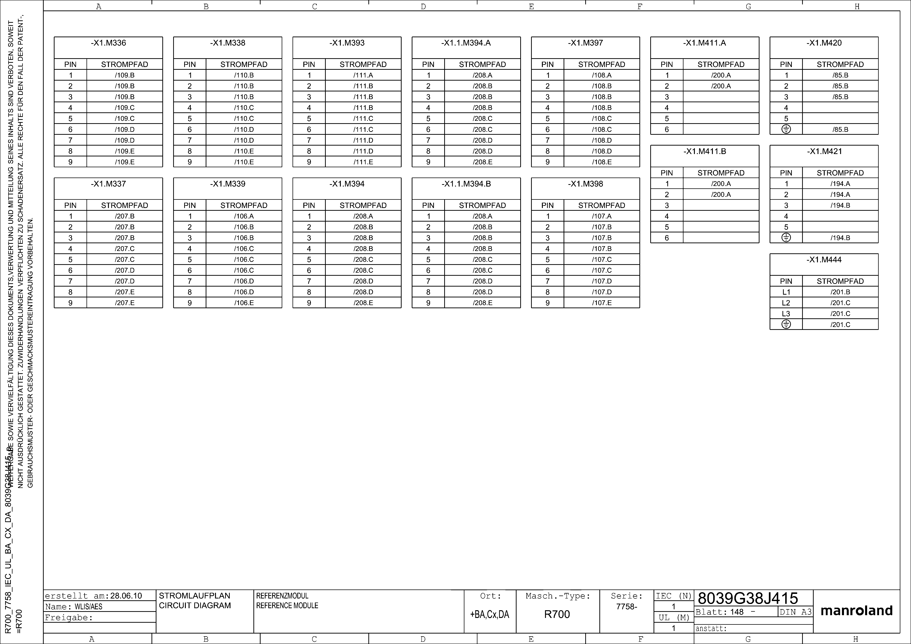

# +BA_Cx_DA — Sheet 148 of 247 — REFERENZMODUL

**REFERENCE MODULE**

> Part of the manroland **R700** printing press IEC/UL circuit diagrams.
> Drawing class: **Stromlaufplan / Circuit diagram** (DIN A3).
> Document `+BA_Cx_DA` covers the **Printing units / main switch cabinet** machine section.

## At a glance

| Field | Value |
|---|---|
| Document | `+BA_Cx_DA`  (8039G38J415) |
| Sheet | **148** of 247 |
| Section (DE) | REFERENZMODUL |
| Section (EN) | REFERENCE MODULE |
| Section type | REFERENCE_MODULE — Reference module |
| Machine type | `R700` |
| Series | `7758` |
| Created | 28.06.10 |
| Replaces | — |
| Columns used | A, B, C, D, E, F, G, H |
| Path numbers | — |
| Labels on sheet | 266 |
| Cross-refs out | 106 |
| Cross-refs in | 0 |

**Previous:** [+BA_Cx_DA sheet 147](SHEET_0147.md) · **Next:** [+BA_Cx_DA sheet 149](SHEET_0149.md) · **Document TOC:** [_TOC.md](_TOC.md)  (+BA_Cx_DA) · **Master TOC:** [all sheets](../_MASTER_TOC.md)

## Sheet image (300 DPI, exact vector render)



_Rendered directly from the PDF vector layer at 300 DPI (1-bit), no OCR and no resampling. Use it to confirm anything ambiguous in the text below._

## Cross-references on this sheet

Each entry is a wire leaving this sheet. The printed token is `/sheet.column`; the link resolves to that sheet inside the same document.

| Ref | Target sheet | Col | Path | Destination on target | Target section | From col |
|---|---|---|---|---|---|---|
| `/85.B` | [+BA_Cx_DA sheet 85](SHEET_0085.md) | B | — | — | WASCHVORRICHTUNG | H |
| `/109.B` | [+BA_Cx_DA sheet 109](SHEET_0109.md) | B | — | — | MOTOR: HEBERSTREIFENBREITE | A |
| `/110.B` | [+BA_Cx_DA sheet 110](SHEET_0110.md) | B | — | — | MOTOR: BEDRUCKSTOFFEINSTELLUNG | B |
| `/111.A` | [+BA_Cx_DA sheet 111](SHEET_0111.md) | A | — | — | MOTOR: DECKMARKENHÖHENEINSTELLUNG | C |
| `/208.A` | [+BA_Cx_DA sheet 208](SHEET_0208.md) | A | — | — | OPTION: | E |
| `/108.A` | [+BA_Cx_DA sheet 108](SHEET_0108.md) | A | — | — | MOTOR: SEITENMARKE, B SEITE | F |
| `/200.A` | [+BA_Cx_DA sheet 200](SHEET_0200.md) | A | — | — | OPTION: APL | G |
| `/85.B` | [+BA_Cx_DA sheet 85](SHEET_0085.md) | B | — | — | WASCHVORRICHTUNG | H |
| `/109.B` | [+BA_Cx_DA sheet 109](SHEET_0109.md) | B | — | — | MOTOR: HEBERSTREIFENBREITE | A |
| `/110.B` | [+BA_Cx_DA sheet 110](SHEET_0110.md) | B | — | — | MOTOR: BEDRUCKSTOFFEINSTELLUNG | B |
| `/111.B` | [+BA_Cx_DA sheet 111](SHEET_0111.md) | B | — | — | MOTOR: DECKMARKENHÖHENEINSTELLUNG | C |
| `/208.B` | [+BA_Cx_DA sheet 208](SHEET_0208.md) | B | — | — | OPTION: | E |
| `/108.B` | [+BA_Cx_DA sheet 108](SHEET_0108.md) | B | — | — | MOTOR: SEITENMARKE, B SEITE | F |
| `/200.A` | [+BA_Cx_DA sheet 200](SHEET_0200.md) | A | — | — | OPTION: APL | G |
| `/85.B` | [+BA_Cx_DA sheet 85](SHEET_0085.md) | B | — | — | WASCHVORRICHTUNG | H |
| `/109.B` | [+BA_Cx_DA sheet 109](SHEET_0109.md) | B | — | — | MOTOR: HEBERSTREIFENBREITE | A |
| `/110.B` | [+BA_Cx_DA sheet 110](SHEET_0110.md) | B | — | — | MOTOR: BEDRUCKSTOFFEINSTELLUNG | B |
| `/111.B` | [+BA_Cx_DA sheet 111](SHEET_0111.md) | B | — | — | MOTOR: DECKMARKENHÖHENEINSTELLUNG | C |
| `/208.B` | [+BA_Cx_DA sheet 208](SHEET_0208.md) | B | — | — | OPTION: | E |
| `/108.B` | [+BA_Cx_DA sheet 108](SHEET_0108.md) | B | — | — | MOTOR: SEITENMARKE, B SEITE | F |
| `/111.B` | [+BA_Cx_DA sheet 111](SHEET_0111.md) | B | — | — | MOTOR: DECKMARKENHÖHENEINSTELLUNG | C |
| `/208.B` | [+BA_Cx_DA sheet 208](SHEET_0208.md) | B | — | — | OPTION: | E |
| `/108.B` | [+BA_Cx_DA sheet 108](SHEET_0108.md) | B | — | — | MOTOR: SEITENMARKE, B SEITE | F |
| `/109.C` | [+BA_Cx_DA sheet 109](SHEET_0109.md) | C | — | — | MOTOR: HEBERSTREIFENBREITE | A |
| `/110.C` | [+BA_Cx_DA sheet 110](SHEET_0110.md) | C | — | — | MOTOR: BEDRUCKSTOFFEINSTELLUNG | B |
| `/109.C` | [+BA_Cx_DA sheet 109](SHEET_0109.md) | C | — | — | MOTOR: HEBERSTREIFENBREITE | A |
| `/110.C` | [+BA_Cx_DA sheet 110](SHEET_0110.md) | C | — | — | MOTOR: BEDRUCKSTOFFEINSTELLUNG | B |
| `/111.C` | [+BA_Cx_DA sheet 111](SHEET_0111.md) | C | — | — | MOTOR: DECKMARKENHÖHENEINSTELLUNG | C |
| `/208.C` | [+BA_Cx_DA sheet 208](SHEET_0208.md) | C | — | — | OPTION: | E |
| `/108.C` | [+BA_Cx_DA sheet 108](SHEET_0108.md) | C | — | — | MOTOR: SEITENMARKE, B SEITE | F |
| `/85.B` | [+BA_Cx_DA sheet 85](SHEET_0085.md) | B | — | — | WASCHVORRICHTUNG | H |
| `/109.D` | [+BA_Cx_DA sheet 109](SHEET_0109.md) | D | — | — | MOTOR: HEBERSTREIFENBREITE | A |
| `/110.D` | [+BA_Cx_DA sheet 110](SHEET_0110.md) | D | — | — | MOTOR: BEDRUCKSTOFFEINSTELLUNG | B |
| `/111.C` | [+BA_Cx_DA sheet 111](SHEET_0111.md) | C | — | — | MOTOR: DECKMARKENHÖHENEINSTELLUNG | C |
| `/208.C` | [+BA_Cx_DA sheet 208](SHEET_0208.md) | C | — | — | OPTION: | E |
| `/108.C` | [+BA_Cx_DA sheet 108](SHEET_0108.md) | C | — | — | MOTOR: SEITENMARKE, B SEITE | F |
| `/109.D` | [+BA_Cx_DA sheet 109](SHEET_0109.md) | D | — | — | MOTOR: HEBERSTREIFENBREITE | A |
| `/110.D` | [+BA_Cx_DA sheet 110](SHEET_0110.md) | D | — | — | MOTOR: BEDRUCKSTOFFEINSTELLUNG | B |
| `/111.D` | [+BA_Cx_DA sheet 111](SHEET_0111.md) | D | — | — | MOTOR: DECKMARKENHÖHENEINSTELLUNG | C |
| `/208.D` | [+BA_Cx_DA sheet 208](SHEET_0208.md) | D | — | — | OPTION: | E |
| `/108.D` | [+BA_Cx_DA sheet 108](SHEET_0108.md) | D | — | — | MOTOR: SEITENMARKE, B SEITE | F |
| `/109.E` | [+BA_Cx_DA sheet 109](SHEET_0109.md) | E | — | — | MOTOR: HEBERSTREIFENBREITE | A |
| `/110.E` | [+BA_Cx_DA sheet 110](SHEET_0110.md) | E | — | — | MOTOR: BEDRUCKSTOFFEINSTELLUNG | B |
| `/111.D` | [+BA_Cx_DA sheet 111](SHEET_0111.md) | D | — | — | MOTOR: DECKMARKENHÖHENEINSTELLUNG | C |
| `/208.D` | [+BA_Cx_DA sheet 208](SHEET_0208.md) | D | — | — | OPTION: | E |
| `/108.D` | [+BA_Cx_DA sheet 108](SHEET_0108.md) | D | — | — | MOTOR: SEITENMARKE, B SEITE | F |
| `/109.E` | [+BA_Cx_DA sheet 109](SHEET_0109.md) | E | — | — | MOTOR: HEBERSTREIFENBREITE | A |
| `/110.E` | [+BA_Cx_DA sheet 110](SHEET_0110.md) | E | — | — | MOTOR: BEDRUCKSTOFFEINSTELLUNG | B |
| `/111.E` | [+BA_Cx_DA sheet 111](SHEET_0111.md) | E | — | — | MOTOR: DECKMARKENHÖHENEINSTELLUNG | C |
| `/208.E` | [+BA_Cx_DA sheet 208](SHEET_0208.md) | E | — | — | OPTION: | E |
| `/108.E` | [+BA_Cx_DA sheet 108](SHEET_0108.md) | E | — | — | MOTOR: SEITENMARKE, B SEITE | F |
| `/200.A` | [+BA_Cx_DA sheet 200](SHEET_0200.md) | A | — | — | OPTION: APL | G |
| `/194.A` | [+BA_Cx_DA sheet 194](SHEET_0194.md) | A | — | — | OPTION: WASCHVORRICHTUNG MIT BÜRSTE | H |
| `/200.A` | [+BA_Cx_DA sheet 200](SHEET_0200.md) | A | — | — | OPTION: APL | G |
| `/194.A` | [+BA_Cx_DA sheet 194](SHEET_0194.md) | A | — | — | OPTION: WASCHVORRICHTUNG MIT BÜRSTE | H |
| `/194.B` | [+BA_Cx_DA sheet 194](SHEET_0194.md) | B | — | — | OPTION: WASCHVORRICHTUNG MIT BÜRSTE | H |
| `/207.B` | [+BA_Cx_DA sheet 207](SHEET_0207.md) | B | — | — | OPTION: VERREIBUNGSEINSATZ | A |
| `/106.A` | [+BA_Cx_DA sheet 106](SHEET_0106.md) | A | — | — | MOTOR: SCHRÄGREGISTER | B |
| `/208.A` | [+BA_Cx_DA sheet 208](SHEET_0208.md) | A | — | — | OPTION: | C |
| `/208.A` | [+BA_Cx_DA sheet 208](SHEET_0208.md) | A | — | — | OPTION: | E |
| `/107.A` | [+BA_Cx_DA sheet 107](SHEET_0107.md) | A | — | — | MOTOR: SEITENMARKE, A SEITE | F |
| `/207.B` | [+BA_Cx_DA sheet 207](SHEET_0207.md) | B | — | — | OPTION: VERREIBUNGSEINSATZ | A |
| `/106.B` | [+BA_Cx_DA sheet 106](SHEET_0106.md) | B | — | — | MOTOR: SCHRÄGREGISTER | B |
| `/208.B` | [+BA_Cx_DA sheet 208](SHEET_0208.md) | B | — | — | OPTION: | C |
| `/208.B` | [+BA_Cx_DA sheet 208](SHEET_0208.md) | B | — | — | OPTION: | E |
| `/107.B` | [+BA_Cx_DA sheet 107](SHEET_0107.md) | B | — | — | MOTOR: SEITENMARKE, A SEITE | F |
| `/207.B` | [+BA_Cx_DA sheet 207](SHEET_0207.md) | B | — | — | OPTION: VERREIBUNGSEINSATZ | A |
| `/106.B` | [+BA_Cx_DA sheet 106](SHEET_0106.md) | B | — | — | MOTOR: SCHRÄGREGISTER | B |
| `/208.B` | [+BA_Cx_DA sheet 208](SHEET_0208.md) | B | — | — | OPTION: | C |
| `/208.B` | [+BA_Cx_DA sheet 208](SHEET_0208.md) | B | — | — | OPTION: | E |
| `/107.B` | [+BA_Cx_DA sheet 107](SHEET_0107.md) | B | — | — | MOTOR: SEITENMARKE, A SEITE | F |
| `/194.B` | [+BA_Cx_DA sheet 194](SHEET_0194.md) | B | — | — | OPTION: WASCHVORRICHTUNG MIT BÜRSTE | H |
| `/208.B` | [+BA_Cx_DA sheet 208](SHEET_0208.md) | B | — | — | OPTION: | C |
| `/208.B` | [+BA_Cx_DA sheet 208](SHEET_0208.md) | B | — | — | OPTION: | E |
| `/107.B` | [+BA_Cx_DA sheet 107](SHEET_0107.md) | B | — | — | MOTOR: SEITENMARKE, A SEITE | F |
| `/207.C` | [+BA_Cx_DA sheet 207](SHEET_0207.md) | C | — | — | OPTION: VERREIBUNGSEINSATZ | A |
| `/106.C` | [+BA_Cx_DA sheet 106](SHEET_0106.md) | C | — | — | MOTOR: SCHRÄGREGISTER | B |
| `/207.C` | [+BA_Cx_DA sheet 207](SHEET_0207.md) | C | — | — | OPTION: VERREIBUNGSEINSATZ | A |
| `/106.C` | [+BA_Cx_DA sheet 106](SHEET_0106.md) | C | — | — | MOTOR: SCHRÄGREGISTER | B |
| `/208.C` | [+BA_Cx_DA sheet 208](SHEET_0208.md) | C | — | — | OPTION: | C |
| `/208.C` | [+BA_Cx_DA sheet 208](SHEET_0208.md) | C | — | — | OPTION: | E |
| `/107.C` | [+BA_Cx_DA sheet 107](SHEET_0107.md) | C | — | — | MOTOR: SEITENMARKE, A SEITE | F |
| `/207.D` | [+BA_Cx_DA sheet 207](SHEET_0207.md) | D | — | — | OPTION: VERREIBUNGSEINSATZ | A |
| `/106.C` | [+BA_Cx_DA sheet 106](SHEET_0106.md) | C | — | — | MOTOR: SCHRÄGREGISTER | B |
| `/208.C` | [+BA_Cx_DA sheet 208](SHEET_0208.md) | C | — | — | OPTION: | C |
| `/208.C` | [+BA_Cx_DA sheet 208](SHEET_0208.md) | C | — | — | OPTION: | E |
| `/107.C` | [+BA_Cx_DA sheet 107](SHEET_0107.md) | C | — | — | MOTOR: SEITENMARKE, A SEITE | F |
| `/207.D` | [+BA_Cx_DA sheet 207](SHEET_0207.md) | D | — | — | OPTION: VERREIBUNGSEINSATZ | A |
| `/106.D` | [+BA_Cx_DA sheet 106](SHEET_0106.md) | D | — | — | MOTOR: SCHRÄGREGISTER | B |
| `/208.D` | [+BA_Cx_DA sheet 208](SHEET_0208.md) | D | — | — | OPTION: | C |
| `/208.D` | [+BA_Cx_DA sheet 208](SHEET_0208.md) | D | — | — | OPTION: | E |
| `/107.D` | [+BA_Cx_DA sheet 107](SHEET_0107.md) | D | — | — | MOTOR: SEITENMARKE, A SEITE | F |
| `/207.E` | [+BA_Cx_DA sheet 207](SHEET_0207.md) | E | — | — | OPTION: VERREIBUNGSEINSATZ | A |
| `/201.B` | [+BA_Cx_DA sheet 201](SHEET_0201.md) | B | — | — | OPTION: | H |
| `/106.D` | [+BA_Cx_DA sheet 106](SHEET_0106.md) | D | — | — | MOTOR: SCHRÄGREGISTER | B |
| `/208.D` | [+BA_Cx_DA sheet 208](SHEET_0208.md) | D | — | — | OPTION: | C |
| `/208.D` | [+BA_Cx_DA sheet 208](SHEET_0208.md) | D | — | — | OPTION: | E |
| `/107.D` | [+BA_Cx_DA sheet 107](SHEET_0107.md) | D | — | — | MOTOR: SEITENMARKE, A SEITE | F |
| `/207.E` | [+BA_Cx_DA sheet 207](SHEET_0207.md) | E | — | — | OPTION: VERREIBUNGSEINSATZ | A |
| `/106.E` | [+BA_Cx_DA sheet 106](SHEET_0106.md) | E | — | — | MOTOR: SCHRÄGREGISTER | B |
| `/208.E` | [+BA_Cx_DA sheet 208](SHEET_0208.md) | E | — | — | OPTION: | C |
| `/208.E` | [+BA_Cx_DA sheet 208](SHEET_0208.md) | E | — | — | OPTION: | E |
| `/107.E` | [+BA_Cx_DA sheet 107](SHEET_0107.md) | E | — | — | MOTOR: SEITENMARKE, A SEITE | F |
| `/201.C` | [+BA_Cx_DA sheet 201](SHEET_0201.md) | C | — | — | OPTION: | H |
| `/201.C` | [+BA_Cx_DA sheet 201](SHEET_0201.md) | C | — | — | OPTION: | H |
| `/201.C` | [+BA_Cx_DA sheet 201](SHEET_0201.md) | C | — | — | OPTION: | H |

## Devices on this sheet

| Tag | Class | Class meaning (IEC) | Col | Sub | Terminal | Sign |
|---|---|---|---|---|---|---|
| `X1.M336` | — | cross-device reference | A | — | — | — |
| `X1.M337` | — | cross-device reference | A | — | — | — |
| `X1.M338` | — | cross-device reference | B | — | — | — |
| `X1.M339` | — | cross-device reference | B | — | — | — |
| `X1.M393` | — | cross-device reference | C | — | — | — |
| `X1.M394` | — | cross-device reference | C | — | — | — |
| `X1.1.M394.A` | — | cross-device reference | D | — | — | — |
| `X1.1.M394.B` | — | cross-device reference | D | — | — | — |
| `X1.M398` | — | cross-device reference | F | — | — | — |
| `X1.M397` | — | cross-device reference | F | — | — | — |
| `X1.M420` | — | cross-device reference | H | — | — | — |
| `X1.M421` | — | cross-device reference | H | — | — | — |
| `X1.M444` | — | cross-device reference | H | — | — | — |
| `X1.M411.A` | — | cross-device reference | G | — | — | — |
| `X1.M411.B` | — | cross-device reference | G | — | — | — |

## Potentials / nets

| Potential | Count | Columns | Attached devices | Terminals |
|---|---|---|---|---|
| `L1` | 1 | G | — | — |
| `L2` | 1 | G | — | — |
| `L3` | 1 | G | — | — |


A potential such as `L24+/4` or `M24+` is a named supply/return rail; every place it appears on this sheet is electrically common.

## Wire-end annotations (grouped as printed)

A wire that continues elsewhere is annotated with a small cluster: the destination description, the path/line number `#NN`, and the `/sheet.column` cross reference. Each row below is one such cluster exactly as it is grouped on the drawing.

| Col | Y | Path | Cross-ref | Text on the wire |
|---|---|---|---|---|
| A | 51.3 | — | — | `X1.M336` |
| B | 51.3 | — | — | `X1.M338` |
| C | 51.3 | — | — | `X1.M393` |
| F | 51.3 | — | — | `X1.M397` |
| G | 51.3 | — | — | `X1.M411.A` |
| H | 51.3 | — | — | `X1.M420` |
| D | 51.4 | — | — | `X1.1.M394.A` |
| A | 80.0 | — | — | `PIN 2 3 4 5 6 7 8 9 1 STROMPFAD` |
| B | 80.0 | — | — | `PIN 2 3 4 5 6 7 8 9 1 STROMPFAD` |
| C | 80.0 | — | — | `PIN 2 3 4 5 6 7 8 9 1 STROMPFAD` |
| D | 80.0 | — | — | `PIN 2 3 4 5 6 7 8 9 1 STROMPFAD` |
| E | 80.0 | — | — | `PIN 2 3 4 5 6 7 8 9 1 STROMPFAD` |
| G | 80.0 | — | — | `PIN 2 3 4 5 6 1 STROMPFAD` |
| H | 80.0 | — | — | `PIN 2 3 4 5 1 STROMPFAD` |
| A | 94.5 | — | `/109.B` | — |
| B | 94.5 | — | `/110.B` | — |
| C | 94.5 | — | `/111.A` | — |
| E | 94.5 | — | `/208.A` | — |
| F | 94.5 | — | `/108.A` | — |
| G | 94.5 | — | `/200.A` | — |
| H | 94.5 | — | `/85.B` | — |
| A | 108.7 | — | `/109.B` | — |
| B | 108.7 | — | `/110.B` | — |
| C | 108.7 | — | `/111.B` | — |
| E | 108.7 | — | `/208.B` | — |
| F | 108.7 | — | `/108.B` | — |
| G | 108.7 | — | `/200.A` | — |
| H | 108.7 | — | `/85.B` | — |
| H | 122.8 | — | `/85.B` | — |
| A | 122.9 | — | `/109.B` | — |
| B | 122.9 | — | `/110.B` | — |
| C | 122.9 | — | `/111.B` | — |
| E | 122.9 | — | `/208.B` | — |
| F | 122.9 | — | `/108.B` | — |
| C | 137.0 | — | `/111.B` | — |
| E | 137.0 | — | `/208.B` | — |
| F | 137.0 | — | `/108.B` | — |
| A | 137.1 | — | `/109.C` | — |
| B | 137.1 | — | `/110.C` | — |
| A | 151.2 | — | `/109.C` | — |
| B | 151.2 | — | `/110.C` | — |
| C | 151.2 | — | `/111.C` | — |
| E | 151.2 | — | `/208.C` | — |
| F | 151.2 | — | `/108.C` | — |
| A | 165.4 | — | `/109.D` | — |
| B | 165.4 | — | `/110.D` | — |
| C | 165.4 | — | `/111.C` | — |
| E | 165.4 | — | `/208.C` | — |
| F | 165.4 | — | `/108.C` | — |
| H | 165.4 | — | `/85.B` | — |
| A | 179.6 | — | `/109.D` | — |
| B | 179.6 | — | `/110.D` | — |
| C | 179.6 | — | `/111.D` | — |
| E | 179.6 | — | `/208.D` | — |
| F | 179.6 | — | `/108.D` | — |
| G | 193.1 | — | — | `X1.M411.B` |
| H | 193.1 | — | — | `X1.M421` |
| A | 193.7 | — | `/109.E` | — |
| B | 193.7 | — | `/110.E` | — |
| C | 193.8 | — | `/111.D` | — |
| E | 193.8 | — | `/208.D` | — |
| F | 193.8 | — | `/108.D` | — |
| A | 207.9 | — | `/109.E` | — |
| B | 207.9 | — | `/110.E` | — |
| C | 207.9 | — | `/111.E` | — |
| E | 207.9 | — | `/208.E` | — |
| F | 207.9 | — | `/108.E` | — |
| G | 221.7 | — | — | `PIN 2 3 4 5 6 1 STROMPFAD` |
| H | 221.7 | — | — | `PIN 2 3 4 5 1 STROMPFAD` |
| A | 235.6 | — | — | `X1.M337` |
| B | 235.6 | — | — | `X1.M339` |
| C | 235.6 | — | — | `X1.M394` |
| D | 235.6 | — | — | `X1.1.M394.B` |
| F | 235.6 | — | — | `X1.M398` |
| G | 236.2 | — | `/200.A` | — |
| H | 236.2 | — | `/194.A` | — |
| G | 250.4 | — | `/200.A` | — |
| H | 250.4 | — | `/194.A` | — |
| A | 264.2 | — | — | `PIN 2 3 4 5 6 7 8 9 1 STROMPFAD` |
| B | 264.2 | — | — | `PIN 2 3 4 5 6 7 8 9 1 STROMPFAD` |
| C | 264.2 | — | — | `PIN 2 3 4 5 6 7 8 9 1 STROMPFAD` |
| D | 264.2 | — | — | `PIN 2 3 4 5 6 7 8 9 1 STROMPFAD` |
| E | 264.2 | — | — | `PIN 2 3 4 5 6 7 8 9 1 STROMPFAD` |
| H | 264.6 | — | `/194.B` | — |
| A | 278.8 | — | `/207.B` | — |
| B | 278.8 | — | `/106.A` | — |
| C | 278.8 | — | `/208.A` | — |
| E | 278.8 | — | `/208.A` | — |
| F | 278.8 | — | `/107.A` | — |
| A | 292.9 | — | `/207.B` | — |
| B | 292.9 | — | `/106.B` | — |
| C | 292.9 | — | `/208.B` | — |
| E | 292.9 | — | `/208.B` | — |
| F | 292.9 | — | `/107.B` | — |
| A | 307.1 | — | `/207.B` | — |
| B | 307.1 | — | `/106.B` | — |
| C | 307.1 | — | `/208.B` | — |
| E | 307.1 | — | `/208.B` | — |
| F | 307.1 | — | `/107.B` | — |
| H | 307.1 | — | `/194.B` | — |
| A | 321.3 | — | `/207.C` | — |
| B | 321.3 | — | `/106.C` | — |
| C | 321.3 | — | `/208.B` | — |
| E | 321.3 | — | `/208.B` | — |
| F | 321.3 | — | `/107.B` | — |
| H | 334.8 | — | — | `X1.M444` |
| A | 335.5 | — | `/207.C` | — |
| B | 335.5 | — | `/106.C` | — |
| C | 335.5 | — | `/208.C` | — |
| E | 335.5 | — | `/208.C` | — |
| F | 335.5 | — | `/107.C` | — |
| A | 349.7 | — | `/207.D` | — |
| B | 349.7 | — | `/106.C` | — |
| C | 349.7 | — | `/208.C` | — |
| E | 349.7 | — | `/208.C` | — |
| F | 349.7 | — | `/107.C` | — |
| H | 363.4 | — | — | `PIN L2 L3 L1 STROMPFAD` |
| A | 363.8 | — | `/207.D` | — |
| B | 363.8 | — | `/106.D` | — |
| C | 363.8 | — | `/208.D` | — |
| E | 363.8 | — | `/208.D` | — |
| F | 363.8 | — | `/107.D` | — |
| A | 378.0 | — | `/207.E` | — |
| B | 378.0 | — | `/106.D` | — |
| C | 378.0 | — | `/208.D` | — |
| E | 378.0 | — | `/208.D` | — |
| F | 378.0 | — | `/107.D` | — |
| H | 378.0 | — | `/201.B` | — |
| A | 392.1 | — | `/207.E` | — |
| B | 392.1 | — | `/106.E` | — |
| C | 392.1 | — | `/208.E` | — |
| E | 392.1 | — | `/208.E` | — |
| F | 392.1 | — | `/107.E` | — |
| H | 392.2 | — | `/201.C` | — |
| H | 406.4 | — | `/201.C` | — |
| H | 420.5 | — | `/201.C` | — |


## Reconstructed tables

This sheet carries tabular content (pin map / terminal assignment / index). The grid below was rebuilt from the drawing's own rule lines, so each row is exactly one physical row of the table.

### Table 1 — 20 data rows × 2 columns (at x=70.9, y=48.2) — **X1.M336**

| PIN | STROMPFAD |
|---|---|
| `1` | `/109.B` |
| `2` | `/109.B` |
| `3` | `/109.B` |
| `4` | `/109.C` |
| `5` | `/109.C` |
| `6` | `/109.D` |
| `7` | `/109.D` |
| `8` | `/109.E` |
| `9` | `/109.E` |
|  | `X1.M337` |
| `PIN` | `STROMPFAD` |
| `1` | `/207.B` |
| `2` | `/207.B` |
| `3` | `/207.B` |
| `4` | `/207.C` |
| `5` | `/207.C` |
| `6` | `/207.D` |
| `7` | `/207.D` |
| `8` | `/207.E` |
| `9` | `/207.E` |


### Table 2 — 20 data rows × 2 columns (at x=226.8, y=48.2) — **X1.M338**

| PIN | STROMPFAD |
|---|---|
| `1` | `/110.B` |
| `2` | `/110.B` |
| `3` | `/110.B` |
| `4` | `/110.C` |
| `5` | `/110.C` |
| `6` | `/110.D` |
| `7` | `/110.D` |
| `8` | `/110.E` |
| `9` | `/110.E` |
|  | `X1.M339` |
| `PIN` | `STROMPFAD` |
| `1` | `/106.A` |
| `2` | `/106.B` |
| `3` | `/106.B` |
| `4` | `/106.C` |
| `5` | `/106.C` |
| `6` | `/106.C` |
| `7` | `/106.D` |
| `8` | `/106.D` |
| `9` | `/106.E` |


### Table 3 — 20 data rows × 2 columns (at x=382.7, y=48.2) — **X1.M393**

| PIN | STROMPFAD |
|---|---|
| `1` | `/111.A` |
| `2` | `/111.B` |
| `3` | `/111.B` |
| `4` | `/111.B` |
| `5` | `/111.C` |
| `6` | `/111.C` |
| `7` | `/111.D` |
| `8` | `/111.D` |
| `9` | `/111.E` |
|  | `X1.M394` |
| `PIN` | `STROMPFAD` |
| `1` | `/208.A` |
| `2` | `/208.B` |
| `3` | `/208.B` |
| `4` | `/208.B` |
| `5` | `/208.C` |
| `6` | `/208.C` |
| `7` | `/208.D` |
| `8` | `/208.D` |
| `9` | `/208.E` |


### Table 4 — 20 data rows × 2 columns (at x=538.6, y=48.2) — **X1.1.M394.A**

| PIN | STROMPFAD |
|---|---|
| `1` | `/208.A` |
| `2` | `/208.B` |
| `3` | `/208.B` |
| `4` | `/208.B` |
| `5` | `/208.C` |
| `6` | `/208.C` |
| `7` | `/208.D` |
| `8` | `/208.D` |
| `9` | `/208.E` |
|  | `X1.1.M394.B` |
| `PIN` | `STROMPFAD` |
| `1` | `/208.A` |
| `2` | `/208.B` |
| `3` | `/208.B` |
| `4` | `/208.B` |
| `5` | `/208.C` |
| `6` | `/208.C` |
| `7` | `/208.D` |
| `8` | `/208.D` |
| `9` | `/208.E` |


### Table 5 — 20 data rows × 2 columns (at x=694.5, y=48.2) — **X1.M397**

| PIN | STROMPFAD |
|---|---|
| `1` | `/108.A` |
| `2` | `/108.B` |
| `3` | `/108.B` |
| `4` | `/108.B` |
| `5` | `/108.C` |
| `6` | `/108.C` |
| `7` | `/108.D` |
| `8` | `/108.D` |
| `9` | `/108.E` |
|  | `X1.M398` |
| `PIN` | `STROMPFAD` |
| `1` | `/107.A` |
| `2` | `/107.B` |
| `3` | `/107.B` |
| `4` | `/107.B` |
| `5` | `/107.C` |
| `6` | `/107.C` |
| `7` | `/107.D` |
| `8` | `/107.D` |
| `9` | `/107.E` |


### Table 6 — 14 data rows × 2 columns (at x=850.4, y=48.2) — **X1.M411.A**

| PIN | STROMPFAD |
|---|---|
| `1` | `/200.A` |
| `2` | `/200.A` |
| `3` |  |
| `4` |  |
| `5` |  |
| `6` |  |
|  | `X1.M411.B` |
| `PIN` | `STROMPFAD` |
| `1` | `/200.A` |
| `2` | `/200.A` |
| `3` |  |
| `4` |  |
| `5` |  |
| `6` |  |


### Table 7 — 20 data rows × 2 columns (at x=1006.3, y=48.2) — **X1.M420**

| PIN | STROMPFAD |
|---|---|
| `1` | `/85.B` |
| `2` | `/85.B` |
| `3` | `/85.B` |
| `4` |  |
| `5` |  |
|  | `/85.B` |
|  | `X1.M421` |
| `PIN` | `STROMPFAD` |
| `1` | `/194.A` |
| `2` | `/194.A` |
| `3` | `/194.B` |
| `4` |  |
| `5` |  |
|  | `/194.B` |
|  | `X1.M444` |
| `PIN` | `STROMPFAD` |
| `L1` | `/201.B` |
| `L2` | `/201.C` |
| `L3` | `/201.C` |
|  | `/201.C` |


## Notes and free text on this sheet

| Text | Col | Y (pt) |
|---|---|---|
| `PIN` | A | 80.02 |
| `STROMPFAD` | A | 79.98 |
| `PIN` | B | 80.02 |
| `STROMPFAD` | B | 79.98 |
| `PIN` | C | 80.02 |
| `STROMPFAD` | C | 79.98 |
| `PIN` | D | 80.02 |
| `STROMPFAD` | E | 79.98 |
| `PIN` | E | 264.27 |
| `STROMPFAD` | F | 264.23 |
| `PIN` | G | 80.02 |
| `STROMPFAD` | H | 79.98 |
| `PIN` | F | 80.02 |
| `STROMPFAD` | G | 79.98 |

## Complete label inventory (exact text from the drawing)

Every text object inside the drawing area of this sheet, in DIN reading order (column A→H, then top→bottom). This is the authoritative list: if a string is not here it is not printed on this sheet.

| Col | Y | X | Dir | Type | Text |
|---|---|---|---|---|---|
| A | 51.3 | 118.9 | → | device ref | `X1.M336` |
| A | 80.0 | 84.0 | → | text | `PIN` |
| A | 80.0 | 132.2 | → | text | `STROMPFAD` |
| A | 94.2 | 90.0 | → | number | `1` |
| A | 94.5 | 150.4 | → | cross-reference | `/109.B` |
| A | 108.4 | 89.4 | → | number | `2` |
| A | 108.7 | 150.4 | → | cross-reference | `/109.B` |
| A | 122.5 | 89.4 | → | number | `3` |
| A | 122.9 | 150.4 | → | cross-reference | `/109.B` |
| A | 136.7 | 89.4 | → | number | `4` |
| A | 137.1 | 150.2 | → | cross-reference | `/109.C` |
| A | 150.9 | 89.4 | → | number | `5` |
| A | 151.2 | 150.2 | → | cross-reference | `/109.C` |
| A | 165.1 | 89.4 | → | number | `6` |
| A | 165.4 | 150.2 | → | cross-reference | `/109.D` |
| A | 179.2 | 89.4 | → | number | `7` |
| A | 179.6 | 150.2 | → | cross-reference | `/109.D` |
| A | 193.4 | 89.4 | → | number | `8` |
| A | 193.7 | 150.5 | → | cross-reference | `/109.E` |
| A | 207.6 | 89.4 | → | number | `9` |
| A | 207.9 | 150.5 | → | cross-reference | `/109.E` |
| A | 235.6 | 118.9 | → | device ref | `X1.M337` |
| A | 264.2 | 132.2 | → | text | `STROMPFAD` |
| A | 264.3 | 84.0 | → | text | `PIN` |
| A | 278.5 | 90.0 | → | number | `1` |
| A | 278.8 | 150.4 | → | cross-reference | `/207.B` |
| A | 292.6 | 89.4 | → | number | `2` |
| A | 292.9 | 150.4 | → | cross-reference | `/207.B` |
| A | 306.8 | 89.4 | → | number | `3` |
| A | 307.1 | 150.4 | → | cross-reference | `/207.B` |
| A | 321.0 | 89.4 | → | number | `4` |
| A | 321.3 | 150.2 | → | cross-reference | `/207.C` |
| A | 335.1 | 89.4 | → | number | `5` |
| A | 335.5 | 150.2 | → | cross-reference | `/207.C` |
| A | 349.3 | 89.4 | → | number | `6` |
| A | 349.7 | 150.2 | → | cross-reference | `/207.D` |
| A | 363.5 | 89.4 | → | number | `7` |
| A | 363.8 | 150.2 | → | cross-reference | `/207.D` |
| A | 377.7 | 89.4 | → | number | `8` |
| A | 378.0 | 150.5 | → | cross-reference | `/207.E` |
| A | 391.8 | 89.4 | → | number | `9` |
| A | 392.2 | 150.5 | → | cross-reference | `/207.E` |
| B | 51.3 | 274.8 | → | device ref | `X1.M338` |
| B | 80.0 | 240.0 | → | text | `PIN` |
| B | 80.0 | 288.1 | → | text | `STROMPFAD` |
| B | 94.2 | 245.9 | → | number | `1` |
| B | 94.5 | 306.3 | → | cross-reference | `/110.B` |
| B | 108.4 | 245.3 | → | number | `2` |
| B | 108.7 | 306.3 | → | cross-reference | `/110.B` |
| B | 122.5 | 245.3 | → | number | `3` |
| B | 122.9 | 306.3 | → | cross-reference | `/110.B` |
| B | 136.7 | 245.3 | → | number | `4` |
| B | 137.1 | 306.1 | → | cross-reference | `/110.C` |
| B | 150.9 | 245.3 | → | number | `5` |
| B | 151.2 | 306.1 | → | cross-reference | `/110.C` |
| B | 165.1 | 245.3 | → | number | `6` |
| B | 165.4 | 306.1 | → | cross-reference | `/110.D` |
| B | 179.2 | 245.3 | → | number | `7` |
| B | 179.6 | 306.1 | → | cross-reference | `/110.D` |
| B | 193.4 | 245.3 | → | number | `8` |
| B | 193.7 | 306.4 | → | cross-reference | `/110.E` |
| B | 207.6 | 245.3 | → | number | `9` |
| B | 207.9 | 306.4 | → | cross-reference | `/110.E` |
| B | 235.6 | 274.8 | → | device ref | `X1.M339` |
| B | 264.2 | 288.1 | → | text | `STROMPFAD` |
| B | 264.3 | 240.0 | → | text | `PIN` |
| B | 278.5 | 245.9 | → | number | `1` |
| B | 278.8 | 306.1 | → | cross-reference | `/106.A` |
| B | 292.6 | 245.3 | → | number | `2` |
| B | 292.9 | 306.3 | → | cross-reference | `/106.B` |
| B | 306.8 | 245.3 | → | number | `3` |
| B | 307.1 | 306.3 | → | cross-reference | `/106.B` |
| B | 321.0 | 245.3 | → | number | `4` |
| B | 321.3 | 306.1 | → | cross-reference | `/106.C` |
| B | 335.1 | 245.3 | → | number | `5` |
| B | 335.5 | 306.1 | → | cross-reference | `/106.C` |
| B | 349.3 | 245.3 | → | number | `6` |
| B | 349.7 | 306.1 | → | cross-reference | `/106.C` |
| B | 363.5 | 245.3 | → | number | `7` |
| B | 363.8 | 306.1 | → | cross-reference | `/106.D` |
| B | 377.7 | 245.3 | → | number | `8` |
| B | 378.0 | 306.1 | → | cross-reference | `/106.D` |
| B | 391.8 | 245.3 | → | number | `9` |
| B | 392.2 | 306.4 | → | cross-reference | `/106.E` |
| C | 51.3 | 430.7 | → | device ref | `X1.M393` |
| C | 80.0 | 395.9 | → | text | `PIN` |
| C | 80.0 | 444.0 | → | text | `STROMPFAD` |
| C | 94.2 | 401.8 | → | number | `1` |
| C | 94.5 | 462.0 | → | cross-reference | `/111.A` |
| C | 108.4 | 401.2 | → | number | `2` |
| C | 108.7 | 462.2 | → | cross-reference | `/111.B` |
| C | 122.5 | 401.2 | → | number | `3` |
| C | 122.9 | 462.2 | → | cross-reference | `/111.B` |
| C | 136.7 | 401.2 | → | number | `4` |
| C | 137.0 | 462.2 | → | cross-reference | `/111.B` |
| C | 150.9 | 401.2 | → | number | `5` |
| C | 151.2 | 462.0 | → | cross-reference | `/111.C` |
| C | 165.1 | 401.2 | → | number | `6` |
| C | 165.4 | 462.0 | → | cross-reference | `/111.C` |
| C | 179.2 | 401.2 | → | number | `7` |
| C | 179.6 | 462.0 | → | cross-reference | `/111.D` |
| C | 193.4 | 401.2 | → | number | `8` |
| C | 193.8 | 462.0 | → | cross-reference | `/111.D` |
| C | 207.6 | 401.2 | → | number | `9` |
| C | 207.9 | 462.3 | → | cross-reference | `/111.E` |
| C | 235.6 | 430.7 | → | device ref | `X1.M394` |
| C | 264.2 | 444.0 | → | text | `STROMPFAD` |
| C | 264.3 | 395.9 | → | text | `PIN` |
| C | 278.5 | 401.8 | → | number | `1` |
| C | 278.8 | 462.0 | → | cross-reference | `/208.A` |
| C | 292.6 | 401.2 | → | number | `2` |
| C | 292.9 | 462.2 | → | cross-reference | `/208.B` |
| C | 306.8 | 401.2 | → | number | `3` |
| C | 307.1 | 462.2 | → | cross-reference | `/208.B` |
| C | 321.0 | 401.2 | → | number | `4` |
| C | 321.3 | 462.2 | → | cross-reference | `/208.B` |
| C | 335.1 | 401.2 | → | number | `5` |
| C | 335.5 | 462.0 | → | cross-reference | `/208.C` |
| C | 349.3 | 401.2 | → | number | `6` |
| C | 349.7 | 462.0 | → | cross-reference | `/208.C` |
| C | 363.5 | 401.2 | → | number | `7` |
| C | 363.8 | 462.0 | → | cross-reference | `/208.D` |
| C | 377.7 | 401.2 | → | number | `8` |
| C | 378.0 | 462.0 | → | cross-reference | `/208.D` |
| C | 391.8 | 401.2 | → | number | `9` |
| C | 392.2 | 462.3 | → | cross-reference | `/208.E` |
| D | 51.3 | 576.9 | → | device ref | `X1.1.M394.A` |
| D | 80.0 | 551.8 | → | text | `PIN` |
| D | 94.2 | 557.7 | → | number | `1` |
| D | 108.4 | 557.1 | → | number | `2` |
| D | 122.5 | 557.1 | → | number | `3` |
| D | 136.7 | 557.1 | → | number | `4` |
| D | 150.9 | 557.1 | → | number | `5` |
| D | 165.1 | 557.1 | → | number | `6` |
| D | 179.2 | 557.1 | → | number | `7` |
| D | 193.4 | 557.1 | → | number | `8` |
| D | 207.6 | 557.1 | → | number | `9` |
| D | 235.6 | 577.3 | → | device ref | `X1.1.M394.B` |
| D | 264.3 | 551.8 | → | text | `PIN` |
| D | 278.5 | 557.7 | → | number | `1` |
| D | 292.6 | 557.1 | → | number | `2` |
| D | 306.8 | 557.1 | → | number | `3` |
| D | 321.0 | 557.1 | → | number | `4` |
| D | 335.1 | 557.1 | → | number | `5` |
| D | 349.3 | 557.1 | → | number | `6` |
| D | 363.5 | 557.1 | → | number | `7` |
| D | 377.7 | 557.1 | → | number | `8` |
| D | 391.8 | 557.1 | → | number | `9` |
| E | 80.0 | 600.0 | → | text | `STROMPFAD` |
| E | 80.0 | 707.7 | → | text | `PIN` |
| E | 94.2 | 713.6 | → | number | `1` |
| E | 94.5 | 618.0 | → | cross-reference | `/208.A` |
| E | 108.4 | 713.1 | → | number | `2` |
| E | 108.7 | 618.1 | → | cross-reference | `/208.B` |
| E | 122.5 | 713.1 | → | number | `3` |
| E | 122.9 | 618.1 | → | cross-reference | `/208.B` |
| E | 136.7 | 713.1 | → | number | `4` |
| E | 137.0 | 618.1 | → | cross-reference | `/208.B` |
| E | 150.9 | 713.1 | → | number | `5` |
| E | 151.2 | 618.0 | → | cross-reference | `/208.C` |
| E | 165.1 | 713.1 | → | number | `6` |
| E | 165.4 | 618.0 | → | cross-reference | `/208.C` |
| E | 179.2 | 713.1 | → | number | `7` |
| E | 179.6 | 618.0 | → | cross-reference | `/208.D` |
| E | 193.4 | 713.1 | → | number | `8` |
| E | 193.8 | 618.0 | → | cross-reference | `/208.D` |
| E | 207.6 | 713.1 | → | number | `9` |
| E | 207.9 | 618.2 | → | cross-reference | `/208.E` |
| E | 264.2 | 600.0 | → | text | `STROMPFAD` |
| E | 264.3 | 707.7 | → | text | `PIN` |
| E | 278.5 | 713.6 | → | number | `1` |
| E | 278.8 | 618.0 | → | cross-reference | `/208.A` |
| E | 292.6 | 713.1 | → | number | `2` |
| E | 292.9 | 618.1 | → | cross-reference | `/208.B` |
| E | 306.8 | 713.1 | → | number | `3` |
| E | 307.1 | 618.1 | → | cross-reference | `/208.B` |
| E | 321.0 | 713.1 | → | number | `4` |
| E | 321.3 | 618.1 | → | cross-reference | `/208.B` |
| E | 335.1 | 713.1 | → | number | `5` |
| E | 335.5 | 618.0 | → | cross-reference | `/208.C` |
| E | 349.3 | 713.1 | → | number | `6` |
| E | 349.7 | 618.0 | → | cross-reference | `/208.C` |
| E | 363.5 | 713.1 | → | number | `7` |
| E | 363.8 | 618.0 | → | cross-reference | `/208.D` |
| E | 377.7 | 713.1 | → | number | `8` |
| E | 378.0 | 618.0 | → | cross-reference | `/208.D` |
| E | 391.8 | 713.1 | → | number | `9` |
| E | 392.2 | 618.2 | → | cross-reference | `/208.E` |
| F | 51.3 | 742.5 | → | device ref | `X1.M397` |
| F | 80.0 | 755.9 | → | text | `STROMPFAD` |
| F | 80.0 | 863.6 | → | text | `PIN` |
| F | 94.2 | 869.5 | → | number | `1` |
| F | 94.5 | 773.9 | → | cross-reference | `/108.A` |
| F | 108.4 | 869.0 | → | number | `2` |
| F | 108.7 | 774.0 | → | cross-reference | `/108.B` |
| F | 122.5 | 869.0 | → | number | `3` |
| F | 122.9 | 774.0 | → | cross-reference | `/108.B` |
| F | 136.7 | 869.0 | → | number | `4` |
| F | 137.0 | 774.0 | → | cross-reference | `/108.B` |
| F | 150.9 | 869.0 | → | number | `5` |
| F | 151.2 | 773.9 | → | cross-reference | `/108.C` |
| F | 165.1 | 869.0 | → | number | `6` |
| F | 165.4 | 773.9 | → | cross-reference | `/108.C` |
| F | 179.6 | 773.9 | → | cross-reference | `/108.D` |
| F | 193.8 | 773.9 | → | cross-reference | `/108.D` |
| F | 207.9 | 774.1 | → | cross-reference | `/108.E` |
| F | 221.8 | 863.6 | → | text | `PIN` |
| F | 235.6 | 742.5 | → | device ref | `X1.M398` |
| F | 235.9 | 869.5 | → | number | `1` |
| F | 250.1 | 869.0 | → | number | `2` |
| F | 264.2 | 755.9 | → | text | `STROMPFAD` |
| F | 264.3 | 869.0 | → | number | `3` |
| F | 278.5 | 869.0 | → | number | `4` |
| F | 278.8 | 773.9 | → | cross-reference | `/107.A` |
| F | 292.6 | 869.0 | → | number | `5` |
| F | 292.9 | 774.0 | → | cross-reference | `/107.B` |
| F | 306.8 | 869.0 | → | number | `6` |
| F | 307.1 | 774.0 | → | cross-reference | `/107.B` |
| F | 321.3 | 774.0 | → | cross-reference | `/107.B` |
| F | 335.5 | 773.9 | → | cross-reference | `/107.C` |
| F | 349.7 | 773.9 | → | cross-reference | `/107.C` |
| F | 363.8 | 773.9 | → | cross-reference | `/107.D` |
| F | 378.0 | 773.9 | → | cross-reference | `/107.D` |
| F | 392.2 | 774.1 | → | cross-reference | `/107.E` |
| G | 51.3 | 893.1 | → | device ref | `X1.M411.A` |
| G | 80.0 | 911.8 | → | text | `STROMPFAD` |
| G | 80.0 | 1019.5 | → | text | `PIN` |
| G | 94.2 | 1025.4 | → | number | `1` |
| G | 94.5 | 929.8 | → | cross-reference | `/200.A` |
| G | 108.4 | 1024.9 | → | number | `2` |
| G | 108.7 | 929.8 | → | cross-reference | `/200.A` |
| G | 122.5 | 1024.9 | → | number | `3` |
| G | 136.7 | 1024.9 | → | number | `4` |
| G | 150.9 | 1024.9 | → | number | `5` |
| G | 193.1 | 893.5 | → | device ref | `X1.M411.B` |
| G | 221.7 | 911.8 | → | text | `STROMPFAD` |
| G | 221.8 | 1019.5 | → | text | `PIN` |
| G | 235.9 | 1025.4 | → | number | `1` |
| G | 236.2 | 929.8 | → | cross-reference | `/200.A` |
| G | 250.1 | 1024.9 | → | number | `2` |
| G | 250.4 | 929.8 | → | cross-reference | `/200.A` |
| G | 264.3 | 1024.9 | → | number | `3` |
| G | 278.5 | 1024.9 | → | number | `4` |
| G | 292.6 | 1024.9 | → | number | `5` |
| G | 363.5 | 1019.5 | → | text | `PIN` |
| G | 377.7 | 1022.7 | → | potential | `L1` |
| G | 391.8 | 1021.9 | → | potential | `L2` |
| G | 406.0 | 1021.9 | → | potential | `L3` |
| H | 51.3 | 1054.3 | → | device ref | `X1.M420` |
| H | 80.0 | 1067.7 | → | text | `STROMPFAD` |
| H | 94.5 | 1088.2 | → | cross-reference | `/85.B` |
| H | 108.7 | 1088.2 | → | cross-reference | `/85.B` |
| H | 122.8 | 1088.2 | → | cross-reference | `/85.B` |
| H | 165.4 | 1088.2 | → | cross-reference | `/85.B` |
| H | 193.1 | 1055.1 | → | device ref | `X1.M421` |
| H | 221.7 | 1067.7 | → | text | `STROMPFAD` |
| H | 236.2 | 1085.7 | → | cross-reference | `/194.A` |
| H | 250.4 | 1085.7 | → | cross-reference | `/194.A` |
| H | 264.6 | 1085.8 | → | cross-reference | `/194.B` |
| H | 307.1 | 1085.8 | → | cross-reference | `/194.B` |
| H | 334.8 | 1054.3 | → | device ref | `X1.M444` |
| H | 363.4 | 1067.7 | → | text | `STROMPFAD` |
| H | 378.0 | 1085.8 | → | cross-reference | `/201.B` |
| H | 392.2 | 1085.7 | → | cross-reference | `/201.C` |
| H | 406.4 | 1085.7 | → | cross-reference | `/201.C` |
| H | 420.5 | 1085.7 | → | cross-reference | `/201.C` |

## Reading-order text block

The same content as a plain block, grouped by DIN column — convenient to paste or to match against a visual description.

```text
=== Column A ===
  51.3  118.9  devref       X1.M336
  80.0   84.0  text         PIN
  80.0  132.2  text         STROMPFAD
  94.2   90.0  numeric      1
  94.5  150.4  xref         /109.B
 108.4   89.4  numeric      2
 108.7  150.4  xref         /109.B
 122.5   89.4  numeric      3
 122.9  150.4  xref         /109.B
 136.7   89.4  numeric      4
 137.1  150.2  xref         /109.C
 150.9   89.4  numeric      5
 151.2  150.2  xref         /109.C
 165.1   89.4  numeric      6
 165.4  150.2  xref         /109.D
 179.2   89.4  numeric      7
 179.6  150.2  xref         /109.D
 193.4   89.4  numeric      8
 193.7  150.5  xref         /109.E
 207.6   89.4  numeric      9
 207.9  150.5  xref         /109.E
 235.6  118.9  devref       X1.M337
 264.2  132.2  text         STROMPFAD
 264.3   84.0  text         PIN
 278.5   90.0  numeric      1
 278.8  150.4  xref         /207.B
 292.6   89.4  numeric      2
 292.9  150.4  xref         /207.B
 306.8   89.4  numeric      3
 307.1  150.4  xref         /207.B
 321.0   89.4  numeric      4
 321.3  150.2  xref         /207.C
 335.1   89.4  numeric      5
 335.5  150.2  xref         /207.C
 349.3   89.4  numeric      6
 349.7  150.2  xref         /207.D
 363.5   89.4  numeric      7
 363.8  150.2  xref         /207.D
 377.7   89.4  numeric      8
 378.0  150.5  xref         /207.E
 391.8   89.4  numeric      9
 392.2  150.5  xref         /207.E
=== Column B ===
  51.3  274.8  devref       X1.M338
  80.0  240.0  text         PIN
  80.0  288.1  text         STROMPFAD
  94.2  245.9  numeric      1
  94.5  306.3  xref         /110.B
 108.4  245.3  numeric      2
 108.7  306.3  xref         /110.B
 122.5  245.3  numeric      3
 122.9  306.3  xref         /110.B
 136.7  245.3  numeric      4
 137.1  306.1  xref         /110.C
 150.9  245.3  numeric      5
 151.2  306.1  xref         /110.C
 165.1  245.3  numeric      6
 165.4  306.1  xref         /110.D
 179.2  245.3  numeric      7
 179.6  306.1  xref         /110.D
 193.4  245.3  numeric      8
 193.7  306.4  xref         /110.E
 207.6  245.3  numeric      9
 207.9  306.4  xref         /110.E
 235.6  274.8  devref       X1.M339
 264.2  288.1  text         STROMPFAD
 264.3  240.0  text         PIN
 278.5  245.9  numeric      1
 278.8  306.1  xref         /106.A
 292.6  245.3  numeric      2
 292.9  306.3  xref         /106.B
 306.8  245.3  numeric      3
 307.1  306.3  xref         /106.B
 321.0  245.3  numeric      4
 321.3  306.1  xref         /106.C
 335.1  245.3  numeric      5
 335.5  306.1  xref         /106.C
 349.3  245.3  numeric      6
 349.7  306.1  xref         /106.C
 363.5  245.3  numeric      7
 363.8  306.1  xref         /106.D
 377.7  245.3  numeric      8
 378.0  306.1  xref         /106.D
 391.8  245.3  numeric      9
 392.2  306.4  xref         /106.E
=== Column C ===
  51.3  430.7  devref       X1.M393
  80.0  395.9  text         PIN
  80.0  444.0  text         STROMPFAD
  94.2  401.8  numeric      1
  94.5  462.0  xref         /111.A
 108.4  401.2  numeric      2
 108.7  462.2  xref         /111.B
 122.5  401.2  numeric      3
 122.9  462.2  xref         /111.B
 136.7  401.2  numeric      4
 137.0  462.2  xref         /111.B
 150.9  401.2  numeric      5
 151.2  462.0  xref         /111.C
 165.1  401.2  numeric      6
 165.4  462.0  xref         /111.C
 179.2  401.2  numeric      7
 179.6  462.0  xref         /111.D
 193.4  401.2  numeric      8
 193.8  462.0  xref         /111.D
 207.6  401.2  numeric      9
 207.9  462.3  xref         /111.E
 235.6  430.7  devref       X1.M394
 264.2  444.0  text         STROMPFAD
 264.3  395.9  text         PIN
 278.5  401.8  numeric      1
 278.8  462.0  xref         /208.A
 292.6  401.2  numeric      2
 292.9  462.2  xref         /208.B
 306.8  401.2  numeric      3
 307.1  462.2  xref         /208.B
 321.0  401.2  numeric      4
 321.3  462.2  xref         /208.B
 335.1  401.2  numeric      5
 335.5  462.0  xref         /208.C
 349.3  401.2  numeric      6
 349.7  462.0  xref         /208.C
 363.5  401.2  numeric      7
 363.8  462.0  xref         /208.D
 377.7  401.2  numeric      8
 378.0  462.0  xref         /208.D
 391.8  401.2  numeric      9
 392.2  462.3  xref         /208.E
=== Column D ===
  51.3  576.9  devref       X1.1.M394.A
  80.0  551.8  text         PIN
  94.2  557.7  numeric      1
 108.4  557.1  numeric      2
 122.5  557.1  numeric      3
 136.7  557.1  numeric      4
 150.9  557.1  numeric      5
 165.1  557.1  numeric      6
 179.2  557.1  numeric      7
 193.4  557.1  numeric      8
 207.6  557.1  numeric      9
 235.6  577.3  devref       X1.1.M394.B
 264.3  551.8  text         PIN
 278.5  557.7  numeric      1
 292.6  557.1  numeric      2
 306.8  557.1  numeric      3
 321.0  557.1  numeric      4
 335.1  557.1  numeric      5
 349.3  557.1  numeric      6
 363.5  557.1  numeric      7
 377.7  557.1  numeric      8
 391.8  557.1  numeric      9
=== Column E ===
  80.0  600.0  text         STROMPFAD
  80.0  707.7  text         PIN
  94.2  713.6  numeric      1
  94.5  618.0  xref         /208.A
 108.4  713.1  numeric      2
 108.7  618.1  xref         /208.B
 122.5  713.1  numeric      3
 122.9  618.1  xref         /208.B
 136.7  713.1  numeric      4
 137.0  618.1  xref         /208.B
 150.9  713.1  numeric      5
 151.2  618.0  xref         /208.C
 165.1  713.1  numeric      6
 165.4  618.0  xref         /208.C
 179.2  713.1  numeric      7
 179.6  618.0  xref         /208.D
 193.4  713.1  numeric      8
 193.8  618.0  xref         /208.D
 207.6  713.1  numeric      9
 207.9  618.2  xref         /208.E
 264.2  600.0  text         STROMPFAD
 264.3  707.7  text         PIN
 278.5  713.6  numeric      1
 278.8  618.0  xref         /208.A
 292.6  713.1  numeric      2
 292.9  618.1  xref         /208.B
 306.8  713.1  numeric      3
 307.1  618.1  xref         /208.B
 321.0  713.1  numeric      4
 321.3  618.1  xref         /208.B
 335.1  713.1  numeric      5
 335.5  618.0  xref         /208.C
 349.3  713.1  numeric      6
 349.7  618.0  xref         /208.C
 363.5  713.1  numeric      7
 363.8  618.0  xref         /208.D
 377.7  713.1  numeric      8
 378.0  618.0  xref         /208.D
 391.8  713.1  numeric      9
 392.2  618.2  xref         /208.E
=== Column F ===
  51.3  742.5  devref       X1.M397
  80.0  755.9  text         STROMPFAD
  80.0  863.6  text         PIN
  94.2  869.5  numeric      1
  94.5  773.9  xref         /108.A
 108.4  869.0  numeric      2
 108.7  774.0  xref         /108.B
 122.5  869.0  numeric      3
 122.9  774.0  xref         /108.B
 136.7  869.0  numeric      4
 137.0  774.0  xref         /108.B
 150.9  869.0  numeric      5
 151.2  773.9  xref         /108.C
 165.1  869.0  numeric      6
 165.4  773.9  xref         /108.C
 179.6  773.9  xref         /108.D
 193.8  773.9  xref         /108.D
 207.9  774.1  xref         /108.E
 221.8  863.6  text         PIN
 235.6  742.5  devref       X1.M398
 235.9  869.5  numeric      1
 250.1  869.0  numeric      2
 264.2  755.9  text         STROMPFAD
 264.3  869.0  numeric      3
 278.5  869.0  numeric      4
 278.8  773.9  xref         /107.A
 292.6  869.0  numeric      5
 292.9  774.0  xref         /107.B
 306.8  869.0  numeric      6
 307.1  774.0  xref         /107.B
 321.3  774.0  xref         /107.B
 335.5  773.9  xref         /107.C
 349.7  773.9  xref         /107.C
 363.8  773.9  xref         /107.D
 378.0  773.9  xref         /107.D
 392.2  774.1  xref         /107.E
=== Column G ===
  51.3  893.1  devref       X1.M411.A
  80.0  911.8  text         STROMPFAD
  80.0 1019.5  text         PIN
  94.2 1025.4  numeric      1
  94.5  929.8  xref         /200.A
 108.4 1024.9  numeric      2
 108.7  929.8  xref         /200.A
 122.5 1024.9  numeric      3
 136.7 1024.9  numeric      4
 150.9 1024.9  numeric      5
 193.1  893.5  devref       X1.M411.B
 221.7  911.8  text         STROMPFAD
 221.8 1019.5  text         PIN
 235.9 1025.4  numeric      1
 236.2  929.8  xref         /200.A
 250.1 1024.9  numeric      2
 250.4  929.8  xref         /200.A
 264.3 1024.9  numeric      3
 278.5 1024.9  numeric      4
 292.6 1024.9  numeric      5
 363.5 1019.5  text         PIN
 377.7 1022.7  net          L1
 391.8 1021.9  net          L2
 406.0 1021.9  net          L3
=== Column H ===
  51.3 1054.3  devref       X1.M420
  80.0 1067.7  text         STROMPFAD
  94.5 1088.2  xref         /85.B
 108.7 1088.2  xref         /85.B
 122.8 1088.2  xref         /85.B
 165.4 1088.2  xref         /85.B
 193.1 1055.1  devref       X1.M421
 221.7 1067.7  text         STROMPFAD
 236.2 1085.7  xref         /194.A
 250.4 1085.7  xref         /194.A
 264.6 1085.8  xref         /194.B
 307.1 1085.8  xref         /194.B
 334.8 1054.3  devref       X1.M444
 363.4 1067.7  text         STROMPFAD
 378.0 1085.8  xref         /201.B
 392.2 1085.7  xref         /201.C
 406.4 1085.7  xref         /201.C
 420.5 1085.7  xref         /201.C
```

---
_Generated from the PDF vector text layer; no OCR. Source: `R700_7758_IEC_UL_BA_CX_DA_8039G38J415_p`, sheet 148._
