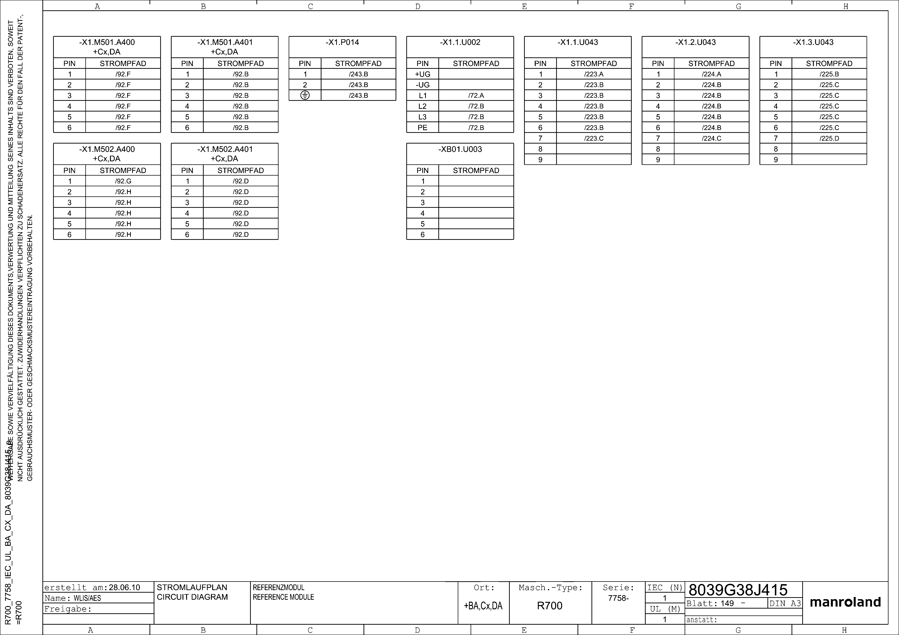

# +BA_Cx_DA — Sheet 149 of 247 — REFERENZMODUL

**REFERENCE MODULE**

> Part of the manroland **R700** printing press IEC/UL circuit diagrams.
> Drawing class: **Stromlaufplan / Circuit diagram** (DIN A3).
> Document `+BA_Cx_DA` covers the **Printing units / main switch cabinet** machine section.

## At a glance

| Field | Value |
|---|---|
| Document | `+BA_Cx_DA`  (8039G38J415) |
| Sheet | **149** of 247 |
| Section (DE) | REFERENZMODUL |
| Section (EN) | REFERENCE MODULE |
| Section type | REFERENCE_MODULE — Reference module |
| Machine type | `R700` |
| Series | `7758` |
| Created | 28.06.10 |
| Replaces | — |
| Columns used | A, B, C, D, E, F, G, H |
| Path numbers | — |
| Labels on sheet | 151 |
| Cross-refs out | 52 |
| Cross-refs in | 0 |

**Previous:** [+BA_Cx_DA sheet 148](SHEET_0148.md) · **Next:** [+BA_Cx_DA sheet 150](SHEET_0150.md) · **Document TOC:** [_TOC.md](_TOC.md)  (+BA_Cx_DA) · **Master TOC:** [all sheets](../_MASTER_TOC.md)

## Sheet image (300 DPI, exact vector render)



_Rendered directly from the PDF vector layer at 300 DPI (1-bit), no OCR and no resampling. Use it to confirm anything ambiguous in the text below._

## Cross-references on this sheet

Each entry is a wire leaving this sheet. The printed token is `/sheet.column`; the link resolves to that sheet inside the same document.

| Ref | Target sheet | Col | Path | Destination on target | Target section | From col |
|---|---|---|---|---|---|---|
| `/92.B` | [+BA_Cx_DA sheet 92](SHEET_0092.md) | B | — | — | BOGENFÜHRUNG, DRUCKWERK NACH WENDUNG | B |
| `/92.F` | [+BA_Cx_DA sheet 92](SHEET_0092.md) | F | — | — | BOGENFÜHRUNG, DRUCKWERK NACH WENDUNG | A |
| `/243.B` | [+BA_Cx_DA sheet 243](SHEET_0243.md) | B | — | — | OPTION: LEITSTANDBEDIENUNG | C |
| `/223.A` | [+BA_Cx_DA sheet 223](SHEET_0223.md) | A | — | — | OPTION: INLINEOBSERVER | F |
| `/224.A` | [+BA_Cx_DA sheet 224](SHEET_0224.md) | A | — | — | OPTION: INLINEOBSERVER | G |
| `/225.B` | [+BA_Cx_DA sheet 225](SHEET_0225.md) | B | — | — | OPTION: INLINEOBSERVER | H |
| `/92.B` | [+BA_Cx_DA sheet 92](SHEET_0092.md) | B | — | — | BOGENFÜHRUNG, DRUCKWERK NACH WENDUNG | B |
| `/92.F` | [+BA_Cx_DA sheet 92](SHEET_0092.md) | F | — | — | BOGENFÜHRUNG, DRUCKWERK NACH WENDUNG | A |
| `/243.B` | [+BA_Cx_DA sheet 243](SHEET_0243.md) | B | — | — | OPTION: LEITSTANDBEDIENUNG | C |
| `/223.B` | [+BA_Cx_DA sheet 223](SHEET_0223.md) | B | — | — | OPTION: INLINEOBSERVER | F |
| `/224.B` | [+BA_Cx_DA sheet 224](SHEET_0224.md) | B | — | — | OPTION: INLINEOBSERVER | G |
| `/225.C` | [+BA_Cx_DA sheet 225](SHEET_0225.md) | C | — | — | OPTION: INLINEOBSERVER | H |
| `/92.B` | [+BA_Cx_DA sheet 92](SHEET_0092.md) | B | — | — | BOGENFÜHRUNG, DRUCKWERK NACH WENDUNG | B |
| `/72.A` | [+BA_Cx_DA sheet 72](SHEET_0072.md) | A | — | — | FEUCHTWERK | E |
| `/92.F` | [+BA_Cx_DA sheet 92](SHEET_0092.md) | F | — | — | BOGENFÜHRUNG, DRUCKWERK NACH WENDUNG | A |
| `/243.B` | [+BA_Cx_DA sheet 243](SHEET_0243.md) | B | — | — | OPTION: LEITSTANDBEDIENUNG | C |
| `/223.B` | [+BA_Cx_DA sheet 223](SHEET_0223.md) | B | — | — | OPTION: INLINEOBSERVER | F |
| `/224.B` | [+BA_Cx_DA sheet 224](SHEET_0224.md) | B | — | — | OPTION: INLINEOBSERVER | G |
| `/225.C` | [+BA_Cx_DA sheet 225](SHEET_0225.md) | C | — | — | OPTION: INLINEOBSERVER | H |
| `/92.B` | [+BA_Cx_DA sheet 92](SHEET_0092.md) | B | — | — | BOGENFÜHRUNG, DRUCKWERK NACH WENDUNG | B |
| `/72.B` | [+BA_Cx_DA sheet 72](SHEET_0072.md) | B | — | — | FEUCHTWERK | E |
| `/92.F` | [+BA_Cx_DA sheet 92](SHEET_0092.md) | F | — | — | BOGENFÜHRUNG, DRUCKWERK NACH WENDUNG | A |
| `/223.B` | [+BA_Cx_DA sheet 223](SHEET_0223.md) | B | — | — | OPTION: INLINEOBSERVER | F |
| `/224.B` | [+BA_Cx_DA sheet 224](SHEET_0224.md) | B | — | — | OPTION: INLINEOBSERVER | G |
| `/225.C` | [+BA_Cx_DA sheet 225](SHEET_0225.md) | C | — | — | OPTION: INLINEOBSERVER | H |
| `/92.B` | [+BA_Cx_DA sheet 92](SHEET_0092.md) | B | — | — | BOGENFÜHRUNG, DRUCKWERK NACH WENDUNG | B |
| `/72.B` | [+BA_Cx_DA sheet 72](SHEET_0072.md) | B | — | — | FEUCHTWERK | E |
| `/92.F` | [+BA_Cx_DA sheet 92](SHEET_0092.md) | F | — | — | BOGENFÜHRUNG, DRUCKWERK NACH WENDUNG | A |
| `/223.B` | [+BA_Cx_DA sheet 223](SHEET_0223.md) | B | — | — | OPTION: INLINEOBSERVER | F |
| `/224.B` | [+BA_Cx_DA sheet 224](SHEET_0224.md) | B | — | — | OPTION: INLINEOBSERVER | G |
| `/225.C` | [+BA_Cx_DA sheet 225](SHEET_0225.md) | C | — | — | OPTION: INLINEOBSERVER | H |
| `/92.B` | [+BA_Cx_DA sheet 92](SHEET_0092.md) | B | — | — | BOGENFÜHRUNG, DRUCKWERK NACH WENDUNG | B |
| `/72.B` | [+BA_Cx_DA sheet 72](SHEET_0072.md) | B | — | — | FEUCHTWERK | E |
| `/92.F` | [+BA_Cx_DA sheet 92](SHEET_0092.md) | F | — | — | BOGENFÜHRUNG, DRUCKWERK NACH WENDUNG | A |
| `/223.B` | [+BA_Cx_DA sheet 223](SHEET_0223.md) | B | — | — | OPTION: INLINEOBSERVER | F |
| `/224.B` | [+BA_Cx_DA sheet 224](SHEET_0224.md) | B | — | — | OPTION: INLINEOBSERVER | G |
| `/225.C` | [+BA_Cx_DA sheet 225](SHEET_0225.md) | C | — | — | OPTION: INLINEOBSERVER | H |
| `/223.C` | [+BA_Cx_DA sheet 223](SHEET_0223.md) | C | — | — | OPTION: INLINEOBSERVER | F |
| `/224.C` | [+BA_Cx_DA sheet 224](SHEET_0224.md) | C | — | — | OPTION: INLINEOBSERVER | G |
| `/225.D` | [+BA_Cx_DA sheet 225](SHEET_0225.md) | D | — | — | OPTION: INLINEOBSERVER | H |
| `/92.G` | [+BA_Cx_DA sheet 92](SHEET_0092.md) | G | — | — | BOGENFÜHRUNG, DRUCKWERK NACH WENDUNG | A |
| `/92.D` | [+BA_Cx_DA sheet 92](SHEET_0092.md) | D | — | — | BOGENFÜHRUNG, DRUCKWERK NACH WENDUNG | B |
| `/92.H` | [+BA_Cx_DA sheet 92](SHEET_0092.md) | H | — | — | BOGENFÜHRUNG, DRUCKWERK NACH WENDUNG | A |
| `/92.D` | [+BA_Cx_DA sheet 92](SHEET_0092.md) | D | — | — | BOGENFÜHRUNG, DRUCKWERK NACH WENDUNG | B |
| `/92.H` | [+BA_Cx_DA sheet 92](SHEET_0092.md) | H | — | — | BOGENFÜHRUNG, DRUCKWERK NACH WENDUNG | A |
| `/92.D` | [+BA_Cx_DA sheet 92](SHEET_0092.md) | D | — | — | BOGENFÜHRUNG, DRUCKWERK NACH WENDUNG | B |
| `/92.H` | [+BA_Cx_DA sheet 92](SHEET_0092.md) | H | — | — | BOGENFÜHRUNG, DRUCKWERK NACH WENDUNG | A |
| `/92.D` | [+BA_Cx_DA sheet 92](SHEET_0092.md) | D | — | — | BOGENFÜHRUNG, DRUCKWERK NACH WENDUNG | B |
| `/92.H` | [+BA_Cx_DA sheet 92](SHEET_0092.md) | H | — | — | BOGENFÜHRUNG, DRUCKWERK NACH WENDUNG | A |
| `/92.D` | [+BA_Cx_DA sheet 92](SHEET_0092.md) | D | — | — | BOGENFÜHRUNG, DRUCKWERK NACH WENDUNG | B |
| `/92.H` | [+BA_Cx_DA sheet 92](SHEET_0092.md) | H | — | — | BOGENFÜHRUNG, DRUCKWERK NACH WENDUNG | A |
| `/92.D` | [+BA_Cx_DA sheet 92](SHEET_0092.md) | D | — | — | BOGENFÜHRUNG, DRUCKWERK NACH WENDUNG | B |

## Devices on this sheet

| Tag | Class | Class meaning (IEC) | Col | Sub | Terminal | Sign |
|---|---|---|---|---|---|---|
| `X1.1.U043` | — | cross-device reference | F | — | — | — |
| `X1.2.U043` | — | cross-device reference | G | — | — | — |
| `X1.3.U043` | — | cross-device reference | H | — | — | — |
| `X1.1.U002` | — | cross-device reference | D | — | — | — |
| `XB01.U003` | — | cross-device reference | D | — | — | — |
| `X1.P014` | — | cross-device reference | C | — | — | — |
| `X1.M501.A400` | — | cross-device reference | A | — | — | — |
| `X1.M502.A400` | — | cross-device reference | A | — | — | — |
| `X1.M501.A401` | — | cross-device reference | B | — | — | — |
| `X1.M502.A401` | — | cross-device reference | B | — | — | — |

## Potentials / nets

| Potential | Count | Columns | Attached devices | Terminals |
|---|---|---|---|---|
| `L1` | 1 | D | — | — |
| `L2` | 1 | D | — | — |
| `L3` | 1 | D | — | — |
| `PE` | 1 | D | — | — |


A potential such as `L24+/4` or `M24+` is a named supply/return rail; every place it appears on this sheet is electrically common.

## Wire-end annotations (grouped as printed)

A wire that continues elsewhere is annotated with a small cluster: the destination description, the path/line number `#NN`, and the `/sheet.column` cross reference. Each row below is one such cluster exactly as it is grouped on the drawing.

| Col | Y | Path | Cross-ref | Text on the wire |
|---|---|---|---|---|
| A | 51.3 | — | — | `X1.M501.A400` |
| B | 51.3 | — | — | `X1.M501.A401` |
| C | 51.3 | — | — | `X1.P014` |
| D | 51.3 | — | — | `X1.1.U002` |
| F | 51.3 | — | — | `X1.1.U043` |
| G | 51.3 | — | — | `X1.2.U043` |
| H | 51.3 | — | — | `X1.3.U043` |
| A | 64.1 | — | — | `+Cx,DA` |
| B | 64.1 | — | — | `+Cx,DA` |
| A | 80.0 | — | — | `PIN 2 3 4 5 6 1 STROMPFAD` |
| B | 80.0 | — | — | `PIN 2 3 4 5 6 1 STROMPFAD` |
| C | 80.0 | — | — | `PIN 2 1 STROMPFAD` |
| D | 80.0 | — | — | `+UG PIN STROMPFAD` |
| E | 80.0 | — | — | `PIN 2 3 4 5 6 7 8 9 1 STROMPFAD` |
| G | 80.0 | — | — | `PIN 2 3 4 5 6 7 8 9 1 STROMPFAD` |
| H | 80.0 | — | — | `PIN 2 3 4 5 6 7 8 9 1 STROMPFAD` |
| A | 94.5 | — | `/92.F` | — |
| B | 94.5 | — | `/92.B` | — |
| C | 94.5 | — | `/243.B` | — |
| F | 94.5 | — | `/223.A` | — |
| G | 94.5 | — | `/224.A` | — |
| H | 94.5 | — | `/225.B` | — |
| D | 108.3 | — | — | `UG` |
| A | 108.7 | — | `/92.F` | — |
| B | 108.7 | — | `/92.B` | — |
| C | 108.7 | — | `/243.B` | — |
| F | 108.7 | — | `/223.B` | — |
| G | 108.7 | — | `/224.B` | — |
| H | 108.7 | — | `/225.C` | — |
| D | 122.5 | — | — | `PE L2 L3 L1` |
| B | 122.8 | — | `/92.B` | — |
| E | 122.8 | — | `/72.A` | — |
| A | 122.9 | — | `/92.F` | — |
| C | 122.9 | — | `/243.B` | — |
| F | 122.9 | — | `/223.B` | — |
| G | 122.9 | — | `/224.B` | — |
| H | 122.9 | — | `/225.C` | — |
| A | 137.0 | — | `/92.F` | — |
| B | 137.0 | — | `/92.B` | — |
| E | 137.0 | — | `/72.B` | — |
| F | 137.0 | — | `/223.B` | — |
| G | 137.0 | — | `/224.B` | — |
| H | 137.1 | — | `/225.C` | — |
| A | 151.2 | — | `/92.F` | — |
| B | 151.2 | — | `/92.B` | — |
| E | 151.2 | — | `/72.B` | — |
| F | 151.2 | — | `/223.B` | — |
| G | 151.2 | — | `/224.B` | — |
| H | 151.2 | — | `/225.C` | — |
| A | 165.4 | — | `/92.F` | — |
| B | 165.4 | — | `/92.B` | — |
| E | 165.4 | — | `/72.B` | — |
| F | 165.4 | — | `/223.B` | — |
| G | 165.4 | — | `/224.B` | — |
| H | 165.4 | — | `/225.C` | — |
| F | 179.6 | — | `/223.C` | — |
| G | 179.6 | — | `/224.C` | — |
| H | 179.6 | — | `/225.D` | — |
| A | 193.1 | — | — | `X1.M502.A400` |
| B | 193.1 | — | — | `X1.M502.A401` |
| D | 193.1 | — | — | `XB01.U003` |
| A | 205.8 | — | — | `+Cx,DA` |
| B | 205.8 | — | — | `+Cx,DA` |
| A | 221.7 | — | — | `PIN 2 3 4 5 6 1 STROMPFAD` |
| B | 221.7 | — | — | `PIN 2 3 4 5 6 1 STROMPFAD` |
| D | 221.7 | — | — | `PIN 2 3 4 5 6 1 STROMPFAD` |
| A | 236.2 | — | `/92.G` | — |
| B | 236.3 | — | `/92.D` | — |
| A | 250.4 | — | `/92.H` | — |
| B | 250.4 | — | `/92.D` | — |
| A | 264.6 | — | `/92.H` | — |
| B | 264.6 | — | `/92.D` | — |
| A | 278.8 | — | `/92.H` | — |
| B | 278.8 | — | `/92.D` | — |
| A | 293.0 | — | `/92.H` | — |
| B | 293.0 | — | `/92.D` | — |
| A | 307.1 | — | `/92.H` | — |
| B | 307.1 | — | `/92.D` | — |


## Reconstructed tables

This sheet carries tabular content (pin map / terminal assignment / index). The grid below was rebuilt from the drawing's own rule lines, so each row is exactly one physical row of the table.

### Table 1 — 15 data rows × 2 columns (at x=70.9, y=48.2) — **X1.M501.A400 +Cx,DA**

| PIN | STROMPFAD |
|---|---|
| `1` | `/92.F` |
| `2` | `/92.F` |
| `3` | `/92.F` |
| `4` | `/92.F` |
| `5` | `/92.F` |
| `6` | `/92.F` |
|  | `X1.M502.A400` |
|  | `+Cx,DA` |
| `PIN` | `STROMPFAD` |
| `1` | `/92.G` |
| `2` | `/92.H` |
| `3` | `/92.H` |
| `4` | `/92.H` |
| `5` | `/92.H` |
| `6` | `/92.H` |


### Table 2 — 15 data rows × 2 columns (at x=226.8, y=48.2) — **X1.M501.A401 +Cx,DA**

| PIN | STROMPFAD |
|---|---|
| `1` | `/92.B` |
| `2` | `/92.B` |
| `3` | `/92.B` |
| `4` | `/92.B` |
| `5` | `/92.B` |
| `6` | `/92.B` |
|  | `X1.M502.A401` |
|  | `+Cx,DA` |
| `PIN` | `STROMPFAD` |
| `1` | `/92.D` |
| `2` | `/92.D` |
| `3` | `/92.D` |
| `4` | `/92.D` |
| `5` | `/92.D` |
| `6` | `/92.D` |


### Table 3 — 3 data rows × 2 columns (at x=382.7, y=48.2) — **X1.P014**

| PIN | STROMPFAD |
|---|---|
| `1` | `/243.B` |
| `2` | `/243.B` |
|  | `/243.B` |


### Table 4 — 14 data rows × 2 columns (at x=538.6, y=48.2) — **X1.1.U002**

| PIN | STROMPFAD |
|---|---|
| `+UG` |  |
| `UG` |  |
| `L1` | `/72.A` |
| `L2` | `/72.B` |
| `L3` | `/72.B` |
| `PE` | `/72.B` |
|  | `XB01.U003` |
| `PIN` | `STROMPFAD` |
| `1` |  |
| `2` |  |
| `3` |  |
| `4` |  |
| `5` |  |
| `6` |  |


### Table 5 — 9 data rows × 2 columns (at x=694.5, y=48.2) — **X1.1.U043**

| PIN | STROMPFAD |
|---|---|
| `1` | `/223.A` |
| `2` | `/223.B` |
| `3` | `/223.B` |
| `4` | `/223.B` |
| `5` | `/223.B` |
| `6` | `/223.B` |
| `7` | `/223.C` |
| `8` |  |
| `9` |  |


### Table 6 — 9 data rows × 2 columns (at x=850.4, y=48.2) — **X1.2.U043**

| PIN | STROMPFAD |
|---|---|
| `1` | `/224.A` |
| `2` | `/224.B` |
| `3` | `/224.B` |
| `4` | `/224.B` |
| `5` | `/224.B` |
| `6` | `/224.B` |
| `7` | `/224.C` |
| `8` |  |
| `9` |  |


### Table 7 — 9 data rows × 2 columns (at x=1006.3, y=48.2) — **X1.3.U043**

| PIN | STROMPFAD |
|---|---|
| `1` | `/225.B` |
| `2` | `/225.C` |
| `3` | `/225.C` |
| `4` | `/225.C` |
| `5` | `/225.C` |
| `6` | `/225.C` |
| `7` | `/225.D` |
| `8` |  |
| `9` |  |


## Notes and free text on this sheet

| Text | Col | Y (pt) |
|---|---|---|
| `PIN` | E | 80.02 |
| `STROMPFAD` | F | 79.98 |
| `PIN` | F | 80.02 |
| `STROMPFAD` | G | 79.98 |
| `PIN` | G | 80.02 |
| `STROMPFAD` | H | 79.98 |
| `PIN` | D | 80.02 |
| `STROMPFAD` | E | 79.98 |
| `+UG` | D | 94.16 |
| `UG` | D | 108.29 |
| `PIN` | C | 80.02 |
| `STROMPFAD` | C | 79.98 |
| `PIN` | A | 80.02 |
| `STROMPFAD` | A | 79.98 |
| `+Cx,DA` | A | 64.09 |
| `PIN` | B | 80.02 |
| `STROMPFAD` | B | 79.98 |
| `+Cx,DA` | B | 64.09 |

## Complete label inventory (exact text from the drawing)

Every text object inside the drawing area of this sheet, in DIN reading order (column A→H, then top→bottom). This is the authoritative list: if a string is not here it is not printed on this sheet.

| Col | Y | X | Dir | Type | Text |
|---|---|---|---|---|---|
| A | 51.3 | 105.0 | → | device ref | `X1.M501.A400` |
| A | 64.1 | 123.2 | → | text | `+Cx,DA` |
| A | 80.0 | 84.0 | → | text | `PIN` |
| A | 80.0 | 132.2 | → | text | `STROMPFAD` |
| A | 94.2 | 90.0 | → | number | `1` |
| A | 94.5 | 153.1 | → | cross-reference | `/92.F` |
| A | 108.4 | 89.4 | → | number | `2` |
| A | 108.7 | 153.1 | → | cross-reference | `/92.F` |
| A | 122.5 | 89.4 | → | number | `3` |
| A | 122.9 | 153.1 | → | cross-reference | `/92.F` |
| A | 136.7 | 89.4 | → | number | `4` |
| A | 137.0 | 153.1 | → | cross-reference | `/92.F` |
| A | 150.9 | 89.4 | → | number | `5` |
| A | 151.2 | 153.1 | → | cross-reference | `/92.F` |
| A | 165.1 | 89.4 | → | number | `6` |
| A | 165.4 | 153.1 | → | cross-reference | `/92.F` |
| A | 193.1 | 105.0 | → | device ref | `X1.M502.A400` |
| A | 205.8 | 123.2 | → | text | `+Cx,DA` |
| A | 221.7 | 132.2 | → | text | `STROMPFAD` |
| A | 221.8 | 84.0 | → | text | `PIN` |
| A | 235.9 | 90.0 | → | number | `1` |
| A | 236.3 | 152.5 | → | cross-reference | `/92.G` |
| A | 250.1 | 89.4 | → | number | `2` |
| A | 250.4 | 152.9 | → | cross-reference | `/92.H` |
| A | 264.3 | 89.4 | → | number | `3` |
| A | 264.6 | 152.9 | → | cross-reference | `/92.H` |
| A | 278.5 | 89.4 | → | number | `4` |
| A | 278.8 | 152.9 | → | cross-reference | `/92.H` |
| A | 292.6 | 89.4 | → | number | `5` |
| A | 293.0 | 152.9 | → | cross-reference | `/92.H` |
| A | 306.8 | 89.4 | → | number | `6` |
| A | 307.1 | 152.9 | → | cross-reference | `/92.H` |
| B | 51.3 | 261.6 | → | device ref | `X1.M501.A401` |
| B | 64.1 | 279.1 | → | text | `+Cx,DA` |
| B | 80.0 | 240.0 | → | text | `PIN` |
| B | 80.0 | 288.1 | → | text | `STROMPFAD` |
| B | 94.2 | 245.9 | → | number | `1` |
| B | 94.5 | 308.7 | → | cross-reference | `/92.B` |
| B | 108.4 | 245.3 | → | number | `2` |
| B | 108.7 | 308.7 | → | cross-reference | `/92.B` |
| B | 122.5 | 245.3 | → | number | `3` |
| B | 122.8 | 308.7 | → | cross-reference | `/92.B` |
| B | 136.7 | 245.3 | → | number | `4` |
| B | 137.0 | 308.7 | → | cross-reference | `/92.B` |
| B | 150.9 | 245.3 | → | number | `5` |
| B | 151.2 | 308.7 | → | cross-reference | `/92.B` |
| B | 165.1 | 245.3 | → | number | `6` |
| B | 165.4 | 308.7 | → | cross-reference | `/92.B` |
| B | 193.1 | 261.6 | → | device ref | `X1.M502.A401` |
| B | 205.8 | 279.1 | → | text | `+Cx,DA` |
| B | 221.7 | 288.1 | → | text | `STROMPFAD` |
| B | 221.8 | 240.0 | → | text | `PIN` |
| B | 235.9 | 245.9 | → | number | `1` |
| B | 236.3 | 308.6 | → | cross-reference | `/92.D` |
| B | 250.1 | 245.3 | → | number | `2` |
| B | 250.4 | 308.6 | → | cross-reference | `/92.D` |
| B | 264.3 | 245.3 | → | number | `3` |
| B | 264.6 | 308.6 | → | cross-reference | `/92.D` |
| B | 278.5 | 245.3 | → | number | `4` |
| B | 278.8 | 308.6 | → | cross-reference | `/92.D` |
| B | 292.6 | 245.3 | → | number | `5` |
| B | 293.0 | 308.6 | → | cross-reference | `/92.D` |
| B | 306.8 | 245.3 | → | number | `6` |
| B | 307.1 | 308.6 | → | cross-reference | `/92.D` |
| C | 51.3 | 431.6 | → | device ref | `X1.P014` |
| C | 80.0 | 395.9 | → | text | `PIN` |
| C | 80.0 | 444.0 | → | text | `STROMPFAD` |
| C | 94.2 | 401.8 | → | number | `1` |
| C | 94.5 | 462.2 | → | cross-reference | `/243.B` |
| C | 108.4 | 401.2 | → | number | `2` |
| C | 108.7 | 462.2 | → | cross-reference | `/243.B` |
| C | 122.9 | 462.2 | → | cross-reference | `/243.B` |
| D | 51.3 | 582.8 | → | device ref | `X1.1.U002` |
| D | 80.0 | 551.8 | → | text | `PIN` |
| D | 94.2 | 549.6 | → | text | `+UG` |
| D | 108.3 | 550.9 | → | text | `UG` |
| D | 122.5 | 555.0 | → | potential | `L1` |
| D | 136.7 | 554.2 | → | potential | `L2` |
| D | 150.9 | 554.2 | → | potential | `L3` |
| D | 165.0 | 553.2 | → | potential | `PE` |
| D | 193.1 | 580.7 | → | device ref | `XB01.U003` |
| D | 221.8 | 551.8 | → | text | `PIN` |
| D | 235.9 | 557.7 | → | number | `1` |
| D | 250.1 | 557.1 | → | number | `2` |
| D | 264.3 | 557.1 | → | number | `3` |
| D | 278.5 | 557.1 | → | number | `4` |
| D | 292.6 | 557.1 | → | number | `5` |
| D | 306.8 | 557.1 | → | number | `6` |
| E | 80.0 | 600.0 | → | text | `STROMPFAD` |
| E | 80.0 | 707.7 | → | text | `PIN` |
| E | 94.2 | 713.6 | → | number | `1` |
| E | 108.4 | 713.1 | → | number | `2` |
| E | 122.5 | 713.1 | → | number | `3` |
| E | 122.8 | 620.4 | → | cross-reference | `/72.A` |
| E | 136.7 | 713.1 | → | number | `4` |
| E | 137.0 | 620.5 | → | cross-reference | `/72.B` |
| E | 150.9 | 713.1 | → | number | `5` |
| E | 151.2 | 620.5 | → | cross-reference | `/72.B` |
| E | 165.1 | 713.1 | → | number | `6` |
| E | 165.4 | 620.5 | → | cross-reference | `/72.B` |
| E | 179.2 | 713.1 | → | number | `7` |
| E | 193.4 | 713.1 | → | number | `8` |
| E | 207.6 | 713.1 | → | number | `9` |
| E | 221.7 | 600.0 | → | text | `STROMPFAD` |
| F | 51.3 | 738.7 | → | device ref | `X1.1.U043` |
| F | 80.0 | 755.9 | → | text | `STROMPFAD` |
| F | 80.0 | 863.6 | → | text | `PIN` |
| F | 94.2 | 869.5 | → | number | `1` |
| F | 94.5 | 773.9 | → | cross-reference | `/223.A` |
| F | 108.4 | 869.0 | → | number | `2` |
| F | 108.7 | 774.0 | → | cross-reference | `/223.B` |
| F | 122.5 | 869.0 | → | number | `3` |
| F | 122.9 | 774.0 | → | cross-reference | `/223.B` |
| F | 136.7 | 869.0 | → | number | `4` |
| F | 137.0 | 774.0 | → | cross-reference | `/223.B` |
| F | 150.9 | 869.0 | → | number | `5` |
| F | 151.2 | 774.0 | → | cross-reference | `/223.B` |
| F | 165.1 | 869.0 | → | number | `6` |
| F | 165.4 | 774.0 | → | cross-reference | `/223.B` |
| F | 179.2 | 869.0 | → | number | `7` |
| F | 179.6 | 773.9 | → | cross-reference | `/223.C` |
| F | 193.4 | 869.0 | → | number | `8` |
| F | 207.6 | 869.0 | → | number | `9` |
| G | 51.3 | 894.6 | → | device ref | `X1.2.U043` |
| G | 80.0 | 911.8 | → | text | `STROMPFAD` |
| G | 80.0 | 1019.5 | → | text | `PIN` |
| G | 94.2 | 1025.4 | → | number | `1` |
| G | 94.5 | 929.8 | → | cross-reference | `/224.A` |
| G | 108.4 | 1024.9 | → | number | `2` |
| G | 108.7 | 929.9 | → | cross-reference | `/224.B` |
| G | 122.5 | 1024.9 | → | number | `3` |
| G | 122.9 | 929.9 | → | cross-reference | `/224.B` |
| G | 136.7 | 1024.9 | → | number | `4` |
| G | 137.0 | 929.9 | → | cross-reference | `/224.B` |
| G | 150.9 | 1024.9 | → | number | `5` |
| G | 151.2 | 929.9 | → | cross-reference | `/224.B` |
| G | 165.1 | 1024.9 | → | number | `6` |
| G | 165.4 | 929.9 | → | cross-reference | `/224.B` |
| G | 179.2 | 1024.9 | → | number | `7` |
| G | 179.6 | 929.8 | → | cross-reference | `/224.C` |
| G | 193.4 | 1024.9 | → | number | `8` |
| G | 207.6 | 1024.9 | → | number | `9` |
| H | 51.3 | 1050.5 | → | device ref | `X1.3.U043` |
| H | 80.0 | 1067.7 | → | text | `STROMPFAD` |
| H | 94.5 | 1085.8 | → | cross-reference | `/225.B` |
| H | 108.7 | 1085.7 | → | cross-reference | `/225.C` |
| H | 122.9 | 1085.7 | → | cross-reference | `/225.C` |
| H | 137.1 | 1085.7 | → | cross-reference | `/225.C` |
| H | 151.2 | 1085.7 | → | cross-reference | `/225.C` |
| H | 165.4 | 1085.7 | → | cross-reference | `/225.C` |
| H | 179.6 | 1085.7 | → | cross-reference | `/225.D` |

## Reading-order text block

The same content as a plain block, grouped by DIN column — convenient to paste or to match against a visual description.

```text
=== Column A ===
  51.3  105.0  devref       X1.M501.A400
  64.1  123.2  text         +Cx,DA
  80.0   84.0  text         PIN
  80.0  132.2  text         STROMPFAD
  94.2   90.0  numeric      1
  94.5  153.1  xref         /92.F
 108.4   89.4  numeric      2
 108.7  153.1  xref         /92.F
 122.5   89.4  numeric      3
 122.9  153.1  xref         /92.F
 136.7   89.4  numeric      4
 137.0  153.1  xref         /92.F
 150.9   89.4  numeric      5
 151.2  153.1  xref         /92.F
 165.1   89.4  numeric      6
 165.4  153.1  xref         /92.F
 193.1  105.0  devref       X1.M502.A400
 205.8  123.2  text         +Cx,DA
 221.7  132.2  text         STROMPFAD
 221.8   84.0  text         PIN
 235.9   90.0  numeric      1
 236.3  152.5  xref         /92.G
 250.1   89.4  numeric      2
 250.4  152.9  xref         /92.H
 264.3   89.4  numeric      3
 264.6  152.9  xref         /92.H
 278.5   89.4  numeric      4
 278.8  152.9  xref         /92.H
 292.6   89.4  numeric      5
 293.0  152.9  xref         /92.H
 306.8   89.4  numeric      6
 307.1  152.9  xref         /92.H
=== Column B ===
  51.3  261.6  devref       X1.M501.A401
  64.1  279.1  text         +Cx,DA
  80.0  240.0  text         PIN
  80.0  288.1  text         STROMPFAD
  94.2  245.9  numeric      1
  94.5  308.7  xref         /92.B
 108.4  245.3  numeric      2
 108.7  308.7  xref         /92.B
 122.5  245.3  numeric      3
 122.8  308.7  xref         /92.B
 136.7  245.3  numeric      4
 137.0  308.7  xref         /92.B
 150.9  245.3  numeric      5
 151.2  308.7  xref         /92.B
 165.1  245.3  numeric      6
 165.4  308.7  xref         /92.B
 193.1  261.6  devref       X1.M502.A401
 205.8  279.1  text         +Cx,DA
 221.7  288.1  text         STROMPFAD
 221.8  240.0  text         PIN
 235.9  245.9  numeric      1
 236.3  308.6  xref         /92.D
 250.1  245.3  numeric      2
 250.4  308.6  xref         /92.D
 264.3  245.3  numeric      3
 264.6  308.6  xref         /92.D
 278.5  245.3  numeric      4
 278.8  308.6  xref         /92.D
 292.6  245.3  numeric      5
 293.0  308.6  xref         /92.D
 306.8  245.3  numeric      6
 307.1  308.6  xref         /92.D
=== Column C ===
  51.3  431.6  devref       X1.P014
  80.0  395.9  text         PIN
  80.0  444.0  text         STROMPFAD
  94.2  401.8  numeric      1
  94.5  462.2  xref         /243.B
 108.4  401.2  numeric      2
 108.7  462.2  xref         /243.B
 122.9  462.2  xref         /243.B
=== Column D ===
  51.3  582.8  devref       X1.1.U002
  80.0  551.8  text         PIN
  94.2  549.6  text         +UG
 108.3  550.9  text         UG
 122.5  555.0  net          L1
 136.7  554.2  net          L2
 150.9  554.2  net          L3
 165.0  553.2  net          PE
 193.1  580.7  devref       XB01.U003
 221.8  551.8  text         PIN
 235.9  557.7  numeric      1
 250.1  557.1  numeric      2
 264.3  557.1  numeric      3
 278.5  557.1  numeric      4
 292.6  557.1  numeric      5
 306.8  557.1  numeric      6
=== Column E ===
  80.0  600.0  text         STROMPFAD
  80.0  707.7  text         PIN
  94.2  713.6  numeric      1
 108.4  713.1  numeric      2
 122.5  713.1  numeric      3
 122.8  620.4  xref         /72.A
 136.7  713.1  numeric      4
 137.0  620.5  xref         /72.B
 150.9  713.1  numeric      5
 151.2  620.5  xref         /72.B
 165.1  713.1  numeric      6
 165.4  620.5  xref         /72.B
 179.2  713.1  numeric      7
 193.4  713.1  numeric      8
 207.6  713.1  numeric      9
 221.7  600.0  text         STROMPFAD
=== Column F ===
  51.3  738.7  devref       X1.1.U043
  80.0  755.9  text         STROMPFAD
  80.0  863.6  text         PIN
  94.2  869.5  numeric      1
  94.5  773.9  xref         /223.A
 108.4  869.0  numeric      2
 108.7  774.0  xref         /223.B
 122.5  869.0  numeric      3
 122.9  774.0  xref         /223.B
 136.7  869.0  numeric      4
 137.0  774.0  xref         /223.B
 150.9  869.0  numeric      5
 151.2  774.0  xref         /223.B
 165.1  869.0  numeric      6
 165.4  774.0  xref         /223.B
 179.2  869.0  numeric      7
 179.6  773.9  xref         /223.C
 193.4  869.0  numeric      8
 207.6  869.0  numeric      9
=== Column G ===
  51.3  894.6  devref       X1.2.U043
  80.0  911.8  text         STROMPFAD
  80.0 1019.5  text         PIN
  94.2 1025.4  numeric      1
  94.5  929.8  xref         /224.A
 108.4 1024.9  numeric      2
 108.7  929.9  xref         /224.B
 122.5 1024.9  numeric      3
 122.9  929.9  xref         /224.B
 136.7 1024.9  numeric      4
 137.0  929.9  xref         /224.B
 150.9 1024.9  numeric      5
 151.2  929.9  xref         /224.B
 165.1 1024.9  numeric      6
 165.4  929.9  xref         /224.B
 179.2 1024.9  numeric      7
 179.6  929.8  xref         /224.C
 193.4 1024.9  numeric      8
 207.6 1024.9  numeric      9
=== Column H ===
  51.3 1050.5  devref       X1.3.U043
  80.0 1067.7  text         STROMPFAD
  94.5 1085.8  xref         /225.B
 108.7 1085.7  xref         /225.C
 122.9 1085.7  xref         /225.C
 137.1 1085.7  xref         /225.C
 151.2 1085.7  xref         /225.C
 165.4 1085.7  xref         /225.C
 179.6 1085.7  xref         /225.D
```

---
_Generated from the PDF vector text layer; no OCR. Source: `R700_7758_IEC_UL_BA_CX_DA_8039G38J415_p`, sheet 149._
