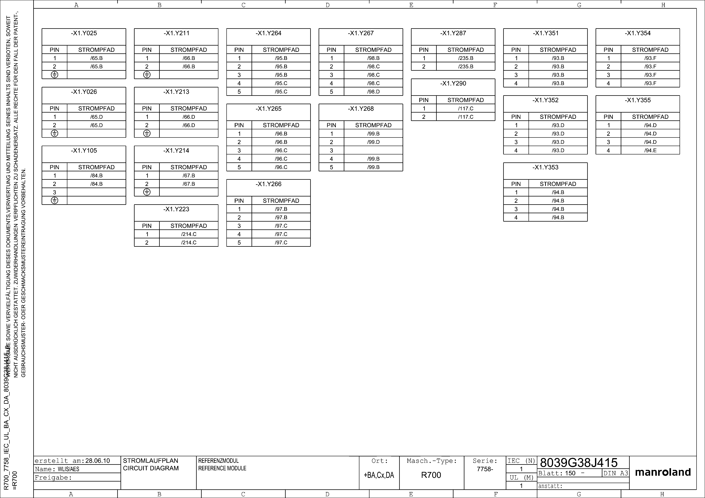

# +BA_Cx_DA — Sheet 150 of 247 — REFERENZMODUL

**REFERENCE MODULE**

> Part of the manroland **R700** printing press IEC/UL circuit diagrams.
> Drawing class: **Stromlaufplan / Circuit diagram** (DIN A3).
> Document `+BA_Cx_DA` covers the **Printing units / main switch cabinet** machine section.

## At a glance

| Field | Value |
|---|---|
| Document | `+BA_Cx_DA`  (8039G38J415) |
| Sheet | **150** of 247 |
| Section (DE) | REFERENZMODUL |
| Section (EN) | REFERENCE MODULE |
| Section type | REFERENCE_MODULE — Reference module |
| Machine type | `R700` |
| Series | `7758` |
| Created | 28.06.10 |
| Replaces | — |
| Columns used | A, B, C, D, E, F, G, H |
| Path numbers | — |
| Labels on sheet | 183 |
| Cross-refs out | 62 |
| Cross-refs in | 0 |

**Previous:** [+BA_Cx_DA sheet 149](SHEET_0149.md) · **Next:** [+BA_Cx_DA sheet 151](SHEET_0151.md) · **Document TOC:** [_TOC.md](_TOC.md)  (+BA_Cx_DA) · **Master TOC:** [all sheets](../_MASTER_TOC.md)

## Sheet image (300 DPI, exact vector render)



_Rendered directly from the PDF vector layer at 300 DPI (1-bit), no OCR and no resampling. Use it to confirm anything ambiguous in the text below._

## Cross-references on this sheet

Each entry is a wire leaving this sheet. The printed token is `/sheet.column`; the link resolves to that sheet inside the same document.

| Ref | Target sheet | Col | Path | Destination on target | Target section | From col |
|---|---|---|---|---|---|---|
| `/65.B` | [+BA_Cx_DA sheet 65](SHEET_0065.md) | B | — | — | DRUCKANSTELLUNG | A |
| `/66.B` | [+BA_Cx_DA sheet 66](SHEET_0066.md) | B | — | — | TRENNBLÄSER | B |
| `/95.B` | [+BA_Cx_DA sheet 95](SHEET_0095.md) | B | — | — | BLAS/SAUGLUFT MIT MOTORVENTILEINSTELLUNG | C |
| `/98.B` | [+BA_Cx_DA sheet 98](SHEET_0098.md) | B | — | — | BLAS/SAUGLUFT MIT MOTORVENTILEINSTELLUNG | E |
| `/93.B` | [+BA_Cx_DA sheet 93](SHEET_0093.md) | B | — | — | BOGENFÜHRUNG (BLASROHRE) | G |
| `/93.F` | [+BA_Cx_DA sheet 93](SHEET_0093.md) | F | — | — | BOGENFÜHRUNG (BLASROHRE) | H |
| `/235.B` | [+BA_Cx_DA sheet 235](SHEET_0235.md) | B | — | — | OPTION: INLINECOATER SMART | F |
| `/65.B` | [+BA_Cx_DA sheet 65](SHEET_0065.md) | B | — | — | DRUCKANSTELLUNG | A |
| `/66.B` | [+BA_Cx_DA sheet 66](SHEET_0066.md) | B | — | — | TRENNBLÄSER | B |
| `/95.B` | [+BA_Cx_DA sheet 95](SHEET_0095.md) | B | — | — | BLAS/SAUGLUFT MIT MOTORVENTILEINSTELLUNG | C |
| `/93.B` | [+BA_Cx_DA sheet 93](SHEET_0093.md) | B | — | — | BOGENFÜHRUNG (BLASROHRE) | G |
| `/235.B` | [+BA_Cx_DA sheet 235](SHEET_0235.md) | B | — | — | OPTION: INLINECOATER SMART | F |
| `/93.F` | [+BA_Cx_DA sheet 93](SHEET_0093.md) | F | — | — | BOGENFÜHRUNG (BLASROHRE) | H |
| `/98.C` | [+BA_Cx_DA sheet 98](SHEET_0098.md) | C | — | — | BLAS/SAUGLUFT MIT MOTORVENTILEINSTELLUNG | E |
| `/95.B` | [+BA_Cx_DA sheet 95](SHEET_0095.md) | B | — | — | BLAS/SAUGLUFT MIT MOTORVENTILEINSTELLUNG | C |
| `/93.B` | [+BA_Cx_DA sheet 93](SHEET_0093.md) | B | — | — | BOGENFÜHRUNG (BLASROHRE) | G |
| `/93.F` | [+BA_Cx_DA sheet 93](SHEET_0093.md) | F | — | — | BOGENFÜHRUNG (BLASROHRE) | H |
| `/98.C` | [+BA_Cx_DA sheet 98](SHEET_0098.md) | C | — | — | BLAS/SAUGLUFT MIT MOTORVENTILEINSTELLUNG | E |
| `/93.B` | [+BA_Cx_DA sheet 93](SHEET_0093.md) | B | — | — | BOGENFÜHRUNG (BLASROHRE) | G |
| `/93.F` | [+BA_Cx_DA sheet 93](SHEET_0093.md) | F | — | — | BOGENFÜHRUNG (BLASROHRE) | H |
| `/95.C` | [+BA_Cx_DA sheet 95](SHEET_0095.md) | C | — | — | BLAS/SAUGLUFT MIT MOTORVENTILEINSTELLUNG | C |
| `/98.C` | [+BA_Cx_DA sheet 98](SHEET_0098.md) | C | — | — | BLAS/SAUGLUFT MIT MOTORVENTILEINSTELLUNG | E |
| `/95.C` | [+BA_Cx_DA sheet 95](SHEET_0095.md) | C | — | — | BLAS/SAUGLUFT MIT MOTORVENTILEINSTELLUNG | C |
| `/98.D` | [+BA_Cx_DA sheet 98](SHEET_0098.md) | D | — | — | BLAS/SAUGLUFT MIT MOTORVENTILEINSTELLUNG | E |
| `/117.C` | [+BA_Cx_DA sheet 117](SHEET_0117.md) | C | — | — | DRUCKGESCHWINDIGKEIT 17.000 B/H | F |
| `/65.D` | [+BA_Cx_DA sheet 65](SHEET_0065.md) | D | — | — | DRUCKANSTELLUNG | A |
| `/66.D` | [+BA_Cx_DA sheet 66](SHEET_0066.md) | D | — | — | TRENNBLÄSER | B |
| `/117.C` | [+BA_Cx_DA sheet 117](SHEET_0117.md) | C | — | — | DRUCKGESCHWINDIGKEIT 17.000 B/H | F |
| `/65.D` | [+BA_Cx_DA sheet 65](SHEET_0065.md) | D | — | — | DRUCKANSTELLUNG | A |
| `/66.D` | [+BA_Cx_DA sheet 66](SHEET_0066.md) | D | — | — | TRENNBLÄSER | B |
| `/93.D` | [+BA_Cx_DA sheet 93](SHEET_0093.md) | D | — | — | BOGENFÜHRUNG (BLASROHRE) | G |
| `/94.D` | [+BA_Cx_DA sheet 94](SHEET_0094.md) | D | — | — | BOGENFÜHRUNG (BLASROHRE) | H |
| `/96.B` | [+BA_Cx_DA sheet 96](SHEET_0096.md) | B | — | — | BLAS/SAUGLUFT MIT MOTORVENTILEINSTELLUNG | C |
| `/99.B` | [+BA_Cx_DA sheet 99](SHEET_0099.md) | B | — | — | BLAS/SAUGLUFT MIT MOTORVENTILEINSTELLUNG | E |
| `/93.D` | [+BA_Cx_DA sheet 93](SHEET_0093.md) | D | — | — | BOGENFÜHRUNG (BLASROHRE) | G |
| `/94.D` | [+BA_Cx_DA sheet 94](SHEET_0094.md) | D | — | — | BOGENFÜHRUNG (BLASROHRE) | H |
| `/96.B` | [+BA_Cx_DA sheet 96](SHEET_0096.md) | B | — | — | BLAS/SAUGLUFT MIT MOTORVENTILEINSTELLUNG | C |
| `/99.D` | [+BA_Cx_DA sheet 99](SHEET_0099.md) | D | — | — | BLAS/SAUGLUFT MIT MOTORVENTILEINSTELLUNG | E |
| `/93.D` | [+BA_Cx_DA sheet 93](SHEET_0093.md) | D | — | — | BOGENFÜHRUNG (BLASROHRE) | G |
| `/94.D` | [+BA_Cx_DA sheet 94](SHEET_0094.md) | D | — | — | BOGENFÜHRUNG (BLASROHRE) | H |
| `/94.E` | [+BA_Cx_DA sheet 94](SHEET_0094.md) | E | — | — | BOGENFÜHRUNG (BLASROHRE) | H |
| `/96.C` | [+BA_Cx_DA sheet 96](SHEET_0096.md) | C | — | — | BLAS/SAUGLUFT MIT MOTORVENTILEINSTELLUNG | C |
| `/93.D` | [+BA_Cx_DA sheet 93](SHEET_0093.md) | D | — | — | BOGENFÜHRUNG (BLASROHRE) | G |
| `/99.B` | [+BA_Cx_DA sheet 99](SHEET_0099.md) | B | — | — | BLAS/SAUGLUFT MIT MOTORVENTILEINSTELLUNG | E |
| `/96.C` | [+BA_Cx_DA sheet 96](SHEET_0096.md) | C | — | — | BLAS/SAUGLUFT MIT MOTORVENTILEINSTELLUNG | C |
| `/99.B` | [+BA_Cx_DA sheet 99](SHEET_0099.md) | B | — | — | BLAS/SAUGLUFT MIT MOTORVENTILEINSTELLUNG | E |
| `/96.C` | [+BA_Cx_DA sheet 96](SHEET_0096.md) | C | — | — | BLAS/SAUGLUFT MIT MOTORVENTILEINSTELLUNG | C |
| `/84.B` | [+BA_Cx_DA sheet 84](SHEET_0084.md) | B | — | — | FARBWERK | A |
| `/67.B` | [+BA_Cx_DA sheet 67](SHEET_0067.md) | B | — | — | TRENNBLÄSER / | B |
| `/84.B` | [+BA_Cx_DA sheet 84](SHEET_0084.md) | B | — | — | FARBWERK | A |
| `/67.B` | [+BA_Cx_DA sheet 67](SHEET_0067.md) | B | — | — | TRENNBLÄSER / | B |
| `/94.B` | [+BA_Cx_DA sheet 94](SHEET_0094.md) | B | — | — | BOGENFÜHRUNG (BLASROHRE) | G |
| `/94.B` | [+BA_Cx_DA sheet 94](SHEET_0094.md) | B | — | — | BOGENFÜHRUNG (BLASROHRE) | G |
| `/97.B` | [+BA_Cx_DA sheet 97](SHEET_0097.md) | B | — | — | BLAS/SAUGLUFT MIT MOTORVENTILEINSTELLUNG | C |
| `/94.B` | [+BA_Cx_DA sheet 94](SHEET_0094.md) | B | — | — | BOGENFÜHRUNG (BLASROHRE) | G |
| `/97.B` | [+BA_Cx_DA sheet 97](SHEET_0097.md) | B | — | — | BLAS/SAUGLUFT MIT MOTORVENTILEINSTELLUNG | C |
| `/94.B` | [+BA_Cx_DA sheet 94](SHEET_0094.md) | B | — | — | BOGENFÜHRUNG (BLASROHRE) | G |
| `/97.C` | [+BA_Cx_DA sheet 97](SHEET_0097.md) | C | — | — | BLAS/SAUGLUFT MIT MOTORVENTILEINSTELLUNG | C |
| `/97.C` | [+BA_Cx_DA sheet 97](SHEET_0097.md) | C | — | — | BLAS/SAUGLUFT MIT MOTORVENTILEINSTELLUNG | C |
| `/214.C` | [+BA_Cx_DA sheet 214](SHEET_0214.md) | C | — | — | OPTION: FWW SPEZIALREINIGER | B |
| `/97.C` | [+BA_Cx_DA sheet 97](SHEET_0097.md) | C | — | — | BLAS/SAUGLUFT MIT MOTORVENTILEINSTELLUNG | C |
| `/214.C` | [+BA_Cx_DA sheet 214](SHEET_0214.md) | C | — | — | OPTION: FWW SPEZIALREINIGER | B |

## Devices on this sheet

| Tag | Class | Class meaning (IEC) | Col | Sub | Terminal | Sign |
|---|---|---|---|---|---|---|
| `X1.Y025` | — | cross-device reference | A | — | — | — |
| `X1.Y026` | — | cross-device reference | A | — | — | — |
| `X1.Y105` | — | cross-device reference | A | — | — | — |
| `X1.Y211` | — | cross-device reference | B | — | — | — |
| `X1.Y213` | — | cross-device reference | B | — | — | — |
| `X1.Y214` | — | cross-device reference | B | — | — | — |
| `X1.Y223` | — | cross-device reference | B | — | — | — |
| `X1.Y264` | — | cross-device reference | C | — | — | — |
| `X1.Y265` | — | cross-device reference | C | — | — | — |
| `X1.Y266` | — | cross-device reference | C | — | — | — |
| `X1.Y267` | — | cross-device reference | D | — | — | — |
| `X1.Y268` | — | cross-device reference | D | — | — | — |
| `X1.Y287` | — | cross-device reference | F | — | — | — |
| `X1.Y290` | — | cross-device reference | F | — | — | — |
| `X1.Y351` | — | cross-device reference | G | — | — | — |
| `X1.Y352` | — | cross-device reference | G | — | — | — |
| `X1.Y353` | — | cross-device reference | G | — | — | — |
| `X1.Y354` | — | cross-device reference | H | — | — | — |
| `X1.Y355` | — | cross-device reference | H | — | — | — |

## Potentials / nets

_No named potentials on this sheet._

## Wire-end annotations (grouped as printed)

A wire that continues elsewhere is annotated with a small cluster: the destination description, the path/line number `#NN`, and the `/sheet.column` cross reference. Each row below is one such cluster exactly as it is grouped on the drawing.

| Col | Y | Path | Cross-ref | Text on the wire |
|---|---|---|---|---|
| A | 51.4 | — | — | `X1.Y025` |
| B | 51.4 | — | — | `X1.Y211` |
| C | 51.4 | — | — | `X1.Y264` |
| D | 51.4 | — | — | `X1.Y267` |
| F | 51.4 | — | — | `X1.Y287` |
| G | 51.4 | — | — | `X1.Y351` |
| H | 51.4 | — | — | `X1.Y354` |
| A | 80.0 | — | — | `PIN 2 1 STROMPFAD` |
| B | 80.0 | — | — | `PIN 2 1 STROMPFAD` |
| C | 80.0 | — | — | `PIN 2 3 4 5 1 STROMPFAD` |
| D | 80.0 | — | — | `PIN 2 3 4 5 1 STROMPFAD` |
| E | 80.0 | — | — | `PIN 2 1 STROMPFAD` |
| G | 80.0 | — | — | `PIN 2 3 4 1 STROMPFAD` |
| H | 80.0 | — | — | `PIN 2 3 4 1 STROMPFAD` |
| A | 94.5 | — | `/65.B` | — |
| B | 94.5 | — | `/66.B` | — |
| C | 94.5 | — | `/95.B` | — |
| E | 94.5 | — | `/98.B` | — |
| F | 94.5 | — | `/235.B` | — |
| G | 94.5 | — | `/93.B` | — |
| H | 94.5 | — | `/93.F` | — |
| A | 108.7 | — | `/65.B` | — |
| B | 108.7 | — | `/66.B` | — |
| C | 108.7 | — | `/95.B` | — |
| E | 108.7 | — | `/98.C` | — |
| F | 108.7 | — | `/235.B` | — |
| G | 108.7 | — | `/93.B` | — |
| H | 108.7 | — | `/93.F` | — |
| C | 122.8 | — | `/95.B` | — |
| G | 122.8 | — | `/93.B` | — |
| E | 122.9 | — | `/98.C` | — |
| H | 122.9 | — | `/93.F` | — |
| F | 136.4 | — | — | `X1.Y290` |
| G | 137.0 | — | `/93.B` | — |
| H | 137.0 | — | `/93.F` | — |
| C | 137.1 | — | `/95.C` | — |
| E | 137.1 | — | `/98.C` | — |
| A | 150.6 | — | — | `X1.Y026` |
| B | 150.6 | — | — | `X1.Y213` |
| C | 151.2 | — | `/95.C` | — |
| E | 151.2 | — | `/98.D` | — |
| G | 164.8 | — | — | `X1.Y352` |
| H | 164.8 | — | — | `X1.Y355` |
| E | 165.0 | — | — | `PIN 2 1 STROMPFAD` |
| C | 178.9 | — | — | `X1.Y265` |
| D | 178.9 | — | — | `X1.Y268` |
| A | 179.2 | — | — | `PIN 2 1 STROMPFAD` |
| B | 179.2 | — | — | `PIN 2 1 STROMPFAD` |
| F | 179.6 | — | `/117.C` | — |
| G | 193.4 | — | — | `PIN 2 3 4 1 STROMPFAD` |
| H | 193.4 | — | — | `PIN 2 3 4 1 STROMPFAD` |
| A | 193.8 | — | `/65.D` | — |
| B | 193.8 | — | `/66.D` | — |
| F | 193.8 | — | `/117.C` | — |
| C | 207.5 | — | — | `PIN 2 3 4 5 1 STROMPFAD` |
| D | 207.5 | — | — | `PIN 2 3 4 5 1 STROMPFAD` |
| A | 207.9 | — | `/65.D` | — |
| B | 207.9 | — | `/66.D` | — |
| G | 207.9 | — | `/93.D` | — |
| H | 207.9 | — | `/94.D` | — |
| C | 222.1 | — | `/96.B` | — |
| E | 222.1 | — | `/99.B` | — |
| G | 222.1 | — | `/93.D` | — |
| H | 222.1 | — | `/94.D` | — |
| C | 236.2 | — | `/96.B` | — |
| E | 236.3 | — | `/99.D` | — |
| G | 236.3 | — | `/93.D` | — |
| H | 236.3 | — | `/94.D` | — |
| A | 249.8 | — | — | `X1.Y105` |
| B | 249.8 | — | — | `X1.Y214` |
| C | 250.4 | — | `/96.C` | — |
| G | 250.4 | — | `/93.D` | — |
| H | 250.4 | — | `/94.E` | — |
| C | 264.6 | — | `/96.C` | — |
| E | 264.6 | — | `/99.B` | — |
| G | 278.2 | — | — | `X1.Y353` |
| A | 278.4 | — | — | `PIN 2 3 1 STROMPFAD` |
| B | 278.4 | — | — | `PIN 2 1 STROMPFAD` |
| C | 278.8 | — | `/96.C` | — |
| E | 278.8 | — | `/99.B` | — |
| A | 292.9 | — | `/84.B` | — |
| B | 292.9 | — | `/67.B` | — |
| C | 306.5 | — | — | `X1.Y266` |
| G | 306.8 | — | — | `PIN 2 3 4 1 STROMPFAD` |
| A | 307.1 | — | `/84.B` | — |
| B | 307.1 | — | `/67.B` | — |
| G | 321.3 | — | `/94.B` | — |
| C | 335.1 | — | — | `PIN 2 3 4 5 1 STROMPFAD` |
| G | 335.4 | — | `/94.B` | — |
| B | 349.0 | — | — | `X1.Y223` |
| C | 349.6 | — | `/97.B` | — |
| G | 349.6 | — | `/94.B` | — |
| C | 363.8 | — | `/97.B` | — |
| G | 363.8 | — | `/94.B` | — |
| B | 377.6 | — | — | `PIN 2 1 STROMPFAD` |
| C | 378.0 | — | `/97.C` | — |
| B | 392.2 | — | `/214.C` | — |
| C | 392.2 | — | `/97.C` | — |
| C | 406.3 | — | `/97.C` | — |
| B | 406.4 | — | `/214.C` | — |


## Reconstructed tables

This sheet carries tabular content (pin map / terminal assignment / index). The grid below was rebuilt from the drawing's own rule lines, so each row is exactly one physical row of the table.

### Table 1 — 11 data rows × 2 columns (at x=70.9, y=48.2) — **X1.Y025**

| PIN | STROMPFAD |
|---|---|
| `1` | `/65.B` |
| `2` | `/65.B` |
|  | `X1.Y026` |
| `PIN` | `STROMPFAD` |
| `1` | `/65.D` |
| `2` | `/65.D` |
|  | `X1.Y105` |
| `PIN` | `STROMPFAD` |
| `1` | `/84.B` |
| `2` | `/84.B` |
| `3` |  |


### Table 2 — 14 data rows × 2 columns (at x=226.8, y=48.2) — **X1.Y211**

| PIN | STROMPFAD |
|---|---|
| `1` | `/66.B` |
| `2` | `/66.B` |
|  | `X1.Y213` |
| `PIN` | `STROMPFAD` |
| `1` | `/66.D` |
| `2` | `/66.D` |
|  | `X1.Y214` |
| `PIN` | `STROMPFAD` |
| `1` | `/67.B` |
| `2` | `/67.B` |
|  | `X1.Y223` |
| `PIN` | `STROMPFAD` |
| `1` | `/214.C` |
| `2` | `/214.C` |


### Table 3 — 19 data rows × 2 columns (at x=382.7, y=48.2) — **X1.Y264**

| PIN | STROMPFAD |
|---|---|
| `1` | `/95.B` |
| `2` | `/95.B` |
| `3` | `/95.B` |
| `4` | `/95.C` |
| `5` | `/95.C` |
|  | `X1.Y265` |
| `PIN` | `STROMPFAD` |
| `1` | `/96.B` |
| `2` | `/96.B` |
| `3` | `/96.C` |
| `4` | `/96.C` |
| `5` | `/96.C` |
|  | `X1.Y266` |
| `PIN` | `STROMPFAD` |
| `1` | `/97.B` |
| `2` | `/97.B` |
| `3` | `/97.C` |
| `4` | `/97.C` |
| `5` | `/97.C` |


### Table 4 — 12 data rows × 2 columns (at x=538.6, y=48.2) — **X1.Y267**

| PIN | STROMPFAD |
|---|---|
| `1` | `/98.B` |
| `2` | `/98.C` |
| `3` | `/98.C` |
| `4` | `/98.C` |
| `5` | `/98.D` |
|  | `X1.Y268` |
| `PIN` | `STROMPFAD` |
| `1` | `/99.B` |
| `2` | `/99.D` |
| `3` |  |
| `4` | `/99.B` |
| `5` | `/99.B` |


### Table 5 — 6 data rows × 2 columns (at x=694.5, y=48.2) — **X1.Y287**

| PIN | STROMPFAD |
|---|---|
| `1` | `/235.B` |
| `2` | `/235.B` |
|  | `X1.Y290` |
| `PIN` | `STROMPFAD` |
| `1` | `/117.C` |
| `2` | `/117.C` |


### Table 6 — 16 data rows × 2 columns (at x=850.4, y=48.2) — **X1.Y351**

| PIN | STROMPFAD |
|---|---|
| `1` | `/93.B` |
| `2` | `/93.B` |
| `3` | `/93.B` |
| `4` | `/93.B` |
|  | `X1.Y352` |
| `PIN` | `STROMPFAD` |
| `1` | `/93.D` |
| `2` | `/93.D` |
| `3` | `/93.D` |
| `4` | `/93.D` |
|  | `X1.Y353` |
| `PIN` | `STROMPFAD` |
| `1` | `/94.B` |
| `2` | `/94.B` |
| `3` | `/94.B` |
| `4` | `/94.B` |


### Table 7 — 10 data rows × 2 columns (at x=1006.3, y=48.2) — **X1.Y354**

| PIN | STROMPFAD |
|---|---|
| `1` | `/93.F` |
| `2` | `/93.F` |
| `3` | `/93.F` |
| `4` | `/93.F` |
|  | `X1.Y355` |
| `PIN` | `STROMPFAD` |
| `1` | `/94.D` |
| `2` | `/94.D` |
| `3` | `/94.D` |
| `4` | `/94.E` |


## Notes and free text on this sheet

| Text | Col | Y (pt) |
|---|---|---|
| `PIN` | A | 80.02 |
| `STROMPFAD` | A | 79.98 |
| `PIN` | B | 80.02 |
| `STROMPFAD` | B | 79.98 |
| `PIN` | C | 80.02 |
| `STROMPFAD` | C | 79.98 |
| `PIN` | D | 80.02 |
| `STROMPFAD` | E | 79.98 |
| `PIN` | E | 80.02 |
| `STROMPFAD` | F | 79.98 |
| `PIN` | F | 80.02 |
| `STROMPFAD` | G | 79.98 |
| `PIN` | G | 80.02 |
| `STROMPFAD` | H | 79.98 |

## Complete label inventory (exact text from the drawing)

Every text object inside the drawing area of this sheet, in DIN reading order (column A→H, then top→bottom). This is the authoritative list: if a string is not here it is not printed on this sheet.

| Col | Y | X | Dir | Type | Text |
|---|---|---|---|---|---|
| A | 51.4 | 120.0 | → | device ref | `X1.Y025` |
| A | 80.0 | 84.0 | → | text | `PIN` |
| A | 80.0 | 132.2 | → | text | `STROMPFAD` |
| A | 94.2 | 90.0 | → | number | `1` |
| A | 94.5 | 152.8 | → | cross-reference | `/65.B` |
| A | 108.4 | 89.4 | → | number | `2` |
| A | 108.7 | 152.8 | → | cross-reference | `/65.B` |
| A | 150.6 | 120.0 | → | device ref | `X1.Y026` |
| A | 179.2 | 84.0 | → | text | `PIN` |
| A | 179.2 | 132.2 | → | text | `STROMPFAD` |
| A | 193.4 | 90.0 | → | number | `1` |
| A | 193.7 | 152.6 | → | cross-reference | `/65.D` |
| A | 207.6 | 89.4 | → | number | `2` |
| A | 207.9 | 152.6 | → | cross-reference | `/65.D` |
| A | 249.8 | 120.0 | → | device ref | `X1.Y105` |
| A | 278.4 | 84.0 | → | text | `PIN` |
| A | 278.4 | 132.2 | → | text | `STROMPFAD` |
| A | 292.6 | 90.0 | → | number | `1` |
| A | 292.9 | 152.8 | → | cross-reference | `/84.B` |
| A | 306.8 | 89.4 | → | number | `2` |
| A | 307.1 | 152.8 | → | cross-reference | `/84.B` |
| A | 321.0 | 89.4 | → | number | `3` |
| B | 51.4 | 276.7 | → | device ref | `X1.Y211` |
| B | 80.0 | 240.0 | → | text | `PIN` |
| B | 80.0 | 288.1 | → | text | `STROMPFAD` |
| B | 94.2 | 245.9 | → | number | `1` |
| B | 94.5 | 308.7 | → | cross-reference | `/66.B` |
| B | 108.4 | 245.3 | → | number | `2` |
| B | 108.7 | 308.7 | → | cross-reference | `/66.B` |
| B | 150.6 | 276.0 | → | device ref | `X1.Y213` |
| B | 179.2 | 240.0 | → | text | `PIN` |
| B | 179.2 | 288.1 | → | text | `STROMPFAD` |
| B | 193.4 | 245.9 | → | number | `1` |
| B | 193.7 | 308.6 | → | cross-reference | `/66.D` |
| B | 207.6 | 245.3 | → | number | `2` |
| B | 207.9 | 308.6 | → | cross-reference | `/66.D` |
| B | 249.8 | 276.0 | → | device ref | `X1.Y214` |
| B | 278.4 | 240.0 | → | text | `PIN` |
| B | 278.4 | 288.1 | → | text | `STROMPFAD` |
| B | 292.6 | 245.9 | → | number | `1` |
| B | 292.9 | 308.7 | → | cross-reference | `/67.B` |
| B | 306.8 | 245.3 | → | number | `2` |
| B | 307.1 | 308.7 | → | cross-reference | `/67.B` |
| B | 349.0 | 276.0 | → | device ref | `X1.Y223` |
| B | 377.6 | 288.1 | → | text | `STROMPFAD` |
| B | 377.7 | 240.0 | → | text | `PIN` |
| B | 391.8 | 245.9 | → | number | `1` |
| B | 392.2 | 306.1 | → | cross-reference | `/214.C` |
| B | 406.0 | 245.3 | → | number | `2` |
| B | 406.4 | 306.1 | → | cross-reference | `/214.C` |
| C | 51.4 | 431.9 | → | device ref | `X1.Y264` |
| C | 80.0 | 395.9 | → | text | `PIN` |
| C | 80.0 | 444.0 | → | text | `STROMPFAD` |
| C | 94.2 | 401.8 | → | number | `1` |
| C | 94.5 | 464.6 | → | cross-reference | `/95.B` |
| C | 108.4 | 401.2 | → | number | `2` |
| C | 108.7 | 464.6 | → | cross-reference | `/95.B` |
| C | 122.5 | 401.2 | → | number | `3` |
| C | 122.8 | 464.6 | → | cross-reference | `/95.B` |
| C | 136.7 | 401.2 | → | number | `4` |
| C | 137.1 | 464.5 | → | cross-reference | `/95.C` |
| C | 150.9 | 401.2 | → | number | `5` |
| C | 151.2 | 464.5 | → | cross-reference | `/95.C` |
| C | 178.9 | 431.9 | → | device ref | `X1.Y265` |
| C | 207.5 | 444.0 | → | text | `STROMPFAD` |
| C | 207.6 | 395.9 | → | text | `PIN` |
| C | 221.8 | 401.8 | → | number | `1` |
| C | 222.1 | 464.6 | → | cross-reference | `/96.B` |
| C | 235.9 | 401.2 | → | number | `2` |
| C | 236.2 | 464.6 | → | cross-reference | `/96.B` |
| C | 250.1 | 401.2 | → | number | `3` |
| C | 250.4 | 464.5 | → | cross-reference | `/96.C` |
| C | 264.3 | 401.2 | → | number | `4` |
| C | 264.6 | 464.5 | → | cross-reference | `/96.C` |
| C | 278.5 | 401.2 | → | number | `5` |
| C | 278.8 | 464.5 | → | cross-reference | `/96.C` |
| C | 306.5 | 431.9 | → | device ref | `X1.Y266` |
| C | 335.1 | 395.9 | → | text | `PIN` |
| C | 335.1 | 444.0 | → | text | `STROMPFAD` |
| C | 349.3 | 401.8 | → | number | `1` |
| C | 349.6 | 464.6 | → | cross-reference | `/97.B` |
| C | 363.5 | 401.2 | → | number | `2` |
| C | 363.8 | 464.6 | → | cross-reference | `/97.B` |
| C | 377.7 | 401.2 | → | number | `3` |
| C | 378.0 | 464.5 | → | cross-reference | `/97.C` |
| C | 391.8 | 401.2 | → | number | `4` |
| C | 392.2 | 464.5 | → | cross-reference | `/97.C` |
| C | 406.0 | 401.2 | → | number | `5` |
| C | 406.3 | 464.5 | → | cross-reference | `/97.C` |
| D | 51.4 | 587.8 | → | device ref | `X1.Y267` |
| D | 80.0 | 551.8 | → | text | `PIN` |
| D | 94.2 | 557.7 | → | number | `1` |
| D | 108.4 | 557.1 | → | number | `2` |
| D | 122.5 | 557.1 | → | number | `3` |
| D | 136.7 | 557.1 | → | number | `4` |
| D | 150.9 | 557.1 | → | number | `5` |
| D | 178.9 | 587.8 | → | device ref | `X1.Y268` |
| D | 207.6 | 551.8 | → | text | `PIN` |
| D | 221.8 | 557.7 | → | number | `1` |
| D | 235.9 | 557.1 | → | number | `2` |
| D | 250.1 | 557.1 | → | number | `3` |
| D | 264.3 | 557.1 | → | number | `4` |
| D | 278.5 | 557.1 | → | number | `5` |
| E | 80.0 | 600.0 | → | text | `STROMPFAD` |
| E | 80.0 | 707.7 | → | text | `PIN` |
| E | 94.2 | 713.6 | → | number | `1` |
| E | 94.5 | 620.5 | → | cross-reference | `/98.B` |
| E | 108.4 | 713.1 | → | number | `2` |
| E | 108.7 | 620.4 | → | cross-reference | `/98.C` |
| E | 122.9 | 620.4 | → | cross-reference | `/98.C` |
| E | 137.1 | 620.4 | → | cross-reference | `/98.C` |
| E | 151.2 | 620.4 | → | cross-reference | `/98.D` |
| E | 165.1 | 707.7 | → | text | `PIN` |
| E | 179.2 | 713.6 | → | number | `1` |
| E | 193.4 | 713.1 | → | number | `2` |
| E | 207.5 | 600.0 | → | text | `STROMPFAD` |
| E | 222.1 | 620.5 | → | cross-reference | `/99.B` |
| E | 236.3 | 620.4 | → | cross-reference | `/99.D` |
| E | 264.6 | 620.5 | → | cross-reference | `/99.B` |
| E | 278.8 | 620.5 | → | cross-reference | `/99.B` |
| F | 51.4 | 743.7 | → | device ref | `X1.Y287` |
| F | 80.0 | 755.9 | → | text | `STROMPFAD` |
| F | 80.0 | 863.6 | → | text | `PIN` |
| F | 94.2 | 869.5 | → | number | `1` |
| F | 94.5 | 774.0 | → | cross-reference | `/235.B` |
| F | 108.4 | 869.0 | → | number | `2` |
| F | 108.7 | 774.0 | → | cross-reference | `/235.B` |
| F | 122.5 | 869.0 | → | number | `3` |
| F | 136.4 | 743.7 | → | device ref | `X1.Y290` |
| F | 136.7 | 869.0 | → | number | `4` |
| F | 165.0 | 755.9 | → | text | `STROMPFAD` |
| F | 179.6 | 773.9 | → | cross-reference | `/117.C` |
| F | 193.4 | 863.6 | → | text | `PIN` |
| F | 193.8 | 773.9 | → | cross-reference | `/117.C` |
| F | 207.6 | 869.5 | → | number | `1` |
| F | 221.8 | 869.0 | → | number | `2` |
| F | 235.9 | 869.0 | → | number | `3` |
| F | 250.1 | 869.0 | → | number | `4` |
| F | 306.8 | 863.6 | → | text | `PIN` |
| F | 321.0 | 869.5 | → | number | `1` |
| F | 335.1 | 869.0 | → | number | `2` |
| F | 349.3 | 869.0 | → | number | `3` |
| F | 363.5 | 869.0 | → | number | `4` |
| G | 51.4 | 900.3 | → | device ref | `X1.Y351` |
| G | 80.0 | 911.8 | → | text | `STROMPFAD` |
| G | 80.0 | 1019.5 | → | text | `PIN` |
| G | 94.2 | 1025.4 | → | number | `1` |
| G | 94.5 | 932.3 | → | cross-reference | `/93.B` |
| G | 108.4 | 1024.9 | → | number | `2` |
| G | 108.7 | 932.3 | → | cross-reference | `/93.B` |
| G | 122.5 | 1024.9 | → | number | `3` |
| G | 122.8 | 932.3 | → | cross-reference | `/93.B` |
| G | 136.7 | 1024.9 | → | number | `4` |
| G | 137.0 | 932.3 | → | cross-reference | `/93.B` |
| G | 164.8 | 899.6 | → | device ref | `X1.Y352` |
| G | 193.4 | 911.8 | → | text | `STROMPFAD` |
| G | 193.4 | 1019.5 | → | text | `PIN` |
| G | 207.6 | 1025.4 | → | number | `1` |
| G | 207.9 | 932.2 | → | cross-reference | `/93.D` |
| G | 221.8 | 1024.9 | → | number | `2` |
| G | 222.1 | 932.2 | → | cross-reference | `/93.D` |
| G | 235.9 | 1024.9 | → | number | `3` |
| G | 236.3 | 932.2 | → | cross-reference | `/93.D` |
| G | 250.1 | 1024.9 | → | number | `4` |
| G | 250.4 | 932.2 | → | cross-reference | `/93.D` |
| G | 278.2 | 899.6 | → | device ref | `X1.Y353` |
| G | 306.8 | 911.8 | → | text | `STROMPFAD` |
| G | 321.3 | 932.3 | → | cross-reference | `/94.B` |
| G | 335.4 | 932.3 | → | cross-reference | `/94.B` |
| G | 349.6 | 932.3 | → | cross-reference | `/94.B` |
| G | 363.8 | 932.3 | → | cross-reference | `/94.B` |
| H | 51.4 | 1055.5 | → | device ref | `X1.Y354` |
| H | 80.0 | 1067.7 | → | text | `STROMPFAD` |
| H | 94.5 | 1088.5 | → | cross-reference | `/93.F` |
| H | 108.7 | 1088.5 | → | cross-reference | `/93.F` |
| H | 122.9 | 1088.5 | → | cross-reference | `/93.F` |
| H | 137.0 | 1088.5 | → | cross-reference | `/93.F` |
| H | 164.8 | 1055.5 | → | device ref | `X1.Y355` |
| H | 193.4 | 1067.7 | → | text | `STROMPFAD` |
| H | 207.9 | 1088.1 | → | cross-reference | `/94.D` |
| H | 222.1 | 1088.1 | → | cross-reference | `/94.D` |
| H | 236.3 | 1088.1 | → | cross-reference | `/94.D` |
| H | 250.4 | 1088.4 | → | cross-reference | `/94.E` |

## Reading-order text block

The same content as a plain block, grouped by DIN column — convenient to paste or to match against a visual description.

```text
=== Column A ===
  51.4  120.0  devref       X1.Y025
  80.0   84.0  text         PIN
  80.0  132.2  text         STROMPFAD
  94.2   90.0  numeric      1
  94.5  152.8  xref         /65.B
 108.4   89.4  numeric      2
 108.7  152.8  xref         /65.B
 150.6  120.0  devref       X1.Y026
 179.2   84.0  text         PIN
 179.2  132.2  text         STROMPFAD
 193.4   90.0  numeric      1
 193.7  152.6  xref         /65.D
 207.6   89.4  numeric      2
 207.9  152.6  xref         /65.D
 249.8  120.0  devref       X1.Y105
 278.4   84.0  text         PIN
 278.4  132.2  text         STROMPFAD
 292.6   90.0  numeric      1
 292.9  152.8  xref         /84.B
 306.8   89.4  numeric      2
 307.1  152.8  xref         /84.B
 321.0   89.4  numeric      3
=== Column B ===
  51.4  276.7  devref       X1.Y211
  80.0  240.0  text         PIN
  80.0  288.1  text         STROMPFAD
  94.2  245.9  numeric      1
  94.5  308.7  xref         /66.B
 108.4  245.3  numeric      2
 108.7  308.7  xref         /66.B
 150.6  276.0  devref       X1.Y213
 179.2  240.0  text         PIN
 179.2  288.1  text         STROMPFAD
 193.4  245.9  numeric      1
 193.7  308.6  xref         /66.D
 207.6  245.3  numeric      2
 207.9  308.6  xref         /66.D
 249.8  276.0  devref       X1.Y214
 278.4  240.0  text         PIN
 278.4  288.1  text         STROMPFAD
 292.6  245.9  numeric      1
 292.9  308.7  xref         /67.B
 306.8  245.3  numeric      2
 307.1  308.7  xref         /67.B
 349.0  276.0  devref       X1.Y223
 377.6  288.1  text         STROMPFAD
 377.7  240.0  text         PIN
 391.8  245.9  numeric      1
 392.2  306.1  xref         /214.C
 406.0  245.3  numeric      2
 406.4  306.1  xref         /214.C
=== Column C ===
  51.4  431.9  devref       X1.Y264
  80.0  395.9  text         PIN
  80.0  444.0  text         STROMPFAD
  94.2  401.8  numeric      1
  94.5  464.6  xref         /95.B
 108.4  401.2  numeric      2
 108.7  464.6  xref         /95.B
 122.5  401.2  numeric      3
 122.8  464.6  xref         /95.B
 136.7  401.2  numeric      4
 137.1  464.5  xref         /95.C
 150.9  401.2  numeric      5
 151.2  464.5  xref         /95.C
 178.9  431.9  devref       X1.Y265
 207.5  444.0  text         STROMPFAD
 207.6  395.9  text         PIN
 221.8  401.8  numeric      1
 222.1  464.6  xref         /96.B
 235.9  401.2  numeric      2
 236.2  464.6  xref         /96.B
 250.1  401.2  numeric      3
 250.4  464.5  xref         /96.C
 264.3  401.2  numeric      4
 264.6  464.5  xref         /96.C
 278.5  401.2  numeric      5
 278.8  464.5  xref         /96.C
 306.5  431.9  devref       X1.Y266
 335.1  395.9  text         PIN
 335.1  444.0  text         STROMPFAD
 349.3  401.8  numeric      1
 349.6  464.6  xref         /97.B
 363.5  401.2  numeric      2
 363.8  464.6  xref         /97.B
 377.7  401.2  numeric      3
 378.0  464.5  xref         /97.C
 391.8  401.2  numeric      4
 392.2  464.5  xref         /97.C
 406.0  401.2  numeric      5
 406.3  464.5  xref         /97.C
=== Column D ===
  51.4  587.8  devref       X1.Y267
  80.0  551.8  text         PIN
  94.2  557.7  numeric      1
 108.4  557.1  numeric      2
 122.5  557.1  numeric      3
 136.7  557.1  numeric      4
 150.9  557.1  numeric      5
 178.9  587.8  devref       X1.Y268
 207.6  551.8  text         PIN
 221.8  557.7  numeric      1
 235.9  557.1  numeric      2
 250.1  557.1  numeric      3
 264.3  557.1  numeric      4
 278.5  557.1  numeric      5
=== Column E ===
  80.0  600.0  text         STROMPFAD
  80.0  707.7  text         PIN
  94.2  713.6  numeric      1
  94.5  620.5  xref         /98.B
 108.4  713.1  numeric      2
 108.7  620.4  xref         /98.C
 122.9  620.4  xref         /98.C
 137.1  620.4  xref         /98.C
 151.2  620.4  xref         /98.D
 165.1  707.7  text         PIN
 179.2  713.6  numeric      1
 193.4  713.1  numeric      2
 207.5  600.0  text         STROMPFAD
 222.1  620.5  xref         /99.B
 236.3  620.4  xref         /99.D
 264.6  620.5  xref         /99.B
 278.8  620.5  xref         /99.B
=== Column F ===
  51.4  743.7  devref       X1.Y287
  80.0  755.9  text         STROMPFAD
  80.0  863.6  text         PIN
  94.2  869.5  numeric      1
  94.5  774.0  xref         /235.B
 108.4  869.0  numeric      2
 108.7  774.0  xref         /235.B
 122.5  869.0  numeric      3
 136.4  743.7  devref       X1.Y290
 136.7  869.0  numeric      4
 165.0  755.9  text         STROMPFAD
 179.6  773.9  xref         /117.C
 193.4  863.6  text         PIN
 193.8  773.9  xref         /117.C
 207.6  869.5  numeric      1
 221.8  869.0  numeric      2
 235.9  869.0  numeric      3
 250.1  869.0  numeric      4
 306.8  863.6  text         PIN
 321.0  869.5  numeric      1
 335.1  869.0  numeric      2
 349.3  869.0  numeric      3
 363.5  869.0  numeric      4
=== Column G ===
  51.4  900.3  devref       X1.Y351
  80.0  911.8  text         STROMPFAD
  80.0 1019.5  text         PIN
  94.2 1025.4  numeric      1
  94.5  932.3  xref         /93.B
 108.4 1024.9  numeric      2
 108.7  932.3  xref         /93.B
 122.5 1024.9  numeric      3
 122.8  932.3  xref         /93.B
 136.7 1024.9  numeric      4
 137.0  932.3  xref         /93.B
 164.8  899.6  devref       X1.Y352
 193.4  911.8  text         STROMPFAD
 193.4 1019.5  text         PIN
 207.6 1025.4  numeric      1
 207.9  932.2  xref         /93.D
 221.8 1024.9  numeric      2
 222.1  932.2  xref         /93.D
 235.9 1024.9  numeric      3
 236.3  932.2  xref         /93.D
 250.1 1024.9  numeric      4
 250.4  932.2  xref         /93.D
 278.2  899.6  devref       X1.Y353
 306.8  911.8  text         STROMPFAD
 321.3  932.3  xref         /94.B
 335.4  932.3  xref         /94.B
 349.6  932.3  xref         /94.B
 363.8  932.3  xref         /94.B
=== Column H ===
  51.4 1055.5  devref       X1.Y354
  80.0 1067.7  text         STROMPFAD
  94.5 1088.5  xref         /93.F
 108.7 1088.5  xref         /93.F
 122.9 1088.5  xref         /93.F
 137.0 1088.5  xref         /93.F
 164.8 1055.5  devref       X1.Y355
 193.4 1067.7  text         STROMPFAD
 207.9 1088.1  xref         /94.D
 222.1 1088.1  xref         /94.D
 236.3 1088.1  xref         /94.D
 250.4 1088.4  xref         /94.E
```

---
_Generated from the PDF vector text layer; no OCR. Source: `R700_7758_IEC_UL_BA_CX_DA_8039G38J415_p`, sheet 150._
