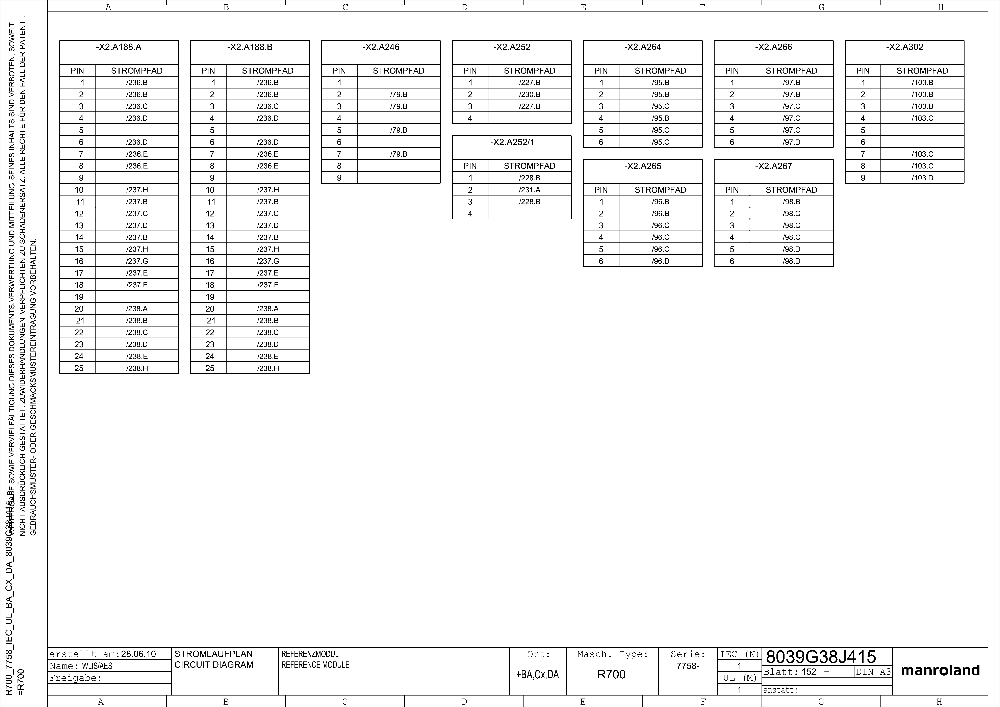

# +BA_Cx_DA — Sheet 152 of 247 — REFERENZMODUL

**REFERENCE MODULE**

> Part of the manroland **R700** printing press IEC/UL circuit diagrams.
> Drawing class: **Stromlaufplan / Circuit diagram** (DIN A3).
> Document `+BA_Cx_DA` covers the **Printing units / main switch cabinet** machine section.

## At a glance

| Field | Value |
|---|---|
| Document | `+BA_Cx_DA`  (8039G38J415) |
| Sheet | **152** of 247 |
| Section (DE) | REFERENZMODUL |
| Section (EN) | REFERENCE MODULE |
| Section type | REFERENCE_MODULE — Reference module |
| Machine type | `R700` |
| Series | `7758` |
| Created | 28.06.10 |
| Replaces | — |
| Columns used | A, B, C, D, E, F, G, H |
| Path numbers | — |
| Labels on sheet | 215 |
| Cross-refs out | 85 |
| Cross-refs in | 0 |

**Previous:** [+BA_Cx_DA sheet 151](SHEET_0151.md) · **Next:** [+BA_Cx_DA sheet 153](SHEET_0153.md) · **Document TOC:** [_TOC.md](_TOC.md)  (+BA_Cx_DA) · **Master TOC:** [all sheets](../_MASTER_TOC.md)

## Sheet image (300 DPI, exact vector render)



_Rendered directly from the PDF vector layer at 300 DPI (1-bit), no OCR and no resampling. Use it to confirm anything ambiguous in the text below._

## Cross-references on this sheet

Each entry is a wire leaving this sheet. The printed token is `/sheet.column`; the link resolves to that sheet inside the same document.

| Ref | Target sheet | Col | Path | Destination on target | Target section | From col |
|---|---|---|---|---|---|---|
| `/95.B` | [+BA_Cx_DA sheet 95](SHEET_0095.md) | B | — | — | BLAS/SAUGLUFT MIT MOTORVENTILEINSTELLUNG | F |
| `/97.B` | [+BA_Cx_DA sheet 97](SHEET_0097.md) | B | — | — | BLAS/SAUGLUFT MIT MOTORVENTILEINSTELLUNG | G |
| `/236.B` | [+BA_Cx_DA sheet 236](SHEET_0236.md) | B | — | — | OPTION: INLINECOATER SMART | A |
| `/236.B` | [+BA_Cx_DA sheet 236](SHEET_0236.md) | B | — | — | OPTION: INLINECOATER SMART | B |
| `/227.B` | [+BA_Cx_DA sheet 227](SHEET_0227.md) | B | — | — | OPTION: WASCHMITTELWECHSELBETRIEB | E |
| `/103.B` | [+BA_Cx_DA sheet 103](SHEET_0103.md) | B | — | — | FARBSCHIEBER | H |
| `/79.B` | [+BA_Cx_DA sheet 79](SHEET_0079.md) | B | — | — | FARBWERK | C |
| `/95.B` | [+BA_Cx_DA sheet 95](SHEET_0095.md) | B | — | — | BLAS/SAUGLUFT MIT MOTORVENTILEINSTELLUNG | F |
| `/97.B` | [+BA_Cx_DA sheet 97](SHEET_0097.md) | B | — | — | BLAS/SAUGLUFT MIT MOTORVENTILEINSTELLUNG | G |
| `/236.B` | [+BA_Cx_DA sheet 236](SHEET_0236.md) | B | — | — | OPTION: INLINECOATER SMART | A |
| `/236.B` | [+BA_Cx_DA sheet 236](SHEET_0236.md) | B | — | — | OPTION: INLINECOATER SMART | B |
| `/230.B` | [+BA_Cx_DA sheet 230](SHEET_0230.md) | B | — | — | OPTION: WASCHMITTELWECHSELBETRIEB | E |
| `/103.B` | [+BA_Cx_DA sheet 103](SHEET_0103.md) | B | — | — | FARBSCHIEBER | H |
| `/79.B` | [+BA_Cx_DA sheet 79](SHEET_0079.md) | B | — | — | FARBWERK | C |
| `/227.B` | [+BA_Cx_DA sheet 227](SHEET_0227.md) | B | — | — | OPTION: WASCHMITTELWECHSELBETRIEB | E |
| `/103.B` | [+BA_Cx_DA sheet 103](SHEET_0103.md) | B | — | — | FARBSCHIEBER | H |
| `/95.C` | [+BA_Cx_DA sheet 95](SHEET_0095.md) | C | — | — | BLAS/SAUGLUFT MIT MOTORVENTILEINSTELLUNG | F |
| `/97.C` | [+BA_Cx_DA sheet 97](SHEET_0097.md) | C | — | — | BLAS/SAUGLUFT MIT MOTORVENTILEINSTELLUNG | G |
| `/236.C` | [+BA_Cx_DA sheet 236](SHEET_0236.md) | C | — | — | OPTION: INLINECOATER SMART | A |
| `/236.C` | [+BA_Cx_DA sheet 236](SHEET_0236.md) | C | — | — | OPTION: INLINECOATER SMART | B |
| `/95.B` | [+BA_Cx_DA sheet 95](SHEET_0095.md) | B | — | — | BLAS/SAUGLUFT MIT MOTORVENTILEINSTELLUNG | F |
| `/97.C` | [+BA_Cx_DA sheet 97](SHEET_0097.md) | C | — | — | BLAS/SAUGLUFT MIT MOTORVENTILEINSTELLUNG | G |
| `/236.D` | [+BA_Cx_DA sheet 236](SHEET_0236.md) | D | — | — | OPTION: INLINECOATER SMART | A |
| `/236.D` | [+BA_Cx_DA sheet 236](SHEET_0236.md) | D | — | — | OPTION: INLINECOATER SMART | B |
| `/103.C` | [+BA_Cx_DA sheet 103](SHEET_0103.md) | C | — | — | FARBSCHIEBER | H |
| `/79.B` | [+BA_Cx_DA sheet 79](SHEET_0079.md) | B | — | — | FARBWERK | C |
| `/95.C` | [+BA_Cx_DA sheet 95](SHEET_0095.md) | C | — | — | BLAS/SAUGLUFT MIT MOTORVENTILEINSTELLUNG | F |
| `/97.C` | [+BA_Cx_DA sheet 97](SHEET_0097.md) | C | — | — | BLAS/SAUGLUFT MIT MOTORVENTILEINSTELLUNG | G |
| `/95.C` | [+BA_Cx_DA sheet 95](SHEET_0095.md) | C | — | — | BLAS/SAUGLUFT MIT MOTORVENTILEINSTELLUNG | F |
| `/97.D` | [+BA_Cx_DA sheet 97](SHEET_0097.md) | D | — | — | BLAS/SAUGLUFT MIT MOTORVENTILEINSTELLUNG | G |
| `/236.D` | [+BA_Cx_DA sheet 236](SHEET_0236.md) | D | — | — | OPTION: INLINECOATER SMART | A |
| `/236.D` | [+BA_Cx_DA sheet 236](SHEET_0236.md) | D | — | — | OPTION: INLINECOATER SMART | B |
| `/79.B` | [+BA_Cx_DA sheet 79](SHEET_0079.md) | B | — | — | FARBWERK | C |
| `/236.E` | [+BA_Cx_DA sheet 236](SHEET_0236.md) | E | — | — | OPTION: INLINECOATER SMART | A |
| `/236.E` | [+BA_Cx_DA sheet 236](SHEET_0236.md) | E | — | — | OPTION: INLINECOATER SMART | B |
| `/103.C` | [+BA_Cx_DA sheet 103](SHEET_0103.md) | C | — | — | FARBSCHIEBER | H |
| `/236.E` | [+BA_Cx_DA sheet 236](SHEET_0236.md) | E | — | — | OPTION: INLINECOATER SMART | A |
| `/236.E` | [+BA_Cx_DA sheet 236](SHEET_0236.md) | E | — | — | OPTION: INLINECOATER SMART | B |
| `/103.C` | [+BA_Cx_DA sheet 103](SHEET_0103.md) | C | — | — | FARBSCHIEBER | H |
| `/228.B` | [+BA_Cx_DA sheet 228](SHEET_0228.md) | B | — | — | OPTION: WASCHMITTELWECHSELBETRIEB | E |
| `/103.D` | [+BA_Cx_DA sheet 103](SHEET_0103.md) | D | — | — | FARBSCHIEBER | H |
| `/231.A` | [+BA_Cx_DA sheet 231](SHEET_0231.md) | A | — | — | OPTION: WASCHMITTELWECHSELBETRIEB | E |
| `/237.H` | [+BA_Cx_DA sheet 237](SHEET_0237.md) | H | — | — | OPTION: INLINECOATER SMART | A |
| `/237.H` | [+BA_Cx_DA sheet 237](SHEET_0237.md) | H | — | — | OPTION: INLINECOATER SMART | B |
| `/96.B` | [+BA_Cx_DA sheet 96](SHEET_0096.md) | B | — | — | BLAS/SAUGLUFT MIT MOTORVENTILEINSTELLUNG | F |
| `/98.B` | [+BA_Cx_DA sheet 98](SHEET_0098.md) | B | — | — | BLAS/SAUGLUFT MIT MOTORVENTILEINSTELLUNG | G |
| `/237.B` | [+BA_Cx_DA sheet 237](SHEET_0237.md) | B | — | — | OPTION: INLINECOATER SMART | A |
| `/237.B` | [+BA_Cx_DA sheet 237](SHEET_0237.md) | B | — | — | OPTION: INLINECOATER SMART | B |
| `/228.B` | [+BA_Cx_DA sheet 228](SHEET_0228.md) | B | — | — | OPTION: WASCHMITTELWECHSELBETRIEB | E |
| `/96.B` | [+BA_Cx_DA sheet 96](SHEET_0096.md) | B | — | — | BLAS/SAUGLUFT MIT MOTORVENTILEINSTELLUNG | F |
| `/98.C` | [+BA_Cx_DA sheet 98](SHEET_0098.md) | C | — | — | BLAS/SAUGLUFT MIT MOTORVENTILEINSTELLUNG | G |
| `/237.C` | [+BA_Cx_DA sheet 237](SHEET_0237.md) | C | — | — | OPTION: INLINECOATER SMART | A |
| `/237.C` | [+BA_Cx_DA sheet 237](SHEET_0237.md) | C | — | — | OPTION: INLINECOATER SMART | B |
| `/96.C` | [+BA_Cx_DA sheet 96](SHEET_0096.md) | C | — | — | BLAS/SAUGLUFT MIT MOTORVENTILEINSTELLUNG | F |
| `/98.C` | [+BA_Cx_DA sheet 98](SHEET_0098.md) | C | — | — | BLAS/SAUGLUFT MIT MOTORVENTILEINSTELLUNG | G |
| `/237.D` | [+BA_Cx_DA sheet 237](SHEET_0237.md) | D | — | — | OPTION: INLINECOATER SMART | A |
| `/237.D` | [+BA_Cx_DA sheet 237](SHEET_0237.md) | D | — | — | OPTION: INLINECOATER SMART | B |
| `/237.B` | [+BA_Cx_DA sheet 237](SHEET_0237.md) | B | — | — | OPTION: INLINECOATER SMART | A |
| `/237.B` | [+BA_Cx_DA sheet 237](SHEET_0237.md) | B | — | — | OPTION: INLINECOATER SMART | B |
| `/96.C` | [+BA_Cx_DA sheet 96](SHEET_0096.md) | C | — | — | BLAS/SAUGLUFT MIT MOTORVENTILEINSTELLUNG | F |
| `/98.C` | [+BA_Cx_DA sheet 98](SHEET_0098.md) | C | — | — | BLAS/SAUGLUFT MIT MOTORVENTILEINSTELLUNG | G |
| `/96.C` | [+BA_Cx_DA sheet 96](SHEET_0096.md) | C | — | — | BLAS/SAUGLUFT MIT MOTORVENTILEINSTELLUNG | F |
| `/98.D` | [+BA_Cx_DA sheet 98](SHEET_0098.md) | D | — | — | BLAS/SAUGLUFT MIT MOTORVENTILEINSTELLUNG | G |
| `/237.H` | [+BA_Cx_DA sheet 237](SHEET_0237.md) | H | — | — | OPTION: INLINECOATER SMART | A |
| `/237.H` | [+BA_Cx_DA sheet 237](SHEET_0237.md) | H | — | — | OPTION: INLINECOATER SMART | B |
| `/237.G` | [+BA_Cx_DA sheet 237](SHEET_0237.md) | G | — | — | OPTION: INLINECOATER SMART | A |
| `/237.G` | [+BA_Cx_DA sheet 237](SHEET_0237.md) | G | — | — | OPTION: INLINECOATER SMART | B |
| `/96.D` | [+BA_Cx_DA sheet 96](SHEET_0096.md) | D | — | — | BLAS/SAUGLUFT MIT MOTORVENTILEINSTELLUNG | F |
| `/98.D` | [+BA_Cx_DA sheet 98](SHEET_0098.md) | D | — | — | BLAS/SAUGLUFT MIT MOTORVENTILEINSTELLUNG | G |
| `/237.E` | [+BA_Cx_DA sheet 237](SHEET_0237.md) | E | — | — | OPTION: INLINECOATER SMART | A |
| `/237.E` | [+BA_Cx_DA sheet 237](SHEET_0237.md) | E | — | — | OPTION: INLINECOATER SMART | B |
| `/237.F` | [+BA_Cx_DA sheet 237](SHEET_0237.md) | F | — | — | OPTION: INLINECOATER SMART | A |
| `/237.F` | [+BA_Cx_DA sheet 237](SHEET_0237.md) | F | — | — | OPTION: INLINECOATER SMART | B |
| `/238.A` | [+BA_Cx_DA sheet 238](SHEET_0238.md) | A | — | — | OPTION: INLINECOATER SMART | A |
| `/238.A` | [+BA_Cx_DA sheet 238](SHEET_0238.md) | A | — | — | OPTION: INLINECOATER SMART | B |
| `/238.B` | [+BA_Cx_DA sheet 238](SHEET_0238.md) | B | — | — | OPTION: INLINECOATER SMART | A |
| `/238.B` | [+BA_Cx_DA sheet 238](SHEET_0238.md) | B | — | — | OPTION: INLINECOATER SMART | B |
| `/238.C` | [+BA_Cx_DA sheet 238](SHEET_0238.md) | C | — | — | OPTION: INLINECOATER SMART | A |
| `/238.C` | [+BA_Cx_DA sheet 238](SHEET_0238.md) | C | — | — | OPTION: INLINECOATER SMART | B |
| `/238.D` | [+BA_Cx_DA sheet 238](SHEET_0238.md) | D | — | — | OPTION: INLINECOATER SMART | A |
| `/238.D` | [+BA_Cx_DA sheet 238](SHEET_0238.md) | D | — | — | OPTION: INLINECOATER SMART | B |
| `/238.E` | [+BA_Cx_DA sheet 238](SHEET_0238.md) | E | — | — | OPTION: INLINECOATER SMART | A |
| `/238.E` | [+BA_Cx_DA sheet 238](SHEET_0238.md) | E | — | — | OPTION: INLINECOATER SMART | B |
| `/238.H` | [+BA_Cx_DA sheet 238](SHEET_0238.md) | H | — | — | OPTION: INLINECOATER SMART | A |
| `/238.H` | [+BA_Cx_DA sheet 238](SHEET_0238.md) | H | — | — | OPTION: INLINECOATER SMART | B |

## Devices on this sheet

| Tag | Class | Class meaning (IEC) | Col | Sub | Terminal | Sign |
|---|---|---|---|---|---|---|
| `X2.A188.A` | — | cross-device reference | A | — | — | — |
| `X2.A188.B` | — | cross-device reference | B | — | — | — |
| `X2.A252` | — | cross-device reference | D | — | — | — |
| `X2.A264` | — | cross-device reference | F | — | — | — |
| `X2.A265` | — | cross-device reference | F | — | — | — |
| `X2.A266` | — | cross-device reference | G | — | — | — |
| `X2.A267` | — | cross-device reference | G | — | — | — |
| `X2.A302` | — | cross-device reference | H | — | — | — |
| `X2.A246` | — | cross-device reference | C | — | — | — |

## Potentials / nets

_No named potentials on this sheet._

## Wire-end annotations (grouped as printed)

A wire that continues elsewhere is annotated with a small cluster: the destination description, the path/line number `#NN`, and the `/sheet.column` cross reference. Each row below is one such cluster exactly as it is grouped on the drawing.

| Col | Y | Path | Cross-ref | Text on the wire |
|---|---|---|---|---|
| A | 51.3 | — | — | `X2.A188.A` |
| B | 51.3 | — | — | `X2.A188.B` |
| C | 51.3 | — | — | `X2.A246` |
| D | 51.3 | — | — | `X2.A252` |
| F | 51.3 | — | — | `X2.A264` |
| G | 51.3 | — | — | `X2.A266` |
| H | 51.3 | — | — | `X2.A302` |
| A | 80.0 | — | — | `PIN STROMPFAD` |
| B | 80.0 | — | — | `PIN STROMPFAD` |
| C | 80.0 | — | — | `PIN 2 3 4 5 6 7 8 9 1 STROMPFAD` |
| D | 80.0 | — | — | `PIN 2 3 4 1 STROMPFAD` |
| E | 80.0 | — | — | `PIN 2 3 4 5 6 1 STROMPFAD` |
| G | 80.0 | — | — | `PIN 2 3 4 5 6 1 STROMPFAD` |
| H | 80.0 | — | — | `PIN 2 3 4 5 6 7 8 9 1 STROMPFAD` |
| A | 94.2 | — | — | `2 3 4 5 6 7 8 9 1` |
| B | 94.2 | — | — | `2 3 4 5 6 7 8 9 1` |
| A | 94.5 | — | `/236.B` | — |
| B | 94.5 | — | `/236.B` | — |
| E | 94.5 | — | `/227.B` | — |
| F | 94.5 | — | `/95.B` | — |
| G | 94.5 | — | `/97.B` | — |
| H | 94.5 | — | `/103.B` | — |
| A | 108.7 | — | `/236.B` | — |
| B | 108.7 | — | `/236.B` | — |
| C | 108.7 | — | `/79.B` | — |
| E | 108.7 | — | `/230.B` | — |
| F | 108.7 | — | `/95.B` | — |
| G | 108.7 | — | `/97.B` | — |
| H | 108.7 | — | `/103.B` | — |
| C | 122.8 | — | `/79.B` | — |
| A | 122.9 | — | `/236.C` | — |
| B | 122.9 | — | `/236.C` | — |
| E | 122.9 | — | `/227.B` | — |
| F | 122.9 | — | `/95.C` | — |
| G | 122.9 | — | `/97.C` | — |
| H | 122.9 | — | `/103.B` | — |
| F | 137.0 | — | `/95.B` | — |
| A | 137.1 | — | `/236.D` | — |
| B | 137.1 | — | `/236.D` | — |
| G | 137.1 | — | `/97.C` | — |
| H | 137.1 | — | `/103.C` | — |
| C | 151.2 | — | `/79.B` | — |
| F | 151.2 | — | `/95.C` | — |
| G | 151.2 | — | `/97.C` | — |
| D | 164.7 | — | — | `X2.A252/1` |
| A | 165.4 | — | `/236.D` | — |
| B | 165.4 | — | `/236.D` | — |
| F | 165.4 | — | `/95.C` | — |
| G | 165.4 | — | `/97.D` | — |
| C | 179.5 | — | `/79.B` | — |
| A | 179.6 | — | `/236.E` | — |
| B | 179.6 | — | `/236.E` | — |
| H | 179.6 | — | `/103.C` | — |
| F | 193.1 | — | — | `X2.A265` |
| G | 193.1 | — | — | `X2.A267` |
| D | 193.4 | — | — | `PIN 2 3 4 1 STROMPFAD` |
| A | 193.7 | — | `/236.E` | — |
| B | 193.7 | — | `/236.E` | — |
| H | 193.8 | — | `/103.C` | — |
| E | 207.9 | — | `/228.B` | — |
| H | 207.9 | — | `/103.D` | — |
| E | 221.7 | — | — | `PIN 2 3 4 5 6 1 STROMPFAD` |
| G | 221.7 | — | — | `PIN 2 3 4 5 6 1 STROMPFAD` |
| A | 221.8 | — | — | `10 12 13 14 15 16 17 18 19 20 11` |
| B | 221.8 | — | — | `10 12 13 14 15 16 17 18 19 20 11` |
| A | 222.1 | — | `/237.H` | — |
| B | 222.1 | — | `/237.H` | — |
| E | 222.1 | — | `/231.A` | — |
| A | 236.2 | — | `/237.B` | — |
| B | 236.2 | — | `/237.B` | — |
| E | 236.2 | — | `/228.B` | — |
| F | 236.2 | — | `/96.B` | — |
| G | 236.2 | — | `/98.B` | — |
| A | 250.4 | — | `/237.C` | — |
| B | 250.4 | — | `/237.C` | — |
| F | 250.4 | — | `/96.B` | — |
| G | 250.4 | — | `/98.C` | — |
| A | 264.6 | — | `/237.D` | — |
| B | 264.6 | — | `/237.D` | — |
| F | 264.6 | — | `/96.C` | — |
| G | 264.6 | — | `/98.C` | — |
| A | 278.8 | — | `/237.B` | — |
| B | 278.8 | — | `/237.B` | — |
| F | 278.8 | — | `/96.C` | — |
| G | 278.8 | — | `/98.C` | — |
| A | 293.0 | — | `/237.H` | — |
| B | 293.0 | — | `/237.H` | — |
| F | 293.0 | — | `/96.C` | — |
| G | 293.0 | — | `/98.D` | — |
| A | 307.1 | — | `/237.G` | — |
| B | 307.1 | — | `/237.G` | — |
| F | 307.1 | — | `/96.D` | — |
| G | 307.1 | — | `/98.D` | — |
| A | 321.3 | — | `/237.E` | — |
| B | 321.3 | — | `/237.E` | — |
| A | 335.5 | — | `/237.F` | — |
| B | 335.5 | — | `/237.F` | — |
| A | 363.8 | — | `/238.A` | — |
| B | 363.8 | — | `/238.A` | — |
| A | 377.7 | — | — | `22 23 24 25 21` |
| B | 377.7 | — | — | `22 23 24 25 21` |
| A | 378.0 | — | `/238.B` | — |
| B | 378.0 | — | `/238.B` | — |
| A | 392.2 | — | `/238.C` | — |
| B | 392.2 | — | `/238.C` | — |
| A | 406.4 | — | `/238.D` | — |
| B | 406.4 | — | `/238.D` | — |
| A | 420.5 | — | `/238.E` | — |
| B | 420.5 | — | `/238.E` | — |
| A | 434.7 | — | `/238.H` | — |
| B | 434.7 | — | `/238.H` | — |


## Reconstructed tables

This sheet carries tabular content (pin map / terminal assignment / index). The grid below was rebuilt from the drawing's own rule lines, so each row is exactly one physical row of the table.

### Table 1 — 25 data rows × 2 columns (at x=70.9, y=48.2) — **X2.A188.A**

| PIN | STROMPFAD |
|---|---|
| `1` | `/236.B` |
| `2` | `/236.B` |
| `3` | `/236.C` |
| `4` | `/236.D` |
| `5` |  |
| `6` | `/236.D` |
| `7` | `/236.E` |
| `8` | `/236.E` |
| `9` |  |
| `10` | `/237.H` |
| `11` | `/237.B` |
| `12` | `/237.C` |
| `13` | `/237.D` |
| `14` | `/237.B` |
| `15` | `/237.H` |
| `16` | `/237.G` |
| `17` | `/237.E` |
| `18` | `/237.F` |
| `19` |  |
| `20` | `/238.A` |
| `21` | `/238.B` |
| `22` | `/238.C` |
| `23` | `/238.D` |
| `24` | `/238.E` |
| `25` | `/238.H` |


### Table 2 — 25 data rows × 2 columns (at x=226.8, y=48.2) — **X2.A188.B**

| PIN | STROMPFAD |
|---|---|
| `1` | `/236.B` |
| `2` | `/236.B` |
| `3` | `/236.C` |
| `4` | `/236.D` |
| `5` |  |
| `6` | `/236.D` |
| `7` | `/236.E` |
| `8` | `/236.E` |
| `9` |  |
| `10` | `/237.H` |
| `11` | `/237.B` |
| `12` | `/237.C` |
| `13` | `/237.D` |
| `14` | `/237.B` |
| `15` | `/237.H` |
| `16` | `/237.G` |
| `17` | `/237.E` |
| `18` | `/237.F` |
| `19` |  |
| `20` | `/238.A` |
| `21` | `/238.B` |
| `22` | `/238.C` |
| `23` | `/238.D` |
| `24` | `/238.E` |
| `25` | `/238.H` |


### Table 3 — 9 data rows × 2 columns (at x=382.7, y=48.2) — **X2.A246**

| PIN | STROMPFAD |
|---|---|
| `1` |  |
| `2` | `/79.B` |
| `3` | `/79.B` |
| `4` |  |
| `5` | `/79.B` |
| `6` |  |
| `7` | `/79.B` |
| `8` |  |
| `9` |  |


### Table 4 — 10 data rows × 2 columns (at x=538.6, y=48.2) — **X2.A252**

| PIN | STROMPFAD |
|---|---|
| `1` | `/227.B` |
| `2` | `/230.B` |
| `3` | `/227.B` |
| `4` |  |
|  | `X2.A252/1` |
| `PIN` | `STROMPFAD` |
| `1` | `/228.B` |
| `2` | `/231.A` |
| `3` | `/228.B` |
| `4` |  |


### Table 5 — 14 data rows × 2 columns (at x=694.5, y=48.2) — **X2.A264**

| PIN | STROMPFAD |
|---|---|
| `1` | `/95.B` |
| `2` | `/95.B` |
| `3` | `/95.C` |
| `4` | `/95.B` |
| `5` | `/95.C` |
| `6` | `/95.C` |
|  | `X2.A265` |
| `PIN` | `STROMPFAD` |
| `1` | `/96.B` |
| `2` | `/96.B` |
| `3` | `/96.C` |
| `4` | `/96.C` |
| `5` | `/96.C` |
| `6` | `/96.D` |


### Table 6 — 14 data rows × 2 columns (at x=850.4, y=48.2) — **X2.A266**

| PIN | STROMPFAD |
|---|---|
| `1` | `/97.B` |
| `2` | `/97.B` |
| `3` | `/97.C` |
| `4` | `/97.C` |
| `5` | `/97.C` |
| `6` | `/97.D` |
|  | `X2.A267` |
| `PIN` | `STROMPFAD` |
| `1` | `/98.B` |
| `2` | `/98.C` |
| `3` | `/98.C` |
| `4` | `/98.C` |
| `5` | `/98.D` |
| `6` | `/98.D` |


### Table 7 — 9 data rows × 2 columns (at x=1006.3, y=48.2) — **X2.A302**

| PIN | STROMPFAD |
|---|---|
| `1` | `/103.B` |
| `2` | `/103.B` |
| `3` | `/103.B` |
| `4` | `/103.C` |
| `5` |  |
| `6` |  |
| `7` | `/103.C` |
| `8` | `/103.C` |
| `9` | `/103.D` |


## Notes and free text on this sheet

| Text | Col | Y (pt) |
|---|---|---|
| `PIN` | A | 80.02 |
| `STROMPFAD` | A | 79.98 |
| `PIN` | B | 80.02 |
| `STROMPFAD` | B | 79.98 |
| `PIN` | D | 80.02 |
| `STROMPFAD` | E | 79.98 |
| `X2.A252/1` | D | 164.72 |
| `PIN` | E | 80.02 |
| `STROMPFAD` | F | 79.98 |
| `PIN` | F | 80.02 |
| `STROMPFAD` | G | 79.98 |
| `PIN` | G | 80.02 |
| `STROMPFAD` | H | 79.98 |
| `PIN` | C | 80.02 |
| `STROMPFAD` | C | 79.98 |

## Complete label inventory (exact text from the drawing)

Every text object inside the drawing area of this sheet, in DIN reading order (column A→H, then top→bottom). This is the authoritative list: if a string is not here it is not printed on this sheet.

| Col | Y | X | Dir | Type | Text |
|---|---|---|---|---|---|
| A | 51.3 | 114.4 | → | device ref | `X2.A188.A` |
| A | 80.0 | 84.0 | → | text | `PIN` |
| A | 80.0 | 132.2 | → | text | `STROMPFAD` |
| A | 94.2 | 95.8 | → | number | `1` |
| A | 94.5 | 150.4 | → | cross-reference | `/236.B` |
| A | 108.4 | 94.1 | → | number | `2` |
| A | 108.7 | 150.4 | → | cross-reference | `/236.B` |
| A | 122.5 | 94.1 | → | number | `3` |
| A | 122.9 | 150.2 | → | cross-reference | `/236.C` |
| A | 136.7 | 94.1 | → | number | `4` |
| A | 137.1 | 150.2 | → | cross-reference | `/236.D` |
| A | 150.9 | 94.1 | → | number | `5` |
| A | 165.1 | 94.1 | → | number | `6` |
| A | 165.4 | 150.2 | → | cross-reference | `/236.D` |
| A | 179.2 | 94.1 | → | number | `7` |
| A | 179.6 | 150.5 | → | cross-reference | `/236.E` |
| A | 193.4 | 94.1 | → | number | `8` |
| A | 193.7 | 150.5 | → | cross-reference | `/236.E` |
| A | 207.6 | 94.1 | → | number | `9` |
| A | 221.8 | 88.7 | → | number | `10` |
| A | 222.1 | 150.5 | → | cross-reference | `/237.H` |
| A | 235.9 | 90.4 | → | number | `11` |
| A | 236.2 | 150.4 | → | cross-reference | `/237.B` |
| A | 250.1 | 88.7 | → | number | `12` |
| A | 250.4 | 150.2 | → | cross-reference | `/237.C` |
| A | 264.3 | 88.7 | → | number | `13` |
| A | 264.6 | 150.2 | → | cross-reference | `/237.D` |
| A | 278.5 | 88.7 | → | number | `14` |
| A | 278.8 | 150.4 | → | cross-reference | `/237.B` |
| A | 292.6 | 88.7 | → | number | `15` |
| A | 293.0 | 150.5 | → | cross-reference | `/237.H` |
| A | 306.8 | 88.7 | → | number | `16` |
| A | 307.1 | 150.1 | → | cross-reference | `/237.G` |
| A | 321.0 | 88.7 | → | number | `17` |
| A | 321.3 | 150.5 | → | cross-reference | `/237.E` |
| A | 335.1 | 88.7 | → | number | `18` |
| A | 335.5 | 150.7 | → | cross-reference | `/237.F` |
| A | 349.3 | 88.7 | → | number | `19` |
| A | 363.5 | 88.7 | → | number | `20` |
| A | 363.8 | 150.2 | → | cross-reference | `/238.A` |
| A | 377.7 | 90.4 | → | number | `21` |
| A | 378.0 | 150.4 | → | cross-reference | `/238.B` |
| A | 391.8 | 88.7 | → | number | `22` |
| A | 392.2 | 150.2 | → | cross-reference | `/238.C` |
| A | 406.0 | 88.7 | → | number | `23` |
| A | 406.4 | 150.2 | → | cross-reference | `/238.D` |
| A | 420.2 | 88.7 | → | number | `24` |
| A | 420.5 | 150.5 | → | cross-reference | `/238.E` |
| A | 434.4 | 88.7 | → | number | `25` |
| A | 434.7 | 150.5 | → | cross-reference | `/238.H` |
| B | 51.3 | 270.7 | → | device ref | `X2.A188.B` |
| B | 80.0 | 240.0 | → | text | `PIN` |
| B | 80.0 | 288.1 | → | text | `STROMPFAD` |
| B | 94.2 | 251.7 | → | number | `1` |
| B | 94.5 | 306.3 | → | cross-reference | `/236.B` |
| B | 108.4 | 250.0 | → | number | `2` |
| B | 108.7 | 306.3 | → | cross-reference | `/236.B` |
| B | 122.5 | 250.0 | → | number | `3` |
| B | 122.9 | 306.1 | → | cross-reference | `/236.C` |
| B | 136.7 | 250.0 | → | number | `4` |
| B | 137.1 | 306.1 | → | cross-reference | `/236.D` |
| B | 150.9 | 250.0 | → | number | `5` |
| B | 165.1 | 250.0 | → | number | `6` |
| B | 165.4 | 306.1 | → | cross-reference | `/236.D` |
| B | 179.2 | 250.0 | → | number | `7` |
| B | 179.6 | 306.4 | → | cross-reference | `/236.E` |
| B | 193.4 | 250.0 | → | number | `8` |
| B | 193.7 | 306.4 | → | cross-reference | `/236.E` |
| B | 207.6 | 250.0 | → | number | `9` |
| B | 221.8 | 244.6 | → | number | `10` |
| B | 222.1 | 306.4 | → | cross-reference | `/237.H` |
| B | 235.9 | 246.3 | → | number | `11` |
| B | 236.2 | 306.3 | → | cross-reference | `/237.B` |
| B | 250.1 | 244.6 | → | number | `12` |
| B | 250.4 | 306.1 | → | cross-reference | `/237.C` |
| B | 264.3 | 244.6 | → | number | `13` |
| B | 264.6 | 306.1 | → | cross-reference | `/237.D` |
| B | 278.5 | 244.6 | → | number | `14` |
| B | 278.8 | 306.3 | → | cross-reference | `/237.B` |
| B | 292.6 | 244.6 | → | number | `15` |
| B | 293.0 | 306.4 | → | cross-reference | `/237.H` |
| B | 306.8 | 244.6 | → | number | `16` |
| B | 307.1 | 306.0 | → | cross-reference | `/237.G` |
| B | 321.0 | 244.6 | → | number | `17` |
| B | 321.3 | 306.4 | → | cross-reference | `/237.E` |
| B | 335.1 | 244.6 | → | number | `18` |
| B | 335.5 | 306.6 | → | cross-reference | `/237.F` |
| B | 349.3 | 244.6 | → | number | `19` |
| B | 363.5 | 244.6 | → | number | `20` |
| B | 363.8 | 306.1 | → | cross-reference | `/238.A` |
| B | 377.7 | 246.3 | → | number | `21` |
| B | 378.0 | 306.3 | → | cross-reference | `/238.B` |
| B | 391.8 | 244.6 | → | number | `22` |
| B | 392.2 | 306.1 | → | cross-reference | `/238.C` |
| B | 406.0 | 244.6 | → | number | `23` |
| B | 406.4 | 306.1 | → | cross-reference | `/238.D` |
| B | 420.2 | 244.6 | → | number | `24` |
| B | 420.5 | 306.4 | → | cross-reference | `/238.E` |
| B | 434.4 | 244.6 | → | number | `25` |
| B | 434.7 | 306.4 | → | cross-reference | `/238.H` |
| C | 51.3 | 431.6 | → | device ref | `X2.A246` |
| C | 80.0 | 395.9 | → | text | `PIN` |
| C | 80.0 | 444.0 | → | text | `STROMPFAD` |
| C | 94.2 | 401.8 | → | number | `1` |
| C | 108.4 | 401.2 | → | number | `2` |
| C | 108.7 | 464.6 | → | cross-reference | `/79.B` |
| C | 122.5 | 401.2 | → | number | `3` |
| C | 122.8 | 464.6 | → | cross-reference | `/79.B` |
| C | 136.7 | 401.2 | → | number | `4` |
| C | 150.9 | 401.2 | → | number | `5` |
| C | 151.2 | 464.6 | → | cross-reference | `/79.B` |
| C | 165.1 | 401.2 | → | number | `6` |
| C | 179.2 | 401.2 | → | number | `7` |
| C | 179.5 | 464.6 | → | cross-reference | `/79.B` |
| C | 193.4 | 401.2 | → | number | `8` |
| C | 207.6 | 401.2 | → | number | `9` |
| D | 51.3 | 587.5 | → | device ref | `X2.A252` |
| D | 80.0 | 551.8 | → | text | `PIN` |
| D | 94.2 | 557.7 | → | number | `1` |
| D | 108.4 | 557.1 | → | number | `2` |
| D | 122.5 | 557.1 | → | number | `3` |
| D | 136.7 | 557.1 | → | number | `4` |
| D | 164.7 | 583.8 | → | text | `X2.A252/1` |
| D | 193.4 | 551.8 | → | text | `PIN` |
| D | 207.6 | 557.7 | → | number | `1` |
| D | 221.8 | 557.1 | → | number | `2` |
| D | 235.9 | 557.1 | → | number | `3` |
| D | 250.1 | 557.1 | → | number | `4` |
| E | 80.0 | 600.0 | → | text | `STROMPFAD` |
| E | 80.0 | 707.7 | → | text | `PIN` |
| E | 94.2 | 713.6 | → | number | `1` |
| E | 94.5 | 618.1 | → | cross-reference | `/227.B` |
| E | 108.4 | 713.1 | → | number | `2` |
| E | 108.7 | 618.1 | → | cross-reference | `/230.B` |
| E | 122.5 | 713.1 | → | number | `3` |
| E | 122.9 | 618.1 | → | cross-reference | `/227.B` |
| E | 136.7 | 713.1 | → | number | `4` |
| E | 150.9 | 713.1 | → | number | `5` |
| E | 165.1 | 713.1 | → | number | `6` |
| E | 193.4 | 600.0 | → | text | `STROMPFAD` |
| E | 207.9 | 618.1 | → | cross-reference | `/228.B` |
| E | 221.8 | 707.7 | → | text | `PIN` |
| E | 222.1 | 618.0 | → | cross-reference | `/231.A` |
| E | 235.9 | 713.6 | → | number | `1` |
| E | 236.2 | 618.1 | → | cross-reference | `/228.B` |
| E | 250.1 | 713.1 | → | number | `2` |
| E | 264.3 | 713.1 | → | number | `3` |
| E | 278.5 | 713.1 | → | number | `4` |
| E | 292.6 | 713.1 | → | number | `5` |
| E | 306.8 | 713.1 | → | number | `6` |
| F | 51.3 | 743.4 | → | device ref | `X2.A264` |
| F | 80.0 | 755.9 | → | text | `STROMPFAD` |
| F | 80.0 | 863.6 | → | text | `PIN` |
| F | 94.2 | 869.5 | → | number | `1` |
| F | 94.5 | 776.4 | → | cross-reference | `/95.B` |
| F | 108.4 | 869.0 | → | number | `2` |
| F | 108.7 | 776.4 | → | cross-reference | `/95.B` |
| F | 122.5 | 869.0 | → | number | `3` |
| F | 122.9 | 776.3 | → | cross-reference | `/95.C` |
| F | 136.7 | 869.0 | → | number | `4` |
| F | 137.0 | 776.4 | → | cross-reference | `/95.B` |
| F | 150.9 | 869.0 | → | number | `5` |
| F | 151.2 | 776.3 | → | cross-reference | `/95.C` |
| F | 165.1 | 869.0 | → | number | `6` |
| F | 165.4 | 776.3 | → | cross-reference | `/95.C` |
| F | 193.1 | 743.4 | → | device ref | `X2.A265` |
| F | 221.7 | 755.9 | → | text | `STROMPFAD` |
| F | 221.8 | 863.6 | → | text | `PIN` |
| F | 235.9 | 869.5 | → | number | `1` |
| F | 236.2 | 776.4 | → | cross-reference | `/96.B` |
| F | 250.1 | 869.0 | → | number | `2` |
| F | 250.4 | 776.4 | → | cross-reference | `/96.B` |
| F | 264.3 | 869.0 | → | number | `3` |
| F | 264.6 | 776.3 | → | cross-reference | `/96.C` |
| F | 278.5 | 869.0 | → | number | `4` |
| F | 278.8 | 776.3 | → | cross-reference | `/96.C` |
| F | 292.6 | 869.0 | → | number | `5` |
| F | 293.0 | 776.3 | → | cross-reference | `/96.C` |
| F | 306.8 | 869.0 | → | number | `6` |
| F | 307.1 | 776.3 | → | cross-reference | `/96.D` |
| G | 51.3 | 899.3 | → | device ref | `X2.A266` |
| G | 80.0 | 911.8 | → | text | `STROMPFAD` |
| G | 80.0 | 1019.5 | → | text | `PIN` |
| G | 94.2 | 1025.4 | → | number | `1` |
| G | 94.5 | 932.3 | → | cross-reference | `/97.B` |
| G | 108.4 | 1024.9 | → | number | `2` |
| G | 108.7 | 932.3 | → | cross-reference | `/97.B` |
| G | 122.5 | 1024.9 | → | number | `3` |
| G | 122.9 | 932.2 | → | cross-reference | `/97.C` |
| G | 136.7 | 1024.9 | → | number | `4` |
| G | 137.1 | 932.2 | → | cross-reference | `/97.C` |
| G | 150.9 | 1024.9 | → | number | `5` |
| G | 151.2 | 932.2 | → | cross-reference | `/97.C` |
| G | 165.1 | 1024.9 | → | number | `6` |
| G | 165.4 | 932.2 | → | cross-reference | `/97.D` |
| G | 179.2 | 1024.9 | → | number | `7` |
| G | 193.1 | 899.3 | → | device ref | `X2.A267` |
| G | 193.4 | 1024.9 | → | number | `8` |
| G | 207.6 | 1024.9 | → | number | `9` |
| G | 221.7 | 911.8 | → | text | `STROMPFAD` |
| G | 236.2 | 932.3 | → | cross-reference | `/98.B` |
| G | 250.4 | 932.2 | → | cross-reference | `/98.C` |
| G | 264.6 | 932.2 | → | cross-reference | `/98.C` |
| G | 278.8 | 932.2 | → | cross-reference | `/98.C` |
| G | 293.0 | 932.2 | → | cross-reference | `/98.D` |
| G | 307.1 | 932.2 | → | cross-reference | `/98.D` |
| H | 51.3 | 1055.2 | → | device ref | `X2.A302` |
| H | 80.0 | 1067.7 | → | text | `STROMPFAD` |
| H | 94.5 | 1085.8 | → | cross-reference | `/103.B` |
| H | 108.7 | 1085.8 | → | cross-reference | `/103.B` |
| H | 122.9 | 1085.8 | → | cross-reference | `/103.B` |
| H | 137.1 | 1085.7 | → | cross-reference | `/103.C` |
| H | 179.6 | 1085.7 | → | cross-reference | `/103.C` |
| H | 193.8 | 1085.7 | → | cross-reference | `/103.C` |
| H | 207.9 | 1085.7 | → | cross-reference | `/103.D` |

## Reading-order text block

The same content as a plain block, grouped by DIN column — convenient to paste or to match against a visual description.

```text
=== Column A ===
  51.3  114.4  devref       X2.A188.A
  80.0   84.0  text         PIN
  80.0  132.2  text         STROMPFAD
  94.2   95.8  numeric      1
  94.5  150.4  xref         /236.B
 108.4   94.1  numeric      2
 108.7  150.4  xref         /236.B
 122.5   94.1  numeric      3
 122.9  150.2  xref         /236.C
 136.7   94.1  numeric      4
 137.1  150.2  xref         /236.D
 150.9   94.1  numeric      5
 165.1   94.1  numeric      6
 165.4  150.2  xref         /236.D
 179.2   94.1  numeric      7
 179.6  150.5  xref         /236.E
 193.4   94.1  numeric      8
 193.7  150.5  xref         /236.E
 207.6   94.1  numeric      9
 221.8   88.7  numeric      10
 222.1  150.5  xref         /237.H
 235.9   90.4  numeric      11
 236.2  150.4  xref         /237.B
 250.1   88.7  numeric      12
 250.4  150.2  xref         /237.C
 264.3   88.7  numeric      13
 264.6  150.2  xref         /237.D
 278.5   88.7  numeric      14
 278.8  150.4  xref         /237.B
 292.6   88.7  numeric      15
 293.0  150.5  xref         /237.H
 306.8   88.7  numeric      16
 307.1  150.1  xref         /237.G
 321.0   88.7  numeric      17
 321.3  150.5  xref         /237.E
 335.1   88.7  numeric      18
 335.5  150.7  xref         /237.F
 349.3   88.7  numeric      19
 363.5   88.7  numeric      20
 363.8  150.2  xref         /238.A
 377.7   90.4  numeric      21
 378.0  150.4  xref         /238.B
 391.8   88.7  numeric      22
 392.2  150.2  xref         /238.C
 406.0   88.7  numeric      23
 406.4  150.2  xref         /238.D
 420.2   88.7  numeric      24
 420.5  150.5  xref         /238.E
 434.4   88.7  numeric      25
 434.7  150.5  xref         /238.H
=== Column B ===
  51.3  270.7  devref       X2.A188.B
  80.0  240.0  text         PIN
  80.0  288.1  text         STROMPFAD
  94.2  251.7  numeric      1
  94.5  306.3  xref         /236.B
 108.4  250.0  numeric      2
 108.7  306.3  xref         /236.B
 122.5  250.0  numeric      3
 122.9  306.1  xref         /236.C
 136.7  250.0  numeric      4
 137.1  306.1  xref         /236.D
 150.9  250.0  numeric      5
 165.1  250.0  numeric      6
 165.4  306.1  xref         /236.D
 179.2  250.0  numeric      7
 179.6  306.4  xref         /236.E
 193.4  250.0  numeric      8
 193.7  306.4  xref         /236.E
 207.6  250.0  numeric      9
 221.8  244.6  numeric      10
 222.1  306.4  xref         /237.H
 235.9  246.3  numeric      11
 236.2  306.3  xref         /237.B
 250.1  244.6  numeric      12
 250.4  306.1  xref         /237.C
 264.3  244.6  numeric      13
 264.6  306.1  xref         /237.D
 278.5  244.6  numeric      14
 278.8  306.3  xref         /237.B
 292.6  244.6  numeric      15
 293.0  306.4  xref         /237.H
 306.8  244.6  numeric      16
 307.1  306.0  xref         /237.G
 321.0  244.6  numeric      17
 321.3  306.4  xref         /237.E
 335.1  244.6  numeric      18
 335.5  306.6  xref         /237.F
 349.3  244.6  numeric      19
 363.5  244.6  numeric      20
 363.8  306.1  xref         /238.A
 377.7  246.3  numeric      21
 378.0  306.3  xref         /238.B
 391.8  244.6  numeric      22
 392.2  306.1  xref         /238.C
 406.0  244.6  numeric      23
 406.4  306.1  xref         /238.D
 420.2  244.6  numeric      24
 420.5  306.4  xref         /238.E
 434.4  244.6  numeric      25
 434.7  306.4  xref         /238.H
=== Column C ===
  51.3  431.6  devref       X2.A246
  80.0  395.9  text         PIN
  80.0  444.0  text         STROMPFAD
  94.2  401.8  numeric      1
 108.4  401.2  numeric      2
 108.7  464.6  xref         /79.B
 122.5  401.2  numeric      3
 122.8  464.6  xref         /79.B
 136.7  401.2  numeric      4
 150.9  401.2  numeric      5
 151.2  464.6  xref         /79.B
 165.1  401.2  numeric      6
 179.2  401.2  numeric      7
 179.5  464.6  xref         /79.B
 193.4  401.2  numeric      8
 207.6  401.2  numeric      9
=== Column D ===
  51.3  587.5  devref       X2.A252
  80.0  551.8  text         PIN
  94.2  557.7  numeric      1
 108.4  557.1  numeric      2
 122.5  557.1  numeric      3
 136.7  557.1  numeric      4
 164.7  583.8  text         X2.A252/1
 193.4  551.8  text         PIN
 207.6  557.7  numeric      1
 221.8  557.1  numeric      2
 235.9  557.1  numeric      3
 250.1  557.1  numeric      4
=== Column E ===
  80.0  600.0  text         STROMPFAD
  80.0  707.7  text         PIN
  94.2  713.6  numeric      1
  94.5  618.1  xref         /227.B
 108.4  713.1  numeric      2
 108.7  618.1  xref         /230.B
 122.5  713.1  numeric      3
 122.9  618.1  xref         /227.B
 136.7  713.1  numeric      4
 150.9  713.1  numeric      5
 165.1  713.1  numeric      6
 193.4  600.0  text         STROMPFAD
 207.9  618.1  xref         /228.B
 221.8  707.7  text         PIN
 222.1  618.0  xref         /231.A
 235.9  713.6  numeric      1
 236.2  618.1  xref         /228.B
 250.1  713.1  numeric      2
 264.3  713.1  numeric      3
 278.5  713.1  numeric      4
 292.6  713.1  numeric      5
 306.8  713.1  numeric      6
=== Column F ===
  51.3  743.4  devref       X2.A264
  80.0  755.9  text         STROMPFAD
  80.0  863.6  text         PIN
  94.2  869.5  numeric      1
  94.5  776.4  xref         /95.B
 108.4  869.0  numeric      2
 108.7  776.4  xref         /95.B
 122.5  869.0  numeric      3
 122.9  776.3  xref         /95.C
 136.7  869.0  numeric      4
 137.0  776.4  xref         /95.B
 150.9  869.0  numeric      5
 151.2  776.3  xref         /95.C
 165.1  869.0  numeric      6
 165.4  776.3  xref         /95.C
 193.1  743.4  devref       X2.A265
 221.7  755.9  text         STROMPFAD
 221.8  863.6  text         PIN
 235.9  869.5  numeric      1
 236.2  776.4  xref         /96.B
 250.1  869.0  numeric      2
 250.4  776.4  xref         /96.B
 264.3  869.0  numeric      3
 264.6  776.3  xref         /96.C
 278.5  869.0  numeric      4
 278.8  776.3  xref         /96.C
 292.6  869.0  numeric      5
 293.0  776.3  xref         /96.C
 306.8  869.0  numeric      6
 307.1  776.3  xref         /96.D
=== Column G ===
  51.3  899.3  devref       X2.A266
  80.0  911.8  text         STROMPFAD
  80.0 1019.5  text         PIN
  94.2 1025.4  numeric      1
  94.5  932.3  xref         /97.B
 108.4 1024.9  numeric      2
 108.7  932.3  xref         /97.B
 122.5 1024.9  numeric      3
 122.9  932.2  xref         /97.C
 136.7 1024.9  numeric      4
 137.1  932.2  xref         /97.C
 150.9 1024.9  numeric      5
 151.2  932.2  xref         /97.C
 165.1 1024.9  numeric      6
 165.4  932.2  xref         /97.D
 179.2 1024.9  numeric      7
 193.1  899.3  devref       X2.A267
 193.4 1024.9  numeric      8
 207.6 1024.9  numeric      9
 221.7  911.8  text         STROMPFAD
 236.2  932.3  xref         /98.B
 250.4  932.2  xref         /98.C
 264.6  932.2  xref         /98.C
 278.8  932.2  xref         /98.C
 293.0  932.2  xref         /98.D
 307.1  932.2  xref         /98.D
=== Column H ===
  51.3 1055.2  devref       X2.A302
  80.0 1067.7  text         STROMPFAD
  94.5 1085.8  xref         /103.B
 108.7 1085.8  xref         /103.B
 122.9 1085.8  xref         /103.B
 137.1 1085.7  xref         /103.C
 179.6 1085.7  xref         /103.C
 193.8 1085.7  xref         /103.C
 207.9 1085.7  xref         /103.D
```

---
_Generated from the PDF vector text layer; no OCR. Source: `R700_7758_IEC_UL_BA_CX_DA_8039G38J415_p`, sheet 152._
