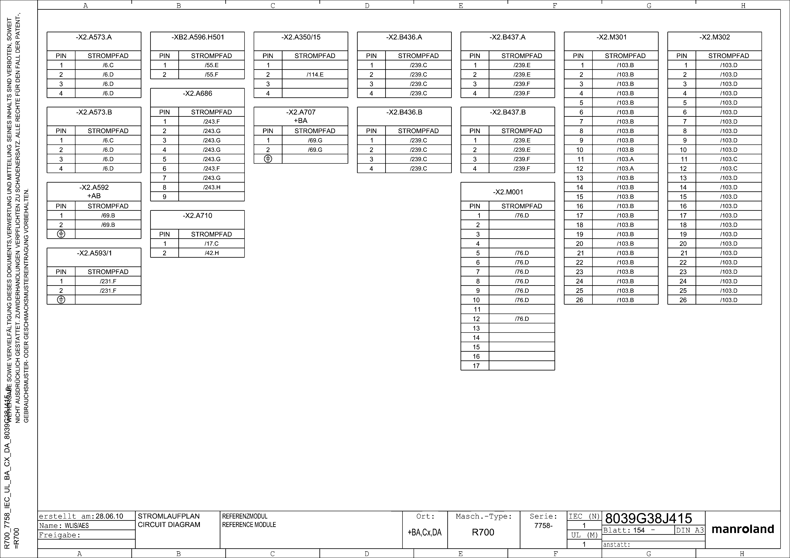

# +BA_Cx_DA — Sheet 154 of 247 — REFERENZMODUL

**REFERENCE MODULE**

> Part of the manroland **R700** printing press IEC/UL circuit diagrams.
> Drawing class: **Stromlaufplan / Circuit diagram** (DIN A3).
> Document `+BA_Cx_DA` covers the **Printing units / main switch cabinet** machine section.

## At a glance

| Field | Value |
|---|---|
| Document | `+BA_Cx_DA`  (8039G38J415) |
| Sheet | **154** of 247 |
| Section (DE) | REFERENZMODUL |
| Section (EN) | REFERENCE MODULE |
| Section type | REFERENCE_MODULE — Reference module |
| Machine type | `R700` |
| Series | `7758` |
| Created | 28.06.10 |
| Replaces | — |
| Columns used | A, B, C, D, E, F, G, H |
| Path numbers | — |
| Labels on sheet | 269 |
| Cross-refs out | 103 |
| Cross-refs in | 0 |

**Previous:** [+BA_Cx_DA sheet 153](SHEET_0153.md) · **Next:** [+BA_Cx_DA sheet 155](SHEET_0155.md) · **Document TOC:** [_TOC.md](_TOC.md)  (+BA_Cx_DA) · **Master TOC:** [all sheets](../_MASTER_TOC.md)

## Sheet image (300 DPI, exact vector render)



_Rendered directly from the PDF vector layer at 300 DPI (1-bit), no OCR and no resampling. Use it to confirm anything ambiguous in the text below._

## Cross-references on this sheet

Each entry is a wire leaving this sheet. The printed token is `/sheet.column`; the link resolves to that sheet inside the same document.

| Ref | Target sheet | Col | Path | Destination on target | Target section | From col |
|---|---|---|---|---|---|---|
| `/55.E` | [+BA_Cx_DA sheet 55](SHEET_0055.md) | E | — | — | ANLAGEBEDIENUNG | B |
| `/6.C` | [+BA_Cx_DA sheet 6](SHEET_0006.md) | C | — | — | SPANNUNGSVERSORGUNG: 400V | A |
| `/239.E` | [+BA_Cx_DA sheet 239](SHEET_0239.md) | E | — | — | OPTION: INLINECOATER SMART | F |
| `/103.B` | [+BA_Cx_DA sheet 103](SHEET_0103.md) | B | — | — | FARBSCHIEBER | G |
| `/239.C` | [+BA_Cx_DA sheet 239](SHEET_0239.md) | C | — | — | OPTION: INLINECOATER SMART | E |
| `/103.D` | [+BA_Cx_DA sheet 103](SHEET_0103.md) | D | — | — | FARBSCHIEBER | H |
| `/6.D` | [+BA_Cx_DA sheet 6](SHEET_0006.md) | D | — | — | SPANNUNGSVERSORGUNG: 400V | A |
| `/55.F` | [+BA_Cx_DA sheet 55](SHEET_0055.md) | F | — | — | ANLAGEBEDIENUNG | B |
| `/114.E` | [+BA_Cx_DA sheet 114](SHEET_0114.md) | E | — | — | PPL 2 | C |
| `/239.E` | [+BA_Cx_DA sheet 239](SHEET_0239.md) | E | — | — | OPTION: INLINECOATER SMART | F |
| `/103.B` | [+BA_Cx_DA sheet 103](SHEET_0103.md) | B | — | — | FARBSCHIEBER | G |
| `/239.C` | [+BA_Cx_DA sheet 239](SHEET_0239.md) | C | — | — | OPTION: INLINECOATER SMART | E |
| `/103.D` | [+BA_Cx_DA sheet 103](SHEET_0103.md) | D | — | — | FARBSCHIEBER | H |
| `/103.B` | [+BA_Cx_DA sheet 103](SHEET_0103.md) | B | — | — | FARBSCHIEBER | G |
| `/6.D` | [+BA_Cx_DA sheet 6](SHEET_0006.md) | D | — | — | SPANNUNGSVERSORGUNG: 400V | A |
| `/239.F` | [+BA_Cx_DA sheet 239](SHEET_0239.md) | F | — | — | OPTION: INLINECOATER SMART | F |
| `/239.C` | [+BA_Cx_DA sheet 239](SHEET_0239.md) | C | — | — | OPTION: INLINECOATER SMART | E |
| `/103.D` | [+BA_Cx_DA sheet 103](SHEET_0103.md) | D | — | — | FARBSCHIEBER | H |
| `/6.D` | [+BA_Cx_DA sheet 6](SHEET_0006.md) | D | — | — | SPANNUNGSVERSORGUNG: 400V | A |
| `/239.F` | [+BA_Cx_DA sheet 239](SHEET_0239.md) | F | — | — | OPTION: INLINECOATER SMART | F |
| `/103.B` | [+BA_Cx_DA sheet 103](SHEET_0103.md) | B | — | — | FARBSCHIEBER | G |
| `/239.C` | [+BA_Cx_DA sheet 239](SHEET_0239.md) | C | — | — | OPTION: INLINECOATER SMART | E |
| `/103.D` | [+BA_Cx_DA sheet 103](SHEET_0103.md) | D | — | — | FARBSCHIEBER | H |
| `/103.B` | [+BA_Cx_DA sheet 103](SHEET_0103.md) | B | — | — | FARBSCHIEBER | G |
| `/103.D` | [+BA_Cx_DA sheet 103](SHEET_0103.md) | D | — | — | FARBSCHIEBER | H |
| `/103.B` | [+BA_Cx_DA sheet 103](SHEET_0103.md) | B | — | — | FARBSCHIEBER | G |
| `/103.D` | [+BA_Cx_DA sheet 103](SHEET_0103.md) | D | — | — | FARBSCHIEBER | H |
| `/103.B` | [+BA_Cx_DA sheet 103](SHEET_0103.md) | B | — | — | FARBSCHIEBER | G |
| `/243.F` | [+BA_Cx_DA sheet 243](SHEET_0243.md) | F | — | — | OPTION: LEITSTANDBEDIENUNG | B |
| `/103.D` | [+BA_Cx_DA sheet 103](SHEET_0103.md) | D | — | — | FARBSCHIEBER | H |
| `/103.B` | [+BA_Cx_DA sheet 103](SHEET_0103.md) | B | — | — | FARBSCHIEBER | G |
| `/243.G` | [+BA_Cx_DA sheet 243](SHEET_0243.md) | G | — | — | OPTION: LEITSTANDBEDIENUNG | B |
| `/103.D` | [+BA_Cx_DA sheet 103](SHEET_0103.md) | D | — | — | FARBSCHIEBER | H |
| `/239.E` | [+BA_Cx_DA sheet 239](SHEET_0239.md) | E | — | — | OPTION: INLINECOATER SMART | F |
| `/103.B` | [+BA_Cx_DA sheet 103](SHEET_0103.md) | B | — | — | FARBSCHIEBER | G |
| `/6.C` | [+BA_Cx_DA sheet 6](SHEET_0006.md) | C | — | — | SPANNUNGSVERSORGUNG: 400V | A |
| `/69.G` | [+BA_Cx_DA sheet 69](SHEET_0069.md) | G | — | — | DRUCKLUFT ABSTELLEN | C |
| `/243.G` | [+BA_Cx_DA sheet 243](SHEET_0243.md) | G | — | — | OPTION: LEITSTANDBEDIENUNG | B |
| `/239.C` | [+BA_Cx_DA sheet 239](SHEET_0239.md) | C | — | — | OPTION: INLINECOATER SMART | E |
| `/103.D` | [+BA_Cx_DA sheet 103](SHEET_0103.md) | D | — | — | FARBSCHIEBER | H |
| `/239.E` | [+BA_Cx_DA sheet 239](SHEET_0239.md) | E | — | — | OPTION: INLINECOATER SMART | F |
| `/103.B` | [+BA_Cx_DA sheet 103](SHEET_0103.md) | B | — | — | FARBSCHIEBER | G |
| `/6.D` | [+BA_Cx_DA sheet 6](SHEET_0006.md) | D | — | — | SPANNUNGSVERSORGUNG: 400V | A |
| `/69.G` | [+BA_Cx_DA sheet 69](SHEET_0069.md) | G | — | — | DRUCKLUFT ABSTELLEN | C |
| `/243.G` | [+BA_Cx_DA sheet 243](SHEET_0243.md) | G | — | — | OPTION: LEITSTANDBEDIENUNG | B |
| `/239.C` | [+BA_Cx_DA sheet 239](SHEET_0239.md) | C | — | — | OPTION: INLINECOATER SMART | E |
| `/103.D` | [+BA_Cx_DA sheet 103](SHEET_0103.md) | D | — | — | FARBSCHIEBER | H |
| `/6.D` | [+BA_Cx_DA sheet 6](SHEET_0006.md) | D | — | — | SPANNUNGSVERSORGUNG: 400V | A |
| `/103.A` | [+BA_Cx_DA sheet 103](SHEET_0103.md) | A | — | — | FARBSCHIEBER | G |
| `/243.G` | [+BA_Cx_DA sheet 243](SHEET_0243.md) | G | — | — | OPTION: LEITSTANDBEDIENUNG | B |
| `/239.F` | [+BA_Cx_DA sheet 239](SHEET_0239.md) | F | — | — | OPTION: INLINECOATER SMART | F |
| `/239.C` | [+BA_Cx_DA sheet 239](SHEET_0239.md) | C | — | — | OPTION: INLINECOATER SMART | E |
| `/103.C` | [+BA_Cx_DA sheet 103](SHEET_0103.md) | C | — | — | FARBSCHIEBER | H |
| `/103.A` | [+BA_Cx_DA sheet 103](SHEET_0103.md) | A | — | — | FARBSCHIEBER | G |
| `/6.D` | [+BA_Cx_DA sheet 6](SHEET_0006.md) | D | — | — | SPANNUNGSVERSORGUNG: 400V | A |
| `/243.F` | [+BA_Cx_DA sheet 243](SHEET_0243.md) | F | — | — | OPTION: LEITSTANDBEDIENUNG | B |
| `/239.F` | [+BA_Cx_DA sheet 239](SHEET_0239.md) | F | — | — | OPTION: INLINECOATER SMART | F |
| `/239.C` | [+BA_Cx_DA sheet 239](SHEET_0239.md) | C | — | — | OPTION: INLINECOATER SMART | E |
| `/103.C` | [+BA_Cx_DA sheet 103](SHEET_0103.md) | C | — | — | FARBSCHIEBER | H |
| `/103.B` | [+BA_Cx_DA sheet 103](SHEET_0103.md) | B | — | — | FARBSCHIEBER | G |
| `/243.G` | [+BA_Cx_DA sheet 243](SHEET_0243.md) | G | — | — | OPTION: LEITSTANDBEDIENUNG | B |
| `/103.D` | [+BA_Cx_DA sheet 103](SHEET_0103.md) | D | — | — | FARBSCHIEBER | H |
| `/103.B` | [+BA_Cx_DA sheet 103](SHEET_0103.md) | B | — | — | FARBSCHIEBER | G |
| `/243.H` | [+BA_Cx_DA sheet 243](SHEET_0243.md) | H | — | — | OPTION: LEITSTANDBEDIENUNG | B |
| `/103.D` | [+BA_Cx_DA sheet 103](SHEET_0103.md) | D | — | — | FARBSCHIEBER | H |
| `/103.B` | [+BA_Cx_DA sheet 103](SHEET_0103.md) | B | — | — | FARBSCHIEBER | G |
| `/103.D` | [+BA_Cx_DA sheet 103](SHEET_0103.md) | D | — | — | FARBSCHIEBER | H |
| `/103.B` | [+BA_Cx_DA sheet 103](SHEET_0103.md) | B | — | — | FARBSCHIEBER | G |
| `/103.D` | [+BA_Cx_DA sheet 103](SHEET_0103.md) | D | — | — | FARBSCHIEBER | H |
| `/69.B` | [+BA_Cx_DA sheet 69](SHEET_0069.md) | B | — | — | DRUCKLUFT ABSTELLEN | A |
| `/103.B` | [+BA_Cx_DA sheet 103](SHEET_0103.md) | B | — | — | FARBSCHIEBER | G |
| `/76.D` | [+BA_Cx_DA sheet 76](SHEET_0076.md) | D | — | — | FARBWERK | F |
| `/103.D` | [+BA_Cx_DA sheet 103](SHEET_0103.md) | D | — | — | FARBSCHIEBER | H |
| `/69.B` | [+BA_Cx_DA sheet 69](SHEET_0069.md) | B | — | — | DRUCKLUFT ABSTELLEN | A |
| `/103.B` | [+BA_Cx_DA sheet 103](SHEET_0103.md) | B | — | — | FARBSCHIEBER | G |
| `/103.D` | [+BA_Cx_DA sheet 103](SHEET_0103.md) | D | — | — | FARBSCHIEBER | H |
| `/103.B` | [+BA_Cx_DA sheet 103](SHEET_0103.md) | B | — | — | FARBSCHIEBER | G |
| `/103.D` | [+BA_Cx_DA sheet 103](SHEET_0103.md) | D | — | — | FARBSCHIEBER | H |
| `/103.B` | [+BA_Cx_DA sheet 103](SHEET_0103.md) | B | — | — | FARBSCHIEBER | G |
| `/17.C` | [+BA_Cx_DA sheet 17](SHEET_0017.md) | C | — | — | SPANNUNGSVERSORGUNG, SCHALTSCHRANKBELÜFTUNG | B |
| `/103.D` | [+BA_Cx_DA sheet 103](SHEET_0103.md) | D | — | — | FARBSCHIEBER | H |
| `/103.B` | [+BA_Cx_DA sheet 103](SHEET_0103.md) | B | — | — | FARBSCHIEBER | G |
| `/42.H` | [+BA_Cx_DA sheet 42](SHEET_0042.md) | H | — | — | SCHUTZEINRICHTUNGEN | B |
| `/76.D` | [+BA_Cx_DA sheet 76](SHEET_0076.md) | D | — | — | FARBWERK | F |
| `/103.D` | [+BA_Cx_DA sheet 103](SHEET_0103.md) | D | — | — | FARBSCHIEBER | H |
| `/103.B` | [+BA_Cx_DA sheet 103](SHEET_0103.md) | B | — | — | FARBSCHIEBER | G |
| `/76.D` | [+BA_Cx_DA sheet 76](SHEET_0076.md) | D | — | — | FARBWERK | F |
| `/103.D` | [+BA_Cx_DA sheet 103](SHEET_0103.md) | D | — | — | FARBSCHIEBER | H |
| `/103.B` | [+BA_Cx_DA sheet 103](SHEET_0103.md) | B | — | — | FARBSCHIEBER | G |
| `/76.D` | [+BA_Cx_DA sheet 76](SHEET_0076.md) | D | — | — | FARBWERK | F |
| `/103.D` | [+BA_Cx_DA sheet 103](SHEET_0103.md) | D | — | — | FARBSCHIEBER | H |
| `/103.B` | [+BA_Cx_DA sheet 103](SHEET_0103.md) | B | — | — | FARBSCHIEBER | G |
| `/231.F` | [+BA_Cx_DA sheet 231](SHEET_0231.md) | F | — | — | OPTION: WASCHMITTELWECHSELBETRIEB | A |
| `/76.D` | [+BA_Cx_DA sheet 76](SHEET_0076.md) | D | — | — | FARBWERK | F |
| `/103.D` | [+BA_Cx_DA sheet 103](SHEET_0103.md) | D | — | — | FARBSCHIEBER | H |
| `/103.B` | [+BA_Cx_DA sheet 103](SHEET_0103.md) | B | — | — | FARBSCHIEBER | G |
| `/231.F` | [+BA_Cx_DA sheet 231](SHEET_0231.md) | F | — | — | OPTION: WASCHMITTELWECHSELBETRIEB | A |
| `/76.D` | [+BA_Cx_DA sheet 76](SHEET_0076.md) | D | — | — | FARBWERK | F |
| `/103.D` | [+BA_Cx_DA sheet 103](SHEET_0103.md) | D | — | — | FARBSCHIEBER | H |
| `/103.B` | [+BA_Cx_DA sheet 103](SHEET_0103.md) | B | — | — | FARBSCHIEBER | G |
| `/76.D` | [+BA_Cx_DA sheet 76](SHEET_0076.md) | D | — | — | FARBWERK | F |
| `/103.D` | [+BA_Cx_DA sheet 103](SHEET_0103.md) | D | — | — | FARBSCHIEBER | H |
| `/76.D` | [+BA_Cx_DA sheet 76](SHEET_0076.md) | D | — | — | FARBWERK | F |

## Devices on this sheet

| Tag | Class | Class meaning (IEC) | Col | Sub | Terminal | Sign |
|---|---|---|---|---|---|---|
| `X2.B436.A` | — | cross-device reference | D | — | — | — |
| `X2.B436.B` | — | cross-device reference | D | — | — | — |
| `X2.B437.A` | — | cross-device reference | E | — | — | — |
| `X2.B437.B` | — | cross-device reference | F | — | — | — |
| `X2.A573.A` | — | cross-device reference | A | — | — | — |
| `X2.A573.B` | — | cross-device reference | A | — | — | — |
| `X2.M001` | — | cross-device reference | F | — | — | — |
| `X2.M301` | — | cross-device reference | G | — | — | — |
| `X2.M302` | — | cross-device reference | H | — | — | — |
| `X2.A707` | — | cross-device reference | C | — | — | — |
| `X2.A592` | — | cross-device reference | A | — | — | — |
| `XB2.A596.H501` | — | cross-device reference | B | — | — | — |
| `X2.A686` | — | cross-device reference | B | — | — | — |
| `X2.A710` | — | cross-device reference | B | — | — | — |

## Potentials / nets

_No named potentials on this sheet._

## Wire-end annotations (grouped as printed)

A wire that continues elsewhere is annotated with a small cluster: the destination description, the path/line number `#NN`, and the `/sheet.column` cross reference. Each row below is one such cluster exactly as it is grouped on the drawing.

| Col | Y | Path | Cross-ref | Text on the wire |
|---|---|---|---|---|
| A | 51.3 | — | — | `X2.A573.A` |
| B | 51.3 | — | — | `XB2.A596.H501` |
| C | 51.3 | — | — | `X2.A350/15` |
| D | 51.3 | — | — | `X2.B436.A` |
| E | 51.3 | — | — | `X2.B437.A` |
| G | 51.3 | — | — | `X2.M301` |
| H | 51.3 | — | — | `X2.M302` |
| A | 80.0 | — | — | `PIN 2 3 4 1 STROMPFAD` |
| B | 80.0 | — | — | `PIN 2 1 STROMPFAD` |
| C | 80.0 | — | — | `PIN 2 3 4 1 STROMPFAD` |
| D | 80.0 | — | — | `PIN 2 3 4 1 STROMPFAD` |
| E | 80.0 | — | — | `PIN 2 3 4 1 STROMPFAD` |
| G | 80.0 | — | — | `PIN STROMPFAD` |
| H | 80.0 | — | — | `PIN STROMPFAD` |
| F | 94.2 | — | — | `2 3 4 5 6 7 8 9 1` |
| G | 94.2 | — | — | `2 3 4 5 6 7 8 9 1` |
| A | 94.5 | — | `/6.C` | — |
| B | 94.5 | — | `/55.E` | — |
| E | 94.5 | — | `/239.C` | — |
| F | 94.5 | — | `/239.E` | — |
| G | 94.5 | — | `/103.B` | — |
| H | 94.5 | — | `/103.D` | — |
| A | 108.7 | — | `/6.D` | — |
| B | 108.7 | — | `/55.F` | — |
| C | 108.7 | — | `/114.E` | — |
| E | 108.7 | — | `/239.C` | — |
| F | 108.7 | — | `/239.E` | — |
| G | 108.7 | — | `/103.B` | — |
| H | 108.7 | — | `/103.D` | — |
| A | 122.9 | — | `/6.D` | — |
| E | 122.9 | — | `/239.C` | — |
| F | 122.9 | — | `/239.F` | — |
| G | 122.9 | — | `/103.B` | — |
| H | 122.9 | — | `/103.D` | — |
| B | 136.4 | — | — | `X2.A686` |
| A | 137.0 | — | `/6.D` | — |
| F | 137.0 | — | `/239.F` | — |
| G | 137.0 | — | `/103.B` | — |
| E | 137.1 | — | `/239.C` | — |
| H | 137.1 | — | `/103.D` | — |
| G | 151.2 | — | `/103.B` | — |
| H | 151.2 | — | `/103.D` | — |
| A | 164.7 | — | — | `X2.A573.B` |
| C | 164.7 | — | — | `X2.A707` |
| D | 164.7 | — | — | `X2.B436.B` |
| F | 164.7 | — | — | `X2.B437.B` |
| B | 165.0 | — | — | `PIN 2 3 4 5 6 7 8 9 1 STROMPFAD` |
| G | 165.4 | — | `/103.B` | — |
| H | 165.4 | — | `/103.D` | — |
| C | 177.4 | — | — | `+BA` |
| B | 179.6 | — | `/243.F` | — |
| G | 179.6 | — | `/103.B` | — |
| H | 179.6 | — | `/103.D` | — |
| A | 193.4 | — | — | `PIN 2 3 4 1 STROMPFAD` |
| C | 193.4 | — | — | `PIN 2 1 STROMPFAD` |
| D | 193.4 | — | — | `PIN 2 3 4 1 STROMPFAD` |
| E | 193.4 | — | — | `PIN 2 3 4 1 STROMPFAD` |
| B | 193.7 | — | `/243.G` | — |
| G | 193.7 | — | `/103.B` | — |
| H | 193.8 | — | `/103.D` | — |
| A | 207.9 | — | `/6.C` | — |
| B | 207.9 | — | `/243.G` | — |
| C | 207.9 | — | `/69.G` | — |
| E | 207.9 | — | `/239.C` | — |
| F | 207.9 | — | `/239.E` | — |
| G | 207.9 | — | `/103.B` | — |
| H | 207.9 | — | `/103.D` | — |
| F | 221.8 | — | — | `10 12 13 14 15 16 17 18 19 20 11` |
| G | 221.8 | — | — | `10 12 13 14 15 16 17 18 19 20 11` |
| A | 222.1 | — | `/6.D` | — |
| B | 222.1 | — | `/243.G` | — |
| C | 222.1 | — | `/69.G` | — |
| E | 222.1 | — | `/239.C` | — |
| F | 222.1 | — | `/239.E` | — |
| G | 222.1 | — | `/103.B` | — |
| H | 222.1 | — | `/103.D` | — |
| A | 236.2 | — | `/6.D` | — |
| G | 236.2 | — | `/103.A` | — |
| B | 236.3 | — | `/243.G` | — |
| E | 236.3 | — | `/239.C` | — |
| F | 236.3 | — | `/239.F` | — |
| H | 236.3 | — | `/103.C` | — |
| A | 250.4 | — | `/6.D` | — |
| B | 250.4 | — | `/243.F` | — |
| E | 250.4 | — | `/239.C` | — |
| F | 250.4 | — | `/239.F` | — |
| G | 250.4 | — | `/103.A` | — |
| H | 250.4 | — | `/103.C` | — |
| B | 264.6 | — | `/243.G` | — |
| G | 264.6 | — | `/103.B` | — |
| H | 264.6 | — | `/103.D` | — |
| A | 278.1 | — | — | `X2.A592` |
| B | 278.8 | — | `/243.H` | — |
| G | 278.8 | — | `/103.B` | — |
| H | 278.8 | — | `/103.D` | — |
| F | 285.2 | — | — | `X2.M001` |
| A | 290.8 | — | — | `+AB` |
| G | 292.9 | — | `/103.B` | — |
| H | 293.0 | — | `/103.D` | — |
| A | 306.8 | — | — | `PIN 2 1 STROMPFAD` |
| E | 306.8 | — | — | `PIN STROMPFAD` |
| G | 307.1 | — | `/103.B` | — |
| H | 307.1 | — | `/103.D` | — |
| B | 320.6 | — | — | `X2.A710` |
| E | 321.0 | — | — | `2 3 4 5 6 7 8 9 1` |
| A | 321.3 | — | `/69.B` | — |
| F | 321.3 | — | `/76.D` | — |
| G | 321.3 | — | `/103.B` | — |
| H | 321.3 | — | `/103.D` | — |
| A | 335.4 | — | `/69.B` | — |
| G | 335.5 | — | `/103.B` | — |
| H | 335.5 | — | `/103.D` | — |
| B | 349.3 | — | — | `PIN 2 1 STROMPFAD` |
| G | 349.6 | — | `/103.B` | — |
| H | 349.7 | — | `/103.D` | — |
| B | 363.8 | — | `/17.C` | — |
| G | 363.8 | — | `/103.B` | — |
| H | 363.8 | — | `/103.D` | — |
| A | 377.3 | — | — | `X2.A593/1` |
| F | 377.7 | — | — | `22 23 24 25 26 21` |
| G | 377.7 | — | — | `22 23 24 25 26 21` |
| B | 378.0 | — | `/42.H` | — |
| F | 378.0 | — | `/76.D` | — |
| G | 378.0 | — | `/103.B` | — |
| H | 378.0 | — | `/103.D` | — |
| G | 392.1 | — | `/103.B` | — |
| F | 392.2 | — | `/76.D` | — |
| H | 392.2 | — | `/103.D` | — |
| A | 406.0 | — | — | `PIN 2 1 STROMPFAD` |
| F | 406.3 | — | `/76.D` | — |
| G | 406.3 | — | `/103.B` | — |
| H | 406.4 | — | `/103.D` | — |
| A | 420.5 | — | `/231.F` | — |
| F | 420.5 | — | `/76.D` | — |
| G | 420.5 | — | `/103.B` | — |
| H | 420.5 | — | `/103.D` | — |
| A | 434.7 | — | `/231.F` | — |
| F | 434.7 | — | `/76.D` | — |
| G | 434.7 | — | `/103.B` | — |
| H | 434.7 | — | `/103.D` | — |
| E | 448.5 | — | — | `10 12 13 14 15 16 17 11` |
| F | 448.9 | — | `/76.D` | — |
| G | 448.9 | — | `/103.B` | — |
| H | 448.9 | — | `/103.D` | — |
| F | 477.2 | — | `/76.D` | — |


## Reconstructed tables

This sheet carries tabular content (pin map / terminal assignment / index). The grid below was rebuilt from the drawing's own rule lines, so each row is exactly one physical row of the table.

### Table 1 — 19 data rows × 2 columns (at x=70.9, y=48.2) — **X2.A573.A**

| PIN | STROMPFAD |
|---|---|
| `1` | `/6.C` |
| `2` | `/6.D` |
| `3` | `/6.D` |
| `4` | `/6.D` |
|  | `X2.A573.B` |
| `PIN` | `STROMPFAD` |
| `1` | `/6.C` |
| `2` | `/6.D` |
| `3` | `/6.D` |
| `4` | `/6.D` |
|  | `X2.A592` |
|  | `+AB` |
| `PIN` | `STROMPFAD` |
| `1` | `/69.B` |
| `2` | `/69.B` |
|  | `X2.A593/1` |
| `PIN` | `STROMPFAD` |
| `1` | `/231.F` |
| `2` | `/231.F` |


### Table 2 — 17 data rows × 2 columns (at x=226.8, y=48.2) — **XB2.A596.H501**

| PIN | STROMPFAD |
|---|---|
| `1` | `/55.E` |
| `2` | `/55.F` |
|  | `X2.A686` |
| `PIN` | `STROMPFAD` |
| `1` | `/243.F` |
| `2` | `/243.G` |
| `3` | `/243.G` |
| `4` | `/243.G` |
| `5` | `/243.G` |
| `6` | `/243.F` |
| `7` | `/243.G` |
| `8` | `/243.H` |
| `9` |  |
|  | `X2.A710` |
| `PIN` | `STROMPFAD` |
| `1` | `/17.C` |
| `2` | `/42.H` |


### Table 3 — 9 data rows × 2 columns (at x=382.7, y=48.2) — **X2.A350/15**

| PIN | STROMPFAD |
|---|---|
| `1` |  |
| `2` | `/114.E` |
| `3` |  |
| `4` |  |
|  | `X2.A707` |
|  | `+BA` |
| `PIN` | `STROMPFAD` |
| `1` | `/69.G` |
| `2` | `/69.G` |


### Table 4 — 10 data rows × 2 columns (at x=538.6, y=48.2) — **X2.B436.A**

| PIN | STROMPFAD |
|---|---|
| `1` | `/239.C` |
| `2` | `/239.C` |
| `3` | `/239.C` |
| `4` | `/239.C` |
|  | `X2.B436.B` |
| `PIN` | `STROMPFAD` |
| `1` | `/239.C` |
| `2` | `/239.C` |
| `3` | `/239.C` |
| `4` | `/239.C` |


### Table 5 — 29 data rows × 2 columns (at x=694.5, y=48.2) — **X2.B437.A**

| PIN | STROMPFAD |
|---|---|
| `1` | `/239.E` |
| `2` | `/239.E` |
| `3` | `/239.F` |
| `4` | `/239.F` |
|  | `X2.B437.B` |
| `PIN` | `STROMPFAD` |
| `1` | `/239.E` |
| `2` | `/239.E` |
| `3` | `/239.F` |
| `4` | `/239.F` |
|  | `X2.M001` |
| `PIN` | `STROMPFAD` |
| `1` | `/76.D` |
| `2` |  |
| `3` |  |
| `4` |  |
| `5` | `/76.D` |
| `6` | `/76.D` |
| `7` | `/76.D` |
| `8` | `/76.D` |
| `9` | `/76.D` |
| `10` | `/76.D` |
| `11` |  |
| `12` | `/76.D` |
| `13` |  |
| `14` |  |
| `15` |  |
| `16` |  |
| `17` |  |


### Table 6 — 26 data rows × 2 columns (at x=850.4, y=48.2) — **X2.M301**

| PIN | STROMPFAD |
|---|---|
| `1` | `/103.B` |
| `2` | `/103.B` |
| `3` | `/103.B` |
| `4` | `/103.B` |
| `5` | `/103.B` |
| `6` | `/103.B` |
| `7` | `/103.B` |
| `8` | `/103.B` |
| `9` | `/103.B` |
| `10` | `/103.B` |
| `11` | `/103.A` |
| `12` | `/103.A` |
| `13` | `/103.B` |
| `14` | `/103.B` |
| `15` | `/103.B` |
| `16` | `/103.B` |
| `17` | `/103.B` |
| `18` | `/103.B` |
| `19` | `/103.B` |
| `20` | `/103.B` |
| `21` | `/103.B` |
| `22` | `/103.B` |
| `23` | `/103.B` |
| `24` | `/103.B` |
| `25` | `/103.B` |
| `26` | `/103.B` |


### Table 7 — 26 data rows × 2 columns (at x=1006.3, y=48.2) — **X2.M302**

| PIN | STROMPFAD |
|---|---|
| `1` | `/103.D` |
| `2` | `/103.D` |
| `3` | `/103.D` |
| `4` | `/103.D` |
| `5` | `/103.D` |
| `6` | `/103.D` |
| `7` | `/103.D` |
| `8` | `/103.D` |
| `9` | `/103.D` |
| `10` | `/103.D` |
| `11` | `/103.C` |
| `12` | `/103.C` |
| `13` | `/103.D` |
| `14` | `/103.D` |
| `15` | `/103.D` |
| `16` | `/103.D` |
| `17` | `/103.D` |
| `18` | `/103.D` |
| `19` | `/103.D` |
| `20` | `/103.D` |
| `21` | `/103.D` |
| `22` | `/103.D` |
| `23` | `/103.D` |
| `24` | `/103.D` |
| `25` | `/103.D` |
| `26` | `/103.D` |


## Notes and free text on this sheet

| Text | Col | Y (pt) |
|---|---|---|
| `PIN` | D | 80.02 |
| `STROMPFAD` | E | 79.98 |
| `PIN` | E | 80.02 |
| `STROMPFAD` | F | 79.98 |
| `PIN` | C | 80.02 |
| `STROMPFAD` | C | 79.98 |
| `X2.A350/15` | C | 51.33 |
| `PIN` | A | 80.02 |
| `STROMPFAD` | A | 79.98 |
| `PIN` | F | 80.02 |
| `STROMPFAD` | G | 79.98 |
| `PIN` | G | 80.02 |
| `STROMPFAD` | H | 79.98 |
| `+BA` | C | 177.4 |
| `+AB` | A | 290.78 |
| `X2.A593/1` | A | 377.32 |
| `PIN` | B | 80.02 |
| `STROMPFAD` | B | 79.98 |

## Complete label inventory (exact text from the drawing)

Every text object inside the drawing area of this sheet, in DIN reading order (column A→H, then top→bottom). This is the authoritative list: if a string is not here it is not printed on this sheet.

| Col | Y | X | Dir | Type | Text |
|---|---|---|---|---|---|
| A | 51.3 | 114.4 | → | device ref | `X2.A573.A` |
| A | 80.0 | 84.0 | → | text | `PIN` |
| A | 80.0 | 132.2 | → | text | `STROMPFAD` |
| A | 94.2 | 90.0 | → | number | `1` |
| A | 94.5 | 155.1 | → | cross-reference | `/6.C` |
| A | 108.4 | 89.4 | → | number | `2` |
| A | 108.7 | 155.1 | → | cross-reference | `/6.D` |
| A | 122.5 | 89.4 | → | number | `3` |
| A | 122.9 | 155.1 | → | cross-reference | `/6.D` |
| A | 136.7 | 89.4 | → | number | `4` |
| A | 137.0 | 155.1 | → | cross-reference | `/6.D` |
| A | 164.7 | 114.8 | → | device ref | `X2.A573.B` |
| A | 193.4 | 84.0 | → | text | `PIN` |
| A | 193.4 | 132.2 | → | text | `STROMPFAD` |
| A | 207.6 | 90.0 | → | number | `1` |
| A | 207.9 | 155.1 | → | cross-reference | `/6.C` |
| A | 221.8 | 89.4 | → | number | `2` |
| A | 222.1 | 155.1 | → | cross-reference | `/6.D` |
| A | 235.9 | 89.4 | → | number | `3` |
| A | 236.3 | 155.1 | → | cross-reference | `/6.D` |
| A | 250.1 | 89.4 | → | number | `4` |
| A | 250.4 | 155.1 | → | cross-reference | `/6.D` |
| A | 278.1 | 119.8 | → | device ref | `X2.A592` |
| A | 290.8 | 131.5 | → | text | `+AB` |
| A | 306.8 | 84.0 | → | text | `PIN` |
| A | 306.8 | 132.2 | → | text | `STROMPFAD` |
| A | 321.0 | 90.0 | → | number | `1` |
| A | 321.3 | 152.8 | → | cross-reference | `/69.B` |
| A | 335.1 | 89.4 | → | number | `2` |
| A | 335.4 | 152.8 | → | cross-reference | `/69.B` |
| A | 377.3 | 116.1 | → | text | `X2.A593/1` |
| A | 406.0 | 84.0 | → | text | `PIN` |
| A | 406.0 | 132.2 | → | text | `STROMPFAD` |
| A | 420.2 | 90.0 | → | number | `1` |
| A | 420.5 | 150.7 | → | cross-reference | `/231.F` |
| A | 434.4 | 89.4 | → | number | `2` |
| A | 434.7 | 150.7 | → | cross-reference | `/231.F` |
| B | 51.3 | 258.7 | → | device ref | `XB2.A596.H501` |
| B | 80.0 | 240.0 | → | text | `PIN` |
| B | 80.0 | 288.1 | → | text | `STROMPFAD` |
| B | 94.2 | 245.9 | → | number | `1` |
| B | 94.5 | 308.8 | → | cross-reference | `/55.E` |
| B | 108.4 | 245.3 | → | number | `2` |
| B | 108.7 | 309.0 | → | cross-reference | `/55.F` |
| B | 136.4 | 275.7 | → | device ref | `X2.A686` |
| B | 165.0 | 288.1 | → | text | `STROMPFAD` |
| B | 165.1 | 240.0 | → | text | `PIN` |
| B | 179.2 | 245.9 | → | number | `1` |
| B | 179.6 | 306.6 | → | cross-reference | `/243.F` |
| B | 193.4 | 245.3 | → | number | `2` |
| B | 193.7 | 306.0 | → | cross-reference | `/243.G` |
| B | 207.6 | 245.3 | → | number | `3` |
| B | 207.9 | 306.0 | → | cross-reference | `/243.G` |
| B | 221.8 | 245.3 | → | number | `4` |
| B | 222.1 | 306.0 | → | cross-reference | `/243.G` |
| B | 235.9 | 245.3 | → | number | `5` |
| B | 236.3 | 306.0 | → | cross-reference | `/243.G` |
| B | 250.1 | 245.3 | → | number | `6` |
| B | 250.4 | 306.6 | → | cross-reference | `/243.F` |
| B | 264.3 | 245.3 | → | number | `7` |
| B | 264.6 | 306.0 | → | cross-reference | `/243.G` |
| B | 278.5 | 245.3 | → | number | `8` |
| B | 278.8 | 306.4 | → | cross-reference | `/243.H` |
| B | 292.6 | 245.3 | → | number | `9` |
| B | 320.6 | 275.7 | → | device ref | `X2.A710` |
| B | 349.3 | 240.0 | → | text | `PIN` |
| B | 349.3 | 288.1 | → | text | `STROMPFAD` |
| B | 363.5 | 245.9 | → | number | `1` |
| B | 363.8 | 308.6 | → | cross-reference | `/17.C` |
| B | 377.7 | 245.3 | → | number | `2` |
| B | 378.0 | 308.8 | → | cross-reference | `/42.H` |
| C | 51.3 | 424.2 | → | text | `X2.A350/15` |
| C | 80.0 | 395.9 | → | text | `PIN` |
| C | 80.0 | 444.0 | → | text | `STROMPFAD` |
| C | 94.2 | 401.8 | → | number | `1` |
| C | 108.4 | 401.2 | → | number | `2` |
| C | 108.7 | 462.3 | → | cross-reference | `/114.E` |
| C | 122.5 | 401.2 | → | number | `3` |
| C | 136.7 | 401.2 | → | number | `4` |
| C | 164.7 | 431.6 | → | device ref | `X2.A707` |
| C | 177.4 | 442.9 | → | text | `+BA` |
| C | 193.4 | 395.9 | → | text | `PIN` |
| C | 193.4 | 444.0 | → | text | `STROMPFAD` |
| C | 207.6 | 401.8 | → | number | `1` |
| C | 207.9 | 464.3 | → | cross-reference | `/69.G` |
| C | 221.8 | 401.2 | → | number | `2` |
| C | 222.1 | 464.3 | → | cross-reference | `/69.G` |
| D | 51.3 | 582.1 | → | device ref | `X2.B436.A` |
| D | 80.0 | 551.8 | → | text | `PIN` |
| D | 94.2 | 557.7 | → | number | `1` |
| D | 108.4 | 557.1 | → | number | `2` |
| D | 122.5 | 557.1 | → | number | `3` |
| D | 136.7 | 557.1 | → | number | `4` |
| D | 164.7 | 582.5 | → | device ref | `X2.B436.B` |
| D | 193.4 | 551.8 | → | text | `PIN` |
| D | 207.6 | 557.7 | → | number | `1` |
| D | 221.8 | 557.1 | → | number | `2` |
| D | 235.9 | 557.1 | → | number | `3` |
| D | 250.1 | 557.1 | → | number | `4` |
| E | 51.3 | 738.0 | → | device ref | `X2.B437.A` |
| E | 80.0 | 600.0 | → | text | `STROMPFAD` |
| E | 80.0 | 707.7 | → | text | `PIN` |
| E | 94.2 | 713.6 | → | number | `1` |
| E | 94.5 | 618.0 | → | cross-reference | `/239.C` |
| E | 108.4 | 713.1 | → | number | `2` |
| E | 108.7 | 618.0 | → | cross-reference | `/239.C` |
| E | 122.5 | 713.1 | → | number | `3` |
| E | 122.9 | 618.0 | → | cross-reference | `/239.C` |
| E | 136.7 | 713.1 | → | number | `4` |
| E | 137.1 | 618.0 | → | cross-reference | `/239.C` |
| E | 193.4 | 600.0 | → | text | `STROMPFAD` |
| E | 193.4 | 707.7 | → | text | `PIN` |
| E | 207.6 | 713.6 | → | number | `1` |
| E | 207.9 | 618.0 | → | cross-reference | `/239.C` |
| E | 221.8 | 713.1 | → | number | `2` |
| E | 222.1 | 618.0 | → | cross-reference | `/239.C` |
| E | 235.9 | 713.1 | → | number | `3` |
| E | 236.3 | 618.0 | → | cross-reference | `/239.C` |
| E | 250.1 | 713.1 | → | number | `4` |
| E | 250.4 | 618.0 | → | cross-reference | `/239.C` |
| E | 306.8 | 707.7 | → | text | `PIN` |
| E | 321.0 | 719.4 | → | number | `1` |
| E | 335.1 | 717.7 | → | number | `2` |
| E | 349.3 | 717.7 | → | number | `3` |
| E | 363.5 | 717.7 | → | number | `4` |
| E | 377.7 | 717.7 | → | number | `5` |
| E | 391.8 | 717.7 | → | number | `6` |
| E | 406.0 | 717.7 | → | number | `7` |
| E | 420.2 | 717.7 | → | number | `8` |
| E | 434.4 | 717.7 | → | number | `9` |
| E | 448.5 | 712.3 | → | number | `10` |
| E | 462.7 | 714.0 | → | number | `11` |
| E | 476.9 | 712.3 | → | number | `12` |
| E | 491.0 | 712.3 | → | number | `13` |
| E | 505.2 | 712.3 | → | number | `14` |
| E | 519.4 | 712.3 | → | number | `15` |
| E | 533.6 | 712.3 | → | number | `16` |
| E | 547.7 | 712.3 | → | number | `17` |
| F | 80.0 | 755.9 | → | text | `STROMPFAD` |
| F | 80.0 | 863.6 | → | text | `PIN` |
| F | 94.2 | 875.3 | → | number | `1` |
| F | 94.5 | 774.1 | → | cross-reference | `/239.E` |
| F | 108.4 | 873.6 | → | number | `2` |
| F | 108.7 | 774.1 | → | cross-reference | `/239.E` |
| F | 122.5 | 873.6 | → | number | `3` |
| F | 122.9 | 774.3 | → | cross-reference | `/239.F` |
| F | 136.7 | 873.6 | → | number | `4` |
| F | 137.0 | 774.3 | → | cross-reference | `/239.F` |
| F | 150.9 | 873.6 | → | number | `5` |
| F | 164.7 | 738.4 | → | device ref | `X2.B437.B` |
| F | 165.1 | 873.6 | → | number | `6` |
| F | 179.2 | 873.6 | → | number | `7` |
| F | 193.4 | 755.9 | → | text | `STROMPFAD` |
| F | 193.4 | 873.6 | → | number | `8` |
| F | 207.6 | 873.6 | → | number | `9` |
| F | 207.9 | 774.1 | → | cross-reference | `/239.E` |
| F | 221.8 | 868.3 | → | number | `10` |
| F | 222.1 | 774.1 | → | cross-reference | `/239.E` |
| F | 235.9 | 870.0 | → | number | `11` |
| F | 236.3 | 774.3 | → | cross-reference | `/239.F` |
| F | 250.1 | 868.3 | → | number | `12` |
| F | 250.4 | 774.3 | → | cross-reference | `/239.F` |
| F | 264.3 | 868.3 | → | number | `13` |
| F | 278.5 | 868.3 | → | number | `14` |
| F | 285.2 | 743.2 | → | device ref | `X2.M001` |
| F | 292.6 | 868.3 | → | number | `15` |
| F | 306.8 | 755.9 | → | text | `STROMPFAD` |
| F | 306.8 | 868.3 | → | number | `16` |
| F | 321.0 | 868.3 | → | number | `17` |
| F | 321.3 | 776.3 | → | cross-reference | `/76.D` |
| F | 335.1 | 868.3 | → | number | `18` |
| F | 349.3 | 868.3 | → | number | `19` |
| F | 363.5 | 868.3 | → | number | `20` |
| F | 377.7 | 870.0 | → | number | `21` |
| F | 378.0 | 776.3 | → | cross-reference | `/76.D` |
| F | 391.8 | 868.3 | → | number | `22` |
| F | 392.2 | 776.3 | → | cross-reference | `/76.D` |
| F | 406.0 | 868.3 | → | number | `23` |
| F | 406.3 | 776.3 | → | cross-reference | `/76.D` |
| F | 420.2 | 868.3 | → | number | `24` |
| F | 420.5 | 776.3 | → | cross-reference | `/76.D` |
| F | 434.4 | 868.3 | → | number | `25` |
| F | 434.7 | 776.3 | → | cross-reference | `/76.D` |
| F | 448.5 | 868.3 | → | number | `26` |
| F | 448.9 | 776.3 | → | cross-reference | `/76.D` |
| F | 477.2 | 776.3 | → | cross-reference | `/76.D` |
| G | 51.3 | 899.1 | → | device ref | `X2.M301` |
| G | 80.0 | 911.8 | → | text | `STROMPFAD` |
| G | 80.0 | 1019.5 | → | text | `PIN` |
| G | 94.2 | 1031.2 | → | number | `1` |
| G | 94.5 | 929.9 | → | cross-reference | `/103.B` |
| G | 108.4 | 1029.5 | → | number | `2` |
| G | 108.7 | 929.9 | → | cross-reference | `/103.B` |
| G | 122.5 | 1029.5 | → | number | `3` |
| G | 122.9 | 929.9 | → | cross-reference | `/103.B` |
| G | 136.7 | 1029.5 | → | number | `4` |
| G | 137.0 | 929.9 | → | cross-reference | `/103.B` |
| G | 150.9 | 1029.5 | → | number | `5` |
| G | 151.2 | 929.9 | → | cross-reference | `/103.B` |
| G | 165.1 | 1029.5 | → | number | `6` |
| G | 165.4 | 929.9 | → | cross-reference | `/103.B` |
| G | 179.2 | 1029.5 | → | number | `7` |
| G | 179.6 | 929.9 | → | cross-reference | `/103.B` |
| G | 193.4 | 1029.5 | → | number | `8` |
| G | 193.7 | 929.9 | → | cross-reference | `/103.B` |
| G | 207.6 | 1029.5 | → | number | `9` |
| G | 207.9 | 929.9 | → | cross-reference | `/103.B` |
| G | 221.8 | 1024.2 | → | number | `10` |
| G | 222.1 | 929.9 | → | cross-reference | `/103.B` |
| G | 235.9 | 1025.9 | → | number | `11` |
| G | 236.2 | 929.8 | → | cross-reference | `/103.A` |
| G | 250.1 | 1024.2 | → | number | `12` |
| G | 250.4 | 929.8 | → | cross-reference | `/103.A` |
| G | 264.3 | 1024.2 | → | number | `13` |
| G | 264.6 | 929.9 | → | cross-reference | `/103.B` |
| G | 278.5 | 1024.2 | → | number | `14` |
| G | 278.8 | 929.9 | → | cross-reference | `/103.B` |
| G | 292.6 | 1024.2 | → | number | `15` |
| G | 292.9 | 929.9 | → | cross-reference | `/103.B` |
| G | 306.8 | 1024.2 | → | number | `16` |
| G | 307.1 | 929.9 | → | cross-reference | `/103.B` |
| G | 321.0 | 1024.2 | → | number | `17` |
| G | 321.3 | 929.9 | → | cross-reference | `/103.B` |
| G | 335.1 | 1024.2 | → | number | `18` |
| G | 335.5 | 929.9 | → | cross-reference | `/103.B` |
| G | 349.3 | 1024.2 | → | number | `19` |
| G | 349.6 | 929.9 | → | cross-reference | `/103.B` |
| G | 363.5 | 1024.2 | → | number | `20` |
| G | 363.8 | 929.9 | → | cross-reference | `/103.B` |
| G | 377.7 | 1025.9 | → | number | `21` |
| G | 378.0 | 929.9 | → | cross-reference | `/103.B` |
| G | 391.8 | 1024.2 | → | number | `22` |
| G | 392.2 | 929.9 | → | cross-reference | `/103.B` |
| G | 406.0 | 1024.2 | → | number | `23` |
| G | 406.3 | 929.9 | → | cross-reference | `/103.B` |
| G | 420.2 | 1024.2 | → | number | `24` |
| G | 420.5 | 929.9 | → | cross-reference | `/103.B` |
| G | 434.4 | 1024.2 | → | number | `25` |
| G | 434.7 | 929.9 | → | cross-reference | `/103.B` |
| G | 448.5 | 1024.2 | → | number | `26` |
| G | 448.8 | 929.9 | → | cross-reference | `/103.B` |
| H | 51.3 | 1054.3 | → | device ref | `X2.M302` |
| H | 80.0 | 1067.7 | → | text | `STROMPFAD` |
| H | 94.5 | 1085.7 | → | cross-reference | `/103.D` |
| H | 108.7 | 1085.7 | → | cross-reference | `/103.D` |
| H | 122.9 | 1085.7 | → | cross-reference | `/103.D` |
| H | 137.1 | 1085.7 | → | cross-reference | `/103.D` |
| H | 151.2 | 1085.7 | → | cross-reference | `/103.D` |
| H | 165.4 | 1085.7 | → | cross-reference | `/103.D` |
| H | 179.6 | 1085.7 | → | cross-reference | `/103.D` |
| H | 193.8 | 1085.7 | → | cross-reference | `/103.D` |
| H | 207.9 | 1085.7 | → | cross-reference | `/103.D` |
| H | 222.1 | 1085.7 | → | cross-reference | `/103.D` |
| H | 236.3 | 1085.7 | → | cross-reference | `/103.C` |
| H | 250.4 | 1085.7 | → | cross-reference | `/103.C` |
| H | 264.6 | 1085.7 | → | cross-reference | `/103.D` |
| H | 278.8 | 1085.7 | → | cross-reference | `/103.D` |
| H | 293.0 | 1085.7 | → | cross-reference | `/103.D` |
| H | 307.1 | 1085.7 | → | cross-reference | `/103.D` |
| H | 321.3 | 1085.7 | → | cross-reference | `/103.D` |
| H | 335.5 | 1085.7 | → | cross-reference | `/103.D` |
| H | 349.7 | 1085.7 | → | cross-reference | `/103.D` |
| H | 363.8 | 1085.7 | → | cross-reference | `/103.D` |
| H | 378.0 | 1085.7 | → | cross-reference | `/103.D` |
| H | 392.2 | 1085.7 | → | cross-reference | `/103.D` |
| H | 406.4 | 1085.7 | → | cross-reference | `/103.D` |
| H | 420.5 | 1085.7 | → | cross-reference | `/103.D` |
| H | 434.7 | 1085.7 | → | cross-reference | `/103.D` |
| H | 448.9 | 1085.7 | → | cross-reference | `/103.D` |

## Reading-order text block

The same content as a plain block, grouped by DIN column — convenient to paste or to match against a visual description.

```text
=== Column A ===
  51.3  114.4  devref       X2.A573.A
  80.0   84.0  text         PIN
  80.0  132.2  text         STROMPFAD
  94.2   90.0  numeric      1
  94.5  155.1  xref         /6.C
 108.4   89.4  numeric      2
 108.7  155.1  xref         /6.D
 122.5   89.4  numeric      3
 122.9  155.1  xref         /6.D
 136.7   89.4  numeric      4
 137.0  155.1  xref         /6.D
 164.7  114.8  devref       X2.A573.B
 193.4   84.0  text         PIN
 193.4  132.2  text         STROMPFAD
 207.6   90.0  numeric      1
 207.9  155.1  xref         /6.C
 221.8   89.4  numeric      2
 222.1  155.1  xref         /6.D
 235.9   89.4  numeric      3
 236.3  155.1  xref         /6.D
 250.1   89.4  numeric      4
 250.4  155.1  xref         /6.D
 278.1  119.8  devref       X2.A592
 290.8  131.5  text         +AB
 306.8   84.0  text         PIN
 306.8  132.2  text         STROMPFAD
 321.0   90.0  numeric      1
 321.3  152.8  xref         /69.B
 335.1   89.4  numeric      2
 335.4  152.8  xref         /69.B
 377.3  116.1  text         X2.A593/1
 406.0   84.0  text         PIN
 406.0  132.2  text         STROMPFAD
 420.2   90.0  numeric      1
 420.5  150.7  xref         /231.F
 434.4   89.4  numeric      2
 434.7  150.7  xref         /231.F
=== Column B ===
  51.3  258.7  devref       XB2.A596.H501
  80.0  240.0  text         PIN
  80.0  288.1  text         STROMPFAD
  94.2  245.9  numeric      1
  94.5  308.8  xref         /55.E
 108.4  245.3  numeric      2
 108.7  309.0  xref         /55.F
 136.4  275.7  devref       X2.A686
 165.0  288.1  text         STROMPFAD
 165.1  240.0  text         PIN
 179.2  245.9  numeric      1
 179.6  306.6  xref         /243.F
 193.4  245.3  numeric      2
 193.7  306.0  xref         /243.G
 207.6  245.3  numeric      3
 207.9  306.0  xref         /243.G
 221.8  245.3  numeric      4
 222.1  306.0  xref         /243.G
 235.9  245.3  numeric      5
 236.3  306.0  xref         /243.G
 250.1  245.3  numeric      6
 250.4  306.6  xref         /243.F
 264.3  245.3  numeric      7
 264.6  306.0  xref         /243.G
 278.5  245.3  numeric      8
 278.8  306.4  xref         /243.H
 292.6  245.3  numeric      9
 320.6  275.7  devref       X2.A710
 349.3  240.0  text         PIN
 349.3  288.1  text         STROMPFAD
 363.5  245.9  numeric      1
 363.8  308.6  xref         /17.C
 377.7  245.3  numeric      2
 378.0  308.8  xref         /42.H
=== Column C ===
  51.3  424.2  text         X2.A350/15
  80.0  395.9  text         PIN
  80.0  444.0  text         STROMPFAD
  94.2  401.8  numeric      1
 108.4  401.2  numeric      2
 108.7  462.3  xref         /114.E
 122.5  401.2  numeric      3
 136.7  401.2  numeric      4
 164.7  431.6  devref       X2.A707
 177.4  442.9  text         +BA
 193.4  395.9  text         PIN
 193.4  444.0  text         STROMPFAD
 207.6  401.8  numeric      1
 207.9  464.3  xref         /69.G
 221.8  401.2  numeric      2
 222.1  464.3  xref         /69.G
=== Column D ===
  51.3  582.1  devref       X2.B436.A
  80.0  551.8  text         PIN
  94.2  557.7  numeric      1
 108.4  557.1  numeric      2
 122.5  557.1  numeric      3
 136.7  557.1  numeric      4
 164.7  582.5  devref       X2.B436.B
 193.4  551.8  text         PIN
 207.6  557.7  numeric      1
 221.8  557.1  numeric      2
 235.9  557.1  numeric      3
 250.1  557.1  numeric      4
=== Column E ===
  51.3  738.0  devref       X2.B437.A
  80.0  600.0  text         STROMPFAD
  80.0  707.7  text         PIN
  94.2  713.6  numeric      1
  94.5  618.0  xref         /239.C
 108.4  713.1  numeric      2
 108.7  618.0  xref         /239.C
 122.5  713.1  numeric      3
 122.9  618.0  xref         /239.C
 136.7  713.1  numeric      4
 137.1  618.0  xref         /239.C
 193.4  600.0  text         STROMPFAD
 193.4  707.7  text         PIN
 207.6  713.6  numeric      1
 207.9  618.0  xref         /239.C
 221.8  713.1  numeric      2
 222.1  618.0  xref         /239.C
 235.9  713.1  numeric      3
 236.3  618.0  xref         /239.C
 250.1  713.1  numeric      4
 250.4  618.0  xref         /239.C
 306.8  707.7  text         PIN
 321.0  719.4  numeric      1
 335.1  717.7  numeric      2
 349.3  717.7  numeric      3
 363.5  717.7  numeric      4
 377.7  717.7  numeric      5
 391.8  717.7  numeric      6
 406.0  717.7  numeric      7
 420.2  717.7  numeric      8
 434.4  717.7  numeric      9
 448.5  712.3  numeric      10
 462.7  714.0  numeric      11
 476.9  712.3  numeric      12
 491.0  712.3  numeric      13
 505.2  712.3  numeric      14
 519.4  712.3  numeric      15
 533.6  712.3  numeric      16
 547.7  712.3  numeric      17
=== Column F ===
  80.0  755.9  text         STROMPFAD
  80.0  863.6  text         PIN
  94.2  875.3  numeric      1
  94.5  774.1  xref         /239.E
 108.4  873.6  numeric      2
 108.7  774.1  xref         /239.E
 122.5  873.6  numeric      3
 122.9  774.3  xref         /239.F
 136.7  873.6  numeric      4
 137.0  774.3  xref         /239.F
 150.9  873.6  numeric      5
 164.7  738.4  devref       X2.B437.B
 165.1  873.6  numeric      6
 179.2  873.6  numeric      7
 193.4  755.9  text         STROMPFAD
 193.4  873.6  numeric      8
 207.6  873.6  numeric      9
 207.9  774.1  xref         /239.E
 221.8  868.3  numeric      10
 222.1  774.1  xref         /239.E
 235.9  870.0  numeric      11
 236.3  774.3  xref         /239.F
 250.1  868.3  numeric      12
 250.4  774.3  xref         /239.F
 264.3  868.3  numeric      13
 278.5  868.3  numeric      14
 285.2  743.2  devref       X2.M001
 292.6  868.3  numeric      15
 306.8  755.9  text         STROMPFAD
 306.8  868.3  numeric      16
 321.0  868.3  numeric      17
 321.3  776.3  xref         /76.D
 335.1  868.3  numeric      18
 349.3  868.3  numeric      19
 363.5  868.3  numeric      20
 377.7  870.0  numeric      21
 378.0  776.3  xref         /76.D
 391.8  868.3  numeric      22
 392.2  776.3  xref         /76.D
 406.0  868.3  numeric      23
 406.3  776.3  xref         /76.D
 420.2  868.3  numeric      24
 420.5  776.3  xref         /76.D
 434.4  868.3  numeric      25
 434.7  776.3  xref         /76.D
 448.5  868.3  numeric      26
 448.9  776.3  xref         /76.D
 477.2  776.3  xref         /76.D
=== Column G ===
  51.3  899.1  devref       X2.M301
  80.0  911.8  text         STROMPFAD
  80.0 1019.5  text         PIN
  94.2 1031.2  numeric      1
  94.5  929.9  xref         /103.B
 108.4 1029.5  numeric      2
 108.7  929.9  xref         /103.B
 122.5 1029.5  numeric      3
 122.9  929.9  xref         /103.B
 136.7 1029.5  numeric      4
 137.0  929.9  xref         /103.B
 150.9 1029.5  numeric      5
 151.2  929.9  xref         /103.B
 165.1 1029.5  numeric      6
 165.4  929.9  xref         /103.B
 179.2 1029.5  numeric      7
 179.6  929.9  xref         /103.B
 193.4 1029.5  numeric      8
 193.7  929.9  xref         /103.B
 207.6 1029.5  numeric      9
 207.9  929.9  xref         /103.B
 221.8 1024.2  numeric      10
 222.1  929.9  xref         /103.B
 235.9 1025.9  numeric      11
 236.2  929.8  xref         /103.A
 250.1 1024.2  numeric      12
 250.4  929.8  xref         /103.A
 264.3 1024.2  numeric      13
 264.6  929.9  xref         /103.B
 278.5 1024.2  numeric      14
 278.8  929.9  xref         /103.B
 292.6 1024.2  numeric      15
 292.9  929.9  xref         /103.B
 306.8 1024.2  numeric      16
 307.1  929.9  xref         /103.B
 321.0 1024.2  numeric      17
 321.3  929.9  xref         /103.B
 335.1 1024.2  numeric      18
 335.5  929.9  xref         /103.B
 349.3 1024.2  numeric      19
 349.6  929.9  xref         /103.B
 363.5 1024.2  numeric      20
 363.8  929.9  xref         /103.B
 377.7 1025.9  numeric      21
 378.0  929.9  xref         /103.B
 391.8 1024.2  numeric      22
 392.2  929.9  xref         /103.B
 406.0 1024.2  numeric      23
 406.3  929.9  xref         /103.B
 420.2 1024.2  numeric      24
 420.5  929.9  xref         /103.B
 434.4 1024.2  numeric      25
 434.7  929.9  xref         /103.B
 448.5 1024.2  numeric      26
 448.8  929.9  xref         /103.B
=== Column H ===
  51.3 1054.3  devref       X2.M302
  80.0 1067.7  text         STROMPFAD
  94.5 1085.7  xref         /103.D
 108.7 1085.7  xref         /103.D
 122.9 1085.7  xref         /103.D
 137.1 1085.7  xref         /103.D
 151.2 1085.7  xref         /103.D
 165.4 1085.7  xref         /103.D
 179.6 1085.7  xref         /103.D
 193.8 1085.7  xref         /103.D
 207.9 1085.7  xref         /103.D
 222.1 1085.7  xref         /103.D
 236.3 1085.7  xref         /103.C
 250.4 1085.7  xref         /103.C
 264.6 1085.7  xref         /103.D
 278.8 1085.7  xref         /103.D
 293.0 1085.7  xref         /103.D
 307.1 1085.7  xref         /103.D
 321.3 1085.7  xref         /103.D
 335.5 1085.7  xref         /103.D
 349.7 1085.7  xref         /103.D
 363.8 1085.7  xref         /103.D
 378.0 1085.7  xref         /103.D
 392.2 1085.7  xref         /103.D
 406.4 1085.7  xref         /103.D
 420.5 1085.7  xref         /103.D
 434.7 1085.7  xref         /103.D
 448.9 1085.7  xref         /103.D
```

---
_Generated from the PDF vector text layer; no OCR. Source: `R700_7758_IEC_UL_BA_CX_DA_8039G38J415_p`, sheet 154._
