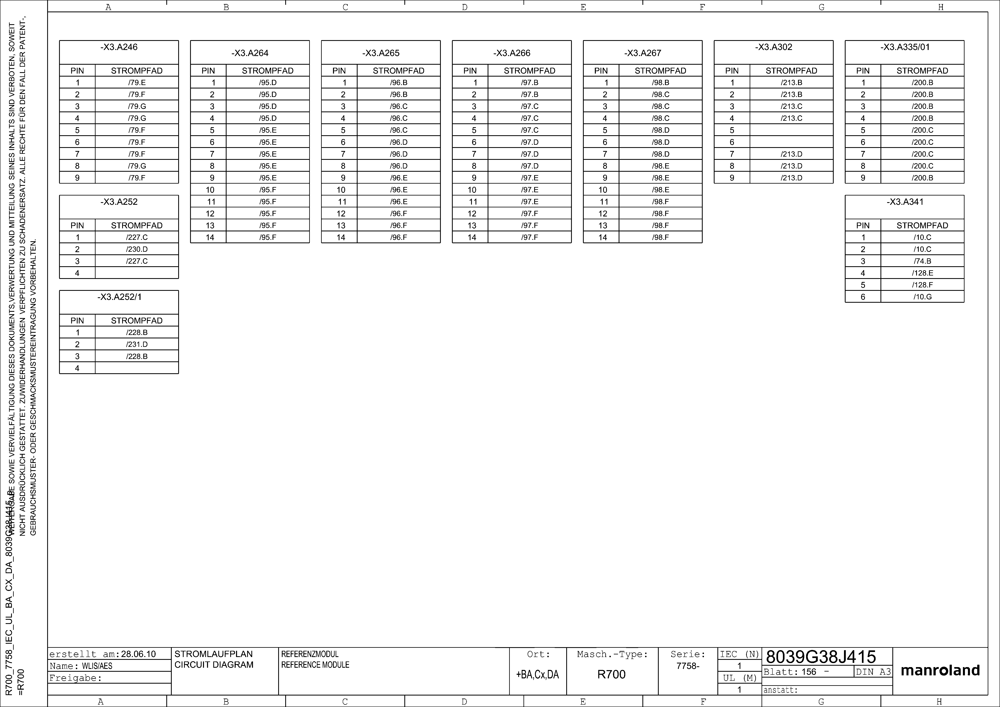

# +BA_Cx_DA — Sheet 156 of 247 — REFERENZMODUL

**REFERENCE MODULE**

> Part of the manroland **R700** printing press IEC/UL circuit diagrams.
> Drawing class: **Stromlaufplan / Circuit diagram** (DIN A3).
> Document `+BA_Cx_DA` covers the **Printing units / main switch cabinet** machine section.

## At a glance

| Field | Value |
|---|---|
| Document | `+BA_Cx_DA`  (8039G38J415) |
| Sheet | **156** of 247 |
| Section (DE) | REFERENZMODUL |
| Section (EN) | REFERENCE MODULE |
| Section type | REFERENCE_MODULE — Reference module |
| Machine type | `R700` |
| Series | `7758` |
| Created | 28.06.10 |
| Replaces | — |
| Columns used | A, B, C, D, E, F, G, H |
| Path numbers | — |
| Labels on sheet | 220 |
| Cross-refs out | 93 |
| Cross-refs in | 0 |

**Previous:** [+BA_Cx_DA sheet 155](SHEET_0155.md) · **Next:** [+BA_Cx_DA sheet 157](SHEET_0157.md) · **Document TOC:** [_TOC.md](_TOC.md)  (+BA_Cx_DA) · **Master TOC:** [all sheets](../_MASTER_TOC.md)

## Sheet image (300 DPI, exact vector render)



_Rendered directly from the PDF vector layer at 300 DPI (1-bit), no OCR and no resampling. Use it to confirm anything ambiguous in the text below._

## Cross-references on this sheet

Each entry is a wire leaving this sheet. The printed token is `/sheet.column`; the link resolves to that sheet inside the same document.

| Ref | Target sheet | Col | Path | Destination on target | Target section | From col |
|---|---|---|---|---|---|---|
| `/79.E` | [+BA_Cx_DA sheet 79](SHEET_0079.md) | E | — | — | FARBWERK | A |
| `/96.B` | [+BA_Cx_DA sheet 96](SHEET_0096.md) | B | — | — | BLAS/SAUGLUFT MIT MOTORVENTILEINSTELLUNG | C |
| `/97.B` | [+BA_Cx_DA sheet 97](SHEET_0097.md) | B | — | — | BLAS/SAUGLUFT MIT MOTORVENTILEINSTELLUNG | E |
| `/98.B` | [+BA_Cx_DA sheet 98](SHEET_0098.md) | B | — | — | BLAS/SAUGLUFT MIT MOTORVENTILEINSTELLUNG | F |
| `/213.B` | [+BA_Cx_DA sheet 213](SHEET_0213.md) | B | — | — | OPTION: VORDERMARKENEINSTELLUNG | G |
| `/200.B` | [+BA_Cx_DA sheet 200](SHEET_0200.md) | B | — | — | OPTION: APL | H |
| `/95.D` | [+BA_Cx_DA sheet 95](SHEET_0095.md) | D | — | — | BLAS/SAUGLUFT MIT MOTORVENTILEINSTELLUNG | B |
| `/96.B` | [+BA_Cx_DA sheet 96](SHEET_0096.md) | B | — | — | BLAS/SAUGLUFT MIT MOTORVENTILEINSTELLUNG | C |
| `/97.B` | [+BA_Cx_DA sheet 97](SHEET_0097.md) | B | — | — | BLAS/SAUGLUFT MIT MOTORVENTILEINSTELLUNG | E |
| `/79.F` | [+BA_Cx_DA sheet 79](SHEET_0079.md) | F | — | — | FARBWERK | A |
| `/213.B` | [+BA_Cx_DA sheet 213](SHEET_0213.md) | B | — | — | OPTION: VORDERMARKENEINSTELLUNG | G |
| `/200.B` | [+BA_Cx_DA sheet 200](SHEET_0200.md) | B | — | — | OPTION: APL | H |
| `/95.D` | [+BA_Cx_DA sheet 95](SHEET_0095.md) | D | — | — | BLAS/SAUGLUFT MIT MOTORVENTILEINSTELLUNG | B |
| `/98.C` | [+BA_Cx_DA sheet 98](SHEET_0098.md) | C | — | — | BLAS/SAUGLUFT MIT MOTORVENTILEINSTELLUNG | F |
| `/200.B` | [+BA_Cx_DA sheet 200](SHEET_0200.md) | B | — | — | OPTION: APL | H |
| `/79.G` | [+BA_Cx_DA sheet 79](SHEET_0079.md) | G | — | — | FARBWERK | A |
| `/95.D` | [+BA_Cx_DA sheet 95](SHEET_0095.md) | D | — | — | BLAS/SAUGLUFT MIT MOTORVENTILEINSTELLUNG | B |
| `/96.C` | [+BA_Cx_DA sheet 96](SHEET_0096.md) | C | — | — | BLAS/SAUGLUFT MIT MOTORVENTILEINSTELLUNG | C |
| `/97.C` | [+BA_Cx_DA sheet 97](SHEET_0097.md) | C | — | — | BLAS/SAUGLUFT MIT MOTORVENTILEINSTELLUNG | E |
| `/98.C` | [+BA_Cx_DA sheet 98](SHEET_0098.md) | C | — | — | BLAS/SAUGLUFT MIT MOTORVENTILEINSTELLUNG | F |
| `/213.C` | [+BA_Cx_DA sheet 213](SHEET_0213.md) | C | — | — | OPTION: VORDERMARKENEINSTELLUNG | G |
| `/79.G` | [+BA_Cx_DA sheet 79](SHEET_0079.md) | G | — | — | FARBWERK | A |
| `/200.B` | [+BA_Cx_DA sheet 200](SHEET_0200.md) | B | — | — | OPTION: APL | H |
| `/95.D` | [+BA_Cx_DA sheet 95](SHEET_0095.md) | D | — | — | BLAS/SAUGLUFT MIT MOTORVENTILEINSTELLUNG | B |
| `/96.C` | [+BA_Cx_DA sheet 96](SHEET_0096.md) | C | — | — | BLAS/SAUGLUFT MIT MOTORVENTILEINSTELLUNG | C |
| `/97.C` | [+BA_Cx_DA sheet 97](SHEET_0097.md) | C | — | — | BLAS/SAUGLUFT MIT MOTORVENTILEINSTELLUNG | E |
| `/98.C` | [+BA_Cx_DA sheet 98](SHEET_0098.md) | C | — | — | BLAS/SAUGLUFT MIT MOTORVENTILEINSTELLUNG | F |
| `/213.C` | [+BA_Cx_DA sheet 213](SHEET_0213.md) | C | — | — | OPTION: VORDERMARKENEINSTELLUNG | G |
| `/95.E` | [+BA_Cx_DA sheet 95](SHEET_0095.md) | E | — | — | BLAS/SAUGLUFT MIT MOTORVENTILEINSTELLUNG | B |
| `/79.F` | [+BA_Cx_DA sheet 79](SHEET_0079.md) | F | — | — | FARBWERK | A |
| `/96.C` | [+BA_Cx_DA sheet 96](SHEET_0096.md) | C | — | — | BLAS/SAUGLUFT MIT MOTORVENTILEINSTELLUNG | C |
| `/97.C` | [+BA_Cx_DA sheet 97](SHEET_0097.md) | C | — | — | BLAS/SAUGLUFT MIT MOTORVENTILEINSTELLUNG | E |
| `/98.D` | [+BA_Cx_DA sheet 98](SHEET_0098.md) | D | — | — | BLAS/SAUGLUFT MIT MOTORVENTILEINSTELLUNG | F |
| `/200.C` | [+BA_Cx_DA sheet 200](SHEET_0200.md) | C | — | — | OPTION: APL | H |
| `/95.E` | [+BA_Cx_DA sheet 95](SHEET_0095.md) | E | — | — | BLAS/SAUGLUFT MIT MOTORVENTILEINSTELLUNG | B |
| `/79.F` | [+BA_Cx_DA sheet 79](SHEET_0079.md) | F | — | — | FARBWERK | A |
| `/96.D` | [+BA_Cx_DA sheet 96](SHEET_0096.md) | D | — | — | BLAS/SAUGLUFT MIT MOTORVENTILEINSTELLUNG | C |
| `/97.D` | [+BA_Cx_DA sheet 97](SHEET_0097.md) | D | — | — | BLAS/SAUGLUFT MIT MOTORVENTILEINSTELLUNG | E |
| `/98.D` | [+BA_Cx_DA sheet 98](SHEET_0098.md) | D | — | — | BLAS/SAUGLUFT MIT MOTORVENTILEINSTELLUNG | F |
| `/200.C` | [+BA_Cx_DA sheet 200](SHEET_0200.md) | C | — | — | OPTION: APL | H |
| `/95.E` | [+BA_Cx_DA sheet 95](SHEET_0095.md) | E | — | — | BLAS/SAUGLUFT MIT MOTORVENTILEINSTELLUNG | B |
| `/79.F` | [+BA_Cx_DA sheet 79](SHEET_0079.md) | F | — | — | FARBWERK | A |
| `/96.D` | [+BA_Cx_DA sheet 96](SHEET_0096.md) | D | — | — | BLAS/SAUGLUFT MIT MOTORVENTILEINSTELLUNG | C |
| `/97.D` | [+BA_Cx_DA sheet 97](SHEET_0097.md) | D | — | — | BLAS/SAUGLUFT MIT MOTORVENTILEINSTELLUNG | E |
| `/98.D` | [+BA_Cx_DA sheet 98](SHEET_0098.md) | D | — | — | BLAS/SAUGLUFT MIT MOTORVENTILEINSTELLUNG | F |
| `/213.D` | [+BA_Cx_DA sheet 213](SHEET_0213.md) | D | — | — | OPTION: VORDERMARKENEINSTELLUNG | G |
| `/200.C` | [+BA_Cx_DA sheet 200](SHEET_0200.md) | C | — | — | OPTION: APL | H |
| `/95.E` | [+BA_Cx_DA sheet 95](SHEET_0095.md) | E | — | — | BLAS/SAUGLUFT MIT MOTORVENTILEINSTELLUNG | B |
| `/98.E` | [+BA_Cx_DA sheet 98](SHEET_0098.md) | E | — | — | BLAS/SAUGLUFT MIT MOTORVENTILEINSTELLUNG | F |
| `/79.G` | [+BA_Cx_DA sheet 79](SHEET_0079.md) | G | — | — | FARBWERK | A |
| `/96.D` | [+BA_Cx_DA sheet 96](SHEET_0096.md) | D | — | — | BLAS/SAUGLUFT MIT MOTORVENTILEINSTELLUNG | C |
| `/97.D` | [+BA_Cx_DA sheet 97](SHEET_0097.md) | D | — | — | BLAS/SAUGLUFT MIT MOTORVENTILEINSTELLUNG | E |
| `/213.D` | [+BA_Cx_DA sheet 213](SHEET_0213.md) | D | — | — | OPTION: VORDERMARKENEINSTELLUNG | G |
| `/200.C` | [+BA_Cx_DA sheet 200](SHEET_0200.md) | C | — | — | OPTION: APL | H |
| `/95.E` | [+BA_Cx_DA sheet 95](SHEET_0095.md) | E | — | — | BLAS/SAUGLUFT MIT MOTORVENTILEINSTELLUNG | B |
| `/96.E` | [+BA_Cx_DA sheet 96](SHEET_0096.md) | E | — | — | BLAS/SAUGLUFT MIT MOTORVENTILEINSTELLUNG | C |
| `/97.E` | [+BA_Cx_DA sheet 97](SHEET_0097.md) | E | — | — | BLAS/SAUGLUFT MIT MOTORVENTILEINSTELLUNG | E |
| `/98.E` | [+BA_Cx_DA sheet 98](SHEET_0098.md) | E | — | — | BLAS/SAUGLUFT MIT MOTORVENTILEINSTELLUNG | F |
| `/79.F` | [+BA_Cx_DA sheet 79](SHEET_0079.md) | F | — | — | FARBWERK | A |
| `/200.B` | [+BA_Cx_DA sheet 200](SHEET_0200.md) | B | — | — | OPTION: APL | H |
| `/213.D` | [+BA_Cx_DA sheet 213](SHEET_0213.md) | D | — | — | OPTION: VORDERMARKENEINSTELLUNG | G |
| `/96.E` | [+BA_Cx_DA sheet 96](SHEET_0096.md) | E | — | — | BLAS/SAUGLUFT MIT MOTORVENTILEINSTELLUNG | C |
| `/97.E` | [+BA_Cx_DA sheet 97](SHEET_0097.md) | E | — | — | BLAS/SAUGLUFT MIT MOTORVENTILEINSTELLUNG | E |
| `/98.E` | [+BA_Cx_DA sheet 98](SHEET_0098.md) | E | — | — | BLAS/SAUGLUFT MIT MOTORVENTILEINSTELLUNG | F |
| `/95.F` | [+BA_Cx_DA sheet 95](SHEET_0095.md) | F | — | — | BLAS/SAUGLUFT MIT MOTORVENTILEINSTELLUNG | B |
| `/96.E` | [+BA_Cx_DA sheet 96](SHEET_0096.md) | E | — | — | BLAS/SAUGLUFT MIT MOTORVENTILEINSTELLUNG | C |
| `/97.E` | [+BA_Cx_DA sheet 97](SHEET_0097.md) | E | — | — | BLAS/SAUGLUFT MIT MOTORVENTILEINSTELLUNG | E |
| `/95.F` | [+BA_Cx_DA sheet 95](SHEET_0095.md) | F | — | — | BLAS/SAUGLUFT MIT MOTORVENTILEINSTELLUNG | B |
| `/98.F` | [+BA_Cx_DA sheet 98](SHEET_0098.md) | F | — | — | BLAS/SAUGLUFT MIT MOTORVENTILEINSTELLUNG | F |
| `/95.F` | [+BA_Cx_DA sheet 95](SHEET_0095.md) | F | — | — | BLAS/SAUGLUFT MIT MOTORVENTILEINSTELLUNG | B |
| `/96.F` | [+BA_Cx_DA sheet 96](SHEET_0096.md) | F | — | — | BLAS/SAUGLUFT MIT MOTORVENTILEINSTELLUNG | C |
| `/97.F` | [+BA_Cx_DA sheet 97](SHEET_0097.md) | F | — | — | BLAS/SAUGLUFT MIT MOTORVENTILEINSTELLUNG | E |
| `/98.F` | [+BA_Cx_DA sheet 98](SHEET_0098.md) | F | — | — | BLAS/SAUGLUFT MIT MOTORVENTILEINSTELLUNG | F |
| `/95.F` | [+BA_Cx_DA sheet 95](SHEET_0095.md) | F | — | — | BLAS/SAUGLUFT MIT MOTORVENTILEINSTELLUNG | B |
| `/96.F` | [+BA_Cx_DA sheet 96](SHEET_0096.md) | F | — | — | BLAS/SAUGLUFT MIT MOTORVENTILEINSTELLUNG | C |
| `/97.F` | [+BA_Cx_DA sheet 97](SHEET_0097.md) | F | — | — | BLAS/SAUGLUFT MIT MOTORVENTILEINSTELLUNG | E |
| `/98.F` | [+BA_Cx_DA sheet 98](SHEET_0098.md) | F | — | — | BLAS/SAUGLUFT MIT MOTORVENTILEINSTELLUNG | F |
| `/95.F` | [+BA_Cx_DA sheet 95](SHEET_0095.md) | F | — | — | BLAS/SAUGLUFT MIT MOTORVENTILEINSTELLUNG | B |
| `/96.F` | [+BA_Cx_DA sheet 96](SHEET_0096.md) | F | — | — | BLAS/SAUGLUFT MIT MOTORVENTILEINSTELLUNG | C |
| `/97.F` | [+BA_Cx_DA sheet 97](SHEET_0097.md) | F | — | — | BLAS/SAUGLUFT MIT MOTORVENTILEINSTELLUNG | E |
| `/98.F` | [+BA_Cx_DA sheet 98](SHEET_0098.md) | F | — | — | BLAS/SAUGLUFT MIT MOTORVENTILEINSTELLUNG | F |
| `/227.C` | [+BA_Cx_DA sheet 227](SHEET_0227.md) | C | — | — | OPTION: WASCHMITTELWECHSELBETRIEB | A |
| `/10.C` | [+BA_Cx_DA sheet 10](SHEET_0010.md) | C | — | — | SPANNUNGSVERSORGUNG, SCHALTSCHRANKBELÜFTUNG | H |
| `/10.C` | [+BA_Cx_DA sheet 10](SHEET_0010.md) | C | — | — | SPANNUNGSVERSORGUNG, SCHALTSCHRANKBELÜFTUNG | H |
| `/230.D` | [+BA_Cx_DA sheet 230](SHEET_0230.md) | D | — | — | OPTION: WASCHMITTELWECHSELBETRIEB | A |
| `/74.B` | [+BA_Cx_DA sheet 74](SHEET_0074.md) | B | — | — | FEUCHTWERK | H |
| `/227.C` | [+BA_Cx_DA sheet 227](SHEET_0227.md) | C | — | — | OPTION: WASCHMITTELWECHSELBETRIEB | A |
| `/128.E` | [+BA_Cx_DA sheet 128](SHEET_0128.md) | E | — | — | RESERVE: SPS STATION (D/A) | H |
| `/128.F` | [+BA_Cx_DA sheet 128](SHEET_0128.md) | F | — | — | RESERVE: SPS STATION (D/A) | H |
| `/10.G` | [+BA_Cx_DA sheet 10](SHEET_0010.md) | G | — | — | SPANNUNGSVERSORGUNG, SCHALTSCHRANKBELÜFTUNG | H |
| `/228.B` | [+BA_Cx_DA sheet 228](SHEET_0228.md) | B | — | — | OPTION: WASCHMITTELWECHSELBETRIEB | A |
| `/231.D` | [+BA_Cx_DA sheet 231](SHEET_0231.md) | D | — | — | OPTION: WASCHMITTELWECHSELBETRIEB | A |
| `/228.B` | [+BA_Cx_DA sheet 228](SHEET_0228.md) | B | — | — | OPTION: WASCHMITTELWECHSELBETRIEB | A |

## Devices on this sheet

| Tag | Class | Class meaning (IEC) | Col | Sub | Terminal | Sign |
|---|---|---|---|---|---|---|
| `X3.A246` | — | cross-device reference | A | — | — | — |
| `X3.A252` | — | cross-device reference | A | — | — | — |
| `X3.A264` | — | cross-device reference | B | — | — | — |
| `X3.A265` | — | cross-device reference | C | — | — | — |
| `X3.A266` | — | cross-device reference | D | — | — | — |
| `X3.A267` | — | cross-device reference | F | — | — | — |
| `X3.A302` | — | cross-device reference | G | — | — | — |
| `X3.A341` | — | cross-device reference | H | — | — | — |

## Potentials / nets

_No named potentials on this sheet._

## Wire-end annotations (grouped as printed)

A wire that continues elsewhere is annotated with a small cluster: the destination description, the path/line number `#NN`, and the `/sheet.column` cross reference. Each row below is one such cluster exactly as it is grouped on the drawing.

| Col | Y | Path | Cross-ref | Text on the wire |
|---|---|---|---|---|
| A | 51.3 | — | — | `X3.A246` |
| G | 51.3 | — | — | `X3.A302` |
| H | 51.3 | — | — | `X3.A335/01` |
| B | 58.4 | — | — | `X3.A264` |
| C | 58.4 | — | — | `X3.A265` |
| D | 58.4 | — | — | `X3.A266` |
| F | 58.4 | — | — | `X3.A267` |
| A | 80.0 | — | — | `PIN 2 3 4 5 6 7 8 9 1 STROMPFAD` |
| B | 80.0 | — | — | `PIN STROMPFAD` |
| C | 80.0 | — | — | `PIN STROMPFAD` |
| D | 80.0 | — | — | `PIN STROMPFAD` |
| E | 80.0 | — | — | `PIN STROMPFAD` |
| G | 80.0 | — | — | `PIN 2 3 4 5 6 7 8 9 1 STROMPFAD` |
| H | 80.0 | — | — | `PIN 2 3 4 5 6 7 8 9 1 STROMPFAD` |
| B | 94.2 | — | — | `2 3 4 5 6 7 8 9 1` |
| C | 94.2 | — | — | `2 3 4 5 6 7 8 9 1` |
| D | 94.2 | — | — | `2 3 4 5 6 7 8 9 1` |
| E | 94.2 | — | — | `2 3 4 5 6 7 8 9 1` |
| A | 94.5 | — | `/79.E` | — |
| B | 94.5 | — | `/95.D` | — |
| C | 94.5 | — | `/96.B` | — |
| E | 94.5 | — | `/97.B` | — |
| F | 94.5 | — | `/98.B` | — |
| G | 94.5 | — | `/213.B` | — |
| H | 94.5 | — | `/200.B` | — |
| A | 108.7 | — | `/79.F` | — |
| B | 108.7 | — | `/95.D` | — |
| C | 108.7 | — | `/96.B` | — |
| E | 108.7 | — | `/97.B` | — |
| F | 108.7 | — | `/98.C` | — |
| G | 108.7 | — | `/213.B` | — |
| H | 108.7 | — | `/200.B` | — |
| A | 122.9 | — | `/79.G` | — |
| B | 122.9 | — | `/95.D` | — |
| C | 122.9 | — | `/96.C` | — |
| E | 122.9 | — | `/97.C` | — |
| F | 122.9 | — | `/98.C` | — |
| G | 122.9 | — | `/213.C` | — |
| H | 122.9 | — | `/200.B` | — |
| A | 137.0 | — | `/79.G` | — |
| H | 137.0 | — | `/200.B` | — |
| B | 137.1 | — | `/95.D` | — |
| C | 137.1 | — | `/96.C` | — |
| E | 137.1 | — | `/97.C` | — |
| F | 137.1 | — | `/98.C` | — |
| G | 137.1 | — | `/213.C` | — |
| A | 151.2 | — | `/79.F` | — |
| B | 151.2 | — | `/95.E` | — |
| C | 151.2 | — | `/96.C` | — |
| E | 151.2 | — | `/97.C` | — |
| F | 151.2 | — | `/98.D` | — |
| H | 151.2 | — | `/200.C` | — |
| A | 165.4 | — | `/79.F` | — |
| B | 165.4 | — | `/95.E` | — |
| C | 165.4 | — | `/96.D` | — |
| E | 165.4 | — | `/97.D` | — |
| F | 165.4 | — | `/98.D` | — |
| H | 165.4 | — | `/200.C` | — |
| B | 179.5 | — | `/95.E` | — |
| A | 179.6 | — | `/79.F` | — |
| C | 179.6 | — | `/96.D` | — |
| E | 179.6 | — | `/97.D` | — |
| F | 179.6 | — | `/98.D` | — |
| G | 179.6 | — | `/213.D` | — |
| H | 179.6 | — | `/200.C` | — |
| A | 193.7 | — | `/79.G` | — |
| B | 193.7 | — | `/95.E` | — |
| F | 193.7 | — | `/98.E` | — |
| C | 193.8 | — | `/96.D` | — |
| E | 193.8 | — | `/97.D` | — |
| G | 193.8 | — | `/213.D` | — |
| H | 193.8 | — | `/200.C` | — |
| A | 207.9 | — | `/79.F` | — |
| B | 207.9 | — | `/95.E` | — |
| C | 207.9 | — | `/96.E` | — |
| E | 207.9 | — | `/97.E` | — |
| F | 207.9 | — | `/98.E` | — |
| G | 207.9 | — | `/213.D` | — |
| H | 207.9 | — | `/200.B` | — |
| B | 221.8 | — | — | `10 12 13 14 11` |
| C | 221.8 | — | — | `10 12 13 14 11` |
| D | 221.8 | — | — | `10 12 13 14 11` |
| E | 221.8 | — | — | `10 12 13 14 11` |
| B | 222.1 | — | `/95.F` | — |
| C | 222.1 | — | `/96.E` | — |
| E | 222.1 | — | `/97.E` | — |
| F | 222.1 | — | `/98.E` | — |
| A | 235.6 | — | — | `X3.A252` |
| H | 235.6 | — | — | `X3.A341` |
| B | 236.2 | — | `/95.F` | — |
| C | 236.2 | — | `/96.E` | — |
| E | 236.2 | — | `/97.E` | — |
| F | 236.2 | — | `/98.F` | — |
| B | 250.4 | — | `/95.F` | — |
| C | 250.4 | — | `/96.F` | — |
| E | 250.4 | — | `/97.F` | — |
| F | 250.4 | — | `/98.F` | — |
| A | 264.2 | — | — | `PIN 2 3 4 1 STROMPFAD` |
| H | 264.2 | — | — | `PIN 2 3 4 5 6 1 STROMPFAD` |
| B | 264.6 | — | `/95.F` | — |
| C | 264.6 | — | `/96.F` | — |
| E | 264.6 | — | `/97.F` | — |
| F | 264.6 | — | `/98.F` | — |
| A | 278.8 | — | `/227.C` | — |
| B | 278.8 | — | `/95.F` | — |
| C | 278.8 | — | `/96.F` | — |
| E | 278.8 | — | `/97.F` | — |
| F | 278.8 | — | `/98.F` | — |
| H | 278.8 | — | `/10.C` | — |
| A | 293.0 | — | `/230.D` | — |
| H | 293.0 | — | `/10.C` | — |
| A | 307.1 | — | `/227.C` | — |
| H | 307.1 | — | `/74.B` | — |
| H | 321.3 | — | `/128.E` | — |
| H | 335.5 | — | `/128.F` | — |
| A | 349.0 | — | — | `X3.A252/1` |
| H | 349.6 | — | `/10.G` | — |
| A | 377.6 | — | — | `PIN 2 3 4 1 STROMPFAD` |
| A | 392.1 | — | `/228.B` | — |
| A | 406.4 | — | `/231.D` | — |
| A | 420.5 | — | `/228.B` | — |


## Reconstructed tables

This sheet carries tabular content (pin map / terminal assignment / index). The grid below was rebuilt from the drawing's own rule lines, so each row is exactly one physical row of the table.

### Table 1 — 21 data rows × 2 columns (at x=70.9, y=48.2) — **X3.A246**

| PIN | STROMPFAD |
|---|---|
| `1` | `/79.E` |
| `2` | `/79.F` |
| `3` | `/79.G` |
| `4` | `/79.G` |
| `5` | `/79.F` |
| `6` | `/79.F` |
| `7` | `/79.F` |
| `8` | `/79.G` |
| `9` | `/79.F` |
|  | `X3.A252` |
| `PIN` | `STROMPFAD` |
| `1` | `/227.C` |
| `2` | `/230.D` |
| `3` | `/227.C` |
| `4` |  |
|  | `X3.A252/1` |
| `PIN` | `STROMPFAD` |
| `1` | `/228.B` |
| `2` | `/231.D` |
| `3` | `/228.B` |
| `4` |  |


### Table 2 — 14 data rows × 2 columns (at x=226.8, y=48.2) — **X3.A264**

| PIN | STROMPFAD |
|---|---|
| `1` | `/95.D` |
| `2` | `/95.D` |
| `3` | `/95.D` |
| `4` | `/95.D` |
| `5` | `/95.E` |
| `6` | `/95.E` |
| `7` | `/95.E` |
| `8` | `/95.E` |
| `9` | `/95.E` |
| `10` | `/95.F` |
| `11` | `/95.F` |
| `12` | `/95.F` |
| `13` | `/95.F` |
| `14` | `/95.F` |


### Table 3 — 14 data rows × 2 columns (at x=382.7, y=48.2) — **X3.A265**

| PIN | STROMPFAD |
|---|---|
| `1` | `/96.B` |
| `2` | `/96.B` |
| `3` | `/96.C` |
| `4` | `/96.C` |
| `5` | `/96.C` |
| `6` | `/96.D` |
| `7` | `/96.D` |
| `8` | `/96.D` |
| `9` | `/96.E` |
| `10` | `/96.E` |
| `11` | `/96.E` |
| `12` | `/96.F` |
| `13` | `/96.F` |
| `14` | `/96.F` |


### Table 4 — 14 data rows × 2 columns (at x=538.6, y=48.2) — **X3.A266**

| PIN | STROMPFAD |
|---|---|
| `1` | `/97.B` |
| `2` | `/97.B` |
| `3` | `/97.C` |
| `4` | `/97.C` |
| `5` | `/97.C` |
| `6` | `/97.D` |
| `7` | `/97.D` |
| `8` | `/97.D` |
| `9` | `/97.E` |
| `10` | `/97.E` |
| `11` | `/97.E` |
| `12` | `/97.F` |
| `13` | `/97.F` |
| `14` | `/97.F` |


### Table 5 — 14 data rows × 2 columns (at x=694.5, y=48.2) — **X3.A267**

| PIN | STROMPFAD |
|---|---|
| `1` | `/98.B` |
| `2` | `/98.C` |
| `3` | `/98.C` |
| `4` | `/98.C` |
| `5` | `/98.D` |
| `6` | `/98.D` |
| `7` | `/98.D` |
| `8` | `/98.E` |
| `9` | `/98.E` |
| `10` | `/98.E` |
| `11` | `/98.F` |
| `12` | `/98.F` |
| `13` | `/98.F` |
| `14` | `/98.F` |


### Table 6 — 9 data rows × 2 columns (at x=850.4, y=48.2) — **X3.A302**

| PIN | STROMPFAD |
|---|---|
| `1` | `/213.B` |
| `2` | `/213.B` |
| `3` | `/213.C` |
| `4` | `/213.C` |
| `5` |  |
| `6` |  |
| `7` | `/213.D` |
| `8` | `/213.D` |
| `9` | `/213.D` |


### Table 7 — 17 data rows × 2 columns (at x=1006.3, y=48.2) — **X3.A335/01**

| PIN | STROMPFAD |
|---|---|
| `1` | `/200.B` |
| `2` | `/200.B` |
| `3` | `/200.B` |
| `4` | `/200.B` |
| `5` | `/200.C` |
| `6` | `/200.C` |
| `7` | `/200.C` |
| `8` | `/200.C` |
| `9` | `/200.B` |
|  | `X3.A341` |
| `PIN` | `STROMPFAD` |
| `1` | `/10.C` |
| `2` | `/10.C` |
| `3` | `/74.B` |
| `4` | `/128.E` |
| `5` | `/128.F` |
| `6` | `/10.G` |


## Notes and free text on this sheet

| Text | Col | Y (pt) |
|---|---|---|
| `PIN` | A | 80.02 |
| `STROMPFAD` | A | 79.98 |
| `X3.A252/1` | A | 348.98 |
| `PIN` | B | 80.02 |
| `STROMPFAD` | B | 79.98 |
| `PIN` | C | 80.02 |
| `STROMPFAD` | C | 79.98 |
| `PIN` | D | 80.02 |
| `STROMPFAD` | E | 79.98 |
| `PIN` | E | 80.02 |
| `STROMPFAD` | F | 79.98 |
| `PIN` | F | 80.02 |
| `STROMPFAD` | G | 79.98 |
| `PIN` | G | 80.02 |
| `STROMPFAD` | H | 79.98 |
| `X3.A335/01` | H | 51.33 |

## Complete label inventory (exact text from the drawing)

Every text object inside the drawing area of this sheet, in DIN reading order (column A→H, then top→bottom). This is the authoritative list: if a string is not here it is not printed on this sheet.

| Col | Y | X | Dir | Type | Text |
|---|---|---|---|---|---|
| A | 51.3 | 119.8 | → | device ref | `X3.A246` |
| A | 80.0 | 84.0 | → | text | `PIN` |
| A | 80.0 | 132.2 | → | text | `STROMPFAD` |
| A | 94.2 | 90.0 | → | number | `1` |
| A | 94.5 | 152.9 | → | cross-reference | `/79.E` |
| A | 108.4 | 89.4 | → | number | `2` |
| A | 108.7 | 153.1 | → | cross-reference | `/79.F` |
| A | 122.5 | 89.4 | → | number | `3` |
| A | 122.9 | 152.5 | → | cross-reference | `/79.G` |
| A | 136.7 | 89.4 | → | number | `4` |
| A | 137.0 | 152.5 | → | cross-reference | `/79.G` |
| A | 150.9 | 89.4 | → | number | `5` |
| A | 151.2 | 153.1 | → | cross-reference | `/79.F` |
| A | 165.1 | 89.4 | → | number | `6` |
| A | 165.4 | 153.1 | → | cross-reference | `/79.F` |
| A | 179.2 | 89.4 | → | number | `7` |
| A | 179.6 | 153.1 | → | cross-reference | `/79.F` |
| A | 193.4 | 89.4 | → | number | `8` |
| A | 193.7 | 152.5 | → | cross-reference | `/79.G` |
| A | 207.6 | 89.4 | → | number | `9` |
| A | 207.9 | 153.1 | → | cross-reference | `/79.F` |
| A | 235.6 | 119.8 | → | device ref | `X3.A252` |
| A | 264.2 | 132.2 | → | text | `STROMPFAD` |
| A | 264.3 | 84.0 | → | text | `PIN` |
| A | 278.5 | 90.0 | → | number | `1` |
| A | 278.8 | 150.2 | → | cross-reference | `/227.C` |
| A | 292.6 | 89.4 | → | number | `2` |
| A | 293.0 | 150.2 | → | cross-reference | `/230.D` |
| A | 306.8 | 89.4 | → | number | `3` |
| A | 307.1 | 150.2 | → | cross-reference | `/227.C` |
| A | 321.0 | 89.4 | → | number | `4` |
| A | 349.0 | 116.1 | → | text | `X3.A252/1` |
| A | 377.6 | 132.2 | → | text | `STROMPFAD` |
| A | 377.7 | 84.0 | → | text | `PIN` |
| A | 391.8 | 90.0 | → | number | `1` |
| A | 392.2 | 150.4 | → | cross-reference | `/228.B` |
| A | 406.0 | 89.4 | → | number | `2` |
| A | 406.4 | 150.2 | → | cross-reference | `/231.D` |
| A | 420.2 | 89.4 | → | number | `3` |
| A | 420.5 | 150.4 | → | cross-reference | `/228.B` |
| A | 434.4 | 89.4 | → | number | `4` |
| B | 58.4 | 275.7 | → | device ref | `X3.A264` |
| B | 80.0 | 240.0 | → | text | `PIN` |
| B | 80.0 | 288.1 | → | text | `STROMPFAD` |
| B | 94.2 | 251.7 | → | number | `1` |
| B | 94.5 | 308.6 | → | cross-reference | `/95.D` |
| B | 108.4 | 250.0 | → | number | `2` |
| B | 108.7 | 308.6 | → | cross-reference | `/95.D` |
| B | 122.5 | 250.0 | → | number | `3` |
| B | 122.9 | 308.6 | → | cross-reference | `/95.D` |
| B | 136.7 | 250.0 | → | number | `4` |
| B | 137.1 | 308.6 | → | cross-reference | `/95.D` |
| B | 150.9 | 250.0 | → | number | `5` |
| B | 151.2 | 308.8 | → | cross-reference | `/95.E` |
| B | 165.1 | 250.0 | → | number | `6` |
| B | 165.4 | 308.8 | → | cross-reference | `/95.E` |
| B | 179.2 | 250.0 | → | number | `7` |
| B | 179.5 | 308.8 | → | cross-reference | `/95.E` |
| B | 193.4 | 250.0 | → | number | `8` |
| B | 193.7 | 308.8 | → | cross-reference | `/95.E` |
| B | 207.6 | 250.0 | → | number | `9` |
| B | 207.9 | 308.8 | → | cross-reference | `/95.E` |
| B | 221.8 | 244.6 | → | number | `10` |
| B | 222.1 | 309.0 | → | cross-reference | `/95.F` |
| B | 235.9 | 246.3 | → | number | `11` |
| B | 236.2 | 309.0 | → | cross-reference | `/95.F` |
| B | 250.1 | 244.6 | → | number | `12` |
| B | 250.4 | 309.0 | → | cross-reference | `/95.F` |
| B | 264.3 | 244.6 | → | number | `13` |
| B | 264.6 | 309.0 | → | cross-reference | `/95.F` |
| B | 278.5 | 244.6 | → | number | `14` |
| B | 278.8 | 309.0 | → | cross-reference | `/95.F` |
| C | 58.4 | 431.6 | → | device ref | `X3.A265` |
| C | 80.0 | 395.9 | → | text | `PIN` |
| C | 80.0 | 444.0 | → | text | `STROMPFAD` |
| C | 94.2 | 407.6 | → | number | `1` |
| C | 94.5 | 464.6 | → | cross-reference | `/96.B` |
| C | 108.4 | 405.9 | → | number | `2` |
| C | 108.7 | 464.6 | → | cross-reference | `/96.B` |
| C | 122.5 | 405.9 | → | number | `3` |
| C | 122.9 | 464.5 | → | cross-reference | `/96.C` |
| C | 136.7 | 405.9 | → | number | `4` |
| C | 137.1 | 464.5 | → | cross-reference | `/96.C` |
| C | 150.9 | 405.9 | → | number | `5` |
| C | 151.2 | 464.5 | → | cross-reference | `/96.C` |
| C | 165.1 | 405.9 | → | number | `6` |
| C | 165.4 | 464.5 | → | cross-reference | `/96.D` |
| C | 179.2 | 405.9 | → | number | `7` |
| C | 179.6 | 464.5 | → | cross-reference | `/96.D` |
| C | 193.4 | 405.9 | → | number | `8` |
| C | 193.7 | 464.5 | → | cross-reference | `/96.D` |
| C | 207.6 | 405.9 | → | number | `9` |
| C | 207.9 | 464.7 | → | cross-reference | `/96.E` |
| C | 221.8 | 400.5 | → | number | `10` |
| C | 222.1 | 464.7 | → | cross-reference | `/96.E` |
| C | 235.9 | 402.2 | → | number | `11` |
| C | 236.2 | 464.7 | → | cross-reference | `/96.E` |
| C | 250.1 | 400.5 | → | number | `12` |
| C | 250.4 | 464.9 | → | cross-reference | `/96.F` |
| C | 264.3 | 400.5 | → | number | `13` |
| C | 264.6 | 464.9 | → | cross-reference | `/96.F` |
| C | 278.5 | 400.5 | → | number | `14` |
| C | 278.8 | 464.9 | → | cross-reference | `/96.F` |
| D | 58.4 | 587.5 | → | device ref | `X3.A266` |
| D | 80.0 | 551.8 | → | text | `PIN` |
| D | 94.2 | 563.5 | → | number | `1` |
| D | 108.4 | 561.8 | → | number | `2` |
| D | 122.5 | 561.8 | → | number | `3` |
| D | 136.7 | 561.8 | → | number | `4` |
| D | 150.9 | 561.8 | → | number | `5` |
| D | 165.1 | 561.8 | → | number | `6` |
| D | 179.2 | 561.8 | → | number | `7` |
| D | 193.4 | 561.8 | → | number | `8` |
| D | 207.6 | 561.8 | → | number | `9` |
| D | 221.8 | 556.4 | → | number | `10` |
| D | 235.9 | 558.1 | → | number | `11` |
| D | 250.1 | 556.4 | → | number | `12` |
| D | 264.3 | 556.4 | → | number | `13` |
| D | 278.5 | 556.4 | → | number | `14` |
| E | 80.0 | 600.0 | → | text | `STROMPFAD` |
| E | 80.0 | 707.7 | → | text | `PIN` |
| E | 94.2 | 719.4 | → | number | `1` |
| E | 94.5 | 620.5 | → | cross-reference | `/97.B` |
| E | 108.4 | 717.7 | → | number | `2` |
| E | 108.7 | 620.5 | → | cross-reference | `/97.B` |
| E | 122.5 | 717.7 | → | number | `3` |
| E | 122.9 | 620.4 | → | cross-reference | `/97.C` |
| E | 136.7 | 717.7 | → | number | `4` |
| E | 137.1 | 620.4 | → | cross-reference | `/97.C` |
| E | 150.9 | 717.7 | → | number | `5` |
| E | 151.2 | 620.4 | → | cross-reference | `/97.C` |
| E | 165.1 | 717.7 | → | number | `6` |
| E | 165.4 | 620.4 | → | cross-reference | `/97.D` |
| E | 179.2 | 717.7 | → | number | `7` |
| E | 179.6 | 620.4 | → | cross-reference | `/97.D` |
| E | 193.4 | 717.7 | → | number | `8` |
| E | 193.7 | 620.4 | → | cross-reference | `/97.D` |
| E | 207.6 | 717.7 | → | number | `9` |
| E | 207.9 | 620.6 | → | cross-reference | `/97.E` |
| E | 221.8 | 712.3 | → | number | `10` |
| E | 222.1 | 620.6 | → | cross-reference | `/97.E` |
| E | 235.9 | 714.0 | → | number | `11` |
| E | 236.2 | 620.6 | → | cross-reference | `/97.E` |
| E | 250.1 | 712.3 | → | number | `12` |
| E | 250.4 | 620.8 | → | cross-reference | `/97.F` |
| E | 264.3 | 712.3 | → | number | `13` |
| E | 264.6 | 620.8 | → | cross-reference | `/97.F` |
| E | 278.5 | 712.3 | → | number | `14` |
| E | 278.8 | 620.8 | → | cross-reference | `/97.F` |
| F | 58.4 | 743.4 | → | device ref | `X3.A267` |
| F | 80.0 | 755.9 | → | text | `STROMPFAD` |
| F | 80.0 | 863.6 | → | text | `PIN` |
| F | 94.2 | 869.5 | → | number | `1` |
| F | 94.5 | 776.4 | → | cross-reference | `/98.B` |
| F | 108.4 | 869.0 | → | number | `2` |
| F | 108.7 | 776.3 | → | cross-reference | `/98.C` |
| F | 122.5 | 869.0 | → | number | `3` |
| F | 122.9 | 776.3 | → | cross-reference | `/98.C` |
| F | 136.7 | 869.0 | → | number | `4` |
| F | 137.1 | 776.3 | → | cross-reference | `/98.C` |
| F | 150.9 | 869.0 | → | number | `5` |
| F | 151.2 | 776.3 | → | cross-reference | `/98.D` |
| F | 165.1 | 869.0 | → | number | `6` |
| F | 165.4 | 776.3 | → | cross-reference | `/98.D` |
| F | 179.2 | 869.0 | → | number | `7` |
| F | 179.6 | 776.3 | → | cross-reference | `/98.D` |
| F | 193.4 | 869.0 | → | number | `8` |
| F | 193.7 | 776.6 | → | cross-reference | `/98.E` |
| F | 207.6 | 869.0 | → | number | `9` |
| F | 207.9 | 776.6 | → | cross-reference | `/98.E` |
| F | 222.1 | 776.6 | → | cross-reference | `/98.E` |
| F | 236.2 | 776.7 | → | cross-reference | `/98.F` |
| F | 250.4 | 776.7 | → | cross-reference | `/98.F` |
| F | 264.6 | 776.7 | → | cross-reference | `/98.F` |
| F | 278.8 | 776.7 | → | cross-reference | `/98.F` |
| G | 51.3 | 899.3 | → | device ref | `X3.A302` |
| G | 80.0 | 911.8 | → | text | `STROMPFAD` |
| G | 80.0 | 1019.5 | → | text | `PIN` |
| G | 94.2 | 1025.4 | → | number | `1` |
| G | 94.5 | 929.9 | → | cross-reference | `/213.B` |
| G | 108.4 | 1024.9 | → | number | `2` |
| G | 108.7 | 929.9 | → | cross-reference | `/213.B` |
| G | 122.5 | 1024.9 | → | number | `3` |
| G | 122.9 | 929.8 | → | cross-reference | `/213.C` |
| G | 136.7 | 1024.9 | → | number | `4` |
| G | 137.1 | 929.8 | → | cross-reference | `/213.C` |
| G | 150.9 | 1024.9 | → | number | `5` |
| G | 165.1 | 1024.9 | → | number | `6` |
| G | 179.2 | 1024.9 | → | number | `7` |
| G | 179.6 | 929.8 | → | cross-reference | `/213.D` |
| G | 193.4 | 1024.9 | → | number | `8` |
| G | 193.8 | 929.8 | → | cross-reference | `/213.D` |
| G | 207.6 | 1024.9 | → | number | `9` |
| G | 207.9 | 929.8 | → | cross-reference | `/213.D` |
| G | 264.3 | 1019.5 | → | text | `PIN` |
| G | 278.5 | 1025.4 | → | number | `1` |
| G | 292.6 | 1024.9 | → | number | `2` |
| G | 306.8 | 1024.9 | → | number | `3` |
| G | 321.0 | 1024.9 | → | number | `4` |
| G | 335.1 | 1024.9 | → | number | `5` |
| G | 349.3 | 1024.9 | → | number | `6` |
| H | 51.3 | 1048.5 | → | text | `X3.A335/01` |
| H | 80.0 | 1067.7 | → | text | `STROMPFAD` |
| H | 94.5 | 1085.8 | → | cross-reference | `/200.B` |
| H | 108.7 | 1085.8 | → | cross-reference | `/200.B` |
| H | 122.9 | 1085.8 | → | cross-reference | `/200.B` |
| H | 137.0 | 1085.8 | → | cross-reference | `/200.B` |
| H | 151.2 | 1085.7 | → | cross-reference | `/200.C` |
| H | 165.4 | 1085.7 | → | cross-reference | `/200.C` |
| H | 179.6 | 1085.7 | → | cross-reference | `/200.C` |
| H | 193.8 | 1085.7 | → | cross-reference | `/200.C` |
| H | 207.9 | 1085.8 | → | cross-reference | `/200.B` |
| H | 235.6 | 1055.9 | → | device ref | `X3.A341` |
| H | 264.2 | 1067.7 | → | text | `STROMPFAD` |
| H | 278.8 | 1088.1 | → | cross-reference | `/10.C` |
| H | 293.0 | 1088.1 | → | cross-reference | `/10.C` |
| H | 307.1 | 1088.2 | → | cross-reference | `/74.B` |
| H | 321.3 | 1086.0 | → | cross-reference | `/128.E` |
| H | 335.5 | 1086.1 | → | cross-reference | `/128.F` |
| H | 349.6 | 1087.9 | → | cross-reference | `/10.G` |

## Reading-order text block

The same content as a plain block, grouped by DIN column — convenient to paste or to match against a visual description.

```text
=== Column A ===
  51.3  119.8  devref       X3.A246
  80.0   84.0  text         PIN
  80.0  132.2  text         STROMPFAD
  94.2   90.0  numeric      1
  94.5  152.9  xref         /79.E
 108.4   89.4  numeric      2
 108.7  153.1  xref         /79.F
 122.5   89.4  numeric      3
 122.9  152.5  xref         /79.G
 136.7   89.4  numeric      4
 137.0  152.5  xref         /79.G
 150.9   89.4  numeric      5
 151.2  153.1  xref         /79.F
 165.1   89.4  numeric      6
 165.4  153.1  xref         /79.F
 179.2   89.4  numeric      7
 179.6  153.1  xref         /79.F
 193.4   89.4  numeric      8
 193.7  152.5  xref         /79.G
 207.6   89.4  numeric      9
 207.9  153.1  xref         /79.F
 235.6  119.8  devref       X3.A252
 264.2  132.2  text         STROMPFAD
 264.3   84.0  text         PIN
 278.5   90.0  numeric      1
 278.8  150.2  xref         /227.C
 292.6   89.4  numeric      2
 293.0  150.2  xref         /230.D
 306.8   89.4  numeric      3
 307.1  150.2  xref         /227.C
 321.0   89.4  numeric      4
 349.0  116.1  text         X3.A252/1
 377.6  132.2  text         STROMPFAD
 377.7   84.0  text         PIN
 391.8   90.0  numeric      1
 392.2  150.4  xref         /228.B
 406.0   89.4  numeric      2
 406.4  150.2  xref         /231.D
 420.2   89.4  numeric      3
 420.5  150.4  xref         /228.B
 434.4   89.4  numeric      4
=== Column B ===
  58.4  275.7  devref       X3.A264
  80.0  240.0  text         PIN
  80.0  288.1  text         STROMPFAD
  94.2  251.7  numeric      1
  94.5  308.6  xref         /95.D
 108.4  250.0  numeric      2
 108.7  308.6  xref         /95.D
 122.5  250.0  numeric      3
 122.9  308.6  xref         /95.D
 136.7  250.0  numeric      4
 137.1  308.6  xref         /95.D
 150.9  250.0  numeric      5
 151.2  308.8  xref         /95.E
 165.1  250.0  numeric      6
 165.4  308.8  xref         /95.E
 179.2  250.0  numeric      7
 179.5  308.8  xref         /95.E
 193.4  250.0  numeric      8
 193.7  308.8  xref         /95.E
 207.6  250.0  numeric      9
 207.9  308.8  xref         /95.E
 221.8  244.6  numeric      10
 222.1  309.0  xref         /95.F
 235.9  246.3  numeric      11
 236.2  309.0  xref         /95.F
 250.1  244.6  numeric      12
 250.4  309.0  xref         /95.F
 264.3  244.6  numeric      13
 264.6  309.0  xref         /95.F
 278.5  244.6  numeric      14
 278.8  309.0  xref         /95.F
=== Column C ===
  58.4  431.6  devref       X3.A265
  80.0  395.9  text         PIN
  80.0  444.0  text         STROMPFAD
  94.2  407.6  numeric      1
  94.5  464.6  xref         /96.B
 108.4  405.9  numeric      2
 108.7  464.6  xref         /96.B
 122.5  405.9  numeric      3
 122.9  464.5  xref         /96.C
 136.7  405.9  numeric      4
 137.1  464.5  xref         /96.C
 150.9  405.9  numeric      5
 151.2  464.5  xref         /96.C
 165.1  405.9  numeric      6
 165.4  464.5  xref         /96.D
 179.2  405.9  numeric      7
 179.6  464.5  xref         /96.D
 193.4  405.9  numeric      8
 193.7  464.5  xref         /96.D
 207.6  405.9  numeric      9
 207.9  464.7  xref         /96.E
 221.8  400.5  numeric      10
 222.1  464.7  xref         /96.E
 235.9  402.2  numeric      11
 236.2  464.7  xref         /96.E
 250.1  400.5  numeric      12
 250.4  464.9  xref         /96.F
 264.3  400.5  numeric      13
 264.6  464.9  xref         /96.F
 278.5  400.5  numeric      14
 278.8  464.9  xref         /96.F
=== Column D ===
  58.4  587.5  devref       X3.A266
  80.0  551.8  text         PIN
  94.2  563.5  numeric      1
 108.4  561.8  numeric      2
 122.5  561.8  numeric      3
 136.7  561.8  numeric      4
 150.9  561.8  numeric      5
 165.1  561.8  numeric      6
 179.2  561.8  numeric      7
 193.4  561.8  numeric      8
 207.6  561.8  numeric      9
 221.8  556.4  numeric      10
 235.9  558.1  numeric      11
 250.1  556.4  numeric      12
 264.3  556.4  numeric      13
 278.5  556.4  numeric      14
=== Column E ===
  80.0  600.0  text         STROMPFAD
  80.0  707.7  text         PIN
  94.2  719.4  numeric      1
  94.5  620.5  xref         /97.B
 108.4  717.7  numeric      2
 108.7  620.5  xref         /97.B
 122.5  717.7  numeric      3
 122.9  620.4  xref         /97.C
 136.7  717.7  numeric      4
 137.1  620.4  xref         /97.C
 150.9  717.7  numeric      5
 151.2  620.4  xref         /97.C
 165.1  717.7  numeric      6
 165.4  620.4  xref         /97.D
 179.2  717.7  numeric      7
 179.6  620.4  xref         /97.D
 193.4  717.7  numeric      8
 193.7  620.4  xref         /97.D
 207.6  717.7  numeric      9
 207.9  620.6  xref         /97.E
 221.8  712.3  numeric      10
 222.1  620.6  xref         /97.E
 235.9  714.0  numeric      11
 236.2  620.6  xref         /97.E
 250.1  712.3  numeric      12
 250.4  620.8  xref         /97.F
 264.3  712.3  numeric      13
 264.6  620.8  xref         /97.F
 278.5  712.3  numeric      14
 278.8  620.8  xref         /97.F
=== Column F ===
  58.4  743.4  devref       X3.A267
  80.0  755.9  text         STROMPFAD
  80.0  863.6  text         PIN
  94.2  869.5  numeric      1
  94.5  776.4  xref         /98.B
 108.4  869.0  numeric      2
 108.7  776.3  xref         /98.C
 122.5  869.0  numeric      3
 122.9  776.3  xref         /98.C
 136.7  869.0  numeric      4
 137.1  776.3  xref         /98.C
 150.9  869.0  numeric      5
 151.2  776.3  xref         /98.D
 165.1  869.0  numeric      6
 165.4  776.3  xref         /98.D
 179.2  869.0  numeric      7
 179.6  776.3  xref         /98.D
 193.4  869.0  numeric      8
 193.7  776.6  xref         /98.E
 207.6  869.0  numeric      9
 207.9  776.6  xref         /98.E
 222.1  776.6  xref         /98.E
 236.2  776.7  xref         /98.F
 250.4  776.7  xref         /98.F
 264.6  776.7  xref         /98.F
 278.8  776.7  xref         /98.F
=== Column G ===
  51.3  899.3  devref       X3.A302
  80.0  911.8  text         STROMPFAD
  80.0 1019.5  text         PIN
  94.2 1025.4  numeric      1
  94.5  929.9  xref         /213.B
 108.4 1024.9  numeric      2
 108.7  929.9  xref         /213.B
 122.5 1024.9  numeric      3
 122.9  929.8  xref         /213.C
 136.7 1024.9  numeric      4
 137.1  929.8  xref         /213.C
 150.9 1024.9  numeric      5
 165.1 1024.9  numeric      6
 179.2 1024.9  numeric      7
 179.6  929.8  xref         /213.D
 193.4 1024.9  numeric      8
 193.8  929.8  xref         /213.D
 207.6 1024.9  numeric      9
 207.9  929.8  xref         /213.D
 264.3 1019.5  text         PIN
 278.5 1025.4  numeric      1
 292.6 1024.9  numeric      2
 306.8 1024.9  numeric      3
 321.0 1024.9  numeric      4
 335.1 1024.9  numeric      5
 349.3 1024.9  numeric      6
=== Column H ===
  51.3 1048.5  text         X3.A335/01
  80.0 1067.7  text         STROMPFAD
  94.5 1085.8  xref         /200.B
 108.7 1085.8  xref         /200.B
 122.9 1085.8  xref         /200.B
 137.0 1085.8  xref         /200.B
 151.2 1085.7  xref         /200.C
 165.4 1085.7  xref         /200.C
 179.6 1085.7  xref         /200.C
 193.8 1085.7  xref         /200.C
 207.9 1085.8  xref         /200.B
 235.6 1055.9  devref       X3.A341
 264.2 1067.7  text         STROMPFAD
 278.8 1088.1  xref         /10.C
 293.0 1088.1  xref         /10.C
 307.1 1088.2  xref         /74.B
 321.3 1086.0  xref         /128.E
 335.5 1086.1  xref         /128.F
 349.6 1087.9  xref         /10.G
```

---
_Generated from the PDF vector text layer; no OCR. Source: `R700_7758_IEC_UL_BA_CX_DA_8039G38J415_p`, sheet 156._
