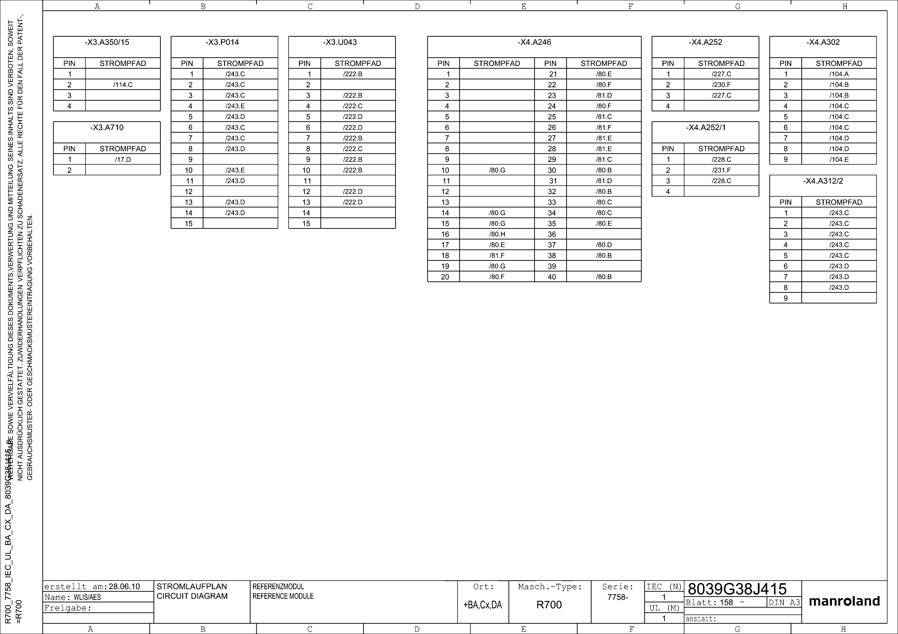

# +BA_Cx_DA — Sheet 158 of 247 — REFERENZMODUL

**REFERENCE MODULE**

> Part of the manroland **R700** printing press IEC/UL circuit diagrams.
> Drawing class: **Stromlaufplan / Circuit diagram** (DIN A3).
> Document `+BA_Cx_DA` covers the **Printing units / main switch cabinet** machine section.

## At a glance

| Field | Value |
|---|---|
| Document | `+BA_Cx_DA`  (8039G38J415) |
| Sheet | **158** of 247 |
| Section (DE) | REFERENZMODUL |
| Section (EN) | REFERENCE MODULE |
| Section type | REFERENCE_MODULE — Reference module |
| Machine type | `R700` |
| Series | `7758` |
| Created | 28.06.10 |
| Replaces | — |
| Columns used | A, B, C, D, E, F, G, H |
| Path numbers | — |
| Labels on sheet | 205 |
| Cross-refs out | 74 |
| Cross-refs in | 0 |

**Previous:** [+BA_Cx_DA sheet 157](SHEET_0157.md) · **Next:** [+BA_Cx_DA sheet 159](SHEET_0159.md) · **Document TOC:** [_TOC.md](_TOC.md)  (+BA_Cx_DA) · **Master TOC:** [all sheets](../_MASTER_TOC.md)

## Sheet image (300 DPI, exact vector render)



_Rendered directly from the PDF vector layer at 300 DPI (1-bit), no OCR and no resampling. Use it to confirm anything ambiguous in the text below._

## Cross-references on this sheet

Each entry is a wire leaving this sheet. The printed token is `/sheet.column`; the link resolves to that sheet inside the same document.

| Ref | Target sheet | Col | Path | Destination on target | Target section | From col |
|---|---|---|---|---|---|---|
| `/80.E` | [+BA_Cx_DA sheet 80](SHEET_0080.md) | E | — | — | FARBWERK | F |
| `/222.B` | [+BA_Cx_DA sheet 222](SHEET_0222.md) | B | — | — | OPTION: INLINEOBSERVER | C |
| `/104.A` | [+BA_Cx_DA sheet 104](SHEET_0104.md) | A | — | — | MOTOR: UMFANGSREGISTER | H |
| `/243.C` | [+BA_Cx_DA sheet 243](SHEET_0243.md) | C | — | — | OPTION: LEITSTANDBEDIENUNG | B |
| `/227.C` | [+BA_Cx_DA sheet 227](SHEET_0227.md) | C | — | — | OPTION: WASCHMITTELWECHSELBETRIEB | G |
| `/80.F` | [+BA_Cx_DA sheet 80](SHEET_0080.md) | F | — | — | FARBWERK | F |
| `/104.B` | [+BA_Cx_DA sheet 104](SHEET_0104.md) | B | — | — | MOTOR: UMFANGSREGISTER | H |
| `/230.F` | [+BA_Cx_DA sheet 230](SHEET_0230.md) | F | — | — | OPTION: WASCHMITTELWECHSELBETRIEB | G |
| `/114.C` | [+BA_Cx_DA sheet 114](SHEET_0114.md) | C | — | — | PPL 2 | A |
| `/243.C` | [+BA_Cx_DA sheet 243](SHEET_0243.md) | C | — | — | OPTION: LEITSTANDBEDIENUNG | B |
| `/222.B` | [+BA_Cx_DA sheet 222](SHEET_0222.md) | B | — | — | OPTION: INLINEOBSERVER | C |
| `/104.B` | [+BA_Cx_DA sheet 104](SHEET_0104.md) | B | — | — | MOTOR: UMFANGSREGISTER | H |
| `/81.D` | [+BA_Cx_DA sheet 81](SHEET_0081.md) | D | — | — | FARBWERK | F |
| `/243.C` | [+BA_Cx_DA sheet 243](SHEET_0243.md) | C | — | — | OPTION: LEITSTANDBEDIENUNG | B |
| `/227.C` | [+BA_Cx_DA sheet 227](SHEET_0227.md) | C | — | — | OPTION: WASCHMITTELWECHSELBETRIEB | G |
| `/80.F` | [+BA_Cx_DA sheet 80](SHEET_0080.md) | F | — | — | FARBWERK | F |
| `/243.E` | [+BA_Cx_DA sheet 243](SHEET_0243.md) | E | — | — | OPTION: LEITSTANDBEDIENUNG | B |
| `/222.C` | [+BA_Cx_DA sheet 222](SHEET_0222.md) | C | — | — | OPTION: INLINEOBSERVER | C |
| `/104.C` | [+BA_Cx_DA sheet 104](SHEET_0104.md) | C | — | — | MOTOR: UMFANGSREGISTER | H |
| `/243.D` | [+BA_Cx_DA sheet 243](SHEET_0243.md) | D | — | — | OPTION: LEITSTANDBEDIENUNG | B |
| `/222.D` | [+BA_Cx_DA sheet 222](SHEET_0222.md) | D | — | — | OPTION: INLINEOBSERVER | C |
| `/81.C` | [+BA_Cx_DA sheet 81](SHEET_0081.md) | C | — | — | FARBWERK | F |
| `/104.C` | [+BA_Cx_DA sheet 104](SHEET_0104.md) | C | — | — | MOTOR: UMFANGSREGISTER | H |
| `/81.F` | [+BA_Cx_DA sheet 81](SHEET_0081.md) | F | — | — | FARBWERK | F |
| `/243.C` | [+BA_Cx_DA sheet 243](SHEET_0243.md) | C | — | — | OPTION: LEITSTANDBEDIENUNG | B |
| `/222.D` | [+BA_Cx_DA sheet 222](SHEET_0222.md) | D | — | — | OPTION: INLINEOBSERVER | C |
| `/104.C` | [+BA_Cx_DA sheet 104](SHEET_0104.md) | C | — | — | MOTOR: UMFANGSREGISTER | H |
| `/81.E` | [+BA_Cx_DA sheet 81](SHEET_0081.md) | E | — | — | FARBWERK | F |
| `/222.B` | [+BA_Cx_DA sheet 222](SHEET_0222.md) | B | — | — | OPTION: INLINEOBSERVER | C |
| `/243.C` | [+BA_Cx_DA sheet 243](SHEET_0243.md) | C | — | — | OPTION: LEITSTANDBEDIENUNG | B |
| `/104.D` | [+BA_Cx_DA sheet 104](SHEET_0104.md) | D | — | — | MOTOR: UMFANGSREGISTER | H |
| `/17.D` | [+BA_Cx_DA sheet 17](SHEET_0017.md) | D | — | STROMPFAD PIN 1 2 | SPANNUNGSVERSORGUNG, SCHALTSCHRANKBELÜFTUNG | A |
| `/81.E` | [+BA_Cx_DA sheet 81](SHEET_0081.md) | E | — | — | FARBWERK | F |
| `/243.D` | [+BA_Cx_DA sheet 243](SHEET_0243.md) | D | — | — | OPTION: LEITSTANDBEDIENUNG | B |
| `/222.C` | [+BA_Cx_DA sheet 222](SHEET_0222.md) | C | — | — | OPTION: INLINEOBSERVER | C |
| `/104.D` | [+BA_Cx_DA sheet 104](SHEET_0104.md) | D | — | — | MOTOR: UMFANGSREGISTER | H |
| `/222.B` | [+BA_Cx_DA sheet 222](SHEET_0222.md) | B | — | — | OPTION: INLINEOBSERVER | C |
| `/104.E` | [+BA_Cx_DA sheet 104](SHEET_0104.md) | E | — | — | MOTOR: UMFANGSREGISTER | H |
| `/81.C` | [+BA_Cx_DA sheet 81](SHEET_0081.md) | C | — | — | FARBWERK | F |
| `/228.C` | [+BA_Cx_DA sheet 228](SHEET_0228.md) | C | — | — | OPTION: WASCHMITTELWECHSELBETRIEB | G |
| `/80.B` | [+BA_Cx_DA sheet 80](SHEET_0080.md) | B | — | — | FARBWERK | F |
| `/243.E` | [+BA_Cx_DA sheet 243](SHEET_0243.md) | E | — | — | OPTION: LEITSTANDBEDIENUNG | B |
| `/222.B` | [+BA_Cx_DA sheet 222](SHEET_0222.md) | B | — | — | OPTION: INLINEOBSERVER | C |
| `/80.G` | [+BA_Cx_DA sheet 80](SHEET_0080.md) | G | — | — | FARBWERK | E |
| `/231.F` | [+BA_Cx_DA sheet 231](SHEET_0231.md) | F | — | — | OPTION: WASCHMITTELWECHSELBETRIEB | G |
| `/243.D` | [+BA_Cx_DA sheet 243](SHEET_0243.md) | D | — | — | OPTION: LEITSTANDBEDIENUNG | B |
| `/81.D` | [+BA_Cx_DA sheet 81](SHEET_0081.md) | D | — | — | FARBWERK | F |
| `/228.C` | [+BA_Cx_DA sheet 228](SHEET_0228.md) | C | — | — | OPTION: WASCHMITTELWECHSELBETRIEB | G |
| `/80.B` | [+BA_Cx_DA sheet 80](SHEET_0080.md) | B | — | — | FARBWERK | F |
| `/222.D` | [+BA_Cx_DA sheet 222](SHEET_0222.md) | D | — | — | OPTION: INLINEOBSERVER | C |
| `/80.C` | [+BA_Cx_DA sheet 80](SHEET_0080.md) | C | — | — | FARBWERK | F |
| `/243.D` | [+BA_Cx_DA sheet 243](SHEET_0243.md) | D | — | — | OPTION: LEITSTANDBEDIENUNG | B |
| `/222.D` | [+BA_Cx_DA sheet 222](SHEET_0222.md) | D | — | — | OPTION: INLINEOBSERVER | C |
| `/80.G` | [+BA_Cx_DA sheet 80](SHEET_0080.md) | G | — | — | FARBWERK | E |
| `/243.D` | [+BA_Cx_DA sheet 243](SHEET_0243.md) | D | — | — | OPTION: LEITSTANDBEDIENUNG | B |
| `/80.C` | [+BA_Cx_DA sheet 80](SHEET_0080.md) | C | — | — | FARBWERK | F |
| `/243.C` | [+BA_Cx_DA sheet 243](SHEET_0243.md) | C | — | — | OPTION: LEITSTANDBEDIENUNG | H |
| `/80.E` | [+BA_Cx_DA sheet 80](SHEET_0080.md) | E | — | — | FARBWERK | F |
| `/80.G` | [+BA_Cx_DA sheet 80](SHEET_0080.md) | G | — | — | FARBWERK | E |
| `/243.C` | [+BA_Cx_DA sheet 243](SHEET_0243.md) | C | — | — | OPTION: LEITSTANDBEDIENUNG | H |
| `/80.H` | [+BA_Cx_DA sheet 80](SHEET_0080.md) | H | — | — | FARBWERK | E |
| `/243.C` | [+BA_Cx_DA sheet 243](SHEET_0243.md) | C | — | — | OPTION: LEITSTANDBEDIENUNG | H |
| `/80.E` | [+BA_Cx_DA sheet 80](SHEET_0080.md) | E | — | — | FARBWERK | E |
| `/80.D` | [+BA_Cx_DA sheet 80](SHEET_0080.md) | D | — | — | FARBWERK | F |
| `/243.C` | [+BA_Cx_DA sheet 243](SHEET_0243.md) | C | — | — | OPTION: LEITSTANDBEDIENUNG | H |
| `/80.B` | [+BA_Cx_DA sheet 80](SHEET_0080.md) | B | — | — | FARBWERK | F |
| `/81.F` | [+BA_Cx_DA sheet 81](SHEET_0081.md) | F | — | — | FARBWERK | E |
| `/243.C` | [+BA_Cx_DA sheet 243](SHEET_0243.md) | C | — | — | OPTION: LEITSTANDBEDIENUNG | H |
| `/80.G` | [+BA_Cx_DA sheet 80](SHEET_0080.md) | G | — | — | FARBWERK | E |
| `/243.D` | [+BA_Cx_DA sheet 243](SHEET_0243.md) | D | — | — | OPTION: LEITSTANDBEDIENUNG | H |
| `/80.B` | [+BA_Cx_DA sheet 80](SHEET_0080.md) | B | — | — | FARBWERK | F |
| `/80.F` | [+BA_Cx_DA sheet 80](SHEET_0080.md) | F | — | — | FARBWERK | E |
| `/243.D` | [+BA_Cx_DA sheet 243](SHEET_0243.md) | D | — | — | OPTION: LEITSTANDBEDIENUNG | H |
| `/243.D` | [+BA_Cx_DA sheet 243](SHEET_0243.md) | D | — | — | OPTION: LEITSTANDBEDIENUNG | H |

## Devices on this sheet

| Tag | Class | Class meaning (IEC) | Col | Sub | Terminal | Sign |
|---|---|---|---|---|---|---|
| `X4.A246` | — | cross-device reference | E | — | — | — |
| `X4.A252` | — | cross-device reference | G | — | — | — |
| `X4.A302` | — | cross-device reference | H | — | — | — |
| `X3.U043` | — | cross-device reference | C | — | — | — |
| `X3.P014` | — | cross-device reference | B | — | — | — |
| `X3.A710` | — | cross-device reference | A | — | — | — |

## Potentials / nets

_No named potentials on this sheet._

## Wire-end annotations (grouped as printed)

A wire that continues elsewhere is annotated with a small cluster: the destination description, the path/line number `#NN`, and the `/sheet.column` cross reference. Each row below is one such cluster exactly as it is grouped on the drawing.

| Col | Y | Path | Cross-ref | Text on the wire |
|---|---|---|---|---|
| A | 51.3 | — | — | `X3.A350/15` |
| B | 51.3 | — | — | `X3.P014` |
| C | 51.3 | — | — | `X3.U043` |
| E | 51.3 | — | — | `X4.A246` |
| G | 51.3 | — | — | `X4.A252` |
| H | 51.3 | — | — | `X4.A302` |
| A | 80.0 | — | — | `PIN 2 3 4 1 STROMPFAD` |
| B | 80.0 | — | — | `PIN 10 12 13 14 15 11 2 3 4 5 6 7 8 9 1 STROMPFAD` |
| C | 80.0 | — | — | `PIN 10 12 13 14 15 11 2 3 4 5 6 7 8 9 1 STROMPFAD` |
| E | 80.0 | — | — | `PIN STROMPFAD` |
| F | 80.0 | — | — | `PIN STROMPFAD` |
| G | 80.0 | — | — | `PIN 2 3 4 1 STROMPFAD` |
| H | 80.0 | — | — | `PIN 2 3 4 5 6 7 8 9 1 STROMPFAD` |
| D | 94.2 | — | — | `2 3 4 5 6 7 8 9 1` |
| E | 94.2 | — | — | `22 21` |
| B | 94.5 | — | `/243.C` | — |
| C | 94.5 | — | `/222.B` | — |
| F | 94.5 | — | `/80.E` | — |
| G | 94.5 | — | `/227.C` | — |
| H | 94.5 | — | `/104.A` | — |
| A | 108.7 | — | `/114.C` | — |
| B | 108.7 | — | `/243.C` | — |
| F | 108.7 | — | `/80.F` | — |
| G | 108.7 | — | `/230.F` | — |
| H | 108.7 | — | `/104.B` | — |
| E | 122.5 | — | — | `23 24 25 26 27 28 29 30 32 33 34 35 36 37 38 39 40 31` |
| B | 122.9 | — | `/243.C` | — |
| C | 122.9 | — | `/222.B` | — |
| F | 122.9 | — | `/81.D` | — |
| G | 122.9 | — | `/227.C` | — |
| H | 122.9 | — | `/104.B` | — |
| B | 137.0 | — | `/243.E` | — |
| F | 137.0 | — | `/80.F` | — |
| C | 137.1 | — | `/222.C` | — |
| H | 137.1 | — | `/104.C` | — |
| B | 151.2 | — | `/243.D` | — |
| C | 151.2 | — | `/222.D` | — |
| F | 151.2 | — | `/81.C` | — |
| H | 151.2 | — | `/104.C` | — |
| A | 164.7 | — | — | `X3.A710` |
| G | 164.7 | — | — | `X4.A252/1` |
| B | 165.4 | — | `/243.C` | — |
| C | 165.4 | — | `/222.D` | — |
| F | 165.4 | — | `/81.F` | — |
| H | 165.4 | — | `/104.C` | — |
| F | 179.5 | — | `/81.E` | — |
| B | 179.6 | — | `/243.C` | — |
| C | 179.6 | — | `/222.B` | — |
| H | 179.6 | — | `/104.D` | — |
| A | 193.4 | — | `/17.D` | `PIN 2 1 STROMPFAD` |
| G | 193.4 | — | — | `PIN 2 3 4 1 STROMPFAD` |
| F | 193.7 | — | `/81.E` | — |
| B | 193.8 | — | `/243.D` | — |
| C | 193.8 | — | `/222.C` | — |
| H | 193.8 | — | `/104.D` | — |
| C | 207.9 | — | `/222.B` | — |
| F | 207.9 | — | `/81.C` | — |
| G | 207.9 | — | `/228.C` | — |
| H | 207.9 | — | `/104.E` | — |
| D | 221.8 | — | — | `10 12 13 14 15 16 17 18 19 11` |
| B | 222.1 | — | `/243.E` | — |
| C | 222.1 | — | `/222.B` | — |
| E | 222.1 | — | `/80.G` | — |
| F | 222.1 | — | `/80.B` | — |
| G | 222.1 | — | `/231.F` | — |
| H | 235.6 | — | — | `X4.A312/2` |
| B | 236.3 | — | `/243.D` | — |
| F | 236.3 | — | `/81.D` | — |
| G | 236.3 | — | `/228.C` | — |
| C | 250.4 | — | `/222.D` | — |
| F | 250.4 | — | `/80.B` | — |
| H | 264.2 | — | — | `PIN 2 3 4 5 6 7 8 9 1 STROMPFAD` |
| B | 264.6 | — | `/243.D` | — |
| C | 264.6 | — | `/222.D` | — |
| F | 264.6 | — | `/80.C` | — |
| B | 278.8 | — | `/243.D` | — |
| E | 278.8 | — | `/80.G` | — |
| F | 278.8 | — | `/80.C` | — |
| H | 278.8 | — | `/243.C` | — |
| E | 292.9 | — | `/80.G` | — |
| F | 292.9 | — | `/80.E` | — |
| H | 293.0 | — | `/243.C` | — |
| E | 307.1 | — | `/80.H` | — |
| H | 307.1 | — | `/243.C` | — |
| E | 321.3 | — | `/80.E` | — |
| F | 321.3 | — | `/80.D` | — |
| H | 321.3 | — | `/243.C` | — |
| F | 335.4 | — | `/80.B` | — |
| E | 335.5 | — | `/81.F` | — |
| H | 335.5 | — | `/243.C` | — |
| E | 349.6 | — | `/80.G` | — |
| H | 349.7 | — | `/243.D` | — |
| D | 363.5 | — | — | `20` |
| E | 363.8 | — | `/80.F` | — |
| F | 363.8 | — | `/80.B` | — |
| H | 363.8 | — | `/243.D` | — |
| H | 378.0 | — | `/243.D` | — |


## Reconstructed tables

This sheet carries tabular content (pin map / terminal assignment / index). The grid below was rebuilt from the drawing's own rule lines, so each row is exactly one physical row of the table.

### Table 1 — 8 data rows × 2 columns (at x=70.9, y=48.2) — **X3.A350/15**

| PIN | STROMPFAD |
|---|---|
| `1` |  |
| `2` | `/114.C` |
| `3` |  |
| `4` |  |
|  | `X3.A710` |
| `PIN` | `STROMPFAD` |
| `1` | `/17.D` |
| `2` |  |


### Table 2 — 15 data rows × 2 columns (at x=226.8, y=48.2) — **X3.P014**

| PIN | STROMPFAD |
|---|---|
| `1` | `/243.C` |
| `2` | `/243.C` |
| `3` | `/243.C` |
| `4` | `/243.E` |
| `5` | `/243.D` |
| `6` | `/243.C` |
| `7` | `/243.C` |
| `8` | `/243.D` |
| `9` |  |
| `10` | `/243.E` |
| `11` | `/243.D` |
| `12` |  |
| `13` | `/243.D` |
| `14` | `/243.D` |
| `15` |  |


### Table 3 — 15 data rows × 2 columns (at x=382.7, y=48.2) — **X3.U043**

| PIN | STROMPFAD |
|---|---|
| `1` | `/222.B` |
| `2` |  |
| `3` | `/222.B` |
| `4` | `/222.C` |
| `5` | `/222.D` |
| `6` | `/222.D` |
| `7` | `/222.B` |
| `8` | `/222.C` |
| `9` | `/222.B` |
| `10` | `/222.B` |
| `11` |  |
| `12` | `/222.D` |
| `13` | `/222.D` |
| `14` |  |
| `15` |  |


### Table 4 — 20 data rows × 4 columns (at x=566.9, y=48.2) — **X4.A246**

| PIN | STROMPFAD | PIN | STROMPFAD |
|---|---|---|---|
| `1` |  | `21` | `/80.E` |
| `2` |  | `22` | `/80.F` |
| `3` |  | `23` | `/81.D` |
| `4` |  | `24` | `/80.F` |
| `5` |  | `25` | `/81.C` |
| `6` |  | `26` | `/81.F` |
| `7` |  | `27` | `/81.E` |
| `8` |  | `28` | `/81.E` |
| `9` |  | `29` | `/81.C` |
| `10` | `/80.G` | `30` | `/80.B` |
| `11` |  | `31` | `/81.D` |
| `12` |  | `32` | `/80.B` |
| `13` |  | `33` | `/80.C` |
| `14` | `/80.G` | `34` | `/80.C` |
| `15` | `/80.G` | `35` | `/80.E` |
| `16` | `/80.H` | `36` |  |
| `17` | `/80.E` | `37` | `/80.D` |
| `18` | `/81.F` | `38` | `/80.B` |
| `19` | `/80.G` | `39` |  |
| `20` | `/80.F` | `40` | `/80.B` |


### Table 5 — 10 data rows × 2 columns (at x=864.6, y=48.2) — **X4.A252**

| PIN | STROMPFAD |
|---|---|
| `1` | `/227.C` |
| `2` | `/230.F` |
| `3` | `/227.C` |
| `4` |  |
|  | `X4.A252/1` |
| `PIN` | `STROMPFAD` |
| `1` | `/228.C` |
| `2` | `/231.F` |
| `3` | `/228.C` |
| `4` |  |


### Table 6 — 20 data rows × 2 columns (at x=1020.5, y=48.2) — **X4.A302**

| PIN | STROMPFAD |
|---|---|
| `1` | `/104.A` |
| `2` | `/104.B` |
| `3` | `/104.B` |
| `4` | `/104.C` |
| `5` | `/104.C` |
| `6` | `/104.C` |
| `7` | `/104.D` |
| `8` | `/104.D` |
| `9` | `/104.E` |
|  | `X4.A312/2` |
| `PIN` | `STROMPFAD` |
| `1` | `/243.C` |
| `2` | `/243.C` |
| `3` | `/243.C` |
| `4` | `/243.C` |
| `5` | `/243.C` |
| `6` | `/243.D` |
| `7` | `/243.D` |
| `8` | `/243.D` |
| `9` |  |


## Notes and free text on this sheet

| Text | Col | Y (pt) |
|---|---|---|
| `PIN` | A | 80.02 |
| `STROMPFAD` | A | 79.98 |
| `X3.A350/15` | A | 51.33 |
| `PIN` | D | 80.02 |
| `STROMPFAD` | E | 79.98 |
| `PIN` | E | 80.02 |
| `STROMPFAD` | F | 79.98 |
| `PIN` | F | 80.02 |
| `STROMPFAD` | G | 79.98 |
| `X4.A252/1` | G | 164.72 |
| `PIN` | G | 80.02 |
| `STROMPFAD` | H | 79.98 |
| `PIN` | C | 80.02 |
| `STROMPFAD` | C | 79.98 |
| `PIN` | B | 80.02 |
| `STROMPFAD` | B | 79.98 |
| `X4.A312/2` | H | 235.59 |

## Complete label inventory (exact text from the drawing)

Every text object inside the drawing area of this sheet, in DIN reading order (column A→H, then top→bottom). This is the authoritative list: if a string is not here it is not printed on this sheet.

| Col | Y | X | Dir | Type | Text |
|---|---|---|---|---|---|
| A | 51.3 | 112.4 | → | text | `X3.A350/15` |
| A | 80.0 | 84.0 | → | text | `PIN` |
| A | 80.0 | 132.2 | → | text | `STROMPFAD` |
| A | 94.2 | 90.0 | → | number | `1` |
| A | 108.4 | 89.4 | → | number | `2` |
| A | 108.7 | 150.2 | → | cross-reference | `/114.C` |
| A | 122.5 | 89.4 | → | number | `3` |
| A | 136.7 | 89.4 | → | number | `4` |
| A | 164.7 | 119.8 | → | device ref | `X3.A710` |
| A | 193.4 | 84.0 | → | text | `PIN` |
| A | 193.4 | 132.2 | → | text | `STROMPFAD` |
| A | 207.6 | 90.0 | → | number | `1` |
| A | 207.9 | 152.6 | → | cross-reference | `/17.D` |
| A | 221.8 | 89.4 | → | number | `2` |
| B | 51.3 | 272.8 | → | device ref | `X3.P014` |
| B | 80.0 | 240.0 | → | text | `PIN` |
| B | 80.0 | 288.1 | → | text | `STROMPFAD` |
| B | 94.2 | 251.7 | → | number | `1` |
| B | 94.5 | 299.1 | → | cross-reference | `/243.C` |
| B | 108.4 | 250.0 | → | number | `2` |
| B | 108.7 | 299.1 | → | cross-reference | `/243.C` |
| B | 122.5 | 250.0 | → | number | `3` |
| B | 122.9 | 299.1 | → | cross-reference | `/243.C` |
| B | 136.7 | 250.0 | → | number | `4` |
| B | 137.0 | 299.3 | → | cross-reference | `/243.E` |
| B | 150.9 | 250.0 | → | number | `5` |
| B | 151.2 | 299.1 | → | cross-reference | `/243.D` |
| B | 165.1 | 250.0 | → | number | `6` |
| B | 165.4 | 299.1 | → | cross-reference | `/243.C` |
| B | 179.2 | 250.0 | → | number | `7` |
| B | 179.6 | 299.1 | → | cross-reference | `/243.C` |
| B | 193.4 | 250.0 | → | number | `8` |
| B | 193.8 | 299.1 | → | cross-reference | `/243.D` |
| B | 207.6 | 250.0 | → | number | `9` |
| B | 221.8 | 244.6 | → | number | `10` |
| B | 222.1 | 299.3 | → | cross-reference | `/243.E` |
| B | 235.9 | 246.3 | → | number | `11` |
| B | 236.3 | 299.1 | → | cross-reference | `/243.D` |
| B | 250.1 | 244.6 | → | number | `12` |
| B | 264.3 | 244.6 | → | number | `13` |
| B | 264.6 | 299.1 | → | cross-reference | `/243.D` |
| B | 278.5 | 244.6 | → | number | `14` |
| B | 278.8 | 299.1 | → | cross-reference | `/243.D` |
| B | 292.6 | 244.6 | → | number | `15` |
| C | 51.3 | 428.5 | → | device ref | `X3.U043` |
| C | 80.0 | 395.9 | → | text | `PIN` |
| C | 80.0 | 444.0 | → | text | `STROMPFAD` |
| C | 94.2 | 407.6 | → | number | `1` |
| C | 94.5 | 455.1 | → | cross-reference | `/222.B` |
| C | 108.4 | 405.9 | → | number | `2` |
| C | 122.5 | 405.9 | → | number | `3` |
| C | 122.9 | 455.1 | → | cross-reference | `/222.B` |
| C | 136.7 | 405.9 | → | number | `4` |
| C | 137.1 | 455.0 | → | cross-reference | `/222.C` |
| C | 150.9 | 405.9 | → | number | `5` |
| C | 151.2 | 455.0 | → | cross-reference | `/222.D` |
| C | 165.1 | 405.9 | → | number | `6` |
| C | 165.4 | 455.0 | → | cross-reference | `/222.D` |
| C | 179.2 | 405.9 | → | number | `7` |
| C | 179.6 | 455.1 | → | cross-reference | `/222.B` |
| C | 193.4 | 405.9 | → | number | `8` |
| C | 193.8 | 455.0 | → | cross-reference | `/222.C` |
| C | 207.6 | 405.9 | → | number | `9` |
| C | 207.9 | 455.1 | → | cross-reference | `/222.B` |
| C | 221.8 | 400.5 | → | number | `10` |
| C | 222.1 | 455.1 | → | cross-reference | `/222.B` |
| C | 235.9 | 402.2 | → | number | `11` |
| C | 250.1 | 400.5 | → | number | `12` |
| C | 250.4 | 455.0 | → | cross-reference | `/222.D` |
| C | 264.3 | 400.5 | → | number | `13` |
| C | 264.6 | 455.0 | → | cross-reference | `/222.D` |
| C | 278.5 | 400.5 | → | number | `14` |
| C | 292.6 | 400.5 | → | number | `15` |
| D | 80.0 | 580.1 | → | text | `PIN` |
| D | 94.2 | 591.9 | → | number | `1` |
| D | 108.4 | 590.2 | → | number | `2` |
| D | 122.5 | 590.2 | → | number | `3` |
| D | 136.7 | 590.2 | → | number | `4` |
| D | 150.9 | 590.2 | → | number | `5` |
| D | 165.1 | 590.2 | → | number | `6` |
| D | 179.2 | 590.2 | → | number | `7` |
| D | 193.4 | 590.2 | → | number | `8` |
| D | 207.6 | 590.2 | → | number | `9` |
| D | 221.8 | 584.8 | → | number | `10` |
| D | 235.9 | 586.5 | → | number | `11` |
| D | 250.1 | 584.8 | → | number | `12` |
| D | 264.3 | 584.8 | → | number | `13` |
| D | 278.5 | 584.8 | → | number | `14` |
| D | 292.6 | 584.8 | → | number | `15` |
| D | 306.8 | 584.8 | → | number | `16` |
| D | 321.0 | 584.8 | → | number | `17` |
| D | 335.1 | 584.8 | → | number | `18` |
| D | 349.3 | 584.8 | → | number | `19` |
| D | 363.5 | 584.8 | → | number | `20` |
| E | 51.3 | 686.7 | → | device ref | `X4.A246` |
| E | 80.0 | 628.3 | → | text | `STROMPFAD` |
| E | 80.0 | 721.8 | → | text | `PIN` |
| E | 94.2 | 728.2 | → | number | `21` |
| E | 108.4 | 726.5 | → | number | `22` |
| E | 122.5 | 726.5 | → | number | `23` |
| E | 136.7 | 726.5 | → | number | `24` |
| E | 150.9 | 726.5 | → | number | `25` |
| E | 165.1 | 726.5 | → | number | `26` |
| E | 179.2 | 726.5 | → | number | `27` |
| E | 193.4 | 726.5 | → | number | `28` |
| E | 207.6 | 726.5 | → | number | `29` |
| E | 221.8 | 726.5 | → | number | `30` |
| E | 222.1 | 648.6 | → | cross-reference | `/80.G` |
| E | 235.9 | 728.2 | → | number | `31` |
| E | 250.1 | 726.5 | → | number | `32` |
| E | 264.3 | 726.5 | → | number | `33` |
| E | 278.5 | 726.5 | → | number | `34` |
| E | 278.8 | 648.6 | → | cross-reference | `/80.G` |
| E | 292.6 | 726.5 | → | number | `35` |
| E | 292.9 | 648.6 | → | cross-reference | `/80.G` |
| E | 306.8 | 726.5 | → | number | `36` |
| E | 307.1 | 649.0 | → | cross-reference | `/80.H` |
| E | 321.0 | 726.5 | → | number | `37` |
| E | 321.3 | 649.0 | → | cross-reference | `/80.E` |
| E | 335.1 | 726.5 | → | number | `38` |
| E | 335.5 | 649.1 | → | cross-reference | `/81.F` |
| E | 349.3 | 726.5 | → | number | `39` |
| E | 349.6 | 648.6 | → | cross-reference | `/80.G` |
| E | 363.5 | 726.5 | → | number | `40` |
| E | 363.8 | 649.1 | → | cross-reference | `/80.F` |
| F | 80.0 | 770.0 | → | text | `STROMPFAD` |
| F | 80.0 | 877.7 | → | text | `PIN` |
| F | 94.2 | 883.7 | → | number | `1` |
| F | 94.5 | 790.7 | → | cross-reference | `/80.E` |
| F | 108.4 | 883.1 | → | number | `2` |
| F | 108.7 | 790.9 | → | cross-reference | `/80.F` |
| F | 122.5 | 883.1 | → | number | `3` |
| F | 122.9 | 790.4 | → | cross-reference | `/81.D` |
| F | 136.7 | 883.1 | → | number | `4` |
| F | 137.0 | 790.9 | → | cross-reference | `/80.F` |
| F | 151.2 | 790.4 | → | cross-reference | `/81.C` |
| F | 165.4 | 790.9 | → | cross-reference | `/81.F` |
| F | 179.5 | 790.7 | → | cross-reference | `/81.E` |
| F | 193.4 | 877.7 | → | text | `PIN` |
| F | 193.7 | 790.7 | → | cross-reference | `/81.E` |
| F | 207.6 | 883.7 | → | number | `1` |
| F | 207.9 | 790.4 | → | cross-reference | `/81.C` |
| F | 221.8 | 883.1 | → | number | `2` |
| F | 222.1 | 790.6 | → | cross-reference | `/80.B` |
| F | 235.9 | 883.1 | → | number | `3` |
| F | 236.3 | 790.4 | → | cross-reference | `/81.D` |
| F | 250.1 | 883.1 | → | number | `4` |
| F | 250.4 | 790.6 | → | cross-reference | `/80.B` |
| F | 264.6 | 790.4 | → | cross-reference | `/80.C` |
| F | 278.8 | 790.4 | → | cross-reference | `/80.C` |
| F | 292.9 | 790.7 | → | cross-reference | `/80.E` |
| F | 321.3 | 790.4 | → | cross-reference | `/80.D` |
| F | 335.4 | 790.6 | → | cross-reference | `/80.B` |
| F | 363.8 | 790.6 | → | cross-reference | `/80.B` |
| G | 51.3 | 913.5 | → | device ref | `X4.A252` |
| G | 80.0 | 925.9 | → | text | `STROMPFAD` |
| G | 80.0 | 1033.7 | → | text | `PIN` |
| G | 94.2 | 1039.6 | → | number | `1` |
| G | 94.5 | 943.9 | → | cross-reference | `/227.C` |
| G | 108.4 | 1039.0 | → | number | `2` |
| G | 108.7 | 944.4 | → | cross-reference | `/230.F` |
| G | 122.5 | 1039.0 | → | number | `3` |
| G | 122.9 | 943.9 | → | cross-reference | `/227.C` |
| G | 136.7 | 1039.0 | → | number | `4` |
| G | 150.9 | 1039.0 | → | number | `5` |
| G | 164.7 | 909.8 | → | text | `X4.A252/1` |
| G | 165.1 | 1039.0 | → | number | `6` |
| G | 179.2 | 1039.0 | → | number | `7` |
| G | 193.4 | 925.9 | → | text | `STROMPFAD` |
| G | 193.4 | 1039.0 | → | number | `8` |
| G | 207.6 | 1039.0 | → | number | `9` |
| G | 207.9 | 943.9 | → | cross-reference | `/228.C` |
| G | 222.1 | 944.4 | → | cross-reference | `/231.F` |
| G | 236.3 | 943.9 | → | cross-reference | `/228.C` |
| G | 264.3 | 1033.7 | → | text | `PIN` |
| G | 278.5 | 1039.6 | → | number | `1` |
| G | 292.6 | 1039.0 | → | number | `2` |
| G | 306.8 | 1039.0 | → | number | `3` |
| G | 321.0 | 1039.0 | → | number | `4` |
| G | 335.1 | 1039.0 | → | number | `5` |
| G | 349.3 | 1039.0 | → | number | `6` |
| G | 363.5 | 1039.0 | → | number | `7` |
| G | 377.7 | 1039.0 | → | number | `8` |
| G | 391.8 | 1039.0 | → | number | `9` |
| H | 51.3 | 1069.4 | → | device ref | `X4.A302` |
| H | 80.0 | 1081.8 | → | text | `STROMPFAD` |
| H | 94.5 | 1099.8 | → | cross-reference | `/104.A` |
| H | 108.7 | 1100.0 | → | cross-reference | `/104.B` |
| H | 122.9 | 1100.0 | → | cross-reference | `/104.B` |
| H | 137.1 | 1099.8 | → | cross-reference | `/104.C` |
| H | 151.2 | 1099.8 | → | cross-reference | `/104.C` |
| H | 165.4 | 1099.8 | → | cross-reference | `/104.C` |
| H | 179.6 | 1099.8 | → | cross-reference | `/104.D` |
| H | 193.8 | 1099.8 | → | cross-reference | `/104.D` |
| H | 207.9 | 1100.1 | → | cross-reference | `/104.E` |
| H | 235.6 | 1065.0 | → | text | `X4.A312/2` |
| H | 264.2 | 1081.8 | → | text | `STROMPFAD` |
| H | 278.8 | 1099.8 | → | cross-reference | `/243.C` |
| H | 293.0 | 1099.8 | → | cross-reference | `/243.C` |
| H | 307.1 | 1099.8 | → | cross-reference | `/243.C` |
| H | 321.3 | 1099.8 | → | cross-reference | `/243.C` |
| H | 335.5 | 1099.8 | → | cross-reference | `/243.C` |
| H | 349.7 | 1099.8 | → | cross-reference | `/243.D` |
| H | 363.8 | 1099.8 | → | cross-reference | `/243.D` |
| H | 378.0 | 1099.8 | → | cross-reference | `/243.D` |

## Reading-order text block

The same content as a plain block, grouped by DIN column — convenient to paste or to match against a visual description.

```text
=== Column A ===
  51.3  112.4  text         X3.A350/15
  80.0   84.0  text         PIN
  80.0  132.2  text         STROMPFAD
  94.2   90.0  numeric      1
 108.4   89.4  numeric      2
 108.7  150.2  xref         /114.C
 122.5   89.4  numeric      3
 136.7   89.4  numeric      4
 164.7  119.8  devref       X3.A710
 193.4   84.0  text         PIN
 193.4  132.2  text         STROMPFAD
 207.6   90.0  numeric      1
 207.9  152.6  xref         /17.D
 221.8   89.4  numeric      2
=== Column B ===
  51.3  272.8  devref       X3.P014
  80.0  240.0  text         PIN
  80.0  288.1  text         STROMPFAD
  94.2  251.7  numeric      1
  94.5  299.1  xref         /243.C
 108.4  250.0  numeric      2
 108.7  299.1  xref         /243.C
 122.5  250.0  numeric      3
 122.9  299.1  xref         /243.C
 136.7  250.0  numeric      4
 137.0  299.3  xref         /243.E
 150.9  250.0  numeric      5
 151.2  299.1  xref         /243.D
 165.1  250.0  numeric      6
 165.4  299.1  xref         /243.C
 179.2  250.0  numeric      7
 179.6  299.1  xref         /243.C
 193.4  250.0  numeric      8
 193.8  299.1  xref         /243.D
 207.6  250.0  numeric      9
 221.8  244.6  numeric      10
 222.1  299.3  xref         /243.E
 235.9  246.3  numeric      11
 236.3  299.1  xref         /243.D
 250.1  244.6  numeric      12
 264.3  244.6  numeric      13
 264.6  299.1  xref         /243.D
 278.5  244.6  numeric      14
 278.8  299.1  xref         /243.D
 292.6  244.6  numeric      15
=== Column C ===
  51.3  428.5  devref       X3.U043
  80.0  395.9  text         PIN
  80.0  444.0  text         STROMPFAD
  94.2  407.6  numeric      1
  94.5  455.1  xref         /222.B
 108.4  405.9  numeric      2
 122.5  405.9  numeric      3
 122.9  455.1  xref         /222.B
 136.7  405.9  numeric      4
 137.1  455.0  xref         /222.C
 150.9  405.9  numeric      5
 151.2  455.0  xref         /222.D
 165.1  405.9  numeric      6
 165.4  455.0  xref         /222.D
 179.2  405.9  numeric      7
 179.6  455.1  xref         /222.B
 193.4  405.9  numeric      8
 193.8  455.0  xref         /222.C
 207.6  405.9  numeric      9
 207.9  455.1  xref         /222.B
 221.8  400.5  numeric      10
 222.1  455.1  xref         /222.B
 235.9  402.2  numeric      11
 250.1  400.5  numeric      12
 250.4  455.0  xref         /222.D
 264.3  400.5  numeric      13
 264.6  455.0  xref         /222.D
 278.5  400.5  numeric      14
 292.6  400.5  numeric      15
=== Column D ===
  80.0  580.1  text         PIN
  94.2  591.9  numeric      1
 108.4  590.2  numeric      2
 122.5  590.2  numeric      3
 136.7  590.2  numeric      4
 150.9  590.2  numeric      5
 165.1  590.2  numeric      6
 179.2  590.2  numeric      7
 193.4  590.2  numeric      8
 207.6  590.2  numeric      9
 221.8  584.8  numeric      10
 235.9  586.5  numeric      11
 250.1  584.8  numeric      12
 264.3  584.8  numeric      13
 278.5  584.8  numeric      14
 292.6  584.8  numeric      15
 306.8  584.8  numeric      16
 321.0  584.8  numeric      17
 335.1  584.8  numeric      18
 349.3  584.8  numeric      19
 363.5  584.8  numeric      20
=== Column E ===
  51.3  686.7  devref       X4.A246
  80.0  628.3  text         STROMPFAD
  80.0  721.8  text         PIN
  94.2  728.2  numeric      21
 108.4  726.5  numeric      22
 122.5  726.5  numeric      23
 136.7  726.5  numeric      24
 150.9  726.5  numeric      25
 165.1  726.5  numeric      26
 179.2  726.5  numeric      27
 193.4  726.5  numeric      28
 207.6  726.5  numeric      29
 221.8  726.5  numeric      30
 222.1  648.6  xref         /80.G
 235.9  728.2  numeric      31
 250.1  726.5  numeric      32
 264.3  726.5  numeric      33
 278.5  726.5  numeric      34
 278.8  648.6  xref         /80.G
 292.6  726.5  numeric      35
 292.9  648.6  xref         /80.G
 306.8  726.5  numeric      36
 307.1  649.0  xref         /80.H
 321.0  726.5  numeric      37
 321.3  649.0  xref         /80.E
 335.1  726.5  numeric      38
 335.5  649.1  xref         /81.F
 349.3  726.5  numeric      39
 349.6  648.6  xref         /80.G
 363.5  726.5  numeric      40
 363.8  649.1  xref         /80.F
=== Column F ===
  80.0  770.0  text         STROMPFAD
  80.0  877.7  text         PIN
  94.2  883.7  numeric      1
  94.5  790.7  xref         /80.E
 108.4  883.1  numeric      2
 108.7  790.9  xref         /80.F
 122.5  883.1  numeric      3
 122.9  790.4  xref         /81.D
 136.7  883.1  numeric      4
 137.0  790.9  xref         /80.F
 151.2  790.4  xref         /81.C
 165.4  790.9  xref         /81.F
 179.5  790.7  xref         /81.E
 193.4  877.7  text         PIN
 193.7  790.7  xref         /81.E
 207.6  883.7  numeric      1
 207.9  790.4  xref         /81.C
 221.8  883.1  numeric      2
 222.1  790.6  xref         /80.B
 235.9  883.1  numeric      3
 236.3  790.4  xref         /81.D
 250.1  883.1  numeric      4
 250.4  790.6  xref         /80.B
 264.6  790.4  xref         /80.C
 278.8  790.4  xref         /80.C
 292.9  790.7  xref         /80.E
 321.3  790.4  xref         /80.D
 335.4  790.6  xref         /80.B
 363.8  790.6  xref         /80.B
=== Column G ===
  51.3  913.5  devref       X4.A252
  80.0  925.9  text         STROMPFAD
  80.0 1033.7  text         PIN
  94.2 1039.6  numeric      1
  94.5  943.9  xref         /227.C
 108.4 1039.0  numeric      2
 108.7  944.4  xref         /230.F
 122.5 1039.0  numeric      3
 122.9  943.9  xref         /227.C
 136.7 1039.0  numeric      4
 150.9 1039.0  numeric      5
 164.7  909.8  text         X4.A252/1
 165.1 1039.0  numeric      6
 179.2 1039.0  numeric      7
 193.4  925.9  text         STROMPFAD
 193.4 1039.0  numeric      8
 207.6 1039.0  numeric      9
 207.9  943.9  xref         /228.C
 222.1  944.4  xref         /231.F
 236.3  943.9  xref         /228.C
 264.3 1033.7  text         PIN
 278.5 1039.6  numeric      1
 292.6 1039.0  numeric      2
 306.8 1039.0  numeric      3
 321.0 1039.0  numeric      4
 335.1 1039.0  numeric      5
 349.3 1039.0  numeric      6
 363.5 1039.0  numeric      7
 377.7 1039.0  numeric      8
 391.8 1039.0  numeric      9
=== Column H ===
  51.3 1069.4  devref       X4.A302
  80.0 1081.8  text         STROMPFAD
  94.5 1099.8  xref         /104.A
 108.7 1100.0  xref         /104.B
 122.9 1100.0  xref         /104.B
 137.1 1099.8  xref         /104.C
 151.2 1099.8  xref         /104.C
 165.4 1099.8  xref         /104.C
 179.6 1099.8  xref         /104.D
 193.8 1099.8  xref         /104.D
 207.9 1100.1  xref         /104.E
 235.6 1065.0  text         X4.A312/2
 264.2 1081.8  text         STROMPFAD
 278.8 1099.8  xref         /243.C
 293.0 1099.8  xref         /243.C
 307.1 1099.8  xref         /243.C
 321.3 1099.8  xref         /243.C
 335.5 1099.8  xref         /243.C
 349.7 1099.8  xref         /243.D
 363.8 1099.8  xref         /243.D
 378.0 1099.8  xref         /243.D
```

---
_Generated from the PDF vector text layer; no OCR. Source: `R700_7758_IEC_UL_BA_CX_DA_8039G38J415_p`, sheet 158._
