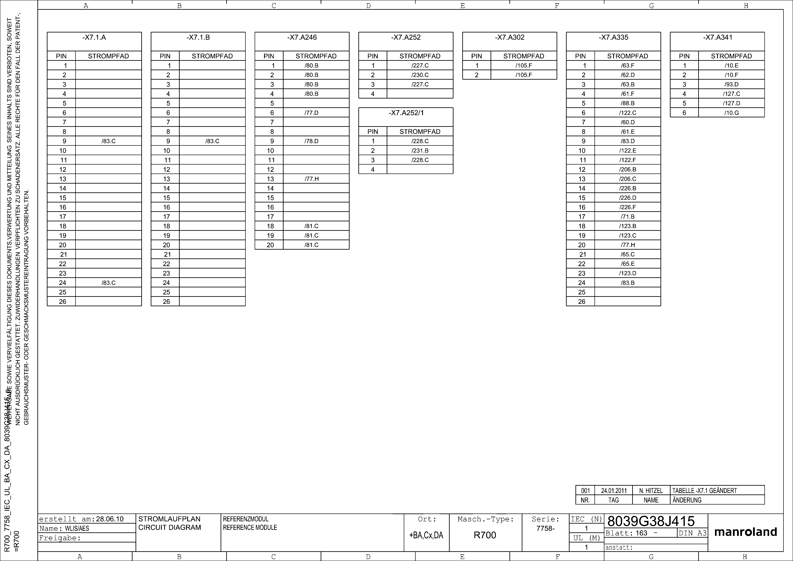

# +BA_Cx_DA — Sheet 163 of 247 — REFERENZMODUL

**REFERENCE MODULE**

> Part of the manroland **R700** printing press IEC/UL circuit diagrams.
> Drawing class: **Stromlaufplan / Circuit diagram** (DIN A3).
> Document `+BA_Cx_DA` covers the **Printing units / main switch cabinet** machine section.

## At a glance

| Field | Value |
|---|---|
| Document | `+BA_Cx_DA`  (8039G38J415) |
| Sheet | **163** of 247 |
| Section (DE) | REFERENZMODUL |
| Section (EN) | REFERENCE MODULE |
| Section type | REFERENCE_MODULE — Reference module |
| Machine type | `R700` |
| Series | `7758` |
| Created | 28.06.10 |
| Replaces | — |
| Columns used | A, B, C, D, E, F, G, H |
| Path numbers | — |
| Labels on sheet | 197 |
| Cross-refs out | 51 |
| Cross-refs in | 0 |

**Previous:** [+BA_Cx_DA sheet 162](SHEET_0162.md) · **Next:** [+BA_Cx_DA sheet 164](SHEET_0164.md) · **Document TOC:** [_TOC.md](_TOC.md)  (+BA_Cx_DA) · **Master TOC:** [all sheets](../_MASTER_TOC.md)

## Sheet image (300 DPI, exact vector render)



_Rendered directly from the PDF vector layer at 300 DPI (1-bit), no OCR and no resampling. Use it to confirm anything ambiguous in the text below._

## Cross-references on this sheet

Each entry is a wire leaving this sheet. The printed token is `/sheet.column`; the link resolves to that sheet inside the same document.

| Ref | Target sheet | Col | Path | Destination on target | Target section | From col |
|---|---|---|---|---|---|---|
| `/80.B` | [+BA_Cx_DA sheet 80](SHEET_0080.md) | B | — | — | FARBWERK | C |
| `/10.E` | [+BA_Cx_DA sheet 10](SHEET_0010.md) | E | — | — | SPANNUNGSVERSORGUNG, SCHALTSCHRANKBELÜFTUNG | H |
| `/63.F` | [+BA_Cx_DA sheet 63](SHEET_0063.md) | F | — | — | MASCHINENBEDIENUNG: BEDIENUNGKOMMANDOS | G |
| `/105.F` | [+BA_Cx_DA sheet 105](SHEET_0105.md) | F | — | — | MOTOR: SEITENREGISTER | F |
| `/227.C` | [+BA_Cx_DA sheet 227](SHEET_0227.md) | C | — | — | OPTION: WASCHMITTELWECHSELBETRIEB | E |
| `/80.B` | [+BA_Cx_DA sheet 80](SHEET_0080.md) | B | — | — | FARBWERK | C |
| `/10.F` | [+BA_Cx_DA sheet 10](SHEET_0010.md) | F | — | — | SPANNUNGSVERSORGUNG, SCHALTSCHRANKBELÜFTUNG | H |
| `/105.F` | [+BA_Cx_DA sheet 105](SHEET_0105.md) | F | — | — | MOTOR: SEITENREGISTER | F |
| `/62.D` | [+BA_Cx_DA sheet 62](SHEET_0062.md) | D | — | — | MASCHINENBEDIENUNG: BEDIENUNGKOMMANDOS | G |
| `/230.C` | [+BA_Cx_DA sheet 230](SHEET_0230.md) | C | — | — | OPTION: WASCHMITTELWECHSELBETRIEB | E |
| `/80.B` | [+BA_Cx_DA sheet 80](SHEET_0080.md) | B | — | — | FARBWERK | C |
| `/63.B` | [+BA_Cx_DA sheet 63](SHEET_0063.md) | B | — | — | MASCHINENBEDIENUNG: BEDIENUNGKOMMANDOS | G |
| `/93.D` | [+BA_Cx_DA sheet 93](SHEET_0093.md) | D | — | — | BOGENFÜHRUNG (BLASROHRE) | H |
| `/227.C` | [+BA_Cx_DA sheet 227](SHEET_0227.md) | C | — | — | OPTION: WASCHMITTELWECHSELBETRIEB | E |
| `/80.B` | [+BA_Cx_DA sheet 80](SHEET_0080.md) | B | — | — | FARBWERK | C |
| `/61.F` | [+BA_Cx_DA sheet 61](SHEET_0061.md) | F | — | — | MASCHINENBEDIENUNG: BEDIENUNGKOMMANDOS | G |
| `/127.C` | [+BA_Cx_DA sheet 127](SHEET_0127.md) | C | — | — | RESERVE: SPS STATION (D/A) | H |
| `/88.B` | [+BA_Cx_DA sheet 88](SHEET_0088.md) | B | — | — | WASCHVORRICHTUNG | G |
| `/127.D` | [+BA_Cx_DA sheet 127](SHEET_0127.md) | D | — | — | RESERVE: SPS STATION (D/A) | H |
| `/10.G` | [+BA_Cx_DA sheet 10](SHEET_0010.md) | G | — | — | SPANNUNGSVERSORGUNG, SCHALTSCHRANKBELÜFTUNG | H |
| `/77.D` | [+BA_Cx_DA sheet 77](SHEET_0077.md) | D | — | — | FARBWERK | C |
| `/122.C` | [+BA_Cx_DA sheet 122](SHEET_0122.md) | C | — | — | RESERVE: SPS STATION (INPUT) | G |
| `/60.D` | [+BA_Cx_DA sheet 60](SHEET_0060.md) | D | — | — | MASCHINENBEDIENUNG: BEDIENUNGKOMMANDOS | G |
| `/61.E` | [+BA_Cx_DA sheet 61](SHEET_0061.md) | E | — | — | MASCHINENBEDIENUNG: BEDIENUNGKOMMANDOS | G |
| `/83.C` | [+BA_Cx_DA sheet 83](SHEET_0083.md) | C | — | — | FARBWERK | A |
| `/83.C` | [+BA_Cx_DA sheet 83](SHEET_0083.md) | C | — | — | FARBWERK | B |
| `/78.D` | [+BA_Cx_DA sheet 78](SHEET_0078.md) | D | — | — | FARBWERK | C |
| `/83.D` | [+BA_Cx_DA sheet 83](SHEET_0083.md) | D | — | — | FARBWERK | G |
| `/228.C` | [+BA_Cx_DA sheet 228](SHEET_0228.md) | C | — | — | OPTION: WASCHMITTELWECHSELBETRIEB | E |
| `/231.B` | [+BA_Cx_DA sheet 231](SHEET_0231.md) | B | — | — | OPTION: WASCHMITTELWECHSELBETRIEB | E |
| `/122.E` | [+BA_Cx_DA sheet 122](SHEET_0122.md) | E | — | — | RESERVE: SPS STATION (INPUT) | G |
| `/122.F` | [+BA_Cx_DA sheet 122](SHEET_0122.md) | F | — | — | RESERVE: SPS STATION (INPUT) | G |
| `/228.C` | [+BA_Cx_DA sheet 228](SHEET_0228.md) | C | — | — | OPTION: WASCHMITTELWECHSELBETRIEB | E |
| `/206.B` | [+BA_Cx_DA sheet 206](SHEET_0206.md) | B | — | — | OPTION: AUTOMATISCHE FARBZUFÜHRUNG | G |
| `/77.H` | [+BA_Cx_DA sheet 77](SHEET_0077.md) | H | — | — | FARBWERK | C |
| `/206.C` | [+BA_Cx_DA sheet 206](SHEET_0206.md) | C | — | — | OPTION: AUTOMATISCHE FARBZUFÜHRUNG | G |
| `/226.B` | [+BA_Cx_DA sheet 226](SHEET_0226.md) | B | — | — | OPTION: ZWISCHENTROCKNER VORBEREITUNG | G |
| `/226.D` | [+BA_Cx_DA sheet 226](SHEET_0226.md) | D | — | — | OPTION: ZWISCHENTROCKNER VORBEREITUNG | G |
| `/226.F` | [+BA_Cx_DA sheet 226](SHEET_0226.md) | F | — | — | OPTION: ZWISCHENTROCKNER VORBEREITUNG | G |
| `/71.B` | [+BA_Cx_DA sheet 71](SHEET_0071.md) | B | — | — | ÖLUMLAUFSCHMIERUNG | G |
| `/123.B` | [+BA_Cx_DA sheet 123](SHEET_0123.md) | B | — | — | RESERVE: SPS STATION (INPUT) | G |
| `/81.C` | [+BA_Cx_DA sheet 81](SHEET_0081.md) | C | — | — | FARBWERK | C |
| `/81.C` | [+BA_Cx_DA sheet 81](SHEET_0081.md) | C | — | — | FARBWERK | C |
| `/123.C` | [+BA_Cx_DA sheet 123](SHEET_0123.md) | C | — | — | RESERVE: SPS STATION (INPUT) | G |
| `/81.C` | [+BA_Cx_DA sheet 81](SHEET_0081.md) | C | — | — | FARBWERK | C |
| `/77.H` | [+BA_Cx_DA sheet 77](SHEET_0077.md) | H | — | — | FARBWERK | G |
| `/65.C` | [+BA_Cx_DA sheet 65](SHEET_0065.md) | C | — | — | DRUCKANSTELLUNG | G |
| `/65.E` | [+BA_Cx_DA sheet 65](SHEET_0065.md) | E | — | — | DRUCKANSTELLUNG | G |
| `/123.D` | [+BA_Cx_DA sheet 123](SHEET_0123.md) | D | — | — | RESERVE: SPS STATION (INPUT) | G |
| `/83.B` | [+BA_Cx_DA sheet 83](SHEET_0083.md) | B | — | — | FARBWERK | G |
| `/83.C` | [+BA_Cx_DA sheet 83](SHEET_0083.md) | C | — | — | FARBWERK | A |

## Devices on this sheet

| Tag | Class | Class meaning (IEC) | Col | Sub | Terminal | Sign |
|---|---|---|---|---|---|---|
| `X7.1.A` | — | cross-device reference | A | — | — | — |
| `X7.1.B` | — | cross-device reference | B | — | — | — |
| `X7.A341` | — | cross-device reference | H | — | — | — |
| `X7.A302` | — | cross-device reference | F | — | — | — |
| `X7.A335` | — | cross-device reference | G | — | — | — |
| `X7.A252` | — | cross-device reference | D | — | — | — |
| `X7.A246` | — | cross-device reference | C | — | — | — |
| `NR.` | — | cross-device reference | F | — | — | — |
| `24.01.2011` | — | cross-device reference | G | — | — | — |

## Potentials / nets

_No named potentials on this sheet._

## Wire-end annotations (grouped as printed)

A wire that continues elsewhere is annotated with a small cluster: the destination description, the path/line number `#NN`, and the `/sheet.column` cross reference. Each row below is one such cluster exactly as it is grouped on the drawing.

| Col | Y | Path | Cross-ref | Text on the wire |
|---|---|---|---|---|
| C | 51.3 | — | — | `X7.A246` |
| D | 51.3 | — | — | `X7.A252` |
| F | 51.3 | — | — | `X7.A302` |
| G | 51.3 | — | — | `X7.A335` |
| H | 51.3 | — | — | `X7.A341` |
| A | 51.4 | — | — | `X7.1.A` |
| B | 51.4 | — | — | `X7.1.B` |
| A | 80.0 | — | — | `PIN STROMPFAD` |
| B | 80.0 | — | — | `PIN STROMPFAD` |
| C | 80.0 | — | — | `PIN 10 12 13 14 15 16 11 2 3 4 5 6 7 8 9 1 STROMPFAD` |
| D | 80.0 | — | — | `PIN 2 3 4 1 STROMPFAD` |
| E | 80.0 | — | — | `PIN 2 1 STROMPFAD` |
| G | 80.0 | — | — | `PIN STROMPFAD` |
| H | 80.0 | — | — | `PIN 2 3 4 5 6 1 STROMPFAD` |
| A | 94.2 | — | — | `2 3 4 5 6 7 8 9 1` |
| B | 94.2 | — | — | `2 3 4 5 6 7 8 9 1` |
| F | 94.2 | — | — | `2 3 4 5 6 7 8 9 1` |
| C | 94.5 | — | `/80.B` | — |
| E | 94.5 | — | `/227.C` | — |
| F | 94.5 | — | `/105.F` | — |
| G | 94.5 | — | `/63.F` | — |
| H | 94.5 | — | `/10.E` | — |
| C | 108.7 | — | `/80.B` | — |
| E | 108.7 | — | `/230.C` | — |
| F | 108.7 | — | `/105.F` | — |
| G | 108.7 | — | `/62.D` | — |
| H | 108.7 | — | `/10.F` | — |
| C | 122.8 | — | `/80.B` | — |
| G | 122.8 | — | `/63.B` | — |
| E | 122.9 | — | `/227.C` | — |
| H | 122.9 | — | `/93.D` | — |
| C | 137.0 | — | `/80.B` | — |
| G | 137.0 | — | `/61.F` | — |
| H | 137.1 | — | `/127.C` | — |
| G | 151.2 | — | `/88.B` | — |
| H | 151.2 | — | `/127.D` | — |
| D | 164.7 | — | — | `X7.A252/1` |
| C | 165.4 | — | `/77.D` | — |
| G | 165.4 | — | `/122.C` | — |
| H | 165.4 | — | `/10.G` | — |
| G | 179.6 | — | `/60.D` | — |
| D | 193.4 | — | — | `PIN 2 3 4 1 STROMPFAD` |
| G | 193.7 | — | `/61.E` | — |
| A | 207.9 | — | `/83.C` | — |
| B | 207.9 | — | `/83.C` | — |
| C | 207.9 | — | `/78.D` | — |
| E | 207.9 | — | `/228.C` | — |
| G | 207.9 | — | `/83.D` | — |
| A | 221.8 | — | — | `10 12 13 14 15 16 17 18 19 20 11` |
| B | 221.8 | — | — | `10 12 13 14 15 16 17 18 19 20 11` |
| F | 221.8 | — | — | `10 12 13 14 15 16 17 18 19 20 11` |
| E | 222.1 | — | `/231.B` | — |
| G | 222.1 | — | `/122.E` | — |
| E | 236.3 | — | `/228.C` | — |
| G | 236.3 | — | `/122.F` | — |
| G | 250.4 | — | `/206.B` | — |
| C | 264.6 | — | `/77.H` | — |
| G | 264.6 | — | `/206.C` | — |
| G | 278.8 | — | `/226.B` | — |
| G | 293.0 | — | `/226.D` | — |
| G | 307.1 | — | `/226.F` | — |
| C | 321.0 | — | — | `17 18` |
| G | 321.3 | — | `/71.B` | — |
| C | 335.5 | — | `/81.C` | — |
| G | 335.5 | — | `/123.B` | — |
| C | 349.3 | — | — | `19 20` |
| C | 349.6 | — | `/81.C` | — |
| G | 349.7 | — | `/123.C` | — |
| C | 363.8 | — | `/81.C` | — |
| G | 363.8 | — | `/77.H` | — |
| A | 377.7 | — | — | `22 23 24 25 26 21` |
| B | 377.7 | — | — | `22 23 24 25 26 21` |
| F | 377.7 | — | — | `22 23 24 25 26 21` |
| G | 378.0 | — | `/65.C` | — |
| G | 392.1 | — | `/65.E` | — |
| G | 406.4 | — | `/123.D` | — |
| A | 420.5 | — | `/83.C` | — |
| G | 420.5 | — | `/83.B` | — |
| G | 732.7 | — | — | `001 24.01.2011 N. HITZEL TABELLE X7.1 GEÄNDERT` |
| G | 747.0 | — | — | `NR. TAG NAME ÄNDERUNG` |


## Reconstructed tables

This sheet carries tabular content (pin map / terminal assignment / index). The grid below was rebuilt from the drawing's own rule lines, so each row is exactly one physical row of the table.

### Table 1 — 26 data rows × 2 columns (at x=70.9, y=48.2) — **X7.1.A**

| PIN | STROMPFAD |
|---|---|
| `1` |  |
| `2` |  |
| `3` |  |
| `4` |  |
| `5` |  |
| `6` |  |
| `7` |  |
| `8` |  |
| `9` | `/83.C` |
| `10` |  |
| `11` |  |
| `12` |  |
| `13` |  |
| `14` |  |
| `15` |  |
| `16` |  |
| `17` |  |
| `18` |  |
| `19` |  |
| `20` |  |
| `21` |  |
| `22` |  |
| `23` |  |
| `24` | `/83.C` |
| `25` |  |
| `26` |  |


### Table 2 — 26 data rows × 2 columns (at x=226.8, y=48.2) — **X7.1.B**

| PIN | STROMPFAD |
|---|---|
| `1` |  |
| `2` |  |
| `3` |  |
| `4` |  |
| `5` |  |
| `6` |  |
| `7` |  |
| `8` |  |
| `9` | `/83.C` |
| `10` |  |
| `11` |  |
| `12` |  |
| `13` |  |
| `14` |  |
| `15` |  |
| `16` |  |
| `17` |  |
| `18` |  |
| `19` |  |
| `20` |  |
| `21` |  |
| `22` |  |
| `23` |  |
| `24` |  |
| `25` |  |
| `26` |  |


### Table 3 — 20 data rows × 2 columns (at x=382.7, y=48.2) — **X7.A246**

| PIN | STROMPFAD |
|---|---|
| `1` | `/80.B` |
| `2` | `/80.B` |
| `3` | `/80.B` |
| `4` | `/80.B` |
| `5` |  |
| `6` | `/77.D` |
| `7` |  |
| `8` |  |
| `9` | `/78.D` |
| `10` |  |
| `11` |  |
| `12` |  |
| `13` | `/77.H` |
| `14` |  |
| `15` |  |
| `16` |  |
| `17` |  |
| `18` | `/81.C` |
| `19` | `/81.C` |
| `20` | `/81.C` |


### Table 4 — 10 data rows × 2 columns (at x=538.6, y=48.2) — **X7.A252**

| PIN | STROMPFAD |
|---|---|
| `1` | `/227.C` |
| `2` | `/230.C` |
| `3` | `/227.C` |
| `4` |  |
|  | `X7.A252/1` |
| `PIN` | `STROMPFAD` |
| `1` | `/228.C` |
| `2` | `/231.B` |
| `3` | `/228.C` |
| `4` |  |


### Table 5 — 2 data rows × 2 columns (at x=694.5, y=48.2) — **X7.A302**

| PIN | STROMPFAD |
|---|---|
| `1` | `/105.F` |
| `2` | `/105.F` |


### Table 6 — 26 data rows × 2 columns (at x=850.4, y=48.2) — **X7.A335**

| PIN | STROMPFAD |
|---|---|
| `1` | `/63.F` |
| `2` | `/62.D` |
| `3` | `/63.B` |
| `4` | `/61.F` |
| `5` | `/88.B` |
| `6` | `/122.C` |
| `7` | `/60.D` |
| `8` | `/61.E` |
| `9` | `/83.D` |
| `10` | `/122.E` |
| `11` | `/122.F` |
| `12` | `/206.B` |
| `13` | `/206.C` |
| `14` | `/226.B` |
| `15` | `/226.D` |
| `16` | `/226.F` |
| `17` | `/71.B` |
| `18` | `/123.B` |
| `19` | `/123.C` |
| `20` | `/77.H` |
| `21` | `/65.C` |
| `22` | `/65.E` |
| `23` | `/123.D` |
| `24` | `/83.B` |
| `25` |  |
| `26` |  |


### Table 7 — 6 data rows × 2 columns (at x=1006.3, y=48.2) — **X7.A341**

| PIN | STROMPFAD |
|---|---|
| `1` | `/10.E` |
| `2` | `/10.F` |
| `3` | `/93.D` |
| `4` | `/127.C` |
| `5` | `/127.D` |
| `6` | `/10.G` |


## Notes and free text on this sheet

| Text | Col | Y (pt) |
|---|---|---|
| `PIN` | A | 80.02 |
| `STROMPFAD` | A | 79.98 |
| `PIN` | B | 80.02 |
| `STROMPFAD` | B | 79.98 |
| `PIN` | G | 80.02 |
| `STROMPFAD` | H | 79.98 |
| `PIN` | E | 80.02 |
| `STROMPFAD` | F | 79.98 |
| `PIN` | F | 80.02 |
| `STROMPFAD` | G | 79.98 |
| `PIN` | D | 80.02 |
| `STROMPFAD` | E | 79.98 |
| `X7.A252/1` | D | 164.72 |
| `PIN` | C | 80.02 |
| `STROMPFAD` | C | 79.98 |
| `TAG` | G | 747.05 |
| `NAME` | G | 747.05 |
| `ÄNDERUNG` | G | 747.11 |
| `N. HITZEL` | G | 732.94 |
| `TABELLE X7.1 GEÄNDERT` | H | 732.93 |

## Complete label inventory (exact text from the drawing)

Every text object inside the drawing area of this sheet, in DIN reading order (column A→H, then top→bottom). This is the authoritative list: if a string is not here it is not printed on this sheet.

| Col | Y | X | Dir | Type | Text |
|---|---|---|---|---|---|
| A | 51.4 | 123.9 | → | device ref | `X7.1.A` |
| A | 80.0 | 84.0 | → | text | `PIN` |
| A | 80.0 | 132.2 | → | text | `STROMPFAD` |
| A | 94.2 | 95.8 | → | number | `1` |
| A | 108.4 | 94.1 | → | number | `2` |
| A | 122.5 | 94.1 | → | number | `3` |
| A | 136.7 | 94.1 | → | number | `4` |
| A | 150.9 | 94.1 | → | number | `5` |
| A | 165.1 | 94.1 | → | number | `6` |
| A | 179.2 | 94.1 | → | number | `7` |
| A | 193.4 | 94.1 | → | number | `8` |
| A | 207.6 | 94.1 | → | number | `9` |
| A | 207.9 | 152.6 | → | cross-reference | `/83.C` |
| A | 221.8 | 88.7 | → | number | `10` |
| A | 235.9 | 90.4 | → | number | `11` |
| A | 250.1 | 88.7 | → | number | `12` |
| A | 264.3 | 88.7 | → | number | `13` |
| A | 278.5 | 88.7 | → | number | `14` |
| A | 292.6 | 88.7 | → | number | `15` |
| A | 306.8 | 88.7 | → | number | `16` |
| A | 321.0 | 88.7 | → | number | `17` |
| A | 335.1 | 88.7 | → | number | `18` |
| A | 349.3 | 88.7 | → | number | `19` |
| A | 363.5 | 88.7 | → | number | `20` |
| A | 377.7 | 90.4 | → | number | `21` |
| A | 391.8 | 88.7 | → | number | `22` |
| A | 406.0 | 88.7 | → | number | `23` |
| A | 420.2 | 88.7 | → | number | `24` |
| A | 420.5 | 152.6 | → | cross-reference | `/83.C` |
| A | 434.4 | 88.7 | → | number | `25` |
| A | 448.5 | 88.7 | → | number | `26` |
| B | 51.4 | 280.2 | → | device ref | `X7.1.B` |
| B | 80.0 | 240.0 | → | text | `PIN` |
| B | 80.0 | 288.1 | → | text | `STROMPFAD` |
| B | 94.2 | 251.7 | → | number | `1` |
| B | 108.4 | 250.0 | → | number | `2` |
| B | 122.5 | 250.0 | → | number | `3` |
| B | 136.7 | 250.0 | → | number | `4` |
| B | 150.9 | 250.0 | → | number | `5` |
| B | 165.1 | 250.0 | → | number | `6` |
| B | 179.2 | 250.0 | → | number | `7` |
| B | 193.4 | 250.0 | → | number | `8` |
| B | 207.6 | 250.0 | → | number | `9` |
| B | 207.9 | 308.6 | → | cross-reference | `/83.C` |
| B | 221.8 | 244.6 | → | number | `10` |
| B | 235.9 | 246.3 | → | number | `11` |
| B | 250.1 | 244.6 | → | number | `12` |
| B | 264.3 | 244.6 | → | number | `13` |
| B | 278.5 | 244.6 | → | number | `14` |
| B | 292.6 | 244.6 | → | number | `15` |
| B | 306.8 | 244.6 | → | number | `16` |
| B | 321.0 | 244.6 | → | number | `17` |
| B | 335.1 | 244.6 | → | number | `18` |
| B | 349.3 | 244.6 | → | number | `19` |
| B | 363.5 | 244.6 | → | number | `20` |
| B | 377.7 | 246.3 | → | number | `21` |
| B | 391.8 | 244.6 | → | number | `22` |
| B | 406.0 | 244.6 | → | number | `23` |
| B | 420.2 | 244.6 | → | number | `24` |
| B | 434.4 | 244.6 | → | number | `25` |
| B | 448.5 | 244.6 | → | number | `26` |
| C | 51.3 | 431.6 | → | device ref | `X7.A246` |
| C | 80.0 | 395.9 | → | text | `PIN` |
| C | 80.0 | 444.0 | → | text | `STROMPFAD` |
| C | 94.2 | 407.6 | → | number | `1` |
| C | 94.5 | 457.5 | → | cross-reference | `/80.B` |
| C | 108.4 | 405.9 | → | number | `2` |
| C | 108.7 | 457.5 | → | cross-reference | `/80.B` |
| C | 122.5 | 405.9 | → | number | `3` |
| C | 122.8 | 457.5 | → | cross-reference | `/80.B` |
| C | 136.7 | 405.9 | → | number | `4` |
| C | 137.0 | 457.5 | → | cross-reference | `/80.B` |
| C | 150.9 | 405.9 | → | number | `5` |
| C | 165.1 | 405.9 | → | number | `6` |
| C | 165.4 | 457.4 | → | cross-reference | `/77.D` |
| C | 179.2 | 405.9 | → | number | `7` |
| C | 193.4 | 405.9 | → | number | `8` |
| C | 207.6 | 405.9 | → | number | `9` |
| C | 207.9 | 457.4 | → | cross-reference | `/78.D` |
| C | 221.8 | 400.5 | → | number | `10` |
| C | 235.9 | 402.2 | → | number | `11` |
| C | 250.1 | 400.5 | → | number | `12` |
| C | 264.3 | 400.5 | → | number | `13` |
| C | 264.6 | 457.7 | → | cross-reference | `/77.H` |
| C | 278.5 | 400.5 | → | number | `14` |
| C | 292.6 | 400.5 | → | number | `15` |
| C | 306.8 | 400.5 | → | number | `16` |
| C | 321.0 | 400.5 | → | number | `17` |
| C | 335.1 | 400.5 | → | number | `18` |
| C | 335.5 | 457.4 | → | cross-reference | `/81.C` |
| C | 349.3 | 400.5 | → | number | `19` |
| C | 349.7 | 457.4 | → | cross-reference | `/81.C` |
| C | 363.5 | 400.5 | → | number | `20` |
| C | 363.8 | 457.4 | → | cross-reference | `/81.C` |
| D | 51.3 | 587.5 | → | device ref | `X7.A252` |
| D | 80.0 | 551.8 | → | text | `PIN` |
| D | 94.2 | 557.7 | → | number | `1` |
| D | 108.4 | 557.1 | → | number | `2` |
| D | 122.5 | 557.1 | → | number | `3` |
| D | 136.7 | 557.1 | → | number | `4` |
| D | 164.7 | 583.8 | → | text | `X7.A252/1` |
| D | 193.4 | 551.8 | → | text | `PIN` |
| D | 207.6 | 557.7 | → | number | `1` |
| D | 221.8 | 557.1 | → | number | `2` |
| D | 235.9 | 557.1 | → | number | `3` |
| D | 250.1 | 557.1 | → | number | `4` |
| E | 80.0 | 600.0 | → | text | `STROMPFAD` |
| E | 80.0 | 707.7 | → | text | `PIN` |
| E | 94.2 | 713.6 | → | number | `1` |
| E | 94.5 | 618.0 | → | cross-reference | `/227.C` |
| E | 108.4 | 713.1 | → | number | `2` |
| E | 108.7 | 618.0 | → | cross-reference | `/230.C` |
| E | 122.9 | 618.0 | → | cross-reference | `/227.C` |
| E | 193.4 | 600.0 | → | text | `STROMPFAD` |
| E | 207.9 | 618.0 | → | cross-reference | `/228.C` |
| E | 222.1 | 618.1 | → | cross-reference | `/231.B` |
| E | 236.3 | 618.0 | → | cross-reference | `/228.C` |
| F | 51.3 | 743.4 | → | device ref | `X7.A302` |
| F | 80.0 | 755.9 | → | text | `STROMPFAD` |
| F | 80.0 | 863.6 | → | text | `PIN` |
| F | 94.2 | 875.3 | → | number | `1` |
| F | 94.5 | 774.3 | → | cross-reference | `/105.F` |
| F | 108.4 | 873.6 | → | number | `2` |
| F | 108.7 | 774.3 | → | cross-reference | `/105.F` |
| F | 122.5 | 873.6 | → | number | `3` |
| F | 136.7 | 873.6 | → | number | `4` |
| F | 150.9 | 873.6 | → | number | `5` |
| F | 165.1 | 873.6 | → | number | `6` |
| F | 179.2 | 873.6 | → | number | `7` |
| F | 193.4 | 873.6 | → | number | `8` |
| F | 207.6 | 873.6 | → | number | `9` |
| F | 221.8 | 868.3 | → | number | `10` |
| F | 235.9 | 870.0 | → | number | `11` |
| F | 250.1 | 868.3 | → | number | `12` |
| F | 264.3 | 868.3 | → | number | `13` |
| F | 278.5 | 868.3 | → | number | `14` |
| F | 292.6 | 868.3 | → | number | `15` |
| F | 306.8 | 868.3 | → | number | `16` |
| F | 321.0 | 868.3 | → | number | `17` |
| F | 335.1 | 868.3 | → | number | `18` |
| F | 349.3 | 868.3 | → | number | `19` |
| F | 363.5 | 868.3 | → | number | `20` |
| F | 377.7 | 870.0 | → | number | `21` |
| F | 391.8 | 868.3 | → | number | `22` |
| F | 406.0 | 868.3 | → | number | `23` |
| F | 420.2 | 868.3 | → | number | `24` |
| F | 434.4 | 868.3 | → | number | `25` |
| F | 448.5 | 868.3 | → | number | `26` |
| F | 732.7 | 872.7 | → | number | `001` |
| F | 747.0 | 872.2 | → | device ref | `NR.` |
| G | 51.3 | 899.3 | → | device ref | `X7.A335` |
| G | 80.0 | 911.8 | → | text | `STROMPFAD` |
| G | 80.0 | 1019.5 | → | text | `PIN` |
| G | 94.2 | 1025.4 | → | number | `1` |
| G | 94.5 | 932.6 | → | cross-reference | `/63.F` |
| G | 108.4 | 1024.9 | → | number | `2` |
| G | 108.7 | 932.2 | → | cross-reference | `/62.D` |
| G | 122.5 | 1024.9 | → | number | `3` |
| G | 122.8 | 932.3 | → | cross-reference | `/63.B` |
| G | 136.7 | 1024.9 | → | number | `4` |
| G | 137.0 | 932.6 | → | cross-reference | `/61.F` |
| G | 150.9 | 1024.9 | → | number | `5` |
| G | 151.2 | 932.3 | → | cross-reference | `/88.B` |
| G | 165.1 | 1024.9 | → | number | `6` |
| G | 165.4 | 929.8 | → | cross-reference | `/122.C` |
| G | 179.6 | 932.2 | → | cross-reference | `/60.D` |
| G | 193.7 | 932.5 | → | cross-reference | `/61.E` |
| G | 207.9 | 932.2 | → | cross-reference | `/83.D` |
| G | 222.1 | 930.0 | → | cross-reference | `/122.E` |
| G | 236.3 | 930.2 | → | cross-reference | `/122.F` |
| G | 250.4 | 929.9 | → | cross-reference | `/206.B` |
| G | 264.6 | 929.8 | → | cross-reference | `/206.C` |
| G | 278.8 | 929.9 | → | cross-reference | `/226.B` |
| G | 293.0 | 929.8 | → | cross-reference | `/226.D` |
| G | 307.1 | 930.2 | → | cross-reference | `/226.F` |
| G | 321.3 | 932.3 | → | cross-reference | `/71.B` |
| G | 335.5 | 929.9 | → | cross-reference | `/123.B` |
| G | 349.7 | 929.8 | → | cross-reference | `/123.C` |
| G | 363.8 | 932.5 | → | cross-reference | `/77.H` |
| G | 378.0 | 932.2 | → | cross-reference | `/65.C` |
| G | 392.1 | 932.5 | → | cross-reference | `/65.E` |
| G | 406.4 | 929.8 | → | cross-reference | `/123.D` |
| G | 420.5 | 932.3 | → | cross-reference | `/83.B` |
| G | 732.9 | 902.9 | → | device ref | `24.01.2011` |
| G | 732.9 | 959.9 | → | text | `N. HITZEL` |
| G | 747.0 | 966.7 | → | text | `NAME` |
| G | 747.1 | 913.5 | → | text | `TAG` |
| G | 747.1 | 1010.1 | → | text | `ÄNDERUNG` |
| H | 51.3 | 1055.9 | → | device ref | `X7.A341` |
| H | 80.0 | 1067.7 | → | text | `STROMPFAD` |
| H | 94.5 | 1088.4 | → | cross-reference | `/10.E` |
| H | 108.7 | 1088.5 | → | cross-reference | `/10.F` |
| H | 122.9 | 1088.1 | → | cross-reference | `/93.D` |
| H | 137.1 | 1085.7 | → | cross-reference | `/127.C` |
| H | 151.2 | 1085.7 | → | cross-reference | `/127.D` |
| H | 165.4 | 1087.9 | → | cross-reference | `/10.G` |
| H | 732.9 | 1009.6 | → | text | `TABELLE X7.1 GEÄNDERT` |

## Reading-order text block

The same content as a plain block, grouped by DIN column — convenient to paste or to match against a visual description.

```text
=== Column A ===
  51.4  123.9  devref       X7.1.A
  80.0   84.0  text         PIN
  80.0  132.2  text         STROMPFAD
  94.2   95.8  numeric      1
 108.4   94.1  numeric      2
 122.5   94.1  numeric      3
 136.7   94.1  numeric      4
 150.9   94.1  numeric      5
 165.1   94.1  numeric      6
 179.2   94.1  numeric      7
 193.4   94.1  numeric      8
 207.6   94.1  numeric      9
 207.9  152.6  xref         /83.C
 221.8   88.7  numeric      10
 235.9   90.4  numeric      11
 250.1   88.7  numeric      12
 264.3   88.7  numeric      13
 278.5   88.7  numeric      14
 292.6   88.7  numeric      15
 306.8   88.7  numeric      16
 321.0   88.7  numeric      17
 335.1   88.7  numeric      18
 349.3   88.7  numeric      19
 363.5   88.7  numeric      20
 377.7   90.4  numeric      21
 391.8   88.7  numeric      22
 406.0   88.7  numeric      23
 420.2   88.7  numeric      24
 420.5  152.6  xref         /83.C
 434.4   88.7  numeric      25
 448.5   88.7  numeric      26
=== Column B ===
  51.4  280.2  devref       X7.1.B
  80.0  240.0  text         PIN
  80.0  288.1  text         STROMPFAD
  94.2  251.7  numeric      1
 108.4  250.0  numeric      2
 122.5  250.0  numeric      3
 136.7  250.0  numeric      4
 150.9  250.0  numeric      5
 165.1  250.0  numeric      6
 179.2  250.0  numeric      7
 193.4  250.0  numeric      8
 207.6  250.0  numeric      9
 207.9  308.6  xref         /83.C
 221.8  244.6  numeric      10
 235.9  246.3  numeric      11
 250.1  244.6  numeric      12
 264.3  244.6  numeric      13
 278.5  244.6  numeric      14
 292.6  244.6  numeric      15
 306.8  244.6  numeric      16
 321.0  244.6  numeric      17
 335.1  244.6  numeric      18
 349.3  244.6  numeric      19
 363.5  244.6  numeric      20
 377.7  246.3  numeric      21
 391.8  244.6  numeric      22
 406.0  244.6  numeric      23
 420.2  244.6  numeric      24
 434.4  244.6  numeric      25
 448.5  244.6  numeric      26
=== Column C ===
  51.3  431.6  devref       X7.A246
  80.0  395.9  text         PIN
  80.0  444.0  text         STROMPFAD
  94.2  407.6  numeric      1
  94.5  457.5  xref         /80.B
 108.4  405.9  numeric      2
 108.7  457.5  xref         /80.B
 122.5  405.9  numeric      3
 122.8  457.5  xref         /80.B
 136.7  405.9  numeric      4
 137.0  457.5  xref         /80.B
 150.9  405.9  numeric      5
 165.1  405.9  numeric      6
 165.4  457.4  xref         /77.D
 179.2  405.9  numeric      7
 193.4  405.9  numeric      8
 207.6  405.9  numeric      9
 207.9  457.4  xref         /78.D
 221.8  400.5  numeric      10
 235.9  402.2  numeric      11
 250.1  400.5  numeric      12
 264.3  400.5  numeric      13
 264.6  457.7  xref         /77.H
 278.5  400.5  numeric      14
 292.6  400.5  numeric      15
 306.8  400.5  numeric      16
 321.0  400.5  numeric      17
 335.1  400.5  numeric      18
 335.5  457.4  xref         /81.C
 349.3  400.5  numeric      19
 349.7  457.4  xref         /81.C
 363.5  400.5  numeric      20
 363.8  457.4  xref         /81.C
=== Column D ===
  51.3  587.5  devref       X7.A252
  80.0  551.8  text         PIN
  94.2  557.7  numeric      1
 108.4  557.1  numeric      2
 122.5  557.1  numeric      3
 136.7  557.1  numeric      4
 164.7  583.8  text         X7.A252/1
 193.4  551.8  text         PIN
 207.6  557.7  numeric      1
 221.8  557.1  numeric      2
 235.9  557.1  numeric      3
 250.1  557.1  numeric      4
=== Column E ===
  80.0  600.0  text         STROMPFAD
  80.0  707.7  text         PIN
  94.2  713.6  numeric      1
  94.5  618.0  xref         /227.C
 108.4  713.1  numeric      2
 108.7  618.0  xref         /230.C
 122.9  618.0  xref         /227.C
 193.4  600.0  text         STROMPFAD
 207.9  618.0  xref         /228.C
 222.1  618.1  xref         /231.B
 236.3  618.0  xref         /228.C
=== Column F ===
  51.3  743.4  devref       X7.A302
  80.0  755.9  text         STROMPFAD
  80.0  863.6  text         PIN
  94.2  875.3  numeric      1
  94.5  774.3  xref         /105.F
 108.4  873.6  numeric      2
 108.7  774.3  xref         /105.F
 122.5  873.6  numeric      3
 136.7  873.6  numeric      4
 150.9  873.6  numeric      5
 165.1  873.6  numeric      6
 179.2  873.6  numeric      7
 193.4  873.6  numeric      8
 207.6  873.6  numeric      9
 221.8  868.3  numeric      10
 235.9  870.0  numeric      11
 250.1  868.3  numeric      12
 264.3  868.3  numeric      13
 278.5  868.3  numeric      14
 292.6  868.3  numeric      15
 306.8  868.3  numeric      16
 321.0  868.3  numeric      17
 335.1  868.3  numeric      18
 349.3  868.3  numeric      19
 363.5  868.3  numeric      20
 377.7  870.0  numeric      21
 391.8  868.3  numeric      22
 406.0  868.3  numeric      23
 420.2  868.3  numeric      24
 434.4  868.3  numeric      25
 448.5  868.3  numeric      26
 732.7  872.7  numeric      001
 747.0  872.2  devref       NR.
=== Column G ===
  51.3  899.3  devref       X7.A335
  80.0  911.8  text         STROMPFAD
  80.0 1019.5  text         PIN
  94.2 1025.4  numeric      1
  94.5  932.6  xref         /63.F
 108.4 1024.9  numeric      2
 108.7  932.2  xref         /62.D
 122.5 1024.9  numeric      3
 122.8  932.3  xref         /63.B
 136.7 1024.9  numeric      4
 137.0  932.6  xref         /61.F
 150.9 1024.9  numeric      5
 151.2  932.3  xref         /88.B
 165.1 1024.9  numeric      6
 165.4  929.8  xref         /122.C
 179.6  932.2  xref         /60.D
 193.7  932.5  xref         /61.E
 207.9  932.2  xref         /83.D
 222.1  930.0  xref         /122.E
 236.3  930.2  xref         /122.F
 250.4  929.9  xref         /206.B
 264.6  929.8  xref         /206.C
 278.8  929.9  xref         /226.B
 293.0  929.8  xref         /226.D
 307.1  930.2  xref         /226.F
 321.3  932.3  xref         /71.B
 335.5  929.9  xref         /123.B
 349.7  929.8  xref         /123.C
 363.8  932.5  xref         /77.H
 378.0  932.2  xref         /65.C
 392.1  932.5  xref         /65.E
 406.4  929.8  xref         /123.D
 420.5  932.3  xref         /83.B
 732.9  902.9  devref       24.01.2011
 732.9  959.9  text         N. HITZEL
 747.0  966.7  text         NAME
 747.1  913.5  text         TAG
 747.1 1010.1  text         ÄNDERUNG
=== Column H ===
  51.3 1055.9  devref       X7.A341
  80.0 1067.7  text         STROMPFAD
  94.5 1088.4  xref         /10.E
 108.7 1088.5  xref         /10.F
 122.9 1088.1  xref         /93.D
 137.1 1085.7  xref         /127.C
 151.2 1085.7  xref         /127.D
 165.4 1087.9  xref         /10.G
 732.9 1009.6  text         TABELLE X7.1 GEÄNDERT
```

---
_Generated from the PDF vector text layer; no OCR. Source: `R700_7758_IEC_UL_BA_CX_DA_8039G38J415_p`, sheet 163._
