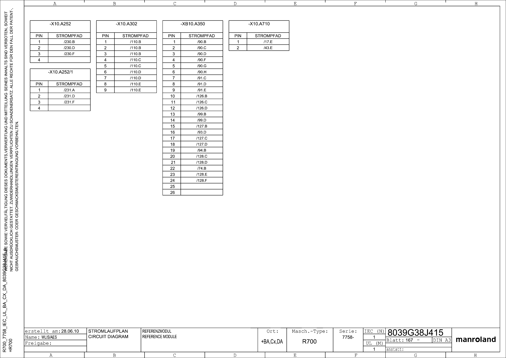

# +BA_Cx_DA — Sheet 167 of 247 — REFERENZMODUL

**REFERENCE MODULE**

> Part of the manroland **R700** printing press IEC/UL circuit diagrams.
> Drawing class: **Stromlaufplan / Circuit diagram** (DIN A3).
> Document `+BA_Cx_DA` covers the **Printing units / main switch cabinet** machine section.

## At a glance

| Field | Value |
|---|---|
| Document | `+BA_Cx_DA`  (8039G38J415) |
| Sheet | **167** of 247 |
| Section (DE) | REFERENZMODUL |
| Section (EN) | REFERENCE MODULE |
| Section type | REFERENCE_MODULE — Reference module |
| Machine type | `R700` |
| Series | `7758` |
| Created | 28.06.10 |
| Replaces | — |
| Columns used | A, B, C, D, E |
| Path numbers | — |
| Labels on sheet | 101 |
| Cross-refs out | 41 |
| Cross-refs in | 0 |

**Previous:** [+BA_Cx_DA sheet 166](SHEET_0166.md) · **Next:** [+BA_Cx_DA sheet 168](SHEET_0168.md) · **Document TOC:** [_TOC.md](_TOC.md)  (+BA_Cx_DA) · **Master TOC:** [all sheets](../_MASTER_TOC.md)

## Sheet image (300 DPI, exact vector render)



_Rendered directly from the PDF vector layer at 300 DPI (1-bit), no OCR and no resampling. Use it to confirm anything ambiguous in the text below._

## Cross-references on this sheet

Each entry is a wire leaving this sheet. The printed token is `/sheet.column`; the link resolves to that sheet inside the same document.

| Ref | Target sheet | Col | Path | Destination on target | Target section | From col |
|---|---|---|---|---|---|---|
| `/90.B` | [+BA_Cx_DA sheet 90](SHEET_0090.md) | B | — | — | BOGENFÜHRUNG | C |
| `/17.E` | [+BA_Cx_DA sheet 17](SHEET_0017.md) | E | — | — | SPANNUNGSVERSORGUNG, SCHALTSCHRANKBELÜFTUNG | E |
| `/230.B` | [+BA_Cx_DA sheet 230](SHEET_0230.md) | B | — | — | OPTION: WASCHMITTELWECHSELBETRIEB | A |
| `/110.B` | [+BA_Cx_DA sheet 110](SHEET_0110.md) | B | — | — | MOTOR: BEDRUCKSTOFFEINSTELLUNG | B |
| `/43.E` | [+BA_Cx_DA sheet 43](SHEET_0043.md) | E | — | — | SCHUTZEINRICHTUNGEN | E |
| `/110.B` | [+BA_Cx_DA sheet 110](SHEET_0110.md) | B | — | — | MOTOR: BEDRUCKSTOFFEINSTELLUNG | B |
| `/90.C` | [+BA_Cx_DA sheet 90](SHEET_0090.md) | C | — | — | BOGENFÜHRUNG | C |
| `/230.D` | [+BA_Cx_DA sheet 230](SHEET_0230.md) | D | — | — | OPTION: WASCHMITTELWECHSELBETRIEB | A |
| `/110.B` | [+BA_Cx_DA sheet 110](SHEET_0110.md) | B | — | — | MOTOR: BEDRUCKSTOFFEINSTELLUNG | B |
| `/230.F` | [+BA_Cx_DA sheet 230](SHEET_0230.md) | F | — | — | OPTION: WASCHMITTELWECHSELBETRIEB | A |
| `/90.D` | [+BA_Cx_DA sheet 90](SHEET_0090.md) | D | — | — | BOGENFÜHRUNG | C |
| `/90.F` | [+BA_Cx_DA sheet 90](SHEET_0090.md) | F | — | — | BOGENFÜHRUNG | C |
| `/110.C` | [+BA_Cx_DA sheet 110](SHEET_0110.md) | C | — | — | MOTOR: BEDRUCKSTOFFEINSTELLUNG | B |
| `/90.G` | [+BA_Cx_DA sheet 90](SHEET_0090.md) | G | — | — | BOGENFÜHRUNG | C |
| `/110.C` | [+BA_Cx_DA sheet 110](SHEET_0110.md) | C | — | — | MOTOR: BEDRUCKSTOFFEINSTELLUNG | B |
| `/90.H` | [+BA_Cx_DA sheet 90](SHEET_0090.md) | H | — | — | BOGENFÜHRUNG | C |
| `/110.D` | [+BA_Cx_DA sheet 110](SHEET_0110.md) | D | — | — | MOTOR: BEDRUCKSTOFFEINSTELLUNG | B |
| `/91.C` | [+BA_Cx_DA sheet 91](SHEET_0091.md) | C | — | — | BOGENFÜHRUNG WENDETROMMEL | C |
| `/110.D` | [+BA_Cx_DA sheet 110](SHEET_0110.md) | D | — | — | MOTOR: BEDRUCKSTOFFEINSTELLUNG | B |
| `/110.E` | [+BA_Cx_DA sheet 110](SHEET_0110.md) | E | — | — | MOTOR: BEDRUCKSTOFFEINSTELLUNG | B |
| `/91.D` | [+BA_Cx_DA sheet 91](SHEET_0091.md) | D | — | — | BOGENFÜHRUNG WENDETROMMEL | C |
| `/91.E` | [+BA_Cx_DA sheet 91](SHEET_0091.md) | E | — | — | BOGENFÜHRUNG WENDETROMMEL | C |
| `/231.A` | [+BA_Cx_DA sheet 231](SHEET_0231.md) | A | — | — | OPTION: WASCHMITTELWECHSELBETRIEB | A |
| `/110.E` | [+BA_Cx_DA sheet 110](SHEET_0110.md) | E | — | — | MOTOR: BEDRUCKSTOFFEINSTELLUNG | B |
| `/126.B` | [+BA_Cx_DA sheet 126](SHEET_0126.md) | B | — | — | RESERVE: SPS STATION (D/A) | C |
| `/231.D` | [+BA_Cx_DA sheet 231](SHEET_0231.md) | D | — | — | OPTION: WASCHMITTELWECHSELBETRIEB | A |
| `/231.F` | [+BA_Cx_DA sheet 231](SHEET_0231.md) | F | — | — | OPTION: WASCHMITTELWECHSELBETRIEB | A |
| `/126.C` | [+BA_Cx_DA sheet 126](SHEET_0126.md) | C | — | — | RESERVE: SPS STATION (D/A) | C |
| `/126.D` | [+BA_Cx_DA sheet 126](SHEET_0126.md) | D | — | — | RESERVE: SPS STATION (D/A) | C |
| `/99.B` | [+BA_Cx_DA sheet 99](SHEET_0099.md) | B | — | — | BLAS/SAUGLUFT MIT MOTORVENTILEINSTELLUNG | C |
| `/99.D` | [+BA_Cx_DA sheet 99](SHEET_0099.md) | D | — | — | BLAS/SAUGLUFT MIT MOTORVENTILEINSTELLUNG | C |
| `/127.B` | [+BA_Cx_DA sheet 127](SHEET_0127.md) | B | — | — | RESERVE: SPS STATION (D/A) | C |
| `/93.D` | [+BA_Cx_DA sheet 93](SHEET_0093.md) | D | — | — | BOGENFÜHRUNG (BLASROHRE) | C |
| `/127.C` | [+BA_Cx_DA sheet 127](SHEET_0127.md) | C | — | — | RESERVE: SPS STATION (D/A) | C |
| `/127.D` | [+BA_Cx_DA sheet 127](SHEET_0127.md) | D | — | — | RESERVE: SPS STATION (D/A) | C |
| `/94.B` | [+BA_Cx_DA sheet 94](SHEET_0094.md) | B | — | — | BOGENFÜHRUNG (BLASROHRE) | C |
| `/128.C` | [+BA_Cx_DA sheet 128](SHEET_0128.md) | C | — | — | RESERVE: SPS STATION (D/A) | C |
| `/128.D` | [+BA_Cx_DA sheet 128](SHEET_0128.md) | D | — | — | RESERVE: SPS STATION (D/A) | C |
| `/74.B` | [+BA_Cx_DA sheet 74](SHEET_0074.md) | B | — | — | FEUCHTWERK | C |
| `/128.E` | [+BA_Cx_DA sheet 128](SHEET_0128.md) | E | — | — | RESERVE: SPS STATION (D/A) | C |
| `/128.F` | [+BA_Cx_DA sheet 128](SHEET_0128.md) | F | — | — | RESERVE: SPS STATION (D/A) | C |

## Devices on this sheet

| Tag | Class | Class meaning (IEC) | Col | Sub | Terminal | Sign |
|---|---|---|---|---|---|---|
| `X10.A252` | — | cross-device reference | A | — | — | — |
| `X10.A302` | — | cross-device reference | B | — | — | — |
| `XB10.A350` | — | cross-device reference | C | — | — | — |
| `X10.A710` | — | cross-device reference | D | — | — | — |

## Potentials / nets

_No named potentials on this sheet._

## Wire-end annotations (grouped as printed)

A wire that continues elsewhere is annotated with a small cluster: the destination description, the path/line number `#NN`, and the `/sheet.column` cross reference. Each row below is one such cluster exactly as it is grouped on the drawing.

| Col | Y | Path | Cross-ref | Text on the wire |
|---|---|---|---|---|
| A | 51.3 | — | — | `X10.A252` |
| B | 51.3 | — | — | `X10.A302` |
| C | 51.3 | — | — | `XB10.A350` |
| D | 51.3 | — | — | `X10.A710` |
| A | 80.0 | — | — | `PIN 2 3 4 1 STROMPFAD` |
| B | 80.0 | — | — | `PIN 2 3 4 5 6 7 8 9 1 STROMPFAD` |
| C | 80.0 | — | — | `PIN STROMPFAD` |
| D | 80.0 | — | — | `PIN 2 1 STROMPFAD` |
| C | 94.2 | — | — | `2 3 4 5 6 7 8 9 1` |
| A | 94.5 | — | `/230.B` | — |
| B | 94.5 | — | `/110.B` | — |
| C | 94.5 | — | `/90.B` | — |
| E | 94.5 | — | `/17.E` | — |
| A | 108.7 | — | `/230.D` | — |
| B | 108.7 | — | `/110.B` | — |
| C | 108.7 | — | `/90.C` | — |
| E | 108.7 | — | `/43.E` | — |
| A | 122.9 | — | `/230.F` | — |
| B | 122.9 | — | `/110.B` | — |
| C | 122.9 | — | `/90.D` | — |
| C | 137.0 | — | `/90.F` | — |
| B | 137.1 | — | `/110.C` | — |
| B | 151.2 | — | `/110.C` | — |
| C | 151.2 | — | `/90.G` | — |
| A | 164.7 | — | — | `X10.A252/1` |
| B | 165.4 | — | `/110.D` | — |
| C | 165.4 | — | `/90.H` | — |
| B | 179.6 | — | `/110.D` | — |
| C | 179.6 | — | `/91.C` | — |
| A | 193.4 | — | — | `PIN 2 3 4 1 STROMPFAD` |
| B | 193.7 | — | `/110.E` | — |
| C | 193.8 | — | `/91.D` | — |
| A | 207.9 | — | `/231.A` | — |
| B | 207.9 | — | `/110.E` | — |
| C | 207.9 | — | `/91.E` | — |
| C | 221.8 | — | — | `10 12 13 14 15 16 17 18 19 20 11` |
| A | 222.1 | — | `/231.D` | — |
| C | 222.1 | — | `/126.B` | — |
| A | 236.3 | — | `/231.F` | — |
| C | 236.3 | — | `/126.C` | — |
| C | 250.4 | — | `/126.D` | — |
| C | 264.6 | — | `/99.B` | — |
| C | 278.8 | — | `/99.D` | — |
| C | 292.9 | — | `/127.B` | — |
| C | 307.1 | — | `/93.D` | — |
| C | 321.3 | — | `/127.C` | — |
| C | 335.5 | — | `/127.D` | — |
| C | 349.6 | — | `/94.B` | — |
| C | 363.8 | — | `/128.C` | — |
| C | 377.7 | — | — | `22 23 24 25 26 21` |
| C | 378.0 | — | `/128.D` | — |
| C | 392.1 | — | `/74.B` | — |
| C | 406.3 | — | `/128.E` | — |
| C | 420.5 | — | `/128.F` | — |


## Reconstructed tables

This sheet carries tabular content (pin map / terminal assignment / index). The grid below was rebuilt from the drawing's own rule lines, so each row is exactly one physical row of the table.

### Table 1 — 10 data rows × 2 columns (at x=70.9, y=48.2) — **X10.A252**

| PIN | STROMPFAD |
|---|---|
| `1` | `/230.B` |
| `2` | `/230.D` |
| `3` | `/230.F` |
| `4` |  |
|  | `X10.A252/1` |
| `PIN` | `STROMPFAD` |
| `1` | `/231.A` |
| `2` | `/231.D` |
| `3` | `/231.F` |
| `4` |  |


### Table 2 — 9 data rows × 2 columns (at x=226.8, y=48.2) — **X10.A302**

| PIN | STROMPFAD |
|---|---|
| `1` | `/110.B` |
| `2` | `/110.B` |
| `3` | `/110.B` |
| `4` | `/110.C` |
| `5` | `/110.C` |
| `6` | `/110.D` |
| `7` | `/110.D` |
| `8` | `/110.E` |
| `9` | `/110.E` |


### Table 3 — 26 data rows × 2 columns (at x=382.7, y=48.2) — **XB10.A350**

| PIN | STROMPFAD |
|---|---|
| `1` | `/90.B` |
| `2` | `/90.C` |
| `3` | `/90.D` |
| `4` | `/90.F` |
| `5` | `/90.G` |
| `6` | `/90.H` |
| `7` | `/91.C` |
| `8` | `/91.D` |
| `9` | `/91.E` |
| `10` | `/126.B` |
| `11` | `/126.C` |
| `12` | `/126.D` |
| `13` | `/99.B` |
| `14` | `/99.D` |
| `15` | `/127.B` |
| `16` | `/93.D` |
| `17` | `/127.C` |
| `18` | `/127.D` |
| `19` | `/94.B` |
| `20` | `/128.C` |
| `21` | `/128.D` |
| `22` | `/74.B` |
| `23` | `/128.E` |
| `24` | `/128.F` |
| `25` |  |
| `26` |  |


### Table 4 — 2 data rows × 2 columns (at x=538.6, y=48.2) — **X10.A710**

| PIN | STROMPFAD |
|---|---|
| `1` | `/17.E` |
| `2` | `/43.E` |


## Notes and free text on this sheet

| Text | Col | Y (pt) |
|---|---|---|
| `PIN` | A | 80.02 |
| `STROMPFAD` | A | 79.98 |
| `X10.A252/1` | A | 164.72 |
| `PIN` | B | 80.02 |
| `STROMPFAD` | B | 79.98 |
| `PIN` | C | 80.02 |
| `STROMPFAD` | C | 79.98 |
| `PIN` | D | 80.02 |
| `STROMPFAD` | E | 79.98 |

## Complete label inventory (exact text from the drawing)

Every text object inside the drawing area of this sheet, in DIN reading order (column A→H, then top→bottom). This is the authoritative list: if a string is not here it is not printed on this sheet.

| Col | Y | X | Dir | Type | Text |
|---|---|---|---|---|---|
| A | 51.3 | 116.8 | → | device ref | `X10.A252` |
| A | 80.0 | 84.0 | → | text | `PIN` |
| A | 80.0 | 132.2 | → | text | `STROMPFAD` |
| A | 94.2 | 90.0 | → | number | `1` |
| A | 94.5 | 150.4 | → | cross-reference | `/230.B` |
| A | 108.4 | 89.4 | → | number | `2` |
| A | 108.7 | 150.2 | → | cross-reference | `/230.D` |
| A | 122.5 | 89.4 | → | number | `3` |
| A | 122.9 | 150.7 | → | cross-reference | `/230.F` |
| A | 136.7 | 89.4 | → | number | `4` |
| A | 164.7 | 113.1 | → | text | `X10.A252/1` |
| A | 193.4 | 84.0 | → | text | `PIN` |
| A | 193.4 | 132.2 | → | text | `STROMPFAD` |
| A | 207.6 | 90.0 | → | number | `1` |
| A | 207.9 | 150.2 | → | cross-reference | `/231.A` |
| A | 221.8 | 89.4 | → | number | `2` |
| A | 222.1 | 150.2 | → | cross-reference | `/231.D` |
| A | 235.9 | 89.4 | → | number | `3` |
| A | 236.3 | 150.7 | → | cross-reference | `/231.F` |
| A | 250.1 | 89.4 | → | number | `4` |
| B | 51.3 | 272.7 | → | device ref | `X10.A302` |
| B | 80.0 | 240.0 | → | text | `PIN` |
| B | 80.0 | 288.1 | → | text | `STROMPFAD` |
| B | 94.2 | 245.9 | → | number | `1` |
| B | 94.5 | 306.3 | → | cross-reference | `/110.B` |
| B | 108.4 | 245.3 | → | number | `2` |
| B | 108.7 | 306.3 | → | cross-reference | `/110.B` |
| B | 122.5 | 245.3 | → | number | `3` |
| B | 122.9 | 306.3 | → | cross-reference | `/110.B` |
| B | 136.7 | 245.3 | → | number | `4` |
| B | 137.1 | 306.1 | → | cross-reference | `/110.C` |
| B | 150.9 | 245.3 | → | number | `5` |
| B | 151.2 | 306.1 | → | cross-reference | `/110.C` |
| B | 165.1 | 245.3 | → | number | `6` |
| B | 165.4 | 306.1 | → | cross-reference | `/110.D` |
| B | 179.2 | 245.3 | → | number | `7` |
| B | 179.6 | 306.1 | → | cross-reference | `/110.D` |
| B | 193.4 | 245.3 | → | number | `8` |
| B | 193.7 | 306.4 | → | cross-reference | `/110.E` |
| B | 207.6 | 245.3 | → | number | `9` |
| B | 207.9 | 306.4 | → | cross-reference | `/110.E` |
| C | 51.3 | 425.1 | → | device ref | `XB10.A350` |
| C | 80.0 | 395.9 | → | text | `PIN` |
| C | 80.0 | 444.0 | → | text | `STROMPFAD` |
| C | 94.2 | 407.6 | → | number | `1` |
| C | 94.5 | 464.6 | → | cross-reference | `/90.B` |
| C | 108.4 | 405.9 | → | number | `2` |
| C | 108.7 | 464.5 | → | cross-reference | `/90.C` |
| C | 122.5 | 405.9 | → | number | `3` |
| C | 122.9 | 464.5 | → | cross-reference | `/90.D` |
| C | 136.7 | 405.9 | → | number | `4` |
| C | 137.0 | 464.9 | → | cross-reference | `/90.F` |
| C | 150.9 | 405.9 | → | number | `5` |
| C | 151.2 | 464.3 | → | cross-reference | `/90.G` |
| C | 165.1 | 405.9 | → | number | `6` |
| C | 165.4 | 464.7 | → | cross-reference | `/90.H` |
| C | 179.2 | 405.9 | → | number | `7` |
| C | 179.6 | 464.5 | → | cross-reference | `/91.C` |
| C | 193.4 | 405.9 | → | number | `8` |
| C | 193.7 | 464.5 | → | cross-reference | `/91.D` |
| C | 207.6 | 405.9 | → | number | `9` |
| C | 207.9 | 464.7 | → | cross-reference | `/91.E` |
| C | 221.8 | 400.5 | → | number | `10` |
| C | 222.1 | 462.2 | → | cross-reference | `/126.B` |
| C | 235.9 | 402.2 | → | number | `11` |
| C | 236.3 | 462.0 | → | cross-reference | `/126.C` |
| C | 250.1 | 400.5 | → | number | `12` |
| C | 250.4 | 462.0 | → | cross-reference | `/126.D` |
| C | 264.3 | 400.5 | → | number | `13` |
| C | 264.6 | 464.6 | → | cross-reference | `/99.B` |
| C | 278.5 | 400.5 | → | number | `14` |
| C | 278.8 | 464.5 | → | cross-reference | `/99.D` |
| C | 292.6 | 400.5 | → | number | `15` |
| C | 292.9 | 462.2 | → | cross-reference | `/127.B` |
| C | 306.8 | 400.5 | → | number | `16` |
| C | 307.1 | 464.5 | → | cross-reference | `/93.D` |
| C | 321.0 | 400.5 | → | number | `17` |
| C | 321.3 | 462.0 | → | cross-reference | `/127.C` |
| C | 335.1 | 400.5 | → | number | `18` |
| C | 335.5 | 462.0 | → | cross-reference | `/127.D` |
| C | 349.3 | 400.5 | → | number | `19` |
| C | 349.6 | 464.6 | → | cross-reference | `/94.B` |
| C | 363.5 | 400.5 | → | number | `20` |
| C | 363.8 | 462.0 | → | cross-reference | `/128.C` |
| C | 377.7 | 402.2 | → | number | `21` |
| C | 378.0 | 462.0 | → | cross-reference | `/128.D` |
| C | 391.8 | 400.5 | → | number | `22` |
| C | 392.1 | 464.6 | → | cross-reference | `/74.B` |
| C | 406.0 | 400.5 | → | number | `23` |
| C | 406.3 | 462.3 | → | cross-reference | `/128.E` |
| C | 420.2 | 400.5 | → | number | `24` |
| C | 420.5 | 462.5 | → | cross-reference | `/128.F` |
| C | 434.4 | 400.5 | → | number | `25` |
| C | 448.5 | 400.5 | → | number | `26` |
| D | 51.3 | 584.5 | → | device ref | `X10.A710` |
| D | 80.0 | 551.8 | → | text | `PIN` |
| D | 94.2 | 557.7 | → | number | `1` |
| D | 108.4 | 557.1 | → | number | `2` |
| E | 80.0 | 600.0 | → | text | `STROMPFAD` |
| E | 94.5 | 620.6 | → | cross-reference | `/17.E` |
| E | 108.7 | 620.6 | → | cross-reference | `/43.E` |

## Reading-order text block

The same content as a plain block, grouped by DIN column — convenient to paste or to match against a visual description.

```text
=== Column A ===
  51.3  116.8  devref       X10.A252
  80.0   84.0  text         PIN
  80.0  132.2  text         STROMPFAD
  94.2   90.0  numeric      1
  94.5  150.4  xref         /230.B
 108.4   89.4  numeric      2
 108.7  150.2  xref         /230.D
 122.5   89.4  numeric      3
 122.9  150.7  xref         /230.F
 136.7   89.4  numeric      4
 164.7  113.1  text         X10.A252/1
 193.4   84.0  text         PIN
 193.4  132.2  text         STROMPFAD
 207.6   90.0  numeric      1
 207.9  150.2  xref         /231.A
 221.8   89.4  numeric      2
 222.1  150.2  xref         /231.D
 235.9   89.4  numeric      3
 236.3  150.7  xref         /231.F
 250.1   89.4  numeric      4
=== Column B ===
  51.3  272.7  devref       X10.A302
  80.0  240.0  text         PIN
  80.0  288.1  text         STROMPFAD
  94.2  245.9  numeric      1
  94.5  306.3  xref         /110.B
 108.4  245.3  numeric      2
 108.7  306.3  xref         /110.B
 122.5  245.3  numeric      3
 122.9  306.3  xref         /110.B
 136.7  245.3  numeric      4
 137.1  306.1  xref         /110.C
 150.9  245.3  numeric      5
 151.2  306.1  xref         /110.C
 165.1  245.3  numeric      6
 165.4  306.1  xref         /110.D
 179.2  245.3  numeric      7
 179.6  306.1  xref         /110.D
 193.4  245.3  numeric      8
 193.7  306.4  xref         /110.E
 207.6  245.3  numeric      9
 207.9  306.4  xref         /110.E
=== Column C ===
  51.3  425.1  devref       XB10.A350
  80.0  395.9  text         PIN
  80.0  444.0  text         STROMPFAD
  94.2  407.6  numeric      1
  94.5  464.6  xref         /90.B
 108.4  405.9  numeric      2
 108.7  464.5  xref         /90.C
 122.5  405.9  numeric      3
 122.9  464.5  xref         /90.D
 136.7  405.9  numeric      4
 137.0  464.9  xref         /90.F
 150.9  405.9  numeric      5
 151.2  464.3  xref         /90.G
 165.1  405.9  numeric      6
 165.4  464.7  xref         /90.H
 179.2  405.9  numeric      7
 179.6  464.5  xref         /91.C
 193.4  405.9  numeric      8
 193.7  464.5  xref         /91.D
 207.6  405.9  numeric      9
 207.9  464.7  xref         /91.E
 221.8  400.5  numeric      10
 222.1  462.2  xref         /126.B
 235.9  402.2  numeric      11
 236.3  462.0  xref         /126.C
 250.1  400.5  numeric      12
 250.4  462.0  xref         /126.D
 264.3  400.5  numeric      13
 264.6  464.6  xref         /99.B
 278.5  400.5  numeric      14
 278.8  464.5  xref         /99.D
 292.6  400.5  numeric      15
 292.9  462.2  xref         /127.B
 306.8  400.5  numeric      16
 307.1  464.5  xref         /93.D
 321.0  400.5  numeric      17
 321.3  462.0  xref         /127.C
 335.1  400.5  numeric      18
 335.5  462.0  xref         /127.D
 349.3  400.5  numeric      19
 349.6  464.6  xref         /94.B
 363.5  400.5  numeric      20
 363.8  462.0  xref         /128.C
 377.7  402.2  numeric      21
 378.0  462.0  xref         /128.D
 391.8  400.5  numeric      22
 392.1  464.6  xref         /74.B
 406.0  400.5  numeric      23
 406.3  462.3  xref         /128.E
 420.2  400.5  numeric      24
 420.5  462.5  xref         /128.F
 434.4  400.5  numeric      25
 448.5  400.5  numeric      26
=== Column D ===
  51.3  584.5  devref       X10.A710
  80.0  551.8  text         PIN
  94.2  557.7  numeric      1
 108.4  557.1  numeric      2
=== Column E ===
  80.0  600.0  text         STROMPFAD
  94.5  620.6  xref         /17.E
 108.7  620.6  xref         /43.E
```

---
_Generated from the PDF vector text layer; no OCR. Source: `R700_7758_IEC_UL_BA_CX_DA_8039G38J415_p`, sheet 167._
