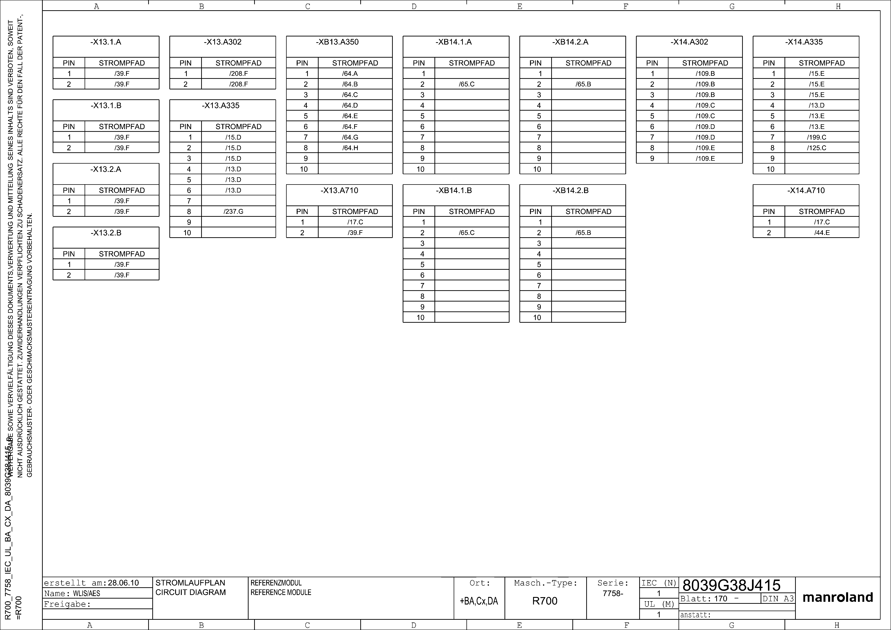

# +BA_Cx_DA — Sheet 170 of 247 — REFERENZMODUL

**REFERENCE MODULE**

> Part of the manroland **R700** printing press IEC/UL circuit diagrams.
> Drawing class: **Stromlaufplan / Circuit diagram** (DIN A3).
> Document `+BA_Cx_DA` covers the **Printing units / main switch cabinet** machine section.

## At a glance

| Field | Value |
|---|---|
| Document | `+BA_Cx_DA`  (8039G38J415) |
| Sheet | **170** of 247 |
| Section (DE) | REFERENZMODUL |
| Section (EN) | REFERENCE MODULE |
| Section type | REFERENCE_MODULE — Reference module |
| Machine type | `R700` |
| Series | `7758` |
| Created | 28.06.10 |
| Replaces | — |
| Columns used | A, B, C, D, E, F, G, H |
| Path numbers | — |
| Labels on sheet | 188 |
| Cross-refs out | 50 |
| Cross-refs in | 0 |

**Previous:** [+BA_Cx_DA sheet 169](SHEET_0169.md) · **Next:** [+BA_Cx_DA sheet 171](SHEET_0171.md) · **Document TOC:** [_TOC.md](_TOC.md)  (+BA_Cx_DA) · **Master TOC:** [all sheets](../_MASTER_TOC.md)

## Sheet image (300 DPI, exact vector render)



_Rendered directly from the PDF vector layer at 300 DPI (1-bit), no OCR and no resampling. Use it to confirm anything ambiguous in the text below._

## Cross-references on this sheet

Each entry is a wire leaving this sheet. The printed token is `/sheet.column`; the link resolves to that sheet inside the same document.

| Ref | Target sheet | Col | Path | Destination on target | Target section | From col |
|---|---|---|---|---|---|---|
| `/64.A` | [+BA_Cx_DA sheet 64](SHEET_0064.md) | A | — | — | MASCHINENBEDIENUNG: BEDIENUNGKOMMANDOS | C |
| `/15.E` | [+BA_Cx_DA sheet 15](SHEET_0015.md) | E | — | — | SPANNUNGSVERSORGUNG, SCHALTSCHRANKBELÜFTUNG | H |
| `/39.F` | [+BA_Cx_DA sheet 39](SHEET_0039.md) | F | — | — | SCHUTZEINRICHTUNGEN | A |
| `/109.B` | [+BA_Cx_DA sheet 109](SHEET_0109.md) | B | — | — | MOTOR: HEBERSTREIFENBREITE | G |
| `/208.F` | [+BA_Cx_DA sheet 208](SHEET_0208.md) | F | — | — | OPTION: | B |
| `/64.B` | [+BA_Cx_DA sheet 64](SHEET_0064.md) | B | — | — | MASCHINENBEDIENUNG: BEDIENUNGKOMMANDOS | C |
| `/65.B` | [+BA_Cx_DA sheet 65](SHEET_0065.md) | B | — | — | DRUCKANSTELLUNG | F |
| `/15.E` | [+BA_Cx_DA sheet 15](SHEET_0015.md) | E | — | — | SPANNUNGSVERSORGUNG, SCHALTSCHRANKBELÜFTUNG | H |
| `/39.F` | [+BA_Cx_DA sheet 39](SHEET_0039.md) | F | — | — | SCHUTZEINRICHTUNGEN | A |
| `/109.B` | [+BA_Cx_DA sheet 109](SHEET_0109.md) | B | — | — | MOTOR: HEBERSTREIFENBREITE | G |
| `/208.F` | [+BA_Cx_DA sheet 208](SHEET_0208.md) | F | — | — | OPTION: | B |
| `/65.C` | [+BA_Cx_DA sheet 65](SHEET_0065.md) | C | — | — | DRUCKANSTELLUNG | E |
| `/15.E` | [+BA_Cx_DA sheet 15](SHEET_0015.md) | E | — | — | SPANNUNGSVERSORGUNG, SCHALTSCHRANKBELÜFTUNG | H |
| `/109.B` | [+BA_Cx_DA sheet 109](SHEET_0109.md) | B | — | — | MOTOR: HEBERSTREIFENBREITE | G |
| `/64.C` | [+BA_Cx_DA sheet 64](SHEET_0064.md) | C | — | — | MASCHINENBEDIENUNG: BEDIENUNGKOMMANDOS | C |
| `/64.D` | [+BA_Cx_DA sheet 64](SHEET_0064.md) | D | — | — | MASCHINENBEDIENUNG: BEDIENUNGKOMMANDOS | C |
| `/13.D` | [+BA_Cx_DA sheet 13](SHEET_0013.md) | D | — | — | SPANNUNGSVERSORGUNG, SCHALTSCHRANKBELÜFTUNG | H |
| `/109.C` | [+BA_Cx_DA sheet 109](SHEET_0109.md) | C | — | — | MOTOR: HEBERSTREIFENBREITE | G |
| `/64.E` | [+BA_Cx_DA sheet 64](SHEET_0064.md) | E | — | — | MASCHINENBEDIENUNG: BEDIENUNGKOMMANDOS | C |
| `/13.E` | [+BA_Cx_DA sheet 13](SHEET_0013.md) | E | — | — | SPANNUNGSVERSORGUNG, SCHALTSCHRANKBELÜFTUNG | H |
| `/109.C` | [+BA_Cx_DA sheet 109](SHEET_0109.md) | C | — | — | MOTOR: HEBERSTREIFENBREITE | G |
| `/13.E` | [+BA_Cx_DA sheet 13](SHEET_0013.md) | E | — | — | SPANNUNGSVERSORGUNG, SCHALTSCHRANKBELÜFTUNG | H |
| `/64.F` | [+BA_Cx_DA sheet 64](SHEET_0064.md) | F | — | — | MASCHINENBEDIENUNG: BEDIENUNGKOMMANDOS | C |
| `/109.D` | [+BA_Cx_DA sheet 109](SHEET_0109.md) | D | — | — | MOTOR: HEBERSTREIFENBREITE | G |
| `/39.F` | [+BA_Cx_DA sheet 39](SHEET_0039.md) | F | — | — | SCHUTZEINRICHTUNGEN | A |
| `/64.G` | [+BA_Cx_DA sheet 64](SHEET_0064.md) | G | — | — | MASCHINENBEDIENUNG: BEDIENUNGKOMMANDOS | C |
| `/15.D` | [+BA_Cx_DA sheet 15](SHEET_0015.md) | D | — | — | SPANNUNGSVERSORGUNG, SCHALTSCHRANKBELÜFTUNG | B |
| `/109.D` | [+BA_Cx_DA sheet 109](SHEET_0109.md) | D | — | — | MOTOR: HEBERSTREIFENBREITE | G |
| `/199.C` | [+BA_Cx_DA sheet 199](SHEET_0199.md) | C | — | — | OPTION: WASCHVORRICHTUNG MIT BÜRSTE | H |
| `/39.F` | [+BA_Cx_DA sheet 39](SHEET_0039.md) | F | — | — | SCHUTZEINRICHTUNGEN | A |
| `/109.E` | [+BA_Cx_DA sheet 109](SHEET_0109.md) | E | — | — | MOTOR: HEBERSTREIFENBREITE | G |
| `/15.D` | [+BA_Cx_DA sheet 15](SHEET_0015.md) | D | — | — | SPANNUNGSVERSORGUNG, SCHALTSCHRANKBELÜFTUNG | B |
| `/64.H` | [+BA_Cx_DA sheet 64](SHEET_0064.md) | H | — | — | MASCHINENBEDIENUNG: BEDIENUNGKOMMANDOS | C |
| `/125.C` | [+BA_Cx_DA sheet 125](SHEET_0125.md) | C | — | — | RESERVE: SPS STATION (INPUT) | H |
| `/109.E` | [+BA_Cx_DA sheet 109](SHEET_0109.md) | E | — | — | MOTOR: HEBERSTREIFENBREITE | G |
| `/15.D` | [+BA_Cx_DA sheet 15](SHEET_0015.md) | D | — | — | SPANNUNGSVERSORGUNG, SCHALTSCHRANKBELÜFTUNG | B |
| `/13.D` | [+BA_Cx_DA sheet 13](SHEET_0013.md) | D | — | — | SPANNUNGSVERSORGUNG, SCHALTSCHRANKBELÜFTUNG | B |
| `/13.D` | [+BA_Cx_DA sheet 13](SHEET_0013.md) | D | — | — | SPANNUNGSVERSORGUNG, SCHALTSCHRANKBELÜFTUNG | B |
| `/13.D` | [+BA_Cx_DA sheet 13](SHEET_0013.md) | D | — | — | SPANNUNGSVERSORGUNG, SCHALTSCHRANKBELÜFTUNG | B |
| `/39.F` | [+BA_Cx_DA sheet 39](SHEET_0039.md) | F | — | — | SCHUTZEINRICHTUNGEN | A |
| `/39.F` | [+BA_Cx_DA sheet 39](SHEET_0039.md) | F | — | — | SCHUTZEINRICHTUNGEN | A |
| `/237.G` | [+BA_Cx_DA sheet 237](SHEET_0237.md) | G | — | — | OPTION: INLINECOATER SMART | B |
| `/17.C` | [+BA_Cx_DA sheet 17](SHEET_0017.md) | C | — | — | SPANNUNGSVERSORGUNG, SCHALTSCHRANKBELÜFTUNG | C |
| `/17.C` | [+BA_Cx_DA sheet 17](SHEET_0017.md) | C | — | — | SPANNUNGSVERSORGUNG, SCHALTSCHRANKBELÜFTUNG | H |
| `/65.B` | [+BA_Cx_DA sheet 65](SHEET_0065.md) | B | — | — | DRUCKANSTELLUNG | F |
| `/44.E` | [+BA_Cx_DA sheet 44](SHEET_0044.md) | E | — | — | SCHUTZEINRICHTUNGEN | H |
| `/39.F` | [+BA_Cx_DA sheet 39](SHEET_0039.md) | F | — | — | SCHUTZEINRICHTUNGEN | C |
| `/65.C` | [+BA_Cx_DA sheet 65](SHEET_0065.md) | C | — | — | DRUCKANSTELLUNG | E |
| `/39.F` | [+BA_Cx_DA sheet 39](SHEET_0039.md) | F | — | — | SCHUTZEINRICHTUNGEN | A |
| `/39.F` | [+BA_Cx_DA sheet 39](SHEET_0039.md) | F | — | — | SCHUTZEINRICHTUNGEN | A |

## Devices on this sheet

| Tag | Class | Class meaning (IEC) | Col | Sub | Terminal | Sign |
|---|---|---|---|---|---|---|
| `XB14.1.A` | — | cross-device reference | D | — | — | — |
| `XB14.1.B` | — | cross-device reference | D | — | — | — |
| `XB14.2.A` | — | cross-device reference | E | — | — | — |
| `XB14.2.B` | — | cross-device reference | E | — | — | — |
| `X14.A302` | — | cross-device reference | G | — | — | — |
| `X14.A335` | — | cross-device reference | H | — | — | — |
| `X14.A710` | — | cross-device reference | H | — | — | — |
| `X13.A302` | — | cross-device reference | B | — | — | — |
| `XB13.A350` | — | cross-device reference | C | — | — | — |
| `X13.A335` | — | cross-device reference | B | — | — | — |
| `X13.A710` | — | cross-device reference | C | — | — | — |
| `X13.1.A` | — | cross-device reference | A | — | — | — |
| `X13.1.B` | — | cross-device reference | A | — | — | — |
| `X13.2.A` | — | cross-device reference | A | — | — | — |
| `X13.2.B` | — | cross-device reference | A | — | — | — |

## Potentials / nets

_No named potentials on this sheet._

## Wire-end annotations (grouped as printed)

A wire that continues elsewhere is annotated with a small cluster: the destination description, the path/line number `#NN`, and the `/sheet.column` cross reference. Each row below is one such cluster exactly as it is grouped on the drawing.

| Col | Y | Path | Cross-ref | Text on the wire |
|---|---|---|---|---|
| B | 51.3 | — | — | `X13.A302` |
| C | 51.3 | — | — | `XB13.A350` |
| G | 51.3 | — | — | `X14.A302` |
| H | 51.3 | — | — | `X14.A335` |
| A | 51.4 | — | — | `X13.1.A` |
| D | 51.4 | — | — | `XB14.1.A` |
| E | 51.4 | — | — | `XB14.2.A` |
| A | 80.0 | — | — | `PIN 2 1 STROMPFAD` |
| B | 80.0 | — | — | `PIN 2 1 STROMPFAD` |
| C | 80.0 | — | — | `PIN 10 2 3 4 5 6 7 8 9 1 STROMPFAD` |
| D | 80.0 | — | — | `PIN 10 2 3 4 5 6 7 8 9 1 STROMPFAD` |
| E | 80.0 | — | — | `PIN 10 2 3 4 5 6 7 8 9 1 STROMPFAD` |
| G | 80.0 | — | — | `PIN 2 3 4 5 6 7 8 9 1 STROMPFAD` |
| H | 80.0 | — | — | `PIN 10 2 3 4 5 6 7 8 9 1 STROMPFAD` |
| A | 94.5 | — | `/39.F` | — |
| B | 94.5 | — | `/208.F` | — |
| C | 94.5 | — | `/64.A` | — |
| G | 94.5 | — | `/109.B` | — |
| H | 94.5 | — | `/15.E` | — |
| A | 108.7 | — | `/39.F` | — |
| B | 108.7 | — | `/208.F` | — |
| C | 108.7 | — | `/64.B` | — |
| E | 108.7 | — | `/65.C` | — |
| F | 108.7 | — | `/65.B` | — |
| G | 108.7 | — | `/109.B` | — |
| H | 108.7 | — | `/15.E` | — |
| H | 122.8 | — | `/15.E` | — |
| C | 122.9 | — | `/64.C` | — |
| G | 122.9 | — | `/109.B` | — |
| A | 136.4 | — | — | `X13.1.B` |
| B | 136.4 | — | — | `X13.A335` |
| C | 137.1 | — | `/64.D` | — |
| G | 137.1 | — | `/109.C` | — |
| H | 137.1 | — | `/13.D` | — |
| C | 151.2 | — | `/64.E` | — |
| G | 151.2 | — | `/109.C` | — |
| H | 151.2 | — | `/13.E` | — |
| A | 165.0 | — | — | `PIN 2 1 STROMPFAD` |
| B | 165.0 | — | — | `PIN 10 2 3 4 5 6 7 8 9 1 STROMPFAD` |
| C | 165.4 | — | `/64.F` | — |
| G | 165.4 | — | `/109.D` | — |
| H | 165.4 | — | `/13.E` | — |
| A | 179.6 | — | `/39.F` | — |
| B | 179.6 | — | `/15.D` | — |
| C | 179.6 | — | `/64.G` | — |
| G | 179.6 | — | `/109.D` | — |
| H | 179.6 | — | `/199.C` | — |
| A | 193.7 | — | `/39.F` | — |
| G | 193.7 | — | `/109.E` | — |
| B | 193.8 | — | `/15.D` | — |
| C | 193.8 | — | `/64.H` | — |
| H | 193.8 | — | `/125.C` | — |
| B | 207.9 | — | `/15.D` | — |
| G | 207.9 | — | `/109.E` | — |
| A | 221.4 | — | — | `X13.2.A` |
| B | 222.1 | — | `/13.D` | — |
| B | 236.3 | — | `/13.D` | — |
| C | 249.8 | — | — | `X13.A710` |
| D | 249.8 | — | — | `XB14.1.B` |
| E | 249.8 | — | — | `XB14.2.B` |
| H | 249.8 | — | — | `X14.A710` |
| A | 250.1 | — | — | `PIN 2 1 STROMPFAD` |
| B | 250.4 | — | `/13.D` | — |
| A | 264.6 | — | `/39.F` | — |
| C | 278.4 | — | — | `PIN 2 1 STROMPFAD` |
| D | 278.4 | — | — | `PIN 10 2 3 4 5 6 7 8 9 1 STROMPFAD` |
| E | 278.4 | — | — | `PIN 10 2 3 4 5 6 7 8 9 1 STROMPFAD` |
| H | 278.4 | — | — | `PIN 2 1 STROMPFAD` |
| A | 278.8 | — | `/39.F` | — |
| B | 278.8 | — | `/237.G` | — |
| C | 293.0 | — | `/17.C` | — |
| H | 293.0 | — | `/17.C` | — |
| A | 306.5 | — | — | `X13.2.B` |
| C | 307.1 | — | `/39.F` | — |
| E | 307.1 | — | `/65.C` | — |
| F | 307.1 | — | `/65.B` | — |
| H | 307.1 | — | `/44.E` | — |
| A | 335.1 | — | — | `PIN 2 1 STROMPFAD` |
| A | 349.6 | — | `/39.F` | — |
| A | 363.8 | — | `/39.F` | — |


## Reconstructed tables

This sheet carries tabular content (pin map / terminal assignment / index). The grid below was rebuilt from the drawing's own rule lines, so each row is exactly one physical row of the table.

### Table 1 — 14 data rows × 2 columns (at x=70.9, y=48.2) — **X13.1.A**

| PIN | STROMPFAD |
|---|---|
| `1` | `/39.F` |
| `2` | `/39.F` |
|  | `X13.1.B` |
| `PIN` | `STROMPFAD` |
| `1` | `/39.F` |
| `2` | `/39.F` |
|  | `X13.2.A` |
| `PIN` | `STROMPFAD` |
| `1` | `/39.F` |
| `2` | `/39.F` |
|  | `X13.2.B` |
| `PIN` | `STROMPFAD` |
| `1` | `/39.F` |
| `2` | `/39.F` |


### Table 2 — 14 data rows × 2 columns (at x=226.8, y=48.2) — **X13.A302**

| PIN | STROMPFAD |
|---|---|
| `1` | `/208.F` |
| `2` | `/208.F` |
|  | `X13.A335` |
| `PIN` | `STROMPFAD` |
| `1` | `/15.D` |
| `2` | `/15.D` |
| `3` | `/15.D` |
| `4` | `/13.D` |
| `5` | `/13.D` |
| `6` | `/13.D` |
| `7` |  |
| `8` | `/237.G` |
| `9` |  |
| `10` |  |


### Table 3 — 14 data rows × 2 columns (at x=382.7, y=48.2) — **XB13.A350**

| PIN | STROMPFAD |
|---|---|
| `1` | `/64.A` |
| `2` | `/64.B` |
| `3` | `/64.C` |
| `4` | `/64.D` |
| `5` | `/64.E` |
| `6` | `/64.F` |
| `7` | `/64.G` |
| `8` | `/64.H` |
| `9` |  |
| `10` |  |
|  | `X13.A710` |
| `PIN` | `STROMPFAD` |
| `1` | `/17.C` |
| `2` | `/39.F` |


### Table 4 — 22 data rows × 2 columns (at x=538.6, y=48.2) — **XB14.1.A**

| PIN | STROMPFAD |
|---|---|
| `1` |  |
| `2` | `/65.C` |
| `3` |  |
| `4` |  |
| `5` |  |
| `6` |  |
| `7` |  |
| `8` |  |
| `9` |  |
| `10` |  |
|  | `XB14.1.B` |
| `PIN` | `STROMPFAD` |
| `1` |  |
| `2` | `/65.C` |
| `3` |  |
| `4` |  |
| `5` |  |
| `6` |  |
| `7` |  |
| `8` |  |
| `9` |  |
| `10` |  |


### Table 5 — 22 data rows × 2 columns (at x=694.5, y=48.2) — **XB14.2.A**

| PIN | STROMPFAD |
|---|---|
| `1` |  |
| `2` | `/65.B` |
| `3` |  |
| `4` |  |
| `5` |  |
| `6` |  |
| `7` |  |
| `8` |  |
| `9` |  |
| `10` |  |
|  | `XB14.2.B` |
| `PIN` | `STROMPFAD` |
| `1` |  |
| `2` | `/65.B` |
| `3` |  |
| `4` |  |
| `5` |  |
| `6` |  |
| `7` |  |
| `8` |  |
| `9` |  |
| `10` |  |


### Table 6 — 9 data rows × 2 columns (at x=850.4, y=48.2) — **X14.A302**

| PIN | STROMPFAD |
|---|---|
| `1` | `/109.B` |
| `2` | `/109.B` |
| `3` | `/109.B` |
| `4` | `/109.C` |
| `5` | `/109.C` |
| `6` | `/109.D` |
| `7` | `/109.D` |
| `8` | `/109.E` |
| `9` | `/109.E` |


### Table 7 — 14 data rows × 2 columns (at x=1006.3, y=48.2) — **X14.A335**

| PIN | STROMPFAD |
|---|---|
| `1` | `/15.E` |
| `2` | `/15.E` |
| `3` | `/15.E` |
| `4` | `/13.D` |
| `5` | `/13.E` |
| `6` | `/13.E` |
| `7` | `/199.C` |
| `8` | `/125.C` |
| `9` |  |
| `10` |  |
|  | `X14.A710` |
| `PIN` | `STROMPFAD` |
| `1` | `/17.C` |
| `2` | `/44.E` |


## Notes and free text on this sheet

| Text | Col | Y (pt) |
|---|---|---|
| `PIN` | D | 80.02 |
| `STROMPFAD` | E | 79.98 |
| `PIN` | E | 80.02 |
| `STROMPFAD` | F | 79.98 |
| `PIN` | F | 80.02 |
| `STROMPFAD` | G | 79.98 |
| `PIN` | G | 80.02 |
| `STROMPFAD` | H | 79.98 |
| `PIN` | B | 80.02 |
| `STROMPFAD` | B | 79.98 |
| `PIN` | C | 80.02 |
| `STROMPFAD` | C | 79.98 |
| `PIN` | A | 80.02 |
| `STROMPFAD` | A | 79.98 |

## Complete label inventory (exact text from the drawing)

Every text object inside the drawing area of this sheet, in DIN reading order (column A→H, then top→bottom). This is the authoritative list: if a string is not here it is not printed on this sheet.

| Col | Y | X | Dir | Type | Text |
|---|---|---|---|---|---|
| A | 51.3 | 120.9 | → | device ref | `X13.1.A` |
| A | 80.0 | 84.0 | → | text | `PIN` |
| A | 80.0 | 132.2 | → | text | `STROMPFAD` |
| A | 94.2 | 90.0 | → | number | `1` |
| A | 94.5 | 153.1 | → | cross-reference | `/39.F` |
| A | 108.4 | 89.4 | → | number | `2` |
| A | 108.7 | 153.1 | → | cross-reference | `/39.F` |
| A | 136.4 | 121.3 | → | device ref | `X13.1.B` |
| A | 165.0 | 132.2 | → | text | `STROMPFAD` |
| A | 165.1 | 84.0 | → | text | `PIN` |
| A | 179.2 | 90.0 | → | number | `1` |
| A | 179.6 | 153.1 | → | cross-reference | `/39.F` |
| A | 193.4 | 89.4 | → | number | `2` |
| A | 193.7 | 153.1 | → | cross-reference | `/39.F` |
| A | 221.4 | 120.9 | → | device ref | `X13.2.A` |
| A | 250.1 | 84.0 | → | text | `PIN` |
| A | 250.1 | 132.2 | → | text | `STROMPFAD` |
| A | 264.3 | 90.0 | → | number | `1` |
| A | 264.6 | 153.1 | → | cross-reference | `/39.F` |
| A | 278.5 | 89.4 | → | number | `2` |
| A | 278.8 | 153.1 | → | cross-reference | `/39.F` |
| A | 306.5 | 121.3 | → | device ref | `X13.2.B` |
| A | 335.1 | 84.0 | → | text | `PIN` |
| A | 335.1 | 132.2 | → | text | `STROMPFAD` |
| A | 349.3 | 90.0 | → | number | `1` |
| A | 349.6 | 153.1 | → | cross-reference | `/39.F` |
| A | 363.5 | 89.4 | → | number | `2` |
| A | 363.8 | 153.1 | → | cross-reference | `/39.F` |
| B | 51.3 | 272.7 | → | device ref | `X13.A302` |
| B | 80.0 | 240.0 | → | text | `PIN` |
| B | 80.0 | 288.1 | → | text | `STROMPFAD` |
| B | 94.2 | 245.9 | → | number | `1` |
| B | 94.5 | 306.6 | → | cross-reference | `/208.F` |
| B | 108.4 | 245.3 | → | number | `2` |
| B | 108.7 | 306.6 | → | cross-reference | `/208.F` |
| B | 136.4 | 269.9 | → | device ref | `X13.A335` |
| B | 165.0 | 288.1 | → | text | `STROMPFAD` |
| B | 165.1 | 240.0 | → | text | `PIN` |
| B | 179.2 | 251.7 | → | number | `1` |
| B | 179.6 | 301.5 | → | cross-reference | `/15.D` |
| B | 193.4 | 250.0 | → | number | `2` |
| B | 193.7 | 301.5 | → | cross-reference | `/15.D` |
| B | 207.6 | 250.0 | → | number | `3` |
| B | 207.9 | 301.5 | → | cross-reference | `/15.D` |
| B | 221.8 | 250.0 | → | number | `4` |
| B | 222.1 | 301.5 | → | cross-reference | `/13.D` |
| B | 235.9 | 250.0 | → | number | `5` |
| B | 236.3 | 301.5 | → | cross-reference | `/13.D` |
| B | 250.1 | 250.0 | → | number | `6` |
| B | 250.4 | 301.5 | → | cross-reference | `/13.D` |
| B | 264.3 | 250.0 | → | number | `7` |
| B | 278.5 | 250.0 | → | number | `8` |
| B | 278.8 | 298.9 | → | cross-reference | `/237.G` |
| B | 292.6 | 250.0 | → | number | `9` |
| B | 306.8 | 244.6 | → | number | `10` |
| C | 51.3 | 422.2 | → | device ref | `XB13.A350` |
| C | 80.0 | 395.9 | → | text | `PIN` |
| C | 80.0 | 444.0 | → | text | `STROMPFAD` |
| C | 94.2 | 407.6 | → | number | `1` |
| C | 94.5 | 457.4 | → | cross-reference | `/64.A` |
| C | 108.4 | 405.9 | → | number | `2` |
| C | 108.7 | 457.5 | → | cross-reference | `/64.B` |
| C | 122.5 | 405.9 | → | number | `3` |
| C | 122.9 | 457.4 | → | cross-reference | `/64.C` |
| C | 136.7 | 405.9 | → | number | `4` |
| C | 137.1 | 457.4 | → | cross-reference | `/64.D` |
| C | 150.9 | 405.9 | → | number | `5` |
| C | 151.2 | 457.7 | → | cross-reference | `/64.E` |
| C | 165.1 | 405.9 | → | number | `6` |
| C | 165.4 | 457.8 | → | cross-reference | `/64.F` |
| C | 179.2 | 405.9 | → | number | `7` |
| C | 179.6 | 457.2 | → | cross-reference | `/64.G` |
| C | 193.4 | 405.9 | → | number | `8` |
| C | 193.7 | 457.7 | → | cross-reference | `/64.H` |
| C | 207.6 | 405.9 | → | number | `9` |
| C | 221.8 | 400.5 | → | number | `10` |
| C | 249.8 | 428.6 | → | device ref | `X13.A710` |
| C | 278.4 | 395.9 | → | text | `PIN` |
| C | 278.4 | 444.0 | → | text | `STROMPFAD` |
| C | 292.6 | 401.8 | → | number | `1` |
| C | 293.0 | 464.5 | → | cross-reference | `/17.C` |
| C | 306.8 | 401.2 | → | number | `2` |
| C | 307.1 | 464.9 | → | cross-reference | `/39.F` |
| D | 51.3 | 582.2 | → | device ref | `XB14.1.A` |
| D | 80.0 | 551.8 | → | text | `PIN` |
| D | 94.2 | 563.5 | → | number | `1` |
| D | 108.4 | 561.8 | → | number | `2` |
| D | 122.5 | 561.8 | → | number | `3` |
| D | 136.7 | 561.8 | → | number | `4` |
| D | 150.9 | 561.8 | → | number | `5` |
| D | 165.1 | 561.8 | → | number | `6` |
| D | 179.2 | 561.8 | → | number | `7` |
| D | 193.4 | 561.8 | → | number | `8` |
| D | 207.6 | 561.8 | → | number | `9` |
| D | 221.8 | 556.4 | → | number | `10` |
| D | 249.8 | 582.7 | → | device ref | `XB14.1.B` |
| D | 278.4 | 551.8 | → | text | `PIN` |
| D | 292.6 | 563.5 | → | number | `1` |
| D | 306.8 | 561.8 | → | number | `2` |
| D | 321.0 | 561.8 | → | number | `3` |
| D | 335.1 | 561.8 | → | number | `4` |
| D | 349.3 | 561.8 | → | number | `5` |
| D | 363.5 | 561.8 | → | number | `6` |
| D | 377.7 | 561.8 | → | number | `7` |
| D | 391.8 | 561.8 | → | number | `8` |
| D | 406.0 | 561.8 | → | number | `9` |
| D | 420.2 | 556.4 | → | number | `10` |
| E | 51.3 | 738.1 | → | device ref | `XB14.2.A` |
| E | 80.0 | 600.0 | → | text | `STROMPFAD` |
| E | 80.0 | 707.7 | → | text | `PIN` |
| E | 94.2 | 719.4 | → | number | `1` |
| E | 108.4 | 717.7 | → | number | `2` |
| E | 108.7 | 613.3 | → | cross-reference | `/65.C` |
| E | 122.5 | 717.7 | → | number | `3` |
| E | 136.7 | 717.7 | → | number | `4` |
| E | 150.9 | 717.7 | → | number | `5` |
| E | 165.1 | 717.7 | → | number | `6` |
| E | 179.2 | 717.7 | → | number | `7` |
| E | 193.4 | 717.7 | → | number | `8` |
| E | 207.6 | 717.7 | → | number | `9` |
| E | 221.8 | 712.3 | → | number | `10` |
| E | 249.8 | 738.6 | → | device ref | `XB14.2.B` |
| E | 278.4 | 600.0 | → | text | `STROMPFAD` |
| E | 278.4 | 707.7 | → | text | `PIN` |
| E | 292.6 | 719.4 | → | number | `1` |
| E | 306.8 | 717.7 | → | number | `2` |
| E | 307.1 | 613.3 | → | cross-reference | `/65.C` |
| E | 321.0 | 717.7 | → | number | `3` |
| E | 335.1 | 717.7 | → | number | `4` |
| E | 349.3 | 717.7 | → | number | `5` |
| E | 363.5 | 717.7 | → | number | `6` |
| E | 377.7 | 717.7 | → | number | `7` |
| E | 391.8 | 717.7 | → | number | `8` |
| E | 406.0 | 717.7 | → | number | `9` |
| E | 420.2 | 712.3 | → | number | `10` |
| F | 80.0 | 755.9 | → | text | `STROMPFAD` |
| F | 80.0 | 863.6 | → | text | `PIN` |
| F | 94.2 | 869.5 | → | number | `1` |
| F | 108.4 | 869.0 | → | number | `2` |
| F | 108.7 | 769.3 | → | cross-reference | `/65.B` |
| F | 122.5 | 869.0 | → | number | `3` |
| F | 136.7 | 869.0 | → | number | `4` |
| F | 150.9 | 869.0 | → | number | `5` |
| F | 165.1 | 869.0 | → | number | `6` |
| F | 179.2 | 869.0 | → | number | `7` |
| F | 193.4 | 869.0 | → | number | `8` |
| F | 207.6 | 869.0 | → | number | `9` |
| F | 278.4 | 755.9 | → | text | `STROMPFAD` |
| F | 307.1 | 769.3 | → | cross-reference | `/65.B` |
| G | 51.3 | 896.3 | → | device ref | `X14.A302` |
| G | 80.0 | 911.8 | → | text | `STROMPFAD` |
| G | 80.0 | 1019.5 | → | text | `PIN` |
| G | 94.2 | 1031.2 | → | number | `1` |
| G | 94.5 | 929.9 | → | cross-reference | `/109.B` |
| G | 108.4 | 1029.5 | → | number | `2` |
| G | 108.7 | 929.9 | → | cross-reference | `/109.B` |
| G | 122.5 | 1029.5 | → | number | `3` |
| G | 122.9 | 929.9 | → | cross-reference | `/109.B` |
| G | 136.7 | 1029.5 | → | number | `4` |
| G | 137.1 | 929.8 | → | cross-reference | `/109.C` |
| G | 150.9 | 1029.5 | → | number | `5` |
| G | 151.2 | 929.8 | → | cross-reference | `/109.C` |
| G | 165.1 | 1029.5 | → | number | `6` |
| G | 165.4 | 929.8 | → | cross-reference | `/109.D` |
| G | 179.2 | 1029.5 | → | number | `7` |
| G | 179.6 | 929.8 | → | cross-reference | `/109.D` |
| G | 193.4 | 1029.5 | → | number | `8` |
| G | 193.7 | 930.0 | → | cross-reference | `/109.E` |
| G | 207.6 | 1029.5 | → | number | `9` |
| G | 207.9 | 930.0 | → | cross-reference | `/109.E` |
| G | 221.8 | 1024.2 | → | number | `10` |
| G | 278.4 | 1019.5 | → | text | `PIN` |
| G | 292.6 | 1025.4 | → | number | `1` |
| G | 306.8 | 1024.9 | → | number | `2` |
| H | 51.3 | 1049.4 | → | device ref | `X14.A335` |
| H | 80.0 | 1067.7 | → | text | `STROMPFAD` |
| H | 94.5 | 1081.3 | → | cross-reference | `/15.E` |
| H | 108.7 | 1081.3 | → | cross-reference | `/15.E` |
| H | 122.8 | 1081.3 | → | cross-reference | `/15.E` |
| H | 137.1 | 1081.0 | → | cross-reference | `/13.D` |
| H | 151.2 | 1081.3 | → | cross-reference | `/13.E` |
| H | 165.4 | 1081.3 | → | cross-reference | `/13.E` |
| H | 179.6 | 1078.6 | → | cross-reference | `/199.C` |
| H | 193.8 | 1078.6 | → | cross-reference | `/125.C` |
| H | 249.8 | 1052.2 | → | device ref | `X14.A710` |
| H | 278.4 | 1067.7 | → | text | `STROMPFAD` |
| H | 293.0 | 1088.1 | → | cross-reference | `/17.C` |
| H | 307.1 | 1088.4 | → | cross-reference | `/44.E` |

## Reading-order text block

The same content as a plain block, grouped by DIN column — convenient to paste or to match against a visual description.

```text
=== Column A ===
  51.3  120.9  devref       X13.1.A
  80.0   84.0  text         PIN
  80.0  132.2  text         STROMPFAD
  94.2   90.0  numeric      1
  94.5  153.1  xref         /39.F
 108.4   89.4  numeric      2
 108.7  153.1  xref         /39.F
 136.4  121.3  devref       X13.1.B
 165.0  132.2  text         STROMPFAD
 165.1   84.0  text         PIN
 179.2   90.0  numeric      1
 179.6  153.1  xref         /39.F
 193.4   89.4  numeric      2
 193.7  153.1  xref         /39.F
 221.4  120.9  devref       X13.2.A
 250.1   84.0  text         PIN
 250.1  132.2  text         STROMPFAD
 264.3   90.0  numeric      1
 264.6  153.1  xref         /39.F
 278.5   89.4  numeric      2
 278.8  153.1  xref         /39.F
 306.5  121.3  devref       X13.2.B
 335.1   84.0  text         PIN
 335.1  132.2  text         STROMPFAD
 349.3   90.0  numeric      1
 349.6  153.1  xref         /39.F
 363.5   89.4  numeric      2
 363.8  153.1  xref         /39.F
=== Column B ===
  51.3  272.7  devref       X13.A302
  80.0  240.0  text         PIN
  80.0  288.1  text         STROMPFAD
  94.2  245.9  numeric      1
  94.5  306.6  xref         /208.F
 108.4  245.3  numeric      2
 108.7  306.6  xref         /208.F
 136.4  269.9  devref       X13.A335
 165.0  288.1  text         STROMPFAD
 165.1  240.0  text         PIN
 179.2  251.7  numeric      1
 179.6  301.5  xref         /15.D
 193.4  250.0  numeric      2
 193.7  301.5  xref         /15.D
 207.6  250.0  numeric      3
 207.9  301.5  xref         /15.D
 221.8  250.0  numeric      4
 222.1  301.5  xref         /13.D
 235.9  250.0  numeric      5
 236.3  301.5  xref         /13.D
 250.1  250.0  numeric      6
 250.4  301.5  xref         /13.D
 264.3  250.0  numeric      7
 278.5  250.0  numeric      8
 278.8  298.9  xref         /237.G
 292.6  250.0  numeric      9
 306.8  244.6  numeric      10
=== Column C ===
  51.3  422.2  devref       XB13.A350
  80.0  395.9  text         PIN
  80.0  444.0  text         STROMPFAD
  94.2  407.6  numeric      1
  94.5  457.4  xref         /64.A
 108.4  405.9  numeric      2
 108.7  457.5  xref         /64.B
 122.5  405.9  numeric      3
 122.9  457.4  xref         /64.C
 136.7  405.9  numeric      4
 137.1  457.4  xref         /64.D
 150.9  405.9  numeric      5
 151.2  457.7  xref         /64.E
 165.1  405.9  numeric      6
 165.4  457.8  xref         /64.F
 179.2  405.9  numeric      7
 179.6  457.2  xref         /64.G
 193.4  405.9  numeric      8
 193.7  457.7  xref         /64.H
 207.6  405.9  numeric      9
 221.8  400.5  numeric      10
 249.8  428.6  devref       X13.A710
 278.4  395.9  text         PIN
 278.4  444.0  text         STROMPFAD
 292.6  401.8  numeric      1
 293.0  464.5  xref         /17.C
 306.8  401.2  numeric      2
 307.1  464.9  xref         /39.F
=== Column D ===
  51.3  582.2  devref       XB14.1.A
  80.0  551.8  text         PIN
  94.2  563.5  numeric      1
 108.4  561.8  numeric      2
 122.5  561.8  numeric      3
 136.7  561.8  numeric      4
 150.9  561.8  numeric      5
 165.1  561.8  numeric      6
 179.2  561.8  numeric      7
 193.4  561.8  numeric      8
 207.6  561.8  numeric      9
 221.8  556.4  numeric      10
 249.8  582.7  devref       XB14.1.B
 278.4  551.8  text         PIN
 292.6  563.5  numeric      1
 306.8  561.8  numeric      2
 321.0  561.8  numeric      3
 335.1  561.8  numeric      4
 349.3  561.8  numeric      5
 363.5  561.8  numeric      6
 377.7  561.8  numeric      7
 391.8  561.8  numeric      8
 406.0  561.8  numeric      9
 420.2  556.4  numeric      10
=== Column E ===
  51.3  738.1  devref       XB14.2.A
  80.0  600.0  text         STROMPFAD
  80.0  707.7  text         PIN
  94.2  719.4  numeric      1
 108.4  717.7  numeric      2
 108.7  613.3  xref         /65.C
 122.5  717.7  numeric      3
 136.7  717.7  numeric      4
 150.9  717.7  numeric      5
 165.1  717.7  numeric      6
 179.2  717.7  numeric      7
 193.4  717.7  numeric      8
 207.6  717.7  numeric      9
 221.8  712.3  numeric      10
 249.8  738.6  devref       XB14.2.B
 278.4  600.0  text         STROMPFAD
 278.4  707.7  text         PIN
 292.6  719.4  numeric      1
 306.8  717.7  numeric      2
 307.1  613.3  xref         /65.C
 321.0  717.7  numeric      3
 335.1  717.7  numeric      4
 349.3  717.7  numeric      5
 363.5  717.7  numeric      6
 377.7  717.7  numeric      7
 391.8  717.7  numeric      8
 406.0  717.7  numeric      9
 420.2  712.3  numeric      10
=== Column F ===
  80.0  755.9  text         STROMPFAD
  80.0  863.6  text         PIN
  94.2  869.5  numeric      1
 108.4  869.0  numeric      2
 108.7  769.3  xref         /65.B
 122.5  869.0  numeric      3
 136.7  869.0  numeric      4
 150.9  869.0  numeric      5
 165.1  869.0  numeric      6
 179.2  869.0  numeric      7
 193.4  869.0  numeric      8
 207.6  869.0  numeric      9
 278.4  755.9  text         STROMPFAD
 307.1  769.3  xref         /65.B
=== Column G ===
  51.3  896.3  devref       X14.A302
  80.0  911.8  text         STROMPFAD
  80.0 1019.5  text         PIN
  94.2 1031.2  numeric      1
  94.5  929.9  xref         /109.B
 108.4 1029.5  numeric      2
 108.7  929.9  xref         /109.B
 122.5 1029.5  numeric      3
 122.9  929.9  xref         /109.B
 136.7 1029.5  numeric      4
 137.1  929.8  xref         /109.C
 150.9 1029.5  numeric      5
 151.2  929.8  xref         /109.C
 165.1 1029.5  numeric      6
 165.4  929.8  xref         /109.D
 179.2 1029.5  numeric      7
 179.6  929.8  xref         /109.D
 193.4 1029.5  numeric      8
 193.7  930.0  xref         /109.E
 207.6 1029.5  numeric      9
 207.9  930.0  xref         /109.E
 221.8 1024.2  numeric      10
 278.4 1019.5  text         PIN
 292.6 1025.4  numeric      1
 306.8 1024.9  numeric      2
=== Column H ===
  51.3 1049.4  devref       X14.A335
  80.0 1067.7  text         STROMPFAD
  94.5 1081.3  xref         /15.E
 108.7 1081.3  xref         /15.E
 122.8 1081.3  xref         /15.E
 137.1 1081.0  xref         /13.D
 151.2 1081.3  xref         /13.E
 165.4 1081.3  xref         /13.E
 179.6 1078.6  xref         /199.C
 193.8 1078.6  xref         /125.C
 249.8 1052.2  devref       X14.A710
 278.4 1067.7  text         STROMPFAD
 293.0 1088.1  xref         /17.C
 307.1 1088.4  xref         /44.E
```

---
_Generated from the PDF vector text layer; no OCR. Source: `R700_7758_IEC_UL_BA_CX_DA_8039G38J415_p`, sheet 170._
