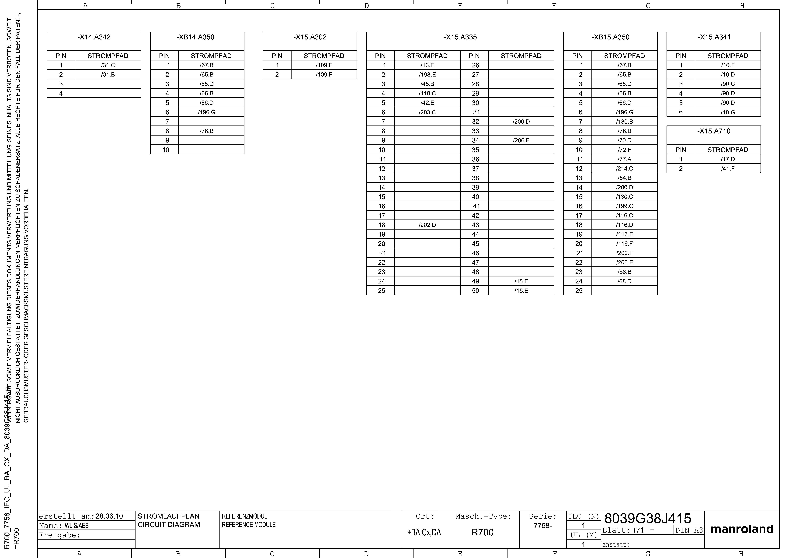

# +BA_Cx_DA — Sheet 171 of 247 — REFERENZMODUL

**REFERENCE MODULE**

> Part of the manroland **R700** printing press IEC/UL circuit diagrams.
> Drawing class: **Stromlaufplan / Circuit diagram** (DIN A3).
> Document `+BA_Cx_DA` covers the **Printing units / main switch cabinet** machine section.

## At a glance

| Field | Value |
|---|---|
| Document | `+BA_Cx_DA`  (8039G38J415) |
| Sheet | **171** of 247 |
| Section (DE) | REFERENZMODUL |
| Section (EN) | REFERENCE MODULE |
| Section type | REFERENCE_MODULE — Reference module |
| Machine type | `R700` |
| Series | `7758` |
| Created | 28.06.10 |
| Replaces | — |
| Columns used | A, B, C, D, E, F, G, H |
| Path numbers | — |
| Labels on sheet | 176 |
| Cross-refs out | 54 |
| Cross-refs in | 0 |

**Previous:** [+BA_Cx_DA sheet 170](SHEET_0170.md) · **Next:** [+BA_Cx_DA sheet 172](SHEET_0172.md) · **Document TOC:** [_TOC.md](_TOC.md)  (+BA_Cx_DA) · **Master TOC:** [all sheets](../_MASTER_TOC.md)

## Sheet image (300 DPI, exact vector render)



_Rendered directly from the PDF vector layer at 300 DPI (1-bit), no OCR and no resampling. Use it to confirm anything ambiguous in the text below._

## Cross-references on this sheet

Each entry is a wire leaving this sheet. The printed token is `/sheet.column`; the link resolves to that sheet inside the same document.

| Ref | Target sheet | Col | Path | Destination on target | Target section | From col |
|---|---|---|---|---|---|---|
| `/67.B` | [+BA_Cx_DA sheet 67](SHEET_0067.md) | B | — | — | TRENNBLÄSER / | B |
| `/13.E` | [+BA_Cx_DA sheet 13](SHEET_0013.md) | E | — | — | SPANNUNGSVERSORGUNG, SCHALTSCHRANKBELÜFTUNG | E |
| `/67.B` | [+BA_Cx_DA sheet 67](SHEET_0067.md) | B | — | — | TRENNBLÄSER / | G |
| `/10.F` | [+BA_Cx_DA sheet 10](SHEET_0010.md) | F | — | — | SPANNUNGSVERSORGUNG, SCHALTSCHRANKBELÜFTUNG | H |
| `/31.C` | [+BA_Cx_DA sheet 31](SHEET_0031.md) | C | — | — | BUSVERBINDUNGEN: SIGNALSCHLEIFE | A |
| `/109.F` | [+BA_Cx_DA sheet 109](SHEET_0109.md) | F | — | — | MOTOR: HEBERSTREIFENBREITE | D |
| `/31.B` | [+BA_Cx_DA sheet 31](SHEET_0031.md) | B | — | — | BUSVERBINDUNGEN: SIGNALSCHLEIFE | A |
| `/65.B` | [+BA_Cx_DA sheet 65](SHEET_0065.md) | B | — | — | DRUCKANSTELLUNG | B |
| `/65.B` | [+BA_Cx_DA sheet 65](SHEET_0065.md) | B | — | — | DRUCKANSTELLUNG | G |
| `/198.E` | [+BA_Cx_DA sheet 198](SHEET_0198.md) | E | — | — | OPTION: WASCHVORRICHTUNG MIT BÜRSTE | E |
| `/109.F` | [+BA_Cx_DA sheet 109](SHEET_0109.md) | F | — | — | MOTOR: HEBERSTREIFENBREITE | D |
| `/10.D` | [+BA_Cx_DA sheet 10](SHEET_0010.md) | D | — | — | SPANNUNGSVERSORGUNG, SCHALTSCHRANKBELÜFTUNG | H |
| `/45.B` | [+BA_Cx_DA sheet 45](SHEET_0045.md) | B | — | — | SCHUTZEINRICHTUNGEN | E |
| `/65.D` | [+BA_Cx_DA sheet 65](SHEET_0065.md) | D | — | — | DRUCKANSTELLUNG | B |
| `/65.D` | [+BA_Cx_DA sheet 65](SHEET_0065.md) | D | — | — | DRUCKANSTELLUNG | G |
| `/90.C` | [+BA_Cx_DA sheet 90](SHEET_0090.md) | C | — | — | BOGENFÜHRUNG | H |
| `/66.B` | [+BA_Cx_DA sheet 66](SHEET_0066.md) | B | — | — | TRENNBLÄSER | B |
| `/66.B` | [+BA_Cx_DA sheet 66](SHEET_0066.md) | B | — | — | TRENNBLÄSER | G |
| `/90.D` | [+BA_Cx_DA sheet 90](SHEET_0090.md) | D | — | — | BOGENFÜHRUNG | H |
| `/118.C` | [+BA_Cx_DA sheet 118](SHEET_0118.md) | C | — | — | RESERVE: SPS STATION (INPUT) | E |
| `/42.E` | [+BA_Cx_DA sheet 42](SHEET_0042.md) | E | — | — | SCHUTZEINRICHTUNGEN | E |
| `/66.D` | [+BA_Cx_DA sheet 66](SHEET_0066.md) | D | — | — | TRENNBLÄSER | B |
| `/66.D` | [+BA_Cx_DA sheet 66](SHEET_0066.md) | D | — | — | TRENNBLÄSER | G |
| `/90.D` | [+BA_Cx_DA sheet 90](SHEET_0090.md) | D | — | — | BOGENFÜHRUNG | H |
| `/10.G` | [+BA_Cx_DA sheet 10](SHEET_0010.md) | G | — | — | SPANNUNGSVERSORGUNG, SCHALTSCHRANKBELÜFTUNG | H |
| `/196.G` | [+BA_Cx_DA sheet 196](SHEET_0196.md) | G | — | — | OPTION: WASCHVORRICHTUNG MIT BÜRSTE | B |
| `/196.G` | [+BA_Cx_DA sheet 196](SHEET_0196.md) | G | — | — | OPTION: WASCHVORRICHTUNG MIT BÜRSTE | G |
| `/203.C` | [+BA_Cx_DA sheet 203](SHEET_0203.md) | C | — | — | OPTION: | E |
| `/130.B` | [+BA_Cx_DA sheet 130](SHEET_0130.md) | B | — | — | RESERVE: SPS STATION (OUTPUT) | G |
| `/206.D` | [+BA_Cx_DA sheet 206](SHEET_0206.md) | D | — | — | OPTION: AUTOMATISCHE FARBZUFÜHRUNG | F |
| `/78.B` | [+BA_Cx_DA sheet 78](SHEET_0078.md) | B | — | — | FARBWERK | B |
| `/78.B` | [+BA_Cx_DA sheet 78](SHEET_0078.md) | B | — | — | FARBWERK | G |
| `/206.F` | [+BA_Cx_DA sheet 206](SHEET_0206.md) | F | — | — | OPTION: AUTOMATISCHE FARBZUFÜHRUNG | F |
| `/70.D` | [+BA_Cx_DA sheet 70](SHEET_0070.md) | D | — | — | ÖLUMLAUFSCHMIERUNG | G |
| `/72.F` | [+BA_Cx_DA sheet 72](SHEET_0072.md) | F | — | — | FEUCHTWERK | G |
| `/77.A` | [+BA_Cx_DA sheet 77](SHEET_0077.md) | A | — | — | FARBWERK | G |
| `/17.D` | [+BA_Cx_DA sheet 17](SHEET_0017.md) | D | — | — | SPANNUNGSVERSORGUNG, SCHALTSCHRANKBELÜFTUNG | H |
| `/41.F` | [+BA_Cx_DA sheet 41](SHEET_0041.md) | F | — | — | SCHUTZEINRICHTUNGEN | H |
| `/214.C` | [+BA_Cx_DA sheet 214](SHEET_0214.md) | C | — | — | OPTION: FWW SPEZIALREINIGER | G |
| `/84.B` | [+BA_Cx_DA sheet 84](SHEET_0084.md) | B | — | — | FARBWERK | G |
| `/200.D` | [+BA_Cx_DA sheet 200](SHEET_0200.md) | D | — | — | OPTION: APL | G |
| `/130.C` | [+BA_Cx_DA sheet 130](SHEET_0130.md) | C | — | — | RESERVE: SPS STATION (OUTPUT) | G |
| `/199.C` | [+BA_Cx_DA sheet 199](SHEET_0199.md) | C | — | — | OPTION: WASCHVORRICHTUNG MIT BÜRSTE | G |
| `/116.C` | [+BA_Cx_DA sheet 116](SHEET_0116.md) | C | — | — | PPL 2 | G |
| `/202.D` | [+BA_Cx_DA sheet 202](SHEET_0202.md) | D | — | — | OPTION: | E |
| `/116.D` | [+BA_Cx_DA sheet 116](SHEET_0116.md) | D | — | — | PPL 2 | G |
| `/116.E` | [+BA_Cx_DA sheet 116](SHEET_0116.md) | E | — | — | PPL 2 | G |
| `/116.F` | [+BA_Cx_DA sheet 116](SHEET_0116.md) | F | — | — | PPL 2 | G |
| `/200.F` | [+BA_Cx_DA sheet 200](SHEET_0200.md) | F | — | — | OPTION: APL | G |
| `/200.E` | [+BA_Cx_DA sheet 200](SHEET_0200.md) | E | — | — | OPTION: APL | G |
| `/68.B` | [+BA_Cx_DA sheet 68](SHEET_0068.md) | B | — | — | SEITENMARKEN: ZIEHEN | G |
| `/15.E` | [+BA_Cx_DA sheet 15](SHEET_0015.md) | E | — | — | SPANNUNGSVERSORGUNG, SCHALTSCHRANKBELÜFTUNG | F |
| `/68.D` | [+BA_Cx_DA sheet 68](SHEET_0068.md) | D | — | — | SEITENMARKEN: ZIEHEN | G |
| `/15.E` | [+BA_Cx_DA sheet 15](SHEET_0015.md) | E | — | — | SPANNUNGSVERSORGUNG, SCHALTSCHRANKBELÜFTUNG | F |

## Devices on this sheet

| Tag | Class | Class meaning (IEC) | Col | Sub | Terminal | Sign |
|---|---|---|---|---|---|---|
| `XB14.A350` | — | cross-device reference | B | — | — | — |
| `X14.A342` | — | cross-device reference | A | — | — | — |
| `X15.A302` | — | cross-device reference | C | — | — | — |
| `X15.A335` | — | cross-device reference | E | — | — | — |
| `XB15.A350` | — | cross-device reference | G | — | — | — |
| `X15.A341` | — | cross-device reference | H | — | — | — |
| `X15.A710` | — | cross-device reference | H | — | — | — |

## Potentials / nets

_No named potentials on this sheet._

## Wire-end annotations (grouped as printed)

A wire that continues elsewhere is annotated with a small cluster: the destination description, the path/line number `#NN`, and the `/sheet.column` cross reference. Each row below is one such cluster exactly as it is grouped on the drawing.

| Col | Y | Path | Cross-ref | Text on the wire |
|---|---|---|---|---|
| A | 51.3 | — | — | `X14.A342` |
| B | 51.3 | — | — | `XB14.A350` |
| C | 51.3 | — | — | `X15.A302` |
| E | 51.3 | — | — | `X15.A335` |
| G | 51.3 | — | — | `XB15.A350` |
| H | 51.3 | — | — | `X15.A341` |
| A | 80.0 | — | — | `PIN 2 3 4 1 STROMPFAD` |
| B | 80.0 | — | — | `PIN 10 2 3 4 5 6 7 8 9 1 STROMPFAD` |
| C | 80.0 | — | — | `PIN 2 1 STROMPFAD` |
| D | 80.0 | — | — | `PIN STROMPFAD` |
| E | 80.0 | — | — | `PIN STROMPFAD` |
| G | 80.0 | — | — | `PIN STROMPFAD` |
| H | 80.0 | — | — | `PIN 2 3 4 5 6 1 STROMPFAD` |
| D | 94.2 | — | — | `2 3 4 5 6 7 8 9 1` |
| E | 94.2 | — | — | `26 27 28 29 30 32 33 34 35 36 37 38 39 40 42 43 44 45 46 47 48 49 50 31 41` |
| F | 94.2 | — | — | `2 3 4 5 6 7 8 9 1` |
| A | 94.5 | — | `/31.C` | — |
| B | 94.5 | — | `/67.B` | — |
| D | 94.5 | — | `/109.F` | — |
| E | 94.5 | — | `/13.E` | — |
| G | 94.5 | — | `/67.B` | — |
| H | 94.5 | — | `/10.F` | — |
| A | 108.7 | — | `/31.B` | — |
| B | 108.7 | — | `/65.B` | — |
| D | 108.7 | — | `/109.F` | — |
| E | 108.7 | — | `/198.E` | — |
| G | 108.7 | — | `/65.B` | — |
| H | 108.7 | — | `/10.D` | — |
| E | 122.8 | — | `/45.B` | — |
| B | 122.9 | — | `/65.D` | — |
| G | 122.9 | — | `/65.D` | — |
| H | 122.9 | — | `/90.C` | — |
| B | 137.0 | — | `/66.B` | — |
| G | 137.0 | — | `/66.B` | — |
| E | 137.1 | — | `/118.C` | — |
| H | 137.1 | — | `/90.D` | — |
| B | 151.2 | — | `/66.D` | — |
| E | 151.2 | — | `/42.E` | — |
| G | 151.2 | — | `/66.D` | — |
| H | 151.2 | — | `/90.D` | — |
| B | 165.4 | — | `/196.G` | — |
| E | 165.4 | — | `/203.C` | — |
| G | 165.4 | — | `/196.G` | — |
| H | 165.4 | — | `/10.G` | — |
| F | 179.6 | — | `/206.D` | — |
| G | 179.6 | — | `/130.B` | — |
| H | 193.1 | — | — | `X15.A710` |
| B | 193.7 | — | `/78.B` | — |
| G | 193.7 | — | `/78.B` | — |
| F | 207.9 | — | `/206.F` | — |
| G | 207.9 | — | `/70.D` | — |
| H | 221.7 | — | — | `PIN 2 1 STROMPFAD` |
| D | 221.8 | — | — | `10 12 13 14 15 16 17 18 19 20 11` |
| F | 221.8 | — | — | `10 12 13 14 15 16 17 18 19 20 11` |
| G | 222.1 | — | `/72.F` | — |
| G | 236.2 | — | `/77.A` | — |
| H | 236.3 | — | `/17.D` | — |
| G | 250.4 | — | `/214.C` | — |
| H | 250.4 | — | `/41.F` | — |
| G | 264.6 | — | `/84.B` | — |
| G | 278.8 | — | `/200.D` | — |
| G | 293.0 | — | `/130.C` | — |
| G | 307.1 | — | `/199.C` | — |
| G | 321.3 | — | `/116.C` | — |
| E | 335.5 | — | `/202.D` | — |
| G | 335.5 | — | `/116.D` | — |
| G | 349.6 | — | `/116.E` | — |
| G | 363.8 | — | `/116.F` | — |
| D | 377.7 | — | — | `22 23 24 25 21` |
| F | 377.7 | — | — | `22 23 24 25 21` |
| G | 378.0 | — | `/200.F` | — |
| G | 392.1 | — | `/200.E` | — |
| G | 406.3 | — | `/68.B` | — |
| F | 420.5 | — | `/15.E` | — |
| G | 420.5 | — | `/68.D` | — |
| F | 434.7 | — | `/15.E` | — |


## Reconstructed tables

This sheet carries tabular content (pin map / terminal assignment / index). The grid below was rebuilt from the drawing's own rule lines, so each row is exactly one physical row of the table.

### Table 1 — 4 data rows × 2 columns (at x=70.9, y=48.2) — **X14.A342**

| PIN | STROMPFAD |
|---|---|
| `1` | `/31.C` |
| `2` | `/31.B` |
| `3` |  |
| `4` |  |


### Table 2 — 10 data rows × 2 columns (at x=226.8, y=48.2) — **XB14.A350**

| PIN | STROMPFAD |
|---|---|
| `1` | `/67.B` |
| `2` | `/65.B` |
| `3` | `/65.D` |
| `4` | `/66.B` |
| `5` | `/66.D` |
| `6` | `/196.G` |
| `7` |  |
| `8` | `/78.B` |
| `9` |  |
| `10` |  |


### Table 3 — 2 data rows × 2 columns (at x=396.9, y=48.2) — **X15.A302**

| PIN | STROMPFAD |
|---|---|
| `1` | `/109.F` |
| `2` | `/109.F` |


### Table 4 — 25 data rows × 4 columns (at x=552.8, y=48.2) — **X15.A335**

| PIN | STROMPFAD | PIN | STROMPFAD |
|---|---|---|---|
| `1` | `/13.E` | `26` |  |
| `2` | `/198.E` | `27` |  |
| `3` | `/45.B` | `28` |  |
| `4` | `/118.C` | `29` |  |
| `5` | `/42.E` | `30` |  |
| `6` | `/203.C` | `31` |  |
| `7` |  | `32` | `/206.D` |
| `8` |  | `33` |  |
| `9` |  | `34` | `/206.F` |
| `10` |  | `35` |  |
| `11` |  | `36` |  |
| `12` |  | `37` |  |
| `13` |  | `38` |  |
| `14` |  | `39` |  |
| `15` |  | `40` |  |
| `16` |  | `41` |  |
| `17` |  | `42` |  |
| `18` | `/202.D` | `43` |  |
| `19` |  | `44` |  |
| `20` |  | `45` |  |
| `21` |  | `46` |  |
| `22` |  | `47` |  |
| `23` |  | `48` |  |
| `24` |  | `49` | `/15.E` |
| `25` |  | `50` | `/15.E` |


### Table 5 — 25 data rows × 2 columns (at x=850.4, y=48.2) — **XB15.A350**

| PIN | STROMPFAD |
|---|---|
| `1` | `/67.B` |
| `2` | `/65.B` |
| `3` | `/65.D` |
| `4` | `/66.B` |
| `5` | `/66.D` |
| `6` | `/196.G` |
| `7` | `/130.B` |
| `8` | `/78.B` |
| `9` | `/70.D` |
| `10` | `/72.F` |
| `11` | `/77.A` |
| `12` | `/214.C` |
| `13` | `/84.B` |
| `14` | `/200.D` |
| `15` | `/130.C` |
| `16` | `/199.C` |
| `17` | `/116.C` |
| `18` | `/116.D` |
| `19` | `/116.E` |
| `20` | `/116.F` |
| `21` | `/200.F` |
| `22` | `/200.E` |
| `23` | `/68.B` |
| `24` | `/68.D` |
| `25` |  |


### Table 6 — 10 data rows × 2 columns (at x=1006.3, y=48.2) — **X15.A341**

| PIN | STROMPFAD |
|---|---|
| `1` | `/10.F` |
| `2` | `/10.D` |
| `3` | `/90.C` |
| `4` | `/90.D` |
| `5` | `/90.D` |
| `6` | `/10.G` |
|  | `X15.A710` |
| `PIN` | `STROMPFAD` |
| `1` | `/17.D` |
| `2` | `/41.F` |


## Notes and free text on this sheet

| Text | Col | Y (pt) |
|---|---|---|
| `PIN` | B | 80.02 |
| `STROMPFAD` | B | 79.98 |
| `PIN` | A | 80.02 |
| `STROMPFAD` | A | 79.98 |
| `PIN` | C | 80.02 |
| `STROMPFAD` | D | 79.98 |
| `PIN` | D | 80.02 |
| `STROMPFAD` | E | 79.98 |
| `PIN` | E | 80.02 |
| `STROMPFAD` | F | 79.98 |
| `PIN` | F | 80.02 |
| `STROMPFAD` | G | 79.98 |
| `PIN` | G | 80.02 |
| `STROMPFAD` | H | 79.98 |

## Complete label inventory (exact text from the drawing)

Every text object inside the drawing area of this sheet, in DIN reading order (column A→H, then top→bottom). This is the authoritative list: if a string is not here it is not printed on this sheet.

| Col | Y | X | Dir | Type | Text |
|---|---|---|---|---|---|
| A | 51.3 | 116.8 | → | device ref | `X14.A342` |
| A | 80.0 | 84.0 | → | text | `PIN` |
| A | 80.0 | 132.2 | → | text | `STROMPFAD` |
| A | 94.2 | 90.0 | → | number | `1` |
| A | 94.5 | 152.6 | → | cross-reference | `/31.C` |
| A | 108.4 | 89.4 | → | number | `2` |
| A | 108.7 | 152.8 | → | cross-reference | `/31.B` |
| A | 122.5 | 89.4 | → | number | `3` |
| A | 136.7 | 89.4 | → | number | `4` |
| B | 51.3 | 266.3 | → | device ref | `XB14.A350` |
| B | 80.0 | 240.0 | → | text | `PIN` |
| B | 80.0 | 288.1 | → | text | `STROMPFAD` |
| B | 94.2 | 251.7 | → | number | `1` |
| B | 94.5 | 301.6 | → | cross-reference | `/67.B` |
| B | 108.4 | 250.0 | → | number | `2` |
| B | 108.7 | 301.6 | → | cross-reference | `/65.B` |
| B | 122.5 | 250.0 | → | number | `3` |
| B | 122.9 | 301.5 | → | cross-reference | `/65.D` |
| B | 136.7 | 250.0 | → | number | `4` |
| B | 137.0 | 301.6 | → | cross-reference | `/66.B` |
| B | 150.9 | 250.0 | → | number | `5` |
| B | 151.2 | 301.5 | → | cross-reference | `/66.D` |
| B | 165.1 | 250.0 | → | number | `6` |
| B | 165.4 | 298.9 | → | cross-reference | `/196.G` |
| B | 179.2 | 250.0 | → | number | `7` |
| B | 193.4 | 250.0 | → | number | `8` |
| B | 193.7 | 301.6 | → | cross-reference | `/78.B` |
| B | 207.6 | 250.0 | → | number | `9` |
| B | 221.8 | 244.6 | → | number | `10` |
| C | 51.3 | 442.8 | → | device ref | `X15.A302` |
| C | 80.0 | 410.0 | → | text | `PIN` |
| C | 94.2 | 416.0 | → | number | `1` |
| C | 108.4 | 415.4 | → | number | `2` |
| D | 80.0 | 458.2 | → | text | `STROMPFAD` |
| D | 80.0 | 565.9 | → | text | `PIN` |
| D | 94.2 | 577.7 | → | number | `1` |
| D | 94.5 | 476.6 | → | cross-reference | `/109.F` |
| D | 108.4 | 576.0 | → | number | `2` |
| D | 108.7 | 476.6 | → | cross-reference | `/109.F` |
| D | 122.5 | 576.0 | → | number | `3` |
| D | 136.7 | 576.0 | → | number | `4` |
| D | 150.9 | 576.0 | → | number | `5` |
| D | 165.1 | 576.0 | → | number | `6` |
| D | 179.2 | 576.0 | → | number | `7` |
| D | 193.4 | 576.0 | → | number | `8` |
| D | 207.6 | 576.0 | → | number | `9` |
| D | 221.8 | 570.6 | → | number | `10` |
| D | 235.9 | 572.3 | → | number | `11` |
| D | 250.1 | 570.6 | → | number | `12` |
| D | 264.3 | 570.6 | → | number | `13` |
| D | 278.5 | 570.6 | → | number | `14` |
| D | 292.6 | 570.6 | → | number | `15` |
| D | 306.8 | 570.6 | → | number | `16` |
| D | 321.0 | 570.6 | → | number | `17` |
| D | 335.1 | 570.6 | → | number | `18` |
| D | 349.3 | 570.6 | → | number | `19` |
| D | 363.5 | 570.6 | → | number | `20` |
| D | 377.7 | 572.3 | → | number | `21` |
| D | 391.8 | 570.6 | → | number | `22` |
| D | 406.0 | 570.6 | → | number | `23` |
| D | 420.2 | 570.6 | → | number | `24` |
| D | 434.4 | 570.6 | → | number | `25` |
| E | 51.3 | 669.5 | → | device ref | `X15.A335` |
| E | 80.0 | 614.1 | → | text | `STROMPFAD` |
| E | 80.0 | 707.7 | → | text | `PIN` |
| E | 94.2 | 712.3 | → | number | `26` |
| E | 94.5 | 634.8 | → | cross-reference | `/13.E` |
| E | 108.4 | 712.3 | → | number | `27` |
| E | 108.7 | 632.4 | → | cross-reference | `/198.E` |
| E | 122.5 | 712.3 | → | number | `28` |
| E | 122.8 | 634.7 | → | cross-reference | `/45.B` |
| E | 136.7 | 712.3 | → | number | `29` |
| E | 137.1 | 632.1 | → | cross-reference | `/118.C` |
| E | 150.9 | 712.3 | → | number | `30` |
| E | 151.2 | 634.8 | → | cross-reference | `/42.E` |
| E | 165.1 | 714.0 | → | number | `31` |
| E | 165.4 | 632.1 | → | cross-reference | `/203.C` |
| E | 179.2 | 712.3 | → | number | `32` |
| E | 193.4 | 712.3 | → | number | `33` |
| E | 207.6 | 712.3 | → | number | `34` |
| E | 221.8 | 712.3 | → | number | `35` |
| E | 235.9 | 712.3 | → | number | `36` |
| E | 250.1 | 712.3 | → | number | `37` |
| E | 264.3 | 712.3 | → | number | `38` |
| E | 278.5 | 712.3 | → | number | `39` |
| E | 292.6 | 712.3 | → | number | `40` |
| E | 306.8 | 714.0 | → | number | `41` |
| E | 321.0 | 712.3 | → | number | `42` |
| E | 335.1 | 712.3 | → | number | `43` |
| E | 335.5 | 632.1 | → | cross-reference | `/202.D` |
| E | 349.3 | 712.3 | → | number | `44` |
| E | 363.5 | 712.3 | → | number | `45` |
| E | 377.7 | 712.3 | → | number | `46` |
| E | 391.8 | 712.3 | → | number | `47` |
| E | 406.0 | 712.3 | → | number | `48` |
| E | 420.2 | 712.3 | → | number | `49` |
| E | 434.4 | 712.3 | → | number | `50` |
| F | 80.0 | 755.9 | → | text | `STROMPFAD` |
| F | 80.0 | 863.6 | → | text | `PIN` |
| F | 94.2 | 875.3 | → | number | `1` |
| F | 108.4 | 873.6 | → | number | `2` |
| F | 122.5 | 873.6 | → | number | `3` |
| F | 136.7 | 873.6 | → | number | `4` |
| F | 150.9 | 873.6 | → | number | `5` |
| F | 165.1 | 873.6 | → | number | `6` |
| F | 179.2 | 873.6 | → | number | `7` |
| F | 179.6 | 773.9 | → | cross-reference | `/206.D` |
| F | 193.4 | 873.6 | → | number | `8` |
| F | 207.6 | 873.6 | → | number | `9` |
| F | 207.9 | 774.3 | → | cross-reference | `/206.F` |
| F | 221.8 | 868.3 | → | number | `10` |
| F | 235.9 | 870.0 | → | number | `11` |
| F | 250.1 | 868.3 | → | number | `12` |
| F | 264.3 | 868.3 | → | number | `13` |
| F | 278.5 | 868.3 | → | number | `14` |
| F | 292.6 | 868.3 | → | number | `15` |
| F | 306.8 | 868.3 | → | number | `16` |
| F | 321.0 | 868.3 | → | number | `17` |
| F | 335.1 | 868.3 | → | number | `18` |
| F | 349.3 | 868.3 | → | number | `19` |
| F | 363.5 | 868.3 | → | number | `20` |
| F | 377.7 | 870.0 | → | number | `21` |
| F | 391.8 | 868.3 | → | number | `22` |
| F | 406.0 | 868.3 | → | number | `23` |
| F | 420.2 | 868.3 | → | number | `24` |
| F | 420.5 | 776.6 | → | cross-reference | `/15.E` |
| F | 434.4 | 868.3 | → | number | `25` |
| F | 434.7 | 776.6 | → | cross-reference | `/15.E` |
| G | 51.3 | 892.8 | → | device ref | `XB15.A350` |
| G | 80.0 | 911.8 | → | text | `STROMPFAD` |
| G | 80.0 | 1019.5 | → | text | `PIN` |
| G | 94.2 | 1025.4 | → | number | `1` |
| G | 94.5 | 932.3 | → | cross-reference | `/67.B` |
| G | 108.4 | 1024.9 | → | number | `2` |
| G | 108.7 | 932.3 | → | cross-reference | `/65.B` |
| G | 122.5 | 1024.9 | → | number | `3` |
| G | 122.9 | 932.2 | → | cross-reference | `/65.D` |
| G | 136.7 | 1024.9 | → | number | `4` |
| G | 137.0 | 932.3 | → | cross-reference | `/66.B` |
| G | 150.9 | 1024.9 | → | number | `5` |
| G | 151.2 | 932.2 | → | cross-reference | `/66.D` |
| G | 165.1 | 1024.9 | → | number | `6` |
| G | 165.4 | 929.6 | → | cross-reference | `/196.G` |
| G | 179.6 | 929.9 | → | cross-reference | `/130.B` |
| G | 193.7 | 932.3 | → | cross-reference | `/78.B` |
| G | 207.9 | 932.2 | → | cross-reference | `/70.D` |
| G | 221.8 | 1019.5 | → | text | `PIN` |
| G | 222.1 | 932.6 | → | cross-reference | `/72.F` |
| G | 235.9 | 1025.4 | → | number | `1` |
| G | 236.2 | 932.2 | → | cross-reference | `/77.A` |
| G | 250.1 | 1024.9 | → | number | `2` |
| G | 250.4 | 929.8 | → | cross-reference | `/214.C` |
| G | 264.6 | 932.3 | → | cross-reference | `/84.B` |
| G | 278.8 | 929.8 | → | cross-reference | `/200.D` |
| G | 293.0 | 929.8 | → | cross-reference | `/130.C` |
| G | 307.1 | 929.8 | → | cross-reference | `/199.C` |
| G | 321.3 | 929.8 | → | cross-reference | `/116.C` |
| G | 335.5 | 929.8 | → | cross-reference | `/116.D` |
| G | 349.6 | 930.0 | → | cross-reference | `/116.E` |
| G | 363.8 | 930.2 | → | cross-reference | `/116.F` |
| G | 378.0 | 930.2 | → | cross-reference | `/200.F` |
| G | 392.2 | 930.0 | → | cross-reference | `/200.E` |
| G | 406.3 | 932.3 | → | cross-reference | `/68.B` |
| G | 420.5 | 932.2 | → | cross-reference | `/68.D` |
| H | 51.3 | 1052.9 | → | device ref | `X15.A341` |
| H | 80.0 | 1067.7 | → | text | `STROMPFAD` |
| H | 94.5 | 1088.5 | → | cross-reference | `/10.F` |
| H | 108.7 | 1088.1 | → | cross-reference | `/10.D` |
| H | 122.9 | 1088.1 | → | cross-reference | `/90.C` |
| H | 137.1 | 1088.1 | → | cross-reference | `/90.D` |
| H | 151.2 | 1088.1 | → | cross-reference | `/90.D` |
| H | 165.4 | 1087.9 | → | cross-reference | `/10.G` |
| H | 193.1 | 1052.2 | → | device ref | `X15.A710` |
| H | 221.7 | 1067.7 | → | text | `STROMPFAD` |
| H | 236.3 | 1088.1 | → | cross-reference | `/17.D` |
| H | 250.4 | 1088.5 | → | cross-reference | `/41.F` |

## Reading-order text block

The same content as a plain block, grouped by DIN column — convenient to paste or to match against a visual description.

```text
=== Column A ===
  51.3  116.8  devref       X14.A342
  80.0   84.0  text         PIN
  80.0  132.2  text         STROMPFAD
  94.2   90.0  numeric      1
  94.5  152.6  xref         /31.C
 108.4   89.4  numeric      2
 108.7  152.8  xref         /31.B
 122.5   89.4  numeric      3
 136.7   89.4  numeric      4
=== Column B ===
  51.3  266.3  devref       XB14.A350
  80.0  240.0  text         PIN
  80.0  288.1  text         STROMPFAD
  94.2  251.7  numeric      1
  94.5  301.6  xref         /67.B
 108.4  250.0  numeric      2
 108.7  301.6  xref         /65.B
 122.5  250.0  numeric      3
 122.9  301.5  xref         /65.D
 136.7  250.0  numeric      4
 137.0  301.6  xref         /66.B
 150.9  250.0  numeric      5
 151.2  301.5  xref         /66.D
 165.1  250.0  numeric      6
 165.4  298.9  xref         /196.G
 179.2  250.0  numeric      7
 193.4  250.0  numeric      8
 193.7  301.6  xref         /78.B
 207.6  250.0  numeric      9
 221.8  244.6  numeric      10
=== Column C ===
  51.3  442.8  devref       X15.A302
  80.0  410.0  text         PIN
  94.2  416.0  numeric      1
 108.4  415.4  numeric      2
=== Column D ===
  80.0  458.2  text         STROMPFAD
  80.0  565.9  text         PIN
  94.2  577.7  numeric      1
  94.5  476.6  xref         /109.F
 108.4  576.0  numeric      2
 108.7  476.6  xref         /109.F
 122.5  576.0  numeric      3
 136.7  576.0  numeric      4
 150.9  576.0  numeric      5
 165.1  576.0  numeric      6
 179.2  576.0  numeric      7
 193.4  576.0  numeric      8
 207.6  576.0  numeric      9
 221.8  570.6  numeric      10
 235.9  572.3  numeric      11
 250.1  570.6  numeric      12
 264.3  570.6  numeric      13
 278.5  570.6  numeric      14
 292.6  570.6  numeric      15
 306.8  570.6  numeric      16
 321.0  570.6  numeric      17
 335.1  570.6  numeric      18
 349.3  570.6  numeric      19
 363.5  570.6  numeric      20
 377.7  572.3  numeric      21
 391.8  570.6  numeric      22
 406.0  570.6  numeric      23
 420.2  570.6  numeric      24
 434.4  570.6  numeric      25
=== Column E ===
  51.3  669.5  devref       X15.A335
  80.0  614.1  text         STROMPFAD
  80.0  707.7  text         PIN
  94.2  712.3  numeric      26
  94.5  634.8  xref         /13.E
 108.4  712.3  numeric      27
 108.7  632.4  xref         /198.E
 122.5  712.3  numeric      28
 122.8  634.7  xref         /45.B
 136.7  712.3  numeric      29
 137.1  632.1  xref         /118.C
 150.9  712.3  numeric      30
 151.2  634.8  xref         /42.E
 165.1  714.0  numeric      31
 165.4  632.1  xref         /203.C
 179.2  712.3  numeric      32
 193.4  712.3  numeric      33
 207.6  712.3  numeric      34
 221.8  712.3  numeric      35
 235.9  712.3  numeric      36
 250.1  712.3  numeric      37
 264.3  712.3  numeric      38
 278.5  712.3  numeric      39
 292.6  712.3  numeric      40
 306.8  714.0  numeric      41
 321.0  712.3  numeric      42
 335.1  712.3  numeric      43
 335.5  632.1  xref         /202.D
 349.3  712.3  numeric      44
 363.5  712.3  numeric      45
 377.7  712.3  numeric      46
 391.8  712.3  numeric      47
 406.0  712.3  numeric      48
 420.2  712.3  numeric      49
 434.4  712.3  numeric      50
=== Column F ===
  80.0  755.9  text         STROMPFAD
  80.0  863.6  text         PIN
  94.2  875.3  numeric      1
 108.4  873.6  numeric      2
 122.5  873.6  numeric      3
 136.7  873.6  numeric      4
 150.9  873.6  numeric      5
 165.1  873.6  numeric      6
 179.2  873.6  numeric      7
 179.6  773.9  xref         /206.D
 193.4  873.6  numeric      8
 207.6  873.6  numeric      9
 207.9  774.3  xref         /206.F
 221.8  868.3  numeric      10
 235.9  870.0  numeric      11
 250.1  868.3  numeric      12
 264.3  868.3  numeric      13
 278.5  868.3  numeric      14
 292.6  868.3  numeric      15
 306.8  868.3  numeric      16
 321.0  868.3  numeric      17
 335.1  868.3  numeric      18
 349.3  868.3  numeric      19
 363.5  868.3  numeric      20
 377.7  870.0  numeric      21
 391.8  868.3  numeric      22
 406.0  868.3  numeric      23
 420.2  868.3  numeric      24
 420.5  776.6  xref         /15.E
 434.4  868.3  numeric      25
 434.7  776.6  xref         /15.E
=== Column G ===
  51.3  892.8  devref       XB15.A350
  80.0  911.8  text         STROMPFAD
  80.0 1019.5  text         PIN
  94.2 1025.4  numeric      1
  94.5  932.3  xref         /67.B
 108.4 1024.9  numeric      2
 108.7  932.3  xref         /65.B
 122.5 1024.9  numeric      3
 122.9  932.2  xref         /65.D
 136.7 1024.9  numeric      4
 137.0  932.3  xref         /66.B
 150.9 1024.9  numeric      5
 151.2  932.2  xref         /66.D
 165.1 1024.9  numeric      6
 165.4  929.6  xref         /196.G
 179.6  929.9  xref         /130.B
 193.7  932.3  xref         /78.B
 207.9  932.2  xref         /70.D
 221.8 1019.5  text         PIN
 222.1  932.6  xref         /72.F
 235.9 1025.4  numeric      1
 236.2  932.2  xref         /77.A
 250.1 1024.9  numeric      2
 250.4  929.8  xref         /214.C
 264.6  932.3  xref         /84.B
 278.8  929.8  xref         /200.D
 293.0  929.8  xref         /130.C
 307.1  929.8  xref         /199.C
 321.3  929.8  xref         /116.C
 335.5  929.8  xref         /116.D
 349.6  930.0  xref         /116.E
 363.8  930.2  xref         /116.F
 378.0  930.2  xref         /200.F
 392.2  930.0  xref         /200.E
 406.3  932.3  xref         /68.B
 420.5  932.2  xref         /68.D
=== Column H ===
  51.3 1052.9  devref       X15.A341
  80.0 1067.7  text         STROMPFAD
  94.5 1088.5  xref         /10.F
 108.7 1088.1  xref         /10.D
 122.9 1088.1  xref         /90.C
 137.1 1088.1  xref         /90.D
 151.2 1088.1  xref         /90.D
 165.4 1087.9  xref         /10.G
 193.1 1052.2  devref       X15.A710
 221.7 1067.7  text         STROMPFAD
 236.3 1088.1  xref         /17.D
 250.4 1088.5  xref         /41.F
```

---
_Generated from the PDF vector text layer; no OCR. Source: `R700_7758_IEC_UL_BA_CX_DA_8039G38J415_p`, sheet 171._
