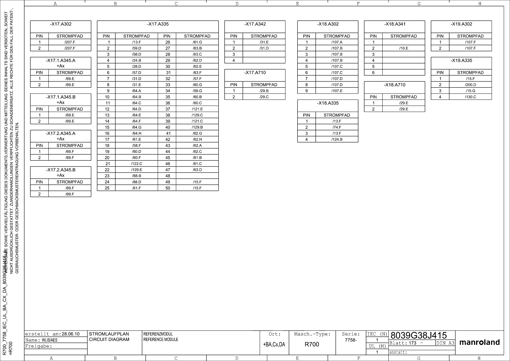

# +BA_Cx_DA — Sheet 173 of 247 — REFERENZMODUL

**REFERENCE MODULE**

> Part of the manroland **R700** printing press IEC/UL circuit diagrams.
> Drawing class: **Stromlaufplan / Circuit diagram** (DIN A3).
> Document `+BA_Cx_DA` covers the **Printing units / main switch cabinet** machine section.

## At a glance

| Field | Value |
|---|---|
| Document | `+BA_Cx_DA`  (8039G38J415) |
| Sheet | **173** of 247 |
| Section (DE) | REFERENZMODUL |
| Section (EN) | REFERENCE MODULE |
| Section type | REFERENCE_MODULE — Reference module |
| Machine type | `R700` |
| Series | `7758` |
| Created | 28.06.10 |
| Replaces | — |
| Columns used | A, B, C, D, E, F, G, H |
| Path numbers | — |
| Labels on sheet | 226 |
| Cross-refs out | 85 |
| Cross-refs in | 0 |

**Previous:** [+BA_Cx_DA sheet 172](SHEET_0172.md) · **Next:** [+BA_Cx_DA sheet 174](SHEET_0174.md) · **Document TOC:** [_TOC.md](_TOC.md)  (+BA_Cx_DA) · **Master TOC:** [all sheets](../_MASTER_TOC.md)

## Sheet image (300 DPI, exact vector render)



_Rendered directly from the PDF vector layer at 300 DPI (1-bit), no OCR and no resampling. Use it to confirm anything ambiguous in the text below._

## Cross-references on this sheet

Each entry is a wire leaving this sheet. The printed token is `/sheet.column`; the link resolves to that sheet inside the same document.

| Ref | Target sheet | Col | Path | Destination on target | Target section | From col |
|---|---|---|---|---|---|---|
| `/31.E` | [+BA_Cx_DA sheet 31](SHEET_0031.md) | E | — | — | BUSVERBINDUNGEN: SIGNALSCHLEIFE | D |
| `/13.F` | [+BA_Cx_DA sheet 13](SHEET_0013.md) | F | — | — | SPANNUNGSVERSORGUNG, SCHALTSCHRANKBELÜFTUNG | B |
| `/61.G` | [+BA_Cx_DA sheet 61](SHEET_0061.md) | G | — | — | MASCHINENBEDIENUNG: BEDIENUNGKOMMANDOS | C |
| `/107.A` | [+BA_Cx_DA sheet 107](SHEET_0107.md) | A | — | — | MOTOR: SEITENMARKE, A SEITE | F |
| `/207.F` | [+BA_Cx_DA sheet 207](SHEET_0207.md) | F | — | — | OPTION: VERREIBUNGSEINSATZ | A |
| `/107.F` | [+BA_Cx_DA sheet 107](SHEET_0107.md) | F | — | — | MOTOR: SEITENMARKE, A SEITE | H |
| `/63.B` | [+BA_Cx_DA sheet 63](SHEET_0063.md) | B | — | — | MASCHINENBEDIENUNG: BEDIENUNGKOMMANDOS | C |
| `/10.E` | [+BA_Cx_DA sheet 10](SHEET_0010.md) | E | — | — | SPANNUNGSVERSORGUNG, SCHALTSCHRANKBELÜFTUNG | G |
| `/107.B` | [+BA_Cx_DA sheet 107](SHEET_0107.md) | B | — | — | MOTOR: SEITENMARKE, A SEITE | F |
| `/207.F` | [+BA_Cx_DA sheet 207](SHEET_0207.md) | F | — | — | OPTION: VERREIBUNGSEINSATZ | A |
| `/107.F` | [+BA_Cx_DA sheet 107](SHEET_0107.md) | F | — | — | MOTOR: SEITENMARKE, A SEITE | H |
| `/59.D` | [+BA_Cx_DA sheet 59](SHEET_0059.md) | D | — | — | MASCHINENBEDIENUNG: LAUFKOMMANDOS | B |
| `/31.D` | [+BA_Cx_DA sheet 31](SHEET_0031.md) | D | — | — | BUSVERBINDUNGEN: SIGNALSCHLEIFE | D |
| `/107.B` | [+BA_Cx_DA sheet 107](SHEET_0107.md) | B | — | — | MOTOR: SEITENMARKE, A SEITE | F |
| `/58.D` | [+BA_Cx_DA sheet 58](SHEET_0058.md) | D | — | — | MASCHINENBEDIENUNG: LAUFKOMMANDOS | B |
| `/63.C` | [+BA_Cx_DA sheet 63](SHEET_0063.md) | C | — | — | MASCHINENBEDIENUNG: BEDIENUNGKOMMANDOS | C |
| `/24.B` | [+BA_Cx_DA sheet 24](SHEET_0024.md) | B | — | — | BUSVERBINDUNGEN: NOT AUS | B |
| `/107.B` | [+BA_Cx_DA sheet 107](SHEET_0107.md) | B | — | — | MOTOR: SEITENMARKE, A SEITE | F |
| `/62.D` | [+BA_Cx_DA sheet 62](SHEET_0062.md) | D | — | — | MASCHINENBEDIENUNG: BEDIENUNGKOMMANDOS | C |
| `/62.E` | [+BA_Cx_DA sheet 62](SHEET_0062.md) | E | — | — | MASCHINENBEDIENUNG: BEDIENUNGKOMMANDOS | C |
| `/28.D` | [+BA_Cx_DA sheet 28](SHEET_0028.md) | D | — | — | BUSVERBINDUNGEN: STOP SICHERN | B |
| `/107.C` | [+BA_Cx_DA sheet 107](SHEET_0107.md) | C | — | — | MOTOR: SEITENMARKE, A SEITE | F |
| `/63.F` | [+BA_Cx_DA sheet 63](SHEET_0063.md) | F | — | — | MASCHINENBEDIENUNG: BEDIENUNGKOMMANDOS | C |
| `/57.D` | [+BA_Cx_DA sheet 57](SHEET_0057.md) | D | — | — | MASCHINENBEDIENUNG: LAUFKOMMANDOS | B |
| `/107.C` | [+BA_Cx_DA sheet 107](SHEET_0107.md) | C | — | — | MOTOR: SEITENMARKE, A SEITE | F |
| `/69.E` | [+BA_Cx_DA sheet 69](SHEET_0069.md) | E | — | — | DRUCKLUFT ABSTELLEN | A |
| `/57.F` | [+BA_Cx_DA sheet 57](SHEET_0057.md) | F | — | — | MASCHINENBEDIENUNG: LAUFKOMMANDOS | C |
| `/15.F` | [+BA_Cx_DA sheet 15](SHEET_0015.md) | F | — | — | SPANNUNGSVERSORGUNG, SCHALTSCHRANKBELÜFTUNG | H |
| `/31.D` | [+BA_Cx_DA sheet 31](SHEET_0031.md) | D | — | — | BUSVERBINDUNGEN: SIGNALSCHLEIFE | B |
| `/107.D` | [+BA_Cx_DA sheet 107](SHEET_0107.md) | D | — | — | MOTOR: SEITENMARKE, A SEITE | F |
| `/69.E` | [+BA_Cx_DA sheet 69](SHEET_0069.md) | E | — | — | DRUCKLUFT ABSTELLEN | A |
| `/31.E` | [+BA_Cx_DA sheet 31](SHEET_0031.md) | E | — | — | BUSVERBINDUNGEN: SIGNALSCHLEIFE | B |
| `/60.G` | [+BA_Cx_DA sheet 60](SHEET_0060.md) | G | — | — | MASCHINENBEDIENUNG: BEDIENUNGKOMMANDOS | C |
| `/107.D` | [+BA_Cx_DA sheet 107](SHEET_0107.md) | D | — | — | MOTOR: SEITENMARKE, A SEITE | F |
| `/200.D` | [+BA_Cx_DA sheet 200](SHEET_0200.md) | D | — | — | OPTION: APL | H |
| `/64.A` | [+BA_Cx_DA sheet 64](SHEET_0064.md) | A | — | — | MASCHINENBEDIENUNG: BEDIENUNGKOMMANDOS | B |
| `/29.B` | [+BA_Cx_DA sheet 29](SHEET_0029.md) | B | — | — | BUSVERBINDUNGEN: STOP SICHERN | D |
| `/107.E` | [+BA_Cx_DA sheet 107](SHEET_0107.md) | E | — | — | MOTOR: SEITENMARKE, A SEITE | F |
| `/59.G` | [+BA_Cx_DA sheet 59](SHEET_0059.md) | G | — | — | MASCHINENBEDIENUNG: LAUFKOMMANDOS | C |
| `/15.G` | [+BA_Cx_DA sheet 15](SHEET_0015.md) | G | — | — | SPANNUNGSVERSORGUNG, SCHALTSCHRANKBELÜFTUNG | H |
| `/64.B` | [+BA_Cx_DA sheet 64](SHEET_0064.md) | B | — | — | MASCHINENBEDIENUNG: BEDIENUNGKOMMANDOS | B |
| `/60.B` | [+BA_Cx_DA sheet 60](SHEET_0060.md) | B | — | — | MASCHINENBEDIENUNG: BEDIENUNGKOMMANDOS | C |
| `/29.C` | [+BA_Cx_DA sheet 29](SHEET_0029.md) | C | — | — | BUSVERBINDUNGEN: STOP SICHERN | D |
| `/130.C` | [+BA_Cx_DA sheet 130](SHEET_0130.md) | C | — | — | RESERVE: SPS STATION (OUTPUT) | H |
| `/29.E` | [+BA_Cx_DA sheet 29](SHEET_0029.md) | E | — | — | BUSVERBINDUNGEN: STOP SICHERN | G |
| `/64.C` | [+BA_Cx_DA sheet 64](SHEET_0064.md) | C | — | — | MASCHINENBEDIENUNG: BEDIENUNGKOMMANDOS | B |
| `/60.C` | [+BA_Cx_DA sheet 60](SHEET_0060.md) | C | — | — | MASCHINENBEDIENUNG: BEDIENUNGKOMMANDOS | C |
| `/29.E` | [+BA_Cx_DA sheet 29](SHEET_0029.md) | E | — | — | BUSVERBINDUNGEN: STOP SICHERN | G |
| `/121.E` | [+BA_Cx_DA sheet 121](SHEET_0121.md) | E | — | — | RESERVE: SPS STATION (INPUT) | C |
| `/64.D` | [+BA_Cx_DA sheet 64](SHEET_0064.md) | D | — | — | MASCHINENBEDIENUNG: BEDIENUNGKOMMANDOS | B |
| `/69.E` | [+BA_Cx_DA sheet 69](SHEET_0069.md) | E | — | — | DRUCKLUFT ABSTELLEN | A |
| `/64.E` | [+BA_Cx_DA sheet 64](SHEET_0064.md) | E | — | — | MASCHINENBEDIENUNG: BEDIENUNGKOMMANDOS | B |
| `/129.C` | [+BA_Cx_DA sheet 129](SHEET_0129.md) | C | — | — | RESERVE: SPS STATION (OUTPUT) | C |
| `/69.E` | [+BA_Cx_DA sheet 69](SHEET_0069.md) | E | — | — | DRUCKLUFT ABSTELLEN | A |
| `/64.F` | [+BA_Cx_DA sheet 64](SHEET_0064.md) | F | — | — | MASCHINENBEDIENUNG: BEDIENUNGKOMMANDOS | B |
| `/13.F` | [+BA_Cx_DA sheet 13](SHEET_0013.md) | F | — | — | SPANNUNGSVERSORGUNG, SCHALTSCHRANKBELÜFTUNG | F |
| `/121.C` | [+BA_Cx_DA sheet 121](SHEET_0121.md) | C | — | — | RESERVE: SPS STATION (INPUT) | C |
| `/129.B` | [+BA_Cx_DA sheet 129](SHEET_0129.md) | B | — | — | RESERVE: SPS STATION (OUTPUT) | C |
| `/74.F` | [+BA_Cx_DA sheet 74](SHEET_0074.md) | F | — | — | FEUCHTWERK | F |
| `/64.G` | [+BA_Cx_DA sheet 64](SHEET_0064.md) | G | — | — | MASCHINENBEDIENUNG: BEDIENUNGKOMMANDOS | B |
| `/13.F` | [+BA_Cx_DA sheet 13](SHEET_0013.md) | F | — | — | SPANNUNGSVERSORGUNG, SCHALTSCHRANKBELÜFTUNG | F |
| `/62.G` | [+BA_Cx_DA sheet 62](SHEET_0062.md) | G | — | — | MASCHINENBEDIENUNG: BEDIENUNGKOMMANDOS | C |
| `/64.H` | [+BA_Cx_DA sheet 64](SHEET_0064.md) | H | — | — | MASCHINENBEDIENUNG: BEDIENUNGKOMMANDOS | B |
| `/61.E` | [+BA_Cx_DA sheet 61](SHEET_0061.md) | E | — | — | MASCHINENBEDIENUNG: BEDIENUNGKOMMANDOS | B |
| `/124.B` | [+BA_Cx_DA sheet 124](SHEET_0124.md) | B | — | — | RESERVE: SPS STATION (INPUT) | F |
| `/62.H` | [+BA_Cx_DA sheet 62](SHEET_0062.md) | H | — | — | MASCHINENBEDIENUNG: BEDIENUNGKOMMANDOS | C |
| `/62.A` | [+BA_Cx_DA sheet 62](SHEET_0062.md) | A | — | — | MASCHINENBEDIENUNG: BEDIENUNGKOMMANDOS | C |
| `/58.F` | [+BA_Cx_DA sheet 58](SHEET_0058.md) | F | — | — | MASCHINENBEDIENUNG: LAUFKOMMANDOS | B |
| `/69.F` | [+BA_Cx_DA sheet 69](SHEET_0069.md) | F | — | — | DRUCKLUFT ABSTELLEN | A |
| `/60.D` | [+BA_Cx_DA sheet 60](SHEET_0060.md) | D | — | — | MASCHINENBEDIENUNG: BEDIENUNGKOMMANDOS | B |
| `/62.C` | [+BA_Cx_DA sheet 62](SHEET_0062.md) | C | — | — | MASCHINENBEDIENUNG: BEDIENUNGKOMMANDOS | C |
| `/61.B` | [+BA_Cx_DA sheet 61](SHEET_0061.md) | B | — | — | MASCHINENBEDIENUNG: BEDIENUNGKOMMANDOS | C |
| `/69.F` | [+BA_Cx_DA sheet 69](SHEET_0069.md) | F | — | — | DRUCKLUFT ABSTELLEN | A |
| `/60.F` | [+BA_Cx_DA sheet 60](SHEET_0060.md) | F | — | — | MASCHINENBEDIENUNG: BEDIENUNGKOMMANDOS | B |
| `/61.C` | [+BA_Cx_DA sheet 61](SHEET_0061.md) | C | — | — | MASCHINENBEDIENUNG: BEDIENUNGKOMMANDOS | C |
| `/122.C` | [+BA_Cx_DA sheet 122](SHEET_0122.md) | C | — | — | RESERVE: SPS STATION (INPUT) | B |
| `/129.E` | [+BA_Cx_DA sheet 129](SHEET_0129.md) | E | — | — | RESERVE: SPS STATION (OUTPUT) | B |
| `/63.D` | [+BA_Cx_DA sheet 63](SHEET_0063.md) | D | — | — | MASCHINENBEDIENUNG: BEDIENUNGKOMMANDOS | C |
| `/88.B` | [+BA_Cx_DA sheet 88](SHEET_0088.md) | B | — | — | WASCHVORRICHTUNG | B |
| `/15.F` | [+BA_Cx_DA sheet 15](SHEET_0015.md) | F | — | — | SPANNUNGSVERSORGUNG, SCHALTSCHRANKBELÜFTUNG | C |
| `/88.D` | [+BA_Cx_DA sheet 88](SHEET_0088.md) | D | — | — | WASCHVORRICHTUNG | B |
| `/69.F` | [+BA_Cx_DA sheet 69](SHEET_0069.md) | F | — | — | DRUCKLUFT ABSTELLEN | A |
| `/61.F` | [+BA_Cx_DA sheet 61](SHEET_0061.md) | F | — | — | MASCHINENBEDIENUNG: BEDIENUNGKOMMANDOS | B |
| `/15.F` | [+BA_Cx_DA sheet 15](SHEET_0015.md) | F | — | — | SPANNUNGSVERSORGUNG, SCHALTSCHRANKBELÜFTUNG | C |
| `/69.F` | [+BA_Cx_DA sheet 69](SHEET_0069.md) | F | — | — | DRUCKLUFT ABSTELLEN | A |

## Devices on this sheet

| Tag | Class | Class meaning (IEC) | Col | Sub | Terminal | Sign |
|---|---|---|---|---|---|---|
| `X17.A302` | — | cross-device reference | A | — | — | — |
| `X17.A335` | — | cross-device reference | C | — | — | — |
| `X17.A342` | — | cross-device reference | D | — | — | — |
| `X18.A302` | — | cross-device reference | F | — | — | — |
| `X18.A335` | — | cross-device reference | F | — | — | — |
| `X17.1.A345.A` | — | cross-device reference | A | — | — | — |
| `X17.1.A345.B` | — | cross-device reference | A | — | — | — |
| `X17.2.A345.A` | — | cross-device reference | A | — | — | — |
| `X17.2.A345.B` | — | cross-device reference | A | — | — | — |
| `X17.A710` | — | cross-device reference | D | — | — | — |
| `X18.A341` | — | cross-device reference | G | — | — | — |
| `X18.A710` | — | cross-device reference | G | — | — | — |
| `X19.A302` | — | cross-device reference | H | — | — | — |
| `X19.A335` | — | cross-device reference | H | — | — | — |

## Potentials / nets

_No named potentials on this sheet._

## Wire-end annotations (grouped as printed)

A wire that continues elsewhere is annotated with a small cluster: the destination description, the path/line number `#NN`, and the `/sheet.column` cross reference. Each row below is one such cluster exactly as it is grouped on the drawing.

| Col | Y | Path | Cross-ref | Text on the wire |
|---|---|---|---|---|
| A | 51.3 | — | — | `X17.A302` |
| C | 51.3 | — | — | `X17.A335` |
| D | 51.3 | — | — | `X17.A342` |
| F | 51.3 | — | — | `X18.A302` |
| G | 51.3 | — | — | `X18.A341` |
| H | 51.3 | — | — | `X19.A302` |
| A | 80.0 | — | — | `PIN 2 1 STROMPFAD` |
| B | 80.0 | — | — | `PIN STROMPFAD` |
| C | 80.0 | — | — | `PIN STROMPFAD` |
| D | 80.0 | — | — | `PIN 2 3 4 1 STROMPFAD` |
| E | 80.0 | — | — | `PIN 2 3 4 5 6 7 8 9 1 STROMPFAD` |
| G | 80.0 | — | — | `PIN 2 3 4 5 6 1 STROMPFAD` |
| H | 80.0 | — | — | `PIN 2 1 STROMPFAD` |
| B | 94.2 | — | — | `2 3 4 5 6 7 8 9 1` |
| C | 94.2 | — | — | `26 27 28 29 30 32 33 34 35 36 37 38 39 40 42 43 44 45 46 47 48 49 50 31 41` |
| A | 94.5 | — | `/207.F` | — |
| B | 94.5 | — | `/13.F` | — |
| C | 94.5 | — | `/61.G` | — |
| D | 94.5 | — | `/31.E` | — |
| F | 94.5 | — | `/107.A` | — |
| H | 94.5 | — | `/107.F` | — |
| A | 108.7 | — | `/207.F` | — |
| B | 108.7 | — | `/59.D` | — |
| C | 108.7 | — | `/63.B` | — |
| D | 108.7 | — | `/31.D` | — |
| F | 108.7 | — | `/107.B` | — |
| G | 108.7 | — | `/10.E` | — |
| H | 108.7 | — | `/107.F` | — |
| B | 122.9 | — | `/58.D` | — |
| C | 122.9 | — | `/63.C` | — |
| F | 122.9 | — | `/107.B` | — |
| A | 136.4 | — | — | `X17.1.A345.A` |
| H | 136.4 | — | — | `X19.A335` |
| B | 137.0 | — | `/24.B` | — |
| F | 137.0 | — | `/107.B` | — |
| C | 137.1 | — | `/62.D` | — |
| A | 149.2 | — | — | `+Ax` |
| B | 151.2 | — | `/28.D` | — |
| C | 151.2 | — | `/62.E` | — |
| F | 151.2 | — | `/107.C` | — |
| D | 164.7 | — | — | `X17.A710` |
| A | 165.0 | — | — | `PIN 2 1 STROMPFAD` |
| H | 165.0 | — | — | `PIN 2 3 4 1 STROMPFAD` |
| B | 165.4 | — | `/57.D` | — |
| C | 165.4 | — | `/63.F` | — |
| F | 165.4 | — | `/107.C` | — |
| A | 179.5 | — | `/69.E` | — |
| B | 179.6 | — | `/31.D` | — |
| C | 179.6 | — | `/57.F` | — |
| F | 179.6 | — | `/107.D` | — |
| H | 179.6 | — | `/15.F` | — |
| G | 193.1 | — | — | `X18.A710` |
| D | 193.4 | — | — | `PIN 2 1 STROMPFAD` |
| A | 193.7 | — | `/69.E` | — |
| B | 193.7 | — | `/31.E` | — |
| C | 193.7 | — | `/60.G` | — |
| F | 193.8 | — | `/107.D` | — |
| H | 193.8 | — | `/200.D` | — |
| B | 207.9 | — | `/64.A` | — |
| C | 207.9 | — | `/59.G` | — |
| D | 207.9 | — | `/29.B` | — |
| F | 207.9 | — | `/107.E` | — |
| H | 207.9 | — | `/15.G` | — |
| A | 221.4 | — | — | `X17.1.A345.B` |
| G | 221.7 | — | — | `PIN 2 1 STROMPFAD` |
| B | 221.8 | — | — | `10 12 13 14 15 16 17 18 19 20 11` |
| B | 222.1 | — | `/64.B` | — |
| C | 222.1 | — | `/60.B` | — |
| D | 222.1 | — | `/29.C` | — |
| H | 222.1 | — | `/130.C` | — |
| A | 234.2 | — | — | `+Ax` |
| F | 235.6 | — | — | `X18.A335` |
| G | 236.2 | — | `/29.E` | — |
| B | 236.3 | — | `/64.C` | — |
| C | 236.3 | — | `/60.C` | — |
| A | 250.1 | — | — | `PIN 2 1 STROMPFAD` |
| B | 250.4 | — | `/64.D` | — |
| C | 250.4 | — | `/121.E` | — |
| G | 250.4 | — | `/29.E` | — |
| E | 264.2 | — | — | `PIN 2 3 4 1 STROMPFAD` |
| A | 264.6 | — | `/69.E` | — |
| B | 264.6 | — | `/64.E` | — |
| C | 264.6 | — | `/129.C` | — |
| A | 278.8 | — | `/69.E` | — |
| B | 278.8 | — | `/64.F` | — |
| C | 278.8 | — | `/121.C` | — |
| F | 278.8 | — | `/13.F` | — |
| B | 292.9 | — | `/64.G` | — |
| C | 292.9 | — | `/129.B` | — |
| F | 292.9 | — | `/74.F` | — |
| A | 306.5 | — | — | `X17.2.A345.A` |
| B | 307.1 | — | `/64.H` | — |
| C | 307.1 | — | `/62.G` | — |
| F | 307.1 | — | `/13.F` | — |
| A | 319.2 | — | — | `+Ax` |
| B | 321.3 | — | `/61.E` | — |
| C | 321.3 | — | `/62.H` | — |
| F | 321.3 | — | `/124.B` | — |
| A | 335.1 | — | — | `PIN 2 1 STROMPFAD` |
| C | 335.4 | — | `/62.A` | — |
| B | 335.5 | — | `/58.F` | — |
| A | 349.6 | — | `/69.F` | — |
| B | 349.6 | — | `/60.D` | — |
| C | 349.6 | — | `/62.C` | — |
| A | 363.8 | — | `/69.F` | — |
| B | 363.8 | — | `/60.F` | — |
| C | 363.8 | — | `/61.B` | — |
| B | 377.7 | — | — | `22 23 24 25 21` |
| B | 378.0 | — | `/122.C` | — |
| C | 378.0 | — | `/61.C` | — |
| A | 391.5 | — | — | `X17.2.A345.B` |
| B | 392.1 | — | `/129.E` | — |
| C | 392.2 | — | `/63.D` | — |
| A | 404.3 | — | — | `+Ax` |
| B | 406.3 | — | `/88.B` | — |
| A | 420.1 | — | — | `PIN 2 1 STROMPFAD` |
| B | 420.5 | — | `/88.D` | — |
| C | 420.5 | — | `/15.F` | — |
| A | 434.7 | — | `/69.F` | — |
| B | 434.7 | — | `/61.F` | — |
| C | 434.7 | — | `/15.F` | — |
| A | 448.8 | — | `/69.F` | — |


## Reconstructed tables

This sheet carries tabular content (pin map / terminal assignment / index). The grid below was rebuilt from the drawing's own rule lines, so each row is exactly one physical row of the table.

### Table 1 — 22 data rows × 2 columns (at x=70.9, y=48.2) — **X17.A302**

| PIN | STROMPFAD |
|---|---|
| `1` | `/207.F` |
| `2` | `/207.F` |
|  | `X17.1.A345.A` |
|  | `+Ax` |
| `PIN` | `STROMPFAD` |
| `1` | `/69.E` |
| `2` | `/69.E` |
|  | `X17.1.A345.B` |
|  | `+Ax` |
| `PIN` | `STROMPFAD` |
| `1` | `/69.E` |
| `2` | `/69.E` |
|  | `X17.2.A345.A` |
|  | `+Ax` |
| `PIN` | `STROMPFAD` |
| `1` | `/69.F` |
| `2` | `/69.F` |
|  | `X17.2.A345.B` |
|  | `+Ax` |
| `PIN` | `STROMPFAD` |
| `1` | `/69.F` |
| `2` | `/69.F` |


### Table 2 — 25 data rows × 4 columns (at x=226.8, y=48.2) — **X17.A335**

| PIN | STROMPFAD | PIN | STROMPFAD |
|---|---|---|---|
| `1` | `/13.F` | `26` | `/61.G` |
| `2` | `/59.D` | `27` | `/63.B` |
| `3` | `/58.D` | `28` | `/63.C` |
| `4` | `/24.B` | `29` | `/62.D` |
| `5` | `/28.D` | `30` | `/62.E` |
| `6` | `/57.D` | `31` | `/63.F` |
| `7` | `/31.D` | `32` | `/57.F` |
| `8` | `/31.E` | `33` | `/60.G` |
| `9` | `/64.A` | `34` | `/59.G` |
| `10` | `/64.B` | `35` | `/60.B` |
| `11` | `/64.C` | `36` | `/60.C` |
| `12` | `/64.D` | `37` | `/121.E` |
| `13` | `/64.E` | `38` | `/129.C` |
| `14` | `/64.F` | `39` | `/121.C` |
| `15` | `/64.G` | `40` | `/129.B` |
| `16` | `/64.H` | `41` | `/62.G` |
| `17` | `/61.E` | `42` | `/62.H` |
| `18` | `/58.F` | `43` | `/62.A` |
| `19` | `/60.D` | `44` | `/62.C` |
| `20` | `/60.F` | `45` | `/61.B` |
| `21` | `/122.C` | `46` | `/61.C` |
| `22` | `/129.E` | `47` | `/63.D` |
| `23` | `/88.B` | `48` |  |
| `24` | `/88.D` | `49` | `/15.F` |
| `25` | `/61.F` | `50` | `/15.F` |


### Table 3 — 8 data rows × 2 columns (at x=524.4, y=48.2) — **X17.A342**

| PIN | STROMPFAD |
|---|---|
| `1` | `/31.E` |
| `2` | `/31.D` |
| `3` |  |
| `4` |  |
|  | `X17.A710` |
| `PIN` | `STROMPFAD` |
| `1` | `/29.B` |
| `2` | `/29.C` |


### Table 4 — 15 data rows × 2 columns (at x=694.5, y=48.2) — **X18.A302**

| PIN | STROMPFAD |
|---|---|
| `1` | `/107.A` |
| `2` | `/107.B` |
| `3` | `/107.B` |
| `4` | `/107.B` |
| `5` | `/107.C` |
| `6` | `/107.C` |
| `7` | `/107.D` |
| `8` | `/107.D` |
| `9` | `/107.E` |
|  | `X18.A335` |
| `PIN` | `STROMPFAD` |
| `1` | `/13.F` |
| `2` | `/74.F` |
| `3` | `/13.F` |
| `4` | `/124.B` |


### Table 5 — 10 data rows × 2 columns (at x=850.4, y=48.2) — **X18.A341**

| PIN | STROMPFAD |
|---|---|
| `1` |  |
| `2` | `/10.E` |
| `3` |  |
| `4` |  |
| `5` |  |
| `6` |  |
|  | `X18.A710` |
| `PIN` | `STROMPFAD` |
| `1` | `/29.E` |
| `2` | `/29.E` |


### Table 6 — 8 data rows × 2 columns (at x=1006.3, y=48.2) — **X19.A302**

| PIN | STROMPFAD |
|---|---|
| `1` | `/107.F` |
| `2` | `/107.F` |
|  | `X19.A335` |
| `PIN` | `STROMPFAD` |
| `1` | `/15.F` |
| `2` | `/200.D` |
| `3` | `/15.G` |
| `4` | `/130.C` |


## Notes and free text on this sheet

| Text | Col | Y (pt) |
|---|---|---|
| `PIN` | A | 80.02 |
| `STROMPFAD` | A | 79.98 |
| `PIN` | B | 80.02 |
| `STROMPFAD` | B | 79.98 |
| `PIN` | C | 80.02 |
| `STROMPFAD` | C | 79.98 |
| `PIN` | D | 80.02 |
| `STROMPFAD` | D | 79.98 |
| `PIN` | E | 80.02 |
| `STROMPFAD` | F | 79.98 |
| `+Ax` | A | 149.16 |
| `PIN` | F | 80.02 |
| `STROMPFAD` | G | 79.98 |
| `PIN` | G | 80.02 |
| `STROMPFAD` | H | 79.98 |

## Complete label inventory (exact text from the drawing)

Every text object inside the drawing area of this sheet, in DIN reading order (column A→H, then top→bottom). This is the authoritative list: if a string is not here it is not printed on this sheet.

| Col | Y | X | Dir | Type | Text |
|---|---|---|---|---|---|
| A | 51.3 | 116.8 | → | device ref | `X17.A302` |
| A | 80.0 | 84.0 | → | text | `PIN` |
| A | 80.0 | 132.2 | → | text | `STROMPFAD` |
| A | 94.2 | 90.0 | → | number | `1` |
| A | 94.5 | 150.7 | → | cross-reference | `/207.F` |
| A | 108.4 | 89.4 | → | number | `2` |
| A | 108.7 | 150.7 | → | cross-reference | `/207.F` |
| A | 136.4 | 107.0 | → | device ref | `X17.1.A345.A` |
| A | 149.2 | 132.2 | → | text | `+Ax` |
| A | 165.0 | 132.2 | → | text | `STROMPFAD` |
| A | 165.1 | 84.0 | → | text | `PIN` |
| A | 179.2 | 90.0 | → | number | `1` |
| A | 179.5 | 152.9 | → | cross-reference | `/69.E` |
| A | 193.4 | 89.4 | → | number | `2` |
| A | 193.7 | 152.9 | → | cross-reference | `/69.E` |
| A | 221.4 | 107.4 | → | device ref | `X17.1.A345.B` |
| A | 234.2 | 132.2 | → | text | `+Ax` |
| A | 250.1 | 84.0 | → | text | `PIN` |
| A | 250.1 | 132.2 | → | text | `STROMPFAD` |
| A | 264.3 | 90.0 | → | number | `1` |
| A | 264.6 | 152.9 | → | cross-reference | `/69.E` |
| A | 278.5 | 89.4 | → | number | `2` |
| A | 278.8 | 152.9 | → | cross-reference | `/69.E` |
| A | 306.5 | 107.0 | → | device ref | `X17.2.A345.A` |
| A | 319.2 | 132.2 | → | text | `+Ax` |
| A | 335.1 | 84.0 | → | text | `PIN` |
| A | 335.1 | 132.2 | → | text | `STROMPFAD` |
| A | 349.3 | 90.0 | → | number | `1` |
| A | 349.6 | 153.1 | → | cross-reference | `/69.F` |
| A | 363.5 | 89.4 | → | number | `2` |
| A | 363.8 | 153.1 | → | cross-reference | `/69.F` |
| A | 391.5 | 107.4 | → | device ref | `X17.2.A345.B` |
| A | 404.3 | 132.2 | → | text | `+Ax` |
| A | 420.1 | 132.2 | → | text | `STROMPFAD` |
| A | 420.2 | 84.0 | → | text | `PIN` |
| A | 434.4 | 90.0 | → | number | `1` |
| A | 434.7 | 153.1 | → | cross-reference | `/69.F` |
| A | 448.5 | 89.4 | → | number | `2` |
| A | 448.8 | 153.1 | → | cross-reference | `/69.F` |
| B | 80.0 | 240.0 | → | text | `PIN` |
| B | 80.0 | 288.1 | → | text | `STROMPFAD` |
| B | 94.2 | 251.7 | → | number | `1` |
| B | 94.5 | 309.0 | → | cross-reference | `/13.F` |
| B | 108.4 | 250.0 | → | number | `2` |
| B | 108.7 | 308.6 | → | cross-reference | `/59.D` |
| B | 122.5 | 250.0 | → | number | `3` |
| B | 122.9 | 308.6 | → | cross-reference | `/58.D` |
| B | 136.7 | 250.0 | → | number | `4` |
| B | 137.0 | 308.7 | → | cross-reference | `/24.B` |
| B | 150.9 | 250.0 | → | number | `5` |
| B | 151.2 | 308.6 | → | cross-reference | `/28.D` |
| B | 165.1 | 250.0 | → | number | `6` |
| B | 165.4 | 308.6 | → | cross-reference | `/57.D` |
| B | 179.2 | 250.0 | → | number | `7` |
| B | 179.6 | 308.6 | → | cross-reference | `/31.D` |
| B | 193.4 | 250.0 | → | number | `8` |
| B | 193.7 | 308.8 | → | cross-reference | `/31.E` |
| B | 207.6 | 250.0 | → | number | `9` |
| B | 207.9 | 308.6 | → | cross-reference | `/64.A` |
| B | 221.8 | 244.6 | → | number | `10` |
| B | 222.1 | 308.7 | → | cross-reference | `/64.B` |
| B | 235.9 | 246.3 | → | number | `11` |
| B | 236.3 | 308.6 | → | cross-reference | `/64.C` |
| B | 250.1 | 244.6 | → | number | `12` |
| B | 250.4 | 308.6 | → | cross-reference | `/64.D` |
| B | 264.3 | 244.6 | → | number | `13` |
| B | 264.6 | 308.8 | → | cross-reference | `/64.E` |
| B | 278.5 | 244.6 | → | number | `14` |
| B | 278.8 | 309.0 | → | cross-reference | `/64.F` |
| B | 292.6 | 244.6 | → | number | `15` |
| B | 292.9 | 308.4 | → | cross-reference | `/64.G` |
| B | 306.8 | 244.6 | → | number | `16` |
| B | 307.1 | 308.8 | → | cross-reference | `/64.H` |
| B | 321.0 | 244.6 | → | number | `17` |
| B | 321.3 | 308.8 | → | cross-reference | `/61.E` |
| B | 335.1 | 244.6 | → | number | `18` |
| B | 335.5 | 309.0 | → | cross-reference | `/58.F` |
| B | 349.3 | 244.6 | → | number | `19` |
| B | 349.7 | 308.6 | → | cross-reference | `/60.D` |
| B | 363.5 | 244.6 | → | number | `20` |
| B | 363.8 | 309.0 | → | cross-reference | `/60.F` |
| B | 377.7 | 246.3 | → | number | `21` |
| B | 378.0 | 306.1 | → | cross-reference | `/122.C` |
| B | 391.8 | 244.6 | → | number | `22` |
| B | 392.2 | 306.4 | → | cross-reference | `/129.E` |
| B | 406.0 | 244.6 | → | number | `23` |
| B | 406.3 | 308.7 | → | cross-reference | `/88.B` |
| B | 420.2 | 244.6 | → | number | `24` |
| B | 420.5 | 308.6 | → | cross-reference | `/88.D` |
| B | 434.4 | 244.6 | → | number | `25` |
| B | 434.7 | 309.0 | → | cross-reference | `/61.F` |
| C | 51.3 | 343.6 | → | device ref | `X17.A335` |
| C | 80.0 | 381.7 | → | text | `PIN` |
| C | 80.0 | 429.9 | → | text | `STROMPFAD` |
| C | 94.2 | 386.4 | → | number | `26` |
| C | 94.5 | 450.1 | → | cross-reference | `/61.G` |
| C | 108.4 | 386.4 | → | number | `27` |
| C | 108.7 | 450.4 | → | cross-reference | `/63.B` |
| C | 122.5 | 386.4 | → | number | `28` |
| C | 122.9 | 450.3 | → | cross-reference | `/63.C` |
| C | 136.7 | 386.4 | → | number | `29` |
| C | 137.1 | 450.3 | → | cross-reference | `/62.D` |
| C | 150.9 | 386.4 | → | number | `30` |
| C | 151.2 | 450.6 | → | cross-reference | `/62.E` |
| C | 165.1 | 388.1 | → | number | `31` |
| C | 165.4 | 450.7 | → | cross-reference | `/63.F` |
| C | 179.2 | 386.4 | → | number | `32` |
| C | 179.6 | 450.7 | → | cross-reference | `/57.F` |
| C | 193.4 | 386.4 | → | number | `33` |
| C | 193.7 | 450.1 | → | cross-reference | `/60.G` |
| C | 207.6 | 386.4 | → | number | `34` |
| C | 207.9 | 450.1 | → | cross-reference | `/59.G` |
| C | 221.8 | 386.4 | → | number | `35` |
| C | 222.1 | 450.4 | → | cross-reference | `/60.B` |
| C | 235.9 | 386.4 | → | number | `36` |
| C | 236.3 | 450.3 | → | cross-reference | `/60.C` |
| C | 250.1 | 386.4 | → | number | `37` |
| C | 250.4 | 448.2 | → | cross-reference | `/121.E` |
| C | 264.3 | 386.4 | → | number | `38` |
| C | 264.6 | 447.9 | → | cross-reference | `/129.C` |
| C | 278.5 | 386.4 | → | number | `39` |
| C | 278.8 | 447.9 | → | cross-reference | `/121.C` |
| C | 292.6 | 386.4 | → | number | `40` |
| C | 292.9 | 448.0 | → | cross-reference | `/129.B` |
| C | 306.8 | 388.1 | → | number | `41` |
| C | 307.1 | 450.1 | → | cross-reference | `/62.G` |
| C | 321.0 | 386.4 | → | number | `42` |
| C | 321.3 | 450.6 | → | cross-reference | `/62.H` |
| C | 335.1 | 386.4 | → | number | `43` |
| C | 335.4 | 450.3 | → | cross-reference | `/62.A` |
| C | 349.3 | 386.4 | → | number | `44` |
| C | 349.7 | 450.3 | → | cross-reference | `/62.C` |
| C | 363.5 | 386.4 | → | number | `45` |
| C | 363.8 | 450.4 | → | cross-reference | `/61.B` |
| C | 377.7 | 386.4 | → | number | `46` |
| C | 378.0 | 450.3 | → | cross-reference | `/61.C` |
| C | 391.8 | 386.4 | → | number | `47` |
| C | 392.2 | 450.3 | → | cross-reference | `/63.D` |
| C | 406.0 | 386.4 | → | number | `48` |
| C | 420.2 | 386.4 | → | number | `49` |
| C | 420.5 | 450.7 | → | cross-reference | `/15.F` |
| C | 434.4 | 386.4 | → | number | `50` |
| C | 434.7 | 450.7 | → | cross-reference | `/15.F` |
| D | 51.3 | 570.3 | → | device ref | `X17.A342` |
| D | 80.0 | 537.6 | → | text | `PIN` |
| D | 80.0 | 585.8 | → | text | `STROMPFAD` |
| D | 94.2 | 543.5 | → | number | `1` |
| D | 94.5 | 606.5 | → | cross-reference | `/31.E` |
| D | 108.4 | 543.0 | → | number | `2` |
| D | 108.7 | 606.2 | → | cross-reference | `/31.D` |
| D | 122.5 | 543.0 | → | number | `3` |
| D | 136.7 | 543.0 | → | number | `4` |
| D | 164.7 | 570.3 | → | device ref | `X17.A710` |
| D | 193.4 | 537.6 | → | text | `PIN` |
| D | 193.4 | 585.8 | → | text | `STROMPFAD` |
| D | 207.6 | 543.5 | → | number | `1` |
| D | 207.9 | 606.3 | → | cross-reference | `/29.B` |
| D | 221.8 | 543.0 | → | number | `2` |
| D | 222.1 | 606.2 | → | cross-reference | `/29.C` |
| E | 80.0 | 707.7 | → | text | `PIN` |
| E | 94.2 | 713.6 | → | number | `1` |
| E | 108.4 | 713.1 | → | number | `2` |
| E | 122.5 | 713.1 | → | number | `3` |
| E | 136.7 | 713.1 | → | number | `4` |
| E | 150.9 | 713.1 | → | number | `5` |
| E | 165.1 | 713.1 | → | number | `6` |
| E | 179.2 | 713.1 | → | number | `7` |
| E | 193.4 | 713.1 | → | number | `8` |
| E | 207.6 | 713.1 | → | number | `9` |
| E | 264.3 | 707.7 | → | text | `PIN` |
| E | 278.5 | 713.6 | → | number | `1` |
| E | 292.6 | 713.1 | → | number | `2` |
| E | 306.8 | 713.1 | → | number | `3` |
| E | 321.0 | 713.1 | → | number | `4` |
| F | 51.3 | 740.4 | → | device ref | `X18.A302` |
| F | 80.0 | 755.9 | → | text | `STROMPFAD` |
| F | 80.0 | 863.6 | → | text | `PIN` |
| F | 94.2 | 869.5 | → | number | `1` |
| F | 94.5 | 773.9 | → | cross-reference | `/107.A` |
| F | 108.4 | 869.0 | → | number | `2` |
| F | 108.7 | 774.0 | → | cross-reference | `/107.B` |
| F | 122.5 | 869.0 | → | number | `3` |
| F | 122.9 | 774.0 | → | cross-reference | `/107.B` |
| F | 136.7 | 869.0 | → | number | `4` |
| F | 137.0 | 774.0 | → | cross-reference | `/107.B` |
| F | 150.9 | 869.0 | → | number | `5` |
| F | 151.2 | 773.9 | → | cross-reference | `/107.C` |
| F | 165.1 | 869.0 | → | number | `6` |
| F | 165.4 | 773.9 | → | cross-reference | `/107.C` |
| F | 179.6 | 773.9 | → | cross-reference | `/107.D` |
| F | 193.8 | 773.9 | → | cross-reference | `/107.D` |
| F | 207.9 | 774.1 | → | cross-reference | `/107.E` |
| F | 221.8 | 863.6 | → | text | `PIN` |
| F | 235.6 | 740.4 | → | device ref | `X18.A335` |
| F | 235.9 | 869.5 | → | number | `1` |
| F | 250.1 | 869.0 | → | number | `2` |
| F | 264.2 | 755.9 | → | text | `STROMPFAD` |
| F | 278.8 | 776.7 | → | cross-reference | `/13.F` |
| F | 292.9 | 776.7 | → | cross-reference | `/74.F` |
| F | 307.1 | 776.7 | → | cross-reference | `/13.F` |
| F | 321.3 | 774.0 | → | cross-reference | `/124.B` |
| G | 51.3 | 897.0 | → | device ref | `X18.A341` |
| G | 80.0 | 911.8 | → | text | `STROMPFAD` |
| G | 80.0 | 1019.5 | → | text | `PIN` |
| G | 94.2 | 1025.4 | → | number | `1` |
| G | 108.4 | 1024.9 | → | number | `2` |
| G | 108.7 | 932.5 | → | cross-reference | `/10.E` |
| G | 165.1 | 1019.5 | → | text | `PIN` |
| G | 179.2 | 1025.4 | → | number | `1` |
| G | 193.1 | 896.3 | → | device ref | `X18.A710` |
| G | 193.4 | 1024.9 | → | number | `2` |
| G | 207.6 | 1024.9 | → | number | `3` |
| G | 221.7 | 911.8 | → | text | `STROMPFAD` |
| G | 221.8 | 1024.9 | → | number | `4` |
| G | 236.2 | 932.5 | → | cross-reference | `/29.E` |
| G | 250.4 | 932.5 | → | cross-reference | `/29.E` |
| H | 51.3 | 1052.2 | → | device ref | `X19.A302` |
| H | 80.0 | 1067.7 | → | text | `STROMPFAD` |
| H | 94.5 | 1086.1 | → | cross-reference | `/107.F` |
| H | 108.7 | 1086.1 | → | cross-reference | `/107.F` |
| H | 136.4 | 1052.2 | → | device ref | `X19.A335` |
| H | 165.0 | 1067.7 | → | text | `STROMPFAD` |
| H | 179.6 | 1088.5 | → | cross-reference | `/15.F` |
| H | 193.8 | 1085.7 | → | cross-reference | `/200.D` |
| H | 207.9 | 1087.9 | → | cross-reference | `/15.G` |
| H | 222.1 | 1085.7 | → | cross-reference | `/130.C` |

## Reading-order text block

The same content as a plain block, grouped by DIN column — convenient to paste or to match against a visual description.

```text
=== Column A ===
  51.3  116.8  devref       X17.A302
  80.0   84.0  text         PIN
  80.0  132.2  text         STROMPFAD
  94.2   90.0  numeric      1
  94.5  150.7  xref         /207.F
 108.4   89.4  numeric      2
 108.7  150.7  xref         /207.F
 136.4  107.0  devref       X17.1.A345.A
 149.2  132.2  text         +Ax
 165.0  132.2  text         STROMPFAD
 165.1   84.0  text         PIN
 179.2   90.0  numeric      1
 179.5  152.9  xref         /69.E
 193.4   89.4  numeric      2
 193.7  152.9  xref         /69.E
 221.4  107.4  devref       X17.1.A345.B
 234.2  132.2  text         +Ax
 250.1   84.0  text         PIN
 250.1  132.2  text         STROMPFAD
 264.3   90.0  numeric      1
 264.6  152.9  xref         /69.E
 278.5   89.4  numeric      2
 278.8  152.9  xref         /69.E
 306.5  107.0  devref       X17.2.A345.A
 319.2  132.2  text         +Ax
 335.1   84.0  text         PIN
 335.1  132.2  text         STROMPFAD
 349.3   90.0  numeric      1
 349.6  153.1  xref         /69.F
 363.5   89.4  numeric      2
 363.8  153.1  xref         /69.F
 391.5  107.4  devref       X17.2.A345.B
 404.3  132.2  text         +Ax
 420.1  132.2  text         STROMPFAD
 420.2   84.0  text         PIN
 434.4   90.0  numeric      1
 434.7  153.1  xref         /69.F
 448.5   89.4  numeric      2
 448.8  153.1  xref         /69.F
=== Column B ===
  80.0  240.0  text         PIN
  80.0  288.1  text         STROMPFAD
  94.2  251.7  numeric      1
  94.5  309.0  xref         /13.F
 108.4  250.0  numeric      2
 108.7  308.6  xref         /59.D
 122.5  250.0  numeric      3
 122.9  308.6  xref         /58.D
 136.7  250.0  numeric      4
 137.0  308.7  xref         /24.B
 150.9  250.0  numeric      5
 151.2  308.6  xref         /28.D
 165.1  250.0  numeric      6
 165.4  308.6  xref         /57.D
 179.2  250.0  numeric      7
 179.6  308.6  xref         /31.D
 193.4  250.0  numeric      8
 193.7  308.8  xref         /31.E
 207.6  250.0  numeric      9
 207.9  308.6  xref         /64.A
 221.8  244.6  numeric      10
 222.1  308.7  xref         /64.B
 235.9  246.3  numeric      11
 236.3  308.6  xref         /64.C
 250.1  244.6  numeric      12
 250.4  308.6  xref         /64.D
 264.3  244.6  numeric      13
 264.6  308.8  xref         /64.E
 278.5  244.6  numeric      14
 278.8  309.0  xref         /64.F
 292.6  244.6  numeric      15
 292.9  308.4  xref         /64.G
 306.8  244.6  numeric      16
 307.1  308.8  xref         /64.H
 321.0  244.6  numeric      17
 321.3  308.8  xref         /61.E
 335.1  244.6  numeric      18
 335.5  309.0  xref         /58.F
 349.3  244.6  numeric      19
 349.7  308.6  xref         /60.D
 363.5  244.6  numeric      20
 363.8  309.0  xref         /60.F
 377.7  246.3  numeric      21
 378.0  306.1  xref         /122.C
 391.8  244.6  numeric      22
 392.2  306.4  xref         /129.E
 406.0  244.6  numeric      23
 406.3  308.7  xref         /88.B
 420.2  244.6  numeric      24
 420.5  308.6  xref         /88.D
 434.4  244.6  numeric      25
 434.7  309.0  xref         /61.F
=== Column C ===
  51.3  343.6  devref       X17.A335
  80.0  381.7  text         PIN
  80.0  429.9  text         STROMPFAD
  94.2  386.4  numeric      26
  94.5  450.1  xref         /61.G
 108.4  386.4  numeric      27
 108.7  450.4  xref         /63.B
 122.5  386.4  numeric      28
 122.9  450.3  xref         /63.C
 136.7  386.4  numeric      29
 137.1  450.3  xref         /62.D
 150.9  386.4  numeric      30
 151.2  450.6  xref         /62.E
 165.1  388.1  numeric      31
 165.4  450.7  xref         /63.F
 179.2  386.4  numeric      32
 179.6  450.7  xref         /57.F
 193.4  386.4  numeric      33
 193.7  450.1  xref         /60.G
 207.6  386.4  numeric      34
 207.9  450.1  xref         /59.G
 221.8  386.4  numeric      35
 222.1  450.4  xref         /60.B
 235.9  386.4  numeric      36
 236.3  450.3  xref         /60.C
 250.1  386.4  numeric      37
 250.4  448.2  xref         /121.E
 264.3  386.4  numeric      38
 264.6  447.9  xref         /129.C
 278.5  386.4  numeric      39
 278.8  447.9  xref         /121.C
 292.6  386.4  numeric      40
 292.9  448.0  xref         /129.B
 306.8  388.1  numeric      41
 307.1  450.1  xref         /62.G
 321.0  386.4  numeric      42
 321.3  450.6  xref         /62.H
 335.1  386.4  numeric      43
 335.4  450.3  xref         /62.A
 349.3  386.4  numeric      44
 349.7  450.3  xref         /62.C
 363.5  386.4  numeric      45
 363.8  450.4  xref         /61.B
 377.7  386.4  numeric      46
 378.0  450.3  xref         /61.C
 391.8  386.4  numeric      47
 392.2  450.3  xref         /63.D
 406.0  386.4  numeric      48
 420.2  386.4  numeric      49
 420.5  450.7  xref         /15.F
 434.4  386.4  numeric      50
 434.7  450.7  xref         /15.F
=== Column D ===
  51.3  570.3  devref       X17.A342
  80.0  537.6  text         PIN
  80.0  585.8  text         STROMPFAD
  94.2  543.5  numeric      1
  94.5  606.5  xref         /31.E
 108.4  543.0  numeric      2
 108.7  606.2  xref         /31.D
 122.5  543.0  numeric      3
 136.7  543.0  numeric      4
 164.7  570.3  devref       X17.A710
 193.4  537.6  text         PIN
 193.4  585.8  text         STROMPFAD
 207.6  543.5  numeric      1
 207.9  606.3  xref         /29.B
 221.8  543.0  numeric      2
 222.1  606.2  xref         /29.C
=== Column E ===
  80.0  707.7  text         PIN
  94.2  713.6  numeric      1
 108.4  713.1  numeric      2
 122.5  713.1  numeric      3
 136.7  713.1  numeric      4
 150.9  713.1  numeric      5
 165.1  713.1  numeric      6
 179.2  713.1  numeric      7
 193.4  713.1  numeric      8
 207.6  713.1  numeric      9
 264.3  707.7  text         PIN
 278.5  713.6  numeric      1
 292.6  713.1  numeric      2
 306.8  713.1  numeric      3
 321.0  713.1  numeric      4
=== Column F ===
  51.3  740.4  devref       X18.A302
  80.0  755.9  text         STROMPFAD
  80.0  863.6  text         PIN
  94.2  869.5  numeric      1
  94.5  773.9  xref         /107.A
 108.4  869.0  numeric      2
 108.7  774.0  xref         /107.B
 122.5  869.0  numeric      3
 122.9  774.0  xref         /107.B
 136.7  869.0  numeric      4
 137.0  774.0  xref         /107.B
 150.9  869.0  numeric      5
 151.2  773.9  xref         /107.C
 165.1  869.0  numeric      6
 165.4  773.9  xref         /107.C
 179.6  773.9  xref         /107.D
 193.8  773.9  xref         /107.D
 207.9  774.1  xref         /107.E
 221.8  863.6  text         PIN
 235.6  740.4  devref       X18.A335
 235.9  869.5  numeric      1
 250.1  869.0  numeric      2
 264.2  755.9  text         STROMPFAD
 278.8  776.7  xref         /13.F
 292.9  776.7  xref         /74.F
 307.1  776.7  xref         /13.F
 321.3  774.0  xref         /124.B
=== Column G ===
  51.3  897.0  devref       X18.A341
  80.0  911.8  text         STROMPFAD
  80.0 1019.5  text         PIN
  94.2 1025.4  numeric      1
 108.4 1024.9  numeric      2
 108.7  932.5  xref         /10.E
 165.1 1019.5  text         PIN
 179.2 1025.4  numeric      1
 193.1  896.3  devref       X18.A710
 193.4 1024.9  numeric      2
 207.6 1024.9  numeric      3
 221.7  911.8  text         STROMPFAD
 221.8 1024.9  numeric      4
 236.2  932.5  xref         /29.E
 250.4  932.5  xref         /29.E
=== Column H ===
  51.3 1052.2  devref       X19.A302
  80.0 1067.7  text         STROMPFAD
  94.5 1086.1  xref         /107.F
 108.7 1086.1  xref         /107.F
 136.4 1052.2  devref       X19.A335
 165.0 1067.7  text         STROMPFAD
 179.6 1088.5  xref         /15.F
 193.8 1085.7  xref         /200.D
 207.9 1087.9  xref         /15.G
 222.1 1085.7  xref         /130.C
```

---
_Generated from the PDF vector text layer; no OCR. Source: `R700_7758_IEC_UL_BA_CX_DA_8039G38J415_p`, sheet 173._
