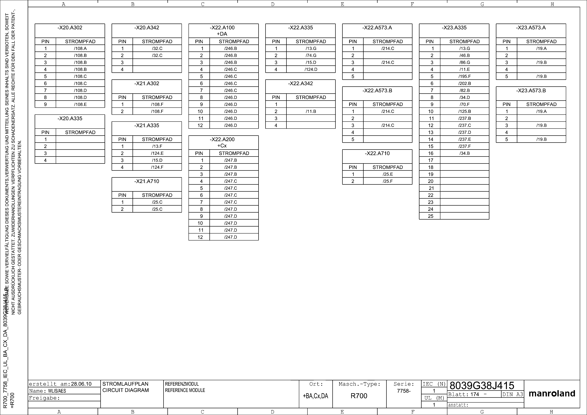

# +BA_Cx_DA — Sheet 174 of 247 — REFERENZMODUL

**REFERENCE MODULE**

> Part of the manroland **R700** printing press IEC/UL circuit diagrams.
> Drawing class: **Stromlaufplan / Circuit diagram** (DIN A3).
> Document `+BA_Cx_DA` covers the **Printing units / main switch cabinet** machine section.

## At a glance

| Field | Value |
|---|---|
| Document | `+BA_Cx_DA`  (8039G38J415) |
| Sheet | **174** of 247 |
| Section (DE) | REFERENZMODUL |
| Section (EN) | REFERENCE MODULE |
| Section type | REFERENCE_MODULE — Reference module |
| Machine type | `R700` |
| Series | `7758` |
| Created | 28.06.10 |
| Replaces | — |
| Columns used | A, B, C, D, E, F, G, H |
| Path numbers | — |
| Labels on sheet | 230 |
| Cross-refs out | 76 |
| Cross-refs in | 0 |

**Previous:** [+BA_Cx_DA sheet 173](SHEET_0173.md) · **Next:** [+BA_Cx_DA sheet 175](SHEET_0175.md) · **Document TOC:** [_TOC.md](_TOC.md)  (+BA_Cx_DA) · **Master TOC:** [all sheets](../_MASTER_TOC.md)

## Sheet image (300 DPI, exact vector render)



_Rendered directly from the PDF vector layer at 300 DPI (1-bit), no OCR and no resampling. Use it to confirm anything ambiguous in the text below._

## Cross-references on this sheet

Each entry is a wire leaving this sheet. The printed token is `/sheet.column`; the link resolves to that sheet inside the same document.

| Ref | Target sheet | Col | Path | Destination on target | Target section | From col |
|---|---|---|---|---|---|---|
| `/19.A` | [+BA_Cx_DA sheet 19](SHEET_0019.md) | A | — | — | SPANNUNGSVERSORGUNG: MAGNETVENTILBLOCK | H |
| `/108.A` | [+BA_Cx_DA sheet 108](SHEET_0108.md) | A | — | — | MOTOR: SEITENMARKE, B SEITE | A |
| `/246.B` | [+BA_Cx_DA sheet 246](SHEET_0246.md) | B | — | — | OPTION: INLINE COLORPILOT (ICP) | C |
| `/13.G` | [+BA_Cx_DA sheet 13](SHEET_0013.md) | G | — | — | SPANNUNGSVERSORGUNG, SCHALTSCHRANKBELÜFTUNG | E |
| `/13.G` | [+BA_Cx_DA sheet 13](SHEET_0013.md) | G | — | — | SPANNUNGSVERSORGUNG, SCHALTSCHRANKBELÜFTUNG | G |
| `/32.C` | [+BA_Cx_DA sheet 32](SHEET_0032.md) | C | — | — | BUSVERBINDUNGEN: 20 mA SCHLEIFE, BUSFUNKTIONEN | B |
| `/214.C` | [+BA_Cx_DA sheet 214](SHEET_0214.md) | C | — | — | OPTION: FWW SPEZIALREINIGER | F |
| `/46.B` | [+BA_Cx_DA sheet 46](SHEET_0046.md) | B | — | — | SCHUTZEINRICHTUNGEN | G |
| `/108.B` | [+BA_Cx_DA sheet 108](SHEET_0108.md) | B | — | — | MOTOR: SEITENMARKE, B SEITE | A |
| `/246.B` | [+BA_Cx_DA sheet 246](SHEET_0246.md) | B | — | — | OPTION: INLINE COLORPILOT (ICP) | C |
| `/74.G` | [+BA_Cx_DA sheet 74](SHEET_0074.md) | G | — | — | FEUCHTWERK | E |
| `/32.C` | [+BA_Cx_DA sheet 32](SHEET_0032.md) | C | — | — | BUSVERBINDUNGEN: 20 mA SCHLEIFE, BUSFUNKTIONEN | B |
| `/19.B` | [+BA_Cx_DA sheet 19](SHEET_0019.md) | B | — | — | SPANNUNGSVERSORGUNG: MAGNETVENTILBLOCK | H |
| `/108.B` | [+BA_Cx_DA sheet 108](SHEET_0108.md) | B | — | — | MOTOR: SEITENMARKE, B SEITE | A |
| `/246.B` | [+BA_Cx_DA sheet 246](SHEET_0246.md) | B | — | — | OPTION: INLINE COLORPILOT (ICP) | C |
| `/86.G` | [+BA_Cx_DA sheet 86](SHEET_0086.md) | G | — | — | WASCHVORRICHTUNG | G |
| `/15.D` | [+BA_Cx_DA sheet 15](SHEET_0015.md) | D | — | — | SPANNUNGSVERSORGUNG, SCHALTSCHRANKBELÜFTUNG | E |
| `/214.C` | [+BA_Cx_DA sheet 214](SHEET_0214.md) | C | — | — | OPTION: FWW SPEZIALREINIGER | F |
| `/11.E` | [+BA_Cx_DA sheet 11](SHEET_0011.md) | E | — | — | SPANNUNGSVERSORGUNG, SCHALTSCHRANKBELÜFTUNG | G |
| `/108.B` | [+BA_Cx_DA sheet 108](SHEET_0108.md) | B | — | — | MOTOR: SEITENMARKE, B SEITE | A |
| `/246.C` | [+BA_Cx_DA sheet 246](SHEET_0246.md) | C | — | — | OPTION: INLINE COLORPILOT (ICP) | C |
| `/124.D` | [+BA_Cx_DA sheet 124](SHEET_0124.md) | D | — | — | RESERVE: SPS STATION (INPUT) | E |
| `/19.B` | [+BA_Cx_DA sheet 19](SHEET_0019.md) | B | — | — | SPANNUNGSVERSORGUNG: MAGNETVENTILBLOCK | H |
| `/195.F` | [+BA_Cx_DA sheet 195](SHEET_0195.md) | F | — | — | OPTION: WASCHVORRICHTUNG MIT BÜRSTE | G |
| `/108.C` | [+BA_Cx_DA sheet 108](SHEET_0108.md) | C | — | — | MOTOR: SEITENMARKE, B SEITE | A |
| `/246.C` | [+BA_Cx_DA sheet 246](SHEET_0246.md) | C | — | — | OPTION: INLINE COLORPILOT (ICP) | C |
| `/202.B` | [+BA_Cx_DA sheet 202](SHEET_0202.md) | B | — | — | OPTION: | G |
| `/108.C` | [+BA_Cx_DA sheet 108](SHEET_0108.md) | C | — | — | MOTOR: SEITENMARKE, B SEITE | A |
| `/246.C` | [+BA_Cx_DA sheet 246](SHEET_0246.md) | C | — | — | OPTION: INLINE COLORPILOT (ICP) | C |
| `/82.B` | [+BA_Cx_DA sheet 82](SHEET_0082.md) | B | — | — | FARBWERK | G |
| `/108.D` | [+BA_Cx_DA sheet 108](SHEET_0108.md) | D | — | — | MOTOR: SEITENMARKE, B SEITE | A |
| `/246.C` | [+BA_Cx_DA sheet 246](SHEET_0246.md) | C | — | — | OPTION: INLINE COLORPILOT (ICP) | C |
| `/108.D` | [+BA_Cx_DA sheet 108](SHEET_0108.md) | D | — | — | MOTOR: SEITENMARKE, B SEITE | A |
| `/246.D` | [+BA_Cx_DA sheet 246](SHEET_0246.md) | D | — | — | OPTION: INLINE COLORPILOT (ICP) | C |
| `/34.D` | [+BA_Cx_DA sheet 34](SHEET_0034.md) | D | — | — | BUSVERBINDUNGEN: RESERVE SIGNALE | G |
| `/108.E` | [+BA_Cx_DA sheet 108](SHEET_0108.md) | E | — | — | MOTOR: SEITENMARKE, B SEITE | A |
| `/70.F` | [+BA_Cx_DA sheet 70](SHEET_0070.md) | F | — | — | ÖLUMLAUFSCHMIERUNG | G |
| `/108.F` | [+BA_Cx_DA sheet 108](SHEET_0108.md) | F | — | — | MOTOR: SEITENMARKE, B SEITE | B |
| `/246.D` | [+BA_Cx_DA sheet 246](SHEET_0246.md) | D | — | — | OPTION: INLINE COLORPILOT (ICP) | C |
| `/11.B` | [+BA_Cx_DA sheet 11](SHEET_0011.md) | B | — | — | SPANNUNGSVERSORGUNG, SCHALTSCHRANKBELÜFTUNG | E |
| `/19.A` | [+BA_Cx_DA sheet 19](SHEET_0019.md) | A | — | — | SPANNUNGSVERSORGUNG: MAGNETVENTILBLOCK | H |
| `/125.B` | [+BA_Cx_DA sheet 125](SHEET_0125.md) | B | — | — | RESERVE: SPS STATION (INPUT) | G |
| `/108.F` | [+BA_Cx_DA sheet 108](SHEET_0108.md) | F | — | — | MOTOR: SEITENMARKE, B SEITE | B |
| `/246.D` | [+BA_Cx_DA sheet 246](SHEET_0246.md) | D | — | — | OPTION: INLINE COLORPILOT (ICP) | C |
| `/214.C` | [+BA_Cx_DA sheet 214](SHEET_0214.md) | C | — | — | OPTION: FWW SPEZIALREINIGER | F |
| `/237.B` | [+BA_Cx_DA sheet 237](SHEET_0237.md) | B | — | — | OPTION: INLINECOATER SMART | G |
| `/246.D` | [+BA_Cx_DA sheet 246](SHEET_0246.md) | D | — | — | OPTION: INLINE COLORPILOT (ICP) | C |
| `/19.B` | [+BA_Cx_DA sheet 19](SHEET_0019.md) | B | — | — | SPANNUNGSVERSORGUNG: MAGNETVENTILBLOCK | H |
| `/246.D` | [+BA_Cx_DA sheet 246](SHEET_0246.md) | D | — | — | OPTION: INLINE COLORPILOT (ICP) | C |
| `/214.C` | [+BA_Cx_DA sheet 214](SHEET_0214.md) | C | — | — | OPTION: FWW SPEZIALREINIGER | F |
| `/237.C` | [+BA_Cx_DA sheet 237](SHEET_0237.md) | C | — | — | OPTION: INLINECOATER SMART | G |
| `/237.D` | [+BA_Cx_DA sheet 237](SHEET_0237.md) | D | — | — | OPTION: INLINECOATER SMART | G |
| `/19.B` | [+BA_Cx_DA sheet 19](SHEET_0019.md) | B | — | — | SPANNUNGSVERSORGUNG: MAGNETVENTILBLOCK | H |
| `/237.E` | [+BA_Cx_DA sheet 237](SHEET_0237.md) | E | — | — | OPTION: INLINECOATER SMART | G |
| `/13.F` | [+BA_Cx_DA sheet 13](SHEET_0013.md) | F | — | — | SPANNUNGSVERSORGUNG, SCHALTSCHRANKBELÜFTUNG | B |
| `/237.F` | [+BA_Cx_DA sheet 237](SHEET_0237.md) | F | — | — | OPTION: INLINECOATER SMART | G |
| `/34.B` | [+BA_Cx_DA sheet 34](SHEET_0034.md) | B | — | — | BUSVERBINDUNGEN: RESERVE SIGNALE | G |
| `/124.E` | [+BA_Cx_DA sheet 124](SHEET_0124.md) | E | — | — | RESERVE: SPS STATION (INPUT) | B |
| `/247.B` | [+BA_Cx_DA sheet 247](SHEET_0247.md) | B | — | — | OPTION: INLINE COLORPILOT (ICP) | C |
| `/15.D` | [+BA_Cx_DA sheet 15](SHEET_0015.md) | D | — | — | SPANNUNGSVERSORGUNG, SCHALTSCHRANKBELÜFTUNG | B |
| `/247.B` | [+BA_Cx_DA sheet 247](SHEET_0247.md) | B | — | — | OPTION: INLINE COLORPILOT (ICP) | C |
| `/124.F` | [+BA_Cx_DA sheet 124](SHEET_0124.md) | F | — | — | RESERVE: SPS STATION (INPUT) | B |
| `/25.E` | [+BA_Cx_DA sheet 25](SHEET_0025.md) | E | — | — | BUSVERBINDUNGEN: NOT AUS | F |
| `/247.B` | [+BA_Cx_DA sheet 247](SHEET_0247.md) | B | — | — | OPTION: INLINE COLORPILOT (ICP) | C |
| `/25.F` | [+BA_Cx_DA sheet 25](SHEET_0025.md) | F | — | — | BUSVERBINDUNGEN: NOT AUS | F |
| `/247.C` | [+BA_Cx_DA sheet 247](SHEET_0247.md) | C | — | — | OPTION: INLINE COLORPILOT (ICP) | C |
| `/247.C` | [+BA_Cx_DA sheet 247](SHEET_0247.md) | C | — | — | OPTION: INLINE COLORPILOT (ICP) | C |
| `/247.C` | [+BA_Cx_DA sheet 247](SHEET_0247.md) | C | — | — | OPTION: INLINE COLORPILOT (ICP) | C |
| `/25.C` | [+BA_Cx_DA sheet 25](SHEET_0025.md) | C | — | — | BUSVERBINDUNGEN: NOT AUS | B |
| `/247.C` | [+BA_Cx_DA sheet 247](SHEET_0247.md) | C | — | — | OPTION: INLINE COLORPILOT (ICP) | C |
| `/25.C` | [+BA_Cx_DA sheet 25](SHEET_0025.md) | C | — | — | BUSVERBINDUNGEN: NOT AUS | B |
| `/247.D` | [+BA_Cx_DA sheet 247](SHEET_0247.md) | D | — | — | OPTION: INLINE COLORPILOT (ICP) | C |
| `/247.D` | [+BA_Cx_DA sheet 247](SHEET_0247.md) | D | — | — | OPTION: INLINE COLORPILOT (ICP) | C |
| `/247.D` | [+BA_Cx_DA sheet 247](SHEET_0247.md) | D | — | — | OPTION: INLINE COLORPILOT (ICP) | C |
| `/247.D` | [+BA_Cx_DA sheet 247](SHEET_0247.md) | D | — | — | OPTION: INLINE COLORPILOT (ICP) | C |
| `/247.D` | [+BA_Cx_DA sheet 247](SHEET_0247.md) | D | — | — | OPTION: INLINE COLORPILOT (ICP) | C |

## Devices on this sheet

| Tag | Class | Class meaning (IEC) | Col | Sub | Terminal | Sign |
|---|---|---|---|---|---|---|
| `X20.A342` | — | cross-device reference | B | — | — | — |
| `X20.A302` | — | cross-device reference | A | — | — | — |
| `X20.A335` | — | cross-device reference | A | — | — | — |
| `X23.A335` | — | cross-device reference | G | — | — | — |
| `X22.A573.A` | — | cross-device reference | E | — | — | — |
| `X22.A573.B` | — | cross-device reference | F | — | — | — |
| `X23.A573.A` | — | cross-device reference | H | — | — | — |
| `X23.A573.B` | — | cross-device reference | H | — | — | — |
| `X22.A710` | — | cross-device reference | F | — | — | — |
| `X21.A302` | — | cross-device reference | B | — | — | — |
| `X21.A335` | — | cross-device reference | B | — | — | — |
| `X21.A710` | — | cross-device reference | B | — | — | — |
| `X22.A100` | — | cross-device reference | C | — | — | — |
| `X22.A200` | — | cross-device reference | C | — | — | — |
| `X22.A342` | — | cross-device reference | D | — | — | — |
| `X22.A335` | — | cross-device reference | D | — | — | — |

## Potentials / nets

_No named potentials on this sheet._

## Wire-end annotations (grouped as printed)

A wire that continues elsewhere is annotated with a small cluster: the destination description, the path/line number `#NN`, and the `/sheet.column` cross reference. Each row below is one such cluster exactly as it is grouped on the drawing.

| Col | Y | Path | Cross-ref | Text on the wire |
|---|---|---|---|---|
| A | 51.3 | — | — | `X20.A302` |
| B | 51.3 | — | — | `X20.A342` |
| C | 51.3 | — | — | `X22.A100` |
| D | 51.3 | — | — | `X22.A335` |
| E | 51.3 | — | — | `X22.A573.A` |
| G | 51.3 | — | — | `X23.A335` |
| H | 51.3 | — | — | `X23.A573.A` |
| C | 64.0 | — | — | `+DA` |
| A | 80.0 | — | — | `PIN 2 3 4 5 6 7 8 9 1 STROMPFAD` |
| B | 80.0 | — | — | `PIN 2 3 4 1 STROMPFAD` |
| C | 80.0 | — | — | `PIN 10 12 11 2 3 4 5 6 7 8 9 1 STROMPFAD` |
| D | 80.0 | — | — | `PIN 2 3 4 1 STROMPFAD` |
| E | 80.0 | — | — | `PIN 2 3 4 5 1 STROMPFAD` |
| G | 80.0 | — | — | `PIN STROMPFAD` |
| H | 80.0 | — | — | `PIN 2 3 4 5 1 STROMPFAD` |
| F | 94.2 | — | — | `2 3 4 5 6 7 8 9 1` |
| A | 94.5 | — | `/108.A` | — |
| B | 94.5 | — | `/32.C` | — |
| C | 94.5 | — | `/246.B` | — |
| E | 94.5 | — | `/13.G` | — |
| F | 94.5 | — | `/214.C` | — |
| G | 94.5 | — | `/13.G` | — |
| H | 94.5 | — | `/19.A` | — |
| A | 108.7 | — | `/108.B` | — |
| B | 108.7 | — | `/32.C` | — |
| C | 108.7 | — | `/246.B` | — |
| E | 108.7 | — | `/74.G` | — |
| G | 108.7 | — | `/46.B` | — |
| H | 122.8 | — | `/19.B` | — |
| A | 122.9 | — | `/108.B` | — |
| C | 122.9 | — | `/246.B` | — |
| E | 122.9 | — | `/15.D` | — |
| F | 122.9 | — | `/214.C` | — |
| G | 122.9 | — | `/86.G` | — |
| A | 137.0 | — | `/108.B` | — |
| G | 137.0 | — | `/11.E` | — |
| C | 137.1 | — | `/246.C` | — |
| E | 137.1 | — | `/124.D` | — |
| A | 151.2 | — | `/108.C` | — |
| C | 151.2 | — | `/246.C` | — |
| G | 151.2 | — | `/195.F` | — |
| H | 151.2 | — | `/19.B` | — |
| B | 164.7 | — | — | `X21.A302` |
| D | 164.7 | — | — | `X22.A342` |
| A | 165.4 | — | `/108.C` | — |
| C | 165.4 | — | `/246.C` | — |
| G | 165.4 | — | `/202.B` | — |
| F | 178.9 | — | — | `X22.A573.B` |
| H | 178.9 | — | — | `X23.A573.B` |
| G | 179.5 | — | `/82.B` | — |
| A | 179.6 | — | `/108.D` | — |
| C | 179.6 | — | `/246.C` | — |
| B | 193.4 | — | — | `PIN 2 1 STROMPFAD` |
| D | 193.4 | — | — | `PIN 2 3 4 1 STROMPFAD` |
| A | 193.8 | — | `/108.D` | — |
| C | 193.8 | — | `/246.D` | — |
| G | 193.8 | — | `/34.D` | — |
| E | 207.5 | — | — | `PIN 2 3 4 5 1 STROMPFAD` |
| H | 207.5 | — | — | `PIN 2 3 4 5 1 STROMPFAD` |
| A | 207.9 | — | `/108.E` | — |
| B | 207.9 | — | `/108.F` | — |
| C | 207.9 | — | `/246.D` | — |
| G | 207.9 | — | `/70.F` | — |
| F | 221.8 | — | — | `10 12 13 14 15 16 17 18 19 20 11` |
| B | 222.1 | — | `/108.F` | — |
| C | 222.1 | — | `/246.D` | — |
| E | 222.1 | — | `/11.B` | — |
| F | 222.1 | — | `/214.C` | — |
| G | 222.1 | — | `/125.B` | — |
| H | 222.1 | — | `/19.A` | — |
| A | 235.6 | — | — | `X20.A335` |
| G | 236.2 | — | `/237.B` | — |
| C | 236.3 | — | `/246.D` | — |
| B | 249.8 | — | — | `X21.A335` |
| C | 250.4 | — | `/246.D` | — |
| F | 250.4 | — | `/214.C` | — |
| G | 250.4 | — | `/237.C` | — |
| H | 250.4 | — | `/19.B` | — |
| A | 264.2 | — | — | `PIN 2 3 4 1 STROMPFAD` |
| G | 264.6 | — | `/237.D` | — |
| C | 278.1 | — | — | `X22.A200` |
| B | 278.4 | — | — | `PIN 2 3 4 1 STROMPFAD` |
| G | 278.8 | — | `/237.E` | — |
| H | 278.8 | — | `/19.B` | — |
| C | 290.9 | — | — | `+Cx` |
| B | 292.9 | — | `/13.F` | — |
| G | 292.9 | — | `/237.F` | — |
| F | 306.4 | — | — | `X22.A710` |
| C | 306.8 | — | — | `PIN 10 12 11 2 3 4 5 6 7 8 9 1 STROMPFAD` |
| B | 307.1 | — | `/124.E` | — |
| G | 307.1 | — | `/34.B` | — |
| B | 321.3 | — | `/15.D` | — |
| C | 321.3 | — | `/247.B` | — |
| E | 335.1 | — | — | `PIN 2 1 STROMPFAD` |
| B | 335.5 | — | `/124.F` | — |
| C | 335.5 | — | `/247.B` | — |
| C | 349.6 | — | `/247.B` | — |
| F | 349.6 | — | `/25.E` | — |
| B | 363.1 | — | — | `X21.A710` |
| C | 363.8 | — | `/247.C` | — |
| F | 363.8 | — | `/25.F` | — |
| F | 377.7 | — | — | `22 23 24 25 21` |
| C | 378.0 | — | `/247.C` | — |
| B | 391.8 | — | — | `PIN 2 1 STROMPFAD` |
| C | 392.2 | — | `/247.C` | — |
| B | 406.3 | — | `/25.C` | — |
| C | 406.4 | — | `/247.C` | — |
| B | 420.5 | — | `/25.C` | — |
| C | 420.5 | — | `/247.D` | — |
| C | 434.7 | — | `/247.D` | — |
| C | 448.9 | — | `/247.D` | — |
| C | 463.1 | — | `/247.D` | — |
| C | 477.2 | — | `/247.D` | — |


## Reconstructed tables

This sheet carries tabular content (pin map / terminal assignment / index). The grid below was rebuilt from the drawing's own rule lines, so each row is exactly one physical row of the table.

### Table 1 — 15 data rows × 2 columns (at x=70.9, y=48.2) — **X20.A302**

| PIN | STROMPFAD |
|---|---|
| `1` | `/108.A` |
| `2` | `/108.B` |
| `3` | `/108.B` |
| `4` | `/108.B` |
| `5` | `/108.C` |
| `6` | `/108.C` |
| `7` | `/108.D` |
| `8` | `/108.D` |
| `9` | `/108.E` |
|  | `X20.A335` |
| `PIN` | `STROMPFAD` |
| `1` |  |
| `2` |  |
| `3` |  |
| `4` |  |


### Table 2 — 18 data rows × 2 columns (at x=226.8, y=48.2) — **X20.A342**

| PIN | STROMPFAD |
|---|---|
| `1` | `/32.C` |
| `2` | `/32.C` |
| `3` |  |
| `4` |  |
|  | `X21.A302` |
| `PIN` | `STROMPFAD` |
| `1` | `/108.F` |
| `2` | `/108.F` |
|  | `X21.A335` |
| `PIN` | `STROMPFAD` |
| `1` | `/13.F` |
| `2` | `/124.E` |
| `3` | `/15.D` |
| `4` | `/124.F` |
|  | `X21.A710` |
| `PIN` | `STROMPFAD` |
| `1` | `/25.C` |
| `2` | `/25.C` |


### Table 3 — 27 data rows × 2 columns (at x=382.7, y=48.2) — **X22.A100 +DA**

| PIN | STROMPFAD |
|---|---|
| `1` | `/246.B` |
| `2` | `/246.B` |
| `3` | `/246.B` |
| `4` | `/246.C` |
| `5` | `/246.C` |
| `6` | `/246.C` |
| `7` | `/246.C` |
| `8` | `/246.D` |
| `9` | `/246.D` |
| `10` | `/246.D` |
| `11` | `/246.D` |
| `12` | `/246.D` |
|  | `X22.A200` |
|  | `+Cx` |
| `PIN` | `STROMPFAD` |
| `1` | `/247.B` |
| `2` | `/247.B` |
| `3` | `/247.B` |
| `4` | `/247.C` |
| `5` | `/247.C` |
| `6` | `/247.C` |
| `7` | `/247.C` |
| `8` | `/247.D` |
| `9` | `/247.D` |
| `10` | `/247.D` |
| `11` | `/247.D` |
| `12` | `/247.D` |


### Table 4 — 10 data rows × 2 columns (at x=538.6, y=48.2) — **X22.A335**

| PIN | STROMPFAD |
|---|---|
| `1` | `/13.G` |
| `2` | `/74.G` |
| `3` | `/15.D` |
| `4` | `/124.D` |
|  | `X22.A342` |
| `PIN` | `STROMPFAD` |
| `1` |  |
| `2` | `/11.B` |
| `3` |  |
| `4` |  |


### Table 5 — 16 data rows × 2 columns (at x=694.5, y=48.2) — **X22.A573.A**

| PIN | STROMPFAD |
|---|---|
| `1` | `/214.C` |
| `2` |  |
| `3` | `/214.C` |
| `4` |  |
| `5` |  |
|  | `X22.A573.B` |
| `PIN` | `STROMPFAD` |
| `1` | `/214.C` |
| `2` |  |
| `3` | `/214.C` |
| `4` |  |
| `5` |  |
|  | `X22.A710` |
| `PIN` | `STROMPFAD` |
| `1` | `/25.E` |
| `2` | `/25.F` |


### Table 6 — 25 data rows × 2 columns (at x=850.4, y=48.2) — **X23.A335**

| PIN | STROMPFAD |
|---|---|
| `1` | `/13.G` |
| `2` | `/46.B` |
| `3` | `/86.G` |
| `4` | `/11.E` |
| `5` | `/195.F` |
| `6` | `/202.B` |
| `7` | `/82.B` |
| `8` | `/34.D` |
| `9` | `/70.F` |
| `10` | `/125.B` |
| `11` | `/237.B` |
| `12` | `/237.C` |
| `13` | `/237.D` |
| `14` | `/237.E` |
| `15` | `/237.F` |
| `16` | `/34.B` |
| `17` |  |
| `18` |  |
| `19` |  |
| `20` |  |
| `21` |  |
| `22` |  |
| `23` |  |
| `24` |  |
| `25` |  |


### Table 7 — 12 data rows × 2 columns (at x=1006.3, y=48.2) — **X23.A573.A**

| PIN | STROMPFAD |
|---|---|
| `1` | `/19.A` |
| `2` |  |
| `3` | `/19.B` |
| `4` |  |
| `5` | `/19.B` |
|  | `X23.A573.B` |
| `PIN` | `STROMPFAD` |
| `1` | `/19.A` |
| `2` |  |
| `3` | `/19.B` |
| `4` |  |
| `5` | `/19.B` |


## Notes and free text on this sheet

| Text | Col | Y (pt) |
|---|---|---|
| `PIN` | B | 80.02 |
| `STROMPFAD` | B | 79.98 |
| `PIN` | A | 80.02 |
| `STROMPFAD` | A | 79.98 |
| `PIN` | F | 80.02 |
| `STROMPFAD` | G | 79.98 |
| `PIN` | E | 80.02 |
| `STROMPFAD` | F | 79.98 |
| `PIN` | G | 80.02 |
| `STROMPFAD` | H | 79.98 |
| `PIN` | C | 80.02 |
| `STROMPFAD` | C | 79.98 |
| `+DA` | C | 64.01 |
| `+Cx` | C | 290.89 |
| `PIN` | D | 193.41 |
| `STROMPFAD` | E | 193.37 |

## Complete label inventory (exact text from the drawing)

Every text object inside the drawing area of this sheet, in DIN reading order (column A→H, then top→bottom). This is the authoritative list: if a string is not here it is not printed on this sheet.

| Col | Y | X | Dir | Type | Text |
|---|---|---|---|---|---|
| A | 51.3 | 116.8 | → | device ref | `X20.A302` |
| A | 80.0 | 84.0 | → | text | `PIN` |
| A | 80.0 | 132.2 | → | text | `STROMPFAD` |
| A | 94.2 | 90.0 | → | number | `1` |
| A | 94.5 | 150.2 | → | cross-reference | `/108.A` |
| A | 108.4 | 89.4 | → | number | `2` |
| A | 108.7 | 150.4 | → | cross-reference | `/108.B` |
| A | 122.5 | 89.4 | → | number | `3` |
| A | 122.9 | 150.4 | → | cross-reference | `/108.B` |
| A | 136.7 | 89.4 | → | number | `4` |
| A | 137.0 | 150.4 | → | cross-reference | `/108.B` |
| A | 150.9 | 89.4 | → | number | `5` |
| A | 151.2 | 150.2 | → | cross-reference | `/108.C` |
| A | 165.1 | 89.4 | → | number | `6` |
| A | 165.4 | 150.2 | → | cross-reference | `/108.C` |
| A | 179.2 | 89.4 | → | number | `7` |
| A | 179.6 | 150.2 | → | cross-reference | `/108.D` |
| A | 193.4 | 89.4 | → | number | `8` |
| A | 193.8 | 150.2 | → | cross-reference | `/108.D` |
| A | 207.6 | 89.4 | → | number | `9` |
| A | 207.9 | 150.5 | → | cross-reference | `/108.E` |
| A | 235.6 | 116.8 | → | device ref | `X20.A335` |
| A | 264.2 | 132.2 | → | text | `STROMPFAD` |
| A | 264.3 | 84.0 | → | text | `PIN` |
| A | 278.5 | 90.0 | → | number | `1` |
| A | 292.6 | 89.4 | → | number | `2` |
| A | 306.8 | 89.4 | → | number | `3` |
| A | 321.0 | 89.4 | → | number | `4` |
| B | 51.3 | 272.7 | → | device ref | `X20.A342` |
| B | 80.0 | 240.0 | → | text | `PIN` |
| B | 80.0 | 288.1 | → | text | `STROMPFAD` |
| B | 94.2 | 245.9 | → | number | `1` |
| B | 94.5 | 308.6 | → | cross-reference | `/32.C` |
| B | 108.4 | 245.3 | → | number | `2` |
| B | 108.7 | 308.6 | → | cross-reference | `/32.C` |
| B | 122.5 | 245.3 | → | number | `3` |
| B | 136.7 | 245.3 | → | number | `4` |
| B | 164.7 | 272.7 | → | device ref | `X21.A302` |
| B | 193.4 | 240.0 | → | text | `PIN` |
| B | 193.4 | 288.1 | → | text | `STROMPFAD` |
| B | 207.6 | 245.9 | → | number | `1` |
| B | 207.9 | 306.6 | → | cross-reference | `/108.F` |
| B | 221.8 | 245.3 | → | number | `2` |
| B | 222.1 | 306.6 | → | cross-reference | `/108.F` |
| B | 249.8 | 272.7 | → | device ref | `X21.A335` |
| B | 278.4 | 240.0 | → | text | `PIN` |
| B | 278.4 | 288.1 | → | text | `STROMPFAD` |
| B | 292.6 | 245.9 | → | number | `1` |
| B | 292.9 | 309.0 | → | cross-reference | `/13.F` |
| B | 306.8 | 245.3 | → | number | `2` |
| B | 307.1 | 306.4 | → | cross-reference | `/124.E` |
| B | 321.0 | 245.3 | → | number | `3` |
| B | 321.3 | 308.6 | → | cross-reference | `/15.D` |
| B | 335.1 | 245.3 | → | number | `4` |
| B | 335.5 | 306.6 | → | cross-reference | `/124.F` |
| B | 363.1 | 272.7 | → | device ref | `X21.A710` |
| B | 391.8 | 240.0 | → | text | `PIN` |
| B | 391.8 | 288.1 | → | text | `STROMPFAD` |
| B | 406.0 | 245.9 | → | number | `1` |
| B | 406.3 | 308.6 | → | cross-reference | `/25.C` |
| B | 420.2 | 245.3 | → | number | `2` |
| B | 420.5 | 308.6 | → | cross-reference | `/25.C` |
| C | 51.3 | 425.8 | → | device ref | `X22.A100` |
| C | 64.0 | 439.8 | → | text | `+DA` |
| C | 80.0 | 395.9 | → | text | `PIN` |
| C | 80.0 | 444.0 | → | text | `STROMPFAD` |
| C | 94.2 | 407.6 | → | number | `1` |
| C | 94.5 | 455.1 | → | cross-reference | `/246.B` |
| C | 108.4 | 405.9 | → | number | `2` |
| C | 108.7 | 455.1 | → | cross-reference | `/246.B` |
| C | 122.5 | 405.9 | → | number | `3` |
| C | 122.9 | 455.1 | → | cross-reference | `/246.B` |
| C | 136.7 | 405.9 | → | number | `4` |
| C | 137.1 | 455.0 | → | cross-reference | `/246.C` |
| C | 150.9 | 405.9 | → | number | `5` |
| C | 151.2 | 455.0 | → | cross-reference | `/246.C` |
| C | 165.1 | 405.9 | → | number | `6` |
| C | 165.4 | 455.0 | → | cross-reference | `/246.C` |
| C | 179.2 | 405.9 | → | number | `7` |
| C | 179.6 | 455.0 | → | cross-reference | `/246.C` |
| C | 193.4 | 405.9 | → | number | `8` |
| C | 193.8 | 455.0 | → | cross-reference | `/246.D` |
| C | 207.6 | 405.9 | → | number | `9` |
| C | 207.9 | 455.0 | → | cross-reference | `/246.D` |
| C | 221.8 | 400.5 | → | number | `10` |
| C | 222.1 | 455.0 | → | cross-reference | `/246.D` |
| C | 235.9 | 402.2 | → | number | `11` |
| C | 236.3 | 455.0 | → | cross-reference | `/246.D` |
| C | 250.1 | 400.5 | → | number | `12` |
| C | 250.4 | 455.0 | → | cross-reference | `/246.D` |
| C | 278.1 | 425.8 | → | device ref | `X22.A200` |
| C | 290.9 | 440.9 | → | text | `+Cx` |
| C | 306.8 | 395.9 | → | text | `PIN` |
| C | 306.8 | 444.0 | → | text | `STROMPFAD` |
| C | 321.0 | 407.6 | → | number | `1` |
| C | 321.3 | 455.1 | → | cross-reference | `/247.B` |
| C | 335.1 | 405.9 | → | number | `2` |
| C | 335.5 | 455.1 | → | cross-reference | `/247.B` |
| C | 349.3 | 405.9 | → | number | `3` |
| C | 349.6 | 455.1 | → | cross-reference | `/247.B` |
| C | 363.5 | 405.9 | → | number | `4` |
| C | 363.8 | 455.0 | → | cross-reference | `/247.C` |
| C | 377.7 | 405.9 | → | number | `5` |
| C | 378.0 | 455.0 | → | cross-reference | `/247.C` |
| C | 391.8 | 405.9 | → | number | `6` |
| C | 392.2 | 455.0 | → | cross-reference | `/247.C` |
| C | 406.0 | 405.9 | → | number | `7` |
| C | 406.4 | 455.0 | → | cross-reference | `/247.C` |
| C | 420.2 | 405.9 | → | number | `8` |
| C | 420.5 | 455.0 | → | cross-reference | `/247.D` |
| C | 434.4 | 405.9 | → | number | `9` |
| C | 434.7 | 455.0 | → | cross-reference | `/247.D` |
| C | 448.5 | 400.5 | → | number | `10` |
| C | 448.9 | 455.0 | → | cross-reference | `/247.D` |
| C | 462.7 | 402.2 | → | number | `11` |
| C | 463.0 | 455.0 | → | cross-reference | `/247.D` |
| C | 476.9 | 400.5 | → | number | `12` |
| C | 477.2 | 455.0 | → | cross-reference | `/247.D` |
| D | 51.3 | 584.5 | → | device ref | `X22.A335` |
| D | 80.0 | 551.8 | → | text | `PIN` |
| D | 94.2 | 557.7 | → | number | `1` |
| D | 108.4 | 557.1 | → | number | `2` |
| D | 122.5 | 557.1 | → | number | `3` |
| D | 136.7 | 557.1 | → | number | `4` |
| D | 164.7 | 584.5 | → | device ref | `X22.A342` |
| D | 193.4 | 551.8 | → | text | `PIN` |
| D | 207.6 | 557.7 | → | number | `1` |
| D | 221.8 | 557.1 | → | number | `2` |
| D | 235.9 | 557.1 | → | number | `3` |
| D | 250.1 | 557.1 | → | number | `4` |
| E | 51.3 | 735.0 | → | device ref | `X22.A573.A` |
| E | 80.0 | 600.0 | → | text | `STROMPFAD` |
| E | 80.0 | 707.7 | → | text | `PIN` |
| E | 94.2 | 713.6 | → | number | `1` |
| E | 94.5 | 620.2 | → | cross-reference | `/13.G` |
| E | 108.4 | 713.1 | → | number | `2` |
| E | 108.7 | 620.2 | → | cross-reference | `/74.G` |
| E | 122.5 | 713.1 | → | number | `3` |
| E | 122.9 | 620.4 | → | cross-reference | `/15.D` |
| E | 136.7 | 713.1 | → | number | `4` |
| E | 137.1 | 618.0 | → | cross-reference | `/124.D` |
| E | 150.9 | 713.1 | → | number | `5` |
| E | 193.4 | 600.0 | → | text | `STROMPFAD` |
| E | 207.6 | 707.7 | → | text | `PIN` |
| E | 221.8 | 713.6 | → | number | `1` |
| E | 222.1 | 620.5 | → | cross-reference | `/11.B` |
| E | 235.9 | 713.1 | → | number | `2` |
| E | 250.1 | 713.1 | → | number | `3` |
| E | 264.3 | 713.1 | → | number | `4` |
| E | 278.5 | 713.1 | → | number | `5` |
| E | 335.1 | 707.7 | → | text | `PIN` |
| E | 349.3 | 713.6 | → | number | `1` |
| E | 363.5 | 713.1 | → | number | `2` |
| F | 80.0 | 755.9 | → | text | `STROMPFAD` |
| F | 80.0 | 863.6 | → | text | `PIN` |
| F | 94.2 | 875.3 | → | number | `1` |
| F | 94.5 | 773.9 | → | cross-reference | `/214.C` |
| F | 108.4 | 873.6 | → | number | `2` |
| F | 122.5 | 873.6 | → | number | `3` |
| F | 122.9 | 773.9 | → | cross-reference | `/214.C` |
| F | 136.7 | 873.6 | → | number | `4` |
| F | 150.9 | 873.6 | → | number | `5` |
| F | 165.1 | 873.6 | → | number | `6` |
| F | 178.9 | 735.4 | → | device ref | `X22.A573.B` |
| F | 179.2 | 873.6 | → | number | `7` |
| F | 193.4 | 873.6 | → | number | `8` |
| F | 207.5 | 755.9 | → | text | `STROMPFAD` |
| F | 207.6 | 873.6 | → | number | `9` |
| F | 221.8 | 868.3 | → | number | `10` |
| F | 222.1 | 773.9 | → | cross-reference | `/214.C` |
| F | 235.9 | 870.0 | → | number | `11` |
| F | 250.1 | 868.3 | → | number | `12` |
| F | 250.4 | 773.9 | → | cross-reference | `/214.C` |
| F | 264.3 | 868.3 | → | number | `13` |
| F | 278.5 | 868.3 | → | number | `14` |
| F | 292.6 | 868.3 | → | number | `15` |
| F | 306.4 | 740.4 | → | device ref | `X22.A710` |
| F | 306.8 | 868.3 | → | number | `16` |
| F | 321.0 | 868.3 | → | number | `17` |
| F | 335.1 | 755.9 | → | text | `STROMPFAD` |
| F | 335.1 | 868.3 | → | number | `18` |
| F | 349.3 | 868.3 | → | number | `19` |
| F | 349.6 | 776.6 | → | cross-reference | `/25.E` |
| F | 363.5 | 868.3 | → | number | `20` |
| F | 363.8 | 776.7 | → | cross-reference | `/25.F` |
| F | 377.7 | 870.0 | → | number | `21` |
| F | 391.8 | 868.3 | → | number | `22` |
| F | 406.0 | 868.3 | → | number | `23` |
| F | 420.2 | 868.3 | → | number | `24` |
| F | 434.4 | 868.3 | → | number | `25` |
| G | 51.3 | 896.3 | → | device ref | `X23.A335` |
| G | 80.0 | 911.8 | → | text | `STROMPFAD` |
| G | 80.0 | 1019.5 | → | text | `PIN` |
| G | 94.2 | 1025.4 | → | number | `1` |
| G | 94.5 | 932.0 | → | cross-reference | `/13.G` |
| G | 108.4 | 1024.9 | → | number | `2` |
| G | 108.7 | 932.3 | → | cross-reference | `/46.B` |
| G | 122.5 | 1024.9 | → | number | `3` |
| G | 122.9 | 932.0 | → | cross-reference | `/86.G` |
| G | 136.7 | 1024.9 | → | number | `4` |
| G | 137.0 | 932.5 | → | cross-reference | `/11.E` |
| G | 150.9 | 1024.9 | → | number | `5` |
| G | 151.2 | 930.2 | → | cross-reference | `/195.F` |
| G | 165.4 | 929.9 | → | cross-reference | `/202.B` |
| G | 179.5 | 932.3 | → | cross-reference | `/82.B` |
| G | 193.7 | 932.2 | → | cross-reference | `/34.D` |
| G | 207.6 | 1019.5 | → | text | `PIN` |
| G | 207.9 | 932.6 | → | cross-reference | `/70.F` |
| G | 221.8 | 1025.4 | → | number | `1` |
| G | 222.1 | 929.9 | → | cross-reference | `/125.B` |
| G | 235.9 | 1024.9 | → | number | `2` |
| G | 236.2 | 929.9 | → | cross-reference | `/237.B` |
| G | 250.1 | 1024.9 | → | number | `3` |
| G | 250.4 | 929.8 | → | cross-reference | `/237.C` |
| G | 264.3 | 1024.9 | → | number | `4` |
| G | 264.6 | 929.8 | → | cross-reference | `/237.D` |
| G | 278.5 | 1024.9 | → | number | `5` |
| G | 278.8 | 930.0 | → | cross-reference | `/237.E` |
| G | 293.0 | 930.2 | → | cross-reference | `/237.F` |
| G | 307.1 | 932.3 | → | cross-reference | `/34.B` |
| H | 51.3 | 1046.8 | → | device ref | `X23.A573.A` |
| H | 80.0 | 1067.7 | → | text | `STROMPFAD` |
| H | 94.5 | 1088.1 | → | cross-reference | `/19.A` |
| H | 122.8 | 1088.2 | → | cross-reference | `/19.B` |
| H | 151.2 | 1088.2 | → | cross-reference | `/19.B` |
| H | 178.9 | 1047.3 | → | device ref | `X23.A573.B` |
| H | 207.5 | 1067.7 | → | text | `STROMPFAD` |
| H | 222.1 | 1088.1 | → | cross-reference | `/19.A` |
| H | 250.4 | 1088.2 | → | cross-reference | `/19.B` |
| H | 278.8 | 1088.2 | → | cross-reference | `/19.B` |

## Reading-order text block

The same content as a plain block, grouped by DIN column — convenient to paste or to match against a visual description.

```text
=== Column A ===
  51.3  116.8  devref       X20.A302
  80.0   84.0  text         PIN
  80.0  132.2  text         STROMPFAD
  94.2   90.0  numeric      1
  94.5  150.2  xref         /108.A
 108.4   89.4  numeric      2
 108.7  150.4  xref         /108.B
 122.5   89.4  numeric      3
 122.9  150.4  xref         /108.B
 136.7   89.4  numeric      4
 137.0  150.4  xref         /108.B
 150.9   89.4  numeric      5
 151.2  150.2  xref         /108.C
 165.1   89.4  numeric      6
 165.4  150.2  xref         /108.C
 179.2   89.4  numeric      7
 179.6  150.2  xref         /108.D
 193.4   89.4  numeric      8
 193.8  150.2  xref         /108.D
 207.6   89.4  numeric      9
 207.9  150.5  xref         /108.E
 235.6  116.8  devref       X20.A335
 264.2  132.2  text         STROMPFAD
 264.3   84.0  text         PIN
 278.5   90.0  numeric      1
 292.6   89.4  numeric      2
 306.8   89.4  numeric      3
 321.0   89.4  numeric      4
=== Column B ===
  51.3  272.7  devref       X20.A342
  80.0  240.0  text         PIN
  80.0  288.1  text         STROMPFAD
  94.2  245.9  numeric      1
  94.5  308.6  xref         /32.C
 108.4  245.3  numeric      2
 108.7  308.6  xref         /32.C
 122.5  245.3  numeric      3
 136.7  245.3  numeric      4
 164.7  272.7  devref       X21.A302
 193.4  240.0  text         PIN
 193.4  288.1  text         STROMPFAD
 207.6  245.9  numeric      1
 207.9  306.6  xref         /108.F
 221.8  245.3  numeric      2
 222.1  306.6  xref         /108.F
 249.8  272.7  devref       X21.A335
 278.4  240.0  text         PIN
 278.4  288.1  text         STROMPFAD
 292.6  245.9  numeric      1
 292.9  309.0  xref         /13.F
 306.8  245.3  numeric      2
 307.1  306.4  xref         /124.E
 321.0  245.3  numeric      3
 321.3  308.6  xref         /15.D
 335.1  245.3  numeric      4
 335.5  306.6  xref         /124.F
 363.1  272.7  devref       X21.A710
 391.8  240.0  text         PIN
 391.8  288.1  text         STROMPFAD
 406.0  245.9  numeric      1
 406.3  308.6  xref         /25.C
 420.2  245.3  numeric      2
 420.5  308.6  xref         /25.C
=== Column C ===
  51.3  425.8  devref       X22.A100
  64.0  439.8  text         +DA
  80.0  395.9  text         PIN
  80.0  444.0  text         STROMPFAD
  94.2  407.6  numeric      1
  94.5  455.1  xref         /246.B
 108.4  405.9  numeric      2
 108.7  455.1  xref         /246.B
 122.5  405.9  numeric      3
 122.9  455.1  xref         /246.B
 136.7  405.9  numeric      4
 137.1  455.0  xref         /246.C
 150.9  405.9  numeric      5
 151.2  455.0  xref         /246.C
 165.1  405.9  numeric      6
 165.4  455.0  xref         /246.C
 179.2  405.9  numeric      7
 179.6  455.0  xref         /246.C
 193.4  405.9  numeric      8
 193.8  455.0  xref         /246.D
 207.6  405.9  numeric      9
 207.9  455.0  xref         /246.D
 221.8  400.5  numeric      10
 222.1  455.0  xref         /246.D
 235.9  402.2  numeric      11
 236.3  455.0  xref         /246.D
 250.1  400.5  numeric      12
 250.4  455.0  xref         /246.D
 278.1  425.8  devref       X22.A200
 290.9  440.9  text         +Cx
 306.8  395.9  text         PIN
 306.8  444.0  text         STROMPFAD
 321.0  407.6  numeric      1
 321.3  455.1  xref         /247.B
 335.1  405.9  numeric      2
 335.5  455.1  xref         /247.B
 349.3  405.9  numeric      3
 349.6  455.1  xref         /247.B
 363.5  405.9  numeric      4
 363.8  455.0  xref         /247.C
 377.7  405.9  numeric      5
 378.0  455.0  xref         /247.C
 391.8  405.9  numeric      6
 392.2  455.0  xref         /247.C
 406.0  405.9  numeric      7
 406.4  455.0  xref         /247.C
 420.2  405.9  numeric      8
 420.5  455.0  xref         /247.D
 434.4  405.9  numeric      9
 434.7  455.0  xref         /247.D
 448.5  400.5  numeric      10
 448.9  455.0  xref         /247.D
 462.7  402.2  numeric      11
 463.0  455.0  xref         /247.D
 476.9  400.5  numeric      12
 477.2  455.0  xref         /247.D
=== Column D ===
  51.3  584.5  devref       X22.A335
  80.0  551.8  text         PIN
  94.2  557.7  numeric      1
 108.4  557.1  numeric      2
 122.5  557.1  numeric      3
 136.7  557.1  numeric      4
 164.7  584.5  devref       X22.A342
 193.4  551.8  text         PIN
 207.6  557.7  numeric      1
 221.8  557.1  numeric      2
 235.9  557.1  numeric      3
 250.1  557.1  numeric      4
=== Column E ===
  51.3  735.0  devref       X22.A573.A
  80.0  600.0  text         STROMPFAD
  80.0  707.7  text         PIN
  94.2  713.6  numeric      1
  94.5  620.2  xref         /13.G
 108.4  713.1  numeric      2
 108.7  620.2  xref         /74.G
 122.5  713.1  numeric      3
 122.9  620.4  xref         /15.D
 136.7  713.1  numeric      4
 137.1  618.0  xref         /124.D
 150.9  713.1  numeric      5
 193.4  600.0  text         STROMPFAD
 207.6  707.7  text         PIN
 221.8  713.6  numeric      1
 222.1  620.5  xref         /11.B
 235.9  713.1  numeric      2
 250.1  713.1  numeric      3
 264.3  713.1  numeric      4
 278.5  713.1  numeric      5
 335.1  707.7  text         PIN
 349.3  713.6  numeric      1
 363.5  713.1  numeric      2
=== Column F ===
  80.0  755.9  text         STROMPFAD
  80.0  863.6  text         PIN
  94.2  875.3  numeric      1
  94.5  773.9  xref         /214.C
 108.4  873.6  numeric      2
 122.5  873.6  numeric      3
 122.9  773.9  xref         /214.C
 136.7  873.6  numeric      4
 150.9  873.6  numeric      5
 165.1  873.6  numeric      6
 178.9  735.4  devref       X22.A573.B
 179.2  873.6  numeric      7
 193.4  873.6  numeric      8
 207.5  755.9  text         STROMPFAD
 207.6  873.6  numeric      9
 221.8  868.3  numeric      10
 222.1  773.9  xref         /214.C
 235.9  870.0  numeric      11
 250.1  868.3  numeric      12
 250.4  773.9  xref         /214.C
 264.3  868.3  numeric      13
 278.5  868.3  numeric      14
 292.6  868.3  numeric      15
 306.4  740.4  devref       X22.A710
 306.8  868.3  numeric      16
 321.0  868.3  numeric      17
 335.1  755.9  text         STROMPFAD
 335.1  868.3  numeric      18
 349.3  868.3  numeric      19
 349.6  776.6  xref         /25.E
 363.5  868.3  numeric      20
 363.8  776.7  xref         /25.F
 377.7  870.0  numeric      21
 391.8  868.3  numeric      22
 406.0  868.3  numeric      23
 420.2  868.3  numeric      24
 434.4  868.3  numeric      25
=== Column G ===
  51.3  896.3  devref       X23.A335
  80.0  911.8  text         STROMPFAD
  80.0 1019.5  text         PIN
  94.2 1025.4  numeric      1
  94.5  932.0  xref         /13.G
 108.4 1024.9  numeric      2
 108.7  932.3  xref         /46.B
 122.5 1024.9  numeric      3
 122.9  932.0  xref         /86.G
 136.7 1024.9  numeric      4
 137.0  932.5  xref         /11.E
 150.9 1024.9  numeric      5
 151.2  930.2  xref         /195.F
 165.4  929.9  xref         /202.B
 179.5  932.3  xref         /82.B
 193.7  932.2  xref         /34.D
 207.6 1019.5  text         PIN
 207.9  932.6  xref         /70.F
 221.8 1025.4  numeric      1
 222.1  929.9  xref         /125.B
 235.9 1024.9  numeric      2
 236.2  929.9  xref         /237.B
 250.1 1024.9  numeric      3
 250.4  929.8  xref         /237.C
 264.3 1024.9  numeric      4
 264.6  929.8  xref         /237.D
 278.5 1024.9  numeric      5
 278.8  930.0  xref         /237.E
 293.0  930.2  xref         /237.F
 307.1  932.3  xref         /34.B
=== Column H ===
  51.3 1046.8  devref       X23.A573.A
  80.0 1067.7  text         STROMPFAD
  94.5 1088.1  xref         /19.A
 122.8 1088.2  xref         /19.B
 151.2 1088.2  xref         /19.B
 178.9 1047.3  devref       X23.A573.B
 207.5 1067.7  text         STROMPFAD
 222.1 1088.1  xref         /19.A
 250.4 1088.2  xref         /19.B
 278.8 1088.2  xref         /19.B
```

---
_Generated from the PDF vector text layer; no OCR. Source: `R700_7758_IEC_UL_BA_CX_DA_8039G38J415_p`, sheet 174._
