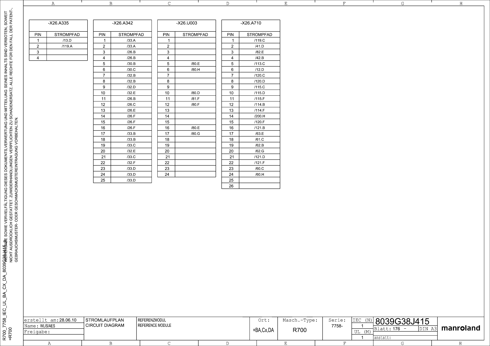

# +BA_Cx_DA — Sheet 176 of 247 — REFERENZMODUL

**REFERENCE MODULE**

> Part of the manroland **R700** printing press IEC/UL circuit diagrams.
> Drawing class: **Stromlaufplan / Circuit diagram** (DIN A3).
> Document `+BA_Cx_DA` covers the **Printing units / main switch cabinet** machine section.

## At a glance

| Field | Value |
|---|---|
| Document | `+BA_Cx_DA`  (8039G38J415) |
| Sheet | **176** of 247 |
| Section (DE) | REFERENZMODUL |
| Section (EN) | REFERENCE MODULE |
| Section type | REFERENCE_MODULE — Reference module |
| Machine type | `R700` |
| Series | `7758` |
| Created | 28.06.10 |
| Replaces | — |
| Columns used | A, B, C, D, E |
| Path numbers | — |
| Labels on sheet | 149 |
| Cross-refs out | 58 |
| Cross-refs in | 0 |

**Previous:** [+BA_Cx_DA sheet 175](SHEET_0175.md) · **Next:** [+BA_Cx_DA sheet 177](SHEET_0177.md) · **Document TOC:** [_TOC.md](_TOC.md)  (+BA_Cx_DA) · **Master TOC:** [all sheets](../_MASTER_TOC.md)

## Sheet image (300 DPI, exact vector render)



_Rendered directly from the PDF vector layer at 300 DPI (1-bit), no OCR and no resampling. Use it to confirm anything ambiguous in the text below._

## Cross-references on this sheet

Each entry is a wire leaving this sheet. The printed token is `/sheet.column`; the link resolves to that sheet inside the same document.

| Ref | Target sheet | Col | Path | Destination on target | Target section | From col |
|---|---|---|---|---|---|---|
| `/33.A` | [+BA_Cx_DA sheet 33](SHEET_0033.md) | A | — | — | BUSVERBINDUNGEN: RESERVE SIGNALE | B |
| `/13.D` | [+BA_Cx_DA sheet 13](SHEET_0013.md) | D | — | — | SPANNUNGSVERSORGUNG, SCHALTSCHRANKBELÜFTUNG | A |
| `/119.C` | [+BA_Cx_DA sheet 119](SHEET_0119.md) | C | — | — | RESERVE: SPS STATION (INPUT) | E |
| `/33.A` | [+BA_Cx_DA sheet 33](SHEET_0033.md) | A | — | — | BUSVERBINDUNGEN: RESERVE SIGNALE | B |
| `/119.A` | [+BA_Cx_DA sheet 119](SHEET_0119.md) | A | — | — | RESERVE: SPS STATION (INPUT) | A |
| `/41.D` | [+BA_Cx_DA sheet 41](SHEET_0041.md) | D | — | — | SCHUTZEINRICHTUNGEN | E |
| `/26.B` | [+BA_Cx_DA sheet 26](SHEET_0026.md) | B | — | — | BUSVERBINDUNGEN: NOT AUS | B |
| `/82.E` | [+BA_Cx_DA sheet 82](SHEET_0082.md) | E | — | — | FARBWERK | E |
| `/26.B` | [+BA_Cx_DA sheet 26](SHEET_0026.md) | B | — | — | BUSVERBINDUNGEN: NOT AUS | B |
| `/42.B` | [+BA_Cx_DA sheet 42](SHEET_0042.md) | B | — | — | SCHUTZEINRICHTUNGEN | E |
| `/30.B` | [+BA_Cx_DA sheet 30](SHEET_0030.md) | B | — | — | BUSVERBINDUNGEN: STOP SICHERN | B |
| `/80.E` | [+BA_Cx_DA sheet 80](SHEET_0080.md) | E | — | — | FARBWERK | C |
| `/113.C` | [+BA_Cx_DA sheet 113](SHEET_0113.md) | C | — | — | PPL 2 | E |
| `/30.C` | [+BA_Cx_DA sheet 30](SHEET_0030.md) | C | — | — | BUSVERBINDUNGEN: STOP SICHERN | B |
| `/80.H` | [+BA_Cx_DA sheet 80](SHEET_0080.md) | H | — | — | FARBWERK | C |
| `/12.D` | [+BA_Cx_DA sheet 12](SHEET_0012.md) | D | — | — | SPANNUNGSVERSORGUNG, SCHALTSCHRANKBELÜFTUNG | E |
| `/32.B` | [+BA_Cx_DA sheet 32](SHEET_0032.md) | B | — | — | BUSVERBINDUNGEN: 20 mA SCHLEIFE, BUSFUNKTIONEN | B |
| `/120.C` | [+BA_Cx_DA sheet 120](SHEET_0120.md) | C | — | — | RESERVE: SPS STATION (INPUT) | E |
| `/32.B` | [+BA_Cx_DA sheet 32](SHEET_0032.md) | B | — | — | BUSVERBINDUNGEN: 20 mA SCHLEIFE, BUSFUNKTIONEN | B |
| `/120.D` | [+BA_Cx_DA sheet 120](SHEET_0120.md) | D | — | — | RESERVE: SPS STATION (INPUT) | E |
| `/32.D` | [+BA_Cx_DA sheet 32](SHEET_0032.md) | D | — | — | BUSVERBINDUNGEN: 20 mA SCHLEIFE, BUSFUNKTIONEN | B |
| `/115.C` | [+BA_Cx_DA sheet 115](SHEET_0115.md) | C | — | — | PPL 2 | E |
| `/32.E` | [+BA_Cx_DA sheet 32](SHEET_0032.md) | E | — | — | BUSVERBINDUNGEN: 20 mA SCHLEIFE, BUSFUNKTIONEN | B |
| `/80.D` | [+BA_Cx_DA sheet 80](SHEET_0080.md) | D | — | — | FARBWERK | C |
| `/115.D` | [+BA_Cx_DA sheet 115](SHEET_0115.md) | D | — | — | PPL 2 | E |
| `/26.B` | [+BA_Cx_DA sheet 26](SHEET_0026.md) | B | — | — | BUSVERBINDUNGEN: NOT AUS | B |
| `/81.F` | [+BA_Cx_DA sheet 81](SHEET_0081.md) | F | — | — | FARBWERK | C |
| `/115.F` | [+BA_Cx_DA sheet 115](SHEET_0115.md) | F | — | — | PPL 2 | E |
| `/80.F` | [+BA_Cx_DA sheet 80](SHEET_0080.md) | F | — | — | FARBWERK | C |
| `/114.B` | [+BA_Cx_DA sheet 114](SHEET_0114.md) | B | — | — | PPL 2 | E |
| `/26.C` | [+BA_Cx_DA sheet 26](SHEET_0026.md) | C | — | — | BUSVERBINDUNGEN: NOT AUS | B |
| `/26.E` | [+BA_Cx_DA sheet 26](SHEET_0026.md) | E | — | — | BUSVERBINDUNGEN: NOT AUS | B |
| `/114.F` | [+BA_Cx_DA sheet 114](SHEET_0114.md) | F | — | — | PPL 2 | E |
| `/26.F` | [+BA_Cx_DA sheet 26](SHEET_0026.md) | F | — | — | BUSVERBINDUNGEN: NOT AUS | B |
| `/200.H` | [+BA_Cx_DA sheet 200](SHEET_0200.md) | H | — | — | OPTION: APL | E |
| `/26.F` | [+BA_Cx_DA sheet 26](SHEET_0026.md) | F | — | — | BUSVERBINDUNGEN: NOT AUS | B |
| `/120.F` | [+BA_Cx_DA sheet 120](SHEET_0120.md) | F | — | — | RESERVE: SPS STATION (INPUT) | E |
| `/80.E` | [+BA_Cx_DA sheet 80](SHEET_0080.md) | E | — | — | FARBWERK | C |
| `/26.F` | [+BA_Cx_DA sheet 26](SHEET_0026.md) | F | — | — | BUSVERBINDUNGEN: NOT AUS | B |
| `/121.B` | [+BA_Cx_DA sheet 121](SHEET_0121.md) | B | — | — | RESERVE: SPS STATION (INPUT) | E |
| `/33.B` | [+BA_Cx_DA sheet 33](SHEET_0033.md) | B | — | — | BUSVERBINDUNGEN: RESERVE SIGNALE | B |
| `/63.E` | [+BA_Cx_DA sheet 63](SHEET_0063.md) | E | — | — | MASCHINENBEDIENUNG: BEDIENUNGKOMMANDOS | E |
| `/80.G` | [+BA_Cx_DA sheet 80](SHEET_0080.md) | G | — | — | FARBWERK | C |
| `/33.B` | [+BA_Cx_DA sheet 33](SHEET_0033.md) | B | — | — | BUSVERBINDUNGEN: RESERVE SIGNALE | B |
| `/61.C` | [+BA_Cx_DA sheet 61](SHEET_0061.md) | C | — | — | MASCHINENBEDIENUNG: BEDIENUNGKOMMANDOS | E |
| `/62.B` | [+BA_Cx_DA sheet 62](SHEET_0062.md) | B | — | — | MASCHINENBEDIENUNG: BEDIENUNGKOMMANDOS | E |
| `/33.C` | [+BA_Cx_DA sheet 33](SHEET_0033.md) | C | — | — | BUSVERBINDUNGEN: RESERVE SIGNALE | B |
| `/32.E` | [+BA_Cx_DA sheet 32](SHEET_0032.md) | E | — | — | BUSVERBINDUNGEN: 20 mA SCHLEIFE, BUSFUNKTIONEN | B |
| `/62.G` | [+BA_Cx_DA sheet 62](SHEET_0062.md) | G | — | — | MASCHINENBEDIENUNG: BEDIENUNGKOMMANDOS | E |
| `/33.C` | [+BA_Cx_DA sheet 33](SHEET_0033.md) | C | — | — | BUSVERBINDUNGEN: RESERVE SIGNALE | B |
| `/121.D` | [+BA_Cx_DA sheet 121](SHEET_0121.md) | D | — | — | RESERVE: SPS STATION (INPUT) | E |
| `/32.F` | [+BA_Cx_DA sheet 32](SHEET_0032.md) | F | — | — | BUSVERBINDUNGEN: 20 mA SCHLEIFE, BUSFUNKTIONEN | B |
| `/121.F` | [+BA_Cx_DA sheet 121](SHEET_0121.md) | F | — | — | RESERVE: SPS STATION (INPUT) | E |
| `/33.D` | [+BA_Cx_DA sheet 33](SHEET_0033.md) | D | — | — | BUSVERBINDUNGEN: RESERVE SIGNALE | B |
| `/60.C` | [+BA_Cx_DA sheet 60](SHEET_0060.md) | C | — | — | MASCHINENBEDIENUNG: BEDIENUNGKOMMANDOS | E |
| `/33.D` | [+BA_Cx_DA sheet 33](SHEET_0033.md) | D | — | — | BUSVERBINDUNGEN: RESERVE SIGNALE | B |
| `/60.H` | [+BA_Cx_DA sheet 60](SHEET_0060.md) | H | — | — | MASCHINENBEDIENUNG: BEDIENUNGKOMMANDOS | E |
| `/33.D` | [+BA_Cx_DA sheet 33](SHEET_0033.md) | D | — | — | BUSVERBINDUNGEN: RESERVE SIGNALE | B |

## Devices on this sheet

| Tag | Class | Class meaning (IEC) | Col | Sub | Terminal | Sign |
|---|---|---|---|---|---|---|
| `X26.A342` | — | cross-device reference | B | — | — | — |
| `X26.U003` | — | cross-device reference | C | — | — | — |
| `X26.A710` | — | cross-device reference | D | — | — | — |
| `X26.A335` | — | cross-device reference | A | — | — | — |

## Potentials / nets

_No named potentials on this sheet._

## Wire-end annotations (grouped as printed)

A wire that continues elsewhere is annotated with a small cluster: the destination description, the path/line number `#NN`, and the `/sheet.column` cross reference. Each row below is one such cluster exactly as it is grouped on the drawing.

| Col | Y | Path | Cross-ref | Text on the wire |
|---|---|---|---|---|
| A | 51.3 | — | — | `X26.A335` |
| B | 51.3 | — | — | `X26.A342` |
| C | 51.3 | — | — | `X26.U003` |
| D | 51.3 | — | — | `X26.A710` |
| A | 80.0 | — | — | `PIN 2 3 4 1 STROMPFAD` |
| B | 80.0 | — | — | `PIN STROMPFAD` |
| C | 80.0 | — | — | `PIN STROMPFAD` |
| D | 80.0 | — | — | `PIN STROMPFAD` |
| B | 94.2 | — | — | `2 3 4 5 6 7 8 9 1` |
| C | 94.2 | — | — | `2 3 4 5 6 7 8 9 1` |
| D | 94.2 | — | — | `2 3 4 5 6 7 8 9 1` |
| A | 94.5 | — | `/13.D` | — |
| B | 94.5 | — | `/33.A` | — |
| E | 94.5 | — | `/119.C` | — |
| A | 108.7 | — | `/119.A` | — |
| B | 108.7 | — | `/33.A` | — |
| E | 108.7 | — | `/41.D` | — |
| B | 122.8 | — | `/26.B` | — |
| E | 122.8 | — | `/82.E` | — |
| B | 137.0 | — | `/26.B` | — |
| E | 137.0 | — | `/42.B` | — |
| B | 151.2 | — | `/30.B` | — |
| C | 151.2 | — | `/80.E` | — |
| E | 151.2 | — | `/113.C` | — |
| B | 165.4 | — | `/30.C` | — |
| C | 165.4 | — | `/80.H` | — |
| E | 165.4 | — | `/12.D` | — |
| B | 179.5 | — | `/32.B` | — |
| E | 179.6 | — | `/120.C` | — |
| B | 193.7 | — | `/32.B` | — |
| E | 193.8 | — | `/120.D` | — |
| B | 207.9 | — | `/32.D` | — |
| E | 207.9 | — | `/115.C` | — |
| B | 221.8 | — | — | `10 12 13 14 15 16 17 18 19 20 11` |
| C | 221.8 | — | — | `10 12 13 14 15 16 17 18 19 20 11` |
| D | 221.8 | — | — | `10 12 13 14 15 16 17 18 19 20 11` |
| B | 222.1 | — | `/32.E` | — |
| C | 222.1 | — | `/80.D` | — |
| E | 222.1 | — | `/115.D` | — |
| B | 236.2 | — | `/26.B` | — |
| C | 236.2 | — | `/81.F` | — |
| E | 236.3 | — | `/115.F` | — |
| B | 250.4 | — | `/26.C` | — |
| C | 250.4 | — | `/80.F` | — |
| E | 250.4 | — | `/114.B` | — |
| B | 264.6 | — | `/26.E` | — |
| E | 264.6 | — | `/114.F` | — |
| B | 278.8 | — | `/26.F` | — |
| E | 278.8 | — | `/200.H` | — |
| B | 292.9 | — | `/26.F` | — |
| E | 292.9 | — | `/120.F` | — |
| B | 307.1 | — | `/26.F` | — |
| C | 307.1 | — | `/80.E` | — |
| E | 307.1 | — | `/121.B` | — |
| B | 321.3 | — | `/33.B` | — |
| C | 321.3 | — | `/80.G` | — |
| E | 321.3 | — | `/63.E` | — |
| B | 335.4 | — | `/33.B` | — |
| E | 335.5 | — | `/61.C` | — |
| B | 349.6 | — | `/33.C` | — |
| E | 349.6 | — | `/62.B` | — |
| B | 363.8 | — | `/32.E` | — |
| E | 363.8 | — | `/62.G` | — |
| B | 377.7 | — | — | `22 23 24 25 21` |
| C | 377.7 | — | — | `22 23 24 21` |
| D | 377.7 | — | — | `22 23 24 25 26 21` |
| B | 378.0 | — | `/33.C` | — |
| E | 378.0 | — | `/121.D` | — |
| B | 392.1 | — | `/32.F` | — |
| E | 392.2 | — | `/121.F` | — |
| B | 406.3 | — | `/33.D` | — |
| E | 406.3 | — | `/60.C` | — |
| B | 420.5 | — | `/33.D` | — |
| E | 420.5 | — | `/60.H` | — |
| B | 434.7 | — | `/33.D` | — |


## Reconstructed tables

This sheet carries tabular content (pin map / terminal assignment / index). The grid below was rebuilt from the drawing's own rule lines, so each row is exactly one physical row of the table.

### Table 1 — 4 data rows × 2 columns (at x=70.9, y=48.2) — **X26.A335**

| PIN | STROMPFAD |
|---|---|
| `1` | `/13.D` |
| `2` | `/119.A` |
| `3` |  |
| `4` |  |


### Table 2 — 25 data rows × 2 columns (at x=226.8, y=48.2) — **X26.A342**

| PIN | STROMPFAD |
|---|---|
| `1` | `/33.A` |
| `2` | `/33.A` |
| `3` | `/26.B` |
| `4` | `/26.B` |
| `5` | `/30.B` |
| `6` | `/30.C` |
| `7` | `/32.B` |
| `8` | `/32.B` |
| `9` | `/32.D` |
| `10` | `/32.E` |
| `11` | `/26.B` |
| `12` | `/26.C` |
| `13` | `/26.E` |
| `14` | `/26.F` |
| `15` | `/26.F` |
| `16` | `/26.F` |
| `17` | `/33.B` |
| `18` | `/33.B` |
| `19` | `/33.C` |
| `20` | `/32.E` |
| `21` | `/33.C` |
| `22` | `/32.F` |
| `23` | `/33.D` |
| `24` | `/33.D` |
| `25` | `/33.D` |


### Table 3 — 24 data rows × 2 columns (at x=382.7, y=48.2) — **X26.U003**

| PIN | STROMPFAD |
|---|---|
| `1` |  |
| `2` |  |
| `3` |  |
| `4` |  |
| `5` | `/80.E` |
| `6` | `/80.H` |
| `7` |  |
| `8` |  |
| `9` |  |
| `10` | `/80.D` |
| `11` | `/81.F` |
| `12` | `/80.F` |
| `13` |  |
| `14` |  |
| `15` |  |
| `16` | `/80.E` |
| `17` | `/80.G` |
| `18` |  |
| `19` |  |
| `20` |  |
| `21` |  |
| `22` |  |
| `23` |  |
| `24` |  |


### Table 4 — 26 data rows × 2 columns (at x=538.6, y=48.2) — **X26.A710**

| PIN | STROMPFAD |
|---|---|
| `1` | `/119.C` |
| `2` | `/41.D` |
| `3` | `/82.E` |
| `4` | `/42.B` |
| `5` | `/113.C` |
| `6` | `/12.D` |
| `7` | `/120.C` |
| `8` | `/120.D` |
| `9` | `/115.C` |
| `10` | `/115.D` |
| `11` | `/115.F` |
| `12` | `/114.B` |
| `13` | `/114.F` |
| `14` | `/200.H` |
| `15` | `/120.F` |
| `16` | `/121.B` |
| `17` | `/63.E` |
| `18` | `/61.C` |
| `19` | `/62.B` |
| `20` | `/62.G` |
| `21` | `/121.D` |
| `22` | `/121.F` |
| `23` | `/60.C` |
| `24` | `/60.H` |
| `25` |  |
| `26` |  |


## Notes and free text on this sheet

| Text | Col | Y (pt) |
|---|---|---|
| `PIN` | B | 80.02 |
| `STROMPFAD` | B | 79.98 |
| `PIN` | C | 80.02 |
| `STROMPFAD` | C | 79.98 |
| `PIN` | D | 80.02 |
| `STROMPFAD` | E | 79.98 |
| `PIN` | A | 80.02 |
| `STROMPFAD` | A | 79.98 |

## Complete label inventory (exact text from the drawing)

Every text object inside the drawing area of this sheet, in DIN reading order (column A→H, then top→bottom). This is the authoritative list: if a string is not here it is not printed on this sheet.

| Col | Y | X | Dir | Type | Text |
|---|---|---|---|---|---|
| A | 51.3 | 116.8 | → | device ref | `X26.A335` |
| A | 80.0 | 84.0 | → | text | `PIN` |
| A | 80.0 | 132.2 | → | text | `STROMPFAD` |
| A | 94.2 | 90.0 | → | number | `1` |
| A | 94.5 | 152.6 | → | cross-reference | `/13.D` |
| A | 108.4 | 89.4 | → | number | `2` |
| A | 108.7 | 150.2 | → | cross-reference | `/119.A` |
| A | 122.5 | 89.4 | → | number | `3` |
| A | 136.7 | 89.4 | → | number | `4` |
| B | 51.3 | 272.7 | → | device ref | `X26.A342` |
| B | 80.0 | 240.0 | → | text | `PIN` |
| B | 80.0 | 288.1 | → | text | `STROMPFAD` |
| B | 94.2 | 251.7 | → | number | `1` |
| B | 94.5 | 308.6 | → | cross-reference | `/33.A` |
| B | 108.4 | 250.0 | → | number | `2` |
| B | 108.7 | 308.6 | → | cross-reference | `/33.A` |
| B | 122.5 | 250.0 | → | number | `3` |
| B | 122.8 | 308.7 | → | cross-reference | `/26.B` |
| B | 136.7 | 250.0 | → | number | `4` |
| B | 137.0 | 308.7 | → | cross-reference | `/26.B` |
| B | 150.9 | 250.0 | → | number | `5` |
| B | 151.2 | 308.7 | → | cross-reference | `/30.B` |
| B | 165.1 | 250.0 | → | number | `6` |
| B | 165.4 | 308.6 | → | cross-reference | `/30.C` |
| B | 179.2 | 250.0 | → | number | `7` |
| B | 179.5 | 308.7 | → | cross-reference | `/32.B` |
| B | 193.4 | 250.0 | → | number | `8` |
| B | 193.7 | 308.7 | → | cross-reference | `/32.B` |
| B | 207.6 | 250.0 | → | number | `9` |
| B | 207.9 | 308.6 | → | cross-reference | `/32.D` |
| B | 221.8 | 244.6 | → | number | `10` |
| B | 222.1 | 308.8 | → | cross-reference | `/32.E` |
| B | 235.9 | 246.3 | → | number | `11` |
| B | 236.2 | 308.7 | → | cross-reference | `/26.B` |
| B | 250.1 | 244.6 | → | number | `12` |
| B | 250.4 | 308.6 | → | cross-reference | `/26.C` |
| B | 264.3 | 244.6 | → | number | `13` |
| B | 264.6 | 308.8 | → | cross-reference | `/26.E` |
| B | 278.5 | 244.6 | → | number | `14` |
| B | 278.8 | 309.0 | → | cross-reference | `/26.F` |
| B | 292.6 | 244.6 | → | number | `15` |
| B | 292.9 | 309.0 | → | cross-reference | `/26.F` |
| B | 306.8 | 244.6 | → | number | `16` |
| B | 307.1 | 309.0 | → | cross-reference | `/26.F` |
| B | 321.0 | 244.6 | → | number | `17` |
| B | 321.3 | 308.7 | → | cross-reference | `/33.B` |
| B | 335.1 | 244.6 | → | number | `18` |
| B | 335.4 | 308.7 | → | cross-reference | `/33.B` |
| B | 349.3 | 244.6 | → | number | `19` |
| B | 349.7 | 308.6 | → | cross-reference | `/33.C` |
| B | 363.5 | 244.6 | → | number | `20` |
| B | 363.8 | 308.8 | → | cross-reference | `/32.E` |
| B | 377.7 | 246.3 | → | number | `21` |
| B | 378.0 | 308.6 | → | cross-reference | `/33.C` |
| B | 391.8 | 244.6 | → | number | `22` |
| B | 392.2 | 309.0 | → | cross-reference | `/32.F` |
| B | 406.0 | 244.6 | → | number | `23` |
| B | 406.3 | 308.6 | → | cross-reference | `/33.D` |
| B | 420.2 | 244.6 | → | number | `24` |
| B | 420.5 | 308.6 | → | cross-reference | `/33.D` |
| B | 434.4 | 244.6 | → | number | `25` |
| B | 434.7 | 308.6 | → | cross-reference | `/33.D` |
| C | 51.3 | 428.3 | → | device ref | `X26.U003` |
| C | 80.0 | 395.9 | → | text | `PIN` |
| C | 80.0 | 444.0 | → | text | `STROMPFAD` |
| C | 94.2 | 407.6 | → | number | `1` |
| C | 108.4 | 405.9 | → | number | `2` |
| C | 122.5 | 405.9 | → | number | `3` |
| C | 136.7 | 405.9 | → | number | `4` |
| C | 150.9 | 405.9 | → | number | `5` |
| C | 151.2 | 464.7 | → | cross-reference | `/80.E` |
| C | 165.1 | 405.9 | → | number | `6` |
| C | 165.4 | 464.7 | → | cross-reference | `/80.H` |
| C | 179.2 | 405.9 | → | number | `7` |
| C | 193.4 | 405.9 | → | number | `8` |
| C | 207.6 | 405.9 | → | number | `9` |
| C | 221.8 | 400.5 | → | number | `10` |
| C | 222.1 | 464.5 | → | cross-reference | `/80.D` |
| C | 235.9 | 402.2 | → | number | `11` |
| C | 236.2 | 464.9 | → | cross-reference | `/81.F` |
| C | 250.1 | 400.5 | → | number | `12` |
| C | 250.4 | 464.9 | → | cross-reference | `/80.F` |
| C | 264.3 | 400.5 | → | number | `13` |
| C | 278.5 | 400.5 | → | number | `14` |
| C | 292.6 | 400.5 | → | number | `15` |
| C | 306.8 | 400.5 | → | number | `16` |
| C | 307.1 | 464.7 | → | cross-reference | `/80.E` |
| C | 321.0 | 400.5 | → | number | `17` |
| C | 321.3 | 464.3 | → | cross-reference | `/80.G` |
| C | 335.1 | 400.5 | → | number | `18` |
| C | 349.3 | 400.5 | → | number | `19` |
| C | 363.5 | 400.5 | → | number | `20` |
| C | 377.7 | 402.2 | → | number | `21` |
| C | 391.8 | 400.5 | → | number | `22` |
| C | 406.0 | 400.5 | → | number | `23` |
| C | 420.2 | 400.5 | → | number | `24` |
| D | 51.3 | 584.5 | → | device ref | `X26.A710` |
| D | 80.0 | 551.8 | → | text | `PIN` |
| D | 94.2 | 563.5 | → | number | `1` |
| D | 108.4 | 561.8 | → | number | `2` |
| D | 122.5 | 561.8 | → | number | `3` |
| D | 136.7 | 561.8 | → | number | `4` |
| D | 150.9 | 561.8 | → | number | `5` |
| D | 165.1 | 561.8 | → | number | `6` |
| D | 179.2 | 561.8 | → | number | `7` |
| D | 193.4 | 561.8 | → | number | `8` |
| D | 207.6 | 561.8 | → | number | `9` |
| D | 221.8 | 556.4 | → | number | `10` |
| D | 235.9 | 558.1 | → | number | `11` |
| D | 250.1 | 556.4 | → | number | `12` |
| D | 264.3 | 556.4 | → | number | `13` |
| D | 278.5 | 556.4 | → | number | `14` |
| D | 292.6 | 556.4 | → | number | `15` |
| D | 306.8 | 556.4 | → | number | `16` |
| D | 321.0 | 556.4 | → | number | `17` |
| D | 335.1 | 556.4 | → | number | `18` |
| D | 349.3 | 556.4 | → | number | `19` |
| D | 363.5 | 556.4 | → | number | `20` |
| D | 377.7 | 558.1 | → | number | `21` |
| D | 391.8 | 556.4 | → | number | `22` |
| D | 406.0 | 556.4 | → | number | `23` |
| D | 420.2 | 556.4 | → | number | `24` |
| D | 434.4 | 556.4 | → | number | `25` |
| D | 448.5 | 556.4 | → | number | `26` |
| E | 80.0 | 600.0 | → | text | `STROMPFAD` |
| E | 94.5 | 618.0 | → | cross-reference | `/119.C` |
| E | 108.7 | 620.4 | → | cross-reference | `/41.D` |
| E | 122.8 | 620.6 | → | cross-reference | `/82.E` |
| E | 137.0 | 620.5 | → | cross-reference | `/42.B` |
| E | 151.2 | 618.0 | → | cross-reference | `/113.C` |
| E | 165.4 | 620.4 | → | cross-reference | `/12.D` |
| E | 179.6 | 618.0 | → | cross-reference | `/120.C` |
| E | 193.8 | 618.0 | → | cross-reference | `/120.D` |
| E | 207.9 | 618.0 | → | cross-reference | `/115.C` |
| E | 222.1 | 618.0 | → | cross-reference | `/115.D` |
| E | 236.3 | 618.4 | → | cross-reference | `/115.F` |
| E | 250.4 | 618.1 | → | cross-reference | `/114.B` |
| E | 264.6 | 618.4 | → | cross-reference | `/114.F` |
| E | 278.8 | 618.2 | → | cross-reference | `/200.H` |
| E | 293.0 | 618.4 | → | cross-reference | `/120.F` |
| E | 307.1 | 618.1 | → | cross-reference | `/121.B` |
| E | 321.3 | 620.6 | → | cross-reference | `/63.E` |
| E | 335.5 | 620.4 | → | cross-reference | `/61.C` |
| E | 349.6 | 620.5 | → | cross-reference | `/62.B` |
| E | 363.8 | 620.2 | → | cross-reference | `/62.G` |
| E | 378.0 | 618.0 | → | cross-reference | `/121.D` |
| E | 392.2 | 618.4 | → | cross-reference | `/121.F` |
| E | 406.3 | 620.4 | → | cross-reference | `/60.C` |
| E | 420.5 | 620.6 | → | cross-reference | `/60.H` |

## Reading-order text block

The same content as a plain block, grouped by DIN column — convenient to paste or to match against a visual description.

```text
=== Column A ===
  51.3  116.8  devref       X26.A335
  80.0   84.0  text         PIN
  80.0  132.2  text         STROMPFAD
  94.2   90.0  numeric      1
  94.5  152.6  xref         /13.D
 108.4   89.4  numeric      2
 108.7  150.2  xref         /119.A
 122.5   89.4  numeric      3
 136.7   89.4  numeric      4
=== Column B ===
  51.3  272.7  devref       X26.A342
  80.0  240.0  text         PIN
  80.0  288.1  text         STROMPFAD
  94.2  251.7  numeric      1
  94.5  308.6  xref         /33.A
 108.4  250.0  numeric      2
 108.7  308.6  xref         /33.A
 122.5  250.0  numeric      3
 122.8  308.7  xref         /26.B
 136.7  250.0  numeric      4
 137.0  308.7  xref         /26.B
 150.9  250.0  numeric      5
 151.2  308.7  xref         /30.B
 165.1  250.0  numeric      6
 165.4  308.6  xref         /30.C
 179.2  250.0  numeric      7
 179.5  308.7  xref         /32.B
 193.4  250.0  numeric      8
 193.7  308.7  xref         /32.B
 207.6  250.0  numeric      9
 207.9  308.6  xref         /32.D
 221.8  244.6  numeric      10
 222.1  308.8  xref         /32.E
 235.9  246.3  numeric      11
 236.2  308.7  xref         /26.B
 250.1  244.6  numeric      12
 250.4  308.6  xref         /26.C
 264.3  244.6  numeric      13
 264.6  308.8  xref         /26.E
 278.5  244.6  numeric      14
 278.8  309.0  xref         /26.F
 292.6  244.6  numeric      15
 292.9  309.0  xref         /26.F
 306.8  244.6  numeric      16
 307.1  309.0  xref         /26.F
 321.0  244.6  numeric      17
 321.3  308.7  xref         /33.B
 335.1  244.6  numeric      18
 335.4  308.7  xref         /33.B
 349.3  244.6  numeric      19
 349.7  308.6  xref         /33.C
 363.5  244.6  numeric      20
 363.8  308.8  xref         /32.E
 377.7  246.3  numeric      21
 378.0  308.6  xref         /33.C
 391.8  244.6  numeric      22
 392.2  309.0  xref         /32.F
 406.0  244.6  numeric      23
 406.3  308.6  xref         /33.D
 420.2  244.6  numeric      24
 420.5  308.6  xref         /33.D
 434.4  244.6  numeric      25
 434.7  308.6  xref         /33.D
=== Column C ===
  51.3  428.3  devref       X26.U003
  80.0  395.9  text         PIN
  80.0  444.0  text         STROMPFAD
  94.2  407.6  numeric      1
 108.4  405.9  numeric      2
 122.5  405.9  numeric      3
 136.7  405.9  numeric      4
 150.9  405.9  numeric      5
 151.2  464.7  xref         /80.E
 165.1  405.9  numeric      6
 165.4  464.7  xref         /80.H
 179.2  405.9  numeric      7
 193.4  405.9  numeric      8
 207.6  405.9  numeric      9
 221.8  400.5  numeric      10
 222.1  464.5  xref         /80.D
 235.9  402.2  numeric      11
 236.2  464.9  xref         /81.F
 250.1  400.5  numeric      12
 250.4  464.9  xref         /80.F
 264.3  400.5  numeric      13
 278.5  400.5  numeric      14
 292.6  400.5  numeric      15
 306.8  400.5  numeric      16
 307.1  464.7  xref         /80.E
 321.0  400.5  numeric      17
 321.3  464.3  xref         /80.G
 335.1  400.5  numeric      18
 349.3  400.5  numeric      19
 363.5  400.5  numeric      20
 377.7  402.2  numeric      21
 391.8  400.5  numeric      22
 406.0  400.5  numeric      23
 420.2  400.5  numeric      24
=== Column D ===
  51.3  584.5  devref       X26.A710
  80.0  551.8  text         PIN
  94.2  563.5  numeric      1
 108.4  561.8  numeric      2
 122.5  561.8  numeric      3
 136.7  561.8  numeric      4
 150.9  561.8  numeric      5
 165.1  561.8  numeric      6
 179.2  561.8  numeric      7
 193.4  561.8  numeric      8
 207.6  561.8  numeric      9
 221.8  556.4  numeric      10
 235.9  558.1  numeric      11
 250.1  556.4  numeric      12
 264.3  556.4  numeric      13
 278.5  556.4  numeric      14
 292.6  556.4  numeric      15
 306.8  556.4  numeric      16
 321.0  556.4  numeric      17
 335.1  556.4  numeric      18
 349.3  556.4  numeric      19
 363.5  556.4  numeric      20
 377.7  558.1  numeric      21
 391.8  556.4  numeric      22
 406.0  556.4  numeric      23
 420.2  556.4  numeric      24
 434.4  556.4  numeric      25
 448.5  556.4  numeric      26
=== Column E ===
  80.0  600.0  text         STROMPFAD
  94.5  618.0  xref         /119.C
 108.7  620.4  xref         /41.D
 122.8  620.6  xref         /82.E
 137.0  620.5  xref         /42.B
 151.2  618.0  xref         /113.C
 165.4  620.4  xref         /12.D
 179.6  618.0  xref         /120.C
 193.8  618.0  xref         /120.D
 207.9  618.0  xref         /115.C
 222.1  618.0  xref         /115.D
 236.3  618.4  xref         /115.F
 250.4  618.1  xref         /114.B
 264.6  618.4  xref         /114.F
 278.8  618.2  xref         /200.H
 293.0  618.4  xref         /120.F
 307.1  618.1  xref         /121.B
 321.3  620.6  xref         /63.E
 335.5  620.4  xref         /61.C
 349.6  620.5  xref         /62.B
 363.8  620.2  xref         /62.G
 378.0  618.0  xref         /121.D
 392.2  618.4  xref         /121.F
 406.3  620.4  xref         /60.C
 420.5  620.6  xref         /60.H
```

---
_Generated from the PDF vector text layer; no OCR. Source: `R700_7758_IEC_UL_BA_CX_DA_8039G38J415_p`, sheet 176._
