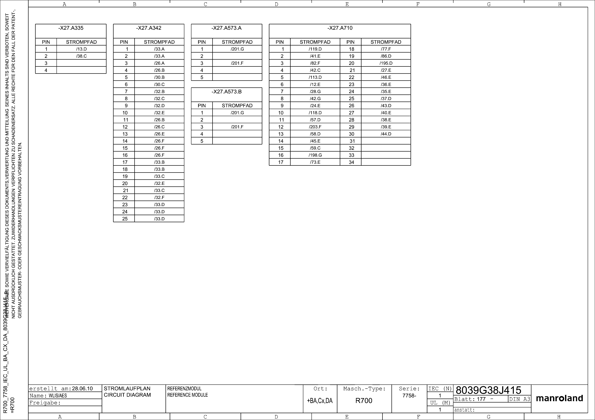

# +BA_Cx_DA — Sheet 177 of 247 — REFERENZMODUL

**REFERENCE MODULE**

> Part of the manroland **R700** printing press IEC/UL circuit diagrams.
> Drawing class: **Stromlaufplan / Circuit diagram** (DIN A3).
> Document `+BA_Cx_DA` covers the **Printing units / main switch cabinet** machine section.

## At a glance

| Field | Value |
|---|---|
| Document | `+BA_Cx_DA`  (8039G38J415) |
| Sheet | **177** of 247 |
| Section (DE) | REFERENZMODUL |
| Section (EN) | REFERENCE MODULE |
| Section type | REFERENCE_MODULE — Reference module |
| Machine type | `R700` |
| Series | `7758` |
| Created | 28.06.10 |
| Replaces | — |
| Columns used | A, B, C, D, E, F |
| Path numbers | — |
| Labels on sheet | 151 |
| Cross-refs out | 61 |
| Cross-refs in | 0 |

**Previous:** [+BA_Cx_DA sheet 176](SHEET_0176.md) · **Next:** [+BA_Cx_DA sheet 178](SHEET_0178.md) · **Document TOC:** [_TOC.md](_TOC.md)  (+BA_Cx_DA) · **Master TOC:** [all sheets](../_MASTER_TOC.md)

## Sheet image (300 DPI, exact vector render)



_Rendered directly from the PDF vector layer at 300 DPI (1-bit), no OCR and no resampling. Use it to confirm anything ambiguous in the text below._

## Cross-references on this sheet

Each entry is a wire leaving this sheet. The printed token is `/sheet.column`; the link resolves to that sheet inside the same document.

| Ref | Target sheet | Col | Path | Destination on target | Target section | From col |
|---|---|---|---|---|---|---|
| `/33.A` | [+BA_Cx_DA sheet 33](SHEET_0033.md) | A | — | — | BUSVERBINDUNGEN: RESERVE SIGNALE | B |
| `/77.F` | [+BA_Cx_DA sheet 77](SHEET_0077.md) | F | — | — | FARBWERK | F |
| `/13.D` | [+BA_Cx_DA sheet 13](SHEET_0013.md) | D | — | — | SPANNUNGSVERSORGUNG, SCHALTSCHRANKBELÜFTUNG | A |
| `/201.G` | [+BA_Cx_DA sheet 201](SHEET_0201.md) | G | — | — | OPTION: | C |
| `/119.D` | [+BA_Cx_DA sheet 119](SHEET_0119.md) | D | — | — | RESERVE: SPS STATION (INPUT) | E |
| `/33.A` | [+BA_Cx_DA sheet 33](SHEET_0033.md) | A | — | — | BUSVERBINDUNGEN: RESERVE SIGNALE | B |
| `/41.E` | [+BA_Cx_DA sheet 41](SHEET_0041.md) | E | — | — | SCHUTZEINRICHTUNGEN | E |
| `/38.C` | [+BA_Cx_DA sheet 38](SHEET_0038.md) | C | — | — | SCHUTZEINRICHTUNGEN | A |
| `/86.D` | [+BA_Cx_DA sheet 86](SHEET_0086.md) | D | — | — | WASCHVORRICHTUNG | F |
| `/26.A` | [+BA_Cx_DA sheet 26](SHEET_0026.md) | A | — | — | BUSVERBINDUNGEN: NOT AUS | B |
| `/82.F` | [+BA_Cx_DA sheet 82](SHEET_0082.md) | F | — | — | FARBWERK | E |
| `/201.F` | [+BA_Cx_DA sheet 201](SHEET_0201.md) | F | — | — | OPTION: | C |
| `/195.D` | [+BA_Cx_DA sheet 195](SHEET_0195.md) | D | — | — | OPTION: WASCHVORRICHTUNG MIT BÜRSTE | F |
| `/26.B` | [+BA_Cx_DA sheet 26](SHEET_0026.md) | B | — | — | BUSVERBINDUNGEN: NOT AUS | B |
| `/27.E` | [+BA_Cx_DA sheet 27](SHEET_0027.md) | E | — | — | BUSVERBINDUNGEN: NOT AUS | F |
| `/42.C` | [+BA_Cx_DA sheet 42](SHEET_0042.md) | C | — | — | SCHUTZEINRICHTUNGEN | E |
| `/30.B` | [+BA_Cx_DA sheet 30](SHEET_0030.md) | B | — | — | BUSVERBINDUNGEN: STOP SICHERN | B |
| `/46.E` | [+BA_Cx_DA sheet 46](SHEET_0046.md) | E | — | — | SCHUTZEINRICHTUNGEN | F |
| `/113.D` | [+BA_Cx_DA sheet 113](SHEET_0113.md) | D | — | — | PPL 2 | E |
| `/12.E` | [+BA_Cx_DA sheet 12](SHEET_0012.md) | E | — | — | SPANNUNGSVERSORGUNG, SCHALTSCHRANKBELÜFTUNG | E |
| `/36.E` | [+BA_Cx_DA sheet 36](SHEET_0036.md) | E | — | — | SCHUTZEINRICHTUNGEN | F |
| `/30.C` | [+BA_Cx_DA sheet 30](SHEET_0030.md) | C | — | — | BUSVERBINDUNGEN: STOP SICHERN | B |
| `/32.B` | [+BA_Cx_DA sheet 32](SHEET_0032.md) | B | — | — | BUSVERBINDUNGEN: 20 mA SCHLEIFE, BUSFUNKTIONEN | B |
| `/35.E` | [+BA_Cx_DA sheet 35](SHEET_0035.md) | E | — | — | SCHUTZEINRICHTUNGEN | F |
| `/28.G` | [+BA_Cx_DA sheet 28](SHEET_0028.md) | G | — | — | BUSVERBINDUNGEN: STOP SICHERN | E |
| `/42.G` | [+BA_Cx_DA sheet 42](SHEET_0042.md) | G | — | — | SCHUTZEINRICHTUNGEN | E |
| `/32.C` | [+BA_Cx_DA sheet 32](SHEET_0032.md) | C | — | — | BUSVERBINDUNGEN: 20 mA SCHLEIFE, BUSFUNKTIONEN | B |
| `/37.D` | [+BA_Cx_DA sheet 37](SHEET_0037.md) | D | — | — | SCHUTZEINRICHTUNGEN | F |
| `/24.E` | [+BA_Cx_DA sheet 24](SHEET_0024.md) | E | — | — | BUSVERBINDUNGEN: NOT AUS | E |
| `/32.D` | [+BA_Cx_DA sheet 32](SHEET_0032.md) | D | — | — | BUSVERBINDUNGEN: 20 mA SCHLEIFE, BUSFUNKTIONEN | B |
| `/43.D` | [+BA_Cx_DA sheet 43](SHEET_0043.md) | D | — | — | SCHUTZEINRICHTUNGEN | F |
| `/32.E` | [+BA_Cx_DA sheet 32](SHEET_0032.md) | E | — | — | BUSVERBINDUNGEN: 20 mA SCHLEIFE, BUSFUNKTIONEN | B |
| `/40.E` | [+BA_Cx_DA sheet 40](SHEET_0040.md) | E | — | — | SCHUTZEINRICHTUNGEN | F |
| `/201.G` | [+BA_Cx_DA sheet 201](SHEET_0201.md) | G | — | — | OPTION: | C |
| `/118.D` | [+BA_Cx_DA sheet 118](SHEET_0118.md) | D | — | — | RESERVE: SPS STATION (INPUT) | E |
| `/26.B` | [+BA_Cx_DA sheet 26](SHEET_0026.md) | B | — | — | BUSVERBINDUNGEN: NOT AUS | B |
| `/38.E` | [+BA_Cx_DA sheet 38](SHEET_0038.md) | E | — | — | SCHUTZEINRICHTUNGEN | F |
| `/57.D` | [+BA_Cx_DA sheet 57](SHEET_0057.md) | D | — | — | MASCHINENBEDIENUNG: LAUFKOMMANDOS | E |
| `/39.E` | [+BA_Cx_DA sheet 39](SHEET_0039.md) | E | — | — | SCHUTZEINRICHTUNGEN | F |
| `/201.F` | [+BA_Cx_DA sheet 201](SHEET_0201.md) | F | — | — | OPTION: | C |
| `/203.F` | [+BA_Cx_DA sheet 203](SHEET_0203.md) | F | — | — | OPTION: | E |
| `/26.C` | [+BA_Cx_DA sheet 26](SHEET_0026.md) | C | — | — | BUSVERBINDUNGEN: NOT AUS | B |
| `/26.E` | [+BA_Cx_DA sheet 26](SHEET_0026.md) | E | — | — | BUSVERBINDUNGEN: NOT AUS | B |
| `/58.D` | [+BA_Cx_DA sheet 58](SHEET_0058.md) | D | — | — | MASCHINENBEDIENUNG: LAUFKOMMANDOS | E |
| `/44.D` | [+BA_Cx_DA sheet 44](SHEET_0044.md) | D | — | — | SCHUTZEINRICHTUNGEN | F |
| `/45.E` | [+BA_Cx_DA sheet 45](SHEET_0045.md) | E | — | — | SCHUTZEINRICHTUNGEN | E |
| `/26.F` | [+BA_Cx_DA sheet 26](SHEET_0026.md) | F | — | — | BUSVERBINDUNGEN: NOT AUS | B |
| `/26.F` | [+BA_Cx_DA sheet 26](SHEET_0026.md) | F | — | — | BUSVERBINDUNGEN: NOT AUS | B |
| `/59.C` | [+BA_Cx_DA sheet 59](SHEET_0059.md) | C | — | — | MASCHINENBEDIENUNG: LAUFKOMMANDOS | E |
| `/26.F` | [+BA_Cx_DA sheet 26](SHEET_0026.md) | F | — | — | BUSVERBINDUNGEN: NOT AUS | B |
| `/198.G` | [+BA_Cx_DA sheet 198](SHEET_0198.md) | G | — | — | OPTION: WASCHVORRICHTUNG MIT BÜRSTE | E |
| `/33.B` | [+BA_Cx_DA sheet 33](SHEET_0033.md) | B | — | — | BUSVERBINDUNGEN: RESERVE SIGNALE | B |
| `/73.E` | [+BA_Cx_DA sheet 73](SHEET_0073.md) | E | — | — | FEUCHTWERK | E |
| `/33.B` | [+BA_Cx_DA sheet 33](SHEET_0033.md) | B | — | — | BUSVERBINDUNGEN: RESERVE SIGNALE | B |
| `/33.C` | [+BA_Cx_DA sheet 33](SHEET_0033.md) | C | — | — | BUSVERBINDUNGEN: RESERVE SIGNALE | B |
| `/32.E` | [+BA_Cx_DA sheet 32](SHEET_0032.md) | E | — | — | BUSVERBINDUNGEN: 20 mA SCHLEIFE, BUSFUNKTIONEN | B |
| `/33.C` | [+BA_Cx_DA sheet 33](SHEET_0033.md) | C | — | — | BUSVERBINDUNGEN: RESERVE SIGNALE | B |
| `/32.F` | [+BA_Cx_DA sheet 32](SHEET_0032.md) | F | — | — | BUSVERBINDUNGEN: 20 mA SCHLEIFE, BUSFUNKTIONEN | B |
| `/33.D` | [+BA_Cx_DA sheet 33](SHEET_0033.md) | D | — | — | BUSVERBINDUNGEN: RESERVE SIGNALE | B |
| `/33.D` | [+BA_Cx_DA sheet 33](SHEET_0033.md) | D | — | — | BUSVERBINDUNGEN: RESERVE SIGNALE | B |
| `/33.D` | [+BA_Cx_DA sheet 33](SHEET_0033.md) | D | — | — | BUSVERBINDUNGEN: RESERVE SIGNALE | B |

## Devices on this sheet

| Tag | Class | Class meaning (IEC) | Col | Sub | Terminal | Sign |
|---|---|---|---|---|---|---|
| `X27.A335` | — | cross-device reference | A | — | — | — |
| `X27.A342` | — | cross-device reference | B | — | — | — |
| `X27.A573.A` | — | cross-device reference | C | — | — | — |
| `X27.A573.B` | — | cross-device reference | C | — | — | — |
| `X27.A710` | — | cross-device reference | E | — | — | — |

## Potentials / nets

_No named potentials on this sheet._

## Wire-end annotations (grouped as printed)

A wire that continues elsewhere is annotated with a small cluster: the destination description, the path/line number `#NN`, and the `/sheet.column` cross reference. Each row below is one such cluster exactly as it is grouped on the drawing.

| Col | Y | Path | Cross-ref | Text on the wire |
|---|---|---|---|---|
| A | 51.3 | — | — | `X27.A335` |
| B | 51.3 | — | — | `X27.A342` |
| C | 51.3 | — | — | `X27.A573.A` |
| E | 51.3 | — | — | `X27.A710` |
| A | 80.0 | — | — | `PIN 2 3 4 1 STROMPFAD` |
| B | 80.0 | — | — | `PIN STROMPFAD` |
| C | 80.0 | — | — | `PIN 2 3 4 5 1 STROMPFAD` |
| D | 80.0 | — | — | `PIN STROMPFAD` |
| E | 80.0 | — | — | `PIN 18 19 20 22 23 24 25 26 27 28 29 30 32 33 34 21 31 STROMPFAD` |
| B | 94.2 | — | — | `2 3 4 5 6 7 8 9 1` |
| D | 94.2 | — | — | `2 3 4 5 6 7 8 9 1` |
| A | 94.5 | — | `/13.D` | — |
| B | 94.5 | — | `/33.A` | — |
| C | 94.5 | — | `/201.G` | — |
| E | 94.5 | — | `/119.D` | — |
| F | 94.5 | — | `/77.F` | — |
| A | 108.7 | — | `/38.C` | — |
| B | 108.7 | — | `/33.A` | — |
| E | 108.7 | — | `/41.E` | — |
| F | 108.7 | — | `/86.D` | — |
| B | 122.8 | — | `/26.A` | — |
| C | 122.9 | — | `/201.F` | — |
| E | 122.9 | — | `/82.F` | — |
| F | 122.9 | — | `/195.D` | — |
| B | 137.0 | — | `/26.B` | — |
| F | 137.0 | — | `/27.E` | — |
| E | 137.1 | — | `/42.C` | — |
| B | 151.2 | — | `/30.B` | — |
| E | 151.2 | — | `/113.D` | — |
| F | 151.2 | — | `/46.E` | — |
| B | 165.4 | — | `/30.C` | — |
| E | 165.4 | — | `/12.E` | — |
| F | 165.4 | — | `/36.E` | — |
| C | 178.9 | — | — | `X27.A573.B` |
| B | 179.5 | — | `/32.B` | — |
| F | 179.5 | — | `/35.E` | — |
| E | 179.6 | — | `/28.G` | — |
| E | 193.7 | — | `/42.G` | — |
| B | 193.8 | — | `/32.C` | — |
| F | 193.8 | — | `/37.D` | — |
| C | 207.5 | — | — | `PIN 2 3 4 5 1 STROMPFAD` |
| B | 207.9 | — | `/32.D` | — |
| E | 207.9 | — | `/24.E` | — |
| F | 207.9 | — | `/43.D` | — |
| B | 221.8 | — | — | `10 12 13 14 15 16 17 18 19 20 11` |
| D | 221.8 | — | — | `10 12 13 14 15 16 17 11` |
| B | 222.1 | — | `/32.E` | — |
| C | 222.1 | — | `/201.G` | — |
| E | 222.1 | — | `/118.D` | — |
| F | 222.1 | — | `/40.E` | — |
| B | 236.2 | — | `/26.B` | — |
| F | 236.2 | — | `/38.E` | — |
| E | 236.3 | — | `/57.D` | — |
| B | 250.4 | — | `/26.C` | — |
| C | 250.4 | — | `/201.F` | — |
| E | 250.4 | — | `/203.F` | — |
| F | 250.4 | — | `/39.E` | — |
| B | 264.6 | — | `/26.E` | — |
| E | 264.6 | — | `/58.D` | — |
| F | 264.6 | — | `/44.D` | — |
| B | 278.8 | — | `/26.F` | — |
| E | 278.8 | — | `/45.E` | — |
| B | 292.9 | — | `/26.F` | — |
| E | 293.0 | — | `/59.C` | — |
| B | 307.1 | — | `/26.F` | — |
| E | 307.1 | — | `/198.G` | — |
| B | 321.3 | — | `/33.B` | — |
| E | 321.3 | — | `/73.E` | — |
| B | 335.4 | — | `/33.B` | — |
| B | 349.6 | — | `/33.C` | — |
| B | 363.8 | — | `/32.E` | — |
| B | 377.7 | — | — | `22 23 24 25 21` |
| B | 378.0 | — | `/33.C` | — |
| B | 392.1 | — | `/32.F` | — |
| B | 406.3 | — | `/33.D` | — |
| B | 420.5 | — | `/33.D` | — |
| B | 434.7 | — | `/33.D` | — |


## Reconstructed tables

This sheet carries tabular content (pin map / terminal assignment / index). The grid below was rebuilt from the drawing's own rule lines, so each row is exactly one physical row of the table.

### Table 1 — 4 data rows × 2 columns (at x=70.9, y=48.2) — **X27.A335**

| PIN | STROMPFAD |
|---|---|
| `1` | `/13.D` |
| `2` | `/38.C` |
| `3` |  |
| `4` |  |


### Table 2 — 25 data rows × 2 columns (at x=226.8, y=48.2) — **X27.A342**

| PIN | STROMPFAD |
|---|---|
| `1` | `/33.A` |
| `2` | `/33.A` |
| `3` | `/26.A` |
| `4` | `/26.B` |
| `5` | `/30.B` |
| `6` | `/30.C` |
| `7` | `/32.B` |
| `8` | `/32.C` |
| `9` | `/32.D` |
| `10` | `/32.E` |
| `11` | `/26.B` |
| `12` | `/26.C` |
| `13` | `/26.E` |
| `14` | `/26.F` |
| `15` | `/26.F` |
| `16` | `/26.F` |
| `17` | `/33.B` |
| `18` | `/33.B` |
| `19` | `/33.C` |
| `20` | `/32.E` |
| `21` | `/33.C` |
| `22` | `/32.F` |
| `23` | `/33.D` |
| `24` | `/33.D` |
| `25` | `/33.D` |


### Table 3 — 12 data rows × 2 columns (at x=382.7, y=48.2) — **X27.A573.A**

| PIN | STROMPFAD |
|---|---|
| `1` | `/201.G` |
| `2` |  |
| `3` | `/201.F` |
| `4` |  |
| `5` |  |
|  | `X27.A573.B` |
| `PIN` | `STROMPFAD` |
| `1` | `/201.G` |
| `2` |  |
| `3` | `/201.F` |
| `4` |  |
| `5` |  |


### Table 4 — 17 data rows × 4 columns (at x=538.6, y=48.2) — **X27.A710**

| PIN | STROMPFAD | PIN | STROMPFAD |
|---|---|---|---|
| `1` | `/119.D` | `18` | `/77.F` |
| `2` | `/41.E` | `19` | `/86.D` |
| `3` | `/82.F` | `20` | `/195.D` |
| `4` | `/42.C` | `21` | `/27.E` |
| `5` | `/113.D` | `22` | `/46.E` |
| `6` | `/12.E` | `23` | `/36.E` |
| `7` | `/28.G` | `24` | `/35.E` |
| `8` | `/42.G` | `25` | `/37.D` |
| `9` | `/24.E` | `26` | `/43.D` |
| `10` | `/118.D` | `27` | `/40.E` |
| `11` | `/57.D` | `28` | `/38.E` |
| `12` | `/203.F` | `29` | `/39.E` |
| `13` | `/58.D` | `30` | `/44.D` |
| `14` | `/45.E` | `31` |  |
| `15` | `/59.C` | `32` |  |
| `16` | `/198.G` | `33` |  |
| `17` | `/73.E` | `34` |  |


## Notes and free text on this sheet

| Text | Col | Y (pt) |
|---|---|---|
| `PIN` | A | 80.02 |
| `STROMPFAD` | A | 79.98 |
| `PIN` | B | 80.02 |
| `STROMPFAD` | B | 79.98 |
| `PIN` | C | 80.02 |
| `STROMPFAD` | C | 79.98 |
| `PIN` | D | 80.02 |
| `STROMPFAD` | E | 79.98 |
| `PIN` | E | 80.02 |
| `STROMPFAD` | F | 79.98 |

## Complete label inventory (exact text from the drawing)

Every text object inside the drawing area of this sheet, in DIN reading order (column A→H, then top→bottom). This is the authoritative list: if a string is not here it is not printed on this sheet.

| Col | Y | X | Dir | Type | Text |
|---|---|---|---|---|---|
| A | 51.3 | 116.8 | → | device ref | `X27.A335` |
| A | 80.0 | 84.0 | → | text | `PIN` |
| A | 80.0 | 132.2 | → | text | `STROMPFAD` |
| A | 94.2 | 90.0 | → | number | `1` |
| A | 94.5 | 152.6 | → | cross-reference | `/13.D` |
| A | 108.4 | 89.4 | → | number | `2` |
| A | 108.7 | 152.6 | → | cross-reference | `/38.C` |
| A | 122.5 | 89.4 | → | number | `3` |
| A | 136.7 | 89.4 | → | number | `4` |
| B | 51.3 | 272.7 | → | device ref | `X27.A342` |
| B | 80.0 | 240.0 | → | text | `PIN` |
| B | 80.0 | 288.1 | → | text | `STROMPFAD` |
| B | 94.2 | 251.7 | → | number | `1` |
| B | 94.5 | 308.6 | → | cross-reference | `/33.A` |
| B | 108.4 | 250.0 | → | number | `2` |
| B | 108.7 | 308.6 | → | cross-reference | `/33.A` |
| B | 122.5 | 250.0 | → | number | `3` |
| B | 122.8 | 308.6 | → | cross-reference | `/26.A` |
| B | 136.7 | 250.0 | → | number | `4` |
| B | 137.0 | 308.7 | → | cross-reference | `/26.B` |
| B | 150.9 | 250.0 | → | number | `5` |
| B | 151.2 | 308.7 | → | cross-reference | `/30.B` |
| B | 165.1 | 250.0 | → | number | `6` |
| B | 165.4 | 308.6 | → | cross-reference | `/30.C` |
| B | 179.2 | 250.0 | → | number | `7` |
| B | 179.5 | 308.7 | → | cross-reference | `/32.B` |
| B | 193.4 | 250.0 | → | number | `8` |
| B | 193.7 | 308.6 | → | cross-reference | `/32.C` |
| B | 207.6 | 250.0 | → | number | `9` |
| B | 207.9 | 308.6 | → | cross-reference | `/32.D` |
| B | 221.8 | 244.6 | → | number | `10` |
| B | 222.1 | 308.8 | → | cross-reference | `/32.E` |
| B | 235.9 | 246.3 | → | number | `11` |
| B | 236.2 | 308.7 | → | cross-reference | `/26.B` |
| B | 250.1 | 244.6 | → | number | `12` |
| B | 250.4 | 308.6 | → | cross-reference | `/26.C` |
| B | 264.3 | 244.6 | → | number | `13` |
| B | 264.6 | 308.8 | → | cross-reference | `/26.E` |
| B | 278.5 | 244.6 | → | number | `14` |
| B | 278.8 | 309.0 | → | cross-reference | `/26.F` |
| B | 292.6 | 244.6 | → | number | `15` |
| B | 292.9 | 309.0 | → | cross-reference | `/26.F` |
| B | 306.8 | 244.6 | → | number | `16` |
| B | 307.1 | 309.0 | → | cross-reference | `/26.F` |
| B | 321.0 | 244.6 | → | number | `17` |
| B | 321.3 | 308.7 | → | cross-reference | `/33.B` |
| B | 335.1 | 244.6 | → | number | `18` |
| B | 335.4 | 308.7 | → | cross-reference | `/33.B` |
| B | 349.3 | 244.6 | → | number | `19` |
| B | 349.7 | 308.6 | → | cross-reference | `/33.C` |
| B | 363.5 | 244.6 | → | number | `20` |
| B | 363.8 | 308.8 | → | cross-reference | `/32.E` |
| B | 377.7 | 246.3 | → | number | `21` |
| B | 378.0 | 308.6 | → | cross-reference | `/33.C` |
| B | 391.8 | 244.6 | → | number | `22` |
| B | 392.2 | 309.0 | → | cross-reference | `/32.F` |
| B | 406.0 | 244.6 | → | number | `23` |
| B | 406.3 | 308.6 | → | cross-reference | `/33.D` |
| B | 420.2 | 244.6 | → | number | `24` |
| B | 420.5 | 308.6 | → | cross-reference | `/33.D` |
| B | 434.4 | 244.6 | → | number | `25` |
| B | 434.7 | 308.6 | → | cross-reference | `/33.D` |
| C | 51.3 | 423.2 | → | device ref | `X27.A573.A` |
| C | 80.0 | 395.9 | → | text | `PIN` |
| C | 80.0 | 444.0 | → | text | `STROMPFAD` |
| C | 94.2 | 401.8 | → | number | `1` |
| C | 94.5 | 461.9 | → | cross-reference | `/201.G` |
| C | 108.4 | 401.2 | → | number | `2` |
| C | 122.5 | 401.2 | → | number | `3` |
| C | 122.9 | 462.5 | → | cross-reference | `/201.F` |
| C | 136.7 | 401.2 | → | number | `4` |
| C | 150.9 | 401.2 | → | number | `5` |
| C | 178.9 | 423.6 | → | device ref | `X27.A573.B` |
| C | 207.5 | 444.0 | → | text | `STROMPFAD` |
| C | 207.6 | 395.9 | → | text | `PIN` |
| C | 221.8 | 401.8 | → | number | `1` |
| C | 222.1 | 461.9 | → | cross-reference | `/201.G` |
| C | 235.9 | 401.2 | → | number | `2` |
| C | 250.1 | 401.2 | → | number | `3` |
| C | 250.4 | 462.5 | → | cross-reference | `/201.F` |
| C | 264.3 | 401.2 | → | number | `4` |
| C | 278.5 | 401.2 | → | number | `5` |
| D | 80.0 | 551.8 | → | text | `PIN` |
| D | 94.2 | 563.5 | → | number | `1` |
| D | 108.4 | 561.8 | → | number | `2` |
| D | 122.5 | 561.8 | → | number | `3` |
| D | 136.7 | 561.8 | → | number | `4` |
| D | 150.9 | 561.8 | → | number | `5` |
| D | 165.1 | 561.8 | → | number | `6` |
| D | 179.2 | 561.8 | → | number | `7` |
| D | 193.4 | 561.8 | → | number | `8` |
| D | 207.6 | 561.8 | → | number | `9` |
| D | 221.8 | 556.4 | → | number | `10` |
| D | 235.9 | 558.1 | → | number | `11` |
| D | 250.1 | 556.4 | → | number | `12` |
| D | 264.3 | 556.4 | → | number | `13` |
| D | 278.5 | 556.4 | → | number | `14` |
| D | 292.6 | 556.4 | → | number | `15` |
| D | 306.8 | 556.4 | → | number | `16` |
| D | 321.0 | 556.4 | → | number | `17` |
| E | 51.3 | 655.4 | → | device ref | `X27.A710` |
| E | 80.0 | 600.0 | → | text | `STROMPFAD` |
| E | 80.0 | 693.5 | → | text | `PIN` |
| E | 94.2 | 698.2 | → | number | `18` |
| E | 94.5 | 618.0 | → | cross-reference | `/119.D` |
| E | 108.4 | 698.2 | → | number | `19` |
| E | 108.7 | 620.6 | → | cross-reference | `/41.E` |
| E | 122.5 | 698.2 | → | number | `20` |
| E | 122.9 | 620.8 | → | cross-reference | `/82.F` |
| E | 136.7 | 699.9 | → | number | `21` |
| E | 137.1 | 620.4 | → | cross-reference | `/42.C` |
| E | 150.9 | 698.2 | → | number | `22` |
| E | 151.2 | 618.0 | → | cross-reference | `/113.D` |
| E | 165.1 | 698.2 | → | number | `23` |
| E | 165.4 | 620.6 | → | cross-reference | `/12.E` |
| E | 179.2 | 698.2 | → | number | `24` |
| E | 179.6 | 620.2 | → | cross-reference | `/28.G` |
| E | 193.4 | 698.2 | → | number | `25` |
| E | 193.7 | 620.2 | → | cross-reference | `/42.G` |
| E | 207.6 | 698.2 | → | number | `26` |
| E | 207.9 | 620.6 | → | cross-reference | `/24.E` |
| E | 221.8 | 698.2 | → | number | `27` |
| E | 222.1 | 618.0 | → | cross-reference | `/118.D` |
| E | 235.9 | 698.2 | → | number | `28` |
| E | 236.3 | 620.4 | → | cross-reference | `/57.D` |
| E | 250.1 | 698.2 | → | number | `29` |
| E | 250.4 | 618.4 | → | cross-reference | `/203.F` |
| E | 264.3 | 698.2 | → | number | `30` |
| E | 264.6 | 620.4 | → | cross-reference | `/58.D` |
| E | 278.5 | 699.9 | → | number | `31` |
| E | 278.8 | 620.6 | → | cross-reference | `/45.E` |
| E | 292.6 | 698.2 | → | number | `32` |
| E | 293.0 | 620.4 | → | cross-reference | `/59.C` |
| E | 306.8 | 698.2 | → | number | `33` |
| E | 307.1 | 617.8 | → | cross-reference | `/198.G` |
| E | 321.0 | 698.2 | → | number | `34` |
| E | 321.3 | 620.6 | → | cross-reference | `/73.E` |
| F | 80.0 | 741.7 | → | text | `STROMPFAD` |
| F | 94.5 | 762.5 | → | cross-reference | `/77.F` |
| F | 108.7 | 762.1 | → | cross-reference | `/86.D` |
| F | 122.9 | 759.7 | → | cross-reference | `/195.D` |
| F | 137.0 | 762.4 | → | cross-reference | `/27.E` |
| F | 151.2 | 762.4 | → | cross-reference | `/46.E` |
| F | 165.4 | 762.4 | → | cross-reference | `/36.E` |
| F | 179.5 | 762.4 | → | cross-reference | `/35.E` |
| F | 193.7 | 762.1 | → | cross-reference | `/37.D` |
| F | 207.9 | 762.1 | → | cross-reference | `/43.D` |
| F | 222.1 | 762.4 | → | cross-reference | `/40.E` |
| F | 236.2 | 762.4 | → | cross-reference | `/38.E` |
| F | 250.4 | 762.4 | → | cross-reference | `/39.E` |
| F | 264.6 | 762.1 | → | cross-reference | `/44.D` |

## Reading-order text block

The same content as a plain block, grouped by DIN column — convenient to paste or to match against a visual description.

```text
=== Column A ===
  51.3  116.8  devref       X27.A335
  80.0   84.0  text         PIN
  80.0  132.2  text         STROMPFAD
  94.2   90.0  numeric      1
  94.5  152.6  xref         /13.D
 108.4   89.4  numeric      2
 108.7  152.6  xref         /38.C
 122.5   89.4  numeric      3
 136.7   89.4  numeric      4
=== Column B ===
  51.3  272.7  devref       X27.A342
  80.0  240.0  text         PIN
  80.0  288.1  text         STROMPFAD
  94.2  251.7  numeric      1
  94.5  308.6  xref         /33.A
 108.4  250.0  numeric      2
 108.7  308.6  xref         /33.A
 122.5  250.0  numeric      3
 122.8  308.6  xref         /26.A
 136.7  250.0  numeric      4
 137.0  308.7  xref         /26.B
 150.9  250.0  numeric      5
 151.2  308.7  xref         /30.B
 165.1  250.0  numeric      6
 165.4  308.6  xref         /30.C
 179.2  250.0  numeric      7
 179.5  308.7  xref         /32.B
 193.4  250.0  numeric      8
 193.7  308.6  xref         /32.C
 207.6  250.0  numeric      9
 207.9  308.6  xref         /32.D
 221.8  244.6  numeric      10
 222.1  308.8  xref         /32.E
 235.9  246.3  numeric      11
 236.2  308.7  xref         /26.B
 250.1  244.6  numeric      12
 250.4  308.6  xref         /26.C
 264.3  244.6  numeric      13
 264.6  308.8  xref         /26.E
 278.5  244.6  numeric      14
 278.8  309.0  xref         /26.F
 292.6  244.6  numeric      15
 292.9  309.0  xref         /26.F
 306.8  244.6  numeric      16
 307.1  309.0  xref         /26.F
 321.0  244.6  numeric      17
 321.3  308.7  xref         /33.B
 335.1  244.6  numeric      18
 335.4  308.7  xref         /33.B
 349.3  244.6  numeric      19
 349.7  308.6  xref         /33.C
 363.5  244.6  numeric      20
 363.8  308.8  xref         /32.E
 377.7  246.3  numeric      21
 378.0  308.6  xref         /33.C
 391.8  244.6  numeric      22
 392.2  309.0  xref         /32.F
 406.0  244.6  numeric      23
 406.3  308.6  xref         /33.D
 420.2  244.6  numeric      24
 420.5  308.6  xref         /33.D
 434.4  244.6  numeric      25
 434.7  308.6  xref         /33.D
=== Column C ===
  51.3  423.2  devref       X27.A573.A
  80.0  395.9  text         PIN
  80.0  444.0  text         STROMPFAD
  94.2  401.8  numeric      1
  94.5  461.9  xref         /201.G
 108.4  401.2  numeric      2
 122.5  401.2  numeric      3
 122.9  462.5  xref         /201.F
 136.7  401.2  numeric      4
 150.9  401.2  numeric      5
 178.9  423.6  devref       X27.A573.B
 207.5  444.0  text         STROMPFAD
 207.6  395.9  text         PIN
 221.8  401.8  numeric      1
 222.1  461.9  xref         /201.G
 235.9  401.2  numeric      2
 250.1  401.2  numeric      3
 250.4  462.5  xref         /201.F
 264.3  401.2  numeric      4
 278.5  401.2  numeric      5
=== Column D ===
  80.0  551.8  text         PIN
  94.2  563.5  numeric      1
 108.4  561.8  numeric      2
 122.5  561.8  numeric      3
 136.7  561.8  numeric      4
 150.9  561.8  numeric      5
 165.1  561.8  numeric      6
 179.2  561.8  numeric      7
 193.4  561.8  numeric      8
 207.6  561.8  numeric      9
 221.8  556.4  numeric      10
 235.9  558.1  numeric      11
 250.1  556.4  numeric      12
 264.3  556.4  numeric      13
 278.5  556.4  numeric      14
 292.6  556.4  numeric      15
 306.8  556.4  numeric      16
 321.0  556.4  numeric      17
=== Column E ===
  51.3  655.4  devref       X27.A710
  80.0  600.0  text         STROMPFAD
  80.0  693.5  text         PIN
  94.2  698.2  numeric      18
  94.5  618.0  xref         /119.D
 108.4  698.2  numeric      19
 108.7  620.6  xref         /41.E
 122.5  698.2  numeric      20
 122.9  620.8  xref         /82.F
 136.7  699.9  numeric      21
 137.1  620.4  xref         /42.C
 150.9  698.2  numeric      22
 151.2  618.0  xref         /113.D
 165.1  698.2  numeric      23
 165.4  620.6  xref         /12.E
 179.2  698.2  numeric      24
 179.6  620.2  xref         /28.G
 193.4  698.2  numeric      25
 193.7  620.2  xref         /42.G
 207.6  698.2  numeric      26
 207.9  620.6  xref         /24.E
 221.8  698.2  numeric      27
 222.1  618.0  xref         /118.D
 235.9  698.2  numeric      28
 236.3  620.4  xref         /57.D
 250.1  698.2  numeric      29
 250.4  618.4  xref         /203.F
 264.3  698.2  numeric      30
 264.6  620.4  xref         /58.D
 278.5  699.9  numeric      31
 278.8  620.6  xref         /45.E
 292.6  698.2  numeric      32
 293.0  620.4  xref         /59.C
 306.8  698.2  numeric      33
 307.1  617.8  xref         /198.G
 321.0  698.2  numeric      34
 321.3  620.6  xref         /73.E
=== Column F ===
  80.0  741.7  text         STROMPFAD
  94.5  762.5  xref         /77.F
 108.7  762.1  xref         /86.D
 122.9  759.7  xref         /195.D
 137.0  762.4  xref         /27.E
 151.2  762.4  xref         /46.E
 165.4  762.4  xref         /36.E
 179.5  762.4  xref         /35.E
 193.7  762.1  xref         /37.D
 207.9  762.1  xref         /43.D
 222.1  762.4  xref         /40.E
 236.2  762.4  xref         /38.E
 250.4  762.4  xref         /39.E
 264.6  762.1  xref         /44.D
```

---
_Generated from the PDF vector text layer; no OCR. Source: `R700_7758_IEC_UL_BA_CX_DA_8039G38J415_p`, sheet 177._
