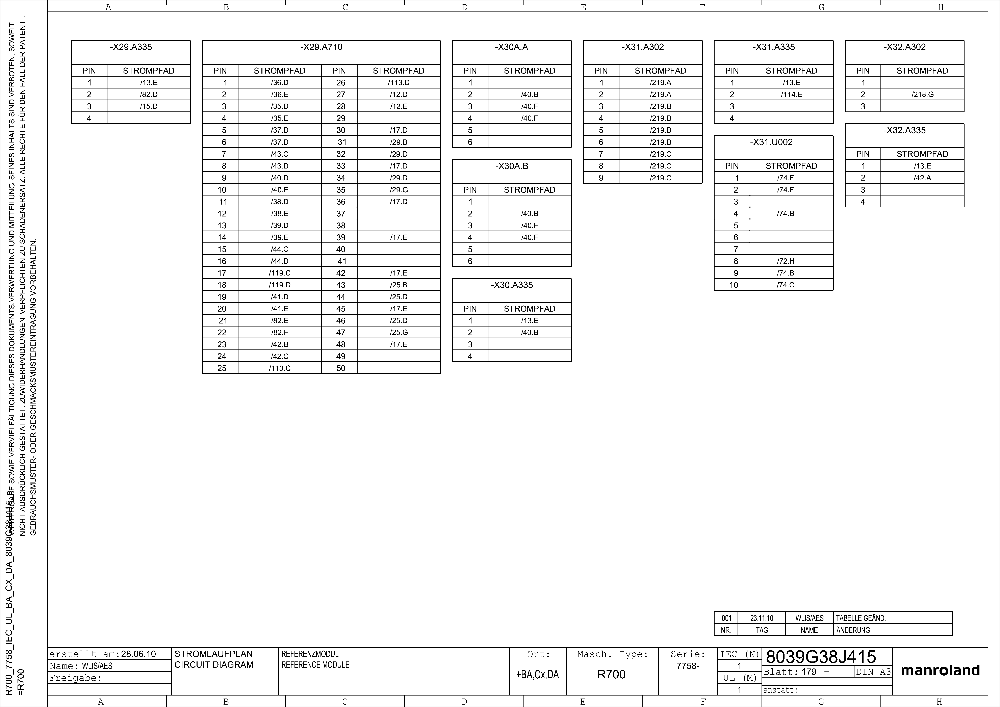

# +BA_Cx_DA — Sheet 179 of 247 — REFERENZMODUL

**REFERENCE MODULE**

> Part of the manroland **R700** printing press IEC/UL circuit diagrams.
> Drawing class: **Stromlaufplan / Circuit diagram** (DIN A3).
> Document `+BA_Cx_DA` covers the **Printing units / main switch cabinet** machine section.

## At a glance

| Field | Value |
|---|---|
| Document | `+BA_Cx_DA`  (8039G38J415) |
| Sheet | **179** of 247 |
| Section (DE) | REFERENZMODUL |
| Section (EN) | REFERENCE MODULE |
| Section type | REFERENCE_MODULE — Reference module |
| Machine type | `R700` |
| Series | `7758` |
| Created | 28.06.10 |
| Replaces | — |
| Columns used | A, B, C, D, E, F, G, H |
| Path numbers | — |
| Labels on sheet | 214 |
| Cross-refs out | 74 |
| Cross-refs in | 0 |

**Previous:** [+BA_Cx_DA sheet 178](SHEET_0178.md) · **Next:** [+BA_Cx_DA sheet 180](SHEET_0180.md) · **Document TOC:** [_TOC.md](_TOC.md)  (+BA_Cx_DA) · **Master TOC:** [all sheets](../_MASTER_TOC.md)

## Sheet image (300 DPI, exact vector render)



_Rendered directly from the PDF vector layer at 300 DPI (1-bit), no OCR and no resampling. Use it to confirm anything ambiguous in the text below._

## Cross-references on this sheet

Each entry is a wire leaving this sheet. The printed token is `/sheet.column`; the link resolves to that sheet inside the same document.

| Ref | Target sheet | Col | Path | Destination on target | Target section | From col |
|---|---|---|---|---|---|---|
| `/13.E` | [+BA_Cx_DA sheet 13](SHEET_0013.md) | E | — | — | SPANNUNGSVERSORGUNG, SCHALTSCHRANKBELÜFTUNG | A |
| `/13.E` | [+BA_Cx_DA sheet 13](SHEET_0013.md) | E | — | — | SPANNUNGSVERSORGUNG, SCHALTSCHRANKBELÜFTUNG | G |
| `/219.A` | [+BA_Cx_DA sheet 219](SHEET_0219.md) | A | — | — | OPTION: TELEPRESENCE | F |
| `/36.D` | [+BA_Cx_DA sheet 36](SHEET_0036.md) | D | — | — | SCHUTZEINRICHTUNGEN | B |
| `/113.D` | [+BA_Cx_DA sheet 113](SHEET_0113.md) | D | — | — | PPL 2 | C |
| `/36.E` | [+BA_Cx_DA sheet 36](SHEET_0036.md) | E | — | — | SCHUTZEINRICHTUNGEN | B |
| `/40.B` | [+BA_Cx_DA sheet 40](SHEET_0040.md) | B | — | — | SCHUTZEINRICHTUNGEN | E |
| `/219.A` | [+BA_Cx_DA sheet 219](SHEET_0219.md) | A | — | — | OPTION: TELEPRESENCE | F |
| `/114.E` | [+BA_Cx_DA sheet 114](SHEET_0114.md) | E | — | — | PPL 2 | G |
| `/82.D` | [+BA_Cx_DA sheet 82](SHEET_0082.md) | D | — | — | FARBWERK | A |
| `/12.D` | [+BA_Cx_DA sheet 12](SHEET_0012.md) | D | — | — | SPANNUNGSVERSORGUNG, SCHALTSCHRANKBELÜFTUNG | C |
| `/218.G` | [+BA_Cx_DA sheet 218](SHEET_0218.md) | G | — | — | OPTION: TELEPRESENCE | H |
| `/12.E` | [+BA_Cx_DA sheet 12](SHEET_0012.md) | E | — | — | SPANNUNGSVERSORGUNG, SCHALTSCHRANKBELÜFTUNG | C |
| `/40.F` | [+BA_Cx_DA sheet 40](SHEET_0040.md) | F | — | — | SCHUTZEINRICHTUNGEN | E |
| `/219.B` | [+BA_Cx_DA sheet 219](SHEET_0219.md) | B | — | — | OPTION: TELEPRESENCE | F |
| `/15.D` | [+BA_Cx_DA sheet 15](SHEET_0015.md) | D | — | — | SPANNUNGSVERSORGUNG, SCHALTSCHRANKBELÜFTUNG | A |
| `/35.D` | [+BA_Cx_DA sheet 35](SHEET_0035.md) | D | — | — | SCHUTZEINRICHTUNGEN | B |
| `/35.E` | [+BA_Cx_DA sheet 35](SHEET_0035.md) | E | — | — | SCHUTZEINRICHTUNGEN | B |
| `/40.F` | [+BA_Cx_DA sheet 40](SHEET_0040.md) | F | — | — | SCHUTZEINRICHTUNGEN | E |
| `/219.B` | [+BA_Cx_DA sheet 219](SHEET_0219.md) | B | — | — | OPTION: TELEPRESENCE | F |
| `/219.B` | [+BA_Cx_DA sheet 219](SHEET_0219.md) | B | — | — | OPTION: TELEPRESENCE | F |
| `/37.D` | [+BA_Cx_DA sheet 37](SHEET_0037.md) | D | — | — | SCHUTZEINRICHTUNGEN | B |
| `/17.D` | [+BA_Cx_DA sheet 17](SHEET_0017.md) | D | — | — | SPANNUNGSVERSORGUNG, SCHALTSCHRANKBELÜFTUNG | C |
| `/29.B` | [+BA_Cx_DA sheet 29](SHEET_0029.md) | B | — | — | BUSVERBINDUNGEN: STOP SICHERN | C |
| `/219.B` | [+BA_Cx_DA sheet 219](SHEET_0219.md) | B | — | — | OPTION: TELEPRESENCE | F |
| `/37.D` | [+BA_Cx_DA sheet 37](SHEET_0037.md) | D | — | — | SCHUTZEINRICHTUNGEN | B |
| `/43.C` | [+BA_Cx_DA sheet 43](SHEET_0043.md) | C | — | — | SCHUTZEINRICHTUNGEN | B |
| `/29.D` | [+BA_Cx_DA sheet 29](SHEET_0029.md) | D | — | — | BUSVERBINDUNGEN: STOP SICHERN | C |
| `/219.C` | [+BA_Cx_DA sheet 219](SHEET_0219.md) | C | — | — | OPTION: TELEPRESENCE | F |
| `/13.E` | [+BA_Cx_DA sheet 13](SHEET_0013.md) | E | — | — | SPANNUNGSVERSORGUNG, SCHALTSCHRANKBELÜFTUNG | H |
| `/43.D` | [+BA_Cx_DA sheet 43](SHEET_0043.md) | D | — | — | SCHUTZEINRICHTUNGEN | B |
| `/17.D` | [+BA_Cx_DA sheet 17](SHEET_0017.md) | D | — | — | SPANNUNGSVERSORGUNG, SCHALTSCHRANKBELÜFTUNG | C |
| `/219.C` | [+BA_Cx_DA sheet 219](SHEET_0219.md) | C | — | — | OPTION: TELEPRESENCE | F |
| `/42.A` | [+BA_Cx_DA sheet 42](SHEET_0042.md) | A | — | — | SCHUTZEINRICHTUNGEN | H |
| `/74.F` | [+BA_Cx_DA sheet 74](SHEET_0074.md) | F | — | — | FEUCHTWERK | G |
| `/40.D` | [+BA_Cx_DA sheet 40](SHEET_0040.md) | D | — | — | SCHUTZEINRICHTUNGEN | B |
| `/29.D` | [+BA_Cx_DA sheet 29](SHEET_0029.md) | D | — | — | BUSVERBINDUNGEN: STOP SICHERN | C |
| `/219.C` | [+BA_Cx_DA sheet 219](SHEET_0219.md) | C | — | — | OPTION: TELEPRESENCE | F |
| `/40.E` | [+BA_Cx_DA sheet 40](SHEET_0040.md) | E | — | — | SCHUTZEINRICHTUNGEN | B |
| `/74.F` | [+BA_Cx_DA sheet 74](SHEET_0074.md) | F | — | — | FEUCHTWERK | G |
| `/29.G` | [+BA_Cx_DA sheet 29](SHEET_0029.md) | G | — | — | BUSVERBINDUNGEN: STOP SICHERN | C |
| `/38.D` | [+BA_Cx_DA sheet 38](SHEET_0038.md) | D | — | — | SCHUTZEINRICHTUNGEN | B |
| `/17.D` | [+BA_Cx_DA sheet 17](SHEET_0017.md) | D | — | — | SPANNUNGSVERSORGUNG, SCHALTSCHRANKBELÜFTUNG | C |
| `/38.E` | [+BA_Cx_DA sheet 38](SHEET_0038.md) | E | — | — | SCHUTZEINRICHTUNGEN | B |
| `/40.B` | [+BA_Cx_DA sheet 40](SHEET_0040.md) | B | — | — | SCHUTZEINRICHTUNGEN | E |
| `/74.B` | [+BA_Cx_DA sheet 74](SHEET_0074.md) | B | — | — | FEUCHTWERK | G |
| `/40.F` | [+BA_Cx_DA sheet 40](SHEET_0040.md) | F | — | — | SCHUTZEINRICHTUNGEN | E |
| `/39.D` | [+BA_Cx_DA sheet 39](SHEET_0039.md) | D | — | — | SCHUTZEINRICHTUNGEN | B |
| `/39.E` | [+BA_Cx_DA sheet 39](SHEET_0039.md) | E | — | — | SCHUTZEINRICHTUNGEN | B |
| `/17.E` | [+BA_Cx_DA sheet 17](SHEET_0017.md) | E | — | — | SPANNUNGSVERSORGUNG, SCHALTSCHRANKBELÜFTUNG | C |
| `/40.F` | [+BA_Cx_DA sheet 40](SHEET_0040.md) | F | — | — | SCHUTZEINRICHTUNGEN | E |
| `/44.C` | [+BA_Cx_DA sheet 44](SHEET_0044.md) | C | — | — | SCHUTZEINRICHTUNGEN | B |
| `/44.D` | [+BA_Cx_DA sheet 44](SHEET_0044.md) | D | — | — | SCHUTZEINRICHTUNGEN | B |
| `/72.H` | [+BA_Cx_DA sheet 72](SHEET_0072.md) | H | — | — | FEUCHTWERK | G |
| `/17.E` | [+BA_Cx_DA sheet 17](SHEET_0017.md) | E | — | — | SPANNUNGSVERSORGUNG, SCHALTSCHRANKBELÜFTUNG | C |
| `/74.B` | [+BA_Cx_DA sheet 74](SHEET_0074.md) | B | — | — | FEUCHTWERK | G |
| `/119.C` | [+BA_Cx_DA sheet 119](SHEET_0119.md) | C | — | — | RESERVE: SPS STATION (INPUT) | B |
| `/25.B` | [+BA_Cx_DA sheet 25](SHEET_0025.md) | B | — | — | BUSVERBINDUNGEN: NOT AUS | C |
| `/74.C` | [+BA_Cx_DA sheet 74](SHEET_0074.md) | C | — | — | FEUCHTWERK | G |
| `/119.D` | [+BA_Cx_DA sheet 119](SHEET_0119.md) | D | — | — | RESERVE: SPS STATION (INPUT) | B |
| `/41.D` | [+BA_Cx_DA sheet 41](SHEET_0041.md) | D | — | — | SCHUTZEINRICHTUNGEN | B |
| `/25.D` | [+BA_Cx_DA sheet 25](SHEET_0025.md) | D | — | — | BUSVERBINDUNGEN: NOT AUS | C |
| `/41.E` | [+BA_Cx_DA sheet 41](SHEET_0041.md) | E | — | — | SCHUTZEINRICHTUNGEN | B |
| `/17.E` | [+BA_Cx_DA sheet 17](SHEET_0017.md) | E | — | — | SPANNUNGSVERSORGUNG, SCHALTSCHRANKBELÜFTUNG | C |
| `/82.E` | [+BA_Cx_DA sheet 82](SHEET_0082.md) | E | — | — | FARBWERK | B |
| `/13.E` | [+BA_Cx_DA sheet 13](SHEET_0013.md) | E | — | — | SPANNUNGSVERSORGUNG, SCHALTSCHRANKBELÜFTUNG | E |
| `/25.D` | [+BA_Cx_DA sheet 25](SHEET_0025.md) | D | — | — | BUSVERBINDUNGEN: NOT AUS | C |
| `/40.B` | [+BA_Cx_DA sheet 40](SHEET_0040.md) | B | — | — | SCHUTZEINRICHTUNGEN | E |
| `/82.F` | [+BA_Cx_DA sheet 82](SHEET_0082.md) | F | — | — | FARBWERK | B |
| `/25.G` | [+BA_Cx_DA sheet 25](SHEET_0025.md) | G | — | — | BUSVERBINDUNGEN: NOT AUS | C |
| `/42.B` | [+BA_Cx_DA sheet 42](SHEET_0042.md) | B | — | — | SCHUTZEINRICHTUNGEN | B |
| `/17.E` | [+BA_Cx_DA sheet 17](SHEET_0017.md) | E | — | — | SPANNUNGSVERSORGUNG, SCHALTSCHRANKBELÜFTUNG | C |
| `/42.C` | [+BA_Cx_DA sheet 42](SHEET_0042.md) | C | — | — | SCHUTZEINRICHTUNGEN | B |
| `/113.C` | [+BA_Cx_DA sheet 113](SHEET_0113.md) | C | — | — | PPL 2 | B |

## Devices on this sheet

| Tag | Class | Class meaning (IEC) | Col | Sub | Terminal | Sign |
|---|---|---|---|---|---|---|
| `X31.A302` | — | cross-device reference | F | — | — | — |
| `X31.A335` | — | cross-device reference | G | — | — | — |
| `X31.U002` | — | cross-device reference | G | — | — | — |
| `X32.A302` | — | cross-device reference | H | — | — | — |
| `X32.A335` | — | cross-device reference | H | — | — | — |
| `X29.A710` | — | cross-device reference | C | — | — | — |
| `X29.A335` | — | cross-device reference | A | — | — | — |
| `X30A.A` | — | cross-device reference | D | — | — | — |
| `X30A.B` | — | cross-device reference | D | — | — | — |
| `X30.A335` | — | cross-device reference | D | — | — | — |
| `NR.` | — | cross-device reference | F | — | — | — |
| `23.11.10` | — | cross-device reference | F | — | — | — |

## Potentials / nets

_No named potentials on this sheet._

## Wire-end annotations (grouped as printed)

A wire that continues elsewhere is annotated with a small cluster: the destination description, the path/line number `#NN`, and the `/sheet.column` cross reference. Each row below is one such cluster exactly as it is grouped on the drawing.

| Col | Y | Path | Cross-ref | Text on the wire |
|---|---|---|---|---|
| A | 51.3 | — | — | `X29.A335` |
| C | 51.3 | — | — | `X29.A710` |
| D | 51.3 | — | — | `X30A.A` |
| F | 51.3 | — | — | `X31.A302` |
| G | 51.3 | — | — | `X31.A335` |
| H | 51.3 | — | — | `X32.A302` |
| A | 80.0 | — | — | `PIN 2 3 4 1 STROMPFAD` |
| B | 80.0 | — | — | `PIN STROMPFAD` |
| C | 80.0 | — | — | `PIN STROMPFAD` |
| D | 80.0 | — | — | `PIN 2 3 4 5 6 1 STROMPFAD` |
| E | 80.0 | — | — | `PIN 2 3 4 5 6 7 8 9 1 STROMPFAD` |
| G | 80.0 | — | — | `PIN 2 3 4 1 STROMPFAD` |
| H | 80.0 | — | — | `PIN 2 3 1 STROMPFAD` |
| B | 94.2 | — | — | `2 3 4 5 6 7 8 9 1` |
| C | 94.2 | — | — | `26 27 28 29 30 32 33 34 35 36 37 38 39 40 42 43 44 45 46 47 48 49 50 31 41` |
| A | 94.5 | — | `/13.E` | — |
| B | 94.5 | — | `/36.D` | — |
| C | 94.5 | — | `/113.D` | — |
| F | 94.5 | — | `/219.A` | — |
| G | 94.5 | — | `/13.E` | — |
| A | 108.7 | — | `/82.D` | — |
| B | 108.7 | — | `/36.E` | — |
| C | 108.7 | — | `/12.D` | — |
| E | 108.7 | — | `/40.B` | — |
| F | 108.7 | — | `/219.A` | — |
| G | 108.7 | — | `/114.E` | — |
| H | 108.7 | — | `/218.G` | — |
| C | 122.8 | — | `/12.E` | — |
| A | 122.9 | — | `/15.D` | — |
| B | 122.9 | — | `/35.D` | — |
| E | 122.9 | — | `/40.F` | — |
| F | 122.9 | — | `/219.B` | — |
| B | 137.0 | — | `/35.E` | — |
| E | 137.0 | — | `/40.F` | — |
| F | 137.0 | — | `/219.B` | — |
| H | 150.5 | — | — | `X32.A335` |
| B | 151.2 | — | `/37.D` | — |
| C | 151.2 | — | `/17.D` | — |
| F | 151.2 | — | `/219.B` | — |
| G | 164.7 | — | — | `X31.U002` |
| B | 165.4 | — | `/37.D` | — |
| C | 165.4 | — | `/29.B` | — |
| F | 165.4 | — | `/219.B` | — |
| H | 179.2 | — | — | `PIN 2 3 4 1 STROMPFAD` |
| B | 179.6 | — | `/43.C` | — |
| C | 179.6 | — | `/29.D` | — |
| F | 179.6 | — | `/219.C` | — |
| D | 193.1 | — | — | `X30A.B` |
| G | 193.4 | — | — | `PIN 10 2 3 4 5 6 7 8 9 1 STROMPFAD` |
| H | 193.7 | — | `/13.E` | — |
| B | 193.8 | — | `/43.D` | — |
| C | 193.8 | — | `/17.D` | — |
| F | 193.8 | — | `/219.C` | — |
| B | 207.9 | — | `/40.D` | — |
| C | 207.9 | — | `/29.D` | — |
| F | 207.9 | — | `/219.C` | — |
| G | 207.9 | — | `/74.F` | — |
| H | 207.9 | — | `/42.A` | — |
| D | 221.7 | — | — | `PIN 2 3 4 5 6 1 STROMPFAD` |
| B | 221.8 | — | — | `10 12 13 14 15 16 17 18 19 20 11` |
| B | 222.1 | — | `/40.E` | — |
| C | 222.1 | — | `/29.G` | — |
| G | 222.1 | — | `/74.F` | — |
| B | 236.3 | — | `/38.D` | — |
| C | 236.3 | — | `/17.D` | — |
| B | 250.4 | — | `/38.E` | — |
| E | 250.4 | — | `/40.B` | — |
| G | 250.4 | — | `/74.B` | — |
| B | 264.6 | — | `/39.D` | — |
| E | 264.6 | — | `/40.F` | — |
| B | 278.8 | — | `/39.E` | — |
| C | 278.8 | — | `/17.E` | — |
| E | 278.8 | — | `/40.F` | — |
| B | 293.0 | — | `/44.C` | — |
| B | 307.1 | — | `/44.D` | — |
| G | 307.1 | — | `/72.H` | — |
| B | 321.3 | — | `/119.C` | — |
| C | 321.3 | — | `/17.E` | — |
| G | 321.3 | — | `/74.B` | — |
| D | 334.8 | — | — | `X30.A335` |
| C | 335.4 | — | `/25.B` | — |
| B | 335.5 | — | `/119.D` | — |
| G | 335.5 | — | `/74.C` | — |
| B | 349.6 | — | `/41.D` | — |
| C | 349.6 | — | `/25.D` | — |
| D | 363.4 | — | — | `PIN 2 3 4 1 STROMPFAD` |
| B | 363.8 | — | `/41.E` | — |
| C | 363.8 | — | `/17.E` | — |
| B | 377.7 | — | — | `22 23 24 25 21` |
| B | 378.0 | — | `/82.E` | — |
| C | 378.0 | — | `/25.D` | — |
| E | 378.0 | — | `/13.E` | — |
| B | 392.1 | — | `/82.F` | — |
| E | 392.1 | — | `/40.B` | — |
| C | 392.2 | — | `/25.G` | — |
| B | 406.3 | — | `/42.B` | — |
| C | 406.3 | — | `/17.E` | — |
| B | 420.5 | — | `/42.C` | — |
| B | 434.7 | — | `/113.C` | — |
| G | 733.0 | — | — | `001 23.11.10 WLIS/AES TABELLE GEÄND.` |
| G | 747.1 | — | — | `NR. TAG NAME ÄNDERUNG` |


## Reconstructed tables

This sheet carries tabular content (pin map / terminal assignment / index). The grid below was rebuilt from the drawing's own rule lines, so each row is exactly one physical row of the table.

### Table 1 — 4 data rows × 2 columns (at x=85.0, y=48.2) — **X29.A335**

| PIN | STROMPFAD |
|---|---|
| `1` | `/13.E` |
| `2` | `/82.D` |
| `3` | `/15.D` |
| `4` |  |


### Table 2 — 25 data rows × 4 columns (at x=240.9, y=48.2) — **X29.A710**

| PIN | STROMPFAD | PIN | STROMPFAD |
|---|---|---|---|
| `1` | `/36.D` | `26` | `/113.D` |
| `2` | `/36.E` | `27` | `/12.D` |
| `3` | `/35.D` | `28` | `/12.E` |
| `4` | `/35.E` | `29` |  |
| `5` | `/37.D` | `30` | `/17.D` |
| `6` | `/37.D` | `31` | `/29.B` |
| `7` | `/43.C` | `32` | `/29.D` |
| `8` | `/43.D` | `33` | `/17.D` |
| `9` | `/40.D` | `34` | `/29.D` |
| `10` | `/40.E` | `35` | `/29.G` |
| `11` | `/38.D` | `36` | `/17.D` |
| `12` | `/38.E` | `37` |  |
| `13` | `/39.D` | `38` |  |
| `14` | `/39.E` | `39` | `/17.E` |
| `15` | `/44.C` | `40` |  |
| `16` | `/44.D` | `41` |  |
| `17` | `/119.C` | `42` | `/17.E` |
| `18` | `/119.D` | `43` | `/25.B` |
| `19` | `/41.D` | `44` | `/25.D` |
| `20` | `/41.E` | `45` | `/17.E` |
| `21` | `/82.E` | `46` | `/25.D` |
| `22` | `/82.F` | `47` | `/25.G` |
| `23` | `/42.B` | `48` | `/17.E` |
| `24` | `/42.C` | `49` |  |
| `25` | `/113.C` | `50` |  |


### Table 3 — 20 data rows × 2 columns (at x=538.6, y=48.2) — **X30A.A**

| PIN | STROMPFAD |
|---|---|
| `1` |  |
| `2` | `/40.B` |
| `3` | `/40.F` |
| `4` | `/40.F` |
| `5` |  |
| `6` |  |
|  | `X30A.B` |
| `PIN` | `STROMPFAD` |
| `1` |  |
| `2` | `/40.B` |
| `3` | `/40.F` |
| `4` | `/40.F` |
| `5` |  |
| `6` |  |
|  | `X30.A335` |
| `PIN` | `STROMPFAD` |
| `1` | `/13.E` |
| `2` | `/40.B` |
| `3` |  |
| `4` |  |


### Table 4 — 9 data rows × 2 columns (at x=694.5, y=48.2) — **X31.A302**

| PIN | STROMPFAD |
|---|---|
| `1` | `/219.A` |
| `2` | `/219.A` |
| `3` | `/219.B` |
| `4` | `/219.B` |
| `5` | `/219.B` |
| `6` | `/219.B` |
| `7` | `/219.C` |
| `8` | `/219.C` |
| `9` | `/219.C` |


### Table 5 — 16 data rows × 2 columns (at x=850.4, y=48.2) — **X31.A335**

| PIN | STROMPFAD |
|---|---|
| `1` | `/13.E` |
| `2` | `/114.E` |
| `3` |  |
| `4` |  |
|  | `X31.U002` |
| `PIN` | `STROMPFAD` |
| `1` | `/74.F` |
| `2` | `/74.F` |
| `3` |  |
| `4` | `/74.B` |
| `5` |  |
| `6` |  |
| `7` |  |
| `8` | `/72.H` |
| `9` | `/74.B` |
| `10` | `/74.C` |


### Table 6 — 9 data rows × 2 columns (at x=1006.3, y=48.2) — **X32.A302**

| PIN | STROMPFAD |
|---|---|
| `1` |  |
| `2` | `/218.G` |
| `3` |  |
|  | `X32.A335` |
| `PIN` | `STROMPFAD` |
| `1` | `/13.E` |
| `2` | `/42.A` |
| `3` |  |
| `4` |  |


## Notes and free text on this sheet

| Text | Col | Y (pt) |
|---|---|---|
| `PIN` | E | 80.02 |
| `STROMPFAD` | F | 79.98 |
| `PIN` | F | 80.02 |
| `STROMPFAD` | G | 79.98 |
| `PIN` | G | 80.02 |
| `STROMPFAD` | H | 79.98 |
| `PIN` | B | 80.02 |
| `STROMPFAD` | B | 79.98 |
| `PIN` | C | 80.02 |
| `STROMPFAD` | C | 79.98 |
| `PIN` | A | 80.02 |
| `STROMPFAD` | A | 79.98 |
| `PIN` | D | 80.02 |
| `STROMPFAD` | E | 79.98 |
| `TAG` | G | 747.27 |
| `NAME` | G | 747.25 |
| `ÄNDERUNG` | G | 747.31 |
| `WLIS/AES` | G | 733.08 |
| `TABELLE GEÄND.` | G | 733.12 |

## Complete label inventory (exact text from the drawing)

Every text object inside the drawing area of this sheet, in DIN reading order (column A→H, then top→bottom). This is the authoritative list: if a string is not here it is not printed on this sheet.

| Col | Y | X | Dir | Type | Text |
|---|---|---|---|---|---|
| A | 51.3 | 131.0 | → | device ref | `X29.A335` |
| A | 80.0 | 98.2 | → | text | `PIN` |
| A | 80.0 | 146.4 | → | text | `STROMPFAD` |
| A | 94.2 | 104.2 | → | number | `1` |
| A | 94.5 | 167.1 | → | cross-reference | `/13.E` |
| A | 108.4 | 103.6 | → | number | `2` |
| A | 108.7 | 166.8 | → | cross-reference | `/82.D` |
| A | 122.5 | 103.6 | → | number | `3` |
| A | 122.9 | 166.8 | → | cross-reference | `/15.D` |
| A | 136.7 | 103.6 | → | number | `4` |
| B | 80.0 | 254.1 | → | text | `PIN` |
| B | 80.0 | 302.3 | → | text | `STROMPFAD` |
| B | 94.2 | 265.9 | → | number | `1` |
| B | 94.5 | 322.7 | → | cross-reference | `/36.D` |
| B | 108.4 | 264.2 | → | number | `2` |
| B | 108.7 | 323.0 | → | cross-reference | `/36.E` |
| B | 122.5 | 264.2 | → | number | `3` |
| B | 122.9 | 322.7 | → | cross-reference | `/35.D` |
| B | 136.7 | 264.2 | → | number | `4` |
| B | 137.0 | 323.0 | → | cross-reference | `/35.E` |
| B | 150.9 | 264.2 | → | number | `5` |
| B | 151.2 | 322.7 | → | cross-reference | `/37.D` |
| B | 165.1 | 264.2 | → | number | `6` |
| B | 165.4 | 322.7 | → | cross-reference | `/37.D` |
| B | 179.2 | 264.2 | → | number | `7` |
| B | 179.6 | 322.7 | → | cross-reference | `/43.C` |
| B | 193.4 | 264.2 | → | number | `8` |
| B | 193.7 | 322.7 | → | cross-reference | `/43.D` |
| B | 207.6 | 264.2 | → | number | `9` |
| B | 207.9 | 322.7 | → | cross-reference | `/40.D` |
| B | 221.8 | 258.8 | → | number | `10` |
| B | 222.1 | 323.0 | → | cross-reference | `/40.E` |
| B | 235.9 | 260.5 | → | number | `11` |
| B | 236.3 | 322.7 | → | cross-reference | `/38.D` |
| B | 250.1 | 258.8 | → | number | `12` |
| B | 250.4 | 323.0 | → | cross-reference | `/38.E` |
| B | 264.3 | 258.8 | → | number | `13` |
| B | 264.6 | 322.7 | → | cross-reference | `/39.D` |
| B | 278.5 | 258.8 | → | number | `14` |
| B | 278.8 | 323.0 | → | cross-reference | `/39.E` |
| B | 292.6 | 258.8 | → | number | `15` |
| B | 293.0 | 322.7 | → | cross-reference | `/44.C` |
| B | 306.8 | 258.8 | → | number | `16` |
| B | 307.1 | 322.7 | → | cross-reference | `/44.D` |
| B | 321.0 | 258.8 | → | number | `17` |
| B | 321.3 | 320.3 | → | cross-reference | `/119.C` |
| B | 335.1 | 258.8 | → | number | `18` |
| B | 335.5 | 320.3 | → | cross-reference | `/119.D` |
| B | 349.3 | 258.8 | → | number | `19` |
| B | 349.7 | 322.7 | → | cross-reference | `/41.D` |
| B | 363.5 | 258.8 | → | number | `20` |
| B | 363.8 | 323.0 | → | cross-reference | `/41.E` |
| B | 377.7 | 260.5 | → | number | `21` |
| B | 378.0 | 323.0 | → | cross-reference | `/82.E` |
| B | 391.8 | 258.8 | → | number | `22` |
| B | 392.2 | 323.1 | → | cross-reference | `/82.F` |
| B | 406.0 | 258.8 | → | number | `23` |
| B | 406.3 | 322.9 | → | cross-reference | `/42.B` |
| B | 420.2 | 258.8 | → | number | `24` |
| B | 420.5 | 322.7 | → | cross-reference | `/42.C` |
| B | 434.4 | 258.8 | → | number | `25` |
| B | 434.7 | 320.3 | → | cross-reference | `/113.C` |
| C | 51.3 | 357.7 | → | device ref | `X29.A710` |
| C | 80.0 | 395.9 | → | text | `PIN` |
| C | 80.0 | 444.0 | → | text | `STROMPFAD` |
| C | 94.2 | 400.5 | → | number | `26` |
| C | 94.5 | 462.0 | → | cross-reference | `/113.D` |
| C | 108.4 | 400.5 | → | number | `27` |
| C | 108.7 | 464.5 | → | cross-reference | `/12.D` |
| C | 122.5 | 400.5 | → | number | `28` |
| C | 122.8 | 464.7 | → | cross-reference | `/12.E` |
| C | 136.7 | 400.5 | → | number | `29` |
| C | 150.9 | 400.5 | → | number | `30` |
| C | 151.2 | 464.5 | → | cross-reference | `/17.D` |
| C | 165.1 | 402.2 | → | number | `31` |
| C | 165.4 | 464.6 | → | cross-reference | `/29.B` |
| C | 179.2 | 400.5 | → | number | `32` |
| C | 179.6 | 464.5 | → | cross-reference | `/29.D` |
| C | 193.4 | 400.5 | → | number | `33` |
| C | 193.7 | 464.5 | → | cross-reference | `/17.D` |
| C | 207.6 | 400.5 | → | number | `34` |
| C | 207.9 | 464.5 | → | cross-reference | `/29.D` |
| C | 221.8 | 400.5 | → | number | `35` |
| C | 222.1 | 464.3 | → | cross-reference | `/29.G` |
| C | 235.9 | 400.5 | → | number | `36` |
| C | 236.3 | 464.5 | → | cross-reference | `/17.D` |
| C | 250.1 | 400.5 | → | number | `37` |
| C | 264.3 | 400.5 | → | number | `38` |
| C | 278.5 | 400.5 | → | number | `39` |
| C | 278.8 | 464.7 | → | cross-reference | `/17.E` |
| C | 292.6 | 400.5 | → | number | `40` |
| C | 306.8 | 402.2 | → | number | `41` |
| C | 321.0 | 400.5 | → | number | `42` |
| C | 321.3 | 464.7 | → | cross-reference | `/17.E` |
| C | 335.1 | 400.5 | → | number | `43` |
| C | 335.4 | 464.6 | → | cross-reference | `/25.B` |
| C | 349.3 | 400.5 | → | number | `44` |
| C | 349.7 | 464.5 | → | cross-reference | `/25.D` |
| C | 363.5 | 400.5 | → | number | `45` |
| C | 363.8 | 464.7 | → | cross-reference | `/17.E` |
| C | 377.7 | 400.5 | → | number | `46` |
| C | 378.0 | 464.5 | → | cross-reference | `/25.D` |
| C | 391.8 | 400.5 | → | number | `47` |
| C | 392.2 | 464.3 | → | cross-reference | `/25.G` |
| C | 406.0 | 400.5 | → | number | `48` |
| C | 406.3 | 464.7 | → | cross-reference | `/17.E` |
| C | 420.2 | 400.5 | → | number | `49` |
| C | 434.4 | 400.5 | → | number | `50` |
| D | 51.3 | 589.5 | → | device ref | `X30A.A` |
| D | 80.0 | 551.8 | → | text | `PIN` |
| D | 94.2 | 557.7 | → | number | `1` |
| D | 108.4 | 557.1 | → | number | `2` |
| D | 122.5 | 557.1 | → | number | `3` |
| D | 136.7 | 557.1 | → | number | `4` |
| D | 150.9 | 557.1 | → | number | `5` |
| D | 165.1 | 557.1 | → | number | `6` |
| D | 193.1 | 589.9 | → | device ref | `X30A.B` |
| D | 221.8 | 551.8 | → | text | `PIN` |
| D | 235.9 | 557.7 | → | number | `1` |
| D | 250.1 | 557.1 | → | number | `2` |
| D | 264.3 | 557.1 | → | number | `3` |
| D | 278.5 | 557.1 | → | number | `4` |
| D | 292.6 | 557.1 | → | number | `5` |
| D | 306.8 | 557.1 | → | number | `6` |
| D | 334.8 | 584.5 | → | device ref | `X30.A335` |
| D | 363.5 | 551.8 | → | text | `PIN` |
| D | 377.7 | 557.7 | → | number | `1` |
| D | 391.8 | 557.1 | → | number | `2` |
| D | 406.0 | 557.1 | → | number | `3` |
| D | 420.2 | 557.1 | → | number | `4` |
| E | 80.0 | 600.0 | → | text | `STROMPFAD` |
| E | 80.0 | 707.7 | → | text | `PIN` |
| E | 94.2 | 713.6 | → | number | `1` |
| E | 108.4 | 713.1 | → | number | `2` |
| E | 108.7 | 620.5 | → | cross-reference | `/40.B` |
| E | 122.5 | 713.1 | → | number | `3` |
| E | 122.9 | 620.8 | → | cross-reference | `/40.F` |
| E | 136.7 | 713.1 | → | number | `4` |
| E | 137.0 | 620.8 | → | cross-reference | `/40.F` |
| E | 150.9 | 713.1 | → | number | `5` |
| E | 165.1 | 713.1 | → | number | `6` |
| E | 179.2 | 713.1 | → | number | `7` |
| E | 193.4 | 713.1 | → | number | `8` |
| E | 207.6 | 713.1 | → | number | `9` |
| E | 221.7 | 600.0 | → | text | `STROMPFAD` |
| E | 250.4 | 620.5 | → | cross-reference | `/40.B` |
| E | 264.6 | 620.8 | → | cross-reference | `/40.F` |
| E | 278.8 | 620.8 | → | cross-reference | `/40.F` |
| E | 363.4 | 600.0 | → | text | `STROMPFAD` |
| E | 378.0 | 620.6 | → | cross-reference | `/13.E` |
| E | 392.1 | 620.5 | → | cross-reference | `/40.B` |
| F | 51.3 | 740.4 | → | device ref | `X31.A302` |
| F | 80.0 | 755.9 | → | text | `STROMPFAD` |
| F | 80.0 | 863.6 | → | text | `PIN` |
| F | 94.2 | 869.5 | → | number | `1` |
| F | 94.5 | 773.9 | → | cross-reference | `/219.A` |
| F | 108.4 | 869.0 | → | number | `2` |
| F | 108.7 | 773.9 | → | cross-reference | `/219.A` |
| F | 122.5 | 869.0 | → | number | `3` |
| F | 122.9 | 774.0 | → | cross-reference | `/219.B` |
| F | 136.7 | 869.0 | → | number | `4` |
| F | 137.0 | 774.0 | → | cross-reference | `/219.B` |
| F | 151.2 | 774.0 | → | cross-reference | `/219.B` |
| F | 165.4 | 774.0 | → | cross-reference | `/219.B` |
| F | 179.6 | 773.9 | → | cross-reference | `/219.C` |
| F | 193.4 | 863.6 | → | text | `PIN` |
| F | 193.8 | 773.9 | → | cross-reference | `/219.C` |
| F | 207.6 | 875.3 | → | number | `1` |
| F | 207.9 | 773.9 | → | cross-reference | `/219.C` |
| F | 221.8 | 873.6 | → | number | `2` |
| F | 235.9 | 873.6 | → | number | `3` |
| F | 250.1 | 873.6 | → | number | `4` |
| F | 264.3 | 873.6 | → | number | `5` |
| F | 278.5 | 873.6 | → | number | `6` |
| F | 292.6 | 873.6 | → | number | `7` |
| F | 306.8 | 873.6 | → | number | `8` |
| F | 321.0 | 873.6 | → | number | `9` |
| F | 335.1 | 868.3 | → | number | `10` |
| F | 733.0 | 859.4 | → | number | `001` |
| F | 733.1 | 893.5 | → | device ref | `23.11.10` |
| F | 747.1 | 858.4 | → | device ref | `NR.` |
| G | 51.3 | 896.3 | → | device ref | `X31.A335` |
| G | 80.0 | 911.8 | → | text | `STROMPFAD` |
| G | 80.0 | 1019.5 | → | text | `PIN` |
| G | 94.2 | 1025.4 | → | number | `1` |
| G | 94.5 | 932.5 | → | cross-reference | `/13.E` |
| G | 108.4 | 1024.9 | → | number | `2` |
| G | 108.7 | 930.0 | → | cross-reference | `/114.E` |
| G | 122.5 | 1024.9 | → | number | `3` |
| G | 164.7 | 893.2 | → | device ref | `X31.U002` |
| G | 179.2 | 1019.5 | → | text | `PIN` |
| G | 193.4 | 911.8 | → | text | `STROMPFAD` |
| G | 193.4 | 1025.4 | → | number | `1` |
| G | 207.6 | 1024.9 | → | number | `2` |
| G | 207.9 | 925.5 | → | cross-reference | `/74.F` |
| G | 221.8 | 1024.9 | → | number | `3` |
| G | 222.1 | 925.5 | → | cross-reference | `/74.F` |
| G | 235.9 | 1024.9 | → | number | `4` |
| G | 250.4 | 925.2 | → | cross-reference | `/74.B` |
| G | 307.1 | 925.4 | → | cross-reference | `/72.H` |
| G | 321.3 | 925.2 | → | cross-reference | `/74.B` |
| G | 335.5 | 925.1 | → | cross-reference | `/74.C` |
| G | 733.1 | 947.3 | → | text | `WLIS/AES` |
| G | 733.1 | 995.4 | → | text | `TABELLE GEÄND.` |
| G | 747.3 | 900.0 | → | text | `TAG` |
| G | 747.3 | 953.4 | → | text | `NAME` |
| G | 747.3 | 996.0 | → | text | `ÄNDERUNG` |
| H | 51.3 | 1052.2 | → | device ref | `X32.A302` |
| H | 80.0 | 1067.7 | → | text | `STROMPFAD` |
| H | 108.7 | 1085.5 | → | cross-reference | `/218.G` |
| H | 150.5 | 1052.2 | → | device ref | `X32.A335` |
| H | 179.2 | 1067.7 | → | text | `STROMPFAD` |
| H | 193.7 | 1088.4 | → | cross-reference | `/13.E` |
| H | 207.9 | 1088.1 | → | cross-reference | `/42.A` |

## Reading-order text block

The same content as a plain block, grouped by DIN column — convenient to paste or to match against a visual description.

```text
=== Column A ===
  51.3  131.0  devref       X29.A335
  80.0   98.2  text         PIN
  80.0  146.4  text         STROMPFAD
  94.2  104.2  numeric      1
  94.5  167.1  xref         /13.E
 108.4  103.6  numeric      2
 108.7  166.8  xref         /82.D
 122.5  103.6  numeric      3
 122.9  166.8  xref         /15.D
 136.7  103.6  numeric      4
=== Column B ===
  80.0  254.1  text         PIN
  80.0  302.3  text         STROMPFAD
  94.2  265.9  numeric      1
  94.5  322.7  xref         /36.D
 108.4  264.2  numeric      2
 108.7  323.0  xref         /36.E
 122.5  264.2  numeric      3
 122.9  322.7  xref         /35.D
 136.7  264.2  numeric      4
 137.0  323.0  xref         /35.E
 150.9  264.2  numeric      5
 151.2  322.7  xref         /37.D
 165.1  264.2  numeric      6
 165.4  322.7  xref         /37.D
 179.2  264.2  numeric      7
 179.6  322.7  xref         /43.C
 193.4  264.2  numeric      8
 193.7  322.7  xref         /43.D
 207.6  264.2  numeric      9
 207.9  322.7  xref         /40.D
 221.8  258.8  numeric      10
 222.1  323.0  xref         /40.E
 235.9  260.5  numeric      11
 236.3  322.7  xref         /38.D
 250.1  258.8  numeric      12
 250.4  323.0  xref         /38.E
 264.3  258.8  numeric      13
 264.6  322.7  xref         /39.D
 278.5  258.8  numeric      14
 278.8  323.0  xref         /39.E
 292.6  258.8  numeric      15
 293.0  322.7  xref         /44.C
 306.8  258.8  numeric      16
 307.1  322.7  xref         /44.D
 321.0  258.8  numeric      17
 321.3  320.3  xref         /119.C
 335.1  258.8  numeric      18
 335.5  320.3  xref         /119.D
 349.3  258.8  numeric      19
 349.7  322.7  xref         /41.D
 363.5  258.8  numeric      20
 363.8  323.0  xref         /41.E
 377.7  260.5  numeric      21
 378.0  323.0  xref         /82.E
 391.8  258.8  numeric      22
 392.2  323.1  xref         /82.F
 406.0  258.8  numeric      23
 406.3  322.9  xref         /42.B
 420.2  258.8  numeric      24
 420.5  322.7  xref         /42.C
 434.4  258.8  numeric      25
 434.7  320.3  xref         /113.C
=== Column C ===
  51.3  357.7  devref       X29.A710
  80.0  395.9  text         PIN
  80.0  444.0  text         STROMPFAD
  94.2  400.5  numeric      26
  94.5  462.0  xref         /113.D
 108.4  400.5  numeric      27
 108.7  464.5  xref         /12.D
 122.5  400.5  numeric      28
 122.8  464.7  xref         /12.E
 136.7  400.5  numeric      29
 150.9  400.5  numeric      30
 151.2  464.5  xref         /17.D
 165.1  402.2  numeric      31
 165.4  464.6  xref         /29.B
 179.2  400.5  numeric      32
 179.6  464.5  xref         /29.D
 193.4  400.5  numeric      33
 193.7  464.5  xref         /17.D
 207.6  400.5  numeric      34
 207.9  464.5  xref         /29.D
 221.8  400.5  numeric      35
 222.1  464.3  xref         /29.G
 235.9  400.5  numeric      36
 236.3  464.5  xref         /17.D
 250.1  400.5  numeric      37
 264.3  400.5  numeric      38
 278.5  400.5  numeric      39
 278.8  464.7  xref         /17.E
 292.6  400.5  numeric      40
 306.8  402.2  numeric      41
 321.0  400.5  numeric      42
 321.3  464.7  xref         /17.E
 335.1  400.5  numeric      43
 335.4  464.6  xref         /25.B
 349.3  400.5  numeric      44
 349.7  464.5  xref         /25.D
 363.5  400.5  numeric      45
 363.8  464.7  xref         /17.E
 377.7  400.5  numeric      46
 378.0  464.5  xref         /25.D
 391.8  400.5  numeric      47
 392.2  464.3  xref         /25.G
 406.0  400.5  numeric      48
 406.3  464.7  xref         /17.E
 420.2  400.5  numeric      49
 434.4  400.5  numeric      50
=== Column D ===
  51.3  589.5  devref       X30A.A
  80.0  551.8  text         PIN
  94.2  557.7  numeric      1
 108.4  557.1  numeric      2
 122.5  557.1  numeric      3
 136.7  557.1  numeric      4
 150.9  557.1  numeric      5
 165.1  557.1  numeric      6
 193.1  589.9  devref       X30A.B
 221.8  551.8  text         PIN
 235.9  557.7  numeric      1
 250.1  557.1  numeric      2
 264.3  557.1  numeric      3
 278.5  557.1  numeric      4
 292.6  557.1  numeric      5
 306.8  557.1  numeric      6
 334.8  584.5  devref       X30.A335
 363.5  551.8  text         PIN
 377.7  557.7  numeric      1
 391.8  557.1  numeric      2
 406.0  557.1  numeric      3
 420.2  557.1  numeric      4
=== Column E ===
  80.0  600.0  text         STROMPFAD
  80.0  707.7  text         PIN
  94.2  713.6  numeric      1
 108.4  713.1  numeric      2
 108.7  620.5  xref         /40.B
 122.5  713.1  numeric      3
 122.9  620.8  xref         /40.F
 136.7  713.1  numeric      4
 137.0  620.8  xref         /40.F
 150.9  713.1  numeric      5
 165.1  713.1  numeric      6
 179.2  713.1  numeric      7
 193.4  713.1  numeric      8
 207.6  713.1  numeric      9
 221.7  600.0  text         STROMPFAD
 250.4  620.5  xref         /40.B
 264.6  620.8  xref         /40.F
 278.8  620.8  xref         /40.F
 363.4  600.0  text         STROMPFAD
 378.0  620.6  xref         /13.E
 392.1  620.5  xref         /40.B
=== Column F ===
  51.3  740.4  devref       X31.A302
  80.0  755.9  text         STROMPFAD
  80.0  863.6  text         PIN
  94.2  869.5  numeric      1
  94.5  773.9  xref         /219.A
 108.4  869.0  numeric      2
 108.7  773.9  xref         /219.A
 122.5  869.0  numeric      3
 122.9  774.0  xref         /219.B
 136.7  869.0  numeric      4
 137.0  774.0  xref         /219.B
 151.2  774.0  xref         /219.B
 165.4  774.0  xref         /219.B
 179.6  773.9  xref         /219.C
 193.4  863.6  text         PIN
 193.8  773.9  xref         /219.C
 207.6  875.3  numeric      1
 207.9  773.9  xref         /219.C
 221.8  873.6  numeric      2
 235.9  873.6  numeric      3
 250.1  873.6  numeric      4
 264.3  873.6  numeric      5
 278.5  873.6  numeric      6
 292.6  873.6  numeric      7
 306.8  873.6  numeric      8
 321.0  873.6  numeric      9
 335.1  868.3  numeric      10
 733.0  859.4  numeric      001
 733.1  893.5  devref       23.11.10
 747.1  858.4  devref       NR.
=== Column G ===
  51.3  896.3  devref       X31.A335
  80.0  911.8  text         STROMPFAD
  80.0 1019.5  text         PIN
  94.2 1025.4  numeric      1
  94.5  932.5  xref         /13.E
 108.4 1024.9  numeric      2
 108.7  930.0  xref         /114.E
 122.5 1024.9  numeric      3
 164.7  893.2  devref       X31.U002
 179.2 1019.5  text         PIN
 193.4  911.8  text         STROMPFAD
 193.4 1025.4  numeric      1
 207.6 1024.9  numeric      2
 207.9  925.5  xref         /74.F
 221.8 1024.9  numeric      3
 222.1  925.5  xref         /74.F
 235.9 1024.9  numeric      4
 250.4  925.2  xref         /74.B
 307.1  925.4  xref         /72.H
 321.3  925.2  xref         /74.B
 335.5  925.1  xref         /74.C
 733.1  947.3  text         WLIS/AES
 733.1  995.4  text         TABELLE GEÄND.
 747.3  900.0  text         TAG
 747.3  953.4  text         NAME
 747.3  996.0  text         ÄNDERUNG
=== Column H ===
  51.3 1052.2  devref       X32.A302
  80.0 1067.7  text         STROMPFAD
 108.7 1085.5  xref         /218.G
 150.5 1052.2  devref       X32.A335
 179.2 1067.7  text         STROMPFAD
 193.7 1088.4  xref         /13.E
 207.9 1088.1  xref         /42.A
```

---
_Generated from the PDF vector text layer; no OCR. Source: `R700_7758_IEC_UL_BA_CX_DA_8039G38J415_p`, sheet 179._
