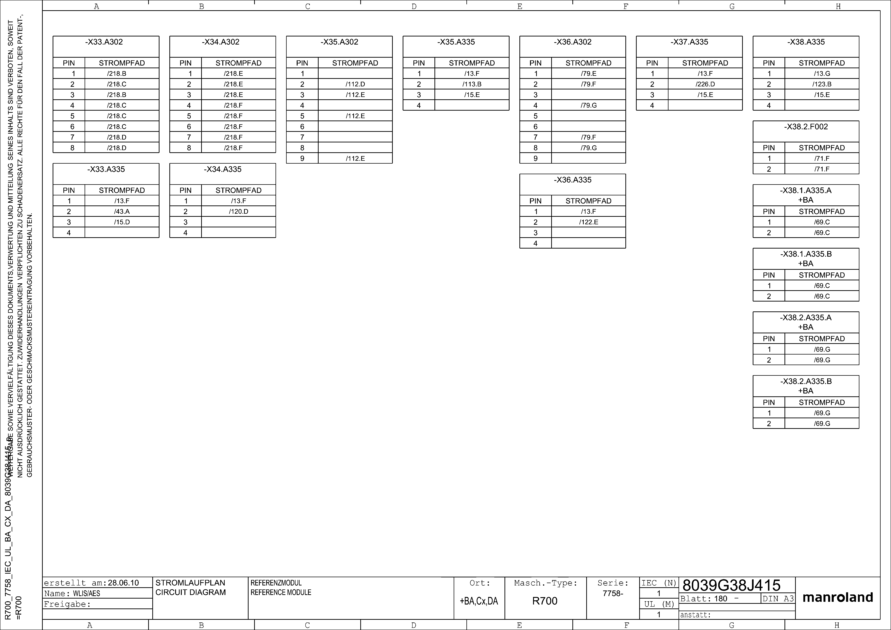

# +BA_Cx_DA — Sheet 180 of 247 — REFERENZMODUL

**REFERENCE MODULE**

> Part of the manroland **R700** printing press IEC/UL circuit diagrams.
> Drawing class: **Stromlaufplan / Circuit diagram** (DIN A3).
> Document `+BA_Cx_DA` covers the **Printing units / main switch cabinet** machine section.

## At a glance

| Field | Value |
|---|---|
| Document | `+BA_Cx_DA`  (8039G38J415) |
| Sheet | **180** of 247 |
| Section (DE) | REFERENZMODUL |
| Section (EN) | REFERENCE MODULE |
| Section type | REFERENCE_MODULE — Reference module |
| Machine type | `R700` |
| Series | `7758` |
| Created | 28.06.10 |
| Replaces | — |
| Columns used | A, B, C, D, E, F, G, H |
| Path numbers | — |
| Labels on sheet | 168 |
| Cross-refs out | 51 |
| Cross-refs in | 0 |

**Previous:** [+BA_Cx_DA sheet 179](SHEET_0179.md) · **Next:** [+BA_Cx_DA sheet 181](SHEET_0181.md) · **Document TOC:** [_TOC.md](_TOC.md)  (+BA_Cx_DA) · **Master TOC:** [all sheets](../_MASTER_TOC.md)

## Sheet image (300 DPI, exact vector render)



_Rendered directly from the PDF vector layer at 300 DPI (1-bit), no OCR and no resampling. Use it to confirm anything ambiguous in the text below._

## Cross-references on this sheet

Each entry is a wire leaving this sheet. The printed token is `/sheet.column`; the link resolves to that sheet inside the same document.

| Ref | Target sheet | Col | Path | Destination on target | Target section | From col |
|---|---|---|---|---|---|---|
| `/79.E` | [+BA_Cx_DA sheet 79](SHEET_0079.md) | E | — | — | FARBWERK | F |
| `/13.F` | [+BA_Cx_DA sheet 13](SHEET_0013.md) | F | — | — | SPANNUNGSVERSORGUNG, SCHALTSCHRANKBELÜFTUNG | E |
| `/13.F` | [+BA_Cx_DA sheet 13](SHEET_0013.md) | F | — | — | SPANNUNGSVERSORGUNG, SCHALTSCHRANKBELÜFTUNG | G |
| `/218.B` | [+BA_Cx_DA sheet 218](SHEET_0218.md) | B | — | — | OPTION: TELEPRESENCE | A |
| `/218.E` | [+BA_Cx_DA sheet 218](SHEET_0218.md) | E | — | — | OPTION: TELEPRESENCE | B |
| `/13.G` | [+BA_Cx_DA sheet 13](SHEET_0013.md) | G | — | — | SPANNUNGSVERSORGUNG, SCHALTSCHRANKBELÜFTUNG | H |
| `/218.E` | [+BA_Cx_DA sheet 218](SHEET_0218.md) | E | — | — | OPTION: TELEPRESENCE | B |
| `/113.B` | [+BA_Cx_DA sheet 113](SHEET_0113.md) | B | — | — | PPL 2 | E |
| `/79.F` | [+BA_Cx_DA sheet 79](SHEET_0079.md) | F | — | — | FARBWERK | F |
| `/123.B` | [+BA_Cx_DA sheet 123](SHEET_0123.md) | B | — | — | RESERVE: SPS STATION (INPUT) | H |
| `/218.C` | [+BA_Cx_DA sheet 218](SHEET_0218.md) | C | — | — | OPTION: TELEPRESENCE | A |
| `/112.D` | [+BA_Cx_DA sheet 112](SHEET_0112.md) | D | — | — | HANDTERMINAL | C |
| `/226.D` | [+BA_Cx_DA sheet 226](SHEET_0226.md) | D | — | — | OPTION: ZWISCHENTROCKNER VORBEREITUNG | G |
| `/15.E` | [+BA_Cx_DA sheet 15](SHEET_0015.md) | E | — | — | SPANNUNGSVERSORGUNG, SCHALTSCHRANKBELÜFTUNG | E |
| `/15.E` | [+BA_Cx_DA sheet 15](SHEET_0015.md) | E | — | — | SPANNUNGSVERSORGUNG, SCHALTSCHRANKBELÜFTUNG | G |
| `/15.E` | [+BA_Cx_DA sheet 15](SHEET_0015.md) | E | — | — | SPANNUNGSVERSORGUNG, SCHALTSCHRANKBELÜFTUNG | H |
| `/218.B` | [+BA_Cx_DA sheet 218](SHEET_0218.md) | B | — | — | OPTION: TELEPRESENCE | A |
| `/218.E` | [+BA_Cx_DA sheet 218](SHEET_0218.md) | E | — | — | OPTION: TELEPRESENCE | B |
| `/112.E` | [+BA_Cx_DA sheet 112](SHEET_0112.md) | E | — | — | HANDTERMINAL | C |
| `/218.F` | [+BA_Cx_DA sheet 218](SHEET_0218.md) | F | — | — | OPTION: TELEPRESENCE | B |
| `/79.G` | [+BA_Cx_DA sheet 79](SHEET_0079.md) | G | — | — | FARBWERK | F |
| `/218.C` | [+BA_Cx_DA sheet 218](SHEET_0218.md) | C | — | — | OPTION: TELEPRESENCE | A |
| `/112.E` | [+BA_Cx_DA sheet 112](SHEET_0112.md) | E | — | — | HANDTERMINAL | C |
| `/218.F` | [+BA_Cx_DA sheet 218](SHEET_0218.md) | F | — | — | OPTION: TELEPRESENCE | B |
| `/218.C` | [+BA_Cx_DA sheet 218](SHEET_0218.md) | C | — | — | OPTION: TELEPRESENCE | A |
| `/218.F` | [+BA_Cx_DA sheet 218](SHEET_0218.md) | F | — | — | OPTION: TELEPRESENCE | B |
| `/218.C` | [+BA_Cx_DA sheet 218](SHEET_0218.md) | C | — | — | OPTION: TELEPRESENCE | A |
| `/79.F` | [+BA_Cx_DA sheet 79](SHEET_0079.md) | F | — | — | FARBWERK | F |
| `/218.F` | [+BA_Cx_DA sheet 218](SHEET_0218.md) | F | — | — | OPTION: TELEPRESENCE | B |
| `/218.D` | [+BA_Cx_DA sheet 218](SHEET_0218.md) | D | — | — | OPTION: TELEPRESENCE | A |
| `/79.G` | [+BA_Cx_DA sheet 79](SHEET_0079.md) | G | — | — | FARBWERK | F |
| `/218.F` | [+BA_Cx_DA sheet 218](SHEET_0218.md) | F | — | — | OPTION: TELEPRESENCE | B |
| `/218.D` | [+BA_Cx_DA sheet 218](SHEET_0218.md) | D | — | — | OPTION: TELEPRESENCE | A |
| `/112.E` | [+BA_Cx_DA sheet 112](SHEET_0112.md) | E | — | — | HANDTERMINAL | C |
| `/71.F` | [+BA_Cx_DA sheet 71](SHEET_0071.md) | F | — | — | ÖLUMLAUFSCHMIERUNG | H |
| `/71.F` | [+BA_Cx_DA sheet 71](SHEET_0071.md) | F | — | — | ÖLUMLAUFSCHMIERUNG | H |
| `/13.F` | [+BA_Cx_DA sheet 13](SHEET_0013.md) | F | — | — | SPANNUNGSVERSORGUNG, SCHALTSCHRANKBELÜFTUNG | A |
| `/13.F` | [+BA_Cx_DA sheet 13](SHEET_0013.md) | F | — | — | SPANNUNGSVERSORGUNG, SCHALTSCHRANKBELÜFTUNG | B |
| `/43.A` | [+BA_Cx_DA sheet 43](SHEET_0043.md) | A | — | — | SCHUTZEINRICHTUNGEN | A |
| `/13.F` | [+BA_Cx_DA sheet 13](SHEET_0013.md) | F | — | — | SPANNUNGSVERSORGUNG, SCHALTSCHRANKBELÜFTUNG | F |
| `/120.D` | [+BA_Cx_DA sheet 120](SHEET_0120.md) | D | — | — | RESERVE: SPS STATION (INPUT) | B |
| `/122.E` | [+BA_Cx_DA sheet 122](SHEET_0122.md) | E | — | — | RESERVE: SPS STATION (INPUT) | F |
| `/15.D` | [+BA_Cx_DA sheet 15](SHEET_0015.md) | D | — | — | SPANNUNGSVERSORGUNG, SCHALTSCHRANKBELÜFTUNG | A |
| `/69.C` | [+BA_Cx_DA sheet 69](SHEET_0069.md) | C | — | — | DRUCKLUFT ABSTELLEN | H |
| `/69.C` | [+BA_Cx_DA sheet 69](SHEET_0069.md) | C | — | — | DRUCKLUFT ABSTELLEN | H |
| `/69.C` | [+BA_Cx_DA sheet 69](SHEET_0069.md) | C | — | — | DRUCKLUFT ABSTELLEN | H |
| `/69.C` | [+BA_Cx_DA sheet 69](SHEET_0069.md) | C | — | — | DRUCKLUFT ABSTELLEN | H |
| `/69.G` | [+BA_Cx_DA sheet 69](SHEET_0069.md) | G | — | — | DRUCKLUFT ABSTELLEN | H |
| `/69.G` | [+BA_Cx_DA sheet 69](SHEET_0069.md) | G | — | — | DRUCKLUFT ABSTELLEN | H |
| `/69.G` | [+BA_Cx_DA sheet 69](SHEET_0069.md) | G | — | — | DRUCKLUFT ABSTELLEN | H |
| `/69.G` | [+BA_Cx_DA sheet 69](SHEET_0069.md) | G | — | — | DRUCKLUFT ABSTELLEN | H |

## Devices on this sheet

| Tag | Class | Class meaning (IEC) | Col | Sub | Terminal | Sign |
|---|---|---|---|---|---|---|
| `X33.A302` | — | cross-device reference | A | — | — | — |
| `X33.A335` | — | cross-device reference | A | — | — | — |
| `X34.A302` | — | cross-device reference | B | — | — | — |
| `X34.A335` | — | cross-device reference | B | — | — | — |
| `X35.A335` | — | cross-device reference | D | — | — | — |
| `X35.A302` | — | cross-device reference | C | — | — | — |
| `X36.A302` | — | cross-device reference | F | — | — | — |
| `X36.A335` | — | cross-device reference | F | — | — | — |
| `X37.A335` | — | cross-device reference | G | — | — | — |
| `X38.A335` | — | cross-device reference | H | — | — | — |
| `X38.2.F002` | — | cross-device reference | H | — | — | — |
| `X38.1.A335.A` | — | cross-device reference | H | — | — | — |
| `X38.1.A335.B` | — | cross-device reference | H | — | — | — |
| `X38.2.A335.A` | — | cross-device reference | H | — | — | — |
| `X38.2.A335.B` | — | cross-device reference | H | — | — | — |

## Potentials / nets

_No named potentials on this sheet._

## Wire-end annotations (grouped as printed)

A wire that continues elsewhere is annotated with a small cluster: the destination description, the path/line number `#NN`, and the `/sheet.column` cross reference. Each row below is one such cluster exactly as it is grouped on the drawing.

| Col | Y | Path | Cross-ref | Text on the wire |
|---|---|---|---|---|
| A | 51.3 | — | — | `X33.A302` |
| B | 51.3 | — | — | `X34.A302` |
| C | 51.3 | — | — | `X35.A302` |
| D | 51.3 | — | — | `X35.A335` |
| F | 51.3 | — | — | `X36.A302` |
| G | 51.3 | — | — | `X37.A335` |
| H | 51.3 | — | — | `X38.A335` |
| A | 80.0 | — | — | `PIN 2 3 4 5 6 7 8 1 STROMPFAD` |
| B | 80.0 | — | — | `PIN 2 3 4 5 6 7 8 1 STROMPFAD` |
| C | 80.0 | — | — | `PIN 2 3 4 5 6 7 8 9 1 STROMPFAD` |
| D | 80.0 | — | — | `PIN 2 3 4 1 STROMPFAD` |
| E | 80.0 | — | — | `PIN 2 3 4 5 6 7 8 9 1 STROMPFAD` |
| G | 80.0 | — | — | `PIN 2 3 4 1 STROMPFAD` |
| H | 80.0 | — | — | `PIN 2 3 4 1 STROMPFAD` |
| A | 94.5 | — | `/218.B` | — |
| B | 94.5 | — | `/218.E` | — |
| E | 94.5 | — | `/13.F` | — |
| F | 94.5 | — | `/79.E` | — |
| G | 94.5 | — | `/13.F` | — |
| H | 94.5 | — | `/13.G` | — |
| A | 108.7 | — | `/218.C` | — |
| B | 108.7 | — | `/218.E` | — |
| C | 108.7 | — | `/112.D` | — |
| E | 108.7 | — | `/113.B` | — |
| F | 108.7 | — | `/79.F` | — |
| G | 108.7 | — | `/226.D` | — |
| H | 108.7 | — | `/123.B` | — |
| E | 122.8 | — | `/15.E` | — |
| G | 122.8 | — | `/15.E` | — |
| H | 122.8 | — | `/15.E` | — |
| A | 122.9 | — | `/218.B` | — |
| B | 122.9 | — | `/218.E` | — |
| C | 122.9 | — | `/112.E` | — |
| B | 137.0 | — | `/218.F` | — |
| F | 137.0 | — | `/79.G` | — |
| A | 137.1 | — | `/218.C` | — |
| A | 151.2 | — | `/218.C` | — |
| B | 151.2 | — | `/218.F` | — |
| C | 151.2 | — | `/112.E` | — |
| H | 164.7 | — | — | `X38.2.F002` |
| A | 165.4 | — | `/218.C` | — |
| B | 165.4 | — | `/218.F` | — |
| A | 179.6 | — | `/218.D` | — |
| B | 179.6 | — | `/218.F` | — |
| F | 179.6 | — | `/79.F` | — |
| H | 193.4 | — | — | `PIN 2 1 STROMPFAD` |
| B | 193.7 | — | `/218.F` | — |
| F | 193.7 | — | `/79.G` | — |
| A | 193.8 | — | `/218.D` | — |
| C | 207.9 | — | `/112.E` | — |
| H | 207.9 | — | `/71.F` | — |
| A | 221.4 | — | — | `X33.A335` |
| B | 221.4 | — | — | `X34.A335` |
| H | 222.1 | — | `/71.F` | — |
| F | 235.6 | — | — | `X36.A335` |
| H | 249.8 | — | — | `X38.1.A335.A` |
| A | 250.1 | — | — | `PIN 2 3 4 1 STROMPFAD` |
| B | 250.1 | — | — | `PIN 2 3 4 1 STROMPFAD` |
| H | 262.4 | — | — | `+BA` |
| E | 264.2 | — | — | `PIN 2 3 4 1 STROMPFAD` |
| A | 264.6 | — | `/13.F` | — |
| B | 264.6 | — | `/13.F` | — |
| H | 278.4 | — | — | `PIN 2 1 STROMPFAD` |
| A | 278.8 | — | `/43.A` | — |
| B | 278.8 | — | `/120.D` | — |
| F | 278.8 | — | `/13.F` | — |
| F | 292.9 | — | `/122.E` | — |
| A | 293.0 | — | `/15.D` | — |
| H | 293.0 | — | `/69.C` | — |
| H | 307.1 | — | `/69.C` | — |
| H | 334.8 | — | — | `X38.1.A335.B` |
| H | 347.5 | — | — | `+BA` |
| H | 363.4 | — | — | `PIN 2 1 STROMPFAD` |
| H | 378.0 | — | `/69.C` | — |
| H | 392.2 | — | `/69.C` | — |
| H | 419.8 | — | — | `X38.2.A335.A` |
| H | 432.5 | — | — | `+BA` |
| H | 448.5 | — | — | `PIN 2 1 STROMPFAD` |
| H | 463.0 | — | `/69.G` | — |
| H | 477.2 | — | `/69.G` | — |
| H | 504.9 | — | — | `X38.2.A335.B` |
| H | 517.5 | — | — | `+BA` |
| H | 533.5 | — | — | `PIN 2 1 STROMPFAD` |
| H | 548.1 | — | `/69.G` | — |
| H | 562.2 | — | `/69.G` | — |


## Reconstructed tables

This sheet carries tabular content (pin map / terminal assignment / index). The grid below was rebuilt from the drawing's own rule lines, so each row is exactly one physical row of the table.

### Table 1 — 14 data rows × 2 columns (at x=70.9, y=48.2) — **X33.A302**

| PIN | STROMPFAD |
|---|---|
| `1` | `/218.B` |
| `2` | `/218.C` |
| `3` | `/218.B` |
| `4` | `/218.C` |
| `5` | `/218.C` |
| `6` | `/218.C` |
| `7` | `/218.D` |
| `8` | `/218.D` |
|  | `X33.A335` |
| `PIN` | `STROMPFAD` |
| `1` | `/13.F` |
| `2` | `/43.A` |
| `3` | `/15.D` |
| `4` |  |


### Table 2 — 14 data rows × 2 columns (at x=226.8, y=48.2) — **X34.A302**

| PIN | STROMPFAD |
|---|---|
| `1` | `/218.E` |
| `2` | `/218.E` |
| `3` | `/218.E` |
| `4` | `/218.F` |
| `5` | `/218.F` |
| `6` | `/218.F` |
| `7` | `/218.F` |
| `8` | `/218.F` |
|  | `X34.A335` |
| `PIN` | `STROMPFAD` |
| `1` | `/13.F` |
| `2` | `/120.D` |
| `3` |  |
| `4` |  |


### Table 3 — 9 data rows × 2 columns (at x=382.7, y=48.2) — **X35.A302**

| PIN | STROMPFAD |
|---|---|
| `1` |  |
| `2` | `/112.D` |
| `3` | `/112.E` |
| `4` |  |
| `5` | `/112.E` |
| `6` |  |
| `7` |  |
| `8` |  |
| `9` | `/112.E` |


### Table 4 — 4 data rows × 2 columns (at x=538.6, y=48.2) — **X35.A335**

| PIN | STROMPFAD |
|---|---|
| `1` | `/13.F` |
| `2` | `/113.B` |
| `3` | `/15.E` |
| `4` |  |


### Table 5 — 15 data rows × 2 columns (at x=694.5, y=48.2) — **X36.A302**

| PIN | STROMPFAD |
|---|---|
| `1` | `/79.E` |
| `2` | `/79.F` |
| `3` |  |
| `4` | `/79.G` |
| `5` |  |
| `6` |  |
| `7` | `/79.F` |
| `8` | `/79.G` |
| `9` |  |
|  | `X36.A335` |
| `PIN` | `STROMPFAD` |
| `1` | `/13.F` |
| `2` | `/122.E` |
| `3` |  |
| `4` |  |


### Table 6 — 4 data rows × 2 columns (at x=850.4, y=48.2) — **X37.A335**

| PIN | STROMPFAD |
|---|---|
| `1` | `/13.F` |
| `2` | `/226.D` |
| `3` | `/15.E` |
| `4` |  |


### Table 7 — 25 data rows × 2 columns (at x=1006.3, y=48.2) — **X38.A335**

| PIN | STROMPFAD |
|---|---|
| `1` | `/13.G` |
| `2` | `/123.B` |
| `3` | `/15.E` |
| `4` |  |
|  | `X38.2.F002` |
| `PIN` | `STROMPFAD` |
| `1` | `/71.F` |
| `2` | `/71.F` |
|  | `X38.1.A335.A` |
|  | `+BA` |
| `PIN` | `STROMPFAD` |
| `1` | `/69.C` |
| `2` | `/69.C` |
|  | `X38.1.A335.B +BA` |
| `PIN` | `STROMPFAD` |
| `1` | `/69.C` |
| `2` | `/69.C` |
|  | `X38.2.A335.A +BA` |
| `PIN` | `STROMPFAD` |
| `1` | `/69.G` |
| `2` | `/69.G` |
|  | `X38.2.A335.B +BA` |
| `PIN` | `STROMPFAD` |
| `1` | `/69.G` |
| `2` | `/69.G` |


## Notes and free text on this sheet

| Text | Col | Y (pt) |
|---|---|---|
| `PIN` | A | 80.02 |
| `STROMPFAD` | A | 79.98 |
| `PIN` | B | 80.02 |
| `STROMPFAD` | B | 79.98 |
| `PIN` | D | 80.02 |
| `STROMPFAD` | E | 79.98 |
| `PIN` | C | 80.02 |
| `STROMPFAD` | C | 79.98 |
| `PIN` | E | 80.02 |
| `STROMPFAD` | F | 79.98 |
| `PIN` | F | 80.02 |
| `STROMPFAD` | G | 79.98 |
| `PIN` | G | 80.02 |
| `STROMPFAD` | H | 79.98 |
| `+BA` | H | 262.44 |

## Complete label inventory (exact text from the drawing)

Every text object inside the drawing area of this sheet, in DIN reading order (column A→H, then top→bottom). This is the authoritative list: if a string is not here it is not printed on this sheet.

| Col | Y | X | Dir | Type | Text |
|---|---|---|---|---|---|
| A | 51.3 | 114.0 | → | device ref | `X33.A302` |
| A | 80.0 | 84.0 | → | text | `PIN` |
| A | 80.0 | 132.2 | → | text | `STROMPFAD` |
| A | 94.2 | 95.8 | → | number | `1` |
| A | 94.5 | 143.3 | → | cross-reference | `/218.B` |
| A | 108.4 | 94.1 | → | number | `2` |
| A | 108.7 | 143.1 | → | cross-reference | `/218.C` |
| A | 122.5 | 94.1 | → | number | `3` |
| A | 122.9 | 143.3 | → | cross-reference | `/218.B` |
| A | 136.7 | 94.1 | → | number | `4` |
| A | 137.1 | 143.1 | → | cross-reference | `/218.C` |
| A | 150.9 | 94.1 | → | number | `5` |
| A | 151.2 | 143.1 | → | cross-reference | `/218.C` |
| A | 165.1 | 94.1 | → | number | `6` |
| A | 165.4 | 143.1 | → | cross-reference | `/218.C` |
| A | 179.2 | 94.1 | → | number | `7` |
| A | 179.6 | 143.1 | → | cross-reference | `/218.D` |
| A | 193.4 | 94.1 | → | number | `8` |
| A | 193.8 | 143.1 | → | cross-reference | `/218.D` |
| A | 221.4 | 116.8 | → | device ref | `X33.A335` |
| A | 250.1 | 84.0 | → | text | `PIN` |
| A | 250.1 | 132.2 | → | text | `STROMPFAD` |
| A | 264.3 | 90.0 | → | number | `1` |
| A | 264.6 | 153.1 | → | cross-reference | `/13.F` |
| A | 278.5 | 89.4 | → | number | `2` |
| A | 278.8 | 152.6 | → | cross-reference | `/43.A` |
| A | 292.6 | 89.4 | → | number | `3` |
| A | 293.0 | 152.6 | → | cross-reference | `/15.D` |
| A | 306.8 | 89.4 | → | number | `4` |
| B | 51.3 | 269.9 | → | device ref | `X34.A302` |
| B | 80.0 | 240.0 | → | text | `PIN` |
| B | 80.0 | 288.1 | → | text | `STROMPFAD` |
| B | 94.2 | 251.7 | → | number | `1` |
| B | 94.5 | 299.3 | → | cross-reference | `/218.E` |
| B | 108.4 | 250.0 | → | number | `2` |
| B | 108.7 | 299.3 | → | cross-reference | `/218.E` |
| B | 122.5 | 250.0 | → | number | `3` |
| B | 122.9 | 299.3 | → | cross-reference | `/218.E` |
| B | 136.7 | 250.0 | → | number | `4` |
| B | 137.0 | 299.5 | → | cross-reference | `/218.F` |
| B | 150.9 | 250.0 | → | number | `5` |
| B | 151.2 | 299.5 | → | cross-reference | `/218.F` |
| B | 165.1 | 250.0 | → | number | `6` |
| B | 165.4 | 299.5 | → | cross-reference | `/218.F` |
| B | 179.2 | 250.0 | → | number | `7` |
| B | 179.6 | 299.5 | → | cross-reference | `/218.F` |
| B | 193.4 | 250.0 | → | number | `8` |
| B | 193.7 | 299.5 | → | cross-reference | `/218.F` |
| B | 221.4 | 272.7 | → | device ref | `X34.A335` |
| B | 250.1 | 240.0 | → | text | `PIN` |
| B | 250.1 | 288.1 | → | text | `STROMPFAD` |
| B | 264.3 | 245.9 | → | number | `1` |
| B | 264.6 | 309.0 | → | cross-reference | `/13.F` |
| B | 278.5 | 245.3 | → | number | `2` |
| B | 278.8 | 306.1 | → | cross-reference | `/120.D` |
| B | 292.6 | 245.3 | → | number | `3` |
| B | 306.8 | 245.3 | → | number | `4` |
| C | 51.3 | 428.6 | → | device ref | `X35.A302` |
| C | 80.0 | 395.9 | → | text | `PIN` |
| C | 80.0 | 444.0 | → | text | `STROMPFAD` |
| C | 94.2 | 401.8 | → | number | `1` |
| C | 108.4 | 401.2 | → | number | `2` |
| C | 108.7 | 462.0 | → | cross-reference | `/112.D` |
| C | 122.5 | 401.2 | → | number | `3` |
| C | 122.9 | 462.3 | → | cross-reference | `/112.E` |
| C | 136.7 | 401.2 | → | number | `4` |
| C | 150.9 | 401.2 | → | number | `5` |
| C | 151.2 | 462.3 | → | cross-reference | `/112.E` |
| C | 165.1 | 401.2 | → | number | `6` |
| C | 179.2 | 401.2 | → | number | `7` |
| C | 193.4 | 401.2 | → | number | `8` |
| C | 207.6 | 401.2 | → | number | `9` |
| C | 207.9 | 462.3 | → | cross-reference | `/112.E` |
| D | 51.3 | 584.5 | → | device ref | `X35.A335` |
| D | 80.0 | 551.8 | → | text | `PIN` |
| D | 94.2 | 557.7 | → | number | `1` |
| D | 108.4 | 557.1 | → | number | `2` |
| D | 122.5 | 557.1 | → | number | `3` |
| D | 136.7 | 557.1 | → | number | `4` |
| E | 80.0 | 600.0 | → | text | `STROMPFAD` |
| E | 80.0 | 707.7 | → | text | `PIN` |
| E | 94.2 | 713.6 | → | number | `1` |
| E | 94.5 | 620.8 | → | cross-reference | `/13.F` |
| E | 108.4 | 713.1 | → | number | `2` |
| E | 108.7 | 618.1 | → | cross-reference | `/113.B` |
| E | 122.5 | 713.1 | → | number | `3` |
| E | 122.8 | 620.6 | → | cross-reference | `/15.E` |
| E | 136.7 | 713.1 | → | number | `4` |
| E | 150.9 | 713.1 | → | number | `5` |
| E | 165.1 | 713.1 | → | number | `6` |
| E | 179.2 | 713.1 | → | number | `7` |
| E | 193.4 | 713.1 | → | number | `8` |
| E | 207.6 | 713.1 | → | number | `9` |
| E | 264.3 | 707.7 | → | text | `PIN` |
| E | 278.5 | 713.6 | → | number | `1` |
| E | 292.6 | 713.1 | → | number | `2` |
| E | 306.8 | 713.1 | → | number | `3` |
| E | 321.0 | 713.1 | → | number | `4` |
| F | 51.3 | 740.4 | → | device ref | `X36.A302` |
| F | 80.0 | 755.9 | → | text | `STROMPFAD` |
| F | 80.0 | 863.6 | → | text | `PIN` |
| F | 94.2 | 869.5 | → | number | `1` |
| F | 94.5 | 776.6 | → | cross-reference | `/79.E` |
| F | 108.4 | 869.0 | → | number | `2` |
| F | 108.7 | 776.7 | → | cross-reference | `/79.F` |
| F | 122.5 | 869.0 | → | number | `3` |
| F | 136.7 | 869.0 | → | number | `4` |
| F | 137.0 | 776.1 | → | cross-reference | `/79.G` |
| F | 179.6 | 776.7 | → | cross-reference | `/79.F` |
| F | 193.7 | 776.1 | → | cross-reference | `/79.G` |
| F | 235.6 | 740.4 | → | device ref | `X36.A335` |
| F | 264.2 | 755.9 | → | text | `STROMPFAD` |
| F | 278.8 | 776.7 | → | cross-reference | `/13.F` |
| F | 292.9 | 774.1 | → | cross-reference | `/122.E` |
| G | 51.3 | 896.3 | → | device ref | `X37.A335` |
| G | 80.0 | 911.8 | → | text | `STROMPFAD` |
| G | 80.0 | 1019.5 | → | text | `PIN` |
| G | 94.2 | 1025.4 | → | number | `1` |
| G | 94.5 | 932.6 | → | cross-reference | `/13.F` |
| G | 108.4 | 1024.9 | → | number | `2` |
| G | 108.7 | 929.8 | → | cross-reference | `/226.D` |
| G | 122.5 | 1024.9 | → | number | `3` |
| G | 122.8 | 932.5 | → | cross-reference | `/15.E` |
| G | 136.7 | 1024.9 | → | number | `4` |
| G | 193.4 | 1019.5 | → | text | `PIN` |
| G | 207.6 | 1025.4 | → | number | `1` |
| G | 221.8 | 1024.9 | → | number | `2` |
| G | 278.4 | 1019.5 | → | text | `PIN` |
| G | 292.6 | 1025.4 | → | number | `1` |
| G | 306.8 | 1024.9 | → | number | `2` |
| G | 363.5 | 1019.5 | → | text | `PIN` |
| G | 377.7 | 1025.4 | → | number | `1` |
| G | 391.8 | 1024.9 | → | number | `2` |
| G | 448.5 | 1019.5 | → | text | `PIN` |
| G | 462.7 | 1025.4 | → | number | `1` |
| G | 476.9 | 1024.9 | → | number | `2` |
| G | 533.6 | 1019.5 | → | text | `PIN` |
| G | 547.7 | 1025.4 | → | number | `1` |
| G | 561.9 | 1024.9 | → | number | `2` |
| H | 51.3 | 1052.2 | → | device ref | `X38.A335` |
| H | 80.0 | 1067.7 | → | text | `STROMPFAD` |
| H | 94.5 | 1087.9 | → | cross-reference | `/13.G` |
| H | 108.7 | 1085.8 | → | cross-reference | `/123.B` |
| H | 122.8 | 1088.4 | → | cross-reference | `/15.E` |
| H | 164.7 | 1048.1 | → | device ref | `X38.2.F002` |
| H | 193.4 | 1067.7 | → | text | `STROMPFAD` |
| H | 207.9 | 1088.5 | → | cross-reference | `/71.F` |
| H | 222.1 | 1088.5 | → | cross-reference | `/71.F` |
| H | 249.8 | 1042.4 | → | device ref | `X38.1.A335.A` |
| H | 262.4 | 1066.5 | → | text | `+BA` |
| H | 278.4 | 1067.7 | → | text | `STROMPFAD` |
| H | 293.0 | 1088.1 | → | cross-reference | `/69.C` |
| H | 307.1 | 1088.1 | → | cross-reference | `/69.C` |
| H | 334.8 | 1042.9 | → | device ref | `X38.1.A335.B` |
| H | 347.5 | 1066.5 | → | text | `+BA` |
| H | 363.4 | 1067.7 | → | text | `STROMPFAD` |
| H | 378.0 | 1088.1 | → | cross-reference | `/69.C` |
| H | 392.2 | 1088.1 | → | cross-reference | `/69.C` |
| H | 419.8 | 1042.4 | → | device ref | `X38.2.A335.A` |
| H | 432.5 | 1066.5 | → | text | `+BA` |
| H | 448.5 | 1067.7 | → | text | `STROMPFAD` |
| H | 463.0 | 1087.9 | → | cross-reference | `/69.G` |
| H | 477.2 | 1087.9 | → | cross-reference | `/69.G` |
| H | 504.9 | 1042.9 | → | device ref | `X38.2.A335.B` |
| H | 517.6 | 1066.5 | → | text | `+BA` |
| H | 533.5 | 1067.7 | → | text | `STROMPFAD` |
| H | 548.1 | 1087.9 | → | cross-reference | `/69.G` |
| H | 562.2 | 1087.9 | → | cross-reference | `/69.G` |

## Reading-order text block

The same content as a plain block, grouped by DIN column — convenient to paste or to match against a visual description.

```text
=== Column A ===
  51.3  114.0  devref       X33.A302
  80.0   84.0  text         PIN
  80.0  132.2  text         STROMPFAD
  94.2   95.8  numeric      1
  94.5  143.3  xref         /218.B
 108.4   94.1  numeric      2
 108.7  143.1  xref         /218.C
 122.5   94.1  numeric      3
 122.9  143.3  xref         /218.B
 136.7   94.1  numeric      4
 137.1  143.1  xref         /218.C
 150.9   94.1  numeric      5
 151.2  143.1  xref         /218.C
 165.1   94.1  numeric      6
 165.4  143.1  xref         /218.C
 179.2   94.1  numeric      7
 179.6  143.1  xref         /218.D
 193.4   94.1  numeric      8
 193.8  143.1  xref         /218.D
 221.4  116.8  devref       X33.A335
 250.1   84.0  text         PIN
 250.1  132.2  text         STROMPFAD
 264.3   90.0  numeric      1
 264.6  153.1  xref         /13.F
 278.5   89.4  numeric      2
 278.8  152.6  xref         /43.A
 292.6   89.4  numeric      3
 293.0  152.6  xref         /15.D
 306.8   89.4  numeric      4
=== Column B ===
  51.3  269.9  devref       X34.A302
  80.0  240.0  text         PIN
  80.0  288.1  text         STROMPFAD
  94.2  251.7  numeric      1
  94.5  299.3  xref         /218.E
 108.4  250.0  numeric      2
 108.7  299.3  xref         /218.E
 122.5  250.0  numeric      3
 122.9  299.3  xref         /218.E
 136.7  250.0  numeric      4
 137.0  299.5  xref         /218.F
 150.9  250.0  numeric      5
 151.2  299.5  xref         /218.F
 165.1  250.0  numeric      6
 165.4  299.5  xref         /218.F
 179.2  250.0  numeric      7
 179.6  299.5  xref         /218.F
 193.4  250.0  numeric      8
 193.7  299.5  xref         /218.F
 221.4  272.7  devref       X34.A335
 250.1  240.0  text         PIN
 250.1  288.1  text         STROMPFAD
 264.3  245.9  numeric      1
 264.6  309.0  xref         /13.F
 278.5  245.3  numeric      2
 278.8  306.1  xref         /120.D
 292.6  245.3  numeric      3
 306.8  245.3  numeric      4
=== Column C ===
  51.3  428.6  devref       X35.A302
  80.0  395.9  text         PIN
  80.0  444.0  text         STROMPFAD
  94.2  401.8  numeric      1
 108.4  401.2  numeric      2
 108.7  462.0  xref         /112.D
 122.5  401.2  numeric      3
 122.9  462.3  xref         /112.E
 136.7  401.2  numeric      4
 150.9  401.2  numeric      5
 151.2  462.3  xref         /112.E
 165.1  401.2  numeric      6
 179.2  401.2  numeric      7
 193.4  401.2  numeric      8
 207.6  401.2  numeric      9
 207.9  462.3  xref         /112.E
=== Column D ===
  51.3  584.5  devref       X35.A335
  80.0  551.8  text         PIN
  94.2  557.7  numeric      1
 108.4  557.1  numeric      2
 122.5  557.1  numeric      3
 136.7  557.1  numeric      4
=== Column E ===
  80.0  600.0  text         STROMPFAD
  80.0  707.7  text         PIN
  94.2  713.6  numeric      1
  94.5  620.8  xref         /13.F
 108.4  713.1  numeric      2
 108.7  618.1  xref         /113.B
 122.5  713.1  numeric      3
 122.8  620.6  xref         /15.E
 136.7  713.1  numeric      4
 150.9  713.1  numeric      5
 165.1  713.1  numeric      6
 179.2  713.1  numeric      7
 193.4  713.1  numeric      8
 207.6  713.1  numeric      9
 264.3  707.7  text         PIN
 278.5  713.6  numeric      1
 292.6  713.1  numeric      2
 306.8  713.1  numeric      3
 321.0  713.1  numeric      4
=== Column F ===
  51.3  740.4  devref       X36.A302
  80.0  755.9  text         STROMPFAD
  80.0  863.6  text         PIN
  94.2  869.5  numeric      1
  94.5  776.6  xref         /79.E
 108.4  869.0  numeric      2
 108.7  776.7  xref         /79.F
 122.5  869.0  numeric      3
 136.7  869.0  numeric      4
 137.0  776.1  xref         /79.G
 179.6  776.7  xref         /79.F
 193.7  776.1  xref         /79.G
 235.6  740.4  devref       X36.A335
 264.2  755.9  text         STROMPFAD
 278.8  776.7  xref         /13.F
 292.9  774.1  xref         /122.E
=== Column G ===
  51.3  896.3  devref       X37.A335
  80.0  911.8  text         STROMPFAD
  80.0 1019.5  text         PIN
  94.2 1025.4  numeric      1
  94.5  932.6  xref         /13.F
 108.4 1024.9  numeric      2
 108.7  929.8  xref         /226.D
 122.5 1024.9  numeric      3
 122.8  932.5  xref         /15.E
 136.7 1024.9  numeric      4
 193.4 1019.5  text         PIN
 207.6 1025.4  numeric      1
 221.8 1024.9  numeric      2
 278.4 1019.5  text         PIN
 292.6 1025.4  numeric      1
 306.8 1024.9  numeric      2
 363.5 1019.5  text         PIN
 377.7 1025.4  numeric      1
 391.8 1024.9  numeric      2
 448.5 1019.5  text         PIN
 462.7 1025.4  numeric      1
 476.9 1024.9  numeric      2
 533.6 1019.5  text         PIN
 547.7 1025.4  numeric      1
 561.9 1024.9  numeric      2
=== Column H ===
  51.3 1052.2  devref       X38.A335
  80.0 1067.7  text         STROMPFAD
  94.5 1087.9  xref         /13.G
 108.7 1085.8  xref         /123.B
 122.8 1088.4  xref         /15.E
 164.7 1048.1  devref       X38.2.F002
 193.4 1067.7  text         STROMPFAD
 207.9 1088.5  xref         /71.F
 222.1 1088.5  xref         /71.F
 249.8 1042.4  devref       X38.1.A335.A
 262.4 1066.5  text         +BA
 278.4 1067.7  text         STROMPFAD
 293.0 1088.1  xref         /69.C
 307.1 1088.1  xref         /69.C
 334.8 1042.9  devref       X38.1.A335.B
 347.5 1066.5  text         +BA
 363.4 1067.7  text         STROMPFAD
 378.0 1088.1  xref         /69.C
 392.2 1088.1  xref         /69.C
 419.8 1042.4  devref       X38.2.A335.A
 432.5 1066.5  text         +BA
 448.5 1067.7  text         STROMPFAD
 463.0 1087.9  xref         /69.G
 477.2 1087.9  xref         /69.G
 504.9 1042.9  devref       X38.2.A335.B
 517.6 1066.5  text         +BA
 533.5 1067.7  text         STROMPFAD
 548.1 1087.9  xref         /69.G
 562.2 1087.9  xref         /69.G
```

---
_Generated from the PDF vector text layer; no OCR. Source: `R700_7758_IEC_UL_BA_CX_DA_8039G38J415_p`, sheet 180._
