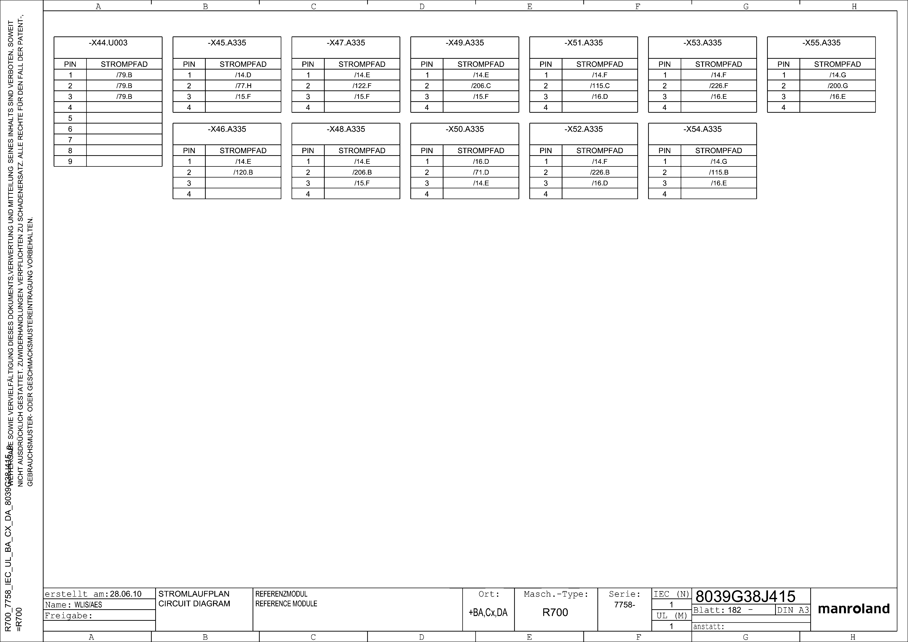

# +BA_Cx_DA — Sheet 182 of 247 — REFERENZMODUL

**REFERENCE MODULE**

> Part of the manroland **R700** printing press IEC/UL circuit diagrams.
> Drawing class: **Stromlaufplan / Circuit diagram** (DIN A3).
> Document `+BA_Cx_DA` covers the **Printing units / main switch cabinet** machine section.

## At a glance

| Field | Value |
|---|---|
| Document | `+BA_Cx_DA`  (8039G38J415) |
| Sheet | **182** of 247 |
| Section (DE) | REFERENZMODUL |
| Section (EN) | REFERENCE MODULE |
| Section type | REFERENCE_MODULE — Reference module |
| Machine type | `R700` |
| Series | `7758` |
| Created | 28.06.10 |
| Replaces | — |
| Columns used | A, B, C, D, E, F, G, H |
| Path numbers | — |
| Labels on sheet | 124 |
| Cross-refs out | 35 |
| Cross-refs in | 0 |

**Previous:** [+BA_Cx_DA sheet 181](SHEET_0181.md) · **Next:** [+BA_Cx_DA sheet 183](SHEET_0183.md) · **Document TOC:** [_TOC.md](_TOC.md)  (+BA_Cx_DA) · **Master TOC:** [all sheets](../_MASTER_TOC.md)

## Sheet image (300 DPI, exact vector render)



_Rendered directly from the PDF vector layer at 300 DPI (1-bit), no OCR and no resampling. Use it to confirm anything ambiguous in the text below._

## Cross-references on this sheet

Each entry is a wire leaving this sheet. The printed token is `/sheet.column`; the link resolves to that sheet inside the same document.

| Ref | Target sheet | Col | Path | Destination on target | Target section | From col |
|---|---|---|---|---|---|---|
| `/79.B` | [+BA_Cx_DA sheet 79](SHEET_0079.md) | B | — | — | FARBWERK | A |
| `/14.E` | [+BA_Cx_DA sheet 14](SHEET_0014.md) | E | — | — | SPANNUNGSVERSORGUNG, SCHALTSCHRANKBELÜFTUNG | C |
| `/14.E` | [+BA_Cx_DA sheet 14](SHEET_0014.md) | E | — | — | SPANNUNGSVERSORGUNG, SCHALTSCHRANKBELÜFTUNG | E |
| `/14.F` | [+BA_Cx_DA sheet 14](SHEET_0014.md) | F | — | — | SPANNUNGSVERSORGUNG, SCHALTSCHRANKBELÜFTUNG | F |
| `/14.F` | [+BA_Cx_DA sheet 14](SHEET_0014.md) | F | — | — | SPANNUNGSVERSORGUNG, SCHALTSCHRANKBELÜFTUNG | G |
| `/14.G` | [+BA_Cx_DA sheet 14](SHEET_0014.md) | G | — | — | SPANNUNGSVERSORGUNG, SCHALTSCHRANKBELÜFTUNG | H |
| `/14.D` | [+BA_Cx_DA sheet 14](SHEET_0014.md) | D | — | — | SPANNUNGSVERSORGUNG, SCHALTSCHRANKBELÜFTUNG | B |
| `/79.B` | [+BA_Cx_DA sheet 79](SHEET_0079.md) | B | — | — | FARBWERK | A |
| `/122.F` | [+BA_Cx_DA sheet 122](SHEET_0122.md) | F | — | — | RESERVE: SPS STATION (INPUT) | C |
| `/226.F` | [+BA_Cx_DA sheet 226](SHEET_0226.md) | F | — | — | OPTION: ZWISCHENTROCKNER VORBEREITUNG | G |
| `/77.H` | [+BA_Cx_DA sheet 77](SHEET_0077.md) | H | — | — | FARBWERK | B |
| `/200.G` | [+BA_Cx_DA sheet 200](SHEET_0200.md) | G | — | — | OPTION: APL | H |
| `/206.C` | [+BA_Cx_DA sheet 206](SHEET_0206.md) | C | — | — | OPTION: AUTOMATISCHE FARBZUFÜHRUNG | E |
| `/115.C` | [+BA_Cx_DA sheet 115](SHEET_0115.md) | C | — | — | PPL 2 | F |
| `/79.B` | [+BA_Cx_DA sheet 79](SHEET_0079.md) | B | — | — | FARBWERK | A |
| `/16.E` | [+BA_Cx_DA sheet 16](SHEET_0016.md) | E | — | — | SPANNUNGSVERSORGUNG, SCHALTSCHRANKBELÜFTUNG | G |
| `/16.E` | [+BA_Cx_DA sheet 16](SHEET_0016.md) | E | — | — | SPANNUNGSVERSORGUNG, SCHALTSCHRANKBELÜFTUNG | H |
| `/15.F` | [+BA_Cx_DA sheet 15](SHEET_0015.md) | F | — | — | SPANNUNGSVERSORGUNG, SCHALTSCHRANKBELÜFTUNG | B |
| `/15.F` | [+BA_Cx_DA sheet 15](SHEET_0015.md) | F | — | — | SPANNUNGSVERSORGUNG, SCHALTSCHRANKBELÜFTUNG | C |
| `/15.F` | [+BA_Cx_DA sheet 15](SHEET_0015.md) | F | — | — | SPANNUNGSVERSORGUNG, SCHALTSCHRANKBELÜFTUNG | E |
| `/16.D` | [+BA_Cx_DA sheet 16](SHEET_0016.md) | D | — | — | SPANNUNGSVERSORGUNG, SCHALTSCHRANKBELÜFTUNG | F |
| `/14.E` | [+BA_Cx_DA sheet 14](SHEET_0014.md) | E | — | — | SPANNUNGSVERSORGUNG, SCHALTSCHRANKBELÜFTUNG | B |
| `/14.E` | [+BA_Cx_DA sheet 14](SHEET_0014.md) | E | — | — | SPANNUNGSVERSORGUNG, SCHALTSCHRANKBELÜFTUNG | C |
| `/14.F` | [+BA_Cx_DA sheet 14](SHEET_0014.md) | F | — | — | SPANNUNGSVERSORGUNG, SCHALTSCHRANKBELÜFTUNG | F |
| `/14.G` | [+BA_Cx_DA sheet 14](SHEET_0014.md) | G | — | — | SPANNUNGSVERSORGUNG, SCHALTSCHRANKBELÜFTUNG | G |
| `/16.D` | [+BA_Cx_DA sheet 16](SHEET_0016.md) | D | — | — | SPANNUNGSVERSORGUNG, SCHALTSCHRANKBELÜFTUNG | E |
| `/120.B` | [+BA_Cx_DA sheet 120](SHEET_0120.md) | B | — | — | RESERVE: SPS STATION (INPUT) | B |
| `/206.B` | [+BA_Cx_DA sheet 206](SHEET_0206.md) | B | — | — | OPTION: AUTOMATISCHE FARBZUFÜHRUNG | C |
| `/226.B` | [+BA_Cx_DA sheet 226](SHEET_0226.md) | B | — | — | OPTION: ZWISCHENTROCKNER VORBEREITUNG | F |
| `/115.B` | [+BA_Cx_DA sheet 115](SHEET_0115.md) | B | — | — | PPL 2 | G |
| `/71.D` | [+BA_Cx_DA sheet 71](SHEET_0071.md) | D | — | — | ÖLUMLAUFSCHMIERUNG | E |
| `/14.E` | [+BA_Cx_DA sheet 14](SHEET_0014.md) | E | — | — | SPANNUNGSVERSORGUNG, SCHALTSCHRANKBELÜFTUNG | E |
| `/16.E` | [+BA_Cx_DA sheet 16](SHEET_0016.md) | E | — | — | SPANNUNGSVERSORGUNG, SCHALTSCHRANKBELÜFTUNG | G |
| `/15.F` | [+BA_Cx_DA sheet 15](SHEET_0015.md) | F | — | — | SPANNUNGSVERSORGUNG, SCHALTSCHRANKBELÜFTUNG | C |
| `/16.D` | [+BA_Cx_DA sheet 16](SHEET_0016.md) | D | — | — | SPANNUNGSVERSORGUNG, SCHALTSCHRANKBELÜFTUNG | F |

## Devices on this sheet

| Tag | Class | Class meaning (IEC) | Col | Sub | Terminal | Sign |
|---|---|---|---|---|---|---|
| `X45.A335` | — | cross-device reference | B | — | — | — |
| `X46.A335` | — | cross-device reference | B | — | — | — |
| `X44.U003` | — | cross-device reference | A | — | — | — |
| `X54.A335` | — | cross-device reference | G | — | — | — |
| `X53.A335` | — | cross-device reference | G | — | — | — |
| `X52.A335` | — | cross-device reference | F | — | — | — |
| `X51.A335` | — | cross-device reference | F | — | — | — |
| `X50.A335` | — | cross-device reference | D | — | — | — |
| `X49.A335` | — | cross-device reference | D | — | — | — |
| `X48.A335` | — | cross-device reference | C | — | — | — |
| `X47.A335` | — | cross-device reference | C | — | — | — |
| `X55.A335` | — | cross-device reference | H | — | — | — |

## Potentials / nets

_No named potentials on this sheet._

## Wire-end annotations (grouped as printed)

A wire that continues elsewhere is annotated with a small cluster: the destination description, the path/line number `#NN`, and the `/sheet.column` cross reference. Each row below is one such cluster exactly as it is grouped on the drawing.

| Col | Y | Path | Cross-ref | Text on the wire |
|---|---|---|---|---|
| A | 51.3 | — | — | `X44.U003` |
| B | 51.3 | — | — | `X45.A335` |
| C | 51.3 | — | — | `X47.A335` |
| D | 51.3 | — | — | `X49.A335` |
| F | 51.3 | — | — | `X51.A335` |
| G | 51.3 | — | — | `X53.A335` |
| H | 51.3 | — | — | `X55.A335` |
| A | 80.0 | — | — | `PIN 2 3 4 5 6 7 8 9 1 STROMPFAD` |
| B | 80.0 | — | — | `PIN 2 3 4 1 STROMPFAD` |
| C | 80.0 | — | — | `PIN 2 3 4 1 STROMPFAD` |
| D | 80.0 | — | — | `PIN 2 3 4 1 STROMPFAD` |
| E | 80.0 | — | — | `PIN 2 3 4 1 STROMPFAD` |
| G | 80.0 | — | — | `PIN 2 3 4 1 STROMPFAD` |
| H | 80.0 | — | — | `PIN 2 3 4 1 STROMPFAD` |
| A | 94.5 | — | `/79.B` | — |
| B | 94.5 | — | `/14.D` | — |
| C | 94.5 | — | `/14.E` | — |
| E | 94.5 | — | `/14.E` | — |
| F | 94.5 | — | `/14.F` | — |
| G | 94.5 | — | `/14.F` | — |
| H | 94.5 | — | `/14.G` | — |
| A | 108.7 | — | `/79.B` | — |
| B | 108.7 | — | `/77.H` | — |
| C | 108.7 | — | `/122.F` | — |
| E | 108.7 | — | `/206.C` | — |
| F | 108.7 | — | `/115.C` | — |
| G | 108.7 | — | `/226.F` | — |
| H | 108.7 | — | `/200.G` | — |
| A | 122.8 | — | `/79.B` | — |
| G | 122.8 | — | `/16.E` | — |
| H | 122.8 | — | `/16.E` | — |
| B | 122.9 | — | `/15.F` | — |
| C | 122.9 | — | `/15.F` | — |
| E | 122.9 | — | `/15.F` | — |
| F | 122.9 | — | `/16.D` | — |
| B | 164.7 | — | — | `X46.A335` |
| C | 164.7 | — | — | `X48.A335` |
| D | 164.7 | — | — | `X50.A335` |
| F | 164.7 | — | — | `X52.A335` |
| G | 164.7 | — | — | `X54.A335` |
| B | 193.4 | — | — | `PIN 2 3 4 1 STROMPFAD` |
| C | 193.4 | — | — | `PIN 2 3 4 1 STROMPFAD` |
| D | 193.4 | — | — | `PIN 2 3 4 1 STROMPFAD` |
| E | 193.4 | — | — | `PIN 2 3 4 1 STROMPFAD` |
| G | 193.4 | — | — | `PIN 2 3 4 1 STROMPFAD` |
| B | 207.9 | — | `/14.E` | — |
| C | 207.9 | — | `/14.E` | — |
| E | 207.9 | — | `/16.D` | — |
| F | 207.9 | — | `/14.F` | — |
| G | 207.9 | — | `/14.G` | — |
| B | 222.1 | — | `/120.B` | — |
| C | 222.1 | — | `/206.B` | — |
| E | 222.1 | — | `/71.D` | — |
| F | 222.1 | — | `/226.B` | — |
| G | 222.1 | — | `/115.B` | — |
| C | 236.2 | — | `/15.F` | — |
| E | 236.2 | — | `/14.E` | — |
| G | 236.2 | — | `/16.E` | — |
| F | 236.3 | — | `/16.D` | — |


## Reconstructed tables

This sheet carries tabular content (pin map / terminal assignment / index). The grid below was rebuilt from the drawing's own rule lines, so each row is exactly one physical row of the table.

### Table 1 — 9 data rows × 2 columns (at x=70.9, y=48.2) — **X44.U003**

| PIN | STROMPFAD |
|---|---|
| `1` | `/79.B` |
| `2` | `/79.B` |
| `3` | `/79.B` |
| `4` |  |
| `5` |  |
| `6` |  |
| `7` |  |
| `8` |  |
| `9` |  |


### Table 2 — 10 data rows × 2 columns (at x=226.8, y=48.2) — **X45.A335**

| PIN | STROMPFAD |
|---|---|
| `1` | `/14.D` |
| `2` | `/77.H` |
| `3` | `/15.F` |
| `4` |  |
|  | `X46.A335` |
| `PIN` | `STROMPFAD` |
| `1` | `/14.E` |
| `2` | `/120.B` |
| `3` |  |
| `4` |  |


### Table 3 — 10 data rows × 2 columns (at x=382.7, y=48.2) — **X47.A335**

| PIN | STROMPFAD |
|---|---|
| `1` | `/14.E` |
| `2` | `/122.F` |
| `3` | `/15.F` |
| `4` |  |
|  | `X48.A335` |
| `PIN` | `STROMPFAD` |
| `1` | `/14.E` |
| `2` | `/206.B` |
| `3` | `/15.F` |
| `4` |  |


### Table 4 — 10 data rows × 2 columns (at x=538.6, y=48.2) — **X49.A335**

| PIN | STROMPFAD |
|---|---|
| `1` | `/14.E` |
| `2` | `/206.C` |
| `3` | `/15.F` |
| `4` |  |
|  | `X50.A335` |
| `PIN` | `STROMPFAD` |
| `1` | `/16.D` |
| `2` | `/71.D` |
| `3` | `/14.E` |
| `4` |  |


### Table 5 — 10 data rows × 2 columns (at x=694.5, y=48.2) — **X51.A335**

| PIN | STROMPFAD |
|---|---|
| `1` | `/14.F` |
| `2` | `/115.C` |
| `3` | `/16.D` |
| `4` |  |
|  | `X52.A335` |
| `PIN` | `STROMPFAD` |
| `1` | `/14.F` |
| `2` | `/226.B` |
| `3` | `/16.D` |
| `4` |  |


### Table 6 — 10 data rows × 2 columns (at x=850.4, y=48.2) — **X53.A335**

| PIN | STROMPFAD |
|---|---|
| `1` | `/14.F` |
| `2` | `/226.F` |
| `3` | `/16.E` |
| `4` |  |
|  | `X54.A335` |
| `PIN` | `STROMPFAD` |
| `1` | `/14.G` |
| `2` | `/115.B` |
| `3` | `/16.E` |
| `4` |  |


### Table 7 — 4 data rows × 2 columns (at x=1006.3, y=48.2) — **X55.A335**

| PIN | STROMPFAD |
|---|---|
| `1` | `/14.G` |
| `2` | `/200.G` |
| `3` | `/16.E` |
| `4` |  |


## Notes and free text on this sheet

| Text | Col | Y (pt) |
|---|---|---|
| `PIN` | B | 80.02 |
| `STROMPFAD` | B | 79.98 |
| `PIN` | A | 80.02 |
| `STROMPFAD` | A | 79.98 |
| `PIN` | F | 193.41 |
| `STROMPFAD` | G | 193.37 |
| `PIN` | E | 193.41 |
| `STROMPFAD` | F | 193.37 |
| `PIN` | D | 193.41 |
| `STROMPFAD` | E | 193.37 |
| `PIN` | C | 193.41 |
| `STROMPFAD` | C | 193.37 |
| `PIN` | G | 80.02 |
| `STROMPFAD` | H | 79.98 |

## Complete label inventory (exact text from the drawing)

Every text object inside the drawing area of this sheet, in DIN reading order (column A→H, then top→bottom). This is the authoritative list: if a string is not here it is not printed on this sheet.

| Col | Y | X | Dir | Type | Text |
|---|---|---|---|---|---|
| A | 51.3 | 116.5 | → | device ref | `X44.U003` |
| A | 80.0 | 84.0 | → | text | `PIN` |
| A | 80.0 | 132.2 | → | text | `STROMPFAD` |
| A | 94.2 | 90.0 | → | number | `1` |
| A | 94.5 | 152.8 | → | cross-reference | `/79.B` |
| A | 108.4 | 89.4 | → | number | `2` |
| A | 108.7 | 152.8 | → | cross-reference | `/79.B` |
| A | 122.5 | 89.4 | → | number | `3` |
| A | 122.8 | 152.8 | → | cross-reference | `/79.B` |
| A | 136.7 | 89.4 | → | number | `4` |
| A | 150.9 | 89.4 | → | number | `5` |
| A | 165.1 | 89.4 | → | number | `6` |
| A | 179.2 | 89.4 | → | number | `7` |
| A | 193.4 | 89.4 | → | number | `8` |
| A | 207.6 | 89.4 | → | number | `9` |
| B | 51.3 | 272.7 | → | device ref | `X45.A335` |
| B | 80.0 | 240.0 | → | text | `PIN` |
| B | 80.0 | 288.1 | → | text | `STROMPFAD` |
| B | 94.2 | 245.9 | → | number | `1` |
| B | 94.5 | 308.6 | → | cross-reference | `/14.D` |
| B | 108.4 | 245.3 | → | number | `2` |
| B | 108.7 | 308.8 | → | cross-reference | `/77.H` |
| B | 122.5 | 245.3 | → | number | `3` |
| B | 122.9 | 309.0 | → | cross-reference | `/15.F` |
| B | 136.7 | 245.3 | → | number | `4` |
| B | 164.7 | 272.7 | → | device ref | `X46.A335` |
| B | 193.4 | 240.0 | → | text | `PIN` |
| B | 193.4 | 288.1 | → | text | `STROMPFAD` |
| B | 207.6 | 245.9 | → | number | `1` |
| B | 207.9 | 308.8 | → | cross-reference | `/14.E` |
| B | 221.8 | 245.3 | → | number | `2` |
| B | 222.1 | 306.3 | → | cross-reference | `/120.B` |
| B | 235.9 | 245.3 | → | number | `3` |
| B | 250.1 | 245.3 | → | number | `4` |
| C | 51.3 | 428.6 | → | device ref | `X47.A335` |
| C | 80.0 | 395.9 | → | text | `PIN` |
| C | 80.0 | 444.0 | → | text | `STROMPFAD` |
| C | 94.2 | 401.8 | → | number | `1` |
| C | 94.5 | 464.7 | → | cross-reference | `/14.E` |
| C | 108.4 | 401.2 | → | number | `2` |
| C | 108.7 | 462.5 | → | cross-reference | `/122.F` |
| C | 122.5 | 401.2 | → | number | `3` |
| C | 122.9 | 464.9 | → | cross-reference | `/15.F` |
| C | 136.7 | 401.2 | → | number | `4` |
| C | 164.7 | 428.6 | → | device ref | `X48.A335` |
| C | 193.4 | 395.9 | → | text | `PIN` |
| C | 193.4 | 444.0 | → | text | `STROMPFAD` |
| C | 207.6 | 401.8 | → | number | `1` |
| C | 207.9 | 464.7 | → | cross-reference | `/14.E` |
| C | 221.8 | 401.2 | → | number | `2` |
| C | 222.1 | 462.2 | → | cross-reference | `/206.B` |
| C | 235.9 | 401.2 | → | number | `3` |
| C | 236.2 | 464.9 | → | cross-reference | `/15.F` |
| C | 250.1 | 401.2 | → | number | `4` |
| D | 51.3 | 584.5 | → | device ref | `X49.A335` |
| D | 80.0 | 551.8 | → | text | `PIN` |
| D | 94.2 | 557.7 | → | number | `1` |
| D | 108.4 | 557.1 | → | number | `2` |
| D | 122.5 | 557.1 | → | number | `3` |
| D | 136.7 | 557.1 | → | number | `4` |
| D | 164.7 | 584.5 | → | device ref | `X50.A335` |
| D | 193.4 | 551.8 | → | text | `PIN` |
| D | 207.6 | 557.7 | → | number | `1` |
| D | 221.8 | 557.1 | → | number | `2` |
| D | 235.9 | 557.1 | → | number | `3` |
| D | 250.1 | 557.1 | → | number | `4` |
| E | 80.0 | 600.0 | → | text | `STROMPFAD` |
| E | 80.0 | 707.7 | → | text | `PIN` |
| E | 94.2 | 713.6 | → | number | `1` |
| E | 94.5 | 620.6 | → | cross-reference | `/14.E` |
| E | 108.4 | 713.1 | → | number | `2` |
| E | 108.7 | 618.0 | → | cross-reference | `/206.C` |
| E | 122.5 | 713.1 | → | number | `3` |
| E | 122.9 | 620.8 | → | cross-reference | `/15.F` |
| E | 136.7 | 713.1 | → | number | `4` |
| E | 193.4 | 600.0 | → | text | `STROMPFAD` |
| E | 193.4 | 707.7 | → | text | `PIN` |
| E | 207.6 | 713.6 | → | number | `1` |
| E | 207.9 | 620.4 | → | cross-reference | `/16.D` |
| E | 221.8 | 713.1 | → | number | `2` |
| E | 222.1 | 620.4 | → | cross-reference | `/71.D` |
| E | 235.9 | 713.1 | → | number | `3` |
| E | 236.2 | 620.6 | → | cross-reference | `/14.E` |
| E | 250.1 | 713.1 | → | number | `4` |
| F | 51.3 | 740.4 | → | device ref | `X51.A335` |
| F | 80.0 | 755.9 | → | text | `STROMPFAD` |
| F | 80.0 | 863.6 | → | text | `PIN` |
| F | 94.2 | 869.5 | → | number | `1` |
| F | 94.5 | 776.7 | → | cross-reference | `/14.F` |
| F | 108.4 | 869.0 | → | number | `2` |
| F | 108.7 | 773.9 | → | cross-reference | `/115.C` |
| F | 122.5 | 869.0 | → | number | `3` |
| F | 122.9 | 776.3 | → | cross-reference | `/16.D` |
| F | 136.7 | 869.0 | → | number | `4` |
| F | 164.7 | 740.4 | → | device ref | `X52.A335` |
| F | 193.4 | 755.9 | → | text | `STROMPFAD` |
| F | 193.4 | 863.6 | → | text | `PIN` |
| F | 207.6 | 869.5 | → | number | `1` |
| F | 207.9 | 776.7 | → | cross-reference | `/14.F` |
| F | 221.8 | 869.0 | → | number | `2` |
| F | 222.1 | 774.0 | → | cross-reference | `/226.B` |
| F | 235.9 | 869.0 | → | number | `3` |
| F | 236.3 | 776.3 | → | cross-reference | `/16.D` |
| F | 250.1 | 869.0 | → | number | `4` |
| G | 51.3 | 896.3 | → | device ref | `X53.A335` |
| G | 80.0 | 911.8 | → | text | `STROMPFAD` |
| G | 80.0 | 1019.5 | → | text | `PIN` |
| G | 94.2 | 1025.4 | → | number | `1` |
| G | 94.5 | 932.6 | → | cross-reference | `/14.F` |
| G | 108.4 | 1024.9 | → | number | `2` |
| G | 108.7 | 930.2 | → | cross-reference | `/226.F` |
| G | 122.5 | 1024.9 | → | number | `3` |
| G | 122.8 | 932.5 | → | cross-reference | `/16.E` |
| G | 136.7 | 1024.9 | → | number | `4` |
| G | 164.7 | 896.3 | → | device ref | `X54.A335` |
| G | 193.4 | 911.8 | → | text | `STROMPFAD` |
| G | 207.9 | 932.0 | → | cross-reference | `/14.G` |
| G | 222.1 | 929.9 | → | cross-reference | `/115.B` |
| G | 236.2 | 932.5 | → | cross-reference | `/16.E` |
| H | 51.3 | 1052.2 | → | device ref | `X55.A335` |
| H | 80.0 | 1067.7 | → | text | `STROMPFAD` |
| H | 94.5 | 1087.9 | → | cross-reference | `/14.G` |
| H | 108.7 | 1085.5 | → | cross-reference | `/200.G` |
| H | 122.8 | 1088.4 | → | cross-reference | `/16.E` |

## Reading-order text block

The same content as a plain block, grouped by DIN column — convenient to paste or to match against a visual description.

```text
=== Column A ===
  51.3  116.5  devref       X44.U003
  80.0   84.0  text         PIN
  80.0  132.2  text         STROMPFAD
  94.2   90.0  numeric      1
  94.5  152.8  xref         /79.B
 108.4   89.4  numeric      2
 108.7  152.8  xref         /79.B
 122.5   89.4  numeric      3
 122.8  152.8  xref         /79.B
 136.7   89.4  numeric      4
 150.9   89.4  numeric      5
 165.1   89.4  numeric      6
 179.2   89.4  numeric      7
 193.4   89.4  numeric      8
 207.6   89.4  numeric      9
=== Column B ===
  51.3  272.7  devref       X45.A335
  80.0  240.0  text         PIN
  80.0  288.1  text         STROMPFAD
  94.2  245.9  numeric      1
  94.5  308.6  xref         /14.D
 108.4  245.3  numeric      2
 108.7  308.8  xref         /77.H
 122.5  245.3  numeric      3
 122.9  309.0  xref         /15.F
 136.7  245.3  numeric      4
 164.7  272.7  devref       X46.A335
 193.4  240.0  text         PIN
 193.4  288.1  text         STROMPFAD
 207.6  245.9  numeric      1
 207.9  308.8  xref         /14.E
 221.8  245.3  numeric      2
 222.1  306.3  xref         /120.B
 235.9  245.3  numeric      3
 250.1  245.3  numeric      4
=== Column C ===
  51.3  428.6  devref       X47.A335
  80.0  395.9  text         PIN
  80.0  444.0  text         STROMPFAD
  94.2  401.8  numeric      1
  94.5  464.7  xref         /14.E
 108.4  401.2  numeric      2
 108.7  462.5  xref         /122.F
 122.5  401.2  numeric      3
 122.9  464.9  xref         /15.F
 136.7  401.2  numeric      4
 164.7  428.6  devref       X48.A335
 193.4  395.9  text         PIN
 193.4  444.0  text         STROMPFAD
 207.6  401.8  numeric      1
 207.9  464.7  xref         /14.E
 221.8  401.2  numeric      2
 222.1  462.2  xref         /206.B
 235.9  401.2  numeric      3
 236.2  464.9  xref         /15.F
 250.1  401.2  numeric      4
=== Column D ===
  51.3  584.5  devref       X49.A335
  80.0  551.8  text         PIN
  94.2  557.7  numeric      1
 108.4  557.1  numeric      2
 122.5  557.1  numeric      3
 136.7  557.1  numeric      4
 164.7  584.5  devref       X50.A335
 193.4  551.8  text         PIN
 207.6  557.7  numeric      1
 221.8  557.1  numeric      2
 235.9  557.1  numeric      3
 250.1  557.1  numeric      4
=== Column E ===
  80.0  600.0  text         STROMPFAD
  80.0  707.7  text         PIN
  94.2  713.6  numeric      1
  94.5  620.6  xref         /14.E
 108.4  713.1  numeric      2
 108.7  618.0  xref         /206.C
 122.5  713.1  numeric      3
 122.9  620.8  xref         /15.F
 136.7  713.1  numeric      4
 193.4  600.0  text         STROMPFAD
 193.4  707.7  text         PIN
 207.6  713.6  numeric      1
 207.9  620.4  xref         /16.D
 221.8  713.1  numeric      2
 222.1  620.4  xref         /71.D
 235.9  713.1  numeric      3
 236.2  620.6  xref         /14.E
 250.1  713.1  numeric      4
=== Column F ===
  51.3  740.4  devref       X51.A335
  80.0  755.9  text         STROMPFAD
  80.0  863.6  text         PIN
  94.2  869.5  numeric      1
  94.5  776.7  xref         /14.F
 108.4  869.0  numeric      2
 108.7  773.9  xref         /115.C
 122.5  869.0  numeric      3
 122.9  776.3  xref         /16.D
 136.7  869.0  numeric      4
 164.7  740.4  devref       X52.A335
 193.4  755.9  text         STROMPFAD
 193.4  863.6  text         PIN
 207.6  869.5  numeric      1
 207.9  776.7  xref         /14.F
 221.8  869.0  numeric      2
 222.1  774.0  xref         /226.B
 235.9  869.0  numeric      3
 236.3  776.3  xref         /16.D
 250.1  869.0  numeric      4
=== Column G ===
  51.3  896.3  devref       X53.A335
  80.0  911.8  text         STROMPFAD
  80.0 1019.5  text         PIN
  94.2 1025.4  numeric      1
  94.5  932.6  xref         /14.F
 108.4 1024.9  numeric      2
 108.7  930.2  xref         /226.F
 122.5 1024.9  numeric      3
 122.8  932.5  xref         /16.E
 136.7 1024.9  numeric      4
 164.7  896.3  devref       X54.A335
 193.4  911.8  text         STROMPFAD
 207.9  932.0  xref         /14.G
 222.1  929.9  xref         /115.B
 236.2  932.5  xref         /16.E
=== Column H ===
  51.3 1052.2  devref       X55.A335
  80.0 1067.7  text         STROMPFAD
  94.5 1087.9  xref         /14.G
 108.7 1085.5  xref         /200.G
 122.8 1088.4  xref         /16.E
```

---
_Generated from the PDF vector text layer; no OCR. Source: `R700_7758_IEC_UL_BA_CX_DA_8039G38J415_p`, sheet 182._
