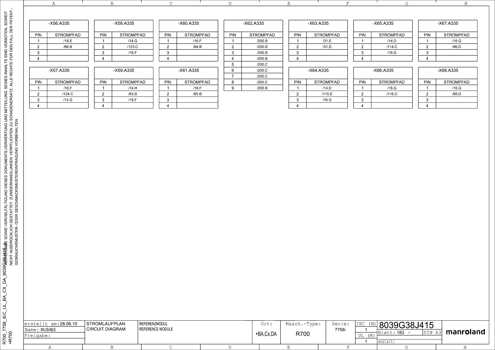

# +BA_Cx_DA — Sheet 183 of 247 — REFERENZMODUL

**REFERENCE MODULE**

> Part of the manroland **R700** printing press IEC/UL circuit diagrams.
> Drawing class: **Stromlaufplan / Circuit diagram** (DIN A3).
> Document `+BA_Cx_DA` covers the **Printing units / main switch cabinet** machine section.

## At a glance

| Field | Value |
|---|---|
| Document | `+BA_Cx_DA`  (8039G38J415) |
| Sheet | **183** of 247 |
| Section (DE) | REFERENZMODUL |
| Section (EN) | REFERENCE MODULE |
| Section type | REFERENCE_MODULE — Reference module |
| Machine type | `R700` |
| Series | `7758` |
| Created | 28.06.10 |
| Replaces | — |
| Columns used | A, B, C, D, E, F, G, H |
| Path numbers | — |
| Labels on sheet | 134 |
| Cross-refs out | 38 |
| Cross-refs in | 0 |

**Previous:** [+BA_Cx_DA sheet 182](SHEET_0182.md) · **Next:** [+BA_Cx_DA sheet 184](SHEET_0184.md) · **Document TOC:** [_TOC.md](_TOC.md)  (+BA_Cx_DA) · **Master TOC:** [all sheets](../_MASTER_TOC.md)

## Sheet image (300 DPI, exact vector render)



_Rendered directly from the PDF vector layer at 300 DPI (1-bit), no OCR and no resampling. Use it to confirm anything ambiguous in the text below._

## Cross-references on this sheet

Each entry is a wire leaving this sheet. The printed token is `/sheet.column`; the link resolves to that sheet inside the same document.

| Ref | Target sheet | Col | Path | Destination on target | Target section | From col |
|---|---|---|---|---|---|---|
| `/16.E` | [+BA_Cx_DA sheet 16](SHEET_0016.md) | E | — | — | SPANNUNGSVERSORGUNG, SCHALTSCHRANKBELÜFTUNG | A |
| `/31.E` | [+BA_Cx_DA sheet 31](SHEET_0031.md) | E | — | — | BUSVERBINDUNGEN: SIGNALSCHLEIFE | F |
| `/16.F` | [+BA_Cx_DA sheet 16](SHEET_0016.md) | F | — | — | SPANNUNGSVERSORGUNG, SCHALTSCHRANKBELÜFTUNG | C |
| `/14.G` | [+BA_Cx_DA sheet 14](SHEET_0014.md) | G | — | — | SPANNUNGSVERSORGUNG, SCHALTSCHRANKBELÜFTUNG | B |
| `/200.B` | [+BA_Cx_DA sheet 200](SHEET_0200.md) | B | — | — | OPTION: APL | E |
| `/16.G` | [+BA_Cx_DA sheet 16](SHEET_0016.md) | G | — | — | SPANNUNGSVERSORGUNG, SCHALTSCHRANKBELÜFTUNG | H |
| `/14.D` | [+BA_Cx_DA sheet 14](SHEET_0014.md) | D | — | — | SPANNUNGSVERSORGUNG, SCHALTSCHRANKBELÜFTUNG | G |
| `/66.B` | [+BA_Cx_DA sheet 66](SHEET_0066.md) | B | — | — | TRENNBLÄSER | A |
| `/84.B` | [+BA_Cx_DA sheet 84](SHEET_0084.md) | B | — | — | FARBWERK | C |
| `/200.B` | [+BA_Cx_DA sheet 200](SHEET_0200.md) | B | — | — | OPTION: APL | E |
| `/31.D` | [+BA_Cx_DA sheet 31](SHEET_0031.md) | D | — | — | BUSVERBINDUNGEN: SIGNALSCHLEIFE | F |
| `/66.D` | [+BA_Cx_DA sheet 66](SHEET_0066.md) | D | — | — | TRENNBLÄSER | H |
| `/123.C` | [+BA_Cx_DA sheet 123](SHEET_0123.md) | C | — | — | RESERVE: SPS STATION (INPUT) | B |
| `/114.C` | [+BA_Cx_DA sheet 114](SHEET_0114.md) | C | — | — | PPL 2 | G |
| `/16.F` | [+BA_Cx_DA sheet 16](SHEET_0016.md) | F | — | — | SPANNUNGSVERSORGUNG, SCHALTSCHRANKBELÜFTUNG | B |
| `/200.B` | [+BA_Cx_DA sheet 200](SHEET_0200.md) | B | — | — | OPTION: APL | E |
| `/16.G` | [+BA_Cx_DA sheet 16](SHEET_0016.md) | G | — | — | SPANNUNGSVERSORGUNG, SCHALTSCHRANKBELÜFTUNG | G |
| `/200.B` | [+BA_Cx_DA sheet 200](SHEET_0200.md) | B | — | — | OPTION: APL | E |
| `/200.C` | [+BA_Cx_DA sheet 200](SHEET_0200.md) | C | — | — | OPTION: APL | E |
| `/200.C` | [+BA_Cx_DA sheet 200](SHEET_0200.md) | C | — | — | OPTION: APL | E |
| `/200.C` | [+BA_Cx_DA sheet 200](SHEET_0200.md) | C | — | — | OPTION: APL | E |
| `/200.C` | [+BA_Cx_DA sheet 200](SHEET_0200.md) | C | — | — | OPTION: APL | E |
| `/16.F` | [+BA_Cx_DA sheet 16](SHEET_0016.md) | F | — | — | SPANNUNGSVERSORGUNG, SCHALTSCHRANKBELÜFTUNG | A |
| `/16.F` | [+BA_Cx_DA sheet 16](SHEET_0016.md) | F | — | — | SPANNUNGSVERSORGUNG, SCHALTSCHRANKBELÜFTUNG | C |
| `/200.B` | [+BA_Cx_DA sheet 200](SHEET_0200.md) | B | — | — | OPTION: APL | E |
| `/16.G` | [+BA_Cx_DA sheet 16](SHEET_0016.md) | G | — | — | SPANNUNGSVERSORGUNG, SCHALTSCHRANKBELÜFTUNG | G |
| `/16.G` | [+BA_Cx_DA sheet 16](SHEET_0016.md) | G | — | — | SPANNUNGSVERSORGUNG, SCHALTSCHRANKBELÜFTUNG | H |
| `/14.H` | [+BA_Cx_DA sheet 14](SHEET_0014.md) | H | — | — | SPANNUNGSVERSORGUNG, SCHALTSCHRANKBELÜFTUNG | B |
| `/14.D` | [+BA_Cx_DA sheet 14](SHEET_0014.md) | D | — | — | SPANNUNGSVERSORGUNG, SCHALTSCHRANKBELÜFTUNG | F |
| `/83.B` | [+BA_Cx_DA sheet 83](SHEET_0083.md) | B | — | — | FARBWERK | B |
| `/65.B` | [+BA_Cx_DA sheet 65](SHEET_0065.md) | B | — | — | DRUCKANSTELLUNG | C |
| `/115.E` | [+BA_Cx_DA sheet 115](SHEET_0115.md) | E | — | — | PPL 2 | F |
| `/65.D` | [+BA_Cx_DA sheet 65](SHEET_0065.md) | D | — | — | DRUCKANSTELLUNG | H |
| `/124.C` | [+BA_Cx_DA sheet 124](SHEET_0124.md) | C | — | — | RESERVE: SPS STATION (INPUT) | A |
| `/116.D` | [+BA_Cx_DA sheet 116](SHEET_0116.md) | D | — | — | PPL 2 | G |
| `/14.G` | [+BA_Cx_DA sheet 14](SHEET_0014.md) | G | — | — | SPANNUNGSVERSORGUNG, SCHALTSCHRANKBELÜFTUNG | A |
| `/16.F` | [+BA_Cx_DA sheet 16](SHEET_0016.md) | F | — | — | SPANNUNGSVERSORGUNG, SCHALTSCHRANKBELÜFTUNG | B |
| `/16.G` | [+BA_Cx_DA sheet 16](SHEET_0016.md) | G | — | — | SPANNUNGSVERSORGUNG, SCHALTSCHRANKBELÜFTUNG | F |

## Devices on this sheet

| Tag | Class | Class meaning (IEC) | Col | Sub | Terminal | Sign |
|---|---|---|---|---|---|---|
| `X56.A335` | — | cross-device reference | A | — | — | — |
| `X57.A335` | — | cross-device reference | A | — | — | — |
| `X58.A335` | — | cross-device reference | B | — | — | — |
| `X59.A335` | — | cross-device reference | B | — | — | — |
| `X60.A335` | — | cross-device reference | C | — | — | — |
| `X61.A335` | — | cross-device reference | C | — | — | — |
| `X62.A335` | — | cross-device reference | D | — | — | — |
| `X63.A335` | — | cross-device reference | F | — | — | — |
| `X64.A335` | — | cross-device reference | F | — | — | — |
| `X65.A335` | — | cross-device reference | G | — | — | — |
| `X66.A335` | — | cross-device reference | G | — | — | — |
| `X67.A335` | — | cross-device reference | H | — | — | — |
| `X68.A335` | — | cross-device reference | H | — | — | — |

## Potentials / nets

_No named potentials on this sheet._

## Wire-end annotations (grouped as printed)

A wire that continues elsewhere is annotated with a small cluster: the destination description, the path/line number `#NN`, and the `/sheet.column` cross reference. Each row below is one such cluster exactly as it is grouped on the drawing.

| Col | Y | Path | Cross-ref | Text on the wire |
|---|---|---|---|---|
| A | 51.3 | — | — | `X56.A335` |
| B | 51.3 | — | — | `X58.A335` |
| C | 51.3 | — | — | `X60.A335` |
| D | 51.3 | — | — | `X62.A335` |
| F | 51.3 | — | — | `X63.A335` |
| G | 51.3 | — | — | `X65.A335` |
| H | 51.3 | — | — | `X67.A335` |
| A | 80.0 | — | — | `PIN 2 3 4 1 STROMPFAD` |
| B | 80.0 | — | — | `PIN 2 3 4 1 STROMPFAD` |
| C | 80.0 | — | — | `PIN 2 3 4 1 STROMPFAD` |
| D | 80.0 | — | — | `PIN 2 3 4 5 6 7 8 9 1 STROMPFAD` |
| E | 80.0 | — | — | `PIN 2 3 4 1 STROMPFAD` |
| G | 80.0 | — | — | `PIN 2 3 4 1 STROMPFAD` |
| H | 80.0 | — | — | `PIN 2 3 4 1 STROMPFAD` |
| A | 94.5 | — | `/16.E` | — |
| B | 94.5 | — | `/14.G` | — |
| C | 94.5 | — | `/16.F` | — |
| E | 94.5 | — | `/200.B` | — |
| F | 94.5 | — | `/31.E` | — |
| G | 94.5 | — | `/14.D` | — |
| H | 94.5 | — | `/16.G` | — |
| A | 108.7 | — | `/66.B` | — |
| B | 108.7 | — | `/123.C` | — |
| C | 108.7 | — | `/84.B` | — |
| E | 108.7 | — | `/200.B` | — |
| F | 108.7 | — | `/31.D` | — |
| G | 108.7 | — | `/114.C` | — |
| H | 108.7 | — | `/66.D` | — |
| B | 122.9 | — | `/16.F` | — |
| E | 122.9 | — | `/200.B` | — |
| G | 122.9 | — | `/16.G` | — |
| E | 137.0 | — | `/200.B` | — |
| E | 151.2 | — | `/200.C` | — |
| A | 164.7 | — | — | `X57.A335` |
| B | 164.7 | — | — | `X59.A335` |
| C | 164.7 | — | — | `X61.A335` |
| F | 164.7 | — | — | `X64.A335` |
| G | 164.7 | — | — | `X66.A335` |
| H | 164.7 | — | — | `X68.A335` |
| E | 165.4 | — | `/200.C` | — |
| E | 179.6 | — | `/200.C` | — |
| A | 193.4 | — | — | `PIN 2 3 4 1 STROMPFAD` |
| B | 193.4 | — | — | `PIN 2 3 4 1 STROMPFAD` |
| C | 193.4 | — | — | `PIN 2 3 4 1 STROMPFAD` |
| E | 193.4 | — | — | `PIN 2 3 4 1 STROMPFAD` |
| G | 193.4 | — | — | `PIN 2 3 4 1 STROMPFAD` |
| H | 193.4 | — | — | `PIN 2 3 4 1 STROMPFAD` |
| E | 193.8 | — | `/200.C` | — |
| A | 207.9 | — | `/16.F` | — |
| B | 207.9 | — | `/14.H` | — |
| C | 207.9 | — | `/16.F` | — |
| E | 207.9 | — | `/200.B` | — |
| F | 207.9 | — | `/14.D` | — |
| G | 207.9 | — | `/16.G` | — |
| H | 207.9 | — | `/16.G` | — |
| A | 222.1 | — | `/124.C` | — |
| B | 222.1 | — | `/83.B` | — |
| C | 222.1 | — | `/65.B` | — |
| F | 222.1 | — | `/115.E` | — |
| G | 222.1 | — | `/116.D` | — |
| H | 222.1 | — | `/65.D` | — |
| A | 236.2 | — | `/14.G` | — |
| B | 236.2 | — | `/16.F` | — |
| F | 236.2 | — | `/16.G` | — |


## Reconstructed tables

This sheet carries tabular content (pin map / terminal assignment / index). The grid below was rebuilt from the drawing's own rule lines, so each row is exactly one physical row of the table.

### Table 1 — 10 data rows × 2 columns (at x=70.9, y=48.2) — **X56.A335**

| PIN | STROMPFAD |
|---|---|
| `1` | `/16.E` |
| `2` | `/66.B` |
| `3` |  |
| `4` |  |
|  | `X57.A335` |
| `PIN` | `STROMPFAD` |
| `1` | `/16.F` |
| `2` | `/124.C` |
| `3` | `/14.G` |
| `4` |  |


### Table 2 — 10 data rows × 2 columns (at x=226.8, y=48.2) — **X58.A335**

| PIN | STROMPFAD |
|---|---|
| `1` | `/14.G` |
| `2` | `/123.C` |
| `3` | `/16.F` |
| `4` |  |
|  | `X59.A335` |
| `PIN` | `STROMPFAD` |
| `1` | `/14.H` |
| `2` | `/83.B` |
| `3` | `/16.F` |
| `4` |  |


### Table 3 — 10 data rows × 2 columns (at x=382.7, y=48.2) — **X60.A335**

| PIN | STROMPFAD |
|---|---|
| `1` | `/16.F` |
| `2` | `/84.B` |
| `3` |  |
| `4` |  |
|  | `X61.A335` |
| `PIN` | `STROMPFAD` |
| `1` | `/16.F` |
| `2` | `/65.B` |
| `3` |  |
| `4` |  |


### Table 4 — 9 data rows × 2 columns (at x=538.6, y=48.2) — **X62.A335**

| PIN | STROMPFAD |
|---|---|
| `1` | `/200.B` |
| `2` | `/200.B` |
| `3` | `/200.B` |
| `4` | `/200.B` |
| `5` | `/200.C` |
| `6` | `/200.C` |
| `7` | `/200.C` |
| `8` | `/200.C` |
| `9` | `/200.B` |


### Table 5 — 10 data rows × 2 columns (at x=694.5, y=48.2) — **X63.A335**

| PIN | STROMPFAD |
|---|---|
| `1` | `/31.E` |
| `2` | `/31.D` |
| `3` |  |
| `4` |  |
|  | `X64.A335` |
| `PIN` | `STROMPFAD` |
| `1` | `/14.D` |
| `2` | `/115.E` |
| `3` | `/16.G` |
| `4` |  |


### Table 6 — 10 data rows × 2 columns (at x=850.4, y=48.2) — **X65.A335**

| PIN | STROMPFAD |
|---|---|
| `1` | `/14.D` |
| `2` | `/114.C` |
| `3` | `/16.G` |
| `4` |  |
|  | `X66.A335` |
| `PIN` | `STROMPFAD` |
| `1` | `/16.G` |
| `2` | `/116.D` |
| `3` |  |
| `4` |  |


### Table 7 — 10 data rows × 2 columns (at x=1006.3, y=48.2) — **X67.A335**

| PIN | STROMPFAD |
|---|---|
| `1` | `/16.G` |
| `2` | `/66.D` |
| `3` |  |
| `4` |  |
|  | `X68.A335` |
| `PIN` | `STROMPFAD` |
| `1` | `/16.G` |
| `2` | `/65.D` |
| `3` |  |
| `4` |  |


## Notes and free text on this sheet

| Text | Col | Y (pt) |
|---|---|---|
| `PIN` | A | 80.02 |
| `STROMPFAD` | A | 79.98 |
| `PIN` | B | 80.02 |
| `STROMPFAD` | B | 79.98 |
| `PIN` | C | 80.02 |
| `STROMPFAD` | C | 79.98 |
| `PIN` | D | 80.02 |
| `STROMPFAD` | E | 79.98 |
| `PIN` | E | 80.02 |
| `STROMPFAD` | F | 79.98 |
| `PIN` | F | 80.02 |
| `STROMPFAD` | G | 79.98 |
| `PIN` | G | 80.02 |
| `STROMPFAD` | H | 79.98 |

## Complete label inventory (exact text from the drawing)

Every text object inside the drawing area of this sheet, in DIN reading order (column A→H, then top→bottom). This is the authoritative list: if a string is not here it is not printed on this sheet.

| Col | Y | X | Dir | Type | Text |
|---|---|---|---|---|---|
| A | 51.3 | 116.8 | → | device ref | `X56.A335` |
| A | 80.0 | 84.0 | → | text | `PIN` |
| A | 80.0 | 132.2 | → | text | `STROMPFAD` |
| A | 94.2 | 90.0 | → | number | `1` |
| A | 94.5 | 152.9 | → | cross-reference | `/16.E` |
| A | 108.4 | 89.4 | → | number | `2` |
| A | 108.7 | 152.8 | → | cross-reference | `/66.B` |
| A | 122.5 | 89.4 | → | number | `3` |
| A | 136.7 | 89.4 | → | number | `4` |
| A | 164.7 | 116.8 | → | device ref | `X57.A335` |
| A | 193.4 | 84.0 | → | text | `PIN` |
| A | 193.4 | 132.2 | → | text | `STROMPFAD` |
| A | 207.6 | 90.0 | → | number | `1` |
| A | 207.9 | 153.1 | → | cross-reference | `/16.F` |
| A | 221.8 | 89.4 | → | number | `2` |
| A | 222.1 | 150.2 | → | cross-reference | `/124.C` |
| A | 235.9 | 89.4 | → | number | `3` |
| A | 236.3 | 152.5 | → | cross-reference | `/14.G` |
| A | 250.1 | 89.4 | → | number | `4` |
| B | 51.3 | 272.7 | → | device ref | `X58.A335` |
| B | 80.0 | 240.0 | → | text | `PIN` |
| B | 80.0 | 288.1 | → | text | `STROMPFAD` |
| B | 94.2 | 245.9 | → | number | `1` |
| B | 94.5 | 308.4 | → | cross-reference | `/14.G` |
| B | 108.4 | 245.3 | → | number | `2` |
| B | 108.7 | 306.1 | → | cross-reference | `/123.C` |
| B | 122.5 | 245.3 | → | number | `3` |
| B | 122.9 | 309.0 | → | cross-reference | `/16.F` |
| B | 136.7 | 245.3 | → | number | `4` |
| B | 164.7 | 272.7 | → | device ref | `X59.A335` |
| B | 193.4 | 240.0 | → | text | `PIN` |
| B | 193.4 | 288.1 | → | text | `STROMPFAD` |
| B | 207.6 | 245.9 | → | number | `1` |
| B | 207.9 | 308.8 | → | cross-reference | `/14.H` |
| B | 221.8 | 245.3 | → | number | `2` |
| B | 222.1 | 308.7 | → | cross-reference | `/83.B` |
| B | 235.9 | 245.3 | → | number | `3` |
| B | 236.2 | 309.0 | → | cross-reference | `/16.F` |
| B | 250.1 | 245.3 | → | number | `4` |
| C | 51.3 | 428.6 | → | device ref | `X60.A335` |
| C | 80.0 | 395.9 | → | text | `PIN` |
| C | 80.0 | 444.0 | → | text | `STROMPFAD` |
| C | 94.2 | 401.8 | → | number | `1` |
| C | 94.5 | 464.9 | → | cross-reference | `/16.F` |
| C | 108.4 | 401.2 | → | number | `2` |
| C | 108.7 | 464.6 | → | cross-reference | `/84.B` |
| C | 122.5 | 401.2 | → | number | `3` |
| C | 136.7 | 401.2 | → | number | `4` |
| C | 164.7 | 428.6 | → | device ref | `X61.A335` |
| C | 193.4 | 395.9 | → | text | `PIN` |
| C | 193.4 | 444.0 | → | text | `STROMPFAD` |
| C | 207.6 | 401.8 | → | number | `1` |
| C | 207.9 | 464.9 | → | cross-reference | `/16.F` |
| C | 221.8 | 401.2 | → | number | `2` |
| C | 222.1 | 464.6 | → | cross-reference | `/65.B` |
| C | 235.9 | 401.2 | → | number | `3` |
| C | 250.1 | 401.2 | → | number | `4` |
| D | 51.3 | 584.5 | → | device ref | `X62.A335` |
| D | 80.0 | 551.8 | → | text | `PIN` |
| D | 94.2 | 557.7 | → | number | `1` |
| D | 108.4 | 557.1 | → | number | `2` |
| D | 122.5 | 557.1 | → | number | `3` |
| D | 136.7 | 557.1 | → | number | `4` |
| D | 150.9 | 557.1 | → | number | `5` |
| D | 165.1 | 557.1 | → | number | `6` |
| D | 179.2 | 557.1 | → | number | `7` |
| D | 193.4 | 557.1 | → | number | `8` |
| D | 207.6 | 557.1 | → | number | `9` |
| E | 80.0 | 600.0 | → | text | `STROMPFAD` |
| E | 80.0 | 707.7 | → | text | `PIN` |
| E | 94.2 | 713.6 | → | number | `1` |
| E | 94.5 | 618.1 | → | cross-reference | `/200.B` |
| E | 108.4 | 713.1 | → | number | `2` |
| E | 108.7 | 618.1 | → | cross-reference | `/200.B` |
| E | 122.5 | 713.1 | → | number | `3` |
| E | 122.9 | 618.1 | → | cross-reference | `/200.B` |
| E | 136.7 | 713.1 | → | number | `4` |
| E | 137.0 | 618.1 | → | cross-reference | `/200.B` |
| E | 151.2 | 618.0 | → | cross-reference | `/200.C` |
| E | 165.4 | 618.0 | → | cross-reference | `/200.C` |
| E | 179.6 | 618.0 | → | cross-reference | `/200.C` |
| E | 193.4 | 707.7 | → | text | `PIN` |
| E | 193.8 | 618.0 | → | cross-reference | `/200.C` |
| E | 207.6 | 713.6 | → | number | `1` |
| E | 207.9 | 618.1 | → | cross-reference | `/200.B` |
| E | 221.8 | 713.1 | → | number | `2` |
| E | 235.9 | 713.1 | → | number | `3` |
| E | 250.1 | 713.1 | → | number | `4` |
| F | 51.3 | 740.4 | → | device ref | `X63.A335` |
| F | 80.0 | 755.9 | → | text | `STROMPFAD` |
| F | 80.0 | 863.6 | → | text | `PIN` |
| F | 94.2 | 869.5 | → | number | `1` |
| F | 94.5 | 776.6 | → | cross-reference | `/31.E` |
| F | 108.4 | 869.0 | → | number | `2` |
| F | 108.7 | 776.3 | → | cross-reference | `/31.D` |
| F | 122.5 | 869.0 | → | number | `3` |
| F | 136.7 | 869.0 | → | number | `4` |
| F | 164.7 | 740.4 | → | device ref | `X64.A335` |
| F | 193.4 | 755.9 | → | text | `STROMPFAD` |
| F | 193.4 | 863.6 | → | text | `PIN` |
| F | 207.6 | 869.5 | → | number | `1` |
| F | 207.9 | 776.3 | → | cross-reference | `/14.D` |
| F | 221.8 | 869.0 | → | number | `2` |
| F | 222.1 | 774.1 | → | cross-reference | `/115.E` |
| F | 235.9 | 869.0 | → | number | `3` |
| F | 236.3 | 776.1 | → | cross-reference | `/16.G` |
| F | 250.1 | 869.0 | → | number | `4` |
| G | 51.3 | 896.3 | → | device ref | `X65.A335` |
| G | 80.0 | 911.8 | → | text | `STROMPFAD` |
| G | 80.0 | 1019.5 | → | text | `PIN` |
| G | 94.2 | 1025.4 | → | number | `1` |
| G | 94.5 | 932.2 | → | cross-reference | `/14.D` |
| G | 108.4 | 1024.9 | → | number | `2` |
| G | 108.7 | 929.8 | → | cross-reference | `/114.C` |
| G | 122.5 | 1024.9 | → | number | `3` |
| G | 122.9 | 932.0 | → | cross-reference | `/16.G` |
| G | 136.7 | 1024.9 | → | number | `4` |
| G | 164.7 | 896.3 | → | device ref | `X66.A335` |
| G | 193.4 | 911.8 | → | text | `STROMPFAD` |
| G | 193.4 | 1019.5 | → | text | `PIN` |
| G | 207.6 | 1025.4 | → | number | `1` |
| G | 207.9 | 932.0 | → | cross-reference | `/16.G` |
| G | 221.8 | 1024.9 | → | number | `2` |
| G | 222.1 | 929.8 | → | cross-reference | `/116.D` |
| G | 235.9 | 1024.9 | → | number | `3` |
| G | 250.1 | 1024.9 | → | number | `4` |
| H | 51.3 | 1052.2 | → | device ref | `X67.A335` |
| H | 80.0 | 1067.7 | → | text | `STROMPFAD` |
| H | 94.5 | 1087.9 | → | cross-reference | `/16.G` |
| H | 108.7 | 1088.1 | → | cross-reference | `/66.D` |
| H | 164.7 | 1052.2 | → | device ref | `X68.A335` |
| H | 193.4 | 1067.7 | → | text | `STROMPFAD` |
| H | 207.9 | 1087.9 | → | cross-reference | `/16.G` |
| H | 222.1 | 1088.1 | → | cross-reference | `/65.D` |

## Reading-order text block

The same content as a plain block, grouped by DIN column — convenient to paste or to match against a visual description.

```text
=== Column A ===
  51.3  116.8  devref       X56.A335
  80.0   84.0  text         PIN
  80.0  132.2  text         STROMPFAD
  94.2   90.0  numeric      1
  94.5  152.9  xref         /16.E
 108.4   89.4  numeric      2
 108.7  152.8  xref         /66.B
 122.5   89.4  numeric      3
 136.7   89.4  numeric      4
 164.7  116.8  devref       X57.A335
 193.4   84.0  text         PIN
 193.4  132.2  text         STROMPFAD
 207.6   90.0  numeric      1
 207.9  153.1  xref         /16.F
 221.8   89.4  numeric      2
 222.1  150.2  xref         /124.C
 235.9   89.4  numeric      3
 236.3  152.5  xref         /14.G
 250.1   89.4  numeric      4
=== Column B ===
  51.3  272.7  devref       X58.A335
  80.0  240.0  text         PIN
  80.0  288.1  text         STROMPFAD
  94.2  245.9  numeric      1
  94.5  308.4  xref         /14.G
 108.4  245.3  numeric      2
 108.7  306.1  xref         /123.C
 122.5  245.3  numeric      3
 122.9  309.0  xref         /16.F
 136.7  245.3  numeric      4
 164.7  272.7  devref       X59.A335
 193.4  240.0  text         PIN
 193.4  288.1  text         STROMPFAD
 207.6  245.9  numeric      1
 207.9  308.8  xref         /14.H
 221.8  245.3  numeric      2
 222.1  308.7  xref         /83.B
 235.9  245.3  numeric      3
 236.2  309.0  xref         /16.F
 250.1  245.3  numeric      4
=== Column C ===
  51.3  428.6  devref       X60.A335
  80.0  395.9  text         PIN
  80.0  444.0  text         STROMPFAD
  94.2  401.8  numeric      1
  94.5  464.9  xref         /16.F
 108.4  401.2  numeric      2
 108.7  464.6  xref         /84.B
 122.5  401.2  numeric      3
 136.7  401.2  numeric      4
 164.7  428.6  devref       X61.A335
 193.4  395.9  text         PIN
 193.4  444.0  text         STROMPFAD
 207.6  401.8  numeric      1
 207.9  464.9  xref         /16.F
 221.8  401.2  numeric      2
 222.1  464.6  xref         /65.B
 235.9  401.2  numeric      3
 250.1  401.2  numeric      4
=== Column D ===
  51.3  584.5  devref       X62.A335
  80.0  551.8  text         PIN
  94.2  557.7  numeric      1
 108.4  557.1  numeric      2
 122.5  557.1  numeric      3
 136.7  557.1  numeric      4
 150.9  557.1  numeric      5
 165.1  557.1  numeric      6
 179.2  557.1  numeric      7
 193.4  557.1  numeric      8
 207.6  557.1  numeric      9
=== Column E ===
  80.0  600.0  text         STROMPFAD
  80.0  707.7  text         PIN
  94.2  713.6  numeric      1
  94.5  618.1  xref         /200.B
 108.4  713.1  numeric      2
 108.7  618.1  xref         /200.B
 122.5  713.1  numeric      3
 122.9  618.1  xref         /200.B
 136.7  713.1  numeric      4
 137.0  618.1  xref         /200.B
 151.2  618.0  xref         /200.C
 165.4  618.0  xref         /200.C
 179.6  618.0  xref         /200.C
 193.4  707.7  text         PIN
 193.8  618.0  xref         /200.C
 207.6  713.6  numeric      1
 207.9  618.1  xref         /200.B
 221.8  713.1  numeric      2
 235.9  713.1  numeric      3
 250.1  713.1  numeric      4
=== Column F ===
  51.3  740.4  devref       X63.A335
  80.0  755.9  text         STROMPFAD
  80.0  863.6  text         PIN
  94.2  869.5  numeric      1
  94.5  776.6  xref         /31.E
 108.4  869.0  numeric      2
 108.7  776.3  xref         /31.D
 122.5  869.0  numeric      3
 136.7  869.0  numeric      4
 164.7  740.4  devref       X64.A335
 193.4  755.9  text         STROMPFAD
 193.4  863.6  text         PIN
 207.6  869.5  numeric      1
 207.9  776.3  xref         /14.D
 221.8  869.0  numeric      2
 222.1  774.1  xref         /115.E
 235.9  869.0  numeric      3
 236.3  776.1  xref         /16.G
 250.1  869.0  numeric      4
=== Column G ===
  51.3  896.3  devref       X65.A335
  80.0  911.8  text         STROMPFAD
  80.0 1019.5  text         PIN
  94.2 1025.4  numeric      1
  94.5  932.2  xref         /14.D
 108.4 1024.9  numeric      2
 108.7  929.8  xref         /114.C
 122.5 1024.9  numeric      3
 122.9  932.0  xref         /16.G
 136.7 1024.9  numeric      4
 164.7  896.3  devref       X66.A335
 193.4  911.8  text         STROMPFAD
 193.4 1019.5  text         PIN
 207.6 1025.4  numeric      1
 207.9  932.0  xref         /16.G
 221.8 1024.9  numeric      2
 222.1  929.8  xref         /116.D
 235.9 1024.9  numeric      3
 250.1 1024.9  numeric      4
=== Column H ===
  51.3 1052.2  devref       X67.A335
  80.0 1067.7  text         STROMPFAD
  94.5 1087.9  xref         /16.G
 108.7 1088.1  xref         /66.D
 164.7 1052.2  devref       X68.A335
 193.4 1067.7  text         STROMPFAD
 207.9 1087.9  xref         /16.G
 222.1 1088.1  xref         /65.D
```

---
_Generated from the PDF vector text layer; no OCR. Source: `R700_7758_IEC_UL_BA_CX_DA_8039G38J415_p`, sheet 183._
