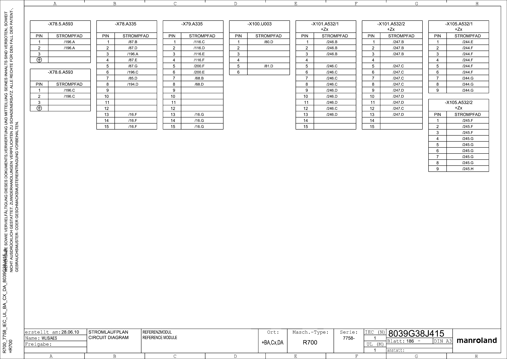

# +BA_Cx_DA — Sheet 186 of 247 — REFERENZMODUL

**REFERENCE MODULE**

> Part of the manroland **R700** printing press IEC/UL circuit diagrams.
> Drawing class: **Stromlaufplan / Circuit diagram** (DIN A3).
> Document `+BA_Cx_DA` covers the **Printing units / main switch cabinet** machine section.

## At a glance

| Field | Value |
|---|---|
| Document | `+BA_Cx_DA`  (8039G38J415) |
| Sheet | **186** of 247 |
| Section (DE) | REFERENZMODUL |
| Section (EN) | REFERENCE MODULE |
| Section type | REFERENCE_MODULE — Reference module |
| Machine type | `R700` |
| Series | `7758` |
| Created | 28.06.10 |
| Replaces | — |
| Columns used | A, B, C, D, E, F, G, H |
| Path numbers | — |
| Labels on sheet | 191 |
| Cross-refs out | 70 |
| Cross-refs in | 0 |

**Previous:** [+BA_Cx_DA sheet 185](SHEET_0185.md) · **Next:** [+BA_Cx_DA sheet 187](SHEET_0187.md) · **Document TOC:** [_TOC.md](_TOC.md)  (+BA_Cx_DA) · **Master TOC:** [all sheets](../_MASTER_TOC.md)

## Sheet image (300 DPI, exact vector render)



_Rendered directly from the PDF vector layer at 300 DPI (1-bit), no OCR and no resampling. Use it to confirm anything ambiguous in the text below._

## Cross-references on this sheet

Each entry is a wire leaving this sheet. The printed token is `/sheet.column`; the link resolves to that sheet inside the same document.

| Ref | Target sheet | Col | Path | Destination on target | Target section | From col |
|---|---|---|---|---|---|---|
| `/87.B` | [+BA_Cx_DA sheet 87](SHEET_0087.md) | B | — | — | WASCHVORRICHTUNG | B |
| `/196.A` | [+BA_Cx_DA sheet 196](SHEET_0196.md) | A | — | — | OPTION: WASCHVORRICHTUNG MIT BÜRSTE | A |
| `/246.B` | [+BA_Cx_DA sheet 246](SHEET_0246.md) | B | — | — | OPTION: INLINE COLORPILOT (ICP) | F |
| `/247.B` | [+BA_Cx_DA sheet 247](SHEET_0247.md) | B | — | — | OPTION: INLINE COLORPILOT (ICP) | G |
| `/244.E` | [+BA_Cx_DA sheet 244](SHEET_0244.md) | E | — | — | OPTION: INLINE COLORPILOT (ICP) | H |
| `/80.D` | [+BA_Cx_DA sheet 80](SHEET_0080.md) | D | — | — | FARBWERK | E |
| `/116.C` | [+BA_Cx_DA sheet 116](SHEET_0116.md) | C | — | — | PPL 2 | C |
| `/196.A` | [+BA_Cx_DA sheet 196](SHEET_0196.md) | A | — | — | OPTION: WASCHVORRICHTUNG MIT BÜRSTE | A |
| `/246.B` | [+BA_Cx_DA sheet 246](SHEET_0246.md) | B | — | — | OPTION: INLINE COLORPILOT (ICP) | F |
| `/247.B` | [+BA_Cx_DA sheet 247](SHEET_0247.md) | B | — | — | OPTION: INLINE COLORPILOT (ICP) | G |
| `/244.F` | [+BA_Cx_DA sheet 244](SHEET_0244.md) | F | — | — | OPTION: INLINE COLORPILOT (ICP) | H |
| `/87.D` | [+BA_Cx_DA sheet 87](SHEET_0087.md) | D | — | — | WASCHVORRICHTUNG | B |
| `/116.D` | [+BA_Cx_DA sheet 116](SHEET_0116.md) | D | — | — | PPL 2 | C |
| `/196.A` | [+BA_Cx_DA sheet 196](SHEET_0196.md) | A | — | — | OPTION: WASCHVORRICHTUNG MIT BÜRSTE | B |
| `/116.E` | [+BA_Cx_DA sheet 116](SHEET_0116.md) | E | — | — | PPL 2 | C |
| `/246.B` | [+BA_Cx_DA sheet 246](SHEET_0246.md) | B | — | — | OPTION: INLINE COLORPILOT (ICP) | F |
| `/247.B` | [+BA_Cx_DA sheet 247](SHEET_0247.md) | B | — | — | OPTION: INLINE COLORPILOT (ICP) | G |
| `/244.F` | [+BA_Cx_DA sheet 244](SHEET_0244.md) | F | — | — | OPTION: INLINE COLORPILOT (ICP) | H |
| `/87.E` | [+BA_Cx_DA sheet 87](SHEET_0087.md) | E | — | — | WASCHVORRICHTUNG | B |
| `/116.F` | [+BA_Cx_DA sheet 116](SHEET_0116.md) | F | — | — | PPL 2 | C |
| `/244.F` | [+BA_Cx_DA sheet 244](SHEET_0244.md) | F | — | — | OPTION: INLINE COLORPILOT (ICP) | H |
| `/87.G` | [+BA_Cx_DA sheet 87](SHEET_0087.md) | G | — | — | WASCHVORRICHTUNG | B |
| `/200.F` | [+BA_Cx_DA sheet 200](SHEET_0200.md) | F | — | — | OPTION: APL | C |
| `/244.F` | [+BA_Cx_DA sheet 244](SHEET_0244.md) | F | — | — | OPTION: INLINE COLORPILOT (ICP) | H |
| `/81.D` | [+BA_Cx_DA sheet 81](SHEET_0081.md) | D | — | — | FARBWERK | E |
| `/246.C` | [+BA_Cx_DA sheet 246](SHEET_0246.md) | C | — | — | OPTION: INLINE COLORPILOT (ICP) | F |
| `/247.C` | [+BA_Cx_DA sheet 247](SHEET_0247.md) | C | — | — | OPTION: INLINE COLORPILOT (ICP) | G |
| `/200.E` | [+BA_Cx_DA sheet 200](SHEET_0200.md) | E | — | — | OPTION: APL | C |
| `/244.F` | [+BA_Cx_DA sheet 244](SHEET_0244.md) | F | — | — | OPTION: INLINE COLORPILOT (ICP) | H |
| `/196.C` | [+BA_Cx_DA sheet 196](SHEET_0196.md) | C | — | — | OPTION: WASCHVORRICHTUNG MIT BÜRSTE | B |
| `/246.C` | [+BA_Cx_DA sheet 246](SHEET_0246.md) | C | — | — | OPTION: INLINE COLORPILOT (ICP) | F |
| `/247.C` | [+BA_Cx_DA sheet 247](SHEET_0247.md) | C | — | — | OPTION: INLINE COLORPILOT (ICP) | G |
| `/68.B` | [+BA_Cx_DA sheet 68](SHEET_0068.md) | B | — | — | SEITENMARKEN: ZIEHEN | C |
| `/85.D` | [+BA_Cx_DA sheet 85](SHEET_0085.md) | D | — | — | WASCHVORRICHTUNG | B |
| `/244.G` | [+BA_Cx_DA sheet 244](SHEET_0244.md) | G | — | — | OPTION: INLINE COLORPILOT (ICP) | H |
| `/246.C` | [+BA_Cx_DA sheet 246](SHEET_0246.md) | C | — | — | OPTION: INLINE COLORPILOT (ICP) | F |
| `/247.C` | [+BA_Cx_DA sheet 247](SHEET_0247.md) | C | — | — | OPTION: INLINE COLORPILOT (ICP) | G |
| `/244.G` | [+BA_Cx_DA sheet 244](SHEET_0244.md) | G | — | — | OPTION: INLINE COLORPILOT (ICP) | H |
| `/194.D` | [+BA_Cx_DA sheet 194](SHEET_0194.md) | D | — | — | OPTION: WASCHVORRICHTUNG MIT BÜRSTE | B |
| `/68.D` | [+BA_Cx_DA sheet 68](SHEET_0068.md) | D | — | — | SEITENMARKEN: ZIEHEN | C |
| `/246.C` | [+BA_Cx_DA sheet 246](SHEET_0246.md) | C | — | — | OPTION: INLINE COLORPILOT (ICP) | F |
| `/247.C` | [+BA_Cx_DA sheet 247](SHEET_0247.md) | C | — | — | OPTION: INLINE COLORPILOT (ICP) | G |
| `/244.G` | [+BA_Cx_DA sheet 244](SHEET_0244.md) | G | — | — | OPTION: INLINE COLORPILOT (ICP) | H |
| `/196.C` | [+BA_Cx_DA sheet 196](SHEET_0196.md) | C | — | — | OPTION: WASCHVORRICHTUNG MIT BÜRSTE | A |
| `/246.D` | [+BA_Cx_DA sheet 246](SHEET_0246.md) | D | — | — | OPTION: INLINE COLORPILOT (ICP) | F |
| `/247.D` | [+BA_Cx_DA sheet 247](SHEET_0247.md) | D | — | — | OPTION: INLINE COLORPILOT (ICP) | G |
| `/196.C` | [+BA_Cx_DA sheet 196](SHEET_0196.md) | C | — | — | OPTION: WASCHVORRICHTUNG MIT BÜRSTE | A |
| `/246.D` | [+BA_Cx_DA sheet 246](SHEET_0246.md) | D | — | — | OPTION: INLINE COLORPILOT (ICP) | F |
| `/247.D` | [+BA_Cx_DA sheet 247](SHEET_0247.md) | D | — | — | OPTION: INLINE COLORPILOT (ICP) | G |
| `/246.D` | [+BA_Cx_DA sheet 246](SHEET_0246.md) | D | — | — | OPTION: INLINE COLORPILOT (ICP) | F |
| `/247.D` | [+BA_Cx_DA sheet 247](SHEET_0247.md) | D | — | — | OPTION: INLINE COLORPILOT (ICP) | G |
| `/246.C` | [+BA_Cx_DA sheet 246](SHEET_0246.md) | C | — | — | OPTION: INLINE COLORPILOT (ICP) | F |
| `/247.C` | [+BA_Cx_DA sheet 247](SHEET_0247.md) | C | — | — | OPTION: INLINE COLORPILOT (ICP) | G |
| `/16.F` | [+BA_Cx_DA sheet 16](SHEET_0016.md) | F | — | — | SPANNUNGSVERSORGUNG, SCHALTSCHRANKBELÜFTUNG | B |
| `/16.G` | [+BA_Cx_DA sheet 16](SHEET_0016.md) | G | — | — | SPANNUNGSVERSORGUNG, SCHALTSCHRANKBELÜFTUNG | C |
| `/246.D` | [+BA_Cx_DA sheet 246](SHEET_0246.md) | D | — | — | OPTION: INLINE COLORPILOT (ICP) | F |
| `/247.D` | [+BA_Cx_DA sheet 247](SHEET_0247.md) | D | — | — | OPTION: INLINE COLORPILOT (ICP) | G |
| `/16.F` | [+BA_Cx_DA sheet 16](SHEET_0016.md) | F | — | — | SPANNUNGSVERSORGUNG, SCHALTSCHRANKBELÜFTUNG | B |
| `/16.G` | [+BA_Cx_DA sheet 16](SHEET_0016.md) | G | — | — | SPANNUNGSVERSORGUNG, SCHALTSCHRANKBELÜFTUNG | C |
| `/245.F` | [+BA_Cx_DA sheet 245](SHEET_0245.md) | F | — | — | OPTION: INLINE COLORPILOT (ICP) | H |
| `/16.F` | [+BA_Cx_DA sheet 16](SHEET_0016.md) | F | — | — | SPANNUNGSVERSORGUNG, SCHALTSCHRANKBELÜFTUNG | B |
| `/16.G` | [+BA_Cx_DA sheet 16](SHEET_0016.md) | G | — | — | SPANNUNGSVERSORGUNG, SCHALTSCHRANKBELÜFTUNG | C |
| `/245.F` | [+BA_Cx_DA sheet 245](SHEET_0245.md) | F | — | — | OPTION: INLINE COLORPILOT (ICP) | H |
| `/245.F` | [+BA_Cx_DA sheet 245](SHEET_0245.md) | F | — | — | OPTION: INLINE COLORPILOT (ICP) | H |
| `/245.G` | [+BA_Cx_DA sheet 245](SHEET_0245.md) | G | — | — | OPTION: INLINE COLORPILOT (ICP) | H |
| `/245.G` | [+BA_Cx_DA sheet 245](SHEET_0245.md) | G | — | — | OPTION: INLINE COLORPILOT (ICP) | H |
| `/245.G` | [+BA_Cx_DA sheet 245](SHEET_0245.md) | G | — | — | OPTION: INLINE COLORPILOT (ICP) | H |
| `/245.G` | [+BA_Cx_DA sheet 245](SHEET_0245.md) | G | — | — | OPTION: INLINE COLORPILOT (ICP) | H |
| `/245.G` | [+BA_Cx_DA sheet 245](SHEET_0245.md) | G | — | — | OPTION: INLINE COLORPILOT (ICP) | H |
| `/245.H` | [+BA_Cx_DA sheet 245](SHEET_0245.md) | H | — | — | OPTION: INLINE COLORPILOT (ICP) | H |

## Devices on this sheet

| Tag | Class | Class meaning (IEC) | Col | Sub | Terminal | Sign |
|---|---|---|---|---|---|---|
| `X78.5.A593` | — | cross-device reference | A | — | — | — |
| `X78.6.A593` | — | cross-device reference | A | — | — | — |
| `X78.A335` | — | cross-device reference | B | — | — | — |
| `X79.A335` | — | cross-device reference | C | — | — | — |
| `X100.U003` | — | cross-device reference | D | — | — | — |

## Potentials / nets

_No named potentials on this sheet._

## Wire-end annotations (grouped as printed)

A wire that continues elsewhere is annotated with a small cluster: the destination description, the path/line number `#NN`, and the `/sheet.column` cross reference. Each row below is one such cluster exactly as it is grouped on the drawing.

| Col | Y | Path | Cross-ref | Text on the wire |
|---|---|---|---|---|
| A | 51.3 | — | — | `X78.5.A593` |
| B | 51.3 | — | — | `X78.A335` |
| C | 51.3 | — | — | `X79.A335` |
| D | 51.3 | — | — | `X100.U003` |
| E | 51.3 | — | — | `X101.A532/1` |
| G | 51.3 | — | — | `X101.A532/2` |
| H | 51.3 | — | — | `X105.A532/1` |
| E | 64.1 | — | — | `+Zx` |
| G | 64.1 | — | — | `+Zx` |
| H | 64.1 | — | — | `+Zx` |
| A | 80.0 | — | — | `PIN 2 3 1 STROMPFAD` |
| B | 80.0 | — | — | `PIN 10 12 13 14 15 11 2 3 4 5 6 7 8 9 1 STROMPFAD` |
| C | 80.0 | — | — | `PIN 10 12 13 14 15 11 2 3 4 5 6 7 8 9 1 STROMPFAD` |
| D | 80.0 | — | — | `PIN 2 3 4 5 6 1 STROMPFAD` |
| E | 80.0 | — | — | `PIN 10 12 13 14 15 11 2 3 4 5 6 7 8 9 1 STROMPFAD` |
| G | 80.0 | — | — | `PIN 10 12 13 14 15 11 2 3 4 5 6 7 8 9 1 STROMPFAD` |
| H | 80.0 | — | — | `PIN 2 3 4 5 6 7 8 9 1 STROMPFAD` |
| A | 94.5 | — | `/196.A` | — |
| B | 94.5 | — | `/87.B` | — |
| C | 94.5 | — | `/116.C` | — |
| E | 94.5 | — | `/80.D` | — |
| F | 94.5 | — | `/246.B` | — |
| G | 94.5 | — | `/247.B` | — |
| H | 94.5 | — | `/244.E` | — |
| A | 108.7 | — | `/196.A` | — |
| B | 108.7 | — | `/87.D` | — |
| C | 108.7 | — | `/116.D` | — |
| F | 108.7 | — | `/246.B` | — |
| G | 108.7 | — | `/247.B` | — |
| H | 108.7 | — | `/244.F` | — |
| B | 122.9 | — | `/196.A` | — |
| C | 122.9 | — | `/116.E` | — |
| F | 122.9 | — | `/246.B` | — |
| G | 122.9 | — | `/247.B` | — |
| H | 122.9 | — | `/244.F` | — |
| B | 137.0 | — | `/87.E` | — |
| C | 137.0 | — | `/116.F` | — |
| H | 137.0 | — | `/244.F` | — |
| B | 151.2 | — | `/87.G` | — |
| C | 151.2 | — | `/200.F` | — |
| E | 151.2 | — | `/81.D` | — |
| F | 151.2 | — | `/246.C` | — |
| G | 151.2 | — | `/247.C` | — |
| H | 151.2 | — | `/244.F` | — |
| A | 164.7 | — | — | `X78.6.A593` |
| B | 165.4 | — | `/196.C` | — |
| C | 165.4 | — | `/200.E` | — |
| F | 165.4 | — | `/246.C` | — |
| G | 165.4 | — | `/247.C` | — |
| H | 165.4 | — | `/244.F` | — |
| C | 179.5 | — | `/68.B` | — |
| B | 179.6 | — | `/85.D` | — |
| F | 179.6 | — | `/246.C` | — |
| G | 179.6 | — | `/247.C` | — |
| H | 179.6 | — | `/244.G` | — |
| A | 193.4 | — | — | `PIN 2 3 1 STROMPFAD` |
| H | 193.7 | — | `/244.G` | — |
| B | 193.8 | — | `/194.D` | — |
| C | 193.8 | — | `/68.D` | — |
| F | 193.8 | — | `/246.C` | — |
| G | 193.8 | — | `/247.C` | — |
| A | 207.9 | — | `/196.C` | — |
| F | 207.9 | — | `/246.D` | — |
| G | 207.9 | — | `/247.D` | — |
| H | 207.9 | — | `/244.G` | — |
| A | 222.1 | — | `/196.C` | — |
| F | 222.1 | — | `/246.D` | — |
| G | 222.1 | — | `/247.D` | — |
| H | 235.6 | — | — | `X105.A532/2` |
| F | 236.3 | — | `/246.D` | — |
| G | 236.3 | — | `/247.D` | — |
| H | 248.4 | — | — | `+Zx` |
| F | 250.4 | — | `/246.C` | — |
| G | 250.4 | — | `/247.C` | — |
| H | 264.2 | — | — | `PIN 2 3 4 5 6 7 8 9 1 STROMPFAD` |
| B | 264.6 | — | `/16.F` | — |
| C | 264.6 | — | `/16.G` | — |
| F | 264.6 | — | `/246.D` | — |
| G | 264.6 | — | `/247.D` | — |
| B | 278.8 | — | `/16.F` | — |
| C | 278.8 | — | `/16.G` | — |
| H | 278.8 | — | `/245.F` | — |
| B | 292.9 | — | `/16.F` | — |
| C | 292.9 | — | `/16.G` | — |
| H | 292.9 | — | `/245.F` | — |
| H | 307.1 | — | `/245.F` | — |
| H | 321.3 | — | `/245.G` | — |
| H | 335.5 | — | `/245.G` | — |
| H | 349.6 | — | `/245.G` | — |
| H | 363.8 | — | `/245.G` | — |
| H | 378.0 | — | `/245.G` | — |
| H | 392.2 | — | `/245.H` | — |


## Reconstructed tables

This sheet carries tabular content (pin map / terminal assignment / index). The grid below was rebuilt from the drawing's own rule lines, so each row is exactly one physical row of the table.

### Table 1 — 8 data rows × 2 columns (at x=70.9, y=48.2) — **X78.5.A593**

| PIN | STROMPFAD |
|---|---|
| `1` | `/196.A` |
| `2` | `/196.A` |
| `3` |  |
|  | `X78.6.A593` |
| `PIN` | `STROMPFAD` |
| `1` | `/196.C` |
| `2` | `/196.C` |
| `3` |  |


### Table 2 — 15 data rows × 2 columns (at x=226.8, y=48.2) — **X78.A335**

| PIN | STROMPFAD |
|---|---|
| `1` | `/87.B` |
| `2` | `/87.D` |
| `3` | `/196.A` |
| `4` | `/87.E` |
| `5` | `/87.G` |
| `6` | `/196.C` |
| `7` | `/85.D` |
| `8` | `/194.D` |
| `9` |  |
| `10` |  |
| `11` |  |
| `12` |  |
| `13` | `/16.F` |
| `14` | `/16.F` |
| `15` | `/16.F` |


### Table 3 — 15 data rows × 2 columns (at x=382.7, y=48.2) — **X79.A335**

| PIN | STROMPFAD |
|---|---|
| `1` | `/116.C` |
| `2` | `/116.D` |
| `3` | `/116.E` |
| `4` | `/116.F` |
| `5` | `/200.F` |
| `6` | `/200.E` |
| `7` | `/68.B` |
| `8` | `/68.D` |
| `9` |  |
| `10` |  |
| `11` |  |
| `12` |  |
| `13` | `/16.G` |
| `14` | `/16.G` |
| `15` | `/16.G` |


### Table 4 — 6 data rows × 2 columns (at x=538.6, y=48.2) — **X100.U003**

| PIN | STROMPFAD |
|---|---|
| `1` | `/80.D` |
| `2` |  |
| `3` |  |
| `4` |  |
| `5` | `/81.D` |
| `6` |  |


### Table 5 — 15 data rows × 2 columns (at x=694.5, y=48.2) — **X101.A532/1 +Zx**

| PIN | STROMPFAD |
|---|---|
| `1` | `/246.B` |
| `2` | `/246.B` |
| `3` | `/246.B` |
| `4` |  |
| `5` | `/246.C` |
| `6` | `/246.C` |
| `7` | `/246.C` |
| `8` | `/246.C` |
| `9` | `/246.D` |
| `10` | `/246.D` |
| `11` | `/246.D` |
| `12` | `/246.C` |
| `13` | `/246.D` |
| `14` |  |
| `15` |  |


### Table 6 — 15 data rows × 2 columns (at x=850.4, y=48.2) — **X101.A532/2 +Zx**

| PIN | STROMPFAD |
|---|---|
| `1` | `/247.B` |
| `2` | `/247.B` |
| `3` | `/247.B` |
| `4` |  |
| `5` | `/247.C` |
| `6` | `/247.C` |
| `7` | `/247.C` |
| `8` | `/247.C` |
| `9` | `/247.D` |
| `10` | `/247.D` |
| `11` | `/247.D` |
| `12` | `/247.C` |
| `13` | `/247.D` |
| `14` |  |
| `15` |  |


### Table 7 — 21 data rows × 2 columns (at x=1006.3, y=48.2) — **X105.A532/1 +Zx**

| PIN | STROMPFAD |
|---|---|
| `1` | `/244.E` |
| `2` | `/244.F` |
| `3` | `/244.F` |
| `4` | `/244.F` |
| `5` | `/244.F` |
| `6` | `/244.F` |
| `7` | `/244.G` |
| `8` | `/244.G` |
| `9` | `/244.G` |
|  | `X105.A532/2` |
|  | `+Zx` |
| `PIN` | `STROMPFAD` |
| `1` | `/245.F` |
| `2` | `/245.F` |
| `3` | `/245.F` |
| `4` | `/245.G` |
| `5` | `/245.G` |
| `6` | `/245.G` |
| `7` | `/245.G` |
| `8` | `/245.G` |
| `9` | `/245.H` |


## Notes and free text on this sheet

| Text | Col | Y (pt) |
|---|---|---|
| `PIN` | A | 80.02 |
| `STROMPFAD` | A | 79.98 |
| `PIN` | B | 80.02 |
| `STROMPFAD` | B | 79.98 |
| `PIN` | C | 80.02 |
| `STROMPFAD` | C | 79.98 |
| `PIN` | F | 80.02 |
| `STROMPFAD` | G | 79.98 |
| `X101.A532/2` | G | 51.33 |
| `+Zx` | G | 64.12 |
| `PIN` | E | 80.02 |
| `STROMPFAD` | F | 79.98 |
| `X101.A532/1` | E | 51.33 |
| `+Zx` | E | 64.12 |
| `PIN` | G | 80.02 |
| `STROMPFAD` | H | 79.98 |
| `X105.A532/1` | H | 51.33 |
| `+Zx` | H | 64.12 |
| `X105.A532/2` | H | 235.58 |
| `PIN` | D | 80.02 |
| `STROMPFAD` | E | 79.98 |

## Complete label inventory (exact text from the drawing)

Every text object inside the drawing area of this sheet, in DIN reading order (column A→H, then top→bottom). This is the authoritative list: if a string is not here it is not printed on this sheet.

| Col | Y | X | Dir | Type | Text |
|---|---|---|---|---|---|
| A | 51.3 | 112.4 | → | device ref | `X78.5.A593` |
| A | 80.0 | 84.0 | → | text | `PIN` |
| A | 80.0 | 132.2 | → | text | `STROMPFAD` |
| A | 94.2 | 90.0 | → | number | `1` |
| A | 94.5 | 150.2 | → | cross-reference | `/196.A` |
| A | 108.4 | 89.4 | → | number | `2` |
| A | 108.7 | 150.2 | → | cross-reference | `/196.A` |
| A | 122.5 | 89.4 | → | number | `3` |
| A | 164.7 | 112.4 | → | device ref | `X78.6.A593` |
| A | 193.4 | 84.0 | → | text | `PIN` |
| A | 193.4 | 132.2 | → | text | `STROMPFAD` |
| A | 207.6 | 90.0 | → | number | `1` |
| A | 207.9 | 150.2 | → | cross-reference | `/196.C` |
| A | 221.8 | 89.4 | → | number | `2` |
| A | 222.1 | 150.2 | → | cross-reference | `/196.C` |
| A | 235.9 | 89.4 | → | number | `3` |
| B | 51.3 | 269.9 | → | device ref | `X78.A335` |
| B | 80.0 | 240.0 | → | text | `PIN` |
| B | 80.0 | 288.1 | → | text | `STROMPFAD` |
| B | 94.2 | 251.7 | → | number | `1` |
| B | 94.5 | 301.6 | → | cross-reference | `/87.B` |
| B | 108.4 | 250.0 | → | number | `2` |
| B | 108.7 | 301.5 | → | cross-reference | `/87.D` |
| B | 122.5 | 250.0 | → | number | `3` |
| B | 122.9 | 299.1 | → | cross-reference | `/196.A` |
| B | 136.7 | 250.0 | → | number | `4` |
| B | 137.0 | 301.7 | → | cross-reference | `/87.E` |
| B | 150.9 | 250.0 | → | number | `5` |
| B | 151.2 | 301.3 | → | cross-reference | `/87.G` |
| B | 165.1 | 250.0 | → | number | `6` |
| B | 165.4 | 299.1 | → | cross-reference | `/196.C` |
| B | 179.2 | 250.0 | → | number | `7` |
| B | 179.6 | 301.5 | → | cross-reference | `/85.D` |
| B | 193.4 | 250.0 | → | number | `8` |
| B | 193.8 | 299.1 | → | cross-reference | `/194.D` |
| B | 207.6 | 250.0 | → | number | `9` |
| B | 221.8 | 244.6 | → | number | `10` |
| B | 235.9 | 246.3 | → | number | `11` |
| B | 250.1 | 244.6 | → | number | `12` |
| B | 264.3 | 244.6 | → | number | `13` |
| B | 264.6 | 301.9 | → | cross-reference | `/16.F` |
| B | 278.5 | 244.6 | → | number | `14` |
| B | 278.8 | 301.9 | → | cross-reference | `/16.F` |
| B | 292.6 | 244.6 | → | number | `15` |
| B | 292.9 | 301.9 | → | cross-reference | `/16.F` |
| C | 51.3 | 425.8 | → | device ref | `X79.A335` |
| C | 80.0 | 395.9 | → | text | `PIN` |
| C | 80.0 | 444.0 | → | text | `STROMPFAD` |
| C | 94.2 | 407.6 | → | number | `1` |
| C | 94.5 | 455.0 | → | cross-reference | `/116.C` |
| C | 108.4 | 405.9 | → | number | `2` |
| C | 108.7 | 455.0 | → | cross-reference | `/116.D` |
| C | 122.5 | 405.9 | → | number | `3` |
| C | 122.9 | 455.2 | → | cross-reference | `/116.E` |
| C | 136.7 | 405.9 | → | number | `4` |
| C | 137.0 | 455.4 | → | cross-reference | `/116.F` |
| C | 150.9 | 405.9 | → | number | `5` |
| C | 151.2 | 455.4 | → | cross-reference | `/200.F` |
| C | 165.1 | 405.9 | → | number | `6` |
| C | 165.4 | 455.2 | → | cross-reference | `/200.E` |
| C | 179.2 | 405.9 | → | number | `7` |
| C | 179.5 | 457.5 | → | cross-reference | `/68.B` |
| C | 193.4 | 405.9 | → | number | `8` |
| C | 193.7 | 457.4 | → | cross-reference | `/68.D` |
| C | 207.6 | 405.9 | → | number | `9` |
| C | 221.8 | 400.5 | → | number | `10` |
| C | 235.9 | 402.2 | → | number | `11` |
| C | 250.1 | 400.5 | → | number | `12` |
| C | 264.3 | 400.5 | → | number | `13` |
| C | 264.6 | 457.2 | → | cross-reference | `/16.G` |
| C | 278.5 | 400.5 | → | number | `14` |
| C | 278.8 | 457.2 | → | cross-reference | `/16.G` |
| C | 292.6 | 400.5 | → | number | `15` |
| C | 292.9 | 457.2 | → | cross-reference | `/16.G` |
| D | 51.3 | 581.2 | → | device ref | `X100.U003` |
| D | 80.0 | 551.8 | → | text | `PIN` |
| D | 94.2 | 557.7 | → | number | `1` |
| D | 108.4 | 557.1 | → | number | `2` |
| D | 122.5 | 557.1 | → | number | `3` |
| D | 136.7 | 557.1 | → | number | `4` |
| D | 150.9 | 557.1 | → | number | `5` |
| D | 165.1 | 557.1 | → | number | `6` |
| E | 51.3 | 730.9 | → | text | `X101.A532/1` |
| E | 64.1 | 753.3 | → | text | `+Zx` |
| E | 80.0 | 600.0 | → | text | `STROMPFAD` |
| E | 80.0 | 707.7 | → | text | `PIN` |
| E | 94.2 | 719.4 | → | number | `1` |
| E | 94.5 | 620.4 | → | cross-reference | `/80.D` |
| E | 108.4 | 717.7 | → | number | `2` |
| E | 122.5 | 717.7 | → | number | `3` |
| E | 136.7 | 717.7 | → | number | `4` |
| E | 150.9 | 717.7 | → | number | `5` |
| E | 151.2 | 620.4 | → | cross-reference | `/81.D` |
| E | 165.1 | 717.7 | → | number | `6` |
| E | 179.2 | 717.7 | → | number | `7` |
| E | 193.4 | 717.7 | → | number | `8` |
| E | 207.6 | 717.7 | → | number | `9` |
| E | 221.8 | 712.3 | → | number | `10` |
| E | 235.9 | 714.0 | → | number | `11` |
| E | 250.1 | 712.3 | → | number | `12` |
| E | 264.3 | 712.3 | → | number | `13` |
| E | 278.5 | 712.3 | → | number | `14` |
| E | 292.6 | 712.3 | → | number | `15` |
| F | 80.0 | 755.9 | → | text | `STROMPFAD` |
| F | 80.0 | 863.6 | → | text | `PIN` |
| F | 94.2 | 875.3 | → | number | `1` |
| F | 94.5 | 766.9 | → | cross-reference | `/246.B` |
| F | 108.4 | 873.6 | → | number | `2` |
| F | 108.7 | 766.9 | → | cross-reference | `/246.B` |
| F | 122.5 | 873.6 | → | number | `3` |
| F | 122.9 | 766.9 | → | cross-reference | `/246.B` |
| F | 136.7 | 873.6 | → | number | `4` |
| F | 150.9 | 873.6 | → | number | `5` |
| F | 151.2 | 766.8 | → | cross-reference | `/246.C` |
| F | 165.1 | 873.6 | → | number | `6` |
| F | 165.4 | 766.8 | → | cross-reference | `/246.C` |
| F | 179.2 | 873.6 | → | number | `7` |
| F | 179.6 | 766.8 | → | cross-reference | `/246.C` |
| F | 193.4 | 873.6 | → | number | `8` |
| F | 193.8 | 766.8 | → | cross-reference | `/246.C` |
| F | 207.6 | 873.6 | → | number | `9` |
| F | 207.9 | 766.8 | → | cross-reference | `/246.D` |
| F | 221.8 | 868.3 | → | number | `10` |
| F | 222.1 | 766.8 | → | cross-reference | `/246.D` |
| F | 235.9 | 870.0 | → | number | `11` |
| F | 236.3 | 766.8 | → | cross-reference | `/246.D` |
| F | 250.1 | 868.3 | → | number | `12` |
| F | 250.4 | 766.8 | → | cross-reference | `/246.C` |
| F | 264.3 | 868.3 | → | number | `13` |
| F | 264.6 | 766.8 | → | cross-reference | `/246.D` |
| F | 278.5 | 868.3 | → | number | `14` |
| F | 292.6 | 868.3 | → | number | `15` |
| G | 51.3 | 886.1 | → | text | `X101.A532/2` |
| G | 64.1 | 909.2 | → | text | `+Zx` |
| G | 80.0 | 911.8 | → | text | `STROMPFAD` |
| G | 80.0 | 1019.5 | → | text | `PIN` |
| G | 94.2 | 1025.4 | → | number | `1` |
| G | 94.5 | 922.8 | → | cross-reference | `/247.B` |
| G | 108.4 | 1024.9 | → | number | `2` |
| G | 108.7 | 922.8 | → | cross-reference | `/247.B` |
| G | 122.5 | 1024.9 | → | number | `3` |
| G | 122.9 | 922.8 | → | cross-reference | `/247.B` |
| G | 136.7 | 1024.9 | → | number | `4` |
| G | 150.9 | 1024.9 | → | number | `5` |
| G | 151.2 | 922.7 | → | cross-reference | `/247.C` |
| G | 165.1 | 1024.9 | → | number | `6` |
| G | 165.4 | 922.7 | → | cross-reference | `/247.C` |
| G | 179.2 | 1024.9 | → | number | `7` |
| G | 179.6 | 922.7 | → | cross-reference | `/247.C` |
| G | 193.4 | 1024.9 | → | number | `8` |
| G | 193.8 | 922.7 | → | cross-reference | `/247.C` |
| G | 207.6 | 1024.9 | → | number | `9` |
| G | 207.9 | 922.7 | → | cross-reference | `/247.D` |
| G | 222.1 | 922.7 | → | cross-reference | `/247.D` |
| G | 236.3 | 922.7 | → | cross-reference | `/247.D` |
| G | 250.4 | 922.7 | → | cross-reference | `/247.C` |
| G | 264.3 | 1019.5 | → | text | `PIN` |
| G | 264.6 | 922.7 | → | cross-reference | `/247.D` |
| G | 278.5 | 1025.4 | → | number | `1` |
| G | 292.6 | 1024.9 | → | number | `2` |
| G | 306.8 | 1024.9 | → | number | `3` |
| G | 321.0 | 1024.9 | → | number | `4` |
| G | 335.1 | 1024.9 | → | number | `5` |
| G | 349.3 | 1024.9 | → | number | `6` |
| G | 363.5 | 1024.9 | → | number | `7` |
| G | 377.7 | 1024.9 | → | number | `8` |
| G | 391.8 | 1024.9 | → | number | `9` |
| H | 51.3 | 1045.6 | → | text | `X105.A532/1` |
| H | 64.1 | 1068.0 | → | text | `+Zx` |
| H | 80.0 | 1067.7 | → | text | `STROMPFAD` |
| H | 94.5 | 1086.0 | → | cross-reference | `/244.E` |
| H | 108.7 | 1086.1 | → | cross-reference | `/244.F` |
| H | 122.9 | 1086.1 | → | cross-reference | `/244.F` |
| H | 137.0 | 1086.1 | → | cross-reference | `/244.F` |
| H | 151.2 | 1086.1 | → | cross-reference | `/244.F` |
| H | 165.4 | 1086.1 | → | cross-reference | `/244.F` |
| H | 179.6 | 1085.5 | → | cross-reference | `/244.G` |
| H | 193.7 | 1085.5 | → | cross-reference | `/244.G` |
| H | 207.9 | 1085.5 | → | cross-reference | `/244.G` |
| H | 235.6 | 1044.9 | → | text | `X105.A532/2` |
| H | 248.4 | 1068.0 | → | text | `+Zx` |
| H | 264.2 | 1067.7 | → | text | `STROMPFAD` |
| H | 278.8 | 1086.1 | → | cross-reference | `/245.F` |
| H | 293.0 | 1086.1 | → | cross-reference | `/245.F` |
| H | 307.1 | 1086.1 | → | cross-reference | `/245.F` |
| H | 321.3 | 1085.5 | → | cross-reference | `/245.G` |
| H | 335.5 | 1085.5 | → | cross-reference | `/245.G` |
| H | 349.7 | 1085.5 | → | cross-reference | `/245.G` |
| H | 363.8 | 1085.5 | → | cross-reference | `/245.G` |
| H | 378.0 | 1085.5 | → | cross-reference | `/245.G` |
| H | 392.2 | 1086.0 | → | cross-reference | `/245.H` |

## Reading-order text block

The same content as a plain block, grouped by DIN column — convenient to paste or to match against a visual description.

```text
=== Column A ===
  51.3  112.4  devref       X78.5.A593
  80.0   84.0  text         PIN
  80.0  132.2  text         STROMPFAD
  94.2   90.0  numeric      1
  94.5  150.2  xref         /196.A
 108.4   89.4  numeric      2
 108.7  150.2  xref         /196.A
 122.5   89.4  numeric      3
 164.7  112.4  devref       X78.6.A593
 193.4   84.0  text         PIN
 193.4  132.2  text         STROMPFAD
 207.6   90.0  numeric      1
 207.9  150.2  xref         /196.C
 221.8   89.4  numeric      2
 222.1  150.2  xref         /196.C
 235.9   89.4  numeric      3
=== Column B ===
  51.3  269.9  devref       X78.A335
  80.0  240.0  text         PIN
  80.0  288.1  text         STROMPFAD
  94.2  251.7  numeric      1
  94.5  301.6  xref         /87.B
 108.4  250.0  numeric      2
 108.7  301.5  xref         /87.D
 122.5  250.0  numeric      3
 122.9  299.1  xref         /196.A
 136.7  250.0  numeric      4
 137.0  301.7  xref         /87.E
 150.9  250.0  numeric      5
 151.2  301.3  xref         /87.G
 165.1  250.0  numeric      6
 165.4  299.1  xref         /196.C
 179.2  250.0  numeric      7
 179.6  301.5  xref         /85.D
 193.4  250.0  numeric      8
 193.8  299.1  xref         /194.D
 207.6  250.0  numeric      9
 221.8  244.6  numeric      10
 235.9  246.3  numeric      11
 250.1  244.6  numeric      12
 264.3  244.6  numeric      13
 264.6  301.9  xref         /16.F
 278.5  244.6  numeric      14
 278.8  301.9  xref         /16.F
 292.6  244.6  numeric      15
 292.9  301.9  xref         /16.F
=== Column C ===
  51.3  425.8  devref       X79.A335
  80.0  395.9  text         PIN
  80.0  444.0  text         STROMPFAD
  94.2  407.6  numeric      1
  94.5  455.0  xref         /116.C
 108.4  405.9  numeric      2
 108.7  455.0  xref         /116.D
 122.5  405.9  numeric      3
 122.9  455.2  xref         /116.E
 136.7  405.9  numeric      4
 137.0  455.4  xref         /116.F
 150.9  405.9  numeric      5
 151.2  455.4  xref         /200.F
 165.1  405.9  numeric      6
 165.4  455.2  xref         /200.E
 179.2  405.9  numeric      7
 179.5  457.5  xref         /68.B
 193.4  405.9  numeric      8
 193.7  457.4  xref         /68.D
 207.6  405.9  numeric      9
 221.8  400.5  numeric      10
 235.9  402.2  numeric      11
 250.1  400.5  numeric      12
 264.3  400.5  numeric      13
 264.6  457.2  xref         /16.G
 278.5  400.5  numeric      14
 278.8  457.2  xref         /16.G
 292.6  400.5  numeric      15
 292.9  457.2  xref         /16.G
=== Column D ===
  51.3  581.2  devref       X100.U003
  80.0  551.8  text         PIN
  94.2  557.7  numeric      1
 108.4  557.1  numeric      2
 122.5  557.1  numeric      3
 136.7  557.1  numeric      4
 150.9  557.1  numeric      5
 165.1  557.1  numeric      6
=== Column E ===
  51.3  730.9  text         X101.A532/1
  64.1  753.3  text         +Zx
  80.0  600.0  text         STROMPFAD
  80.0  707.7  text         PIN
  94.2  719.4  numeric      1
  94.5  620.4  xref         /80.D
 108.4  717.7  numeric      2
 122.5  717.7  numeric      3
 136.7  717.7  numeric      4
 150.9  717.7  numeric      5
 151.2  620.4  xref         /81.D
 165.1  717.7  numeric      6
 179.2  717.7  numeric      7
 193.4  717.7  numeric      8
 207.6  717.7  numeric      9
 221.8  712.3  numeric      10
 235.9  714.0  numeric      11
 250.1  712.3  numeric      12
 264.3  712.3  numeric      13
 278.5  712.3  numeric      14
 292.6  712.3  numeric      15
=== Column F ===
  80.0  755.9  text         STROMPFAD
  80.0  863.6  text         PIN
  94.2  875.3  numeric      1
  94.5  766.9  xref         /246.B
 108.4  873.6  numeric      2
 108.7  766.9  xref         /246.B
 122.5  873.6  numeric      3
 122.9  766.9  xref         /246.B
 136.7  873.6  numeric      4
 150.9  873.6  numeric      5
 151.2  766.8  xref         /246.C
 165.1  873.6  numeric      6
 165.4  766.8  xref         /246.C
 179.2  873.6  numeric      7
 179.6  766.8  xref         /246.C
 193.4  873.6  numeric      8
 193.8  766.8  xref         /246.C
 207.6  873.6  numeric      9
 207.9  766.8  xref         /246.D
 221.8  868.3  numeric      10
 222.1  766.8  xref         /246.D
 235.9  870.0  numeric      11
 236.3  766.8  xref         /246.D
 250.1  868.3  numeric      12
 250.4  766.8  xref         /246.C
 264.3  868.3  numeric      13
 264.6  766.8  xref         /246.D
 278.5  868.3  numeric      14
 292.6  868.3  numeric      15
=== Column G ===
  51.3  886.1  text         X101.A532/2
  64.1  909.2  text         +Zx
  80.0  911.8  text         STROMPFAD
  80.0 1019.5  text         PIN
  94.2 1025.4  numeric      1
  94.5  922.8  xref         /247.B
 108.4 1024.9  numeric      2
 108.7  922.8  xref         /247.B
 122.5 1024.9  numeric      3
 122.9  922.8  xref         /247.B
 136.7 1024.9  numeric      4
 150.9 1024.9  numeric      5
 151.2  922.7  xref         /247.C
 165.1 1024.9  numeric      6
 165.4  922.7  xref         /247.C
 179.2 1024.9  numeric      7
 179.6  922.7  xref         /247.C
 193.4 1024.9  numeric      8
 193.8  922.7  xref         /247.C
 207.6 1024.9  numeric      9
 207.9  922.7  xref         /247.D
 222.1  922.7  xref         /247.D
 236.3  922.7  xref         /247.D
 250.4  922.7  xref         /247.C
 264.3 1019.5  text         PIN
 264.6  922.7  xref         /247.D
 278.5 1025.4  numeric      1
 292.6 1024.9  numeric      2
 306.8 1024.9  numeric      3
 321.0 1024.9  numeric      4
 335.1 1024.9  numeric      5
 349.3 1024.9  numeric      6
 363.5 1024.9  numeric      7
 377.7 1024.9  numeric      8
 391.8 1024.9  numeric      9
=== Column H ===
  51.3 1045.6  text         X105.A532/1
  64.1 1068.0  text         +Zx
  80.0 1067.7  text         STROMPFAD
  94.5 1086.0  xref         /244.E
 108.7 1086.1  xref         /244.F
 122.9 1086.1  xref         /244.F
 137.0 1086.1  xref         /244.F
 151.2 1086.1  xref         /244.F
 165.4 1086.1  xref         /244.F
 179.6 1085.5  xref         /244.G
 193.7 1085.5  xref         /244.G
 207.9 1085.5  xref         /244.G
 235.6 1044.9  text         X105.A532/2
 248.4 1068.0  text         +Zx
 264.2 1067.7  text         STROMPFAD
 278.8 1086.1  xref         /245.F
 293.0 1086.1  xref         /245.F
 307.1 1086.1  xref         /245.F
 321.3 1085.5  xref         /245.G
 335.5 1085.5  xref         /245.G
 349.7 1085.5  xref         /245.G
 363.8 1085.5  xref         /245.G
 378.0 1085.5  xref         /245.G
 392.2 1086.0  xref         /245.H
```

---
_Generated from the PDF vector text layer; no OCR. Source: `R700_7758_IEC_UL_BA_CX_DA_8039G38J415_p`, sheet 186._
