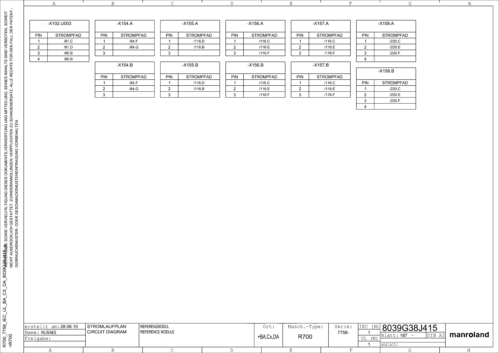

# +BA_Cx_DA — Sheet 187 of 247 — REFERENZMODUL

**REFERENCE MODULE**

> Part of the manroland **R700** printing press IEC/UL circuit diagrams.
> Drawing class: **Stromlaufplan / Circuit diagram** (DIN A3).
> Document `+BA_Cx_DA` covers the **Printing units / main switch cabinet** machine section.

## At a glance

| Field | Value |
|---|---|
| Document | `+BA_Cx_DA`  (8039G38J415) |
| Sheet | **187** of 247 |
| Section (DE) | REFERENZMODUL |
| Section (EN) | REFERENCE MODULE |
| Section type | REFERENCE_MODULE — Reference module |
| Machine type | `R700` |
| Series | `7758` |
| Created | 28.06.10 |
| Replaces | — |
| Columns used | A, B, C, D, E, F, G |
| Path numbers | — |
| Labels on sheet | 99 |
| Cross-refs out | 30 |
| Cross-refs in | 0 |

**Previous:** [+BA_Cx_DA sheet 186](SHEET_0186.md) · **Next:** [+BA_Cx_DA sheet 188](SHEET_0188.md) · **Document TOC:** [_TOC.md](_TOC.md)  (+BA_Cx_DA) · **Master TOC:** [all sheets](../_MASTER_TOC.md)

## Sheet image (300 DPI, exact vector render)



_Rendered directly from the PDF vector layer at 300 DPI (1-bit), no OCR and no resampling. Use it to confirm anything ambiguous in the text below._

## Cross-references on this sheet

Each entry is a wire leaving this sheet. The printed token is `/sheet.column`; the link resolves to that sheet inside the same document.

| Ref | Target sheet | Col | Path | Destination on target | Target section | From col |
|---|---|---|---|---|---|---|
| `/84.F` | [+BA_Cx_DA sheet 84](SHEET_0084.md) | F | — | — | FARBWERK | B |
| `/81.C` | [+BA_Cx_DA sheet 81](SHEET_0081.md) | C | — | — | FARBWERK | A |
| `/116.D` | [+BA_Cx_DA sheet 116](SHEET_0116.md) | D | — | — | PPL 2 | C |
| `/116.C` | [+BA_Cx_DA sheet 116](SHEET_0116.md) | C | — | — | PPL 2 | E |
| `/116.C` | [+BA_Cx_DA sheet 116](SHEET_0116.md) | C | — | — | PPL 2 | F |
| `/220.C` | [+BA_Cx_DA sheet 220](SHEET_0220.md) | C | — | — | OPTION: FORMAT 780x1040 | G |
| `/116.B` | [+BA_Cx_DA sheet 116](SHEET_0116.md) | B | — | — | PPL 2 | C |
| `/116.E` | [+BA_Cx_DA sheet 116](SHEET_0116.md) | E | — | — | PPL 2 | E |
| `/116.E` | [+BA_Cx_DA sheet 116](SHEET_0116.md) | E | — | — | PPL 2 | F |
| `/220.E` | [+BA_Cx_DA sheet 220](SHEET_0220.md) | E | — | — | OPTION: FORMAT 780x1040 | G |
| `/84.G` | [+BA_Cx_DA sheet 84](SHEET_0084.md) | G | — | — | FARBWERK | B |
| `/81.D` | [+BA_Cx_DA sheet 81](SHEET_0081.md) | D | — | — | FARBWERK | A |
| `/80.B` | [+BA_Cx_DA sheet 80](SHEET_0080.md) | B | — | — | FARBWERK | A |
| `/116.F` | [+BA_Cx_DA sheet 116](SHEET_0116.md) | F | — | — | PPL 2 | E |
| `/116.F` | [+BA_Cx_DA sheet 116](SHEET_0116.md) | F | — | — | PPL 2 | F |
| `/220.F` | [+BA_Cx_DA sheet 220](SHEET_0220.md) | F | — | — | OPTION: FORMAT 780x1040 | G |
| `/80.B` | [+BA_Cx_DA sheet 80](SHEET_0080.md) | B | — | — | FARBWERK | A |
| `/84.F` | [+BA_Cx_DA sheet 84](SHEET_0084.md) | F | — | — | FARBWERK | B |
| `/116.D` | [+BA_Cx_DA sheet 116](SHEET_0116.md) | D | — | — | PPL 2 | C |
| `/116.C` | [+BA_Cx_DA sheet 116](SHEET_0116.md) | C | — | — | PPL 2 | E |
| `/116.C` | [+BA_Cx_DA sheet 116](SHEET_0116.md) | C | — | — | PPL 2 | F |
| `/116.B` | [+BA_Cx_DA sheet 116](SHEET_0116.md) | B | — | — | PPL 2 | C |
| `/116.E` | [+BA_Cx_DA sheet 116](SHEET_0116.md) | E | — | — | PPL 2 | E |
| `/116.E` | [+BA_Cx_DA sheet 116](SHEET_0116.md) | E | — | — | PPL 2 | F |
| `/84.G` | [+BA_Cx_DA sheet 84](SHEET_0084.md) | G | — | — | FARBWERK | B |
| `/220.C` | [+BA_Cx_DA sheet 220](SHEET_0220.md) | C | — | — | OPTION: FORMAT 780x1040 | G |
| `/220.E` | [+BA_Cx_DA sheet 220](SHEET_0220.md) | E | — | — | OPTION: FORMAT 780x1040 | G |
| `/116.F` | [+BA_Cx_DA sheet 116](SHEET_0116.md) | F | — | — | PPL 2 | E |
| `/116.F` | [+BA_Cx_DA sheet 116](SHEET_0116.md) | F | — | — | PPL 2 | F |
| `/220.F` | [+BA_Cx_DA sheet 220](SHEET_0220.md) | F | — | — | OPTION: FORMAT 780x1040 | G |

## Devices on this sheet

| Tag | Class | Class meaning (IEC) | Col | Sub | Terminal | Sign |
|---|---|---|---|---|---|---|
| `X154.A` | — | cross-device reference | B | — | — | — |
| `X154.B` | — | cross-device reference | B | — | — | — |
| `X155.A` | — | cross-device reference | C | — | — | — |
| `X155.B` | — | cross-device reference | C | — | — | — |
| `X156.A` | — | cross-device reference | D | — | — | — |
| `X156.B` | — | cross-device reference | D | — | — | — |
| `X157.A` | — | cross-device reference | E | — | — | — |
| `X157.B` | — | cross-device reference | F | — | — | — |
| `X158.A` | — | cross-device reference | G | — | — | — |
| `X158.B` | — | cross-device reference | G | — | — | — |
| `X102.U003` | — | cross-device reference | A | — | — | — |

## Potentials / nets

_No named potentials on this sheet._

## Wire-end annotations (grouped as printed)

A wire that continues elsewhere is annotated with a small cluster: the destination description, the path/line number `#NN`, and the `/sheet.column` cross reference. Each row below is one such cluster exactly as it is grouped on the drawing.

| Col | Y | Path | Cross-ref | Text on the wire |
|---|---|---|---|---|
| A | 51.3 | — | — | `X102.U003` |
| B | 51.3 | — | — | `X154.A` |
| C | 51.3 | — | — | `X155.A` |
| D | 51.3 | — | — | `X156.A` |
| E | 51.3 | — | — | `X157.A` |
| G | 51.3 | — | — | `X158.A` |
| A | 80.0 | — | — | `PIN 2 3 4 1 STROMPFAD` |
| B | 80.0 | — | — | `PIN 2 3 1 STROMPFAD` |
| C | 80.0 | — | — | `PIN 2 3 1 STROMPFAD` |
| D | 80.0 | — | — | `PIN 2 3 1 STROMPFAD` |
| E | 80.0 | — | — | `PIN 2 3 1 STROMPFAD` |
| G | 80.0 | — | — | `PIN 2 3 4 1 STROMPFAD` |
| A | 94.5 | — | `/81.C` | — |
| B | 94.5 | — | `/84.F` | — |
| C | 94.5 | — | `/116.D` | — |
| E | 94.5 | — | `/116.C` | — |
| F | 94.5 | — | `/116.C` | — |
| G | 94.5 | — | `/220.C` | — |
| A | 108.7 | — | `/81.D` | — |
| B | 108.7 | — | `/84.G` | — |
| C | 108.7 | — | `/116.B` | — |
| E | 108.7 | — | `/116.E` | — |
| F | 108.7 | — | `/116.E` | — |
| G | 108.7 | — | `/220.E` | — |
| A | 122.8 | — | `/80.B` | — |
| E | 122.9 | — | `/116.F` | — |
| F | 122.9 | — | `/116.F` | — |
| G | 122.9 | — | `/220.F` | — |
| A | 137.0 | — | `/80.B` | — |
| B | 150.6 | — | — | `X154.B` |
| C | 150.6 | — | — | `X155.B` |
| D | 150.6 | — | — | `X156.B` |
| F | 150.6 | — | — | `X157.B` |
| G | 164.7 | — | — | `X158.B` |
| B | 179.2 | — | — | `PIN 2 3 1 STROMPFAD` |
| C | 179.2 | — | — | `PIN 2 3 1 STROMPFAD` |
| D | 179.2 | — | — | `PIN 2 3 1 STROMPFAD` |
| E | 179.2 | — | — | `PIN 2 3 1 STROMPFAD` |
| G | 193.4 | — | — | `PIN 2 3 4 1 STROMPFAD` |
| B | 193.7 | — | `/84.F` | — |
| C | 193.8 | — | `/116.D` | — |
| E | 193.8 | — | `/116.C` | — |
| F | 193.8 | — | `/116.C` | — |
| B | 207.9 | — | `/84.G` | — |
| C | 207.9 | — | `/116.B` | — |
| E | 207.9 | — | `/116.E` | — |
| F | 207.9 | — | `/116.E` | — |
| G | 207.9 | — | `/220.C` | — |
| E | 222.1 | — | `/116.F` | — |
| F | 222.1 | — | `/116.F` | — |
| G | 222.1 | — | `/220.E` | — |
| G | 236.3 | — | `/220.F` | — |


## Reconstructed tables

This sheet carries tabular content (pin map / terminal assignment / index). The grid below was rebuilt from the drawing's own rule lines, so each row is exactly one physical row of the table.

### Table 1 — 4 data rows × 2 columns (at x=70.9, y=48.2) — **X102.U003**

| PIN | STROMPFAD |
|---|---|
| `1` | `/81.C` |
| `2` | `/81.D` |
| `3` | `/80.B` |
| `4` | `/80.B` |


### Table 2 — 8 data rows × 2 columns (at x=226.8, y=48.2) — **X154.A**

| PIN | STROMPFAD |
|---|---|
| `1` | `/84.F` |
| `2` | `/84.G` |
| `3` |  |
|  | `X154.B` |
| `PIN` | `STROMPFAD` |
| `1` | `/84.F` |
| `2` | `/84.G` |
| `3` |  |


### Table 3 — 8 data rows × 2 columns (at x=382.7, y=48.2) — **X155.A**

| PIN | STROMPFAD |
|---|---|
| `1` | `/116.D` |
| `2` | `/116.B` |
| `3` |  |
|  | `X155.B` |
| `PIN` | `STROMPFAD` |
| `1` | `/116.D` |
| `2` | `/116.B` |
| `3` |  |


### Table 4 — 8 data rows × 2 columns (at x=538.6, y=48.2) — **X156.A**

| PIN | STROMPFAD |
|---|---|
| `1` | `/116.C` |
| `2` | `/116.E` |
| `3` | `/116.F` |
|  | `X156.B` |
| `PIN` | `STROMPFAD` |
| `1` | `/116.C` |
| `2` | `/116.E` |
| `3` | `/116.F` |


### Table 5 — 8 data rows × 2 columns (at x=694.5, y=48.2) — **X157.A**

| PIN | STROMPFAD |
|---|---|
| `1` | `/116.C` |
| `2` | `/116.E` |
| `3` | `/116.F` |
|  | `X157.B` |
| `PIN` | `STROMPFAD` |
| `1` | `/116.C` |
| `2` | `/116.E` |
| `3` | `/116.F` |


### Table 6 — 10 data rows × 2 columns (at x=850.4, y=48.2) — **X158.A**

| PIN | STROMPFAD |
|---|---|
| `1` | `/220.C` |
| `2` | `/220.E` |
| `3` | `/220.F` |
| `4` |  |
|  | `X158.B` |
| `PIN` | `STROMPFAD` |
| `1` | `/220.C` |
| `2` | `/220.E` |
| `3` | `/220.F` |
| `4` |  |


## Notes and free text on this sheet

| Text | Col | Y (pt) |
|---|---|---|
| `PIN` | B | 80.02 |
| `STROMPFAD` | B | 79.98 |
| `PIN` | C | 80.02 |
| `STROMPFAD` | C | 79.98 |
| `PIN` | D | 80.02 |
| `STROMPFAD` | E | 79.98 |
| `PIN` | E | 80.02 |
| `STROMPFAD` | F | 79.98 |
| `PIN` | F | 80.02 |
| `STROMPFAD` | G | 79.98 |
| `PIN` | A | 80.02 |
| `STROMPFAD` | A | 79.98 |

## Complete label inventory (exact text from the drawing)

Every text object inside the drawing area of this sheet, in DIN reading order (column A→H, then top→bottom). This is the authoritative list: if a string is not here it is not printed on this sheet.

| Col | Y | X | Dir | Type | Text |
|---|---|---|---|---|---|
| A | 51.3 | 113.5 | → | device ref | `X102.U003` |
| A | 80.0 | 84.0 | → | text | `PIN` |
| A | 80.0 | 132.2 | → | text | `STROMPFAD` |
| A | 94.2 | 90.0 | → | number | `1` |
| A | 94.5 | 152.6 | → | cross-reference | `/81.C` |
| A | 108.4 | 89.4 | → | number | `2` |
| A | 108.7 | 152.6 | → | cross-reference | `/81.D` |
| A | 122.5 | 89.4 | → | number | `3` |
| A | 122.8 | 152.8 | → | cross-reference | `/80.B` |
| A | 136.7 | 89.4 | → | number | `4` |
| A | 137.0 | 152.8 | → | cross-reference | `/80.B` |
| B | 51.3 | 278.2 | → | device ref | `X154.A` |
| B | 80.0 | 240.0 | → | text | `PIN` |
| B | 80.0 | 288.1 | → | text | `STROMPFAD` |
| B | 94.2 | 245.9 | → | number | `1` |
| B | 94.5 | 309.0 | → | cross-reference | `/84.F` |
| B | 108.4 | 245.3 | → | number | `2` |
| B | 108.7 | 308.4 | → | cross-reference | `/84.G` |
| B | 122.5 | 245.3 | → | number | `3` |
| B | 150.6 | 278.6 | → | device ref | `X154.B` |
| B | 179.2 | 240.0 | → | text | `PIN` |
| B | 179.2 | 288.1 | → | text | `STROMPFAD` |
| B | 193.4 | 245.9 | → | number | `1` |
| B | 193.7 | 309.0 | → | cross-reference | `/84.F` |
| B | 207.6 | 245.3 | → | number | `2` |
| B | 207.9 | 308.4 | → | cross-reference | `/84.G` |
| B | 221.8 | 245.3 | → | number | `3` |
| C | 51.3 | 434.1 | → | device ref | `X155.A` |
| C | 80.0 | 395.9 | → | text | `PIN` |
| C | 80.0 | 444.0 | → | text | `STROMPFAD` |
| C | 94.2 | 401.8 | → | number | `1` |
| C | 94.5 | 462.0 | → | cross-reference | `/116.D` |
| C | 108.4 | 401.2 | → | number | `2` |
| C | 108.7 | 462.2 | → | cross-reference | `/116.B` |
| C | 122.5 | 401.2 | → | number | `3` |
| C | 150.6 | 434.6 | → | device ref | `X155.B` |
| C | 179.2 | 395.9 | → | text | `PIN` |
| C | 179.2 | 444.0 | → | text | `STROMPFAD` |
| C | 193.4 | 401.8 | → | number | `1` |
| C | 193.8 | 462.0 | → | cross-reference | `/116.D` |
| C | 207.6 | 401.2 | → | number | `2` |
| C | 207.9 | 462.2 | → | cross-reference | `/116.B` |
| C | 221.8 | 401.2 | → | number | `3` |
| D | 51.3 | 590.0 | → | device ref | `X156.A` |
| D | 80.0 | 551.8 | → | text | `PIN` |
| D | 94.2 | 557.7 | → | number | `1` |
| D | 108.4 | 557.1 | → | number | `2` |
| D | 122.5 | 557.1 | → | number | `3` |
| D | 150.6 | 590.5 | → | device ref | `X156.B` |
| D | 179.2 | 551.8 | → | text | `PIN` |
| D | 193.4 | 557.7 | → | number | `1` |
| D | 207.6 | 557.1 | → | number | `2` |
| D | 221.8 | 557.1 | → | number | `3` |
| E | 51.3 | 745.9 | → | device ref | `X157.A` |
| E | 80.0 | 600.0 | → | text | `STROMPFAD` |
| E | 80.0 | 707.7 | → | text | `PIN` |
| E | 94.2 | 713.6 | → | number | `1` |
| E | 94.5 | 618.0 | → | cross-reference | `/116.C` |
| E | 108.4 | 713.1 | → | number | `2` |
| E | 108.7 | 618.2 | → | cross-reference | `/116.E` |
| E | 122.5 | 713.1 | → | number | `3` |
| E | 122.9 | 618.4 | → | cross-reference | `/116.F` |
| E | 179.2 | 600.0 | → | text | `STROMPFAD` |
| E | 179.2 | 707.7 | → | text | `PIN` |
| E | 193.4 | 713.6 | → | number | `1` |
| E | 193.8 | 618.0 | → | cross-reference | `/116.C` |
| E | 207.6 | 713.1 | → | number | `2` |
| E | 207.9 | 618.2 | → | cross-reference | `/116.E` |
| E | 221.8 | 713.1 | → | number | `3` |
| E | 222.1 | 618.4 | → | cross-reference | `/116.F` |
| F | 80.0 | 755.9 | → | text | `STROMPFAD` |
| F | 80.0 | 863.6 | → | text | `PIN` |
| F | 94.2 | 869.5 | → | number | `1` |
| F | 94.5 | 773.9 | → | cross-reference | `/116.C` |
| F | 108.4 | 869.0 | → | number | `2` |
| F | 108.7 | 774.1 | → | cross-reference | `/116.E` |
| F | 122.5 | 869.0 | → | number | `3` |
| F | 122.9 | 774.3 | → | cross-reference | `/116.F` |
| F | 136.7 | 869.0 | → | number | `4` |
| F | 150.6 | 746.4 | → | device ref | `X157.B` |
| F | 179.2 | 755.9 | → | text | `STROMPFAD` |
| F | 193.4 | 863.6 | → | text | `PIN` |
| F | 193.8 | 773.9 | → | cross-reference | `/116.C` |
| F | 207.6 | 869.5 | → | number | `1` |
| F | 207.9 | 774.1 | → | cross-reference | `/116.E` |
| F | 221.8 | 869.0 | → | number | `2` |
| F | 222.1 | 774.3 | → | cross-reference | `/116.F` |
| F | 235.9 | 869.0 | → | number | `3` |
| F | 250.1 | 869.0 | → | number | `4` |
| G | 51.3 | 901.8 | → | device ref | `X158.A` |
| G | 80.0 | 911.8 | → | text | `STROMPFAD` |
| G | 94.5 | 929.8 | → | cross-reference | `/220.C` |
| G | 108.7 | 930.0 | → | cross-reference | `/220.E` |
| G | 122.9 | 930.2 | → | cross-reference | `/220.F` |
| G | 164.7 | 902.3 | → | device ref | `X158.B` |
| G | 193.4 | 911.8 | → | text | `STROMPFAD` |
| G | 207.9 | 929.8 | → | cross-reference | `/220.C` |
| G | 222.1 | 930.0 | → | cross-reference | `/220.E` |
| G | 236.3 | 930.2 | → | cross-reference | `/220.F` |

## Reading-order text block

The same content as a plain block, grouped by DIN column — convenient to paste or to match against a visual description.

```text
=== Column A ===
  51.3  113.5  devref       X102.U003
  80.0   84.0  text         PIN
  80.0  132.2  text         STROMPFAD
  94.2   90.0  numeric      1
  94.5  152.6  xref         /81.C
 108.4   89.4  numeric      2
 108.7  152.6  xref         /81.D
 122.5   89.4  numeric      3
 122.8  152.8  xref         /80.B
 136.7   89.4  numeric      4
 137.0  152.8  xref         /80.B
=== Column B ===
  51.3  278.2  devref       X154.A
  80.0  240.0  text         PIN
  80.0  288.1  text         STROMPFAD
  94.2  245.9  numeric      1
  94.5  309.0  xref         /84.F
 108.4  245.3  numeric      2
 108.7  308.4  xref         /84.G
 122.5  245.3  numeric      3
 150.6  278.6  devref       X154.B
 179.2  240.0  text         PIN
 179.2  288.1  text         STROMPFAD
 193.4  245.9  numeric      1
 193.7  309.0  xref         /84.F
 207.6  245.3  numeric      2
 207.9  308.4  xref         /84.G
 221.8  245.3  numeric      3
=== Column C ===
  51.3  434.1  devref       X155.A
  80.0  395.9  text         PIN
  80.0  444.0  text         STROMPFAD
  94.2  401.8  numeric      1
  94.5  462.0  xref         /116.D
 108.4  401.2  numeric      2
 108.7  462.2  xref         /116.B
 122.5  401.2  numeric      3
 150.6  434.6  devref       X155.B
 179.2  395.9  text         PIN
 179.2  444.0  text         STROMPFAD
 193.4  401.8  numeric      1
 193.8  462.0  xref         /116.D
 207.6  401.2  numeric      2
 207.9  462.2  xref         /116.B
 221.8  401.2  numeric      3
=== Column D ===
  51.3  590.0  devref       X156.A
  80.0  551.8  text         PIN
  94.2  557.7  numeric      1
 108.4  557.1  numeric      2
 122.5  557.1  numeric      3
 150.6  590.5  devref       X156.B
 179.2  551.8  text         PIN
 193.4  557.7  numeric      1
 207.6  557.1  numeric      2
 221.8  557.1  numeric      3
=== Column E ===
  51.3  745.9  devref       X157.A
  80.0  600.0  text         STROMPFAD
  80.0  707.7  text         PIN
  94.2  713.6  numeric      1
  94.5  618.0  xref         /116.C
 108.4  713.1  numeric      2
 108.7  618.2  xref         /116.E
 122.5  713.1  numeric      3
 122.9  618.4  xref         /116.F
 179.2  600.0  text         STROMPFAD
 179.2  707.7  text         PIN
 193.4  713.6  numeric      1
 193.8  618.0  xref         /116.C
 207.6  713.1  numeric      2
 207.9  618.2  xref         /116.E
 221.8  713.1  numeric      3
 222.1  618.4  xref         /116.F
=== Column F ===
  80.0  755.9  text         STROMPFAD
  80.0  863.6  text         PIN
  94.2  869.5  numeric      1
  94.5  773.9  xref         /116.C
 108.4  869.0  numeric      2
 108.7  774.1  xref         /116.E
 122.5  869.0  numeric      3
 122.9  774.3  xref         /116.F
 136.7  869.0  numeric      4
 150.6  746.4  devref       X157.B
 179.2  755.9  text         STROMPFAD
 193.4  863.6  text         PIN
 193.8  773.9  xref         /116.C
 207.6  869.5  numeric      1
 207.9  774.1  xref         /116.E
 221.8  869.0  numeric      2
 222.1  774.3  xref         /116.F
 235.9  869.0  numeric      3
 250.1  869.0  numeric      4
=== Column G ===
  51.3  901.8  devref       X158.A
  80.0  911.8  text         STROMPFAD
  94.5  929.8  xref         /220.C
 108.7  930.0  xref         /220.E
 122.9  930.2  xref         /220.F
 164.7  902.3  devref       X158.B
 193.4  911.8  text         STROMPFAD
 207.9  929.8  xref         /220.C
 222.1  930.0  xref         /220.E
 236.3  930.2  xref         /220.F
```

---
_Generated from the PDF vector text layer; no OCR. Source: `R700_7758_IEC_UL_BA_CX_DA_8039G38J415_p`, sheet 187._
