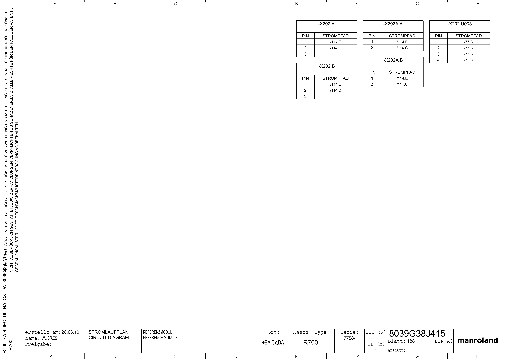

# +BA_Cx_DA — Sheet 188 of 247 — REFERENZMODUL

**REFERENCE MODULE**

> Part of the manroland **R700** printing press IEC/UL circuit diagrams.
> Drawing class: **Stromlaufplan / Circuit diagram** (DIN A3).
> Document `+BA_Cx_DA` covers the **Printing units / main switch cabinet** machine section.

## At a glance

| Field | Value |
|---|---|
| Document | `+BA_Cx_DA`  (8039G38J415) |
| Sheet | **188** of 247 |
| Section (DE) | REFERENZMODUL |
| Section (EN) | REFERENCE MODULE |
| Section type | REFERENCE_MODULE — Reference module |
| Machine type | `R700` |
| Series | `7758` |
| Created | 28.06.10 |
| Replaces | — |
| Columns used | E, F, G, H |
| Path numbers | — |
| Labels on sheet | 41 |
| Cross-refs out | 12 |
| Cross-refs in | 0 |

**Previous:** [+BA_Cx_DA sheet 187](SHEET_0187.md) · **Next:** [+BA_Cx_DA sheet 189](SHEET_0189.md) · **Document TOC:** [_TOC.md](_TOC.md)  (+BA_Cx_DA) · **Master TOC:** [all sheets](../_MASTER_TOC.md)

## Sheet image (300 DPI, exact vector render)



_Rendered directly from the PDF vector layer at 300 DPI (1-bit), no OCR and no resampling. Use it to confirm anything ambiguous in the text below._

## Cross-references on this sheet

Each entry is a wire leaving this sheet. The printed token is `/sheet.column`; the link resolves to that sheet inside the same document.

| Ref | Target sheet | Col | Path | Destination on target | Target section | From col |
|---|---|---|---|---|---|---|
| `/114.E` | [+BA_Cx_DA sheet 114](SHEET_0114.md) | E | — | — | PPL 2 | F |
| `/114.E` | [+BA_Cx_DA sheet 114](SHEET_0114.md) | E | — | — | PPL 2 | G |
| `/76.D` | [+BA_Cx_DA sheet 76](SHEET_0076.md) | D | — | — | FARBWERK | H |
| `/76.D` | [+BA_Cx_DA sheet 76](SHEET_0076.md) | D | — | — | FARBWERK | H |
| `/114.C` | [+BA_Cx_DA sheet 114](SHEET_0114.md) | C | — | — | PPL 2 | F |
| `/114.C` | [+BA_Cx_DA sheet 114](SHEET_0114.md) | C | — | — | PPL 2 | G |
| `/76.D` | [+BA_Cx_DA sheet 76](SHEET_0076.md) | D | — | — | FARBWERK | H |
| `/76.D` | [+BA_Cx_DA sheet 76](SHEET_0076.md) | D | — | — | FARBWERK | H |
| `/114.E` | [+BA_Cx_DA sheet 114](SHEET_0114.md) | E | — | — | PPL 2 | G |
| `/114.E` | [+BA_Cx_DA sheet 114](SHEET_0114.md) | E | — | — | PPL 2 | F |
| `/114.C` | [+BA_Cx_DA sheet 114](SHEET_0114.md) | C | — | — | PPL 2 | G |
| `/114.C` | [+BA_Cx_DA sheet 114](SHEET_0114.md) | C | — | — | PPL 2 | F |

## Devices on this sheet

| Tag | Class | Class meaning (IEC) | Col | Sub | Terminal | Sign |
|---|---|---|---|---|---|---|
| `X202.A` | — | cross-device reference | E | — | — | — |
| `X202.B` | — | cross-device reference | F | — | — | — |
| `X202A.A` | — | cross-device reference | G | — | — | — |
| `X202A.B` | — | cross-device reference | G | — | — | — |
| `X202.U003` | — | cross-device reference | H | — | — | — |

## Potentials / nets

_No named potentials on this sheet._

## Wire-end annotations (grouped as printed)

A wire that continues elsewhere is annotated with a small cluster: the destination description, the path/line number `#NN`, and the `/sheet.column` cross reference. Each row below is one such cluster exactly as it is grouped on the drawing.

| Col | Y | Path | Cross-ref | Text on the wire |
|---|---|---|---|---|
| E | 51.3 | — | — | `X202.A` |
| G | 51.3 | — | — | `X202A.A` |
| H | 51.3 | — | — | `X202.U003` |
| E | 80.0 | — | — | `PIN 2 3 1 STROMPFAD` |
| G | 80.0 | — | — | `PIN 2 1 STROMPFAD` |
| H | 80.0 | — | — | `PIN 2 3 4 1 STROMPFAD` |
| F | 94.5 | — | `/114.E` | — |
| G | 94.5 | — | `/114.E` | — |
| H | 94.5 | — | `/76.D` | — |
| F | 108.7 | — | `/114.C` | — |
| G | 108.7 | — | `/114.C` | — |
| H | 108.7 | — | `/76.D` | — |
| H | 122.9 | — | `/76.D` | — |
| G | 136.4 | — | — | `X202A.B` |
| H | 137.1 | — | `/76.D` | — |
| F | 150.6 | — | — | `X202.B` |
| G | 165.0 | — | — | `PIN 2 1 STROMPFAD` |
| E | 179.2 | — | — | `PIN 2 3 1 STROMPFAD` |
| G | 179.6 | — | `/114.E` | — |
| F | 193.7 | — | `/114.E` | — |
| G | 193.8 | — | `/114.C` | — |
| F | 207.9 | — | `/114.C` | — |


## Reconstructed tables

This sheet carries tabular content (pin map / terminal assignment / index). The grid below was rebuilt from the drawing's own rule lines, so each row is exactly one physical row of the table.

### Table 1 — 8 data rows × 2 columns (at x=694.5, y=48.2) — **X202.A**

| PIN | STROMPFAD |
|---|---|
| `1` | `/114.E` |
| `2` | `/114.C` |
| `3` |  |
|  | `X202.B` |
| `PIN` | `STROMPFAD` |
| `1` | `/114.E` |
| `2` | `/114.C` |
| `3` |  |


### Table 2 — 6 data rows × 2 columns (at x=850.4, y=48.2) — **X202A.A**

| PIN | STROMPFAD |
|---|---|
| `1` | `/114.E` |
| `2` | `/114.C` |
|  | `X202A.B` |
| `PIN` | `STROMPFAD` |
| `1` | `/114.E` |
| `2` | `/114.C` |


### Table 3 — 4 data rows × 2 columns (at x=1006.3, y=48.2) — **X202.U003**

| PIN | STROMPFAD |
|---|---|
| `1` | `/76.D` |
| `2` | `/76.D` |
| `3` | `/76.D` |
| `4` | `/76.D` |


## Notes and free text on this sheet

| Text | Col | Y (pt) |
|---|---|---|
| `PIN` | E | 80.02 |
| `STROMPFAD` | F | 79.98 |
| `PIN` | F | 80.02 |
| `STROMPFAD` | G | 79.98 |
| `PIN` | G | 80.02 |
| `STROMPFAD` | H | 79.98 |

## Complete label inventory (exact text from the drawing)

Every text object inside the drawing area of this sheet, in DIN reading order (column A→H, then top→bottom). This is the authoritative list: if a string is not here it is not printed on this sheet.

| Col | Y | X | Dir | Type | Text |
|---|---|---|---|---|---|
| E | 51.3 | 745.9 | → | device ref | `X202.A` |
| E | 80.0 | 707.7 | → | text | `PIN` |
| E | 94.2 | 713.6 | → | number | `1` |
| E | 108.4 | 713.1 | → | number | `2` |
| E | 122.5 | 713.1 | → | number | `3` |
| E | 179.2 | 707.7 | → | text | `PIN` |
| E | 193.4 | 713.6 | → | number | `1` |
| E | 207.6 | 713.1 | → | number | `2` |
| E | 221.8 | 713.1 | → | number | `3` |
| F | 80.0 | 755.9 | → | text | `STROMPFAD` |
| F | 80.0 | 863.6 | → | text | `PIN` |
| F | 94.2 | 869.5 | → | number | `1` |
| F | 94.5 | 774.1 | → | cross-reference | `/114.E` |
| F | 108.4 | 869.0 | → | number | `2` |
| F | 108.7 | 773.9 | → | cross-reference | `/114.C` |
| F | 150.6 | 746.4 | → | device ref | `X202.B` |
| F | 165.1 | 863.6 | → | text | `PIN` |
| F | 179.2 | 755.9 | → | text | `STROMPFAD` |
| F | 179.2 | 869.5 | → | number | `1` |
| F | 193.4 | 869.0 | → | number | `2` |
| F | 193.7 | 774.1 | → | cross-reference | `/114.E` |
| F | 207.9 | 773.9 | → | cross-reference | `/114.C` |
| G | 51.3 | 898.3 | → | device ref | `X202A.A` |
| G | 80.0 | 911.8 | → | text | `STROMPFAD` |
| G | 80.0 | 1019.5 | → | text | `PIN` |
| G | 94.2 | 1025.4 | → | number | `1` |
| G | 94.5 | 930.0 | → | cross-reference | `/114.E` |
| G | 108.4 | 1024.9 | → | number | `2` |
| G | 108.7 | 929.8 | → | cross-reference | `/114.C` |
| G | 122.5 | 1024.9 | → | number | `3` |
| G | 136.4 | 898.7 | → | device ref | `X202A.B` |
| G | 136.7 | 1024.9 | → | number | `4` |
| G | 165.0 | 911.8 | → | text | `STROMPFAD` |
| G | 179.6 | 930.0 | → | cross-reference | `/114.E` |
| G | 193.8 | 929.8 | → | cross-reference | `/114.C` |
| H | 51.3 | 1049.0 | → | device ref | `X202.U003` |
| H | 80.0 | 1067.7 | → | text | `STROMPFAD` |
| H | 94.5 | 1088.1 | → | cross-reference | `/76.D` |
| H | 108.7 | 1088.1 | → | cross-reference | `/76.D` |
| H | 122.9 | 1088.1 | → | cross-reference | `/76.D` |
| H | 137.1 | 1088.1 | → | cross-reference | `/76.D` |

## Reading-order text block

The same content as a plain block, grouped by DIN column — convenient to paste or to match against a visual description.

```text
=== Column E ===
  51.3  745.9  devref       X202.A
  80.0  707.7  text         PIN
  94.2  713.6  numeric      1
 108.4  713.1  numeric      2
 122.5  713.1  numeric      3
 179.2  707.7  text         PIN
 193.4  713.6  numeric      1
 207.6  713.1  numeric      2
 221.8  713.1  numeric      3
=== Column F ===
  80.0  755.9  text         STROMPFAD
  80.0  863.6  text         PIN
  94.2  869.5  numeric      1
  94.5  774.1  xref         /114.E
 108.4  869.0  numeric      2
 108.7  773.9  xref         /114.C
 150.6  746.4  devref       X202.B
 165.1  863.6  text         PIN
 179.2  755.9  text         STROMPFAD
 179.2  869.5  numeric      1
 193.4  869.0  numeric      2
 193.7  774.1  xref         /114.E
 207.9  773.9  xref         /114.C
=== Column G ===
  51.3  898.3  devref       X202A.A
  80.0  911.8  text         STROMPFAD
  80.0 1019.5  text         PIN
  94.2 1025.4  numeric      1
  94.5  930.0  xref         /114.E
 108.4 1024.9  numeric      2
 108.7  929.8  xref         /114.C
 122.5 1024.9  numeric      3
 136.4  898.7  devref       X202A.B
 136.7 1024.9  numeric      4
 165.0  911.8  text         STROMPFAD
 179.6  930.0  xref         /114.E
 193.8  929.8  xref         /114.C
=== Column H ===
  51.3 1049.0  devref       X202.U003
  80.0 1067.7  text         STROMPFAD
  94.5 1088.1  xref         /76.D
 108.7 1088.1  xref         /76.D
 122.9 1088.1  xref         /76.D
 137.1 1088.1  xref         /76.D
```

---
_Generated from the PDF vector text layer; no OCR. Source: `R700_7758_IEC_UL_BA_CX_DA_8039G38J415_p`, sheet 188._
