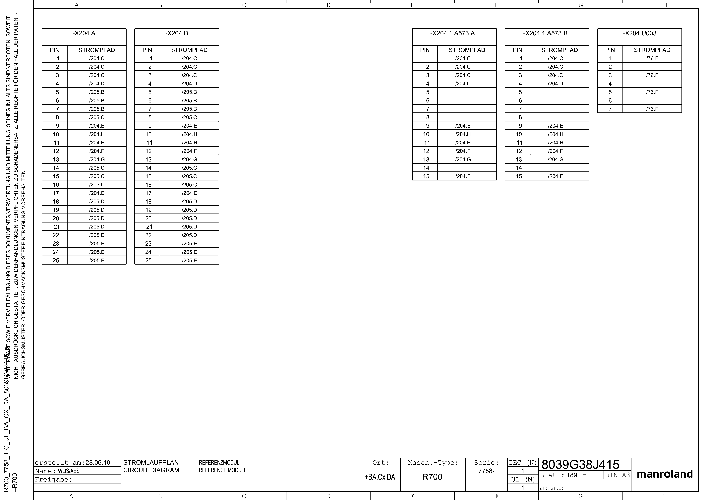

# +BA_Cx_DA — Sheet 189 of 247 — REFERENZMODUL

**REFERENCE MODULE**

> Part of the manroland **R700** printing press IEC/UL circuit diagrams.
> Drawing class: **Stromlaufplan / Circuit diagram** (DIN A3).
> Document `+BA_Cx_DA` covers the **Printing units / main switch cabinet** machine section.

## At a glance

| Field | Value |
|---|---|
| Document | `+BA_Cx_DA`  (8039G38J415) |
| Sheet | **189** of 247 |
| Section (DE) | REFERENZMODUL |
| Section (EN) | REFERENCE MODULE |
| Section type | REFERENCE_MODULE — Reference module |
| Machine type | `R700` |
| Series | `7758` |
| Created | 28.06.10 |
| Replaces | — |
| Columns used | A, B, E, F, G, H |
| Path numbers | — |
| Labels on sheet | 176 |
| Cross-refs out | 74 |
| Cross-refs in | 0 |

**Previous:** [+BA_Cx_DA sheet 188](SHEET_0188.md) · **Next:** [+BA_Cx_DA sheet 190](SHEET_0190.md) · **Document TOC:** [_TOC.md](_TOC.md)  (+BA_Cx_DA) · **Master TOC:** [all sheets](../_MASTER_TOC.md)

## Sheet image (300 DPI, exact vector render)



_Rendered directly from the PDF vector layer at 300 DPI (1-bit), no OCR and no resampling. Use it to confirm anything ambiguous in the text below._

## Cross-references on this sheet

Each entry is a wire leaving this sheet. The printed token is `/sheet.column`; the link resolves to that sheet inside the same document.

| Ref | Target sheet | Col | Path | Destination on target | Target section | From col |
|---|---|---|---|---|---|---|
| `/76.F` | [+BA_Cx_DA sheet 76](SHEET_0076.md) | F | — | — | FARBWERK | H |
| `/204.C` | [+BA_Cx_DA sheet 204](SHEET_0204.md) | C | — | — | OPTION: AUTOMATISCHE FARBZUFÜHRUNG | A |
| `/204.C` | [+BA_Cx_DA sheet 204](SHEET_0204.md) | C | — | — | OPTION: AUTOMATISCHE FARBZUFÜHRUNG | B |
| `/204.C` | [+BA_Cx_DA sheet 204](SHEET_0204.md) | C | — | — | OPTION: AUTOMATISCHE FARBZUFÜHRUNG | F |
| `/204.C` | [+BA_Cx_DA sheet 204](SHEET_0204.md) | C | — | — | OPTION: AUTOMATISCHE FARBZUFÜHRUNG | G |
| `/204.C` | [+BA_Cx_DA sheet 204](SHEET_0204.md) | C | — | — | OPTION: AUTOMATISCHE FARBZUFÜHRUNG | A |
| `/204.C` | [+BA_Cx_DA sheet 204](SHEET_0204.md) | C | — | — | OPTION: AUTOMATISCHE FARBZUFÜHRUNG | B |
| `/204.C` | [+BA_Cx_DA sheet 204](SHEET_0204.md) | C | — | — | OPTION: AUTOMATISCHE FARBZUFÜHRUNG | F |
| `/204.C` | [+BA_Cx_DA sheet 204](SHEET_0204.md) | C | — | — | OPTION: AUTOMATISCHE FARBZUFÜHRUNG | G |
| `/76.F` | [+BA_Cx_DA sheet 76](SHEET_0076.md) | F | — | — | FARBWERK | H |
| `/204.C` | [+BA_Cx_DA sheet 204](SHEET_0204.md) | C | — | — | OPTION: AUTOMATISCHE FARBZUFÜHRUNG | A |
| `/204.C` | [+BA_Cx_DA sheet 204](SHEET_0204.md) | C | — | — | OPTION: AUTOMATISCHE FARBZUFÜHRUNG | B |
| `/204.C` | [+BA_Cx_DA sheet 204](SHEET_0204.md) | C | — | — | OPTION: AUTOMATISCHE FARBZUFÜHRUNG | F |
| `/204.C` | [+BA_Cx_DA sheet 204](SHEET_0204.md) | C | — | — | OPTION: AUTOMATISCHE FARBZUFÜHRUNG | G |
| `/204.D` | [+BA_Cx_DA sheet 204](SHEET_0204.md) | D | — | — | OPTION: AUTOMATISCHE FARBZUFÜHRUNG | A |
| `/204.D` | [+BA_Cx_DA sheet 204](SHEET_0204.md) | D | — | — | OPTION: AUTOMATISCHE FARBZUFÜHRUNG | B |
| `/204.D` | [+BA_Cx_DA sheet 204](SHEET_0204.md) | D | — | — | OPTION: AUTOMATISCHE FARBZUFÜHRUNG | F |
| `/204.D` | [+BA_Cx_DA sheet 204](SHEET_0204.md) | D | — | — | OPTION: AUTOMATISCHE FARBZUFÜHRUNG | G |
| `/205.B` | [+BA_Cx_DA sheet 205](SHEET_0205.md) | B | — | — | OPTION: AUTOMATISCHE FARBZUFÜHRUNG | A |
| `/205.B` | [+BA_Cx_DA sheet 205](SHEET_0205.md) | B | — | — | OPTION: AUTOMATISCHE FARBZUFÜHRUNG | B |
| `/76.F` | [+BA_Cx_DA sheet 76](SHEET_0076.md) | F | — | — | FARBWERK | H |
| `/205.B` | [+BA_Cx_DA sheet 205](SHEET_0205.md) | B | — | — | OPTION: AUTOMATISCHE FARBZUFÜHRUNG | A |
| `/205.B` | [+BA_Cx_DA sheet 205](SHEET_0205.md) | B | — | — | OPTION: AUTOMATISCHE FARBZUFÜHRUNG | B |
| `/205.B` | [+BA_Cx_DA sheet 205](SHEET_0205.md) | B | — | — | OPTION: AUTOMATISCHE FARBZUFÜHRUNG | A |
| `/205.B` | [+BA_Cx_DA sheet 205](SHEET_0205.md) | B | — | — | OPTION: AUTOMATISCHE FARBZUFÜHRUNG | B |
| `/76.F` | [+BA_Cx_DA sheet 76](SHEET_0076.md) | F | — | — | FARBWERK | H |
| `/205.C` | [+BA_Cx_DA sheet 205](SHEET_0205.md) | C | — | — | OPTION: AUTOMATISCHE FARBZUFÜHRUNG | A |
| `/205.C` | [+BA_Cx_DA sheet 205](SHEET_0205.md) | C | — | — | OPTION: AUTOMATISCHE FARBZUFÜHRUNG | B |
| `/204.E` | [+BA_Cx_DA sheet 204](SHEET_0204.md) | E | — | — | OPTION: AUTOMATISCHE FARBZUFÜHRUNG | A |
| `/204.E` | [+BA_Cx_DA sheet 204](SHEET_0204.md) | E | — | — | OPTION: AUTOMATISCHE FARBZUFÜHRUNG | B |
| `/204.E` | [+BA_Cx_DA sheet 204](SHEET_0204.md) | E | — | — | OPTION: AUTOMATISCHE FARBZUFÜHRUNG | F |
| `/204.E` | [+BA_Cx_DA sheet 204](SHEET_0204.md) | E | — | — | OPTION: AUTOMATISCHE FARBZUFÜHRUNG | G |
| `/204.H` | [+BA_Cx_DA sheet 204](SHEET_0204.md) | H | — | — | OPTION: AUTOMATISCHE FARBZUFÜHRUNG | A |
| `/204.H` | [+BA_Cx_DA sheet 204](SHEET_0204.md) | H | — | — | OPTION: AUTOMATISCHE FARBZUFÜHRUNG | B |
| `/204.H` | [+BA_Cx_DA sheet 204](SHEET_0204.md) | H | — | — | OPTION: AUTOMATISCHE FARBZUFÜHRUNG | F |
| `/204.H` | [+BA_Cx_DA sheet 204](SHEET_0204.md) | H | — | — | OPTION: AUTOMATISCHE FARBZUFÜHRUNG | G |
| `/204.H` | [+BA_Cx_DA sheet 204](SHEET_0204.md) | H | — | — | OPTION: AUTOMATISCHE FARBZUFÜHRUNG | A |
| `/204.H` | [+BA_Cx_DA sheet 204](SHEET_0204.md) | H | — | — | OPTION: AUTOMATISCHE FARBZUFÜHRUNG | B |
| `/204.H` | [+BA_Cx_DA sheet 204](SHEET_0204.md) | H | — | — | OPTION: AUTOMATISCHE FARBZUFÜHRUNG | F |
| `/204.H` | [+BA_Cx_DA sheet 204](SHEET_0204.md) | H | — | — | OPTION: AUTOMATISCHE FARBZUFÜHRUNG | G |
| `/204.F` | [+BA_Cx_DA sheet 204](SHEET_0204.md) | F | — | — | OPTION: AUTOMATISCHE FARBZUFÜHRUNG | A |
| `/204.F` | [+BA_Cx_DA sheet 204](SHEET_0204.md) | F | — | — | OPTION: AUTOMATISCHE FARBZUFÜHRUNG | B |
| `/204.F` | [+BA_Cx_DA sheet 204](SHEET_0204.md) | F | — | — | OPTION: AUTOMATISCHE FARBZUFÜHRUNG | F |
| `/204.F` | [+BA_Cx_DA sheet 204](SHEET_0204.md) | F | — | — | OPTION: AUTOMATISCHE FARBZUFÜHRUNG | G |
| `/204.G` | [+BA_Cx_DA sheet 204](SHEET_0204.md) | G | — | — | OPTION: AUTOMATISCHE FARBZUFÜHRUNG | A |
| `/204.G` | [+BA_Cx_DA sheet 204](SHEET_0204.md) | G | — | — | OPTION: AUTOMATISCHE FARBZUFÜHRUNG | B |
| `/204.G` | [+BA_Cx_DA sheet 204](SHEET_0204.md) | G | — | — | OPTION: AUTOMATISCHE FARBZUFÜHRUNG | F |
| `/204.G` | [+BA_Cx_DA sheet 204](SHEET_0204.md) | G | — | — | OPTION: AUTOMATISCHE FARBZUFÜHRUNG | G |
| `/205.C` | [+BA_Cx_DA sheet 205](SHEET_0205.md) | C | — | — | OPTION: AUTOMATISCHE FARBZUFÜHRUNG | A |
| `/205.C` | [+BA_Cx_DA sheet 205](SHEET_0205.md) | C | — | — | OPTION: AUTOMATISCHE FARBZUFÜHRUNG | B |
| `/204.E` | [+BA_Cx_DA sheet 204](SHEET_0204.md) | E | — | — | OPTION: AUTOMATISCHE FARBZUFÜHRUNG | F |
| `/204.E` | [+BA_Cx_DA sheet 204](SHEET_0204.md) | E | — | — | OPTION: AUTOMATISCHE FARBZUFÜHRUNG | G |
| `/205.C` | [+BA_Cx_DA sheet 205](SHEET_0205.md) | C | — | — | OPTION: AUTOMATISCHE FARBZUFÜHRUNG | A |
| `/205.C` | [+BA_Cx_DA sheet 205](SHEET_0205.md) | C | — | — | OPTION: AUTOMATISCHE FARBZUFÜHRUNG | B |
| `/205.C` | [+BA_Cx_DA sheet 205](SHEET_0205.md) | C | — | — | OPTION: AUTOMATISCHE FARBZUFÜHRUNG | A |
| `/205.C` | [+BA_Cx_DA sheet 205](SHEET_0205.md) | C | — | — | OPTION: AUTOMATISCHE FARBZUFÜHRUNG | B |
| `/204.E` | [+BA_Cx_DA sheet 204](SHEET_0204.md) | E | — | — | OPTION: AUTOMATISCHE FARBZUFÜHRUNG | A |
| `/204.E` | [+BA_Cx_DA sheet 204](SHEET_0204.md) | E | — | — | OPTION: AUTOMATISCHE FARBZUFÜHRUNG | B |
| `/205.D` | [+BA_Cx_DA sheet 205](SHEET_0205.md) | D | — | — | OPTION: AUTOMATISCHE FARBZUFÜHRUNG | A |
| `/205.D` | [+BA_Cx_DA sheet 205](SHEET_0205.md) | D | — | — | OPTION: AUTOMATISCHE FARBZUFÜHRUNG | B |
| `/205.D` | [+BA_Cx_DA sheet 205](SHEET_0205.md) | D | — | — | OPTION: AUTOMATISCHE FARBZUFÜHRUNG | A |
| `/205.D` | [+BA_Cx_DA sheet 205](SHEET_0205.md) | D | — | — | OPTION: AUTOMATISCHE FARBZUFÜHRUNG | B |
| `/205.D` | [+BA_Cx_DA sheet 205](SHEET_0205.md) | D | — | — | OPTION: AUTOMATISCHE FARBZUFÜHRUNG | A |
| `/205.D` | [+BA_Cx_DA sheet 205](SHEET_0205.md) | D | — | — | OPTION: AUTOMATISCHE FARBZUFÜHRUNG | B |
| `/205.D` | [+BA_Cx_DA sheet 205](SHEET_0205.md) | D | — | — | OPTION: AUTOMATISCHE FARBZUFÜHRUNG | A |
| `/205.D` | [+BA_Cx_DA sheet 205](SHEET_0205.md) | D | — | — | OPTION: AUTOMATISCHE FARBZUFÜHRUNG | B |
| `/205.D` | [+BA_Cx_DA sheet 205](SHEET_0205.md) | D | — | — | OPTION: AUTOMATISCHE FARBZUFÜHRUNG | A |
| `/205.D` | [+BA_Cx_DA sheet 205](SHEET_0205.md) | D | — | — | OPTION: AUTOMATISCHE FARBZUFÜHRUNG | B |
| `/205.E` | [+BA_Cx_DA sheet 205](SHEET_0205.md) | E | — | — | OPTION: AUTOMATISCHE FARBZUFÜHRUNG | A |
| `/205.E` | [+BA_Cx_DA sheet 205](SHEET_0205.md) | E | — | — | OPTION: AUTOMATISCHE FARBZUFÜHRUNG | B |
| `/205.E` | [+BA_Cx_DA sheet 205](SHEET_0205.md) | E | — | — | OPTION: AUTOMATISCHE FARBZUFÜHRUNG | A |
| `/205.E` | [+BA_Cx_DA sheet 205](SHEET_0205.md) | E | — | — | OPTION: AUTOMATISCHE FARBZUFÜHRUNG | B |
| `/205.E` | [+BA_Cx_DA sheet 205](SHEET_0205.md) | E | — | — | OPTION: AUTOMATISCHE FARBZUFÜHRUNG | A |
| `/205.E` | [+BA_Cx_DA sheet 205](SHEET_0205.md) | E | — | — | OPTION: AUTOMATISCHE FARBZUFÜHRUNG | B |

## Devices on this sheet

| Tag | Class | Class meaning (IEC) | Col | Sub | Terminal | Sign |
|---|---|---|---|---|---|---|
| `X204.A` | — | cross-device reference | A | — | — | — |
| `X204.B` | — | cross-device reference | B | — | — | — |
| `X204.1.A573.A` | — | cross-device reference | E | — | — | — |
| `X204.1.A573.B` | — | cross-device reference | G | — | — | — |
| `X204.U003` | — | cross-device reference | H | — | — | — |

## Potentials / nets

_No named potentials on this sheet._

## Wire-end annotations (grouped as printed)

A wire that continues elsewhere is annotated with a small cluster: the destination description, the path/line number `#NN`, and the `/sheet.column` cross reference. Each row below is one such cluster exactly as it is grouped on the drawing.

| Col | Y | Path | Cross-ref | Text on the wire |
|---|---|---|---|---|
| A | 51.3 | — | — | `X204.A` |
| B | 51.3 | — | — | `X204.B` |
| E | 51.3 | — | — | `X204.1.A573.A` |
| G | 51.3 | — | — | `X204.1.A573.B` |
| H | 51.3 | — | — | `X204.U003` |
| A | 80.0 | — | — | `PIN STROMPFAD` |
| B | 80.0 | — | — | `PIN STROMPFAD` |
| E | 80.0 | — | — | `PIN 10 12 13 14 15 11 2 3 4 5 6 7 8 9 1 STROMPFAD` |
| G | 80.0 | — | — | `PIN 10 12 13 14 15 11 2 3 4 5 6 7 8 9 1 STROMPFAD` |
| H | 80.0 | — | — | `PIN 2 3 4 5 6 7 1 STROMPFAD` |
| A | 94.2 | — | — | `2 3 4 5 6 7 8 9 1` |
| B | 94.2 | — | — | `2 3 4 5 6 7 8 9 1` |
| A | 94.5 | — | `/204.C` | — |
| B | 94.5 | — | `/204.C` | — |
| F | 94.5 | — | `/204.C` | — |
| G | 94.5 | — | `/204.C` | — |
| H | 94.5 | — | `/76.F` | — |
| A | 108.7 | — | `/204.C` | — |
| B | 108.7 | — | `/204.C` | — |
| F | 108.7 | — | `/204.C` | — |
| G | 108.7 | — | `/204.C` | — |
| A | 122.9 | — | `/204.C` | — |
| B | 122.9 | — | `/204.C` | — |
| F | 122.9 | — | `/204.C` | — |
| G | 122.9 | — | `/204.C` | — |
| H | 122.9 | — | `/76.F` | — |
| A | 137.1 | — | `/204.D` | — |
| B | 137.1 | — | `/204.D` | — |
| F | 137.1 | — | `/204.D` | — |
| G | 137.1 | — | `/204.D` | — |
| A | 151.2 | — | `/205.B` | — |
| B | 151.2 | — | `/205.B` | — |
| H | 151.2 | — | `/76.F` | — |
| A | 165.4 | — | `/205.B` | — |
| B | 165.4 | — | `/205.B` | — |
| A | 179.6 | — | `/205.B` | — |
| B | 179.6 | — | `/205.B` | — |
| H | 179.6 | — | `/76.F` | — |
| A | 193.8 | — | `/205.C` | — |
| B | 193.8 | — | `/205.C` | — |
| A | 207.9 | — | `/204.E` | — |
| B | 207.9 | — | `/204.E` | — |
| F | 207.9 | — | `/204.E` | — |
| G | 207.9 | — | `/204.E` | — |
| A | 221.8 | — | — | `10 12 13 14 15 16 17 18 19 20 11` |
| B | 221.8 | — | — | `10 12 13 14 15 16 17 18 19 20 11` |
| A | 222.1 | — | `/204.H` | — |
| B | 222.1 | — | `/204.H` | — |
| F | 222.1 | — | `/204.H` | — |
| G | 222.1 | — | `/204.H` | — |
| A | 236.3 | — | `/204.H` | — |
| B | 236.3 | — | `/204.H` | — |
| F | 236.3 | — | `/204.H` | — |
| G | 236.3 | — | `/204.H` | — |
| A | 250.4 | — | `/204.F` | — |
| B | 250.4 | — | `/204.F` | — |
| F | 250.4 | — | `/204.F` | — |
| G | 250.4 | — | `/204.F` | — |
| A | 264.6 | — | `/204.G` | — |
| B | 264.6 | — | `/204.G` | — |
| F | 264.6 | — | `/204.G` | — |
| G | 264.6 | — | `/204.G` | — |
| A | 278.8 | — | `/205.C` | — |
| B | 278.8 | — | `/205.C` | — |
| F | 292.9 | — | `/204.E` | — |
| G | 292.9 | — | `/204.E` | — |
| A | 293.0 | — | `/205.C` | — |
| B | 293.0 | — | `/205.C` | — |
| A | 307.1 | — | `/205.C` | — |
| B | 307.1 | — | `/205.C` | — |
| A | 321.3 | — | `/204.E` | — |
| B | 321.3 | — | `/204.E` | — |
| A | 335.5 | — | `/205.D` | — |
| B | 335.5 | — | `/205.D` | — |
| A | 349.7 | — | `/205.D` | — |
| B | 349.7 | — | `/205.D` | — |
| A | 363.8 | — | `/205.D` | — |
| B | 363.8 | — | `/205.D` | — |
| A | 377.7 | — | — | `22 23 24 25 21` |
| B | 377.7 | — | — | `22 23 24 25 21` |
| A | 378.0 | — | `/205.D` | — |
| B | 378.0 | — | `/205.D` | — |
| A | 392.2 | — | `/205.D` | — |
| B | 392.2 | — | `/205.D` | — |
| A | 406.3 | — | `/205.E` | — |
| B | 406.3 | — | `/205.E` | — |
| A | 420.5 | — | `/205.E` | — |
| B | 420.5 | — | `/205.E` | — |
| A | 434.7 | — | `/205.E` | — |
| B | 434.7 | — | `/205.E` | — |


## Reconstructed tables

This sheet carries tabular content (pin map / terminal assignment / index). The grid below was rebuilt from the drawing's own rule lines, so each row is exactly one physical row of the table.

### Table 1 — 25 data rows × 2 columns (at x=70.9, y=48.2) — **X204.A**

| PIN | STROMPFAD |
|---|---|
| `1` | `/204.C` |
| `2` | `/204.C` |
| `3` | `/204.C` |
| `4` | `/204.D` |
| `5` | `/205.B` |
| `6` | `/205.B` |
| `7` | `/205.B` |
| `8` | `/205.C` |
| `9` | `/204.E` |
| `10` | `/204.H` |
| `11` | `/204.H` |
| `12` | `/204.F` |
| `13` | `/204.G` |
| `14` | `/205.C` |
| `15` | `/205.C` |
| `16` | `/205.C` |
| `17` | `/204.E` |
| `18` | `/205.D` |
| `19` | `/205.D` |
| `20` | `/205.D` |
| `21` | `/205.D` |
| `22` | `/205.D` |
| `23` | `/205.E` |
| `24` | `/205.E` |
| `25` | `/205.E` |


### Table 2 — 25 data rows × 2 columns (at x=226.8, y=48.2) — **X204.B**

| PIN | STROMPFAD |
|---|---|
| `1` | `/204.C` |
| `2` | `/204.C` |
| `3` | `/204.C` |
| `4` | `/204.D` |
| `5` | `/205.B` |
| `6` | `/205.B` |
| `7` | `/205.B` |
| `8` | `/205.C` |
| `9` | `/204.E` |
| `10` | `/204.H` |
| `11` | `/204.H` |
| `12` | `/204.F` |
| `13` | `/204.G` |
| `14` | `/205.C` |
| `15` | `/205.C` |
| `16` | `/205.C` |
| `17` | `/204.E` |
| `18` | `/205.D` |
| `19` | `/205.D` |
| `20` | `/205.D` |
| `21` | `/205.D` |
| `22` | `/205.D` |
| `23` | `/205.E` |
| `24` | `/205.E` |
| `25` | `/205.E` |


### Table 3 — 15 data rows × 2 columns (at x=694.5, y=48.2) — **X204.1.A573.A**

| PIN | STROMPFAD |
|---|---|
| `1` | `/204.C` |
| `2` | `/204.C` |
| `3` | `/204.C` |
| `4` | `/204.D` |
| `5` |  |
| `6` |  |
| `7` |  |
| `8` |  |
| `9` | `/204.E` |
| `10` | `/204.H` |
| `11` | `/204.H` |
| `12` | `/204.F` |
| `13` | `/204.G` |
| `14` |  |
| `15` | `/204.E` |


### Table 4 — 15 data rows × 2 columns (at x=850.4, y=48.2) — **X204.1.A573.B**

| PIN | STROMPFAD |
|---|---|
| `1` | `/204.C` |
| `2` | `/204.C` |
| `3` | `/204.C` |
| `4` | `/204.D` |
| `5` |  |
| `6` |  |
| `7` |  |
| `8` |  |
| `9` | `/204.E` |
| `10` | `/204.H` |
| `11` | `/204.H` |
| `12` | `/204.F` |
| `13` | `/204.G` |
| `14` |  |
| `15` | `/204.E` |


### Table 5 — 7 data rows × 2 columns (at x=1006.3, y=48.2) — **X204.U003**

| PIN | STROMPFAD |
|---|---|
| `1` | `/76.F` |
| `2` |  |
| `3` | `/76.F` |
| `4` |  |
| `5` | `/76.F` |
| `6` |  |
| `7` | `/76.F` |


## Notes and free text on this sheet

| Text | Col | Y (pt) |
|---|---|---|
| `PIN` | A | 80.02 |
| `STROMPFAD` | A | 79.98 |
| `PIN` | B | 80.02 |
| `STROMPFAD` | B | 79.98 |
| `PIN` | E | 80.02 |
| `STROMPFAD` | F | 79.98 |
| `PIN` | F | 80.02 |
| `STROMPFAD` | G | 79.98 |
| `PIN` | G | 80.02 |
| `STROMPFAD` | H | 79.98 |

## Complete label inventory (exact text from the drawing)

Every text object inside the drawing area of this sheet, in DIN reading order (column A→H, then top→bottom). This is the authoritative list: if a string is not here it is not printed on this sheet.

| Col | Y | X | Dir | Type | Text |
|---|---|---|---|---|---|
| A | 51.3 | 122.3 | → | device ref | `X204.A` |
| A | 80.0 | 84.0 | → | text | `PIN` |
| A | 80.0 | 132.2 | → | text | `STROMPFAD` |
| A | 94.2 | 95.8 | → | number | `1` |
| A | 94.5 | 150.2 | → | cross-reference | `/204.C` |
| A | 108.4 | 94.1 | → | number | `2` |
| A | 108.7 | 150.2 | → | cross-reference | `/204.C` |
| A | 122.5 | 94.1 | → | number | `3` |
| A | 122.9 | 150.2 | → | cross-reference | `/204.C` |
| A | 136.7 | 94.1 | → | number | `4` |
| A | 137.1 | 150.2 | → | cross-reference | `/204.D` |
| A | 150.9 | 94.1 | → | number | `5` |
| A | 151.2 | 150.4 | → | cross-reference | `/205.B` |
| A | 165.1 | 94.1 | → | number | `6` |
| A | 165.4 | 150.4 | → | cross-reference | `/205.B` |
| A | 179.2 | 94.1 | → | number | `7` |
| A | 179.6 | 150.4 | → | cross-reference | `/205.B` |
| A | 193.4 | 94.1 | → | number | `8` |
| A | 193.8 | 150.2 | → | cross-reference | `/205.C` |
| A | 207.6 | 94.1 | → | number | `9` |
| A | 207.9 | 150.5 | → | cross-reference | `/204.E` |
| A | 221.8 | 88.7 | → | number | `10` |
| A | 222.1 | 150.5 | → | cross-reference | `/204.H` |
| A | 235.9 | 90.4 | → | number | `11` |
| A | 236.3 | 150.5 | → | cross-reference | `/204.H` |
| A | 250.1 | 88.7 | → | number | `12` |
| A | 250.4 | 150.7 | → | cross-reference | `/204.F` |
| A | 264.3 | 88.7 | → | number | `13` |
| A | 264.6 | 150.1 | → | cross-reference | `/204.G` |
| A | 278.5 | 88.7 | → | number | `14` |
| A | 278.8 | 150.2 | → | cross-reference | `/205.C` |
| A | 292.6 | 88.7 | → | number | `15` |
| A | 293.0 | 150.2 | → | cross-reference | `/205.C` |
| A | 306.8 | 88.7 | → | number | `16` |
| A | 307.1 | 150.2 | → | cross-reference | `/205.C` |
| A | 321.0 | 88.7 | → | number | `17` |
| A | 321.3 | 150.5 | → | cross-reference | `/204.E` |
| A | 335.1 | 88.7 | → | number | `18` |
| A | 335.5 | 150.2 | → | cross-reference | `/205.D` |
| A | 349.3 | 88.7 | → | number | `19` |
| A | 349.7 | 150.2 | → | cross-reference | `/205.D` |
| A | 363.5 | 88.7 | → | number | `20` |
| A | 363.8 | 150.2 | → | cross-reference | `/205.D` |
| A | 377.7 | 90.4 | → | number | `21` |
| A | 378.0 | 150.2 | → | cross-reference | `/205.D` |
| A | 391.8 | 88.7 | → | number | `22` |
| A | 392.2 | 150.2 | → | cross-reference | `/205.D` |
| A | 406.0 | 88.7 | → | number | `23` |
| A | 406.3 | 150.5 | → | cross-reference | `/205.E` |
| A | 420.2 | 88.7 | → | number | `24` |
| A | 420.5 | 150.5 | → | cross-reference | `/205.E` |
| A | 434.4 | 88.7 | → | number | `25` |
| A | 434.7 | 150.5 | → | cross-reference | `/205.E` |
| B | 51.3 | 278.6 | → | device ref | `X204.B` |
| B | 80.0 | 240.0 | → | text | `PIN` |
| B | 80.0 | 288.1 | → | text | `STROMPFAD` |
| B | 94.2 | 251.7 | → | number | `1` |
| B | 94.5 | 306.1 | → | cross-reference | `/204.C` |
| B | 108.4 | 250.0 | → | number | `2` |
| B | 108.7 | 306.1 | → | cross-reference | `/204.C` |
| B | 122.5 | 250.0 | → | number | `3` |
| B | 122.9 | 306.1 | → | cross-reference | `/204.C` |
| B | 136.7 | 250.0 | → | number | `4` |
| B | 137.1 | 306.1 | → | cross-reference | `/204.D` |
| B | 150.9 | 250.0 | → | number | `5` |
| B | 151.2 | 306.3 | → | cross-reference | `/205.B` |
| B | 165.1 | 250.0 | → | number | `6` |
| B | 165.4 | 306.3 | → | cross-reference | `/205.B` |
| B | 179.2 | 250.0 | → | number | `7` |
| B | 179.6 | 306.3 | → | cross-reference | `/205.B` |
| B | 193.4 | 250.0 | → | number | `8` |
| B | 193.8 | 306.1 | → | cross-reference | `/205.C` |
| B | 207.6 | 250.0 | → | number | `9` |
| B | 207.9 | 306.4 | → | cross-reference | `/204.E` |
| B | 221.8 | 244.6 | → | number | `10` |
| B | 222.1 | 306.4 | → | cross-reference | `/204.H` |
| B | 235.9 | 246.3 | → | number | `11` |
| B | 236.3 | 306.4 | → | cross-reference | `/204.H` |
| B | 250.1 | 244.6 | → | number | `12` |
| B | 250.4 | 306.6 | → | cross-reference | `/204.F` |
| B | 264.3 | 244.6 | → | number | `13` |
| B | 264.6 | 306.0 | → | cross-reference | `/204.G` |
| B | 278.5 | 244.6 | → | number | `14` |
| B | 278.8 | 306.1 | → | cross-reference | `/205.C` |
| B | 292.6 | 244.6 | → | number | `15` |
| B | 293.0 | 306.1 | → | cross-reference | `/205.C` |
| B | 306.8 | 244.6 | → | number | `16` |
| B | 307.1 | 306.1 | → | cross-reference | `/205.C` |
| B | 321.0 | 244.6 | → | number | `17` |
| B | 321.3 | 306.4 | → | cross-reference | `/204.E` |
| B | 335.1 | 244.6 | → | number | `18` |
| B | 335.5 | 306.1 | → | cross-reference | `/205.D` |
| B | 349.3 | 244.6 | → | number | `19` |
| B | 349.7 | 306.1 | → | cross-reference | `/205.D` |
| B | 363.5 | 244.6 | → | number | `20` |
| B | 363.8 | 306.1 | → | cross-reference | `/205.D` |
| B | 377.7 | 246.3 | → | number | `21` |
| B | 378.0 | 306.1 | → | cross-reference | `/205.D` |
| B | 391.8 | 244.6 | → | number | `22` |
| B | 392.2 | 306.1 | → | cross-reference | `/205.D` |
| B | 406.0 | 244.6 | → | number | `23` |
| B | 406.3 | 306.4 | → | cross-reference | `/205.E` |
| B | 420.2 | 244.6 | → | number | `24` |
| B | 420.5 | 306.4 | → | cross-reference | `/205.E` |
| B | 434.4 | 244.6 | → | number | `25` |
| B | 434.7 | 306.4 | → | cross-reference | `/205.E` |
| E | 51.3 | 724.8 | → | device ref | `X204.1.A573.A` |
| E | 80.0 | 707.7 | → | text | `PIN` |
| E | 94.2 | 719.4 | → | number | `1` |
| E | 108.4 | 717.7 | → | number | `2` |
| E | 122.5 | 717.7 | → | number | `3` |
| E | 136.7 | 717.7 | → | number | `4` |
| E | 150.9 | 717.7 | → | number | `5` |
| E | 165.1 | 717.7 | → | number | `6` |
| E | 179.2 | 717.7 | → | number | `7` |
| E | 193.4 | 717.7 | → | number | `8` |
| E | 207.6 | 717.7 | → | number | `9` |
| E | 221.8 | 712.3 | → | number | `10` |
| E | 235.9 | 714.0 | → | number | `11` |
| E | 250.1 | 712.3 | → | number | `12` |
| E | 264.3 | 712.3 | → | number | `13` |
| E | 278.5 | 712.3 | → | number | `14` |
| E | 292.6 | 712.3 | → | number | `15` |
| F | 80.0 | 755.9 | → | text | `STROMPFAD` |
| F | 80.0 | 863.6 | → | text | `PIN` |
| F | 94.2 | 875.3 | → | number | `1` |
| F | 94.5 | 766.8 | → | cross-reference | `/204.C` |
| F | 108.4 | 873.6 | → | number | `2` |
| F | 108.7 | 766.8 | → | cross-reference | `/204.C` |
| F | 122.5 | 873.6 | → | number | `3` |
| F | 122.9 | 766.8 | → | cross-reference | `/204.C` |
| F | 136.7 | 873.6 | → | number | `4` |
| F | 137.1 | 766.8 | → | cross-reference | `/204.D` |
| F | 150.9 | 873.6 | → | number | `5` |
| F | 165.1 | 873.6 | → | number | `6` |
| F | 179.2 | 873.6 | → | number | `7` |
| F | 193.4 | 873.6 | → | number | `8` |
| F | 207.6 | 873.6 | → | number | `9` |
| F | 207.9 | 767.1 | → | cross-reference | `/204.E` |
| F | 221.8 | 868.3 | → | number | `10` |
| F | 222.1 | 767.1 | → | cross-reference | `/204.H` |
| F | 235.9 | 870.0 | → | number | `11` |
| F | 236.3 | 767.1 | → | cross-reference | `/204.H` |
| F | 250.1 | 868.3 | → | number | `12` |
| F | 250.4 | 767.2 | → | cross-reference | `/204.F` |
| F | 264.3 | 868.3 | → | number | `13` |
| F | 264.6 | 766.6 | → | cross-reference | `/204.G` |
| F | 278.5 | 868.3 | → | number | `14` |
| F | 292.6 | 868.3 | → | number | `15` |
| F | 292.9 | 767.1 | → | cross-reference | `/204.E` |
| G | 51.3 | 881.1 | → | device ref | `X204.1.A573.B` |
| G | 80.0 | 911.8 | → | text | `STROMPFAD` |
| G | 80.0 | 1019.5 | → | text | `PIN` |
| G | 94.2 | 1025.4 | → | number | `1` |
| G | 94.5 | 922.7 | → | cross-reference | `/204.C` |
| G | 108.4 | 1024.9 | → | number | `2` |
| G | 108.7 | 922.7 | → | cross-reference | `/204.C` |
| G | 122.5 | 1024.9 | → | number | `3` |
| G | 122.9 | 922.7 | → | cross-reference | `/204.C` |
| G | 136.7 | 1024.9 | → | number | `4` |
| G | 137.1 | 922.7 | → | cross-reference | `/204.D` |
| G | 150.9 | 1024.9 | → | number | `5` |
| G | 165.1 | 1024.9 | → | number | `6` |
| G | 179.2 | 1024.9 | → | number | `7` |
| G | 207.9 | 923.0 | → | cross-reference | `/204.E` |
| G | 222.1 | 923.0 | → | cross-reference | `/204.H` |
| G | 236.3 | 923.0 | → | cross-reference | `/204.H` |
| G | 250.4 | 923.1 | → | cross-reference | `/204.F` |
| G | 264.6 | 922.5 | → | cross-reference | `/204.G` |
| G | 292.9 | 923.0 | → | cross-reference | `/204.E` |
| H | 51.3 | 1049.0 | → | device ref | `X204.U003` |
| H | 80.0 | 1067.7 | → | text | `STROMPFAD` |
| H | 94.5 | 1088.5 | → | cross-reference | `/76.F` |
| H | 122.9 | 1088.5 | → | cross-reference | `/76.F` |
| H | 151.2 | 1088.5 | → | cross-reference | `/76.F` |
| H | 179.6 | 1088.5 | → | cross-reference | `/76.F` |

## Reading-order text block

The same content as a plain block, grouped by DIN column — convenient to paste or to match against a visual description.

```text
=== Column A ===
  51.3  122.3  devref       X204.A
  80.0   84.0  text         PIN
  80.0  132.2  text         STROMPFAD
  94.2   95.8  numeric      1
  94.5  150.2  xref         /204.C
 108.4   94.1  numeric      2
 108.7  150.2  xref         /204.C
 122.5   94.1  numeric      3
 122.9  150.2  xref         /204.C
 136.7   94.1  numeric      4
 137.1  150.2  xref         /204.D
 150.9   94.1  numeric      5
 151.2  150.4  xref         /205.B
 165.1   94.1  numeric      6
 165.4  150.4  xref         /205.B
 179.2   94.1  numeric      7
 179.6  150.4  xref         /205.B
 193.4   94.1  numeric      8
 193.8  150.2  xref         /205.C
 207.6   94.1  numeric      9
 207.9  150.5  xref         /204.E
 221.8   88.7  numeric      10
 222.1  150.5  xref         /204.H
 235.9   90.4  numeric      11
 236.3  150.5  xref         /204.H
 250.1   88.7  numeric      12
 250.4  150.7  xref         /204.F
 264.3   88.7  numeric      13
 264.6  150.1  xref         /204.G
 278.5   88.7  numeric      14
 278.8  150.2  xref         /205.C
 292.6   88.7  numeric      15
 293.0  150.2  xref         /205.C
 306.8   88.7  numeric      16
 307.1  150.2  xref         /205.C
 321.0   88.7  numeric      17
 321.3  150.5  xref         /204.E
 335.1   88.7  numeric      18
 335.5  150.2  xref         /205.D
 349.3   88.7  numeric      19
 349.7  150.2  xref         /205.D
 363.5   88.7  numeric      20
 363.8  150.2  xref         /205.D
 377.7   90.4  numeric      21
 378.0  150.2  xref         /205.D
 391.8   88.7  numeric      22
 392.2  150.2  xref         /205.D
 406.0   88.7  numeric      23
 406.3  150.5  xref         /205.E
 420.2   88.7  numeric      24
 420.5  150.5  xref         /205.E
 434.4   88.7  numeric      25
 434.7  150.5  xref         /205.E
=== Column B ===
  51.3  278.6  devref       X204.B
  80.0  240.0  text         PIN
  80.0  288.1  text         STROMPFAD
  94.2  251.7  numeric      1
  94.5  306.1  xref         /204.C
 108.4  250.0  numeric      2
 108.7  306.1  xref         /204.C
 122.5  250.0  numeric      3
 122.9  306.1  xref         /204.C
 136.7  250.0  numeric      4
 137.1  306.1  xref         /204.D
 150.9  250.0  numeric      5
 151.2  306.3  xref         /205.B
 165.1  250.0  numeric      6
 165.4  306.3  xref         /205.B
 179.2  250.0  numeric      7
 179.6  306.3  xref         /205.B
 193.4  250.0  numeric      8
 193.8  306.1  xref         /205.C
 207.6  250.0  numeric      9
 207.9  306.4  xref         /204.E
 221.8  244.6  numeric      10
 222.1  306.4  xref         /204.H
 235.9  246.3  numeric      11
 236.3  306.4  xref         /204.H
 250.1  244.6  numeric      12
 250.4  306.6  xref         /204.F
 264.3  244.6  numeric      13
 264.6  306.0  xref         /204.G
 278.5  244.6  numeric      14
 278.8  306.1  xref         /205.C
 292.6  244.6  numeric      15
 293.0  306.1  xref         /205.C
 306.8  244.6  numeric      16
 307.1  306.1  xref         /205.C
 321.0  244.6  numeric      17
 321.3  306.4  xref         /204.E
 335.1  244.6  numeric      18
 335.5  306.1  xref         /205.D
 349.3  244.6  numeric      19
 349.7  306.1  xref         /205.D
 363.5  244.6  numeric      20
 363.8  306.1  xref         /205.D
 377.7  246.3  numeric      21
 378.0  306.1  xref         /205.D
 391.8  244.6  numeric      22
 392.2  306.1  xref         /205.D
 406.0  244.6  numeric      23
 406.3  306.4  xref         /205.E
 420.2  244.6  numeric      24
 420.5  306.4  xref         /205.E
 434.4  244.6  numeric      25
 434.7  306.4  xref         /205.E
=== Column E ===
  51.3  724.8  devref       X204.1.A573.A
  80.0  707.7  text         PIN
  94.2  719.4  numeric      1
 108.4  717.7  numeric      2
 122.5  717.7  numeric      3
 136.7  717.7  numeric      4
 150.9  717.7  numeric      5
 165.1  717.7  numeric      6
 179.2  717.7  numeric      7
 193.4  717.7  numeric      8
 207.6  717.7  numeric      9
 221.8  712.3  numeric      10
 235.9  714.0  numeric      11
 250.1  712.3  numeric      12
 264.3  712.3  numeric      13
 278.5  712.3  numeric      14
 292.6  712.3  numeric      15
=== Column F ===
  80.0  755.9  text         STROMPFAD
  80.0  863.6  text         PIN
  94.2  875.3  numeric      1
  94.5  766.8  xref         /204.C
 108.4  873.6  numeric      2
 108.7  766.8  xref         /204.C
 122.5  873.6  numeric      3
 122.9  766.8  xref         /204.C
 136.7  873.6  numeric      4
 137.1  766.8  xref         /204.D
 150.9  873.6  numeric      5
 165.1  873.6  numeric      6
 179.2  873.6  numeric      7
 193.4  873.6  numeric      8
 207.6  873.6  numeric      9
 207.9  767.1  xref         /204.E
 221.8  868.3  numeric      10
 222.1  767.1  xref         /204.H
 235.9  870.0  numeric      11
 236.3  767.1  xref         /204.H
 250.1  868.3  numeric      12
 250.4  767.2  xref         /204.F
 264.3  868.3  numeric      13
 264.6  766.6  xref         /204.G
 278.5  868.3  numeric      14
 292.6  868.3  numeric      15
 292.9  767.1  xref         /204.E
=== Column G ===
  51.3  881.1  devref       X204.1.A573.B
  80.0  911.8  text         STROMPFAD
  80.0 1019.5  text         PIN
  94.2 1025.4  numeric      1
  94.5  922.7  xref         /204.C
 108.4 1024.9  numeric      2
 108.7  922.7  xref         /204.C
 122.5 1024.9  numeric      3
 122.9  922.7  xref         /204.C
 136.7 1024.9  numeric      4
 137.1  922.7  xref         /204.D
 150.9 1024.9  numeric      5
 165.1 1024.9  numeric      6
 179.2 1024.9  numeric      7
 207.9  923.0  xref         /204.E
 222.1  923.0  xref         /204.H
 236.3  923.0  xref         /204.H
 250.4  923.1  xref         /204.F
 264.6  922.5  xref         /204.G
 292.9  923.0  xref         /204.E
=== Column H ===
  51.3 1049.0  devref       X204.U003
  80.0 1067.7  text         STROMPFAD
  94.5 1088.5  xref         /76.F
 122.9 1088.5  xref         /76.F
 151.2 1088.5  xref         /76.F
 179.6 1088.5  xref         /76.F
```

---
_Generated from the PDF vector text layer; no OCR. Source: `R700_7758_IEC_UL_BA_CX_DA_8039G38J415_p`, sheet 189._
