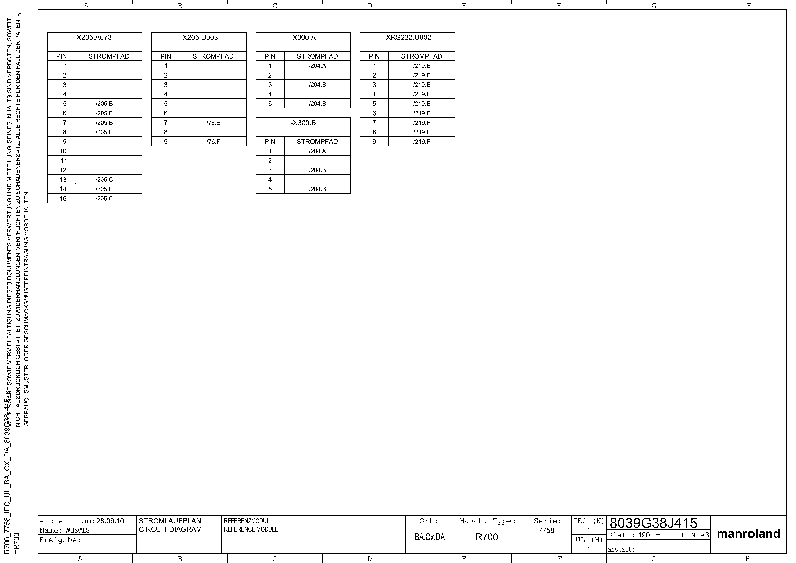

# +BA_Cx_DA — Sheet 190 of 247 — REFERENZMODUL

**REFERENCE MODULE**

> Part of the manroland **R700** printing press IEC/UL circuit diagrams.
> Drawing class: **Stromlaufplan / Circuit diagram** (DIN A3).
> Document `+BA_Cx_DA` covers the **Printing units / main switch cabinet** machine section.

## At a glance

| Field | Value |
|---|---|
| Document | `+BA_Cx_DA`  (8039G38J415) |
| Sheet | **190** of 247 |
| Section (DE) | REFERENZMODUL |
| Section (EN) | REFERENCE MODULE |
| Section type | REFERENCE_MODULE — Reference module |
| Machine type | `R700` |
| Series | `7758` |
| Created | 28.06.10 |
| Replaces | — |
| Columns used | A, B, C, D, E |
| Path numbers | — |
| Labels on sheet | 82 |
| Cross-refs out | 24 |
| Cross-refs in | 0 |

**Previous:** [+BA_Cx_DA sheet 189](SHEET_0189.md) · **Next:** [+BA_Cx_DA sheet 191](SHEET_0191.md) · **Document TOC:** [_TOC.md](_TOC.md)  (+BA_Cx_DA) · **Master TOC:** [all sheets](../_MASTER_TOC.md)

## Sheet image (300 DPI, exact vector render)



_Rendered directly from the PDF vector layer at 300 DPI (1-bit), no OCR and no resampling. Use it to confirm anything ambiguous in the text below._

## Cross-references on this sheet

Each entry is a wire leaving this sheet. The printed token is `/sheet.column`; the link resolves to that sheet inside the same document.

| Ref | Target sheet | Col | Path | Destination on target | Target section | From col |
|---|---|---|---|---|---|---|
| `/204.A` | [+BA_Cx_DA sheet 204](SHEET_0204.md) | A | — | — | OPTION: AUTOMATISCHE FARBZUFÜHRUNG | C |
| `/219.E` | [+BA_Cx_DA sheet 219](SHEET_0219.md) | E | — | — | OPTION: TELEPRESENCE | E |
| `/219.E` | [+BA_Cx_DA sheet 219](SHEET_0219.md) | E | — | — | OPTION: TELEPRESENCE | E |
| `/204.B` | [+BA_Cx_DA sheet 204](SHEET_0204.md) | B | — | — | OPTION: AUTOMATISCHE FARBZUFÜHRUNG | C |
| `/219.E` | [+BA_Cx_DA sheet 219](SHEET_0219.md) | E | — | — | OPTION: TELEPRESENCE | E |
| `/219.E` | [+BA_Cx_DA sheet 219](SHEET_0219.md) | E | — | — | OPTION: TELEPRESENCE | E |
| `/205.B` | [+BA_Cx_DA sheet 205](SHEET_0205.md) | B | — | — | OPTION: AUTOMATISCHE FARBZUFÜHRUNG | A |
| `/204.B` | [+BA_Cx_DA sheet 204](SHEET_0204.md) | B | — | — | OPTION: AUTOMATISCHE FARBZUFÜHRUNG | C |
| `/219.E` | [+BA_Cx_DA sheet 219](SHEET_0219.md) | E | — | — | OPTION: TELEPRESENCE | E |
| `/205.B` | [+BA_Cx_DA sheet 205](SHEET_0205.md) | B | — | — | OPTION: AUTOMATISCHE FARBZUFÜHRUNG | A |
| `/219.F` | [+BA_Cx_DA sheet 219](SHEET_0219.md) | F | — | — | OPTION: TELEPRESENCE | E |
| `/76.E` | [+BA_Cx_DA sheet 76](SHEET_0076.md) | E | — | — | FARBWERK | B |
| `/205.B` | [+BA_Cx_DA sheet 205](SHEET_0205.md) | B | — | — | OPTION: AUTOMATISCHE FARBZUFÜHRUNG | A |
| `/219.F` | [+BA_Cx_DA sheet 219](SHEET_0219.md) | F | — | — | OPTION: TELEPRESENCE | E |
| `/219.F` | [+BA_Cx_DA sheet 219](SHEET_0219.md) | F | — | — | OPTION: TELEPRESENCE | E |
| `/205.C` | [+BA_Cx_DA sheet 205](SHEET_0205.md) | C | — | — | OPTION: AUTOMATISCHE FARBZUFÜHRUNG | A |
| `/76.F` | [+BA_Cx_DA sheet 76](SHEET_0076.md) | F | — | — | FARBWERK | B |
| `/219.F` | [+BA_Cx_DA sheet 219](SHEET_0219.md) | F | — | — | OPTION: TELEPRESENCE | E |
| `/204.A` | [+BA_Cx_DA sheet 204](SHEET_0204.md) | A | — | — | OPTION: AUTOMATISCHE FARBZUFÜHRUNG | C |
| `/204.B` | [+BA_Cx_DA sheet 204](SHEET_0204.md) | B | — | — | OPTION: AUTOMATISCHE FARBZUFÜHRUNG | C |
| `/205.C` | [+BA_Cx_DA sheet 205](SHEET_0205.md) | C | — | — | OPTION: AUTOMATISCHE FARBZUFÜHRUNG | A |
| `/204.B` | [+BA_Cx_DA sheet 204](SHEET_0204.md) | B | — | — | OPTION: AUTOMATISCHE FARBZUFÜHRUNG | C |
| `/205.C` | [+BA_Cx_DA sheet 205](SHEET_0205.md) | C | — | — | OPTION: AUTOMATISCHE FARBZUFÜHRUNG | A |
| `/205.C` | [+BA_Cx_DA sheet 205](SHEET_0205.md) | C | — | — | OPTION: AUTOMATISCHE FARBZUFÜHRUNG | A |

## Devices on this sheet

| Tag | Class | Class meaning (IEC) | Col | Sub | Terminal | Sign |
|---|---|---|---|---|---|---|
| `X205.A573` | — | cross-device reference | A | — | — | — |
| `X300.A` | — | cross-device reference | C | — | — | — |
| `X300.B` | — | cross-device reference | C | — | — | — |
| `XRS232.U002` | — | cross-device reference | D | — | — | — |
| `X205.U003` | — | cross-device reference | B | — | — | — |

## Potentials / nets

_No named potentials on this sheet._

## Wire-end annotations (grouped as printed)

A wire that continues elsewhere is annotated with a small cluster: the destination description, the path/line number `#NN`, and the `/sheet.column` cross reference. Each row below is one such cluster exactly as it is grouped on the drawing.

| Col | Y | Path | Cross-ref | Text on the wire |
|---|---|---|---|---|
| A | 51.3 | — | — | `X205.A573` |
| B | 51.3 | — | — | `X205.U003` |
| C | 51.3 | — | — | `X300.A` |
| D | 51.3 | — | — | `XRS232.U002` |
| A | 80.0 | — | — | `PIN 10 12 13 14 15 11 2 3 4 5 6 7 8 9 1 STROMPFAD` |
| B | 80.0 | — | — | `PIN 2 3 4 5 6 7 8 9 1 STROMPFAD` |
| C | 80.0 | — | — | `PIN 2 3 4 5 1 STROMPFAD` |
| D | 80.0 | — | — | `PIN 2 3 4 5 6 7 8 9 1 STROMPFAD` |
| C | 94.5 | — | `/204.A` | — |
| E | 94.5 | — | `/219.E` | — |
| E | 108.7 | — | `/219.E` | — |
| C | 122.9 | — | `/204.B` | — |
| E | 122.9 | — | `/219.E` | — |
| E | 137.0 | — | `/219.E` | — |
| A | 151.2 | — | `/205.B` | — |
| C | 151.2 | — | `/204.B` | — |
| E | 151.2 | — | `/219.E` | — |
| A | 165.4 | — | `/205.B` | — |
| E | 165.4 | — | `/219.F` | — |
| C | 178.9 | — | — | `X300.B` |
| B | 179.5 | — | `/76.E` | — |
| A | 179.6 | — | `/205.B` | — |
| E | 179.6 | — | `/219.F` | — |
| E | 193.7 | — | `/219.F` | — |
| A | 193.8 | — | `/205.C` | — |
| C | 207.5 | — | — | `PIN 2 3 4 5 1 STROMPFAD` |
| B | 207.9 | — | `/76.F` | — |
| E | 207.9 | — | `/219.F` | — |
| C | 222.1 | — | `/204.A` | — |
| C | 250.4 | — | `/204.B` | — |
| A | 264.6 | — | `/205.C` | — |
| A | 278.8 | — | `/205.C` | — |
| C | 278.8 | — | `/204.B` | — |
| A | 293.0 | — | `/205.C` | — |


## Reconstructed tables

This sheet carries tabular content (pin map / terminal assignment / index). The grid below was rebuilt from the drawing's own rule lines, so each row is exactly one physical row of the table.

### Table 1 — 15 data rows × 2 columns (at x=70.9, y=48.2) — **X205.A573**

| PIN | STROMPFAD |
|---|---|
| `1` |  |
| `2` |  |
| `3` |  |
| `4` |  |
| `5` | `/205.B` |
| `6` | `/205.B` |
| `7` | `/205.B` |
| `8` | `/205.C` |
| `9` |  |
| `10` |  |
| `11` |  |
| `12` |  |
| `13` | `/205.C` |
| `14` | `/205.C` |
| `15` | `/205.C` |


### Table 2 — 9 data rows × 2 columns (at x=226.8, y=48.2) — **X205.U003**

| PIN | STROMPFAD |
|---|---|
| `1` |  |
| `2` |  |
| `3` |  |
| `4` |  |
| `5` |  |
| `6` |  |
| `7` | `/76.E` |
| `8` |  |
| `9` | `/76.F` |


### Table 3 — 12 data rows × 2 columns (at x=382.7, y=48.2) — **X300.A**

| PIN | STROMPFAD |
|---|---|
| `1` | `/204.A` |
| `2` |  |
| `3` | `/204.B` |
| `4` |  |
| `5` | `/204.B` |
|  | `X300.B` |
| `PIN` | `STROMPFAD` |
| `1` | `/204.A` |
| `2` |  |
| `3` | `/204.B` |
| `4` |  |
| `5` | `/204.B` |


### Table 4 — 9 data rows × 2 columns (at x=538.6, y=48.2) — **XRS232.U002**

| PIN | STROMPFAD |
|---|---|
| `1` | `/219.E` |
| `2` | `/219.E` |
| `3` | `/219.E` |
| `4` | `/219.E` |
| `5` | `/219.E` |
| `6` | `/219.F` |
| `7` | `/219.F` |
| `8` | `/219.F` |
| `9` | `/219.F` |


## Notes and free text on this sheet

| Text | Col | Y (pt) |
|---|---|---|
| `PIN` | A | 80.02 |
| `STROMPFAD` | A | 79.98 |
| `PIN` | C | 80.02 |
| `STROMPFAD` | C | 79.98 |
| `PIN` | D | 80.02 |
| `STROMPFAD` | E | 79.98 |
| `PIN` | B | 80.02 |
| `STROMPFAD` | B | 79.98 |

## Complete label inventory (exact text from the drawing)

Every text object inside the drawing area of this sheet, in DIN reading order (column A→H, then top→bottom). This is the authoritative list: if a string is not here it is not printed on this sheet.

| Col | Y | X | Dir | Type | Text |
|---|---|---|---|---|---|
| A | 51.3 | 111.0 | → | device ref | `X205.A573` |
| A | 80.0 | 84.0 | → | text | `PIN` |
| A | 80.0 | 132.2 | → | text | `STROMPFAD` |
| A | 94.2 | 95.8 | → | number | `1` |
| A | 108.4 | 94.1 | → | number | `2` |
| A | 122.5 | 94.1 | → | number | `3` |
| A | 136.7 | 94.1 | → | number | `4` |
| A | 150.9 | 94.1 | → | number | `5` |
| A | 151.2 | 143.3 | → | cross-reference | `/205.B` |
| A | 165.1 | 94.1 | → | number | `6` |
| A | 165.4 | 143.3 | → | cross-reference | `/205.B` |
| A | 179.2 | 94.1 | → | number | `7` |
| A | 179.6 | 143.3 | → | cross-reference | `/205.B` |
| A | 193.4 | 94.1 | → | number | `8` |
| A | 193.8 | 143.1 | → | cross-reference | `/205.C` |
| A | 207.6 | 94.1 | → | number | `9` |
| A | 221.8 | 88.7 | → | number | `10` |
| A | 235.9 | 90.4 | → | number | `11` |
| A | 250.1 | 88.7 | → | number | `12` |
| A | 264.3 | 88.7 | → | number | `13` |
| A | 264.6 | 143.1 | → | cross-reference | `/205.C` |
| A | 278.5 | 88.7 | → | number | `14` |
| A | 278.8 | 143.1 | → | cross-reference | `/205.C` |
| A | 292.6 | 88.7 | → | number | `15` |
| A | 293.0 | 143.1 | → | cross-reference | `/205.C` |
| B | 51.3 | 269.4 | → | device ref | `X205.U003` |
| B | 80.0 | 240.0 | → | text | `PIN` |
| B | 80.0 | 288.1 | → | text | `STROMPFAD` |
| B | 94.2 | 245.9 | → | number | `1` |
| B | 108.4 | 245.3 | → | number | `2` |
| B | 122.5 | 245.3 | → | number | `3` |
| B | 136.7 | 245.3 | → | number | `4` |
| B | 150.9 | 245.3 | → | number | `5` |
| B | 165.1 | 245.3 | → | number | `6` |
| B | 179.2 | 245.3 | → | number | `7` |
| B | 179.5 | 308.8 | → | cross-reference | `/76.E` |
| B | 193.4 | 245.3 | → | number | `8` |
| B | 207.6 | 245.3 | → | number | `9` |
| B | 207.9 | 309.0 | → | cross-reference | `/76.F` |
| C | 51.3 | 434.1 | → | device ref | `X300.A` |
| C | 80.0 | 395.9 | → | text | `PIN` |
| C | 80.0 | 444.0 | → | text | `STROMPFAD` |
| C | 94.2 | 401.8 | → | number | `1` |
| C | 94.5 | 462.0 | → | cross-reference | `/204.A` |
| C | 108.4 | 401.2 | → | number | `2` |
| C | 122.5 | 401.2 | → | number | `3` |
| C | 122.9 | 462.2 | → | cross-reference | `/204.B` |
| C | 136.7 | 401.2 | → | number | `4` |
| C | 150.9 | 401.2 | → | number | `5` |
| C | 151.2 | 462.2 | → | cross-reference | `/204.B` |
| C | 178.9 | 434.6 | → | device ref | `X300.B` |
| C | 207.5 | 444.0 | → | text | `STROMPFAD` |
| C | 207.6 | 395.9 | → | text | `PIN` |
| C | 221.8 | 401.8 | → | number | `1` |
| C | 222.1 | 462.0 | → | cross-reference | `/204.A` |
| C | 235.9 | 401.2 | → | number | `2` |
| C | 250.1 | 401.2 | → | number | `3` |
| C | 250.4 | 462.2 | → | cross-reference | `/204.B` |
| C | 264.3 | 401.2 | → | number | `4` |
| C | 278.5 | 401.2 | → | number | `5` |
| C | 278.8 | 462.2 | → | cross-reference | `/204.B` |
| D | 51.3 | 573.9 | → | device ref | `XRS232.U002` |
| D | 80.0 | 551.8 | → | text | `PIN` |
| D | 94.2 | 557.7 | → | number | `1` |
| D | 108.4 | 557.1 | → | number | `2` |
| D | 122.5 | 557.1 | → | number | `3` |
| D | 136.7 | 557.1 | → | number | `4` |
| D | 150.9 | 557.1 | → | number | `5` |
| D | 165.1 | 557.1 | → | number | `6` |
| D | 179.2 | 557.1 | → | number | `7` |
| D | 193.4 | 557.1 | → | number | `8` |
| D | 207.6 | 557.1 | → | number | `9` |
| E | 80.0 | 600.0 | → | text | `STROMPFAD` |
| E | 94.5 | 618.2 | → | cross-reference | `/219.E` |
| E | 108.7 | 618.2 | → | cross-reference | `/219.E` |
| E | 122.9 | 618.2 | → | cross-reference | `/219.E` |
| E | 137.0 | 618.2 | → | cross-reference | `/219.E` |
| E | 151.2 | 618.2 | → | cross-reference | `/219.E` |
| E | 165.4 | 618.4 | → | cross-reference | `/219.F` |
| E | 179.6 | 618.4 | → | cross-reference | `/219.F` |
| E | 193.7 | 618.4 | → | cross-reference | `/219.F` |
| E | 207.9 | 618.4 | → | cross-reference | `/219.F` |

## Reading-order text block

The same content as a plain block, grouped by DIN column — convenient to paste or to match against a visual description.

```text
=== Column A ===
  51.3  111.0  devref       X205.A573
  80.0   84.0  text         PIN
  80.0  132.2  text         STROMPFAD
  94.2   95.8  numeric      1
 108.4   94.1  numeric      2
 122.5   94.1  numeric      3
 136.7   94.1  numeric      4
 150.9   94.1  numeric      5
 151.2  143.3  xref         /205.B
 165.1   94.1  numeric      6
 165.4  143.3  xref         /205.B
 179.2   94.1  numeric      7
 179.6  143.3  xref         /205.B
 193.4   94.1  numeric      8
 193.8  143.1  xref         /205.C
 207.6   94.1  numeric      9
 221.8   88.7  numeric      10
 235.9   90.4  numeric      11
 250.1   88.7  numeric      12
 264.3   88.7  numeric      13
 264.6  143.1  xref         /205.C
 278.5   88.7  numeric      14
 278.8  143.1  xref         /205.C
 292.6   88.7  numeric      15
 293.0  143.1  xref         /205.C
=== Column B ===
  51.3  269.4  devref       X205.U003
  80.0  240.0  text         PIN
  80.0  288.1  text         STROMPFAD
  94.2  245.9  numeric      1
 108.4  245.3  numeric      2
 122.5  245.3  numeric      3
 136.7  245.3  numeric      4
 150.9  245.3  numeric      5
 165.1  245.3  numeric      6
 179.2  245.3  numeric      7
 179.5  308.8  xref         /76.E
 193.4  245.3  numeric      8
 207.6  245.3  numeric      9
 207.9  309.0  xref         /76.F
=== Column C ===
  51.3  434.1  devref       X300.A
  80.0  395.9  text         PIN
  80.0  444.0  text         STROMPFAD
  94.2  401.8  numeric      1
  94.5  462.0  xref         /204.A
 108.4  401.2  numeric      2
 122.5  401.2  numeric      3
 122.9  462.2  xref         /204.B
 136.7  401.2  numeric      4
 150.9  401.2  numeric      5
 151.2  462.2  xref         /204.B
 178.9  434.6  devref       X300.B
 207.5  444.0  text         STROMPFAD
 207.6  395.9  text         PIN
 221.8  401.8  numeric      1
 222.1  462.0  xref         /204.A
 235.9  401.2  numeric      2
 250.1  401.2  numeric      3
 250.4  462.2  xref         /204.B
 264.3  401.2  numeric      4
 278.5  401.2  numeric      5
 278.8  462.2  xref         /204.B
=== Column D ===
  51.3  573.9  devref       XRS232.U002
  80.0  551.8  text         PIN
  94.2  557.7  numeric      1
 108.4  557.1  numeric      2
 122.5  557.1  numeric      3
 136.7  557.1  numeric      4
 150.9  557.1  numeric      5
 165.1  557.1  numeric      6
 179.2  557.1  numeric      7
 193.4  557.1  numeric      8
 207.6  557.1  numeric      9
=== Column E ===
  80.0  600.0  text         STROMPFAD
  94.5  618.2  xref         /219.E
 108.7  618.2  xref         /219.E
 122.9  618.2  xref         /219.E
 137.0  618.2  xref         /219.E
 151.2  618.2  xref         /219.E
 165.4  618.4  xref         /219.F
 179.6  618.4  xref         /219.F
 193.7  618.4  xref         /219.F
 207.9  618.4  xref         /219.F
```

---
_Generated from the PDF vector text layer; no OCR. Source: `R700_7758_IEC_UL_BA_CX_DA_8039G38J415_p`, sheet 190._
